# \*-PLUIE: Personalisable metric with Llm Used for Improved Evaluation

Quentin Lemesle Affiliation: Univ Rennes, CNRS, IRISA, EXPRESSION, 22300
Lannion, France    Léane Jourdan Affiliation: Nantes Université, École
Centrale Nantes, CNRS, LS2N, UMR 6004, F-44000 Nantes, France    Daisy
Munson Affiliation: Univ Rennes, CNRS, IRISA, SOTERN, 22300 Lannion,
France    Pierre Alain Affiliation: Univ Rennes, CNRS, IRISA, SOTERN,
22300 Lannion, France    Jonathan Chevelu Affiliation: Univ Rennes,
CNRS, IRISA, EXPRESSION, 22300 Lannion, France    Arnaud Delhay
Affiliation: Univ Rennes, CNRS, IRISA, EXPRESSION, 22300 Lannion, France
   Damien Lolive Affiliation: Univ of South Brittany, CNRS, IRISA,
ARCHIMEDIA, 56000 Vannes, France
Correspondence:[quentin.lemesle@irisa.fr](mailto:quentin.lemesle@irisa.fr)

###### Abstract

Evaluating the quality of automatically generated text often relies on
LLM-as-a-judge methods. While effective, these approaches are
computationally expensive and require post-processing. To address these
limitations, we build upon ParaPLUIE, a perplexity-based LLM-as-a-judge
metric that estimates confidence over “Yes/No” answers without
generating text. We introduce \*-PLUIE, task-specific prompting variants
of ParaPLUIE and evaluate their alignment with human judgement. Our
experiments show that personalised \*-PLUIE achieves stronger
correlations with human ratings while maintaining low computational
cost.

## 1 Introduction

Automatic evaluation is still a challenge in free-form text generation.
Traditional similarity-based metrics focus on surface-level lexical
overlap and often fail to capture meaning-preserving variations or
stylistic improvements. Recent advances in Large Language Models have
introduced LLM-as-a-judge methods, which use the reasoning capabilities
of LLMs for interpreting user demands to evaluate generated text (Brown
et al., 2020). They leverage the semantic understanding and contextual
reasoning of LLMs to provide richer, more human-aligned assessments
across a variety of NLP tasks (Doostmohammadi et al., 2024).

However, standard LLM-as-a-judge methods Gu et al. (2025) generate
free-form text responses that need to be parsed into structured
judgements. This parsing introduces noise and ambiguity, especially when
simple categorical decisions (e.g. “Yes/No”) are required. This
text-generation process may not fully exploit the model’s internal
knowledge. To mitigate these limitations, Lemesle et al. (2025) proposed
ParaPLUIE as a perplexity-based alternative to output-based LLM judging,
which is formally defined in Appendix A. It grants a confidence score
for a “Yes/No” question by relying on the perplexity of the LLM.
Originally introduced for paraphrase classification, ParaPLUIE achieves
strong alignment with human binary annotations and with minimal
computational cost, roughly equivalent to generating one token. By
definition, ParaPLUIE represents the model’s confidence in its answer,
offering several appealing interpretability properties. Intuitively, a
strong positive and negative score should indicate high confidence in
“Yes” and “No” answers respectively. However, this property has not been
evaluated, and it has not been compared to output-based LLM-as-a-judge.

We also evaluate its applicability to other tasks, language and its
alignment to human judgements on preference-based evaluation and compare
it to output-based LLM-as-a-judge. Specifically, we investigate whether
task-specific prompting (\*-PLUIE), i.e., tailoring the question to the
evaluation context, can improve the reliability and generalisation of
ParaPLUIE. We conduct this study on three semantic tasks: French
Paraphrase classification, evaluation of Network Intent Language
translation and Scientific text revision quality. For each task, we
compare \*-PLUIE against widely used similarity-based metrics,
output-based LLM-as-a-judge and a random-based approach. Our main
contributions are as follows: (1) We introduce \*-PLUIE, a general and
personalisable perplexity-based method for LLM-as-a-judge. (2) We design
and evaluate three task-specific variants of \*-PLUIE, covering three
semantic tasks, to assess the adaptability of the approach. (3) We show
that \*-PLUIE achieves stronger alignment with human judgement while
being up to almost 8 times faster to compute compared to other
LLM-as-a-judge metrics.

## 2 Experimental Protocol

We describe the tasks and data considered, the baseline metrics, and
discuss how the ParaPLUIE methodology is adapted through prompt design.

### 2.1 Semantic Tasks

Paraphrase Classification: As ParaPLUIE demonstrated strong performance
in English paraphrase classification (Lemesle et al., 2025), we examine
its generalisation capabilities to French. For this purpose, we use the
dataset proposed by Tytgat et al. (2024) which contains French sentences
manually transformed with synonym and paronym substitution. From this,
we create a French paraphrase dataset that contains 33.60% positive
pairs, and describe the methodology in Appendix B.

Nile Translation: Network Intent Language (Jacobs et al., 2018),
provides a structured yet flexible grammar for expressing access
control, quality of service, and temporal statements, making it
well-suited for bridging the gap between natural language inputs and
enforceable network policies. Munson et al. (2025) introduced
Nile-English Aligned Translations, a methodology used to create a
large-scale corpus of aligned English–Network Intent Language intents.
We use their human evaluation of 436 translation triplets of Network
Intent Language expressions. Following the Nile-English Aligned
Translations protocol, Mushra scores of Nile translations are binarised
using an acceptability cutoff: translations rated “Good” or “Excellent”
are considered positive, leading to 60% positive examples.

Scientific Text Revision: Text revision is a writing assistance task
that involves substantially modifying an existing text to improve it
while preserving its original meaning (Du et al., 2022; Li et al.,
2022). In the scientific domain, revision is a critical step of the
writing process ensuring clarity, coherence, and adherence to academic
standards, as poor writing quality can contribute to paper
rejection (Amano et al., 2023). We focus on the paragraph-level
scientific text revision task (Jourdan et al., 2025a). We use the test
split of the ParaReval dataset¹¹ 1
[https://github.com/JourdanL/parareval](https://github.com/JourdanL/parareval) (Jourdan
et al., 2025b), a collection of human pairwise evaluations of
automatically generated revisions. More details about this dataset are
provided in Appendix C.

|                  |                           |      |      |       |      |                  |      |      |       |      |
| ---------------- | ------------------------- | ---- | ---- | ----- | ---- | ---------------- | ---- | ---- | ----- | ---- |
| Task             | Paraphrase Classification |      |      |       |      | Nile Translation |      |      |       |      |
| Metric           | Thr.                      | Acc. | Rec. | Prec. | F1   | Thr.             | Acc. | Rec. | Prec. | F1   |
| \*-PLUIE Phi     | -7.63                     | 0.71 | 0.77 | 0.54  | 0.63 | -3.14            | 0.81 | 0.95 | 0.78  | 0.85 |
| \*-PLUIE Phi     | 0                         | 0.74 | 0.54 | 0.61  | 0.58 | 0                | 0.81 | 0.85 | 0.84  | 0.85 |
| \*-PLUIE Llama   | -4.07                     | 0.67 | 0.71 | 0.50  | 0.59 | 3.97             | 0.80 | 0.92 | 0.79  | 0.85 |
| \*-PLUIE Llama   | 0                         | 0.70 | 0.64 | 0.53  | 0.58 | 0                | 0.79 | 0.94 | 0.77  | 0.84 |
| Para-PLUIE Phi   | -7.47                     | 0.73 | 0.73 | 0.57  | 0.64 | -3.43            | 0.81 | 0.87 | 0.83  | 0.85 |
| Para-PLUIE Phi   | 0                         | 0.75 | 0.49 | 0.66  | 0.56 | 0                | 0.73 | 0.63 | 0.88  | 0.73 |
| Para-PLUIE Llama | -11.91                    | 0.70 | 0.66 | 0.54  | 0.59 | -13.73           | 0.81 | 0.92 | 0.80  | 0.85 |
| Para-PLUIE Llama | 0                         | 0.72 | 0.48 | 0.58  | 0.53 | 0                | 0.82 | 0.79 | 0.89  | 0.84 |
| LLM-Yes/No Phi   |                           | 0.74 | 0.50 | 0.64  | 0.56 |                  | 0.81 | 0.88 | 0.86  | 0.87 |
| LLM-Yes/No Llama |                           | 0.71 | 0.48 | 0.56  | 0.52 |                  | 0.81 | 0.90 | 0.86  | 0.88 |
| Modern BertScore | 0.84                      | 0.33 | 1.00 | 0.33  | 0.49 | 0.68             | 0.63 | 0.96 | 0.63  | 0.76 |
| BERTScore        | 0.80                      | 0.33 | 1.00 | 0.33  | 0.49 | 0.39             | 0.67 | 1.0  | 0.64  | 0.78 |
| METEOR           | 0.43                      | 0.33 | 1.00 | 0.33  | 0.49 | 0.0              | 0.6  | 1.0  | 0.6   | 0.75 |
| BLEU             | 0.00                      | 0.33 | 1.00 | 0.33  | 0.49 | 0.0              | 0.6  | 1.0  | 0.6   | 0.75 |
| Levenshtein      | 0.71                      | 0.33 | 1.00 | 0.33  | 0.49 | 0.17             | 0.65 | 0.95 | 0.64  | 0.77 |
| Random weighted  |                           | 0.56 | 0.32 | 0.32  | 0.32 |                  | 0.52 | 0.60 | 0.61  | 0.61 |
| Random uniform   |                           | 0.50 | 0.50 | 0.32  | 0.40 |                  | 0.49 | 0.48 | 0.60  | 0.53 |

Table 1: Natural and a posteriori optimal threshold for each metric and
model-prompt variant, with corresponding accuracy, precision, recall,
and F1-score on classification. \*-PLUIE is respectively Fr-PLUIE and
Net-PLUIE. Confidence interval of reported accuracy, precision, recall,
and F1-score is less than $`10^{-3}`$.

|                  |                  |       |            |                          |           |       |           |            |           |
| ---------------- | ---------------- | ----- | ---------- | ------------------------ | --------- | ----- | --------- | ---------- | --------- |
| Task             | Nile Translation |       |            | Scientific Text Revision |           |       |           |            |           |
| Metric           | Pair acc.        | $`V`$ | $`\kappa`$ | Pair acc.                |           | $`V`$ |           | $`\kappa`$ |           |
| \*-PLUIE Phi     | 0.69             | 0.42  | 0.40       | 0.61                     | 0.61 w.g. | 0.31  | 0.32 w.g. | 0.32       | 0.33 w.g. |
| \*-PLUIE Llama   | 0.70             | 0.43  | 0.42       | 0.61                     | 0.62 w.g. | 0.31  | 0.32 w.g. | 0.32       | 0.34 w.g. |
| Para-PLUIE Phi   | 0.70             | 0.44  | 0.42       | 0.52                     |           | 0.21  |           | 0.15       |           |
| Para-PLUIE Llama | 0.72             | 0.46  | 0.43       | 0.52                     |           | 0.20  |           | 0.17       |           |
| LLM-choice Phi   | 0.47             | 0.42  | 0.20       | 0.53                     | 0.55 w.g. | 0.25  | 0.27 w.g. | 0.24       | 0.27 w.g. |
| LLM-choice Llama | 0.47             | 0.43  | 0.20       | 0.59                     | 0.60 w.g. | 0.28  | 0.30 w.g. | 0.30       | 0.31 w.g. |
| LLM-Likert Phi   | 0.65             | 0.37  | 0.41       | 0.45                     | 0.52 w.g. | 0.30  | 0.29 w.g. | 0.21       | 0.26 w.g. |
| LLM-Likert Llama | 0.69             | 0.40  | 0.44       | 0.44                     | 0.50 w.g. | 0.29  | 0.27 w.g. | 0.19       | 0.23 w.g. |
| Modern BertScore | 0.63             | 0.41  | 0.36       | 0.36                     |           | 0.13  |           | -0.07      |           |
| BERTScore        | 0.68             | 0.43  | 0.40       | 0.45                     |           | 0.16  |           | 0.03       |           |
| METEOR           | 0.68             | 0.40  | 0.37       | 0.42                     |           | 0.19  |           | 0.00       |           |
| BLEU             | 0.43             | N/A   | 0.00       | 0.41                     |           | 0.17  |           | -0.03      |           |
| Levenshtein      | 0.64             | 0.34  | 0.29       | 0.44                     |           | 0.13  |           | 0.01       |           |
| Random weighted  | 0.43             | 0.06  | 0.00       | 0.36                     |           | 0.03  |           | 0.00       |           |
| Random uniform   | 0.33             | 0.06  | 0.00       | 0.33                     |           | 0.03  |           | 0.00       |           |

Table 2: Alignment of automatic metrics with human preferences. Pairwise
accuracy and $`V`$ are defined on \[0:1\] and $`\kappa`$ on \[-1:1\].
"w.g." indicates that the reference revision is provided. Confidence
interval of reported pairwise accuracy, $`V`$, and $`\kappa`$ score is
less than $`10^{-3}`$.

|       | Task                    | Paraphrase Classification |         | Nile Translation |         | Scientific Text Revision |         |              |
| ----- | ----------------------- | ------------------------- | ------- | ---------------- | ------- | ------------------------ | ------- | ------------ |
| model | Approach                | GPUs                      | Runtime | GPUs             | Runtime | GPUs                     | Runtime |              |
| Phi   | LLM-Yes/No / LLM-choice | MI300 x1                  | 23 min  | MI300 x1         | 11 min  | A100 x1                  | 40 min  | 41 min w.g.  |
|       | LLM-Likert              |                           |         | MI300 x1         | 10 min  | A100 x1                  | 51 min  | 65 min w.g.  |
|       | Para-PLUIE              | MI300 x1                  | 3.5 min | MI300 x1         | 1.8 min | A100 x1                  | 08 min  |              |
|       | \*-PLUIE                | MI300 x1                  | 3.6 min | MI300 x1         | 1.4 min | A100 x1                  | 09 min  | 13 min w.g.  |
| Llama | LLM-Yes/No / LLM-choice | MI300 x2                  | 48 min  | MI300 x2         | 22 min  | A100 x2                  | 124 min | 127 min w.g. |
|       | LLM-Likert              |                           |         | MI300 x2         | 21 min  | A100 x2                  | 141 min | 187 min w.g. |
|       | Para-PLUIE              | MI300 x2                  | 14 min  | MI300 x2         | 6.5 min | A100 x3                  | 29 min  |              |
|       | \*-PLUIE                | MI300 x2                  | 17 min  | MI300 x2         | 3.4 min | A100 x3                  | 33 min  | 55 min w.g.  |

Table 3: GPU usage of all LLM-as-a-judge approaches on all three tasks
using Phi and Llama. Confidence interval of reported times is less than
$`0.1`$ minute.

### 2.2 Baseline Metrics

For all tasks, we include a set of similarity metrics that have been
widely used for text generation: Levenshtein (normalised),
BLEU (Papineni et al., 2002), METEOR (Banerjee and Lavie, 2005) and
BERTScore (Zhang et al., 2020). We additionally use Modern BERT (Warner
et al., 2025), a modernised encoder-only Transformer trained with
updated data and techniques. This yields an updated variant, Modern
BertScore, which we use as a state-of-the-art baseline.

We consider three LLM-as-a-judge variants: (a) LLM-Yes/No, which answers
binary “Yes/No” questions, (b) LLM-choice, which conducts pairwise
comparisons, and (c) LLM-Likert, which assigns scores based on a
five-point scale. All prompts are provided in Appendix D.

### 2.3 \*-PLUIE Metrics

Prior work (Rios and Kavuluru, 2018; Brown et al., 2020; Chung et al.,
2024; Lemesle et al., 2025) shows that providing explicit examples of
the task can improve the model’s ability to produce accurate and
consistent judgement. While ParaPLUIE has demonstrated strong
performance for evaluating text revision using its original paraphrase
classification prompt (Jourdan et al., 2025b), we investigate whether
adapting the prompt to the task can further improve reliability and if
it can be generalised to other tasks.

To explore this hypothesis, we design personalised prompts for each
studied task, considering ParaPLUIE as a flexible plug-and-play metric
that can easily be adapted through prompt and underlying perplexity
model modification. We refer to the original paraphrase classification
template as Para-PLUIE and construct the following variants: Fr-PLUIE: a
French adaptation of the original Para-PLUIE prompt, using translated
few-shot examples to test French generalisation. Net-PLUIE: a prompt for
assessing whether two sentences express the same network policy.
Few-shot examples used are drawn and removed from the evaluation data to
prevent bias. Rev-PLUIE: a prompt designed to assess whether a generated
revision follows its associated instruction. This variant uses the gold
reference as a one-shot example to ground the model’s task
understanding.

All prompts are available in Appendix E. We compare \*-PLUIE against the
original ParaPLUIE template to determine whether task-specific prompts
improve alignment with human judgements. For all LLM-based methods, we
use Phi-4 14B (Abdin et al., 2024), and Llama 3 70B (AI@Meta, 2024) as
the perplexity models.

## 3 Results

To study the natural interpretability of the proposed \*-PLUIE, we
compare approaches with standard similarity metrics and output-based
LLM-as-a-judge methods. As this metric grants a continuous score with an
interpretable threshold, we use it for classification and for preference
evaluation. In classification, if the returned score is above $`0`$, the
sample is considered as positive, and negative otherwise. For
preference, we rank the options according to their scores to identify
the preferred one and align it to human preference.

### 3.1 Classification

We used \*-PLUIE for classification of paraphrase/non-paraphrase pairs
and good/bad Nile translations. As baseline metric scores are not
directly interpretable as categorical decisions, we calibrate each
metric by determining an optimal decision threshold that maximises the
F1 score. Table 1 reports the performance of all evaluated metrics; we
also report results for the natural threshold with \*-PLUIE.

We find that \*/Para-PLUIE achieves competitive or slightly better
performance than LLM-as-a-judge metrics. The difference between the
calibrated and default thresholds is minimal, highlighting the
interpretability and robustness of \*/Para-PLUIE’s scoring scale.
Traditional metrics achieve an accuracy of approximately 33% on French
paraphrase classification, implying that all pairs are classified as
paraphrases. This finding suggests that the dataset is particularly
challenging and that these surface-based metrics struggle to capture
large semantic differences when lexical overlap remains high.

We only consider the Nile translations generated with Llama from the
Nile-English Aligned Translations methodology; other results can be
found in Appendix F. We observe that the \*/Para-PLUIE consistently
outperforms similarity metrics, and is comparable to output-based
LLM-as-a-judge. For this task, higher precision is preferable to avoid
incorrect network configuration. The best performance is observed with
Para-PLUIE Llama and the uncalibrated threshold ($`0`$). Further
analyses on the impact of the threshold choice are in Appendix G.

### 3.2 Preference

To assess the alignment between automatic metrics and human judgement,
we use pairwise accuracy with tie calibration (Deutsch et al., 2023),
Cramér’s $`V`$ (Cramér, 1946), and Cohen’s $`\kappa`$ (Cohen, 1960);
results are reported in Table 2.

For Nile translation, all metrics correlate positively with human
judgement, according to $`\kappa`$. Para-PLUIE achieves the highest
correlation, followed by Net-PLUIE. LLM-as-a-judge approaches are more
dependent on the choice of the model, with Llama emerging as the best
option for this task. BERTScore shows the best alignment among
traditional similarity metrics, with scores comparable to the LLM-Likert
approach.

For revision, across all three measures, Rev-PLUIE shows the highest
alignment with human evaluations, achieving the best or second-best
scores. This surpasses other LLM-as-a-judge methods and traditional
similarity metrics. LLM-choice also performs competitively, while
LLM-Likert and Para-PLUIE achieve moderate yet consistent results. In
contrast, n-gram and embedding-based metrics display considerably weaker
correlations with human judgement. Lastly, for Rev-PLUIE, adding the
reference revision in the prompt as a one-shot example does slightly
improve the alignment judgement, making it the most reliable option to
evaluate the task with or without a reference. Results with different
LLMs are available in Appendix H, and show that Rev-PLUIE surpasses
LLM-choice in all experimental configurations.

### 3.3 Computational Efficiency

We compare the computational cost of all LLM-based metrics in Table 3.
\*-PLUIE approaches are consistently faster than output-based
alternatives when using the same model, since they compute probabilities
over limited answer tokens rather than generating long textual outputs.
Overall, PLUIE methods offer a favourable trade-off between efficiency
and alignment, making them an attractive option for scalable
LLM-as-a-judge evaluation.

As highlighted by Nayab et al. (2025), the inference time of an LLM
depends on the number of output tokens generated. Due to the
autoregressive nature of transformer decoders (Vaswani et al., 2017),
each output token requires a dedicated forward pass, meaning that
generation time scales linearly with the length of the response and is
directly linked to the length of the input prompt.

Output-based LLM-judge methods are directly subject to this constraint:
generating a free-form judgement of $`\mathcal{N}(\hat{y})`$ tokens
requires $`\mathcal{N}(\hat{y})`$ successive decoder calls. Furthermore,
the prompt length $`\mathcal{N}(x)`$ itself is a source of overhead that
is often overlooked. Standard LLM-judge prompts tend to grow longer in
practice Wang et al. (2025), as they must include explicit instructions
describing the expected output format, and few-shot examples that
condition the model to produce a structured response (e.g., a Yes/No
answer or a Likert score) rather than free-form text. Moreover,
reasoning strategies such as Chains-of-Thought Wei et al. (2022) further
increase the length of generations. Without such conditioning,
output-based methods are prone to producing responses that are difficult
to parse or do not conform to the expected schema.

PLUIE methods are free from this constraint: since the score is derived
directly from the model’s logits (as highlighted by Appendix A), a
well-formed confidence score is obtained regardless of how the model
would have phrased its answer. Explaining the response format or
enforcing output structure through lengthy instructions is therefore not
strictly necessary. That said, providing few-shot examples remains
beneficial: even though format enforcement is unnecessary, examples help
realign the model’s next-token distribution toward the tokens of
interest (Yes and No), reducing the probability mass assigned to
unrelated vocabulary entries and improving the discriminability of the
resulting score.

PLUIE methods require exactly one decoder pass, regardless of the number
of candidate tokens evaluated. This follows from the fact that a single
forward pass through the decoder produces a probability distribution
over the entire vocabulary; the probabilities of Yes and No are
therefore both available as entries of the same output logit vector, at
no additional cost. On the other hand, in the best-case scenario, by
using an output-based LLM-judge method with the same prompt, the
computational cost will be at least twice as expensive as a PLUIE
method. Indeed, even in the most favourable case, an output-based
LLM-judge must produce at least two tokens, one for the answer and one
end-of-sequence token, thereby requiring at least two decoder passes.
This explains the up to $`7.9\times`$ speedup reported in Table 3.

## 4 Reproducibility

To use \*-PLUIE you can follow the documentation available on a
[HuggingFace space
(https://huggingface.co/spaces/qlemesle/parapluie)](https://huggingface.co/spaces/qlemesle/parapluie)
and use the publicly available source code on [GitLab
(https://gitlab.inria.fr/expression/paraphrase-generation-evaluation-powered-by-an-llm-a-semantic-metric-not-a-lexical-one-coling-2025)](https://gitlab.inria.fr/expression/paraphrase-generation-evaluation-powered-by-an-llm-a-semantic-metric-not-a-lexical-one-coling-2025).

Both the underlying LLM and the prompting template can be swapped
independently without modifying the scoring logic. The following snippet
illustrates how to instantiate and run a \*-PLUIE variant:

from PPLUIE.wrapper import ParaPLUIE

scorer = ParaPLUIE()

scorer.init("microsoft/phi-4", device="auto")

\# Use Fr-PLUIE by simply switching the template

scorer.setTemplate("FS-DIRECT_FR")

S = \["Les enfants ont boulonné tous les g^ateaux."\]

H = \["Les enfants ont mangé tous les g^ateaux."\]

score = scorer.compute(S, H)

print("Result score : ", score) \# -4.85

\# score \> 0 : paraphrase, score \< 0 : non-paraphrase

The full list of supported models and templates is available via
scorer.show_available_models() and scorer.show_templates(). New
task-specific templates can be easily added by extending the template.py
file.

## 5 Conclusion

We introduced a generalised version of ParaPLUIE, extending the original
approach to a broader range of semantic evaluation tasks. By adapting
task-specific prompts, we showed that \*-PLUIE consistently achieves
stronger correlations with human judgement. Across all experiments,
personalised \*-PLUIE prompts are up to $`7.9`$ times faster than
output-based approaches. Its interpretable score and stable decision
thresholds make it practical, avoid post-processing of LLM outputs and
enable simple, scalable, and transparent model substitution for
automatic LLM evaluation.

In addition, the proposed Net-PLUIE template can be used as a
state-of-the-art alignment function between natural language and Nile
intent expressions, as described in Appendix I. Overall, these results
position \*-PLUIE as an efficient and adaptable foundation for automatic
evaluation in the era of LLMs.

## Limitations

The perplexity models used with \*-PLUIE were not fine-tuned for these
experiments. Fine-tuning could potentially enhance both accuracy and
task-specific sensitivity. The larger LLM used in this paper has 70B
parameters; employing even larger models could further improve the
results.

Most experiments were carried out in English, with additional tests in
French showing consistent results. The behaviour of the method in
languages with richer morphology or markedly different syntactic
structures remains to be investigated.

In this paper, we only considered prompts that can be formulated as
“Yes/No” questions. It would be interesting to extend this work to
several tasks that require different outputs. Such tasks could include
sentiment analysis, topic classification or question answering.
Furthermore, the \*-PLUIE formula could be changed to remove the one
token limitation, which is discussed in Appendix A.

## Ethical Considerations

Data Availability: For all considered tasks, we use datasets that are
openly available. The datasets from Tytgat et al. (2024) and Munson et
al. (2025) are available on demand to the original authors. The
paragraphs in ParaReval are extracted from scientific articles collected
on OpenReview where they fall under different “non-exclusive, perpetual,
and royalty-free licence”.

Computational Resources: Using LLMs remains resource-intensive; however,
using an LLM of medium size like Phi-4 14B seems to be competitive with
larger LLMs like Llama 3 70B (Tables 1 and 2), and it’s obviously less
computationally intensive. Lastly, \*-PLUIE’s computational cost is much
lower than other LLM-as-a-judge methods, as highlighted by Table 3.

## Acknowledgements

This work benefited from access to the MI300A resources of CINES under
allocation 2025–AD011015262R1 granted by GENCI, and is supported by the
Ministère des Armées - Agence de l’Innovation de la Défense.

This work was granted access to the HPC resources of IDRIS under the
allocations 2023-AD011013901R1, 2024-AD011013901R2 and
2024-AD011014882R1 made by GENCI.

This study is partially funded by the ANR within the framework of the
PIA EUR CyberSchool project (ANR-18-EURE-0004).

## References

- Abdin et al. (2024) M. Abdin, J. Aneja, H. Behl, S. Bubeck, R.
  Eldan, S. Gunasekar, M. Harrison, R. J. Hewett, M. Javaheripi, P.
  Kauffmann, J. R. Lee, Y. T. Lee, Y. Li, W. Liu, C. C. T. Mendes, A.
  Nguyen, E. Price, G. de Rosa, O. Saarikivi, A. Salim, S. Shah, X.
  Wang, R. Ward, Y. Wu, D. Yu, C. Zhang, and Y. Zhang Phi-4 technical
  report. External Links: 2412.08905,
  [Link](https://arxiv.org/abs/2412.08905) Cited by: Table 6, §2.3.
- AI@Meta (2024) AI@Meta Llama 3 model card. Note: (accessed
  December 2025) External Links:
  [Link](https://github.com/meta-llama/llama3/blob/main/MODEL_CARD.md)
  Cited by: §2.3.
- Allal et al. (2025) L. B. Allal, A. Lozhkov, E. Bakouch, G. M.
  Blázquez, G. Penedo, L. Tunstall, A. Marafioti, H. Kydlíček, A. P.
  Lajarín, V. Srivastav, J. Lochner, C. Fahlgren, X. Nguyen, C.
  Fourrier, B. Burtenshaw, H. Larcher, H. Zhao, C. Zakka, M. Morlon, C.
  Raffel, L. von Werra, and T. Wolf SmolLM2: when smol goes big –
  data-centric training of a small language model. External Links:
  2502.02737, [Link](https://arxiv.org/abs/2502.02737) Cited by: Table 10.
- Amano et al. (2023) T. Amano, V. Ramírez-Castañeda, V.
  Berdejo-Espinola, I. Borokini, S. Chowdhury, M. Golivets, J. D.
  González-Trujillo, F. Montaño-Centellas, K. Paudel, R. L. White, et
  al. The manifold costs of being a non-native english speaker in
  science. PLoS Biology 21 (7), pp. e3002184. Cited by: §2.1.
- Banerjee and Lavie (2005) S. Banerjee and A. Lavie METEOR: an
  automatic metric for MT evaluation with improved correlation with
  human judgments. In Proceedings of the ACL Workshop on Intrinsic and
  Extrinsic Evaluation Measures for Machine Translation and/or
  Summarization, J. Goldstein, A. Lavie, C. Lin, and C. Voss (Eds.), Ann
  Arbor, Michigan, pp. 65–72. External Links:
  [Link](https://aclanthology.org/W05-0909/) Cited by: §2.2.
- Brown et al. (2020) T. Brown, B. Mann, N. Ryder, M. Subbiah, J. D.
  Kaplan, P. Dhariwal, A. Neelakantan, P. Shyam, G. Sastry, A.
  Askell, S. Agarwal, A. Herbert-Voss, G. Krueger, T. Henighan, R.
  Child, A. Ramesh, D. Ziegler, J. Wu, C. Winter, C. Hesse, M. Chen, E.
  Sigler, M. Litwin, S. Gray, B. Chess, J. Clark, C. Berner, S.
  McCandlish, A. Radford, I. Sutskever, and D. Amodei Language models
  are few-shot learners. In Advances in Neural Information Processing
  Systems, H. Larochelle, M. Ranzato, R. Hadsell, M.F. Balcan, and H.
  Lin (Eds.), Vol. 33, pp. 1877–1901. External Links:
  [Link](https://proceedings.neurips.cc/paper_files/paper/2020/file/1457c0d6bfcb4967418bfb8ac142f64a-Paper.pdf)
  Cited by: §1, §2.3.
- Cai et al. (2024) Z. Cai, M. Cao, H. Chen, K. Chen, K. Chen, X.
  Chen, X. Chen, Z. Chen, Z. Chen, P. Chu, X. Dong, H. Duan, Q. Fan, Z.
  Fei, Y. Gao, J. Ge, C. Gu, Y. Gu, T. Gui, A. Guo, Q. Guo, C. He, Y.
  Hu, T. Huang, T. Jiang, P. Jiao, Z. Jin, Z. Lei, J. Li, J. Li, L.
  Li, S. Li, W. Li, Y. Li, H. Liu, J. Liu, J. Hong, K. Liu, K. Liu, X.
  Liu, C. Lv, H. Lv, K. Lv, L. Ma, R. Ma, Z. Ma, W. Ning, L. Ouyang, J.
  Qiu, Y. Qu, F. Shang, Y. Shao, D. Song, Z. Song, Z. Sui, P. Sun, Y.
  Sun, H. Tang, B. Wang, G. Wang, J. Wang, J. Wang, R. Wang, Y. Wang, Z.
  Wang, X. Wei, Q. Weng, F. Wu, Y. Xiong, C. Xu, R. Xu, H. Yan, Y.
  Yan, X. Yang, H. Ye, H. Ying, J. Yu, J. Yu, Y. Zang, C. Zhang, L.
  Zhang, P. Zhang, P. Zhang, R. Zhang, S. Zhang, S. Zhang, W. Zhang, W.
  Zhang, X. Zhang, X. Zhang, H. Zhao, Q. Zhao, X. Zhao, F. Zhou, Z.
  Zhou, J. Zhuo, Y. Zou, X. Qiu, Y. Qiao, and D. Lin InternLM2 technical
  report. External Links: 2403.17297,
  [Link](https://arxiv.org/abs/2403.17297) Cited by: Table 10.
- Chung et al. (2024) H. W. Chung, L. Hou, S. Longpre, B. Zoph, Y.
  Tay, W. Fedus, Y. Li, X. Wang, M. Dehghani, S. Brahma, A.
  Webson, S. S. Gu, Z. Dai, M. Suzgun, X. Chen, A. Chowdhery, A.
  Castro-Ros, M. Pellat, K. Robinson, D. Valter, S. Narang, G.
  Mishra, A. Yu, V. Zhao, Y. Huang, A. Dai, H. Yu, S. Petrov, E. H.
  Chi, J. Dean, J. Devlin, A. Roberts, D. Zhou, Q. V. Le, and J. Wei
  Scaling instruction-finetuned language models. Journal of Machine
  Learning Research 25 (70), pp. 1–53. External Links:
  [Link](http://jmlr.org/papers/v25/23-0870.html) Cited by: §2.3.
- Cohen (1960) J. Cohen A coefficient of agreement for nominal scales.
  Educational and Psychological Measurement 20 (1), pp. 37–46. External
  Links: [Document](https://dx.doi.org/10.1177/001316446002000104),
  [Link](https://doi.org/10.1177/001316446002000104),
  https://doi.org/10.1177/001316446002000104 Cited by: §3.2.
- Cramér (1946) H. Cramér Mathematical methods of statistics. Goldstine
  Printed Materials, Princeton University Press. External Links: ISBN
  9780691080048, LCCN a46005922,
  [Link](https://books.google.fr/books?id=_db1jwEACAAJ) Cited by: §3.2.
- Dang et al. (2024) J. Dang, S. Singh, D. D’souza, A. Ahmadian, A.
  Salamanca, M. Smith, A. Peppin, S. Hong, M. Govindassamy, T. Zhao, S.
  Kublik, M. Amer, V. Aryabumi, J. A. Campos, Y. Tan, T. Kocmi, F.
  Strub, N. Grinsztajn, Y. Flet-Berliac, A. Locatelli, H. Lin, D.
  Talupuru, B. Venkitesh, D. Cairuz, B. Yang, T. Chung, W. Ko, S. S.
  Shi, A. Shukayev, S. Bae, A. Piktus, R. Castagné, F. Cruz-Salinas, E.
  Kim, L. Crawhall-Stein, A. Morisot, S. Roy, P. Blunsom, I. Zhang, A.
  Gomez, N. Frosst, M. Fadaee, B. Ermis, A. Üstün, and S. Hooker Aya
  expanse: combining research breakthroughs for a new multilingual
  frontier. External Links: 2412.04261,
  [Link](https://arxiv.org/abs/2412.04261) Cited by: Table 10.
- Deutsch et al. (2023) D. Deutsch, G. Foster, and M. Freitag Ties
  matter: meta-evaluating modern metrics with pairwise accuracy and tie
  calibration. In Proceedings of the 2023 Conference on Empirical
  Methods in Natural Language Processing, pp. 12914–12929. Cited by:
  §3.2.
- Doostmohammadi et al. (2024) E. Doostmohammadi, O. Holmström, and M.
  Kuhlmann How reliable are automatic evaluation methods for
  instruction-tuned LLMs?. In Findings of the Association for
  Computational Linguistics: EMNLP 2024, Y. Al-Onaizan, M. Bansal,
  and Y. Chen (Eds.), Miami, Florida, USA, pp. 6321–6336. External
  Links: [Link](https://aclanthology.org/2024.findings-emnlp.367) Cited
  by: §1.
- Du et al. (2022) W. Du, Z. M. Kim, V. Runderstandaheja, D. Kumar,
  and D. Kang Read, revise, repeat: a system demonstration for
  human-in-the-loop iterative text revision. In Proceedings of the First
  Workshop on Intelligent and Interactive Writing Assistants (In2Writing
  2022), Dublin, Ireland, pp. 96–108. External Links:
  [Link](https://aclanthology.org/2022.in2writing-1.14),
  [Document](https://dx.doi.org/10.18653/v1/2022.in2writing-1.14) Cited
  by: §2.1.
- Grattafiori et al. (2024) A. Grattafiori, A. Dubey, A. Jauhri, A.
  Pandey, A. Kadian, A. Al-Dahle, A. Letman, A. Mathur, A. Schelten, A.
  Vaughan, A. Yang, A. Fan, A. Goyal, A. Hartshorn, A. Yang, A.
  Mitra, A. Sravankumar, A. Korenev, A. Hinsvark, A. Rao, A. Zhang, A.
  Rodriguez, A. Gregerson, A. Spataru, B. Roziere, B. Biron, B. Tang, B.
  Chern, C. Caucheteux, C. Nayak, C. Bi, C. Marra, C. McConnell, C.
  Keller, C. Touret, C. Wu, C. Wong, C. C. Ferrer, C. Nikolaidis, D.
  Allonsius, D. Song, D. Pintz, D. Livshits, D. Wyatt, D. Esiobu, D.
  Choudhary, D. Mahajan, D. Garcia-Olano, D. Perino, D. Hupkes, E.
  Lakomkin, E. AlBadawy, E. Lobanova, E. Dinan, E. M. Smith, F.
  Radenovic, F. Guzmán, F. Zhang, G. Synnaeve, G. Lee, G. L.
  Anderson, G. Thattai, G. Nail, G. Mialon, G. Pang, G. Cucurell, H.
  Nguyen, H. Korevaar, H. Xu, H. Touvron, I. Zarov, I. A. Ibarra, I.
  Kloumann, I. Misra, I. Evtimov, J. Zhang, J. Copet, J. Lee, J.
  Geffert, J. Vranes, J. Park, J. Mahadeokar, J. Shah, J. van der
  Linde, J. Billock, J. Hong, J. Lee, J. Fu, J. Chi, J. Huang, J.
  Liu, J. Wang, J. Yu, J. Bitton, J. Spisak, J. Park, J. Rocca, J.
  Johnstun, J. Saxe, J. Jia, K. V. Alwala, K. Prasad, K. Upasani, K.
  Plawiak, K. Li, K. Heafield, K. Stone, K. El-Arini, K. Iyer, K.
  Malik, K. Chiu, K. Bhalla, K. Lakhotia, L. Rantala-Yeary, L. van der
  Maaten, L. Chen, L. Tan, L. Jenkins, L. Martin, L. Madaan, L. Malo, L.
  Blecher, L. Landzaat, L. de Oliveira, M. Muzzi, M. Pasupuleti, M.
  Singh, M. Paluri, M. Kardas, M. Tsimpoukelli, M. Oldham, M. Rita, M.
  Pavlova, M. Kambadur, M. Lewis, M. Si, M. K. Singh, M. Hassan, N.
  Goyal, N. Torabi, N. Bashlykov, N. Bogoychev, N. Chatterji, N.
  Zhang, O. Duchenne, O. Çelebi, P. Alrassy, P. Zhang, P. Li, P.
  Vasic, P. Weng, P. Bhargava, P. Dubal, P. Krishnan, P. S. Koura, P.
  Xu, Q. He, Q. Dong, R. Srinivasan, R. Ganapathy, R. Calderer, R. S.
  Cabral, R. Stojnic, R. Raileanu, R. Maheswari, R. Girdhar, R.
  Patel, R. Sauvestre, R. Polidoro, R. Sumbaly, R. Taylor, R. Silva, R.
  Hou, R. Wang, S. Hosseini, S. Chennabasappa, S. Singh, S. Bell, S. S.
  Kim, S. Edunov, S. Nie, S. Narang, S. Raparthy, S. Shen, S. Wan, S.
  Bhosale, S. Zhang, S. Vandenhende, S. Batra, S. Whitman, S. Sootla, S.
  Collot, S. Gururangan, S. Borodinsky, T. Herman, T. Fowler, T.
  Sheasha, T. Georgiou, T. Scialom, T. Speckbacher, T. Mihaylov, T.
  Xiao, U. Karn, V. Goswami, V. Gupta, V. Ramanathan, V. Kerkez, V.
  Gonguet, V. Do, V. Vogeti, V. Albiero, V. Petrovic, W. Chu, W.
  Xiong, W. Fu, W. Meers, X. Martinet, X. Wang, X. Wang, X. E. Tan, X.
  Xia, X. Xie, X. Jia, X. Wang, Y. Goldschlag, Y. Gaur, Y. Babaei, Y.
  Wen, Y. Song, Y. Zhang, Y. Li, Y. Mao, Z. D. Coudert, Z. Yan, Z.
  Chen, Z. Papakipos, A. Singh, A. Srivastava, A. Jain, A. Kelsey, A.
  Shajnfeld, A. Gangidi, A. Victoria, A. Goldstand, A. Menon, A.
  Sharma, A. Boesenberg, A. Baevski, A. Feinstein, A. Kallet, A.
  Sangani, A. Teo, A. Yunus, A. Lupu, A. Alvarado, A. Caples, A. Gu, A.
  Ho, A. Poulton, A. Ryan, A. Ramchandani, A. Dong, A. Franco, A.
  Goyal, A. Saraf, A. Chowdhury, A. Gabriel, A. Bharambe, A.
  Eisenman, A. Yazdan, B. James, B. Maurer, B. Leonhardi, B. Huang, B.
  Loyd, B. D. Paola, B. Paranjape, B. Liu, B. Wu, B. Ni, B. Hancock, B.
  Wasti, B. Spence, B. Stojkovic, B. Gamido, B. Montalvo, C. Parker, C.
  Burton, C. Mejia, C. Liu, C. Wang, C. Kim, C. Zhou, C. Hu, C. Chu, C.
  Cai, C. Tindal, C. Feichtenhofer, C. Gao, D. Civin, D. Beaty, D.
  Kreymer, D. Li, D. Adkins, D. Xu, D. Testuggine, D. David, D.
  Parikh, D. Liskovich, D. Foss, D. Wang, D. Le, D. Holland, E.
  Dowling, E. Jamil, E. Montgomery, E. Presani, E. Hahn, E. Wood, E.
  Le, E. Brinkman, E. Arcaute, E. Dunbar, E. Smothers, F. Sun, F.
  Kreuk, F. Tian, F. Kokkinos, F. Ozgenel, F. Caggioni, F. Kanayet, F.
  Seide, G. M. Florez, G. Schwarz, G. Badeer, G. Swee, G. Halpern, G.
  Herman, G. Sizov, Guangyi, Zhang, G. Lakshminarayanan, H. Inan, H.
  Shojanazeri, H. Zou, H. Wang, H. Zha, H. Habeeb, H. Rudolph, H.
  Suk, H. Aspegren, H. Goldman, H. Zhan, I. Damlaj, I. Molybog, I.
  Tufanov, I. Leontiadis, I. Veliche, I. Gat, J. Weissman, J.
  Geboski, J. Kohli, J. Lam, J. Asher, J. Gaya, J. Marcus, J. Tang, J.
  Chan, J. Zhen, J. Reizenstein, J. Teboul, J. Zhong, J. Jin, J.
  Yang, J. Cummings, J. Carvill, J. Shepard, J. McPhie, J. Torres, J.
  Ginsburg, J. Wang, K. Wu, K. H. U, K. Saxena, K. Khandelwal, K.
  Zand, K. Matosich, K. Veeraraghavan, K. Michelena, K. Li, K.
  Jagadeesh, K. Huang, K. Chawla, K. Huang, L. Chen, L. Garg, L. A, L.
  Silva, L. Bell, L. Zhang, L. Guo, L. Yu, L. Moshkovich, L.
  Wehrstedt, M. Khabsa, M. Avalani, M. Bhatt, M. Mankus, M. Hasson, M.
  Lennie, M. Reso, M. Groshev, M. Naumov, M. Lathi, M. Keneally, M.
  Liu, M. L. Seltzer, M. Valko, M. Restrepo, M. Patel, M. Vyatskov, M.
  Samvelyan, M. Clark, M. Macey, M. Wang, M. J. Hermoso, M. Metanat, M.
  Rastegari, M. Bansal, N. Santhanam, N. Parks, N. White, N. Bawa, N.
  Singhal, N. Egebo, N. Usunier, N. Mehta, N. P. Laptev, N. Dong, N.
  Cheng, O. Chernoguz, O. Hart, O. Salpekar, O. Kalinli, P. Kent, P.
  Parekh, P. Saab, P. Balaji, P. Rittner, P. Bontrager, P. Roux, P.
  Dollar, P. Zvyagina, P. Ratanchandani, P. Yuvraj, Q. Liang, R.
  Alao, R. Rodriguez, R. Ayub, R. Murthy, R. Nayani, R. Mitra, R.
  Parthasarathy, R. Li, R. Hogan, R. Battey, R. Wang, R. Howes, R.
  Rinott, S. Mehta, S. Siby, S. J. Bondu, S. Datta, S. Chugh, S.
  Hunt, S. Dhillon, S. Sidorov, S. Pan, S. Mahajan, S. Verma, S.
  Yamamoto, S. Ramaswamy, S. Lindsay, S. Lindsay, S. Feng, S. Lin, S. C.
  Zha, S. Patil, S. Shankar, S. Zhang, S. Zhang, S. Wang, S. Agarwal, S.
  Sajuyigbe, S. Chintala, S. Max, S. Chen, S. Kehoe, S. Satterfield, S.
  Govindaprasad, S. Gupta, S. Deng, S. Cho, S. Virk, S. Subramanian, S.
  Choudhury, S. Goldman, T. Remez, T. Glaser, T. Best, T. Koehler, T.
  Robinson, T. Li, T. Zhang, T. Matthews, T. Chou, T. Shaked, V.
  Vontimitta, V. Ajayi, V. Montanez, V. Mohan, V. S. Kumar, V.
  Mangla, V. Ionescu, V. Poenaru, V. T. Mihailescu, V. Ivanov, W. Li, W.
  Wang, W. Jiang, W. Bouaziz, W. Constable, X. Tang, X. Wu, X. Wang, X.
  Wu, X. Gao, Y. Kleinman, Y. Chen, Y. Hu, Y. Jia, Y. Qi, Y. Li, Y.
  Zhang, Y. Zhang, Y. Adi, Y. Nam, Yu, Wang, Y. Zhao, Y. Hao, Y.
  Qian, Y. Li, Y. He, Z. Rait, Z. DeVito, Z. Rosnbrick, Z. Wen, Z.
  Yang, Z. Zhao, and Z. Ma The llama 3 herd of models. External Links:
  2407.21783, [Link](https://arxiv.org/abs/2407.21783) Cited by: Table
  10, Table 6, Table 7, Table 8.
- Gu et al. (2025) J. Gu, X. Jiang, Z. Shi, H. Tan, X. Zhai, C. Xu, W.
  Li, Y. Shen, S. Ma, H. Liu, S. Wang, K. Zhang, Y. Wang, W. Gao, L. Ni,
  and J. Guo A survey on llm-as-a-judge. External Links: 2411.15594,
  [Link](https://arxiv.org/abs/2411.15594) Cited by: §1.
- Jacobs et al. (2018) A. S. Jacobs, R. J. Pfitscher, R. A. Ferreira,
  and L. Z. Granville Refining network intents for self-driving
  networks. In Proceedings of the Afternoon Workshop on Self-Driving
  Networks, SelfDN 2018, New York, NY, USA, pp. 15–21. External Links:
  ISBN 9781450359146,
  [Document](https://dx.doi.org/10.1145/3229584.3229590) Cited by: §2.1.
- Jiang et al. (2023) A. Q. Jiang, A. Sablayrolles, A. Mensch, C.
  Bamford, D. S. Chaplot, D. de las Casas, F. Bressand, G. Lengyel, G.
  Lample, L. Saulnier, L. R. Lavaud, M. Lachaux, P. Stock, T. L.
  Scao, T. Lavril, T. Wang, T. Lacroix, and W. E. Sayed Mistral 7b.
  External Links: 2310.06825, [Link](https://arxiv.org/abs/2310.06825)
  Cited by: Table 10, Table 5, Table 6, Table 7, Table 8.
- Jourdan et al. (2025a) L. Jourdan, F. Boudin, R. Dufour, N. Hernandez,
  and A. Aizawa ParaRev : building a dataset for scientific paragraph
  revision annotated with revision instruction. In Proceedings of the
  First Workshop on Writing Aids at the Crossroads of AI, Cognitive
  Science and NLP (WRAICOGS 2025), M. Zock, K. Inui, and Z. Yuan (Eds.),
  Abu Dhabi, UAE, pp. 35–44. External Links:
  [Link](https://aclanthology.org/2025.wraicogs-1.4/) Cited by: Appendix
  C, §2.1.
- Jourdan et al. (2025b) L. Jourdan, N. Hernandez, F. Boudin, and R.
  Dufour Identifying reliable evaluation metrics for scientific text
  revision. In Proceedings of the 63rd Annual Meeting of the Association
  for Computational Linguistics (Volume 1: Long Papers), W. Che, J.
  Nabende, E. Shutova, and M. T. Pilehvar (Eds.), Vienna, Austria,
  pp. 6731–6756. External Links:
  [Link](https://aclanthology.org/2025.acl-long.335/),
  [Document](https://dx.doi.org/10.18653/v1/2025.acl-long.335), ISBN
  979-8-89176-251-0 Cited by: Appendix C, Appendix E, §2.1, §2.3.
- Lemesle et al. (2025) Q. Lemesle, J. Chevelu, P. Martin, D. Lolive, A.
  Delhay, and N. Barbot Paraphrase generation evaluation powered by an
  LLM: a semantic metric, not a lexical one. In Proceedings of the 31st
  International Conference on Computational Linguistics, O. Rambow, L.
  Wanner, M. Apidianaki, H. Al-Khalifa, B. D. Eugenio, and S. Schockaert
  (Eds.), Abu Dhabi, UAE, pp. 8057–8087. External Links:
  [Link](https://aclanthology.org/2025.coling-main.538/) Cited by:
  Appendix A, §1, §2.1, §2.3.
- Li et al. (2022) J. Li, Z. Li, T. Ge, I. King, and M. Lyu Text
  revision by on-the-fly representation optimization. In Proceedings of
  the First Workshop on Intelligent and Interactive Writing Assistants
  (In2Writing 2022), T. ’. Huang, V. Raheja, D. Kang, J. J. Y. Chung, D.
  Gissin, M. Lee, and K. I. Gero (Eds.), Dublin, Ireland, pp. 58–59.
  External Links: [Link](https://aclanthology.org/2022.in2writing-1.7),
  [Document](https://dx.doi.org/10.18653/v1/2022.in2writing-1.7) Cited
  by: §2.1.
- Microsoft et al. (2025) Microsoft, :, A. Abouelenin, A. Ashfaq, A.
  Atkinson, H. Awadalla, N. Bach, J. Bao, A. Benhaim, M. Cai, V.
  Chaudhary, C. Chen, D. Chen, D. Chen, J. Chen, W. Chen, Y. Chen, Y.
  Chen, Q. Dai, X. Dai, R. Fan, M. Gao, M. Gao, A. Garg, A. Goswami, J.
  Hao, A. Hendy, Y. Hu, X. Jin, M. Khademi, D. Kim, Y. J. Kim, G.
  Lee, J. Li, Y. Li, C. Liang, X. Lin, Z. Lin, M. Liu, Y. Liu, G.
  Lopez, C. Luo, P. Madan, V. Mazalov, A. Mitra, A. Mousavi, A.
  Nguyen, J. Pan, D. Perez-Becker, J. Platin, T. Portet, K. Qiu, B.
  Ren, L. Ren, S. Roy, N. Shang, Y. Shen, S. Singhal, S. Som, X.
  Song, T. Sych, P. Vaddamanu, S. Wang, Y. Wang, Z. Wang, H. Wu, H.
  Xu, W. Xu, Y. Yang, Z. Yang, D. Yu, I. Zabir, J. Zhang, L. L.
  Zhang, Y. Zhang, and X. Zhou Phi-4-mini technical report: compact yet
  powerful multimodal language models via mixture-of-loras. External
  Links: 2503.01743, [Link](https://arxiv.org/abs/2503.01743) Cited by:
  Table 10.
- Munson et al. (2025) D. Munson, P. Alain, and G. Doyen NEAT: a
  nile-english aligned translation corpus based on a robust methodology
  for intent based networking. Computer Networks 271, pp. 111519.
  External Links: ISSN 1389-1286,
  [Document](https://dx.doi.org/https%3A//doi.org/10.1016/j.comnet.2025.111519),
  [Link](https://www.sciencedirect.com/science/article/pii/S1389128625004864)
  Cited by: Appendix I, §2.1, Ethical Considerations.
- Nayab et al. (2025) S. Nayab, G. Rossolini, M. Simoni, A. Saracino, G.
  Buttazzo, N. Manes, and F. Giacomelli Concise thoughts: impact of
  output length on llm reasoning and cost. External Links: 2407.19825,
  [Link](https://arxiv.org/abs/2407.19825) Cited by: §3.3.
- OpenAI et al. (2024) OpenAI, :, A. Hurst, A. Lerer, A. P. Goucher, A.
  Perelman, A. Ramesh, A. Clark, A. Ostrow, A. Welihinda, A. Hayes, A.
  Radford, A. Mądry, A. Baker-Whitcomb, A. Beutel, A. Borzunov, A.
  Carney, A. Chow, A. Kirillov, A. Nichol, A. Paino, A. Renzin, A. T.
  Passos, A. Kirillov, A. Christakis, A. Conneau, A. Kamali, A.
  Jabri, A. Moyer, A. Tam, A. Crookes, A. Tootoochian, A.
  Tootoonchian, A. Kumar, A. Vallone, A. Karpathy, A. Braunstein, A.
  Cann, A. Codispoti, A. Galu, A. Kondrich, A. Tulloch, A.
  Mishchenko, A. Baek, A. Jiang, A. Pelisse, A. Woodford, A. Gosalia, A.
  Dhar, A. Pantuliano, A. Nayak, A. Oliver, B. Zoph, B. Ghorbani, B.
  Leimberger, B. Rossen, B. Sokolowsky, B. Wang, B. Zweig, B. Hoover, B.
  Samic, B. McGrew, B. Spero, B. Giertler, B. Cheng, B. Lightcap, B.
  Walkin, B. Quinn, B. Guarraci, B. Hsu, B. Kellogg, B. Eastman, C.
  Lugaresi, C. Wainwright, C. Bassin, C. Hudson, C. Chu, C. Nelson, C.
  Li, C. J. Shern, C. Conger, C. Barette, C. Voss, C. Ding, C. Lu, C.
  Zhang, C. Beaumont, C. Hallacy, C. Koch, C. Gibson, C. Kim, C.
  Choi, C. McLeavey, C. Hesse, C. Fischer, C. Winter, C. Czarnecki, C.
  Jarvis, C. Wei, C. Koumouzelis, D. Sherburn, D. Kappler, D. Levin, D.
  Levy, D. Carr, D. Farhi, D. Mely, D. Robinson, D. Sasaki, D. Jin, D.
  Valladares, D. Tsipras, D. Li, D. P. Nguyen, D. Findlay, E. Oiwoh, E.
  Wong, E. Asdar, E. Proehl, E. Yang, E. Antonow, E. Kramer, E.
  Peterson, E. Sigler, E. Wallace, E. Brevdo, E. Mays, F.
  Khorasani, F. P. Such, F. Raso, F. Zhang, F. von Lohmann, F. Sulit, G.
  Goh, G. Oden, G. Salmon, G. Starace, G. Brockman, H. Salman, H.
  Bao, H. Hu, H. Wong, H. Wang, H. Schmidt, H. Whitney, H. Jun, H.
  Kirchner, H. P. de Oliveira Pinto, H. Ren, H. Chang, H. W. Chung, I.
  Kivlichan, I. O’Connell, I. O’Connell, I. Osband, I. Silber, I.
  Sohl, I. Okuyucu, I. Lan, I. Kostrikov, I. Sutskever, I.
  Kanitscheider, I. Gulrajani, J. Coxon, J. Menick, J. Pachocki, J.
  Aung, J. Betker, J. Crooks, J. Lennon, J. Kiros, J. Leike, J. Park, J.
  Kwon, J. Phang, J. Teplitz, J. Wei, J. Wolfe, J. Chen, J. Harris, J.
  Varavva, J. G. Lee, J. Shieh, J. Lin, J. Yu, J. Weng, J. Tang, J.
  Yu, J. Jang, J. Q. Candela, J. Beutler, J. Landers, J. Parish, J.
  Heidecke, J. Schulman, J. Lachman, J. McKay, J. Uesato, J. Ward, J. W.
  Kim, J. Huizinga, J. Sitkin, J. Kraaijeveld, J. Gross, J. Kaplan, J.
  Snyder, J. Achiam, J. Jiao, J. Lee, J. Zhuang, J. Harriman, K.
  Fricke, K. Hayashi, K. Singhal, K. Shi, K. Karthik, K. Wood, K.
  Rimbach, K. Hsu, K. Nguyen, K. Gu-Lemberg, K. Button, K. Liu, K.
  Howe, K. Muthukumar, K. Luther, L. Ahmad, L. Kai, L. Itow, L.
  Workman, L. Pathak, L. Chen, L. Jing, L. Guy, L. Fedus, L. Zhou, L.
  Mamitsuka, L. Weng, L. McCallum, L. Held, L. Ouyang, L. Feuvrier, L.
  Zhang, L. Kondraciuk, L. Kaiser, L. Hewitt, L. Metz, L. Doshi, M.
  Aflak, M. Simens, M. Boyd, M. Thompson, M. Dukhan, M. Chen, M.
  Gray, M. Hudnall, M. Zhang, M. Aljubeh, M. Litwin, M. Zeng, M.
  Johnson, M. Shetty, M. Gupta, M. Shah, M. Yatbaz, M. J. Yang, M.
  Zhong, M. Glaese, M. Chen, M. Janner, M. Lampe, M. Petrov, M. Wu, M.
  Wang, M. Fradin, M. Pokrass, M. Castro, M. O. T. de Castro, M.
  Pavlov, M. Brundage, M. Wang, M. Khan, M. Murati, M. Bavarian, M.
  Lin, M. Yesildal, N. Soto, N. Gimelshein, N. Cone, N. Staudacher, N.
  Summers, N. LaFontaine, N. Chowdhury, N. Ryder, N. Stathas, N.
  Turley, N. Tezak, N. Felix, N. Kudige, N. Keskar, N. Deutsch, N.
  Bundick, N. Puckett, O. Nachum, O. Okelola, O. Boiko, O. Murk, O.
  Jaffe, O. Watkins, O. Godement, O. Campbell-Moore, P. Chao, P.
  McMillan, P. Belov, P. Su, P. Bak, P. Bakkum, P. Deng, P. Dolan, P.
  Hoeschele, P. Welinder, P. Tillet, P. Pronin, P. Tillet, P.
  Dhariwal, Q. Yuan, R. Dias, R. Lim, R. Arora, R. Troll, R. Lin, R. G.
  Lopes, R. Puri, R. Miyara, R. Leike, R. Gaubert, R. Zamani, R.
  Wang, R. Donnelly, R. Honsby, R. Smith, R. Sahai, R. Ramchandani, R.
  Huet, R. Carmichael, R. Zellers, R. Chen, R. Chen, R. Nigmatullin, R.
  Cheu, S. Jain, S. Altman, S. Schoenholz, S. Toizer, S. Miserendino, S.
  Agarwal, S. Culver, S. Ethersmith, S. Gray, S. Grove, S. Metzger, S.
  Hermani, S. Jain, S. Zhao, S. Wu, S. Jomoto, S. Wu, Shuaiqi, Xia, S.
  Phene, S. Papay, S. Narayanan, S. Coffey, S. Lee, S. Hall, S.
  Balaji, T. Broda, T. Stramer, T. Xu, T. Gogineni, T. Christianson, T.
  Sanders, T. Patwardhan, T. Cunninghman, T. Degry, T. Dimson, T.
  Raoux, T. Shadwell, T. Zheng, T. Underwood, T. Markov, T.
  Sherbakov, T. Rubin, T. Stasi, T. Kaftan, T. Heywood, T. Peterson, T.
  Walters, T. Eloundou, V. Qi, V. Moeller, V. Monaco, V. Kuo, V.
  Fomenko, W. Chang, W. Zheng, W. Zhou, W. Manassra, W. Sheu, W.
  Zaremba, Y. Patil, Y. Qian, Y. Kim, Y. Cheng, Y. Zhang, Y. He, Y.
  Zhang, Y. Jin, Y. Dai, and Y. Malkov GPT-4o system card. External
  Links: 2410.21276, [Link](https://arxiv.org/abs/2410.21276) Cited by:
  Table 6.
- Papineni et al. (2002) K. Papineni, S. Roukos, T. Ward, and W. Zhu
  Bleu: a method for automatic evaluation of machine translation. In
  Proceedings of the 40th Annual Meeting of the Association for
  Computational Linguistics, Philadelphia, Pennsylvania, USA,
  pp. 311–318. External Links:
  [Link](https://aclanthology.org/P02-1040),
  [Document](https://dx.doi.org/10.3115/1073083.1073135) Cited by: §2.2.
- Qwen et al. (2025) Qwen, :, A. Yang, B. Yang, B. Zhang, B. Hui, B.
  Zheng, B. Yu, C. Li, D. Liu, F. Huang, H. Wei, H. Lin, J. Yang, J.
  Tu, J. Zhang, J. Yang, J. Yang, J. Zhou, J. Lin, K. Dang, K. Lu, K.
  Bao, K. Yang, L. Yu, M. Li, M. Xue, P. Zhang, Q. Zhu, R. Men, R.
  Lin, T. Li, T. Tang, T. Xia, X. Ren, X. Ren, Y. Fan, Y. Su, Y.
  Zhang, Y. Wan, Y. Liu, Z. Cui, Z. Zhang, and Z. Qiu Qwen2.5 technical
  report. External Links: 2412.15115,
  [Link](https://arxiv.org/abs/2412.15115) Cited by: Table 10.
- Rios and Kavuluru (2018) A. Rios and R. Kavuluru Few-shot and
  zero-shot multi-label learning for structured label spaces. In
  Proceedings of the 2018 Conference on Empirical Methods in Natural
  Language Processing, E. Riloff, D. Chiang, J. Hockenmaier, and J.
  Tsujii (Eds.), Brussels, Belgium, pp. 3132–3142. External Links:
  [Link](https://aclanthology.org/D18-1352),
  [Document](https://dx.doi.org/10.18653/v1/D18-1352) Cited by: §2.3.
- Team et al. (2024) G. Team, M. Riviere, S. Pathak, P. G. Sessa, C.
  Hardin, S. Bhupatiraju, L. Hussenot, T. Mesnard, B. Shahriari, A.
  Ramé, J. Ferret, P. Liu, P. Tafti, A. Friesen, M. Casbon, S. Ramos, R.
  Kumar, C. L. Lan, S. Jerome, A. Tsitsulin, N. Vieillard, P.
  Stanczyk, S. Girgin, N. Momchev, M. Hoffman, S. Thakoor, J. Grill, B.
  Neyshabur, O. Bachem, A. Walton, A. Severyn, A. Parrish, A. Ahmad, A.
  Hutchison, A. Abdagic, A. Carl, A. Shen, A. Brock, A. Coenen, A.
  Laforge, A. Paterson, B. Bastian, B. Piot, B. Wu, B. Royal, C.
  Chen, C. Kumar, C. Perry, C. Welty, C. A. Choquette-Choo, D.
  Sinopalnikov, D. Weinberger, D. Vijaykumar, D. Rogozińska, D.
  Herbison, E. Bandy, E. Wang, E. Noland, E. Moreira, E. Senter, E.
  Eltyshev, F. Visin, G. Rasskin, G. Wei, G. Cameron, G. Martins, H.
  Hashemi, H. Klimczak-Plucińska, H. Batra, H. Dhand, I. Nardini, J.
  Mein, J. Zhou, J. Svensson, J. Stanway, J. Chan, J. P. Zhou, J.
  Carrasqueira, J. Iljazi, J. Becker, J. Fernandez, J. van
  Amersfoort, J. Gordon, J. Lipschultz, J. Newlan, J. Ji, K. Mohamed, K.
  Badola, K. Black, K. Millican, K. McDonell, K. Nguyen, K. Sodhia, K.
  Greene, L. L. Sjoesund, L. Usui, L. Sifre, L. Heuermann, L. Lago, L.
  McNealus, L. B. Soares, L. Kilpatrick, L. Dixon, L. Martins, M.
  Reid, M. Singh, M. Iverson, M. Görner, M. Velloso, M. Wirth, M.
  Davidow, M. Miller, M. Rahtz, M. Watson, M. Risdal, M. Kazemi, M.
  Moynihan, M. Zhang, M. Kahng, M. Park, M. Rahman, M. Khatwani, N.
  Dao, N. Bardoliwalla, N. Devanathan, N. Dumai, N. Chauhan, O.
  Wahltinez, P. Botarda, P. Barnes, P. Barham, P. Michel, P. Jin, P.
  Georgiev, P. Culliton, P. Kuppala, R. Comanescu, R. Merhej, R.
  Jana, R. A. Rokni, R. Agarwal, R. Mullins, S. Saadat, S. M. Carthy, S.
  Cogan, S. Perrin, S. M. R. Arnold, S. Krause, S. Dai, S. Garg, S.
  Sheth, S. Ronstrom, S. Chan, T. Jordan, T. Yu, T. Eccles, T.
  Hennigan, T. Kocisky, T. Doshi, V. Jain, V. Yadav, V. Meshram, V.
  Dharmadhikari, W. Barkley, W. Wei, W. Ye, W. Han, W. Kwon, X. Xu, Z.
  Shen, Z. Gong, Z. Wei, V. Cotruta, P. Kirk, A. Rao, M. Giang, L.
  Peran, T. Warkentin, E. Collins, J. Barral, Z. Ghahramani, R.
  Hadsell, D. Sculley, J. Banks, A. Dragan, S. Petrov, O. Vinyals, J.
  Dean, D. Hassabis, K. Kavukcuoglu, C. Farabet, E. Buchatskaya, S.
  Borgeaud, N. Fiedel, A. Joulin, K. Kenealy, R. Dadashi, and A. Andreev
  Gemma 2: improving open language models at a practical size. External
  Links: 2408.00118, [Link](https://arxiv.org/abs/2408.00118) Cited by:
  Table 10.
- Team (2025) Q. Team QwQ-32b: embracing the power of reinforcement
  learning. External Links:
  [Link](https://qwenlm.github.io/blog/qwq-32b/) Cited by: Table 10.
- Tytgat et al. (2024) J. Tytgat, G. Wisniewski, and A. Betrancourt
  Évaluation de la similarité textuelle : entre sémantique et surface
  dans les représentations neuronales. In Actes de la 31ème Conférence
  sur le Traitement Automatique des Langues Naturelles, volume 1 :
  articles longs et prises de position, M. Balaguer, N. Bendahman, L.
  Ho-dac, J. Mauclair, J. G Moreno, and J. Pinquier (Eds.), Toulouse,
  France, pp. 85–96 (fra). External Links:
  [Link](https://aclanthology.org/2024.jeptalnrecital-taln.6/) Cited by:
  Table 4, Appendix B, §2.1, Ethical Considerations.
- Vaswani et al. (2017) A. Vaswani, N. Shazeer, N. Parmar, J.
  Uszkoreit, L. Jones, A. N. Gomez, Ł. Kaiser, and I. Polosukhin
  Attention is all you need. In Advances in Neural Information
  Processing Systems, I. Guyon, U. V. Luxburg, S. Bengio, H. Wallach, R.
  Fergus, S. Vishwanathan, and R. Garnett (Eds.), Vol. 30, pp. .
  External Links:
  [Link](https://proceedings.neurips.cc/paper_files/paper/2017/file/3f5ee243547dee91fbd053c1c4a845aa-Paper.pdf)
  Cited by: §3.3.
- Verga et al. (2024) P. Verga, S. Hofstatter, S. Althammer, Y. Su, A.
  Piktus, A. Arkhangorodsky, M. Xu, N. White, and P. Lewis Replacing
  judges with juries: evaluating llm generations with a panel of diverse
  models. External Links: 2404.18796,
  [Link](https://arxiv.org/abs/2404.18796) Cited by: Table 10.
- Wang et al. (2025) C. Wang, Y. Feng, D. Chen, Z. Chu, R. Krishna,
  and T. Zhou Wait, we don’t need to “wait”! removing thinking tokens
  improves reasoning efficiency. In Findings of the Association for
  Computational Linguistics: EMNLP 2025, C. Christodoulopoulos, T.
  Chakraborty, C. Rose, and V. Peng (Eds.), Suzhou, China,
  pp. 7459–7482. External Links:
  [Link](https://aclanthology.org/2025.findings-emnlp.394/),
  [Document](https://dx.doi.org/10.18653/v1/2025.findings-emnlp.394),
  ISBN 979-8-89176-335-7 Cited by: §3.3.
- Warner et al. (2025) B. Warner, A. Chaffin, B. Clavié, O. Weller, O.
  Hallström, S. Taghadouini, A. Gallagher, R. Biswas, F. Ladhak, T.
  Aarsen, G. T. Adams, J. Howard, and I. Poli Smarter, better, faster,
  longer: a modern bidirectional encoder for fast, memory efficient, and
  long context finetuning and inference. In Proceedings of the 63rd
  Annual Meeting of the Association for Computational Linguistics
  (Volume 1: Long Papers), W. Che, J. Nabende, E. Shutova, and M. T.
  Pilehvar (Eds.), Vienna, Austria, pp. 2526–2547. External Links:
  [Link](https://aclanthology.org/2025.acl-long.127/),
  [Document](https://dx.doi.org/10.18653/v1/2025.acl-long.127), ISBN
  979-8-89176-251-0 Cited by: §2.2.
- Wei et al. (2022) J. Wei, X. Wang, D. Schuurmans, M. Bosma, F. Xia, E.
  Chi, Q. V. Le, D. Zhou, et al. Chain-of-thought prompting elicits
  reasoning in large language models. Advances in Neural Information
  Processing Systems 35, pp. 24824–24837. Cited by: §3.3.
- Zhang et al. (2020) T. Zhang, V. Kishore, F. Wu, K. Q. Weinberger,
  and Y. Artzi BERTScore: evaluating text generation with bert. In
  International Conference on Learning Representations, External Links:
  [Link](https://openreview.net/forum?id=SkeHuCVFDr) Cited by: §2.2.

## Appendix A ParaPLUIE definition

ParaPLUIE is originally defined as the log-likelihood ratio to compare
the predominance of an answer “Yes” against “No” to the question raised
by the prompt (Lemesle et al., 2025), as illustrated in Figure 1.

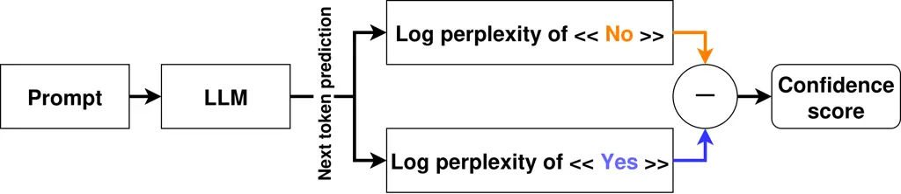

Figure 1: \*-PLUIE workflow.

More formally, given:

- •
  $`S`$ the source sentence,
- •
  $`H`$ the hypothetical sentence,
- •
  $`\textrm{Prompt}{}(S,H)`$ the prompt filled with the sentences $`S`$
  and $`H`$,
- •
  $`T`$: length in tokens of the $`\textrm{Prompt}{}(S,H)`$,
- •
  $`\circ`$: the concatenation operator of 2 sequences of tokens.

```math
\displaystyle\texttt{ParaPLUIE{}}(S,H) \displaystyle= \displaystyle\log\left(\frac{p\left(\textrm{Yes}|\textrm{Prompt}{}(S,H)\right)}{p\left(\textrm{No}|\textrm{Prompt}{}(S,H)\right)}\right) \tag{1}
```

It can be expanded, using the Bayes formula, to bring out the perplexity
of the template:

```math
\displaystyle= \displaystyle\log\left(\frac{p\left(\textrm{Prompt}{}(S,H)\circ\textrm{Yes}\right)}{p\left(\textrm{Prompt}{}(S,H)\right)}\times\frac{p\left(\textrm{Prompt}{}(S,H)\right)}{p\left(\textrm{Prompt}{}(S,H)\circ\textrm{No}\right)}\right) \tag{2}
```

```math
\displaystyle= \displaystyle-\frac{-1}{T+1}\log\left(p\left(\textrm{Prompt}{}(S,H)\circ\textrm{Yes}\right)\right)\times(T+1)
```

```math
\displaystyle+\frac{-1}{T+1}\log\left(p\left(\textrm{Prompt}{}(S,H)\circ\textrm{No}\right)\right)\times(T+1)
```

```math
\displaystyle= \displaystyle\log\left(\exp\left(\frac{-1}{T+1}\log\left(p\left(\textrm{Prompt}{}(S,H)\circ\textrm{No}\right)\right)\right)^{T+1}\right)
```

```math
\displaystyle-\log\left(\exp\left(\frac{-1}{T+1}\log\left(p\left(\textrm{Prompt}{}(S,H)\circ\textrm{Yes}\right)\right)\right)^{T+1}\right)
```

```math
\displaystyle= \displaystyle\log\left(ppl\left(\textrm{Prompt}{}(S,H)\circ\textrm{No}\right)^{T+1}\right)
```

```math
\displaystyle-\log\left(ppl\left(\textrm{Prompt}{}(S,H)\circ\textrm{Yes}\right)^{T+1}\right)
```

```math
\displaystyle= \displaystyle(T+1)\times\log\left(ppl\left(\textrm{Prompt}{}(S,H)\circ\textrm{No}\right)\right)
```

```math
\displaystyle-(T+1)\times\log\left(ppl\left(\textrm{Prompt}{}(S,H)\circ\textrm{Yes}\right)\right)
```

Finally, assuming that the LLM employed uses log perplexity as a
$`loss`$, we have:

```math
\displaystyle\texttt{ParaPLUIE{}}(S,H)=(T+1)\times\left[\textrm{$loss$}_{\textit{LLM}{}}(\textrm{Prompt}{}(S,H)\circ\textrm{No})-\textrm{$loss$}_{\textit{LLM}{}}(\textrm{Prompt}{}(S,H)\circ\textrm{Yes})\right] \tag{3}
```

Note that ParaPLUIE is not necessarily symmetrical. ParaPLUIE presents
plug-and-play capabilities: both the underlying perplexity model and the
prompt template can be modified without altering the fundamental
principle of the method. However, a few aspects must be taken into
consideration. First, the perplexity model must be able to perform
question-answering tasks, as the metric relies on evaluating the model’s
confidence between two mutually exclusive answers. Note that a
requirement of Equation 2 is that the two answers being opposed each
correspond to exactly one token according to the model’s tokenizer.
Beyond that, the choice of tokens is not restricted (it could be “Dog”
vs. “Cat”), even though we only consider “Yes” vs. “No” in this study.
Second, to ensure correct perplexity computation, the tokens being
compared must appear as the final tokens of the prompt. Tokenizers of
most modern LLM-based chatbots employ a user–assistant dialogue format,
where special tokens are inserted to mark the end of each role. These
role-ending tokens must be removed prior to perplexity computation, as
they would otherwise alter the results. For example, when computing the
perplexity of “Yes” in the following dialogue:

\<user\>People like “Cats” more than “Dogs”.\</user\> \<assistant\> Yes
\</assistant\> the end-of-turn token \</assistant\> must be removed
before calculating perplexity. We rely on the publicly available
implementation provided by the original authors²² 2
[https://gitlab.inria.fr/expression/paraphrase-generation-evaluation-powered-by-an-llm-a-semantic-metric-not-a-lexical-one-coli\</assistant\>ng-2025](https://gitlab.inria.fr/expression/paraphrase-generation-evaluation-powered-by-an-llm-a-semantic-metric-not-a-lexical-one-coling-2025).

This formula can be generalised to answers of different length. So, if
one answer is ($`Y_{1}`$… $`Y_{i}`$) and the second is ($`N_{1}`$…
$`N_{j}`$), we can write:

```math
\displaystyle\texttt{ParaPLUIE{}}(S,H)=(T+j)\times\left(\textrm{$loss$}_{\textit{LLM}{}}(\textrm{Prompt}{}(S,H)\circ N_{1}\dots{}N_{j})-(T+i)\times\textrm{$loss$}_{\textit{LLM}{}}(\textrm{Prompt}{}(S,H)\circ Y_{1}\dots{}Y_{i})\right) \tag{4}
```

A drawback here is that the shorter answer would be favoured: indeed, it
is often more probable to generate a short sequence rather than a long
one. Considering the average perplexity of the answer could be an
alternative, but we would likely observe a trend of centering every
answer around a similar average, which would be regrettable.

## Appendix B French Paraphrase Dataset

| Transformation     | Sentence                                   |
| ------------------ | ------------------------------------------ |
| None               | Les enfants ont boulotté tous les gâteaux. |
|                    | The children gobbled up all the cakes.     |
| Paronym            | Les enfants ont boulonné tous les gâteaux  |
|                    | The children screwed all the cakes.        |
| Synonym            | Les enfants ont mangé tous les gâteaux.    |
|                    | The children ate all the cakes.            |
| Synonym of Paronym | Les enfants ont fixé tous les gâteaux.     |
|                    | The children fixed all the cakes.          |

Table 4: Characteristic sentence of Tytgat et al. (2024) dataset and its
different transformations. English translations are provided in italics;
however, as paronym substitution relies on visual and phonetic
similarity, it cannot be easily translated. A simple example of an
English paronym pair: “The children decided to eat the desert.” vs. “The
children decided to eat the dessert.”

This dataset is built on the work of Tytgat et al. (2024) who showed
that conventionally used semantic similarity metrics are often more
sensitive to surface-level differences than to semantic variations.
Their study introduced an expert-annotated French dataset of 355 source
sentences, each constructed independently of any specific domain. For
each original sentence, Tytgat et al. (2024) identified the central
semantic word, the one that most conveys the meaning of the sentence,
and systematically produced three types of modified versions:

- •
  Paronym substitution: the word is replaced by a paronym, a word that
  looks or sounds similar but has a completely different meaning. The
  resulting sentence becomes semantically different from the original
  while remaining lexically close.
- •
  Synonym substitution: the word is replaced by a synonym, producing a
  sentence that preserves the original meaning while being lexically
  close.
- •
  Synonym of a paronym: the word is replaced by a synonym of the
  paronym, leading to an additional nuanced variant. This process
  results in three alternative versions for each source sentence, an
  example of these transformations is provided in Table 4.

Let us denote the transformation of a sentence s by synonym S and by
paronym P. We create a new set composed of pairs of sentences formed by
the source sentence $`s`$ and its transformation. Depending on the
combination of transformations, we label them as paraphrase or
non-paraphrase:

$`\textbf{( s, S(s) )}\implies\text{paraphrase}`$

$`\textbf{( P(s), S(P(s)) )}\implies\text{paraphrase}`$

$`\textbf{( s, P(s) )}\implies\overline{\text{paraphrase}}`$

$`\textbf{( s, S(P(s)) )}\implies\overline{\text{paraphrase}}`$

$`\textbf{( P(s), S(s) )}\implies\overline{\text{paraphrase}}`$

$`\textbf{( S(s), S(P(s)) )}\implies\overline{\text{paraphrase}}`$

The resulting dataset is composed of $`1914`$ pairs with $`33.60`$%
positive pairs.

## Appendix C Example of data from ParaReval dataset

This dataset focuses on the paragraph-level scientific text revision
task, where a paragraph and an accompanying instruction specifying the
intended modification are provided as input, and the model is expected
to produce a revised paragraph that aligns with the given
instruction (Jourdan et al., 2025a).

We use the test split of the ParaReval dataset³³ 3
[https://github.com/JourdanL/parareval](https://github.com/JourdanL/parareval) (Jourdan
et al., 2025b), a collection of human pairwise evaluations of
automatically generated revisions. Each instance in the dataset consists
of two versions of the same paragraph, extracted from computer science
papers from OpenReview and authored by the original writers. Pairs of
paragraphs are annotated with an instruction describing the underlying
revision intention; an example is given in Appendix C.

Based on these annotations, each paragraph was automatically revised by
six different models following the corresponding instruction. The
resulting generated revisions were evaluated in pairs by human
annotators to assess the reliability of automatic evaluation metrics for
this task. Annotators answered three questions: (1) Did the model follow
the instruction? (2) Is the revision correct, i.e., better than the
original? and (3) Which revision do they prefer between options A and B?
The annotator’s responses enable ranking the two options and identifying
the preferred one.

The data comprises 258 pairs of revised paragraphs, each annotated with
two distinct revision instructions, resulting in a total of 516
evaluation instances. Human pairwise preferences are balanced, with
annotators favouring option A in 44% of cases, option B in 41%, and
reporting ties in 15% of cases.

Figure 2: Example of data in the ParaReval dataset

## Appendix D LLM-as-a-judge prompts

system="""(\*@You will receive two sentences A and B, you will have to
identify if they mean the same thing.

In your answer please only provide the answers to the question.@\*)"""

user="""\[BEGIN EXAMPLES\]

\*\*\*

\[Sentence A\]: Amrozi accused his brother , whom he called the witness
, of deliberately distorting his evidence .

\[Sentence B\]: Amrozi accused his brother , whom he disparagingly
referred to as ’the liar witness’, of intentionally twisting his
testimony .

No

\*\*\*

\[Sentence A\]: Pennmakkal is an Indian Malayalam film from 1966 ,
produced by J. Sasikumar and directed by KP Kottarakkara .

\[Sentence B\]: The Indian Malayalam film ’Pennmakkal’, released in
1966, was produced by J. Sasikumar and directed by KP Kottarakkara .

Yes

\*\*\*

\[Sentence A\]: Sorkin , who faces charges of conspiracy to obstruct
justice and lying to a grand jury , was to have been tried separately .

\[Sentence B\]: Despite being accused of conspiring to obstruct justice
and perjury , Sorkin was supposed to stand trial on his own .

No

\*\*\*

\[Sentence A\]: Gilroy police and FBI agents described Gehring as
cooperative , but said Saturday that he had revealed nothing about what
had happened to the children .

\[Sentence B\]: Although Gilroy police and FBI agents reported that
Gehring was cooperative , he hadn’t disclosed any information about the
children’s whereabouts or what had happened to them as of Saturday .

No

\*\*\*

\[Sentence A\]: Whereas ” e “ the electric charge of the particle and A
is the magnetic vector potential of the electromagnetic field .

\[Sentence B\]: The electric charge of the particle is denoted by ”e”,
and the magnetic vector potential of the electromagnetic field is
denoted by ’A’ .

Yes

\*\*\*

\[Sentence A\]: The Jidanul River is a tributary of the Jiul de Vest
River in Romania .

\[Sentence B\]: The Jidanul River is a mere insignificant stream that
flows into the grand Jiul de Vest River in Romania .

No

\*\*\*

\[END EXAMPLES\]

\[BEGIN DATA\]

\[Sentence A\]: "(\*@\\textcolor{blue}{\\source\\}@\*)"

\*\*\*

\[Sentence B\]: "(\*@\\textcolor{blue}{\\paraphrase\\}@\*)"

\*\*\*

\[END DATA\]

Do these two sentences express the same meaning? Answer "Yes" or "No".

"""+"""

You do not need to explain the reason.

Your response must be RFC8259 compliant JSON following this schema:

{{"answer": str }}"""

To evaluate in similar settings the Fr-PLUIE and LLM-Yes/No methods, we
design a French prompt for them. Results with this prompt are available
in Appendix J.

system="""(\*@Tu vas recevoir deux phrases, A et B, tu vas devoir
identifier si elles signifient la m\\eme chose.

Dans ta r\\eponse fournis uniquement la r\\eponse \\a la
question.@\*)"""

user="""\[DEBUT EXEMPLES\]

\*\*\*

(\*@\[Phrase A\]: Amrozi a accus\\e son fr\\ere, qu’il appelait le
t\\emoin, d’avoir d\\elib\\er\\ement d\\eform\\e ses preuves .@\*)

(\*@\[Phrase B\]: Amrozi a accus\\e son fr\\ere, qu’il d\\esignait de
mani\\ere p\\ejorative comme le t\\emoin menteur, d’avoir
intentionnellement falsifi\\e son t\\emoignage.@\*)

Non

\*\*\*

(\*@\[Phrase A\]: Pennmakkal est un film indien en malayalam de 1966,
produit par J. Sasikumar et r\\ealis\\e par KP Kottarakkara .@\*)

(\*@\[Phrase B\]: Le film indien en malayalam ’Pennmakkal’, sorti en
1966, a \\et\\e produit par J. Sasikumar et r\\ealis\\e par KP
Kottarakkara .@\*)

Oui

\*\*\*

(\*@\[Phrase A\]: Sorkin, qui fait face \\a des accusations de complot
pour entraver la justice et de faux t\\emoignage devant un grand jury,
devait \\etre jug\\e s\\epar\\ement .@\*)

(\*@\[Phrase B\]: Malgr\\e les accusations de complot pour entraver la
justice et de parjure, Sorkin devait \\etre jug\\e seul .@\*)

Non

\*\*\*

(\*@\[Phrase A\]: La police de Gilroy et les agents du FBI ont d\\ecrit
Gehring comme coop\\eratif, mais ont d\\eclar\\e samedi qu’il n’avait
r\\ev\\el\\e aucune information sur ce qui \\etait arriv\\e aux
enfants.@\*)

(\*@\[Phrase B\]: Bien que la police de Gilroy et les agents du FBI
aient rapport\\e que Gehring \\etait coop\\eratif, il n’avait pas
divulgu\\e d’informations sur le lieu o\\u se trouvaient les enfants ou
sur ce qui leur \\etait arriv\\e samedi .@\*)

Non

\*\*\*

(\*@\[Phrase A\]: Dans lequel ”e” repr\\esente la charge \\electrique de
la particule et A est le vecteur du potentiel magn\\etique du champ
\\electromagn\\etique .@\*)

(\*@\[Phrase B\]: La charge \\electrique de la particule est
d\\esign\\ee par ”e”, et le vecteur du potentiel magn\\etique du champ
\\electromagn\\etique est d\\esign\\e par ’A’ .@\*)

Oui

\*\*\*

(\*@\[Phrase A\]: La rivi\\ere Jidanul est un affluent de la rivi\\ere
Jiul de Vest en Roumanie .@\*)

(\*@\[Phrase B\]: La rivi\\ere Jidanul est un simple ruisseau
insignifiant qui se jette dans la grande rivi\\ere Jiul de Vest en
Roumanie .@\*)

Non

\*\*\*

\[FIN EXEMPLES\]

\[DEBUT DONNEES\]

(\*@\[Phrase A\]: "\\textcolor{blue}{\\source\\}@\*)"

\*\*\*

(\*@\[Phrase B\]: "\\textcolor{blue}{\\paraphrase\\}@\*)"

\*\*\*

\[FIN DONNEES\]

(\*@Est-ce que ces deux phrases veulent dire la m\\eme chose ? R\\eponds
par "Oui" ou "Non".@\*)

"""+"""

(\*@Tu n’as pas besoin d’expliquer la raison.@\*)

(\*@Ta r\\eponse doit \\etre compatible RFC8259 JSON et suivre le
sch\\ema suivant : @\*)

{{"(\*@r\\eponse@\*)": str }}"""

system="""(\*@You are an evaluator of nile network policies to english
translations. In this task, a translation model has been provided with
the original nile sentence and translated it to english. You will be
given the original nile sentence and the proposition from this model and
will have to report if the two sentences express the same network
policy. In your answer please only provide the answers to the
questions.@\*)"""

user="""\[BEGIN EXAMPLES\]

\*\*\*

\[Sentence A\]: Everquest is blocked by the University firewall

\[Sentence B\]: Everquest is not allowed by the University firewall

Yes

\*\*\*

\[Sentence A\]: Quotas for students are 5000 Megabyte per hr download
and 2000 Megabyte per hour upload

\[Sentence B\]: Students have a download quota of 5000 MB per hour and
an upload quota of 2000 MB per hour

Yes

\*\*\*

\[Sentence A\]: from endpoint(’guests’) to endpoint(’servers’) for
group(’host’) block traffic(’any’)

\[Sentence B\]: RHIT-OPEN will work in labs, classrooms and residence
halls but does not allow the user to access the internal Rose-Hulman
network

No

\*\*\*

\[Sentence A\]: Housing does not normally limit the amount of bandwidth

\[Sentence B\]: There is no bandwidth limit for the dorms

No

\*\*\*

\[Sentence A\]: for endpoint(’university’) add middlebox(’firewall’)
allow traffic(’H323 video conferencing’)

\[Sentence B\]: H323 video conferencing is allowed by the University
firewall

Yes

\*\*\*

\[Sentence A\]: H323 video conferencing is allowed by the University
firewall

\[Sentence B\]: The network firewall does not block H.323 video
conferencing

No

\*\*\*

\[END EXAMPLES\]

\[BEGIN DATA\]

\[Sentence A\]: "(\*@\\textcolor{blue}{\\nile\\}@\*)"

\*\*\*

\[Sentence B\]: "(\*@\\textcolor{blue}{\\translation\\}@\*)"

\*\*\*

\[END DATA\]

Do these two sentences express the same network policy? Answer "Yes" or
"No".

"""+"""

You do not need to explain the reason.

Your response must be RFC8259 compliant JSON following this schema:

{{"answer": str }}"""

system="""You are an evaluator of nile network policies to english
translations. In this task, two translation models have been provided
with the original nile sentence and translated it to english. You will
be given the proposition from the two different models and a question to
identify the best one. In your answer please only provide the answers to
the questions."""

user="""\[BEGIN DATA\]

\*\*\*

\[Nile network policy\]: "(\*@\\textcolor{blue}{\\nile\\}@\*)"

\*\*\*

\[Sentence A\]: "(\*@\\textcolor{blue}{\\translation 1\\}@\*)"

\*\*\*

\[Sentence B\]: "(\*@\\textcolor{blue}{\\translation 2\\}@\*)"

\*\*\*

\[END DATA\]

Which sentence is the best translation of the nile network policy?
Answer "A", "B" or "Tie".

"""+"""

You do not need to explain the reason.

Your response must be RFC8259 compliant JSON following this schema:

{{"best_translation": str }}"""

system="""You are an evaluator of nile network policies to english
translations.

In this task, a translation model has been provided with the original
nile sentence and translated it to english.

You will be given the proposition from the translation model and an
affirmation to determine the quality of this proposition.

You will answer this affirmation with a grade (int) from 1 to 5 as
follows: 1 = Strongly disagree , 2 = Disagree , 3 = Neutral , 4 = Agree
, 5 = Strongly agree

To help you in this task, you will also be given the gold reference
which is a correct translation to english.

In your answer please only provide the answer to the affirmation."""

user="""\[BEGIN DATA\]

\*\*\*

\[Nile network policy\]: "(\*@\\textcolor{blue}{\\nile\\}@\*)"

\*\*\*

\[Model proposed translation\]:
"(\*@\\textcolor{blue}{\\translation\\}@\*)"

\*\*\*

\[END DATA\]

The model proposed a correct translation of the nile network policy?

"""+"""

You do not need to explain the reason.

Your response must be RFC8259 compliant JSON following this schema:

{{"translation_quality": int }}"""

## Appendix E \*-PLUIE new task-specific prompts

In this section, we provide the prompts used for French paraphrase
classification and Nile translation. For text revision, for LLM-choice
and LLM-Likert, we reused the prompts and generated evaluations
from Jourdan et al. (2025b).

user= """(\*@Tu vas recevoir deux phrases, A et B. Est-ce que ces deux
phrases veulent dire la même chose ? Réponds avec un seul mot : "oui" ou
"non".@\*)"""

assistant="""(\*@S’il te plaît, fournis-moi les deux phrases que je dois
évaluer.@\*)"""

user="""A: (\*@"Amrozi a accusé son frère, qu’il appelait "le témoin",
d’avoir délibérément déformé ses preuves ."; B: "Amrozi a accusé son
frère, qu’il désignait de manière péjorative comme "le témoin menteur",
d’avoir intentionnellement falsifié son témoignage."@\*)"""

assistant="""non"""

user="""A: (\*@"Pennmakkal est un film indien en malayalam de 1966,
produit par J. Sasikumar et réalisé par KP Kottarakkara ."; B: "Le film
indien en malayalam ’Pennmakkal’, sorti en 1966, a été produit par J.
Sasikumar et réalisé par KP Kottarakkara ."@\*)"""

assistant="""oui"""

user="""A: (\*@"Sorkin, qui fait face à des accusations de complot pour
entraver la justice et de faux témoignage devant un grand jury, devait
être jugé séparément ."; B: "Malgré les accusations de complot pour
entraver la justice et de parjure, Sorkin devait être jugé seul
."@\*)"""

assistant="""non"""

user="""A: (\*@"La police de Gilroy et les agents du FBI ont décrit
Gehring comme coopératif, mais ont déclaré samedi qu’il n’avait révélé
aucune information sur ce qui était arrivé aux enfants ."; B: "Bien que
la police de Gilroy et les agents du FBI aient rapporté que Gehring
était coopératif, il n’avait pas divulgué d’informations sur le lieu où
se trouvaient les enfants ou sur ce qui leur était arrivé samedi
."@\*)"""

assistant="""non"""

user="""A: (\*@"Dans lequel ”e” représente la charge électrique de la
particule et A est le vecteur du potentiel magnétique du champ
électromagnétique ."; B: "La charge électrique de la particule est
désignée par ”e”, et le vecteur du potentiel magnétique du champ
électromagnétique est désigné par ’A’ ."@\*)"""

assistant="""oui"""

user="""A: (\*@"La rivière Jidanul est un affluent de la rivière Jiul de
Vest en Roumanie ."; B: "La rivière Jidanul est un simple ruisseau
insignifiant qui se jette dans la grande rivière Jiul de Vest en
Roumanie ."@\*)"""

assistant="""non"""

user="""A: "(\*@\\textcolor{blue}{\\source\\}@\*)"; B:
"(\*@\\textcolor{blue}{\\paraphrase\\}@\*)""""

user= """You will receive two sentences A and B. Do these two sentences
express the same network policy? Answer with only one word "Yes" or
"No"."""

assistant= """Please provide the data for me to evaluate."""

user="""A: "Everquest is blocked by the University firewall"; B:
"Everquest is not allowed by the University firewall""""

assistant="""Yes"""

user="""A: "Quotas for students are 5000 Megabyte per hr download and
2000 Megabyte per hour upload"; B: "Students have a download quota of
5000 MB per hour and an upload quota of 2000 MB per hour""""

assistant="""Yes"""

user="""A: "from endpoint(’guests’) to endpoint(’servers’) for
group(’host’) block traffic(’any’)"; B: "RHIT-OPEN will work in labs,
classrooms and residence halls but does not allow the user to access the
internal Rose-Hulman network""""

assistant="""No"""

user="""A: "Housing does not normally limit the amount of bandwidth"; B:
"There is no bandwidth limit for the dorms""""

assistant="""No"""

user="""A: "for endpoint(’university’) add middlebox(’firewall’) allow
traffic(’H323 video conferencing’)"; B: "H323 video conferencing is
allowed by the University firewall""""

assistant="""Yes"""

user="""A: "H323 video conferencing is allowed by the University
firewall"; B: "The network firewall does not block H.323 video
conferencing""""

assistant="""No"""

user="""A: "(\*@\\textcolor{blue}{\\source\\}@\*)"; B:
"(\*@\\textcolor{blue}{\\translation\\}@\*)""""

user= """You will receive two paragraphs P1 and P2 and an instruction I.
P1 is a paragraph written for a scientific article, I is an instruction
on how to revise P1 and P2 is a revised version of P1. Did P2 address
the instruction I? Answer with only one word "Yes" or "No"."""

assistant= """Please provide the data for me to evaluate."""

(\*@\\textcolor{orange}{\<Gold reference can be added here as
one-shot\>}@\*)

user="""P1: "(\*@\\textcolor{blue}{\\original\\}@\*)"; I:
"(\*@\\textcolor{blue}{\\instruction\\}@\*)"; P2:
"(\*@\\textcolor{blue}{\\gold\\}@\*)""""

assistant= """Yes"""

(\*@\\textcolor{orange}{\<end of gold reference inclusion\>}@\*)

user="""P1: "(\*@\\textcolor{blue}{\\original\\}@\*)"; I:
"(\*@\\textcolor{blue}{\\instruction\\}@\*)"; P2:
"(\*@\\textcolor{blue}{\\hypothese\\}@\*)""""

## Appendix F Mistral and Reference test results

|                  |         |        |      |       |      |
| ---------------- | ------- | ------ | ---- | ----- | ---- |
| model            | syst    | thr.   | f1   | prec. | rec. |
| levenshtein      | source  | 0.17   | 0.72 | 0.63  | 0.84 |
| bleu             | source  | 0.0    | 0.7  | 0.54  | 1.0  |
| meteor           | source  | 0.02   | 0.74 | 0.65  | 0.85 |
| bertscore        | source  | 0.43   | 0.73 | 0.66  | 0.82 |
| modern_bertscore | source  | 0.65   | 0.7  | 0.54  | 1.0  |
| Net-PLUIE        | source  | -1.91  | 0.78 | 0.67  | 0.93 |
| Net-PLUIE        | source  | 0      | 0.77 | 0.71  | 0.84 |
| levenshtein      | Mistral | 0.13   | 0.95 | 0.91  | 0.99 |
| bleu             | Mistral | 0.0    | 0.95 | 0.9   | 1.0  |
| meteor           | Mistral | 0.0    | 0.95 | 0.9   | 1.0  |
| bertscore        | Mistral | 0.38   | 0.95 | 0.9   | 1.0  |
| modern_bertscore | Mistral | 0.65   | 0.95 | 0.9   | 1.0  |
| Net-PLUIE        | Mistral | -14.74 | 0.95 | 0.9   | 1.0  |
| Net-PLUIE        | Mistral | 0      | 0.92 | 0.95  | 0.89 |

Table 5: Metrics evaluation for the Mistral (Jiang et al., 2023)
generated translations and the English source intents. Phi-4 14B is the
perplexity model used in Net-PLUIE.

## Appendix G Score distribution according to the decision threshold

To better understand the results from Section 3.1, Figure 3 compares the
score distributions of Modern BertScore and Fr-PLUIE on the French
paraphrase detection task. As shown in Figure 3(a), Modern BertScore
assigns predominantly high similarity scores, and its accuracy curve
does not decrease. The 0.75 on the x-axis is the lowest Modern BertScore
across each pair of sentences in the French paraphrase dataset. The full
0-to-1 version would be flat from 0 to 0.85. This graph may look a bit
disturbing because it does not show the distribution of scores. The
average Modern BertScore of pairs is 0.95 (with a 95% confidence
interval of 0.00). Most of the non-paraphrase pairs have a score greater
than paraphrase ones and the pair with the higher score is labelled as
non-paraphrase. This indicates that it fails to assign higher similarity
scores to sentence pairs that convey the same meaning. In contrast,
Fr-PLUIE (Figure 3(b)) successfully differentiates paraphrases and
non-paraphrases, assigning negative scores to the latter. However, the
rapid decrease in recall reveals that the model also produces a number
of false negative pairs labelled as paraphrases but judged as
non-paraphrases, indicating room for improvement.

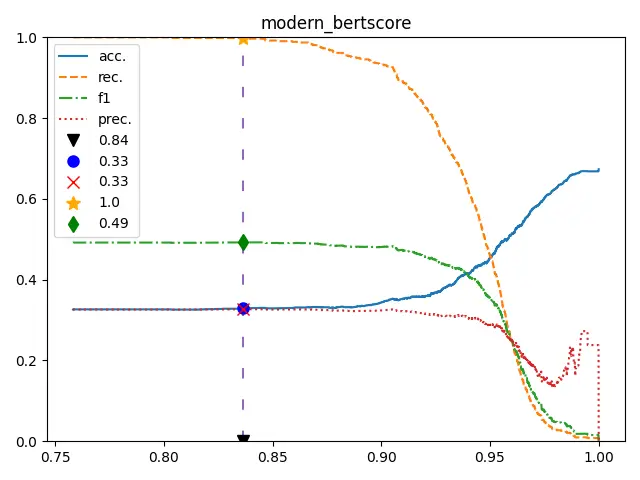

(a)

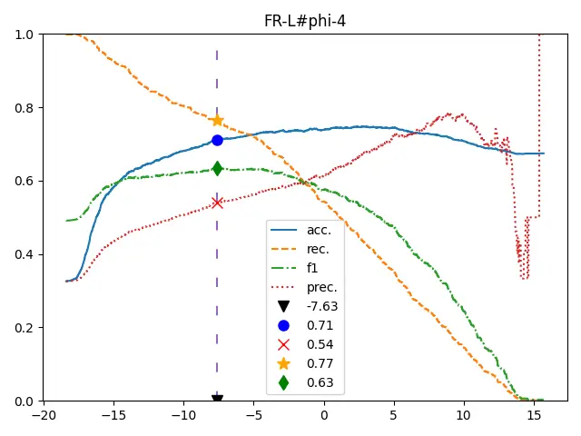

(b)

Figure 3: Score distribution of Modern BertScore (a) and Fr-PLUIE (b).
The blue, orange, red and green curves denote respectively the accuracy,
recall, precision and F1-score according to the decision threshold.
Emphasis is placed on the maximum F1-score obtained by the metric.

Figure 4 presents precision, recall, accuracy, and F1-score across
different threshold values for Modern BertScore and Net-PLUIE.

For Net-PLUIE (Figure 4(b)), the precision increases with the threshold,
reducing false positives. Accuracy and F1 initially increase for
threshold values between approximately $`-20`$ and $`0`$, then decline
rapidly beyond $`0`$. In contrast, Modern BertScore (Figure 4(a)) shows
a slower and shorter initial rise in accuracy and F1, followed by a
continuous decrease. Figures 5, 6, 7, 8, 9, 10, 11 show the different
classification results with all the combinations of metrics.

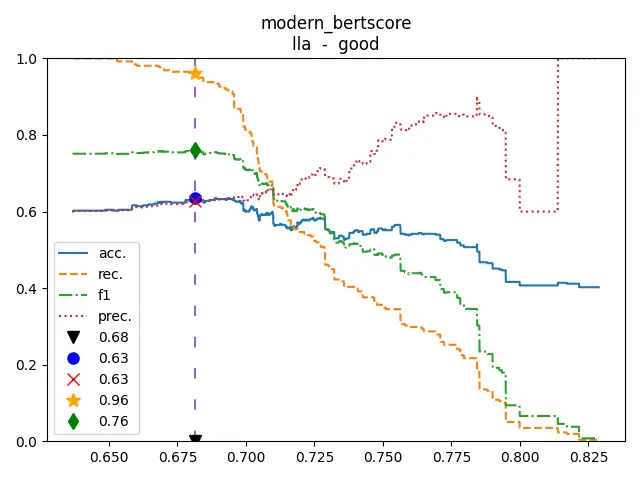

(a)

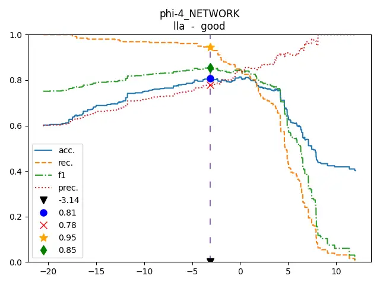

(b)

Figure 4: Accuracy, recall, precision and F1-score distribution over
different threshold values for Modern BertScore (a) and Net-PLUIE (b).
Emphasis is placed on the maximum F1-score obtained by the metric.

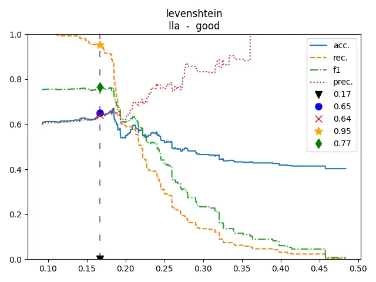

(c) Llama translations

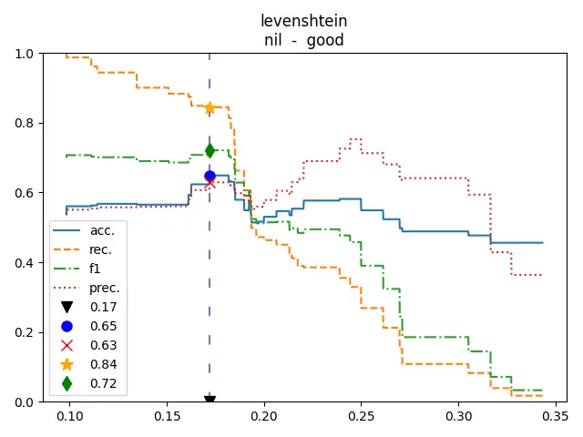

(d) English source intents

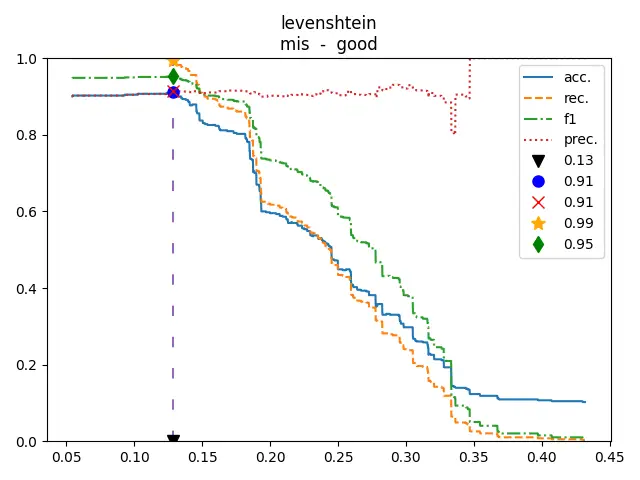

(e) Mistral translations

Figure 5: Classification with Levenshtein.

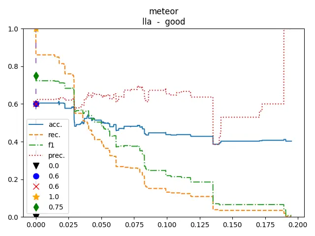

(a) Llama translations

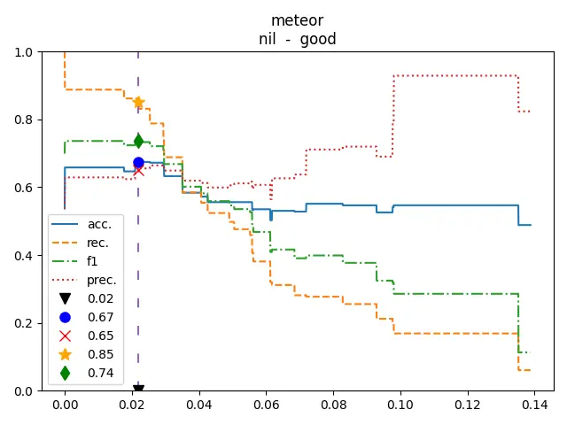

(b) English source intents

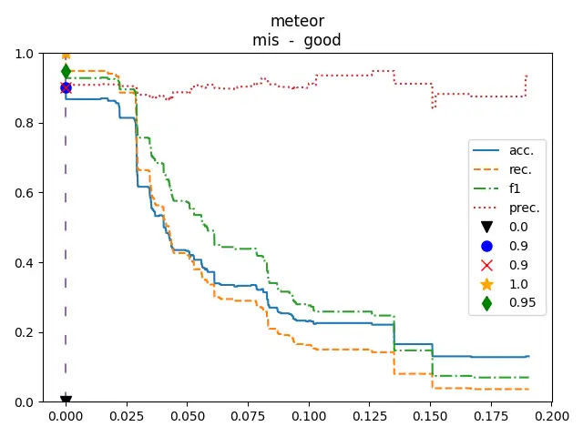

(c) Mistral translations

Figure 6: Classification with METEOR.

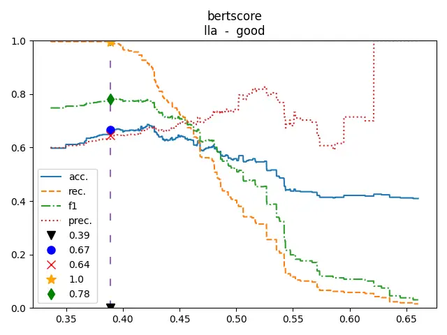

(a) Llama translations

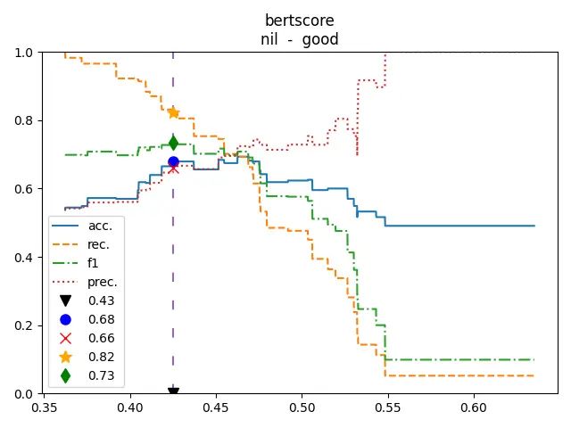

(b) English source intents

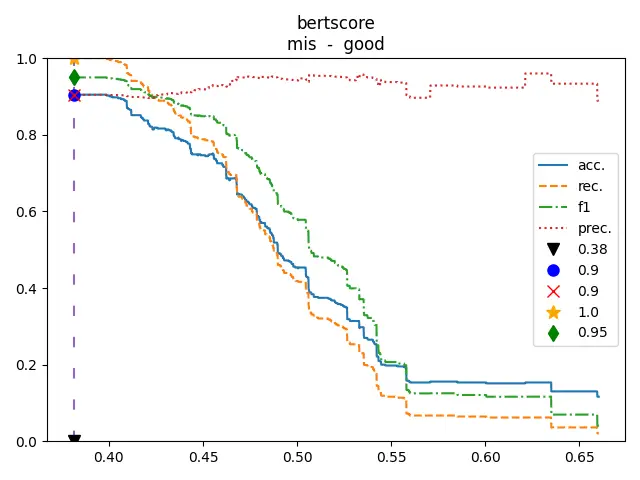

(c) Mistral translations

Figure 7: Classification with BERTScore.

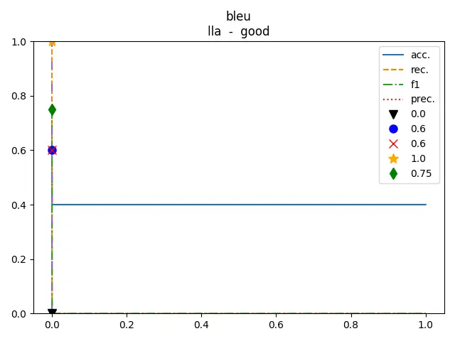

(a) Llama translations

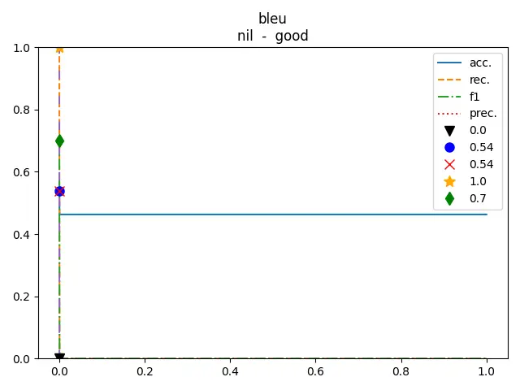

(b) English source intents

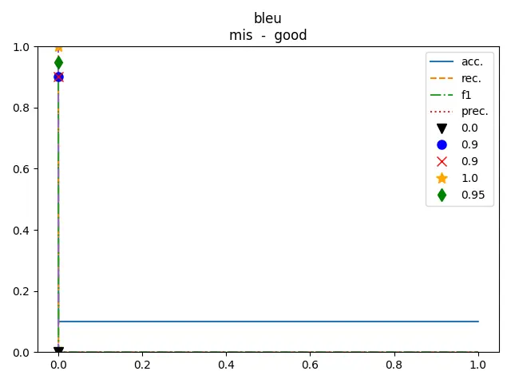

(c) Mistral translations

Figure 8: Classification with BLEU.


(a) Llama translations

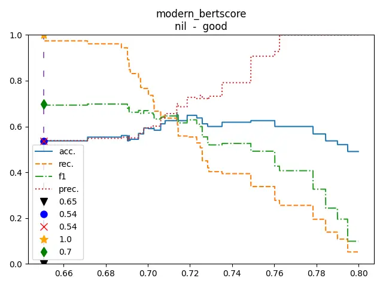

(b) English source intents

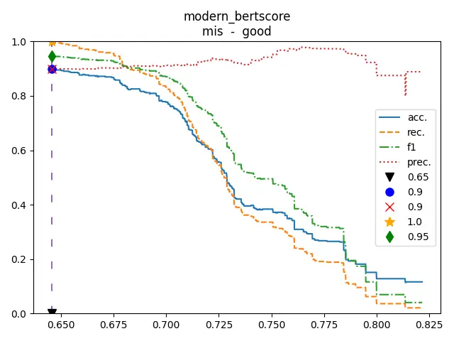

(c) Mistral translations

Figure 9: Classification with Modern BertScore.

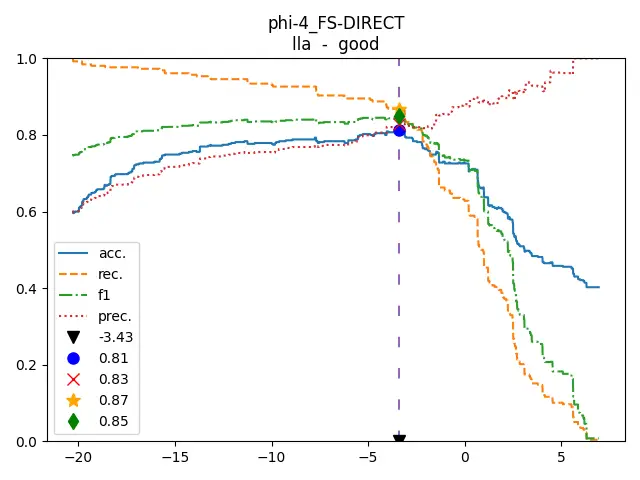

(a) Llama translations

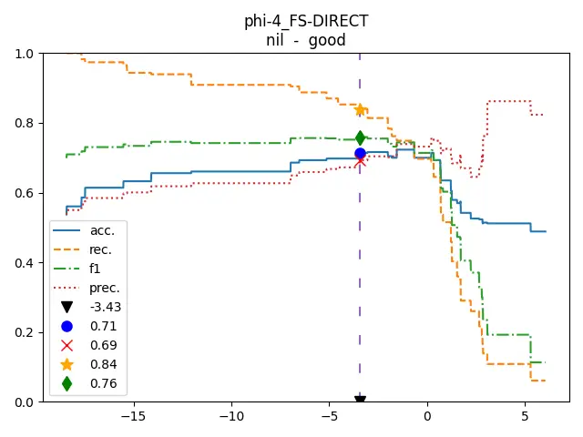

(b) English source intents

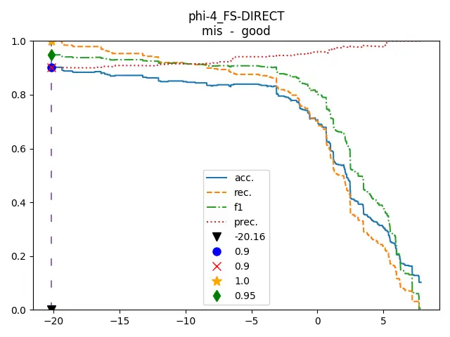

(c) Mistral translations

Figure 10: Classification with metric Para-PLUIE with Phi-4 14B.


(a) Llama translations

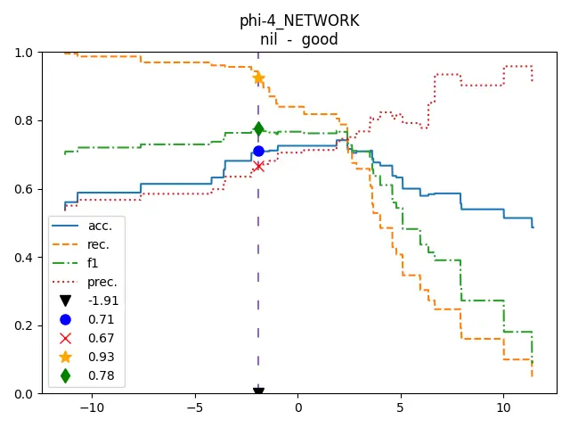

(b) English source intents

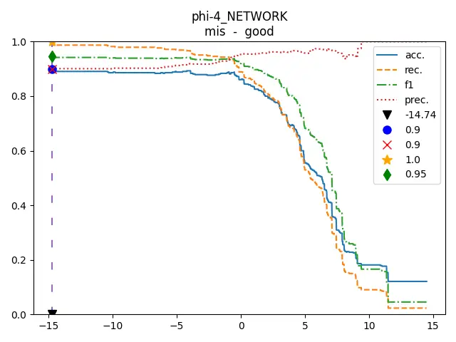

(c) Mistral translations

Figure 11: Classification with metric Net-PLUIE with Phi-4 14B.

## Appendix H Additional results for alignment of LLM-based metrics on text revision

|            |             |           |      |       |      |            |      |
| ---------- | ----------- | --------- | ---- | ----- | ---- | ---------- | ---- |
| Judge      |             | Pair acc. |      | $`V`$ |      | $`\kappa`$ |      |
|            |             |           | w.g. |       | w.g. |            | w.g. |
| Rev-PLUIE  | Llama 3 70B | 0.61      | 0.62 | 0.31  | 0.32 | 0.32       | 0.34 |
|            | Phi-4 14B   | 0.61      | 0.61 | 0.31  | 0.32 | 0.32       | 0.33 |
|            | Llama 3 8B  | 0.58      | 0.59 | 0.27  | 0.29 | 0.27       | 0.29 |
|            | Mistral 7B  | 0.55      | 0.59 | 0.24  | 0.28 | 0.22       | 0.28 |
| Para-PLUIE | Llama 3 70B | 0.52      |      | 0.20  |      | 0.17       |      |
|            | Phi-4 14B   | 0.52      |      | 0.21  |      | 0.15       |      |
|            | Llama 3 8B  | 0.52      |      | 0.21  |      | 0.17       |      |
|            | Mistral 7B  | 0.54      |      | 0.22  |      | 0.20       |      |
| LLM choice | GPT-4o      | 0.59      | 0.60 | 0.28  | 0.30 | 0.30       | 0.33 |
|            | GPT-4o mini | 0.57      | 0.58 | 0.25  | 0.26 | 0.27       | 0.29 |
|            | Llama 3 70B | 0.59      | 0.60 | 0.28  | 0.30 | 0.30       | 0.31 |
|            | Phi-4 14B   | 0.53      | 0.55 | 0.25  | 0.27 | 0.24       | 0.27 |
|            | Llama 3 8B  | 0.54      | 0.51 | 0.21  | 0.18 | 0.20       | 0.17 |
|            | Mistral 7B  | 0.53      | 0.53 | 0.20  | 0.17 | 0.17       | 0.16 |
| LLM likert | GPT-4o      | 0.54      | 0.54 | 0.28  | 0.27 | 0.28       | 0.27 |
|            | GPT-4o mini | 0.45      | 0.51 | 0.28  | 0.27 | 0.21       | 0.23 |
|            | Llama 3 70B | 0.44      | 0.50 | 0.29  | 0.27 | 0.19       | 0.23 |
|            | Phi-4 14B   | 0.45      | 0.52 | 0.30  | 0.29 | 0.21       | 0.26 |
|            | Llama 3 8B  | 0.43      | 0.45 | 0.18  | 0.18 | 0.15       | 0.15 |
|            | Mistral 7B  | 0.33      | 0.28 | 0.16  | 0.10 | 0.09       | 0.05 |

Table 6: Alignment of LLM-based metrics with human judgements. Pairwise
accuracy and Cramér’s V are defined on \[0:1\] and Cohen’s Kappa on
\[-1:1\]. w.g. (with gold) indicates that the reference revision is
provided. For Para-PLUIE, the column without gold corresponds to the
Para-PLUIE scores between the original and generated paragraphs.
Perplexity models used are Llama-3, Phi-4, Mistral and GPT-4o
(Grattafiori et al., 2024; Abdin et al., 2024; Jiang et al., 2023;
OpenAI et al., 2024).

## Appendix I Net-PLUIE as an alignment function

Munson et al. (2025) introduced Nile-English Aligned Translations, a
methodology used to create a large-scale corpus of aligned
English–Network Intent Language intents. In their methodology, the
authors formalise the $`align(i,n)`$ function which assesses if a Nile
intent $`(i)`$ and a natural language statement $`(n)`$ share the same
underlying meaning. So far, $`align(\cdot,\cdot)`$ has only been
reliably implemented through manual expert annotation, which limits
scalability and reproducibility. To validate Net-PLUIE as a semantic
alignment function, we require two conditions to be verified, presented
in Equations 5 and 6.

```math
align(i,n_{1})\land align(i,n_{2})\implies\texttt{*-PLUIE}(n_{1},n_{2})>T\land\texttt{*-PLUIE}(n_{2},n_{1})>T \tag{5}
```

```math
align(i,n_{1})\land\texttt{*-PLUIE}(n_{1},n_{2})>T\land\texttt{*-PLUIE}(n_{2},n_{1})>T\implies align(i,n_{2}) \tag{6}
```

Therefore, if two sentences ($`n_{1}`$ and $`n_{2}`$) share the same
meaning and one of them is aligned with an intent, the second one should
also be aligned with this intent. This is made possible because the
intent language is unambiguous; indeed, this relation is not necessarily
true with natural language. We exploit from the non-symmetrical property
of \*-PLUIE and compute the score Net-PLUIE($`n_{1}`$,$`n_{2}`$) and
Net-PLUIE($`n_{2}`$,$`n_{1}`$). However, when used as the alignment
measure between natural language and formal intent language, we only use
it once with the formal intent as the reference. This is because natural
language expressions usually capture more details than formal languages;
these additional details captured in the expression should still be
considered as part of a good translation. However, the metric penalises
the suppression of information between two expressions, meaning that the
loss of information that is not relevant to the actual network
configurations when going from natural language to Nile is penalised by
the metric. We consider the Mistral and Llama generated translations as
our two sources of natural language expressions and count how many times
our two implications are not respected. Overall, of the 430 Nile-NL
triplets, 56 do not verify condition 5 and 7 fail condition 6. Examples
of the translations that failed the tests can be found in Table 7 and
Table 8.

Despite only 15% of the triplets failing our imposed conditions, this
makes it difficult to use this metric comfortably as a semantic
alignment function without further verification on the generated
translations before acceptance. Fortunately, the most critical condition
is condition 6, which enables the deduction of an alignment given an
existing alignment and a paraphrased sentence, and this condition is
satisfied in 98% of the cases. So we can consider Net-PLUIE as the
closest solution we have to an accurate automatic semantic alignment
function between natural language and a formal intent language, making
it the best solution available.

| Nile sentence                                                                                                                       | Translation with Llama (Grattafiori et al., 2024)                                                             | Translation with Mistral (Jiang et al., 2023)                                                                                            |
| ----------------------------------------------------------------------------------------------------------------------------------- | ------------------------------------------------------------------------------------------------------------- | ---------------------------------------------------------------------------------------------------------------------------------------- |
| for endpoint(’dorms’), endpoint(’wireless’) set quota(’any’, ’6’, ’gb/d’) start hour(’00:00’) end hour(’23:59’)                     | The ResNet and NYURoam wireless networks have a 6 GB per day quota                                            | The ResNet and wireless network have a daily cap of 6 GB per day, from midnight to midnight                                              |
| for endpoint(’dorms’), endpoint(’wireless’) set quota(’any’, ’6’, ’gb/d’) start hour(’00:00’) end hour(’23:59’)                     | The ResNet cap is currently 6 GB per day                                                                      | ResNet and UIC wireless have a daily cap of 6 GB for all incoming and outgoing traffic                                                   |
| for endpoint(’dorms’), endpoint(’wireless’) set quota(’any’, ’6’, ’gb/d’) start hour(’00:00’) end hour(’23:59’)                     | The ResNet cap is currently 6 GB per day                                                                      | ResNet and wireless users have a daily quota of 6 GB, with no time restrictions                                                          |
| for endpoint(’dorms’), endpoint(’wireless’) set quota(’any’, ’6’, ’gb/d’) start hour(’00:00’) end hour(’23:59’)                     | The ResNet cap is currently 6 gigabytes per day                                                               | The ResNet cap is currently 6 gigabytes per day for each 24 hour period of combined incoming and outgoing traffic                        |
| for endpoint(’guests’) block service(’file transfer’)                                                                               | Guests are not allowed to run file transfer services                                                          | Guests are not allowed to transfer files                                                                                                 |
| for endpoint(’guests’) block service(’file transfer’)                                                                               | Guests are not allowed to use file transfer protocols                                                         | Guests are not allowed to transfer files                                                                                                 |
| for endpoint(’host’) set bandwidth(’max’, ’3’, ’mbps’)                                                                              | The individual will have a 3 Mbps bandwidth rate limit                                                        | The host will have a 3 Mbps bandwidth rate limit                                                                                         |
| for endpoint(’host’) set bandwidth(’max’, ’4’, ’mbps’)                                                                              | Hosts’ network is rate-limited to 4 Mb/s per user                                                             | Each host is limited to 4 Mb/s                                                                                                           |
| for endpoint(’host’) set bandwidth(’max’, ’4’, ’mbps’)                                                                              | Hosts’ network is rate-limited to 4 Mb/s per user                                                             | Hosts are rate-limited to 4 Mb/s                                                                                                         |
| for endpoint(’host’) set bandwidth(’max’, ’4’, ’mbps’)                                                                              | Internet is limited to 4 Mbps per host                                                                        | Each host is limited to 4 Mbps                                                                                                           |
| for endpoint(’network’) add middlebox(’network border system’), middlebox(’ips’), middlebox(’firewall’), middlebox(’unit firewall’) | The network is protected by a firewall, a network border system, and a unit firewall                          | The network has multiple layers of security, including a network border system, intrusion prevention system, firewall, and unit firewall |
| for endpoint(’network’) add middlebox(’overuse notification’) set quota(’any’, ’10’, ’gb/wk’)                                       | The network will send an email to the user when they have used 10 GB of bandwidth in a week                   | If you exceed 10 GB of network usage in a week, you will receive a notification                                                          |
| for endpoint(’network’) block service(’NETBIOS’)                                                                                    | The UVA More Secure Network does not allow NetBIOS                                                            | NETBIOS is blocked by the University of Virginia’s firewall                                                                              |
| for endpoint(’network’) block service(’NETBIOS’)                                                                                    | The network firewall does prevent some applications from working in their normal manner, for example, NetBIOS | NETBIOS is blocked by the network firewall                                                                                               |
| for endpoint(’network’) block service(’NETBIOS’)                                                                                    | The network firewall does prevent some applications from working in their normal manner, for example, NetBIOS | The network firewall blocks the use of the NETBIOS protocol                                                                              |
| for endpoint(’network’) block traffic(’H323 video conferencing’)                                                                    | H323 video conferencing is blocked by the University network                                                  | H323 video conferencing is blocked by the network                                                                                        |
| for endpoint(’network’) block traffic(’H323 video conferencing’)                                                                    | H323 video conferencing is blocked                                                                            | H323 video conferencing is blocked on the network                                                                                        |
| for endpoint(’network’) set quota(’any’, ’10’, ’gb/d’)                                                                              | The University of Illinois at Urbana-Champaign has a 10 GB per day limit on all combined traffic              | The network has a 10 GB per day data transfer limit                                                                                      |

Table 7: A few examples of bad translations that do not respect
implication 5, both translations are aligned to the same intent
expression, but ParaPLUIE does not consider the translations to be
paraphrases.

| Nile sentence                                                                                                                                                                    | Translation with Llama (Grattafiori et al., 2024)                                                                                                                                   | Translation with Mistral (Jiang et al., 2023)                                                            |
| -------------------------------------------------------------------------------------------------------------------------------------------------------------------------------- | ----------------------------------------------------------------------------------------------------------------------------------------------------------------------------------- | -------------------------------------------------------------------------------------------------------- |
| for endpoint(’dorms’) block protocol(’nat’)                                                                                                                                      | NAT is not allowed on the ResNet                                                                                                                                                    | NAT is blocked on the ResNet                                                                             |
| for endpoint(’dorms’), endpoint(’wireless’) block protocol(’ftp’), protocol(’telnet’), traffic(’peer2peer’), protocol(’http’), service(’irc’), protocol(’dns’), service(’email’) | You may not run any services (e.g., FTP services, telnet, P2P file sharing servers, publishing files via generic file services, etc.) via NYU’s ResNet or NYURoam wireless networks | ResNet and wireless networks are blocked from using FTP, Telnet, P2P, HTTP, IRC, DNS, and email services |
| for endpoint(’dorms’), endpoint(’wireless’) block protocol(’ftp’), service(’listserver’), traffic(’peer2peer’)                                                                   | The University of Washington does not allow FTP, Listserv, or Peer-to-Peer traffic on the ResNet or UW Wireless                                                                     | ResNet and UIC wireless do not allow FTP, listserv, or peer-to-peer traffic                              |
| for endpoint(’dorms’), endpoint(’wireless’) block protocol(’ftp’), service(’listserver’), traffic(’peer2peer’)                                                                   | You may not run FTP, listserver, peer-to-peer, or file sharing/downloading program                                                                                                  | ResNet and wireless users cannot use FTP, listserv, or peer-to-peer file sharing                         |
| for endpoint(’dorms’), endpoint(’wireless’) set quota(’any’, ’6’, ’gb/d’) start hour(’00:00’) end hour(’23:59’)                                                                  | Dorms and wireless have a quota of 6 GB per day                                                                                                                                     | The quota for dorms and wireless is 6 GB per day, with no time restrictions                              |
| for endpoint(’dorms’), endpoint(’wireless’) set quota(’any’, ’6’, ’gb/d’) start hour(’00:00’) end hour(’23:59’)                                                                  | Students have a quota of 6 GB per day The quota is reset at midnight                                                                                                                | ResNet and wireless users have a daily quota of 6 GB, with no time restrictions                          |
| for endpoint(’dorms’), endpoint(’wireless’) set quota(’any’, ’6’, ’gb/d’) start hour(’00:00’) end hour(’23:59’)                                                                  | The ResNet and NYURoam wireless networks have a 6 GB per day quota                                                                                                                  | ResNet and wireless network have a daily quota of 6 GB, available 24/7                                   |

Table 8: Bad translations that do not respect implication 6: One
translation is aligned to the Nile expression, both translations are
paraphrases, but, on lines 1 to 4, ParaPLUIE does not consider Llama’s
translation to be aligned to the Nile expression, and on lines 5 to 7,
ParaPLUIE does not consider Mistral’s translation to be aligned to the
Nile expression.

## Appendix J Additional results for French paraphrase classification

|                                  | French Paraphrase Detection |      |       |      |          |         |
| -------------------------------- | --------------------------- | ---- | ----- | ---- | -------- | ------- |
| Metric                           | Acc.                        | Rec. | Prec. | F1   | GPUs     | Runtime |
| LLM-Yes/No Phi-4 14B  (French)   | 0.74                        | 0.53 | 0.61  | 0.57 | MI300 x1 | 27 min  |
| LLM-Yes/No Llama 3 70B  (French) | 0.71                        | 0.57 | 0.55  | 0.56 | MI300 x2 | 57 min  |

Table 9: Results of LLM-as-a-judge approaches with a French prompt.

|                                     | French Paraphrase Classification |      |      |       |      |
| ----------------------------------- | -------------------------------- | ---- | ---- | ----- | ---- |
| Metric                              | Thr.                             | Acc. | Rec. | Prec. | F1   |
| Para-PLUIE SmolLM2-135M-Instruct    | 0                                | 0.67 | N/A  | 0.00  | 0.00 |
| Para-PLUIE SmolLM2-135M-Instruct    | -2.31                            | 0.33 | 0.33 | 1.00  | 0.49 |
| Para-PLUIE SmolLM2-360M-Instruct    | 0                                | 0.67 | 0.35 | 0.03  | 0.06 |
| Para-PLUIE SmolLM2-360M-Instruct    | -1.26                            | 0.33 | 0.33 | 1.00  | 0.49 |
| Para-PLUIE SmolLM2-1.7B-Instruct    | 0                                | 0.61 | 0.41 | 0.44  | 0.43 |
| Para-PLUIE SmolLM2-1.7B-Instruct    | -0.75                            | 0.41 | 0.35 | 0.92  | 0.51 |
| Para-PLUIE internlm2-chat-1_8b      | 0                                | 0.39 | 0.34 | 0.93  | 0.50 |
| Para-PLUIE internlm2-chat-1_8b      | 0.23                             | 0.43 | 0.35 | 0.89  | 0.50 |
| Para-PLUIE gemma-2-2b-it            | 0                                | 0.61 | 0.44 | 0.71  | 0.54 |
| Para-PLUIE gemma-2-2b-it            | -0.67                            | 0.58 | 0.42 | 0.77  | 0.55 |
| Para-PLUIE Phi-4-mini-instruct      | 0                                | 0.65 | 0.48 | 0.68  | 0.56 |
| Para-PLUIE Phi-4-mini-instruct      | -2.52                            | 0.58 | 0.43 | 0.85  | 0.57 |
| Para-PLUIE Mistral-7B-Instruct-v0.2 | 0                                | 0.67 | 0.49 | 0.48  | 0.49 |
| Para-PLUIE Mistral-7B-Instruct-v0.2 | -10.71                           | 0.59 | 0.43 | 0.76  | 0.55 |
| Para-PLUIE Qwen2.5-7B-Instruct      | 0                                | 0.71 | 0.55 | 0.59  | 0.57 |
| Para-PLUIE Qwen2.5-7B-Instruct      | -13.04                           | 0.67 | 0.50 | 0.73  | 0.59 |
| Para-PLUIE aya-expanse-8b           | 0                                | 0.60 | 0.43 | 0.65  | 0.52 |
| Para-PLUIE aya-expanse-8b           | -5.7                             | 0.53 | 0.40 | 0.87  | 0.54 |
| Para-PLUIE Llama-3.1-8B-Instruct    | 0                                | 0.72 | 0.58 | 0.48  | 0.52 |
| Para-PLUIE Llama-3.1-8B-Instruct    | -6.52                            | 0.64 | 0.47 | 0.79  | 0.59 |
| Para-PLUIE gemma-2-9b-it            | 0                                | 0.70 | 0.54 | 0.55  | 0.54 |
| Para-PLUIE gemma-2-9b-it            | -5.83                            | 0.63 | 0.46 | 0.78  | 0.58 |
| Para-PLUIE aya-expanse-32b          | 0                                | 0.65 | 0.48 | 0.63  | 0.54 |
| Para-PLUIE aya-expanse-32b          | -2.65                            | 0.62 | 0.45 | 0.74  | 0.56 |
| Para-PLUIE QwQ-32B                  | 0                                | 0.70 | 0.53 | 0.64  | 0.58 |
| Para-PLUIE QwQ-32B                  | -0.13                            | 0.70 | 0.53 | 0.67  | 0.59 |
| Para-PLUIE c4ai-command-r-08-2024   | 0                                | 0.70 | 0.59 | 0.29  | 0.39 |
| Para-PLUIE c4ai-command-r-08-2024   | -7.26                            | 0.62 | 0.45 | 0.79  | 0.57 |

Table 10: Results of Para-PLUIE approaches with for French paraphrase
classification with different perplexity models. In the following order,
SmolLM2-Instruct (Allal et al., 2025), internlm2-chat (Cai et al.,
2024), gemma-2  (Team et al., 2024), Phi-4-mini-instruct (Microsoft et
al., 2025), Mistral-7B-Instruct (Jiang et al., 2023),
Qwen2.5-Instruct (Qwen et al., 2025), aya-expanse (Dang et al., 2024),
Llama-3.1-Instruct (Grattafiori et al., 2024), QwQ (Team, 2025) and
c4ai-command-r (Verga et al., 2024).
