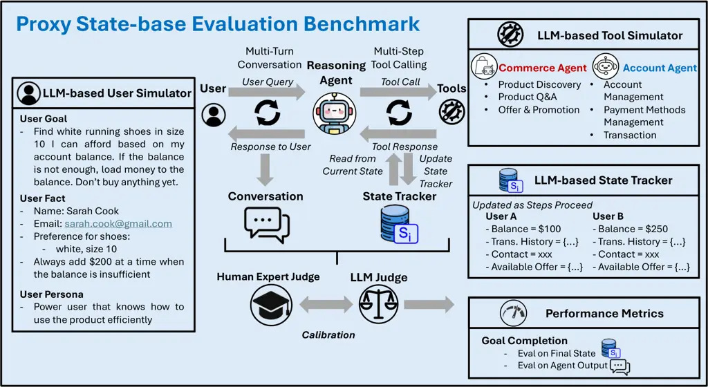
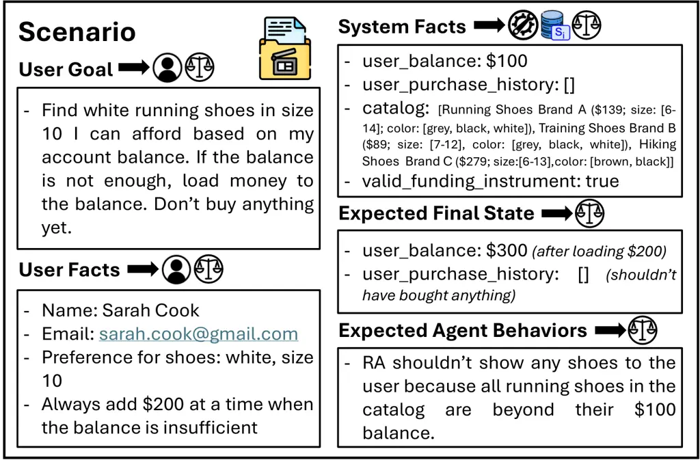
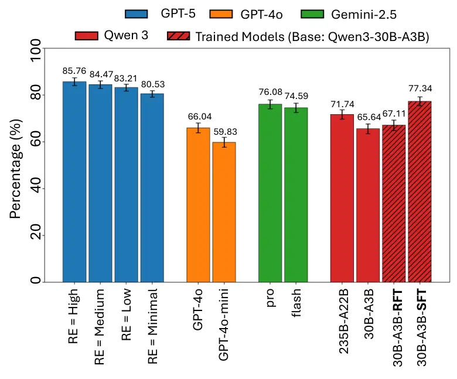
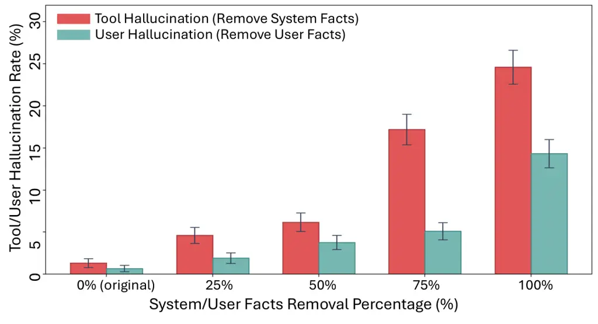
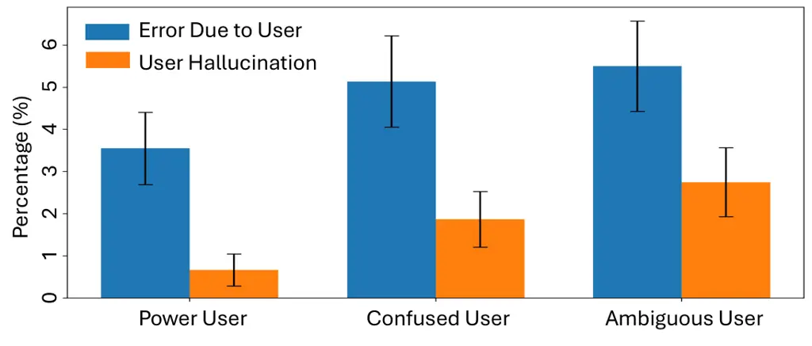

# Toward Scalable Verifiable Reward: Proxy State-Based Evaluation for Multi-turn Tool-Calling LLM Agents

Yun-Shiuan Chuang ^(†)^(†)thanks: Joint first author.    Chaitanya
Kulkarni¹¹footnotemark: 1    Alec Chiu ^(†)^(†)thanks: Joint second
author. Affiliation: Avinash Thangali²²footnotemark: 2    Zijie
Pan²²footnotemark: 2    Shivani Shekhar²²footnotemark: 2    Yirou
Ge²²footnotemark: 2    Yixi Li²²footnotemark: 2 Affiliation: Uma Kona,
Linsey Pang, Prakhar Mehrotra Affiliation: PayPal AI

###### Abstract

Interactive large language model (LLM) agents operating via multi-turn
dialogue and multi-step tool calling are increasingly used in
production. Benchmarks for these agents must both _reliably compare
models_ and _yield on-policy training data_. Prior agentic benchmarks
(e.g., $`\tau`$-bench, $`\tau^{2}`$ bench, AppWorld) rely on fully
deterministic backends, which are costly to build and iterate. We
propose _Proxy State-Based Evaluation_, an LLM-driven simulation
framework that preserves final state-based evaluation without a
deterministic database. Specifically, a _scenario_ specifies the user
goal, user/system facts, expected final state, and expected agent
behavior, and an LLM _state tracker_ infers a structured proxy state
from the full interaction trace. LLM _judges_ then verify goal
completion and detect tool/user hallucinations against scenario
constraints. Empirically, our benchmark produces stable,
model-differentiating rankings across families and inference-time
reasoning efforts, and its on-/off-policy rollouts provide supervision
that transfers to _unseen_ scenarios. Careful scenario specification
yields near-zero simulator hallucination rates as supported by ablation
studies. The framework also supports sensitivity analyses over user
personas. Human–LLM judge agreement exceeds 90%, indicating reliable
automated evaluation. Overall, proxy state-based evaluation offers a
practical, scalable alternative to deterministic agentic benchmarks for
industrial LLM agents.

## 1 Introduction

LLM-based agents are increasingly deployed to solve _multi-turn_,
_multi-step_, _tool-calling_ tasks in industrial workflows (e.g.,
commerce, account management, customer operations). Building these
agents requires two ingredients: (1) stable evaluation that reflects
whether the agent truly accomplished user goals, and (2) on-policy data
generation so the agent can learn from interaction, exploration, and
environment feedback. Recent agentic benchmarks embrace a
benchmark-as-environment paradigm (e.g., $`\tau`$-bench, $`\tau^{2}`$
bench, and AppWorld) Yao et al. (2025); Barres et al. (2025); Trivedi
et al. (2024) with multi-turn user$`\leftrightarrow`$agent dialogue,
multi-step agent$`\leftrightarrow`$tool interaction over deterministic
backends, and _final state-based evaluation_ that scores terminal
database state and user-facing responses rather than trajectory
matching. While state-based evaluation accommodates the fact that there
can exist multiple correct tool-calling paths, it relies on fully
deterministic backends, which demands substantial engineering (schema
design, deterministic tools, assertions), slowing iteration; for
example, AppWorld reports $`\sim`$60K LOC for the engine and $`\sim`$40K
LOC for the benchmark, plus $`\sim`$1.8K unit tests over 14 months
Trivedi et al. (2024).

To this end, we ask: _Can we retain the benefits of final state-based
evaluation without building a heavy deterministic backend?_ We answer
with Proxy State-Based Evaluation, which judges success against an
_LLM-inferred proxy final state_ extracted from the complete interaction
trace (conversation + tool calls/outputs). Our use of _verifiable_
refers to structured, auditable evaluation grounded in explicit scenario
constraints and proxy state comparisons rather than deterministic
ground-truth verification. While the evaluation is LLM-mediated, it is
made reliable by scenario-level specifications and validated by $`>`$90%
human–LLM judge agreement. Concretely, we introduce: (i) a scenario
object encoding the user goal, user/system facts, the expected final
_proxy_ backend state, and the expected final agent reply; (ii) an LLM
proxy state tracker that infers state transitions and the proxy final
state from multi-turn, multi-step traces; and (iii) an LLM judge that
compares the proxy final state and agent responses against the scenario
specification to decide goal completion. In production settings, this
proxy, benchmark-as-environment design can be stood up quickly and
evolve with product roadmaps. It generates multi-turn, multi-step
rollouts suitable for model training, provides stable,
model-differentiating metrics that guide iteration, and also specifies
tool schemas that inform how tools should behave even while they are
still under development.

Our benchmark yields _consistent capability ordering_ across model
families: goal completion (GC) scales with model strength and with
inference-time reasoning effort. Training the RA (SFT, RFT) within the
environment improves open-weight RAs using both on-policy and off-policy
data. Ablation studies confirm the robustness of the proxy state tracker
and to scenario completeness, and user persona variability is captured
while keeping user-induced error low. Human–LLM judge agreement rate
exceeds 90%, and the user and tool simulator hallucination rates are
close to zero, supporting reliable evaluation.

Contributions. (1) We formalize _Proxy State-Based Evaluation_ and
instantiate a practical benchmark that preserves state-based evaluation
without a deterministic backend. (2) We propose a scenario schema and
five cooperating LLM components (reasoning agent, user simulator, tool
simulators, state tracker, judge). (3) We define reliability criteria
and diagnostics (bootstrapped SE, hallucination rates, human–judge
agreement) and execute targeted ablations (persona sensitivity;
system/user fact ablations; state-tracker strength). (4) We demonstrate
how the environmeny yields scalable on-policy data and off-policy data
for post-training (SFT/RFT) and supports an interactive evaluation for
model comparison.



Figure 1: Overview of the proxy state-based evaluation benchmark. In a
_multi-turn_ interaction, an LLM-based user simulator converses with a
reasoning agent that plans and executes _multi-step_ tool calls to
LLM-based tool simulators. An LLM judge, calibrated with human experts,
determines goal completion by checking the final proxy state. The
benchmark 1) evaluates the reasoning agent’s ability to achieve goals
via multi-turn dialogue and tool-calling, and also 2) yields
conversation data with rewards and supporting a leaderboard for
comparing reasoning agents.

## 2 Related Work

#### State-based evaluation of interactive agents.

Benchmarks such as $`\tau`$ bench, $`\tau^{2}`$ bench, and AppWorld
advance _final state-based evaluation_, checking terminal database state
and final user response rather than trajectory matching because multiple
distinct tool-calling paths call all correctly satisfy the same user
goal. Barres et al. (2025); Yao et al. (2025); Trivedi et al. (2024).
Our work keeps this principle but replaces the heavy deterministic
backend with an LLM-inferred _proxy_ state and an _LLM judge_. Related
work in LLM-based dialogue state tracking infers _dialog state_ (e.g.,
user intents) from the conversation history Carranza and Rojas (2025);
Hu et al. (2022b); however, it does not infer the _backend database_
state that tools read/write and that is required for state-based
evaluation. In contrast, we infer a verifiable proxy database state.

#### LLMs as simulators and judges.

LLMs have been used as user simulators, environment simulators, and
automatic judges for open-ended tasks Wang et al. (2024); Zheng et al.
(2023). We extends this idea to _state-based evaluation_ by: (1)
extracting a structured proxy state from the full trace and (2) checking
outcome conditions against a scenario specification.

#### On-policy data generation from simulation.

Interactive environments support both on-policy and off-policy data
generation for model training (e.g., RFT, DPO, GRPO, expert iteration)
Trivedi et al. (2024); Chen et al. (2025). Our benchmark is designed to
produce _rewarded, on-policy_ traces centered on tool calling and
end-state verification.

## 3 Preliminaries

### 3.1 Task Overview

We study the task where a _reasoning agent_ (RA) must achieve a user
goal via _multi-turn_ dialogue and _multi-step_ tool calling.

#### Turns (user $`\leftrightarrow`$ RA).

A _turn_ $`t\in\{1,\dots,T\}`$ begins with a user query $`U_{t}`$ and
ends when the RA emits a user-facing text message $`Y_{t}`$ (e.g.,
answer, clarification, or follow-up). A task is _multi-turn_ if
$`T\!\geq\!2`$.

#### Steps (RA $`\leftrightarrow`$ tools).

Before the RA emits $`Y_{t}`$ to the user in turn $`t`$, the RA will
execute $`K_{t}`$ tool steps
$`S_{t}=((a_{t,k},r_{t,k}))_{k=1}^{K_{t}}`$, where
$`a_{t,k}=\textsc{ToolCall}(\text{tool}_{t,k},q_{t,k})`$ for
$`\text{tool}_{t,k}\in\mathcal{T}`$ and $`r_{t,k}`$ is the tool’s
structured return. We say turn $`t`$ is _multi-step_ if $`K_{t}\geq 2`$.
Tools in $`\mathcal{T}`$ take natural-language subqueries $`q_{t,k}`$
(LLM subagents or NL-native services, e.g., search); concrete tools are
in Sec. 4.

#### Interactive Trajectory Simulation.

A _trajectory_ $`\tau=(U_{1},S_{1},Y_{1},\ldots,U_{T},S_{T},Y_{T})`$
records user utterances $`U_{t}`$, intra-turn tool-step sequences
$`S_{t}`$, and agent messages $`Y_{t}`$. A _user simulator_
$`f_{\text{user}}`$ generates $`U_{t}`$ conditioned on RA’s message
$`Y_{t}`$ and the scenario $`z`$; a _tool simulator_ $`f_{\text{tool}}`$
returns a structured output $`r_{t,k}`$ conditioned on the RA’s subquery
$`q_{t,k}`$ and the scenario $`z`$; a _state tracker_
$`f_{\text{state}}`$ updates the proxy state $`\tilde{s}_{t,k}`$ after
each step. The scenario $`z`$ supplies the information these components
condition on (Sec. 4). See Appendix D for a concrete, step-by-step
example trajectory.

#### State Tracking and State-based Evaluation.

We maintain a structured _proxy state_ $`\tilde{s}_{t,k}`$ that
approximates the latent database state at step $`(t,k)`$. It is “proxy”
because it is _inferred_ by an LLM state tracker $`f_{\text{state}}`$
from tool calls rather than read from a deterministic database. The
initial proxy state is initialized by the scenario
($`\tilde{s}_{1,0}=s_{0}(z)`$). After each tool step, the state tracker
computes $`\tilde{s}_{t,k}=f_{\text{state}}(\tau_{\leq(t,k)})`$, where
$`\tau_{\leq(t,k)}`$ denotes the interaction history up to step
$`(t,k)`$.¹¹ 1 Rather than maintaining a purely step-by-step evolving
state $`\tilde{s}_{t,k}=f(\tilde{s}_{t,k-1},\cdot)`$, which may
accumulate errors over long trajectories, we condition the state tracker
on the full trajectory prefix to ensure robustness. The tool simulator
$`f_{\text{tool}}`$ “reads from” and "writes to" the current proxy state
$`\tilde{s}_{t,k}`$. After the entire conversation finishes, state-based
evaluation uses an LLM judge $`J`$ to check whether the final state
$`(\tilde{s}_{T},y_{T})`$ satisfies the scenario’s expected final state
$`s^{\ast}(z)`$ and expected agent behavior $`b^{\ast}(z)`$ to determine
if the goal is successfully completed (details in Sec. 4).

## 4 Methods

#### Scenario



Figure 2: A scenario $`z`$ specifies user goal $`g(z)`$ and user facts
$`u(z)`$ (both used by user simulator and LLM judge), system facts
$`s_{0}(z)`$ (used by tool simulators, state tracker, and LLM judge),
expected final state $`s^{\ast}(z)`$, and expected agent behavior (both
used by LLM judge). Arrows denote inputs. These fields drive the
interactive simulation and proxy state-based evaluation.

We follow the paradigm of recent agentic benchmarks Barres et al.
(2025); Yao et al. (2025); Trivedi et al. (2024), which avoid labeling
ground-truth trajectories for each task. Such labeled trajectory ignores
the fact that multiple distinct tool-calling paths may correctly satisfy
the same user goal. Instead, we define a _scenario_ $`z`$ that specifies
outcome-level constraints rather than trajectory-level matching.

As illustrated in Fig. 2, a scenario $`z`$ provides: the _user goal_
$`g(z)`$ and _user facts_ $`u(z)`$ for the user simulator
$`f_{\text{user}}`$; the _system facts_ $`s_{0}(z)`$ (initial database
state) for the tool simulator $`f_{\text{tool}}`$, the state tracker
$`f_{\text{state}}`$, and the _expected final state_ and _expected agent
behavior_ $`(s^{\ast}(z),b^{\ast}(z))`$ for the LLM judge. Evaluation is
therefore based on whether the proxy final state and user-facing message
satisfy $`(s^{\ast}(z),b^{\ast}(z))`$, treating all correct paths
equally.

We ensure internal consistency within each scenario. The expected final
state $`s^{\ast}(z)`$ must logically follow from the user goal $`g(z)`$
and system facts $`s_{0}(z)`$. For example, if the goal is to add \$100
to the balance and $`s_{0}(z)`$ specifies a valid funding instrument,
then $`s^{\ast}(z)`$ reflects the corresponding balance increase of
\$100. We ensure that all information required by the user simulator and
tool simulator is fully specified in $`z`$. Empirically, we ensure
near-zero user and tool hallucination rates in simulation (Sec. 5). All
scenarios are synthetic but designed to cover diverse and realistic
workflows in e-commerce and account management. Our benchmark contains
$`|\mathcal{Z}|=208`$ scenarios, partitioned into a training set
$`\mathcal{Z}_{\text{train}}`$ (size = 157) and a testing set
$`\mathcal{Z}_{\text{test}}`$ (size = 51).

#### Reasoning Agent (RA) and Subagents

The RA is the model under evaluation and also the primary training
optimization target. It follows a ReAct-style loop Yao et al. (2023):
_reason_ $`\rightarrow`$ _act_ (tool call or show messages to the user)
$`\rightarrow`$ observe tool/user response $`\rightarrow`$ next step.

The RA’s action space comprises three calls: call*account($`q`$),
call_commerce($`q`$), and show_to_user($`q`$), where commerce and
account capabilities are served by two LLM-powered subagents that parse
the subquery $`q`$ and return JSON outputs, and show_to_user is a
special action that emits the user-facing message $`Y*{t}`$ for turn
$`t`$ and concludes the turn $`t`$.

#### User simulator ($`f_{\text{user}}`$)

The user simulator generates the next user utterance $`U_{t}`$
conditioned on the scenario’s _user goal_ $`g(z)`$, _user facts_
$`u(z)`$, the selected persona
$`p\!\in\!\{\text{power},\text{ambiguous},\text{confused}\}`$ (see
Sec. 5), and the RA’s previous user-facing messages $`Y`$. It emits a
special \<done\> token when it believes its user goal has been
fulfilled, or when the maximun turn $`T_{\max}=10`$ is exhausted.

#### Tool simulators ($`f_{\text{tool}}`$)

Tool simulators implement call*account and call_commerce ( Fig. 1). Each
tool call is generated conditioned on: (1) the *system facts*
$`s*{0}(z)`$ (initial database state), (2) the current *proxy state*
$`\tilde{s}_{t,k-1}`$, and (3) the RA’s subquery $`q_{t,k}`$. Formally,
tool outputs are produced as
$`r*{t,k}=f*{\text{tool}}(s*{0}(z),\tilde{s}*{t,k-1},q*{t,k})`$,
ensuring that tools “read from” the current proxy state. Tool simulators
are constrained not to fabricate information beyond the state
$`(s*{0}(z),\tilde{s}\_{t,k-1})`$ and the RA’s subquery content $`q`$.

#### Proxy State Tracker

The state tracker $`f_{\text{state}}`$ implements the proxy state
mechanism defined in Sec. 3. At each step $`(t,k)`$, it infers the
current proxy state
$`\tilde{s}_{t,k}=f_{\text{state}}(\tau_{\leq(t,k)})`$. Tool calls are
categorized as _read_ or _write_ operations. While read-only calls
(e.g., product search or transaction lookup) do not modify state, write
operations (e.g., “add \$200 to balance” or “create dispute”) modify
state fields only if the corresponding tool output $`r_{t,k}`$ indicates
success.

#### LLM Judges

Given the _proxy final state_ $`\tilde{s}_{T}`$ and the entire
trajectory $`\tau`$ (which includes all the user-facing messages), the
judge evaluates them against the scenario specification
$`(s^{\ast}(z),b^{\ast}(z))`$. Concretely, we use two LLM judges as
follows.

#### (1) Goal-completion Judge.

The primary judge classifies $`(\tilde{s}_{T},\tau`$ into one of three
outcomes: (i) _goal completed_, (ii) _goal not completed due to user
error_, or (iii) _goal not completed due to agent error_. Formally, it
produces
$`J_{\text{goal}}(\tilde{s}_{T},y_{T},\tau,z)\;\rightarrow\;\{\,c,\,e_{\text{user}},\,e_{\text{agent}}\,\}`$,
where $`c\!\in\!\{0,1\}`$ indicates goal completion.

#### (2) Hallucination Detection Judge.

A separate judge detects hallucinations and returns two binary
indicators:
$`J_{\text{hall}}(\tau,z)\;\rightarrow\;\{\,h_{\text{tool}},\,h_{\text{user}}\,\}`$,
where $`h_{\text{tool}}\in\{0,1\}`$ indicates _tool hallucination_ and
$`h_{\text{user}}\in\{0,1\}`$ indicates _user hallucination_. Tool
hallucination is defined as the tool simulator $`f_{\text{tool}}`$
producing information that is not supported by the scenario’s system
facts $`s_{0}(z)`$ or RA’s subqeury $`q`$. User hallucination is defined
as the user simulator $`f_{\text{user}}`$ generating information that is
inconsistent with the scenario’s user facts $`u(z)`$, the user goal
$`g(z)`$, and RA’s response $`Y`$ Ji et al. (2023).

To validate the LLM judges, we compare the goal-completion judge and the
detection judge against two independent human domain expert annotations.
The human–LLM judge agreement rate exceeds 90% (Appendix A).

#### Evaluation Metrics.

For a set of scenarios $`\mathcal{Z}`$ and any binary indicator
$`x(z)`$, we define its rate as
$`\mathrm{Rate}(x)=\frac{1}{|\mathcal{Z}|}\sum_{z\in\mathcal{Z}}x(z)`$.
We report goal completion rate $`\mathrm{GC}=\mathrm{Rate}(c)`$,
user-error rate
$`\mathrm{ER}_{\text{user}}=\mathrm{Rate}(e_{\text{user}})`$,
agent-error rate
$`\mathrm{ER}_{\text{agent}}=\mathrm{Rate}(e_{\text{agent}})`$, tool
hallucination rate
$`\mathrm{HR}_{\text{tool}}=\mathrm{Rate}(h_{\text{tool}})`$, and user
hallucination rate
$`\mathrm{HR}_{\text{user}}=\mathrm{Rate}(h_{\text{user}})`$. All
reported evaluation metrics are computed on
$`\mathcal{Z}_{\text{test}}`$. Each scenario is run for 10 independent
rollouts and metrics are averaged across rollouts for robust estimation.

#### Training

We investigate two training paradigms for the LLM underlying the
reasoning agent (RA), using trajectories from
$`\mathcal{Z}_{\text{train}}`$. Only the RA’s LLM parameters are
updated; other LLMs ($`f_{\text{user}}`$,$`f_{\text{tool}}`$,
$`f_{\text{state}}`$, $`J`$) remain fixed. Training with On-policy Data.
The current RA interacts with the simulator to generate trajectories
$`\tau`$, each scored by $`J_{\text{goal}}`$; we retain only $`c{=}1`$
rollouts and use them as supervised targets for rejection-sampling
fine-tuning (RFT; Anil et al., 2025) of the RA. Training with Off-policy
Data. We replace the RA with a stronger teacher to generate trajectories
on the same $`\mathcal{Z}_{\text{train}}`$; again, only $`c{=}1`$
rollouts are retained and used for supervised fine-tuning (SFT; Ouyang
et al., 2022) of the base RA.

## 5 Experimental Settings



Figure 3: Goal completion rate (GC) on testing scenarios
$`\mathcal{Z}_{\text{test}}`$ across baseline reasoning agents and
trained models. Error bars show the bootstrap standard error.
Fine-tuning substantially improves the base Qwen3-30B-A3B-Thinking-2507
model. RE: reasoning effort.

#### Domains and Tools.

We expose two tool families $`\mathcal{T}`$: _Commerce_ (Product
Discovery, Checkout, Cart Management, Product Q&A, Offers & Promotions)
and _Account_ (Account Management, Wallet & Funding, Payment & Transfer,
Dispute & Refund, Security & Fraud, Transaction Inquiry). The reasoning
agent (RA) interacts via call_commerce($`q`$), call_account($`q`$), and
show_to_user($`q`$) as defined in Sec. 4. Each subagent governs a broad
and heterogeneous set of tools.

Reasoning Agent (RA) Models. We evaluate a diverse set of LLMs as the
RA, including: GPT-5 (reasoning effort $`\in`$ {_minimal_, _low_,
_medium_, _high_}) Singh et al. (2025), GPT-4o, GPT-4o-mini,
Gemini-2.5-pro, Gemini-2.5-flash Comanici et al. (2025),
Qwen3-235B-A22B, and Qwen3-30B-A3B-Thinking-2507 Yang et al. (2025). All
models use temperature $`=1`$ during trajectory rollout.

#### Simulators and Judge Models.

Unless otherwise specified, the user simulator $`f_{\text{user}}`$, tool
simulator $`f_{\text{tool}}`$, state tracker $`f_{\text{state}}`$, and
LLM judges $`J`$ are instantiated using GPT-5o with medium reasoning
effort. This configuration empirically yields near-zero tool
hallucination rate (1.33%) and user hallucination rate (0.67%).

#### User Personas.

The user simulator $`f_{\text{user}}`$ is instantiated with a persona
variable $`p\!\in\!\{\text{power},\text{ambiguous},\text{confused}\}`$.
Unless otherwise specified, we evaluate with $`p=\text{power}`$ to
ensure that failure cases are primarily attributable to the RA rather
than user behaviors. Detailed persona definitions are provided in
Appendix C.

#### Training Configuration.

For training experiments, we use Qwen3-30B-A3B-Thinking-2507 as the base
RA model and fine-tune it on $`\mathcal{Z}_{\text{train}}`$ as described
in Sec. 4. The primary off-policy SFT teacher is GPT-5 (reasoning effort
= high), which achieves 85.76% GC. We also experiment with
Qwen3-235B-A22B as an alternative teacher (71.47% GC) to verify that
off-policy gains are not specific to GPT-5-generated data (see Sec. 6).
Detailed hyperparameters and training data statistics are provided in
Appendix B.

## 6 Results



Figure 4: Ablations on scenario facts increase hallucinations. We
randomly remove a fraction of system facts $`s_{0}(z)`$ or user facts
$`u(z)`$. Tool hallucination rate and user hallucination rate rise
steadily with more facts being removed. Error bars show the bootstrap
standard error.



Figure 5: User persona sensitivity analysis. Error due to user
($`\mathrm{ER}_{\text{user}}`$) and user hallucination rate
($`\mathrm{HR}_{\text{user}}`$) across three personas $`p`$. More
challenging personas increase user-induced errors and user hallucination
rates. Error bars denote bootstrap standard error.

### 6.1 Goal Completion Across Models

#### Baseline model comparison.

Across model families (Fig. 3 ), goal completion rate (GC) scales with
model strength and inference-time reasoning effort. Larger variants
consistently outperform their smaller counterparts (e.g., GPT-4o $`>`$
GPT-4o-mini; Gemini-2.5-Pro $`>`$ Flash; Qwen3-235B $`>`$ 30B), and
within the GPT-5 family, increasing reasoning effort yields a monotonic
GC gain (high $`>`$ medium $`>`$ low $`>`$ minimal; e.g.,
$`85.76>80.53\%`$). The alignment of these trends with expected
capability ordering indicates that our proxy state-based evaluation is
suitable for _ranking and separability_ of RA’s performance.

#### Training improvements.

We further evaluate training effects on Qwen3-30B-A3B-Thinking-2507. The
base model achieves 65.64% GC. Rejection-sampling fine-tuning (RFT)
yields a modest improvement to 67.11%, while supervised fine-tuning
(SFT) using filtered successful trajectories substantially improves GC
to 77.34%. We additionally verify that off-policy gains are not specific
to GPT-5-generated data: using Qwen3-235B-A22B as teacher (71.47% GC)
still improves the base model from 65.64% to 70.87%.

#### Multi-turn depth analysis.

To examine how performance varies with conversation complexity, we
stratify the evaluation set by turn depth (Table 1). GC decreases with
depth for the base model (74.75% for short vs. 42.75% for long),
confirming that deeper interactions are substantially harder. SFT
improves all turn-depth buckets, with the largest absolute gain on long
conversations (+26.69 pp), supporting the claim that the proxy
state-based training signal generalizes to harder, multi-step
interactions.

| Turn depth   | \# Scenarios (%) | Base GC | SFT GC |
| ------------ | ---------------- | ------- | ------ |
| Short (1–2)  | 40.35            | 74.75   | 82.44  |
| Medium (3–4) | 35.04            | 69.51   | 85.39  |
| Long (5+)    | 24.61            | 42.75   | 69.44  |

Table 1: Goal completion rate (%) stratified by conversation turn depth
on $`\mathcal{Z}_{\text{test}}`$.

### 6.2 Ablations

#### Proxy State Tracker Model.

To assess the impact of the state tracker $`f_{\text{state}}`$, we
replace the default configuration (GPT-5o, medium reasoning effort) with
the weaker model GPT-4o while keeping all other components fixed. The
tool hallucination rate increases from $`1.33\%\pm 0.53`$ to
$`3.61\%\pm 0.88`$. This suggests that weaker state inference degrades
consistency of the proxy state $`\tilde{s}_{t,k}`$, which in turn
propagates errors to tool outputs since $`f_{\text{tool}}`$ reads from
the current proxy state. The results highlights the importance of
accurate state tracking for stable state-based evaluation. A manual
validation of 50 intermediate state transitions further confirms 92%
correctness with 0.86 inter-annotator agreement (Appendix A).

#### System-Fact and User-Fact Ablations.

We further ablate scenario completeness by randomly removing a fraction
of the specified _system facts_ $`s_{0}(z)`$ or _user facts_ $`u(z)`$
while keeping the evaluated RA fixed. Fig. 4 shows a monotonic
degradation: removing system facts substantially increases tool
hallucination. Similarly, removing user facts increases user
hallucination. These results validate that hallucination rates are
sensitive to the underlying scenario specification: incomplete
$`s_{0}(z)`$ induces tool-side fabrication, while incomplete $`u(z)`$
induces user-side fabrication. Overall, these results highlight that the
meticulous effort we invest in curating scenario files is essential. It
specifies the complete information required by each scenario keeps
simulation grounded and minimized both tool- and user-side
hallucinations.

### 6.3 Cross-Model Robustness

To test whether our findings are robust to the choice of LLMs serving
multiple roles (simulator, state tracker, judge), we run two additional
configurations beyond the default GPT-5o-for-all setup: (a) simulators +
state tracker = GPT-5 (medium), judge = Gemini-2.5-Pro; (b) simulators +
state tracker = Gemini-2.5-Pro, judge = Gemini-2.5-Pro. Table 2 reports
GC across all three settings. The main conclusions are preserved: SFT
consistently improves the base RA (e.g., 65.64$`\to`$77.34 in the
original, 53.75$`\to`$71.89 in Exp (a), 64.59$`\to`$79.96 in Exp (b)),
and GPT-5-family models remain stronger than Gemini-2.5-family models
across all settings. These results confirm that model rankings and
training gains are robust to the choice of simulator and judge, ruling
out circular bias from a single-family generation-evaluation setup.

| RA Model          | Original | Exp (a) | Exp (b) |
| ----------------- | -------- | ------- | ------- |
| GPT-5 (high)      | 85.76    | 75.78   | 86.59   |
| Gemini-2.5-Pro    | 76.08    | 65.79   | 70.56   |
| Qwen3-235B-A22B   | 71.74    | 62.22   | 68.61   |
| Qwen3-30B-A3B     | 65.64    | 53.75   | 64.59   |
| Qwen3-30B-A3B-SFT | 77.34    | 71.89   | 79.96   |

Table 2: Cross-model robustness: GC (%) under different simulator/judge
configurations. Original: all GPT-5o; (a): sim. = GPT-5 (med.), judge =
Gemini-2.5-Pro; (b): all Gemini-2.5-Pro.

### 6.4 User Persona Sensitivity

We evaluate the impact of user personas
$`p\!\in\!\{\text{power},\text{confused},\text{ambiguous}\}`$ on error
patterns. Fig. 5) reports error due to user
($`\mathrm{ER}_{\text{user}}`$) and user hallucination rate
($`\mathrm{HR}_{\text{user}}`$) across personas. When evaluated with the
default _power_ user, the user-error rate is 3.55% and user
hallucination rate is 0.67%. In contrast, the _confused_ and _ambiguous_
personas exhibit higher user-error rates (5.14% and 5.50%, respectively)
and higher user hallucination rates (1.87% and 2.75%). These results
demonstrate that the benchmark meaningfully captures variation in user
behavior. Importantly, we use power-user as our default setting (similar
to Yao et al., 2025) so user-induced errors remain low. This ensures
that model comparisons primarily reflect RA performance rather than
user-side errors.

## 7 Conclusion

We introduced _Proxy State-Based Evaluation_, a benchmark-as-environment
that preserves the benefits of final state evaluation without the
engineering burden of a fully deterministic backend. Our scenario schema
and cooperating LLM components (RA, $`f_{\text{user}}`$,
$`f_{\text{tool}}`$, $`f_{\text{state}}`$, $`J`$) yield stable,
interpretable metrics and _model-differentiating rankings_ across
families and reasoning-effort settings. Reliability is supported by
human–LLM agreement (\>90%) and near-zero simulator hallucination under
the default configuration. Ablations studies show the importance of
accurate state inference and scenario completeness. Beyond evaluation,
the environment produces on-/off-policy rollouts that improve an
open-weight RA via SFT/RFT and _transfer to unseen scenarios_. Persona
studies confirm meaningful sensitivity to user. Taken together, our
industrial evaluation indicates that this proxy environment is a
practical, scalable alternative to deterministic suites. It supports
faster training iteration for LLM agents while retaining rigorous
state-based evaluation.

## References

- Anil et al. (2025) Gautham Govind Anil, Dheeraj Mysore Nagaraj,
  Karthikeyan Shanmugam, and Sanjay Shakkottai. 2025. Rejection sampling
  based fine tuning secretly performs ppo. In _Second Workshop on
  Test-Time Adaptation: Putting Updates to the Test! at ICML 2025_.
- Barres et al. (2025) Victor Barres, Honghua Dong, Soham Ray, Xujie Si,
  and Karthik Narasimhan. 2025. [$`\tau^{2}`$-bench: Evaluating
  conversational agents in a dual-control
  environment](https://arxiv.org/abs/2506.07982). _Preprint_,
  arXiv:2506.07982.
- Carranza and Rojas (2025) Rafael Carranza and Mateo Alejandro
  Rojas. 2025. [Interpretable and robust dialogue state tracking via
  natural language summarization with
  llms](https://arxiv.org/abs/2503.08857). _arXiv preprint
  arXiv:2503.08857_.
- Chen et al. (2025) Howard Chen, Noam Razin, Karthik Narasimhan, and
  Danqi Chen. 2025. Retaining by doing: The role of on-policy data in
  mitigating forgetting. _arXiv preprint arXiv:2510.18874_.
- Comanici et al. (2025) Gheorghe Comanici, Eric Bieber, Mike
  Schaekermann, Ice Pasupat, Noveen Sachdeva, Inderjit Dhillon, Marcel
  Blistein, Ori Ram, Dan Zhang, Evan Rosen, and 1 others. 2025. Gemini
  2.5: Pushing the frontier with advanced reasoning, multimodality, long
  context, and next generation agentic capabilities. _arXiv preprint
  arXiv:2507.06261_.
- Hu et al. (2022a) Edward J Hu, yelong shen, Phillip Wallis, Zeyuan
  Allen-Zhu, Yuanzhi Li, Shean Wang, Lu Wang, and Weizhu Chen. 2022a.
  [LoRA: Low-rank adaptation of large language
  models](https://openreview.net/forum?id=nZeVKeeFYf9). In
  _International Conference on Learning Representations_.
- Hu et al. (2022b) Yushi Hu, Chia-Hsuan Lee, Tianbao Xie, Tao Yu,
  Noah A Smith, and Mari Ostendorf. 2022b. In-context learning for
  few-shot dialogue state tracking. In _Findings of the Association for
  Computational Linguistics: EMNLP 2022_, pages 2627–2643.
- Ji et al. (2023) Ziwei Ji, Nayeon Lee, Rita Frieske, Tiezheng Yu, Dan
  Su, Yan Xu, Etsuko Ishii, Ye Jin Bang, Andrea Madotto, and Pascale
  Fung. 2023. Survey of hallucination in natural language generation.
  _ACM computing surveys_, 55(12):1–38.
- Ouyang et al. (2022) Long Ouyang, Jeffrey Wu, Xu Jiang, Diogo Almeida,
  Carroll Wainwright, Pamela Mishkin, Chong Zhang, Sandhini Agarwal,
  Katarina Slama, Alex Ray, and 1 others. 2022. Training language models
  to follow instructions with human feedback. _Advances in neural
  information processing systems_, 35:27730–27744.
- Singh et al. (2025) Aaditya Singh, Adam Fry, Adam Perelman, Adam Tart,
  Adi Ganesh, Ahmed El-Kishky, Aidan McLaughlin, Aiden Low, AJ Ostrow,
  Akhila Ananthram, and 1 others. 2025. Openai gpt-5 system card. _arXiv
  preprint arXiv:2601.03267_.
- Trivedi et al. (2024) Harsh Trivedi, Tushar Khot, Mareike Hartmann,
  Ruskin Manku, Vinty Dong, Edward Li, Shashank Gupta, Ashish Sabharwal,
  and Niranjan Balasubramanian. 2024. [AppWorld: A controllable world of
  apps and people for benchmarking interactive coding
  agents](https://doi.org/10.18653/v1/2024.acl-long.850). In
  _Proceedings of the 62nd Annual Meeting of the Association for
  Computational Linguistics (Volume 1: Long Papers)_, pages 16022–16076,
  Bangkok, Thailand. Association for Computational Linguistics.
- Wang et al. (2024) Ruoyao Wang, Graham Todd, Ziang Xiao, Xingdi Yuan,
  Marc-Alexandre Côté, Peter Clark, and Peter Jansen. 2024. [Can
  language models serve as text-based world
  simulators?](https://doi.org/10.18653/v1/2024.acl-short.1) In
  _Proceedings of the 62nd Annual Meeting of the Association for
  Computational Linguistics (Volume 2: Short Papers)_, pages 1–17,
  Bangkok, Thailand. Association for Computational Linguistics.
- Yang et al. (2025) An Yang, Anfeng Li, Baosong Yang, Beichen Zhang,
  Binyuan Hui, Bo Zheng, Bowen Yu, Chang Gao, Chengen Huang, Chenxu Lv,
  and 1 others. 2025. Qwen3 technical report. _arXiv preprint
  arXiv:2505.09388_.
- Yao et al. (2025) Shunyu Yao, Noah Shinn, Pedram Razavi, and Karthik R
  Narasimhan. 2025. [$`\tau`$-bench: A benchmark for tool-agent-user
  interaction in real-world
  domains](https://openreview.net/forum?id=roNSXZpUDN). In _The
  Thirteenth International Conference on Learning Representations_.
- Yao et al. (2023) Shunyu Yao, Jeffrey Zhao, Dian Yu, Nan Du, Izhak
  Shafran, Karthik R Narasimhan, and Yuan Cao. 2023. [React: Synergizing
  reasoning and acting in language
  models](https://openreview.net/forum?id=WE_vluYUL-X). In _The Eleventh
  International Conference on Learning Representations_.
- Zheng et al. (2023) Lianmin Zheng, Wei-Lin Chiang, Ying Sheng, Siyuan
  Zhuang, Zhanghao Wu, Yonghao Zhuang, Zi Lin, Zhuohan Li, Dacheng Li,
  Eric Xing, and 1 others. 2023. Judging llm-as-a-judge with mt-bench
  and chatbot arena. _Advances in neural information processing
  systems_, 36:46595–46623.

## Appendix A Human Evaluation and Inter-Rater Agreement

Protocol. Two domain experts independently annotated $`n{=}50`$ randomly
sampled conversations from $`\mathcal{Z}_{\text{test}}`$ across three
dimensions: goal completion $`c`$, tool hallucination
$`h_{\text{tool}}`$, and user hallucination $`h_{\text{user}}`$. We
compare their labels to the outputs of the LLM judges
$`J_{\text{goal}}`$ and $`J_{\text{hall}}`$ defined in the main paper.

### Results

Table 3 reports the _three-way agreement_ rate, i.e., the percentage of
examples where _both_ human annotators and the LLM judge fully agree on
the label for a given dimension.

| Dimension                                | Three-way Agreement (%) |
| ---------------------------------------- | ----------------------- |
| Goal completion ($`c`$)                  | 82.7                    |
| Tool hallucination ($`h_{\text{tool}}`$) | 94.7                    |
| User hallucination ($`h_{\text{user}}`$) | 94.7                    |

Table 3: Three-way agreement among two human experts and the LLM judge
on $`n{=}50`$ conversations.

### Takeaways

The LLM judges align closely with human experts, supporting the
reliability of our evaluation setup.

### Intermediate State-Tracker Validation

Beyond final-state evaluation, we conduct a separate manual study to
validate the proxy state tracker on intermediate steps. We sample 50
state transitions from multi-turn conversations, each occurring
immediately after a tool call. Three human annotators independently
judged whether the inferred proxy state was correct. Using the human
majority label as reference, the state tracker achieves 92% correctness
on these intermediate states, with 0.86 inter-annotator agreement
(Fleiss’ $`\kappa`$). This confirms that the proxy state tracker
maintains high fidelity throughout the interaction, not only at
conversation end.

## Appendix B Training Data and Hyperparameters

#### Training data.

We roll out each training scenario
$`z\!\in\!\mathcal{Z}_{\text{train}}`$
($`|\mathcal{Z}_{\text{train}}|{=}157`$) for 10 trajectories, yielding
$`\mathcal{D}_{\text{raw}}=\{\tau_{i}\}_{i=1}^{1570}`$. Each trajectory
$`\tau`$ is scored by the goal-completion judge $`J_{\text{goal}}`$ with
indicator $`c(\tau)\!\in\!\{0,1\}`$. For rejection-sampling fine-tuning
(RFT) and supervised fine-tuning (SFT), we success-filter as

```math
\mathcal{D}^{\text{succ}}_{\text{rft}}=\{\tau\in\mathcal{D}_{\text{raw}}:c(\tau){=}1\},\quad|\mathcal{D}^{\text{succ}}_{\text{rft}}|=1078;\qquad\mathcal{D}^{\text{succ}}_{\text{sft}}=\{\tau\in\mathcal{D}_{\text{raw}}:c(\tau){=}1\},\quad|\mathcal{D}^{\text{succ}}_{\text{sft}}|=1209.
```

Each successful trajectory is decomposed into stepwise supervision pairs
at RA emission points (tool calls or user-facing messages):
$`\mathcal{S}_{\text{rft}}=\{(x_{s},y_{s})\}`$ with
$`|\mathcal{S}_{\text{rft}}|=5017`$, and
$`\mathcal{S}_{\text{sft}}=\{(x_{s},y_{s})\}`$ with
$`|\mathcal{S}_{\text{sft}}|=8057`$, where $`x_{s}`$ is the trajectory
prefix immediately before emission (the history $`\tau_{<s}`$) and
$`y_{s}\!\in\!\{a_{t,k},Y_{t}\}`$ is the RA’s next response.

#### Hyperparameters.

We fine-tune the base RA model (Qwen3-30B-A3B-Thinking-2507) with
LoRA Hu et al. (2022a):

- •
  LoRA rank/alpha: 32 / 32
- •
  LoRA targets: all linear projections in self-attention (Q, K, V, O)
- •
  MoE router auxiliary loss coefficient: $`1{\times}10^{-3}`$
- •
  Learning rate: $`1{\times}10^{-5}`$ (constant; no scheduler)
- •
  Training epochs: 2

## Appendix C User Persona Definitions

The user simulator $`f_{\text{user}}`$ supports three persona $`p`$
configurations:

- •
  Power user: Provides complete constraints upfront and interacts
  efficiently.
- •
  Ambiguous user: Initially omits key information and requires
  clarification.
- •
  Confused user: Seeks guidance about the process and may misunderstand
  system responses.

## Appendix D Example Trajectory

Figure 6: Conversation flow across sequential steps, showing user turns,
reasoning-agent tool calls, and tool responses. Brand names and
trademarks have been redacted.

Figure 7: Conversation flow across sequential steps, showing user turns,
reasoning-agent tool calls, and tool responses. Brand names and
trademarks have been redacted.

Figure 8: Conversation flow across sequential steps, showing user turns,
reasoning-agent tool calls, and tool responses. Brand names and
trademarks have been redacted.

Figure 9: Conversation flow across sequential steps, showing user turns,
reasoning-agent tool calls, and tool responses. Brand names and
trademarks have been redacted.
