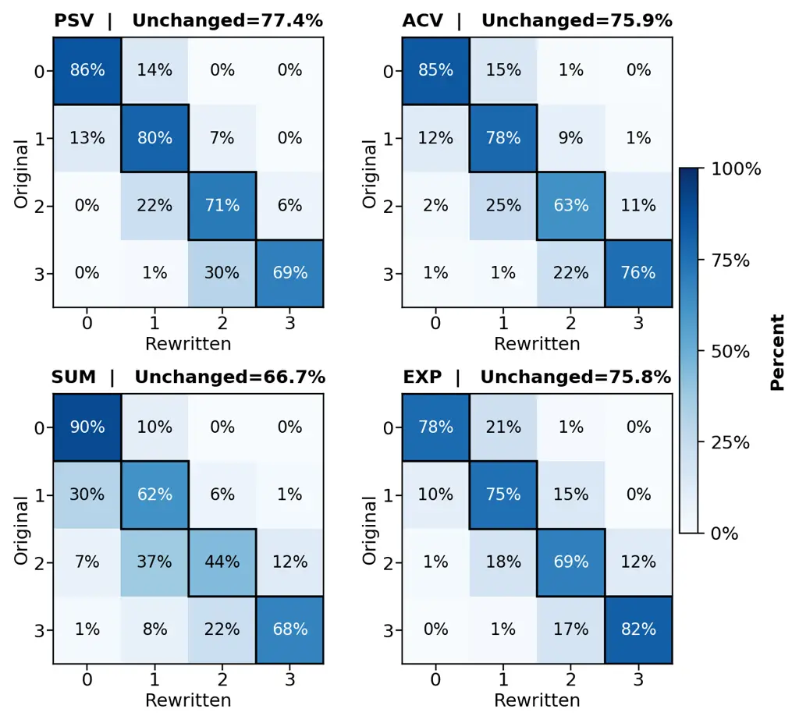

# When LLM Judges Inflate Scores: Exploring Overrating in Relevance Assessment

Conference: Proceedings of the 49th International ACM SIGIR Conference
on Research and Development in Information Retrieval; July 20–24, 2026;
Melbourne, VIC, AustraliaProceedings of the 49th International ACM SIGIR
Conference on Research and Development in Information Retrieval (SIGIR
’26), July 20–24, 2026, Melbourne, VIC,
AustraliaDOI: [10.1145/3805712.3809905](https://doi.org/10.1145/3805712.3809905)ISBN: 979-8-4007-2599-9/2026/07CCS: Information
systems Relevance assessment

Chuting Yu

email: <v.yu@uq.edu.au> Affiliation: The University of Queensland,
Brisbane, Australia , Hang Li email: <hang.li@uq.edu.au>
Affiliation: The University of Queensland, Brisbane, Australia , Guido
Zuccon email: <g.zuccon@uq.edu.au> Affiliation: The University of
Queensland, Brisbane, Australia , Joel Mackenzie email:
<joel.mackenzie@uq.edu.au> Affiliation: The University of Queensland,
Brisbane, Australia and Teerapong Leelanupab email:
<t.leelanupab@uq.edu.au> Affiliation: The University of Queensland,
Brisbane, Australia

© cc

###### Abstract.

Human relevance assessment is time-consuming and cognitively intensive,
limiting the scalability of Information Retrieval evaluation. This has
led to growing interest in using large language models (LLMs) as proxies
for human judges. However, it remains an open question whether LLM-based
relevance judgments are reliable, stable, and rigorous enough to match
humans for relevance assessment. In this work, we conduct a study of
overrating behavior in LLM-based relevance judgments across model
backbones, evaluation paradigms (pointwise and pairwise), and passage
modification strategies. We show that models consistently assign
inflated relevance scores --- often with high confidence --- to passages
that do not genuinely satisfy the underlying information need, revealing
a system-wide bias rather than random fluctuations in judgment.
Furthermore, controlled experiments show that LLM-based relevance
judgments can be highly sensitive to passage length and surface-level
lexical cues. These results raise concerns about the usage of LLMs as
drop-in replacements for human relevance assessors, and highlight the
urgent need for careful diagnostic evaluation frameworks when applying
LLMs for relevance assessments. Our code and results are publicly
available.¹¹ 1
[https://github.com/chutingyu/Exploring-Overrating](https://github.com/chutingyu/Exploring-Overrating)

###### Keywords: 

LLMs, Overrating Bias, Relevance Judgment, Relevance Cues

^(†)^(†)cc-license: by-nc-nd

## 1. Introduction and Background

Building reliable relevance annotations for evaluation has long been a
central challenge in Information Retrieval (IR). Cranfield-style
collections (Cleverdon, 1967), such as TREC DL (Craswell et al., 2020;
Craswell et al., 2021), rely on trained assessors to annotate
query-document pairs, costing substantial time and effort (Soboroff,
2025), while crowdsourced annotations often suffer from limited
reliability (Guo et al., 2023; Rahmani et al., 2025; Damessie et al.,
2017). Large language models (LLMs) offer a potential alternative by
enabling relevance judgments to be generated rapidly and at scale.

Recent studies report that LLM-based relevance judgments can closely
align with human assessments. Thomas et al. (2024) employed real
searcher feedback to select LLM–prompt configurations aligned with user
preferences, demonstrating performance comparable to human assessors in
identifying strong systems and difficult queries. These findings were
reproduced and extended by Upadhyay et al. (2024a), who further released
the open-source UMBRELA framework (Upadhyay et al., 2024b).  Upadhyay et
al. (2025) showed that LLM-generated judgments can replace traditional
human labels at the _run level_ in the TREC 2024 RAG Track, with limited
benefit from additional human-in-the-loop intervention.

While LLMs have shown to be effective annotation tools, their potential
shortcomings as relevance assessors remains insufficiently understood.
LLM-based judgments raise several issues. For example, Alaofi et al.
(2024) show that LLMs are vulnerable to keyword stuffing, systematically
overrating non-relevant passages that contain query terms by assigning
inflated relevance labels. Inflated relevance labels, as compared to
humans, have been reported in prior work (Upadhyay et al., 2025; Meng et
al., 2025). This behavior also demonstrates how strong _aggregate_
performance can obscure judgment-level errors, which can directly impact
downstream evaluation tasks. Moreover, using LLMs as both a retrieval
method and as an evaluation (labeling) method introduces circularity,
confounding true system improvements with LLM-specific
preferences (Clarke and Dietz, 2024). These issues highlight the
potential risks when adopting LLMs as relevance assessors.

Since IR systems are measured over the set of relevance labels for a
given set of topics, these labels serve as an upper bound on measurable
effectiveness. When relevance judgments are generated by LLMs, this
upper bound is implicitly shaped by the models’ own judgment behaviors.
LLM-based relevance assessments tend to exhibit label inflation (e.g.,
assigning a document a higher relevance label than that assigned by a
human assessor), which may distort evaluation signals and mask genuine
differences in retrieval quality. However, it remains unclear how
widespread this behavior is in different model families and evaluation
settings.

In this work, we conduct a systematic analysis of overrating behavior in
LLM-based relevance judgments across two TREC datasets (DL2019 and
DL2020), and four open-source LLMs (Llama-3.2-3B, Gemma-3-4B,
Mistral-7B, and Qwen-3-8B), on both pointwise and pairwise evaluation
paradigms. We analyze overrating at both the label level, and via
token-level confidence, to examine whether it reflects random
fluctuations or a systematic model bias. To examine the role of semantic
understanding, we further conduct controlled passage-rewriting
experiments, varying passage length and syntactic voice²² 2 i.e., the
grammatical relationship between a verb and its subject, determining
whether the subject performs (active) or receives (passive) the action.
while preserving meaning, and experiment with varying the content of
non-relevant passages to isolate the effects of lexical overlap and
surface relevance cues.

## 2. Overrating Behavior in LLM Judges

We first analyze overrating in LLM-based relevance assessment in terms
of both the labels, and the confidence of the assessment.

#### Label Overrating.

Overrating in LLM-based relevance judgments occurs when LLMs assign
quality valuations that exceed the ground truth established by human
assessors. In pointwise evaluation (binary and graded), overrating
manifests through an upward shift in the distribution of LLM-assigned
labels relative to human labels. In pairwise evaluation, overrating is
implicit due to the comparative nature of the task. Assuming that graded
relevance labels imply a strict human preference (e.g., $`2>0`$), two
failure modes emerge: _lack of discrimination_, where the model predicts
a tie despite a clear human preference, and _preference hallucination_,
where a lower-grade passage is preferred over a higher-grade one.

#### Model Confidence and Stability.

Beyond label inflation, we analyze the token-level confidence on the
LLM’s predicted label or preference. In the pointwise setting, we
determine _confidently incorrect_ prediction as cases where the model
assigns near-deterministic probabilities (i.e., softmax probabilities
approaching 1.0) to incorrect label tokens, which are measured by the
normalized logits on the generation of the label. In the pairwise
setting, instability manifests where the LLM yields varying preferences
under positional swapping (e.g., $`A>B`$ vs. $`B>A`$) while still
assigning high confidence to the assessments.

### 2.1. Experimental Setup

We conduct experiments on the TREC Deep Learning (DL) Track passage
ranking tasks from 2019-2020 (Craswell et al., 2020; Craswell et al.,
2021), using human relevance labels (0–3) as ground truth. We evaluate
four open-weight LLMs: Llama-3.2-3B (Grattafiori et al., 2024),
Gemma-3-4B (Team, 2025), Mistral-7B (Jiang et al., 2023), and
Qwen-3-8B (Yang et al., 2025) under both pointwise and pairwise
settings.

In the pointwise setting, we consider both binary relevance (0
“Non-relevant”, 1 “Relevant”) and graded relevance (0 “Non-relevant”, 1
“Related”, 2 “Highly relevant”, 3 “Perfectly relevant”). We apply
variations of the UMBRELA prompt (Upadhyay et al., 2024b) for all
judgment tasks. Each configuration is evaluated in terms of label
overrating and model confidence.

#### Pointwise Evaluation.

For pointwise judgments, we measure label inflation through two metrics:
(1) Overrate Ratio, the proportion of the instances where the LLM
assigns a relevance label exceeding the human label; and (2) Mean Bias,
the average signed difference between LLM-assigned labels and human
relevance labels (LLM minus Human). We additionally report Cohen’s
$`\kappa`$ to analyze agreement with human judgments. These metrics
collectively quantify both the magnitude and distributional patterns of
label inflation exhibited by different LLMs. To understand model
confidence, we binarized both the human and LLM judgments according to
the TREC standard.³³ 3 Not relevant: $`0`$ and $`1`$; Relevant:
$`\geq 2`$. See:
[https://trec.nist.gov/data/deep2019.html](https://trec.nist.gov/data/deep2019.html)
Then, we aggregate the token-level confidence according to the True
Positive (TP), True Negative (TN), False Positive (FP), and False
Negative (FN) classes when comparing the human and LLM judgment pairs.
Our intuition is that models may be less confident for incorrect (FP or
FN) judgments.

#### Pairwise Evaluation.

For pairwise judgment, passages are grouped per query into three
categories: _Best_ (top-graded relevant), _Acceptable_ (relevant, but
not the highest grade), and _Unacceptable_ (non-relevant) (Arabzadeh and
Clarke, 2025). We sampled 20 pairs per query from each of the following
settings: _Best vs. Acceptable_; _Acceptable vs. Unacceptable_; and
_Best vs. Unacceptable._ We treat the higher-class passage as the
ground-truth winner, and pairs are judged in _both_ presentation orders.
We force the LLM to prefer one of the two documents, rather than
allowing an explicit tie option. As such, we define a _tie_ as the case
where a contradiction arises between the two presentation orderings,
meaning that the judgments cannot be linearized. This indicates that the
model cannot reliably distinguish the relevance difference between the
passages. Therefore, we interpret such cases as the model treating the
two passages as equally relevant.

Pairwise overrating behavior is measured using _Pairwise Accuracy_
(Acc), the overall proportion of correctly ordered pairs (including
ties), and _Pairwise Accuracy without Ties_ (Acc (No Ties)), which
excludes tied predictions and evaluates only non-tied comparisons. We
also compute the _Tie Rate_, capturing failures to discriminate between
passages of unequal quality, and the _Wrong Wins Rate_, measuring cases
where the lower-grade passage is explicitly preferred over the
higher-grade one in _both_ presentations. We report the average
token-level confidence on the set of correctly-ordered preferences and
the set of incorrectly-ordered preferences.

### 2.2. Results: Pointwise Judgment

|      |         |               |       |                |       |           |       |                    |       |                |       |       |       |
| ---- | ------- | ------------- | ----- | -------------- | ----- | --------- | ----- | ------------------ | ----- | -------------- | ----- | ----- | ----- |
|      | Model   | Overrated (%) |       | Underrated (%) |       | Mean Bias |       | Cohen’s $`\kappa`$ |       | Avg Confidence |       |       |       |
|      |         | Bin.          | Grad. | Bin.           | Grad. | Bin.      | Grad. | Bin.               | Grad. | TP             | FP    | TN    | FN    |
| DL19 | Gemma   | 37.81         | 61.84 | 3.74           | 8.36  | 0.341     | 0.736 | 0.246              | 0.107 | 0.987          | 0.989 | 0.989 | 0.977 |
|      | Llama   | 18.82         | 49.72 | 11.09          | 12.17 | 0.077     | 0.564 | 0.304              | 0.163 | 0.902          | 0.881 | 0.958 | 0.914 |
|      | Mistral | 21.53         | 54.23 | 7.45           | 10.45 | 0.141     | 0.557 | 0.369              | 0.150 | 0.939          | 0.932 | 0.951 | 0.904 |
|      | Qwen    | 20.62         | 47.02 | 6.10           | 10.3  | 0.145     | 0.459 | 0.421              | 0.215 | 0.977          | 0.976 | 0.991 | 0.986 |
| DL20 | Gemma   | 44.78         | 66.51 | 1.66           | 5.36  | 0.431     | 0.895 | 0.163              | 0.088 | 0.983          | 0.979 | 0.986 | 0.981 |
|      | Llama   | 18.57         | 51.11 | 6.21           | 8.00  | 0.124     | 0.691 | 0.265              | 0.149 | 0.908          | 0.870 | 0.920 | 0.871 |
|      | Mistral | 22.32         | 55.08 | 4.35           | 7.47  | 0.180     | 0.646 | 0.293              | 0.140 | 0.941          | 0.925 | 0.937 | 0.910 |
|      | Qwen    | 23.42         | 44.59 | 2.79           | 6.61  | 0.206     | 0.516 | 0.338              | 0.235 | 0.977          | 0.974 | 0.986 | 0.968 |

Table 1. Pointwise overrating and underrating metrics on DL2019 and
DL2020 under binary and graded relevance labels. Average Confidence is
computed under the graded relevance label setting.

Table 1 demonstrates the pervasive nature of overrating across all
models and datasets from our results. We consistently observe that the
overrating ratio is substantially higher than the underrating ratio,
indicating LLMs rarely assign labels lower than human annotators. Since
the two settings use different relevance scales (Section 2.1), we
binarized graded labels based on TREC standard to enable a fair
comparison; the observed overrating ratio becomes lower than that
obtained from direct binary evaluation. This suggests that a substantial
portion of overrating errors in the graded setting occurs within the
relevant or highly relevant categories. Cohen’s $`\kappa`$ is
consistently lower in the graded setting than in the binary setting,
which suggests that LLM judgments are less consistent with human
annotations in finer-grained relevance, although agreement is typically
lower in graded scenarios due to the additional freedom afforded by
having more relevance levels.

Examining the label transition matrices in the graded setting also
reveals that the overrating behavior is dominated by soft errors:
non-relevant passages are rarely assigned the highest relevance score,
but are frequently misclassified as marginally or moderately relevant.
This systematic reluctance to assign the non-relevant label inflates
relevance estimates under graded evaluation.

We determine whether model confidence (token-level logits) can serve as
a reliable proxy for judgment quality in pointwise settings by analyzing
the average confidence scores across TP, TN, FP, and FN predictions.
Ideally, a reliable model should exhibit high confidence for correct
predictions and noticeably lower confidence for errors. Our results
indicate a profound disconnect between correctness and confidence.
Intuitively, TP decisions should carry noticeably higher confidence than
FP decisions. However, our results reveal that the confidence gap is
negligible or even inverted. We observe a universal tendency towards
extreme overconfidence across all models and tasks. In binary scoring,
every model exhibits over 95% confidence not only on TP and TN but also
on FP and FN; we observe a similar pattern of high confidence in graded
setting as showed in Table 1. This phenomenon reveals that, irrespective
of the relevance of the passage, the model is almost always “absolutely
confident” of its decision.

### 2.3. Results: Pairwise Judgment

#### Trend 1: Lack of Discrimination.

As shown in Table 2, the “Tie Rate” is substantial for all models,
ranging from approximately 24% to over 45%. This indicates order-induced
inconsistency (preference flips under swapping), not consistent errors
where the model repeats the same wrong choice. Furthermore, we
investigated how judgment varies with the different graded pairs, as,
intuitively, the _Best vs Unacceptable_ pairs should be the easiest to
discriminate. However, we observed that all four LLMs tested
consistently overrate “Unacceptable” passages, treating them as
qualitatively equivalent to the “Best” passages in nearly _one-third_ of
cases. Moreover, the tie rate increases systematically as the
discrimination task becomes more difficult (e.g., _Best vs Acceptable_),
reflecting the models’ growing inability to distinguish between
relevance grades on such higher difficulty tasks.

#### Trend 2: Indecision vs. Hallucination.

The most revealing commonality across all models is the source of error.
By comparing accuracy and accuracy (no ties) in Table 2, a consistent
behavioral pattern emerges: LLMs are accurate when they express a
decisive preference, while overrating primarily arises from their
tendency to assign equivocal judgments rather than making clear
distinctions. Put simply, when ties are excluded, all models exhibit
strong reliability. Qwen achieves an impressive accuracy (no ties) of
93% on DL2020, and even the lowest performing model exceeds 85%. These
findings suggest that LLMs do not typically hallucinate that a bad
passage is better than a good one (as demonstrated by the rather low
“Wrong Wins” rate); rather, they fail to perceive the quality gap
between the good and bad passages, defaulting to a Tie.

The confidence difference between correct and incorrect judgments is
negligible in the pairwise scenario. On DL2019, Gemma’s average
confidence drops only marginally from 0.979 on correct judgments (Corr.)
to 0.964 on incorrect ones (Incorr.); Llama shows an even smaller gap.
In other words, LLM confidence is virtually indistinguishable,
regardless of judgment correctness.

|      |         |                      |                |          |            |                |         |
| ---- | ------- | -------------------- | -------------- | -------- | ---------- | -------------- | ------- |
|      | Model   | Pairwise Metrics (%) |                |          |            | Avg Confidence |         |
|      |         | Acc.                 | Acc. (No Ties) | Tie Rate | Wrong Wins | Corr.          | Incorr. |
| DL19 | Gemma   | 50.35                | 89.47          | 43.72    | 5.92       | 0.979          | 0.963   |
|      | Llama   | 57.59                | 84.65          | 31.95    | 10.44      | 0.981          | 0.978   |
|      | Mistral | 56.50                | 87.77          | 35.61    | 7.87       | 0.978          | 0.961   |
|      | Qwen    | 50.58                | 92.71          | 45.44    | 3.97       | 0.974          | 0.946   |
| DL20 | Gemma   | 53.78                | 89.52          | 39.92    | 6.29       | 0.989          | 0.970   |
|      | Llama   | 60.01                | 85.46          | 23.78    | 10.20      | 0.982          | 0.981   |
|      | Mistral | 61.36                | 88.19          | 30.42    | 8.21       | 0.984          | 0.964   |
|      | Qwen    | 54.42                | 93.08          | 41.52    | 4.04       | 0.982          | 0.962   |

Table 2. Pairwise preference-judgment results on DL2019 and DL2020.
Average confidence is computed on no-tie cases only for correct and
incorrect preferences.

Analyzing the model confidence on the tied pairs showed that on around
75% of such cases, model confidence exceeded 0.95 on _both presentation
orderings_ even though the preferences were contradictory, indicating a
tendency for the LLMs to express overconfidence even when their
judgments are logically inconsistent. Overall, these results demonstrate
that using confidence as a signal for judgment reliability is not
useful, and is highly sensitive to positional changes.

## 3. Exploring Relevance Cues

Figure 1. Label transition matrices for Qwen under different passage
rewrites. Each heatmap shows normalized transitions from the LLM’s
original assigned relevance labels.

The overrating behaviors observed earlier raise a key question: do LLMs
genuinely assess semantic relevance, or are their judgments
disproportionately driven by surface-level lexical and structural cues?
We evaluate robustness to semantically equivalent structural variations
(syntactic and length changes), where label divergence indicates
reliance on surface cues. We then introduce controlled, query-dependent
sentence insertions into non-relevant passages to disentangle semantic
relevance from lexical overlap.

### 3.1. Semantic-Preserving Structural Variations

We evaluate judgment consistency across four meaning-preserving variants
of each passage to quantify sensitivity to structural form.

#### Syntactic Variation.

LLMs may favor scientific writing styles (Faggioli et al., 2023), where
passive constructions are more common (Fowler, 2015). To test whether
such stylistic cues influence relevance judgments, we rewrite passages
using passive (PSV) and active (ACV) voice, following expert
recommendations favoring the active voice for clarity (Lubis et al.,
2024).

#### Length Variation.

LLMs are known to prefer longer responses regardless of quality (Zheng
et al., 2023; Saito et al., 2023), and input length shifts LLM label
distributions in model-dependent ways (Mohtadi et al., 2026). We
generate summarized (SUM) and expanded (EXP) passage variants while
ensuring semantic equivalence. Comparing relevance scores across these
variants reveals whether passage length is mistakenly treated as a
relevance signal.

#### Generating Structural Variations.

Findings from Balog et al. (2025) indicate no general bias from
LLM-judges to LLM-generated content, even within the same model family.
We use Gemini-2.5-Flash to generate stylistic and length-based content
variations. Unlike Balog et al. (2025), who assume rewriting preserves
relevance (validated by human assessors (Dai et al., 2024)), we perform
an explicit quality-check by prompting Gemini-2.5-Flash to verify that
all rewritten passages preserve the meaning of the original passage.
Across all prompts, we retain only the passages identified as “meaning
preserved.”

#### Sample Strategy.

For each query, we independently sample (at maximum) 20 passages per
predicted relevance label (0–3) for each LLM. For each passage, we
generate four syntactic variants and assess label consistency across
versions to analyze intrinsic model preferences. To avoid redundant
rewriting from overlapping samples across LLMs, passages are pooled only
at the rewriting stage, while each LLM is re-judged and evaluated solely
on its own sampled query–rewritten passage pairs.

#### Results.

Figure 1 shows the results as label transition matrices, capturing the
change in judgment due to the four different passage re-writing
treatments as compared to the original (unedited passage) LLM judgment.
Across all models, passive voice rewrites and active voice rewrites
produce nearly identical effects on LLM judgments, indicating no
systematic preference for one form over the other. Summarization
consistently reduces relevance labels across models, whereas passage
expansion does not consistently inflate relevance labels. Passage
expansion systematically inflates relevance labels for originally
low-relevance passages – but can still degrade labels for highly
relevant passages. These results indicate that even when semantic
meaning is preserved, LLM-based relevance judgments exhibit a clear
tendency to disfavor short passages.

### 3.2. Controlled Lexical–Semantic Variations

Figure 2. SEM, LEX, and QRY variants for the query “do goldfish grow”.
SEM preserves relevance without surface query terms; LEX provides the
query terms such that they are not relevant to the information need; and
QRY simply adds the query itself.

Prior work shows that query terms can cause LLMs to overrate
non-relevant passages (Alaofi et al., 2024). To disentangle lexical
overlap from semantic relevance, we construct three controlled,
query-dependent variants, including Semantic-only (SEM), Lexical-only
(LEX), and Query-only (QRY), by inserting a single sentence at the
beginning of passages originally labeled non-relevant by both human
assessors and LLMs, where injection has the strongest influence on
relevance judgments (Tamber and Lin, 2025). Figure 2 illustrates these
three variants for the example query “do goldfish grow”, where each
injected sentence is prepended to non-relevant passages to re-assess
their relevance.

For the SEM variant, we prompt Gemini-2.5-Flash to generate a single
sentence that directly answers the query while excluding all query terms
after stopword removal. When exact synonyms are unavailable,
dictionary-style paraphrases are used to preserve meaning without
introducing lexical overlap. All generated sentences are manually
verified for semantic correctness and constrained to minimal length to
avoid confounding passage-length effects.

For the LEX variant, we construct a semantically non-relevant sentence
that retains all query terms (excluding stopwords). To strictly control
unigram overlap and eliminate unintended changes to the passage meaning,
we use a fixed, content-neutral template: “The terms $`w_{1}`$,
$`w_{2}`$, …, $`w_{n}`$ are shown together as an example of word
grouping in text data.”, where $`w_{k}`$ represent the $`k`$ individual
query terms.

In the QRY variant, the inserted sentence is the original query string
itself (Alaofi et al., 2024). This design aims to maximize full-query
lexical overlap with the non-relevant passage without introducing
additional semantic content beyond the query.

#### Results.

Figure 3 reports the label distributions after inserting each variant.
Under the SEM condition, the majority of the models assign 1–2 relevance
labels, with perfectly relevant (label 3) rarely assigned, indicating
systematic under-recognition of semantic relevance in the absence of
lexical cues. Under LEX condition, unigram-level lexical overlap alone
is sufficient to elevate relevance labels despite the absence of
semantic alignment. This reveals a strong sensitivity to term-level
lexical cues. While some models (e.g., Gemma) assign labels comparable
to SEM, others (e.g., Qwen) remain largely at label 0, suggesting that
query terms are insufficient to override semantic non-relevance for
stronger models. The QRY condition yields severe overrating: inserting
only query string frequently triggers  *perfectly relevant* labels for
non-relevant passages which confirms prior findings (Alaofi et al.,
2024). Gemma assigns _perfectly relevant_ to the majority of
non-relevant passages once the full query is inserted, while others
(Mistral, Qwen) remain relatively robust. This demonstrates that
full-query lexical anchoring can override semantic judgment in most
cases. Overall, even with semantic understanding, our experiments show
that LLM relevance assessment is disproportionately influenced by
lexical cues, confirming strong lexical anchoring effects across models.

Figure 3. Predicted relevance-label distributions on non-relevant
passages after three query-dependent insertions.

## 4. Conclusion

In this study, we investigated label overrating and model confidence in
LLM-based relevance judgments across multiple open-weight LLMs and
evaluation paradigms. Across all evaluation settings, we showed that
overrating is a system-wide bias, particularly in graded and pairwise
evaluations. Overrating is less pronounced in binary relevance
judgments, suggesting that LLMs may be better suited for coarse-grained
tasks that focus on distinguishing relevant from non-relevant passages.
Through experiments on semantically equivalent passage variations, we
demonstrate that LLM judges are sensitive to passage length even when
semantic content is preserved, while showing comparatively limited
sensitivity to syntactic form. Controlled query-related variant
experiments indicate that, despite some semantic understanding, LLMs
remain strongly influenced by lexical cues, especially direct
query-string overlap. These findings underscore the need for diagnostic
evaluation frameworks that explicitly probe such biases when applying
LLMs for relevance assessment.

## 5. Future Works

The experimental setup relies only on TREC DL datasets, which primarily
consist of short queries paired with relatively short passages. Future
work will extend our analysis to investigate how LLM-based relevance
judges behave in collections, such as TREC-8 (Hawking et al., 2000) and
TREC Robust04 (Voorhees, 2006), contain substantially longer,
multi-topic documents. Another concern is our current study adopts the
UMBRELA prompt as a representative instantiation of LLM-based relevance
judges. Prior work demonstrates that variations in prompt structure can
substantially influence LLM judgment behaviors. Extending beyond a
single prompt is therefore essential to establish the robustness of our
findings. Future work will construct analysis on multiple prompts
spanning reasoning strategies, prompt structures, and persona. These
extensions will strengthen the generalizability of our findings and
position the proposed analysis as a framework for studying LLM judges,
rather than a result tied to a single prompt instantiation.

We acknowledge the concern that modern LLMs may have been exposed to MS
MARCO (Bajaj et al., 2018) or TREC Deep Learning (Craswell et al., 2020;
Craswell et al., 2021) qrels during pre-training (Thomas et al., 2024;
Faggioli et al., 2023), which could inflate apparent agreement with
ground-truth labels through memorization rather than genuine judgment
capability. Our experimental design partially mitigate this risk.
Specifically, the summarization and expansion rewriting generates
passages that are unlikely to have appeared in pre-training, and the
SEM, LEX, and QRY variants are synthetically constructed rather than
directly drawn from the original collection. Hence, the bias patterns we
report in this work cannot be fully explained by memorization of
specific query-passage pairs. However, we cannot fully rule out that
LLMs retain topical or stylistic priors from MS MARCO that bias their
judgments in ways not captured by our controlled perturbations. A
rigorous contamination audit remains an important future work.

###### Acknowledgements.

We thank the anonymous referees for their insightful comments and
suggestions. This work was supported by the UQ HERA initiative and by a
Google Research Scholar grant.

## References

- Alaofi et al. (2024) M. Alaofi, P. Thomas, F. Scholer, and M.
  Sanderson LLMs can be Fooled into Labelling a Document as Relevant:
  best café near me; this paper is perfectly relevant. In Proceedings of
  the 2024 Annual International ACM SIGIR Conference on Research and
  Development in Information Retrieval in the Asia Pacific Region,
  SIGIR-AP ’24, Tokyo, Japan, pp. 32–41. External Links:
  [Document](https://dx.doi.org/10.1145/3673791.3698431) Cited by: §1,
  §3.2, §3.2, §3.2.
- Arabzadeh and Clarke (2025) N. Arabzadeh and C. L. A. Clarke
  Benchmarking llm-based relevance judgment methods. In Proceedings of
  the 48th International ACM SIGIR Conference on Research and
  Development in Information Retrieval, SIGIR ’25, Padua, Italy,
  pp. 3194–3204. External Links:
  [Document](https://dx.doi.org/10.1145/3726302.3730305), ISBN
  9798400715921 Cited by: §2.1.
- Bajaj et al. (2018) P. Bajaj, D. Campos, N. Craswell, L. Deng, J.
  Gao, X. Liu, R. Majumder, A. McNamara, B. Mitra, T. Nguyen, M.
  Rosenberg, X. Song, A. Stoica, S. Tiwary, and T. Wang MS MARCO: A
  Human Generated MAchine Reading COmprehension Dataset.
  arXiv:1611.09268v3. Cited by: §5.
- Balog et al. (2025) K. Balog, D. Metzler, and Z. Qin Rankers, Judges,
  and Assistants: Towards Understanding the Interplay of LLMs in
  Information Retrieval Evaluation. In Proceedings of the 48th
  International ACM SIGIR Conference on Research and Development in
  Information Retrieval, SIGIR ’25, Padua, Italy, pp. 3865–3875.
  External Links: [Document](https://dx.doi.org/10.1145/3726302.3730348)
  Cited by: §3.1.
- Clarke and Dietz (2024) C. L. Clarke and L. Dietz LLM-based relevance
  assessment still can’t replace human relevance assessment. arXiv
  preprint arXiv:2412.17156. External Links:
  [Document](https://dx.doi.org/https%3A//doi.org/10.48550/arXiv.2412.17156)
  Cited by: §1.
- Cleverdon (1967) C. Cleverdon The cranfield tests on index language
  devices. Aslib Proceedings 19 (6), pp. 173–194. External Links: ISSN
  0001-253X, [Document](https://dx.doi.org/10.1108/eb050097) Cited by:
  §1.
- Craswell et al. (2020) N. Craswell, B. Mitra, E. Yilmaz, D. Campos,
  and E. M. Voorhees Overview of the trec 2019 deep learning track. In
  Proceedings of the 28th Text REtrieval Conference, TREC, Cited by: §1,
  §2.1, §5.
- Craswell et al. (2021) N. Craswell, B. Mitra, E. Yilmaz, D. Campos,
  and E. M. Voorhees Overview of the trec 2020 deep learning track. In
  Proceedings of the 29th Text REtrieval Conference, TREC, Cited by: §1,
  §2.1, §5.
- Dai et al. (2024) S. Dai, Y. Zhou, L. Pang, W. Liu, X. Hu, Y. Liu, X.
  Zhang, G. Wang, and J. Xu Neural Retrievers are Biased Towards
  LLM-Generated Content. In Proceedings of the 30th ACM SIGKDD
  Conference on Knowledge Discovery and Data Mining, KDD ’24, Barcelona,
  Spain, pp. 526–537. External Links:
  [Document](https://dx.doi.org/10.1145/3637528.3671882) Cited by: §3.1.
- Damessie et al. (2017) T. T. Damessie, T. P. Nghiem, F. Scholer,
  and J. S. Culpepper Gauging the quality of relevance assessments using
  inter-rater agreement. In Proceedings of the 40th International ACM
  SIGIR Conference on Research and Development in Information Retrieval,
  SIGIR ’17, Tokyo, Japan, pp. 1089–1092. External Links:
  [Document](https://dx.doi.org/10.1145/3077136.3080729) Cited by: §1.
- Faggioli et al. (2023) G. Faggioli, L. Dietz, C. Clarke, G.
  Demartini, M. Hagen, C. Hauff, N. Kando, E. Kanoulas, M. Potthast, B.
  Stein, and H. Wachsmuth Perspectives on Large Language Models for
  Relevance Judgment. In Proceedings of the 2023 ACM SIGIR International
  Conference on Theory of Information Retrieval, ICTIR ’23, Taipei,
  Taiwan, pp. 39–50. External Links:
  [Document](https://dx.doi.org/10.1145/3578337.3605136) Cited by: §3.1,
  §5.
- Fowler (2015) H. W. Fowler Fowler’s dictionary of modern english
  usage. Oxford University Press. Cited by: §3.1.
- Grattafiori et al. (2024) A. Grattafiori, A. Dubey, A. Jauhri, A.
  Pandey, A. Kadian, A. Al-Dahle, A. Letman, A. Mathur, A. Schelten, A.
  Vaughan, et al. The llama 3 herd of models. arXiv preprint
  arXiv:2407.21783. External Links:
  [Link](https://arxiv.org/abs/2407.21783) Cited by: §2.1.
- Guo et al. (2023) Z. Guo, R. Jin, C. Liu, Y. Huang, D. Shi,
  Supryadi, L. Yu, Y. Liu, J. Li, B. Xiong, and D. Xiong Evaluating
  large language models: a comprehensive survey. arXiv preprint
  arXiv:2310.19736. External Links:
  [Link](https://arxiv.org/abs/2310.19736) Cited by: §1.
- Hawking et al. (2000) D. Hawking, E. Voorhees, N. Craswell, and P.
  Bailey Overview of the trec-8 web track. Text Retrieval Conference
  (TREC). External Links:
  [Link](https://tsapps.nist.gov/publication/get_pdf.cfm?pub_id=151494)
  Cited by: §5.
- Jiang et al. (2023) A. Q. Jiang, A. Sablayrolles, A. Mensch, C.
  Bamford, D. S. Chaplot, D. de las Casas, F. Bressand, G. Lengyel, G.
  Lample, L. Saulnier, L. R. Lavaud, M. Lachaux, P. Stock, T. L.
  Scao, T. Lavril, T. Wang, T. Lacroix, and W. E. Sayed Mistral 7b.
  arXiv preprint arXiv:2310.06825. External Links:
  [Document](https://dx.doi.org/https%3A//doi.org/10.48550/arXiv.2310.06825)
  Cited by: §2.1.
- Lubis et al. (2024) M. Y. A. Lubis, R. Miranti, and Y. Lubis Passive
  voice and active voice in sentence structure. Journal of Psychology,
  Counseling and Education 2 (1), pp. 59–64. Cited by: §3.1.
- Meng et al. (2025) C. Meng, N. Arabzadeh, A. Askari, M. Aliannejadi,
  and M. de Rijke Query performance prediction using relevance judgments
  generated by large language models. ACM Transactions on Information
  Systems, pp. 1–35. External Links:
  [Document](https://dx.doi.org/10.1145/3736402) Cited by: §1.
- Mohtadi et al. (2026) S. Mohtadi, K. Roitero, S. Mizzaro, and G.
  Demartini The effect of document summarization on llm-based relevance
  judgments. In Proceedings of the 48th European Conference on
  Information Retrieval, ECIR ’26, Delft, The Netherlands, pp. 70–87.
  External Links:
  [Document](https://dx.doi.org/https%3A//doi.org/10.1007/978-3-032-21300-6%5F5)
  Cited by: §3.1.
- Rahmani et al. (2025) H. A. Rahmani, C. Siro, M. Aliannejadi, N.
  Craswell, C. L. A. Clarke, G. Faggioli, B. Mitra, P. Thomas, and E.
  Yilmaz Judging the judges: a collection of llm-generated relevance
  judgements. arXiv preprint arXiv:2502.13908. External Links:
  [Link](https://arxiv.org/abs/2502.13908) Cited by: §1.
- Saito et al. (2023) K. Saito, A. Wachi, K. Wataoka, and Y. Akimoto
  Verbosity bias in preference labeling by large language models. arXiv
  preprint arXiv:2310.10076. External Links:
  [Link](https://arxiv.org/abs/2310.10076) Cited by: §3.1.
- Soboroff (2025) I. Soboroff Don’t use llms to make relevance
  judgments. Information retrieval research journal, pp. 10–54195.
  External Links: [Document](https://dx.doi.org/10.54195/irrj.19625)
  Cited by: §1.
- Tamber and Lin (2025) M. S. Tamber and J. Lin Illusions of relevance:
  using content injection attacks to deceive retrievers, rerankers, and
  llm judges. arXiv preprint arXiv:2501.18536. External Links:
  [Document](https://dx.doi.org/https%3A//doi.org/10.48550/arXiv.2501.18536)
  Cited by: §3.2.
- Team (2025) G. Team Gemma 3. Kaggle. External Links:
  [Link](https://goo.gle/Gemma3Report) Cited by: §2.1.
- Thomas et al. (2024) P. Thomas, S. Spielman, N. Craswell, and B. Mitra
  Large language models can accurately predict searcher preferences. In
  Proceedings of the 47th International ACM SIGIR Conference on Research
  and Development in Information Retrieval, SIGIR ’24, Washington DC,
  USA, pp. 1930–1940. External Links:
  [Document](https://dx.doi.org/10.1145/3626772.3657707) Cited by: §1,
  §5.
- Upadhyay et al. (2024a) S. Upadhyay, R. Pradeep, N. Thakur, D.
  Campos, N. Craswell, I. Soboroff, H. T. Dang, and J. Lin A large-scale
  study of relevance assessments with large language models: an initial
  look. arXiv preprint arXiv:2411.08275. External Links:
  [Link](https://arxiv.org/abs/2411.08275) Cited by: §1.
- Upadhyay et al. (2025) S. Upadhyay, R. Pradeep, N. Thakur, D.
  Campos, N. Craswell, I. Soboroff, and J. Lin A large-scale study of
  relevance assessments with large language models using UMBRELA. In
  Proceedings of the 2025 International ACM SIGIR Conference on
  Innovative Concepts and Theories in Information Retrieval, ICTIR ’25,
  Padua, Italy, pp. 358–368. External Links:
  [Document](https://dx.doi.org/10.1145/3731120.3744605) Cited by: §1,
  §1.
- Upadhyay et al. (2024b) S. Upadhyay, R. Pradeep, N. Thakur, N.
  Craswell, and J. Lin UMBRELA: UMbrela is the (Open-Source Reproduction
  of the) Bing RELevance Assessor. arXiv preprint arXiv:2406.06519.
  External Links:
  [Document](https://dx.doi.org/https%3A//doi.org/10.48550/arXiv.2406.06519)
  Cited by: §1, §2.1.
- Voorhees (2006) E. M. Voorhees Overview of the trec 2005 robust
  retrieval track. Text Retrieval Conference (TREC). External Links:
  [Link](https://tsapps.nist.gov/publication/get_pdf.cfm?pub_id=150643)
  Cited by: §5.
- Yang et al. (2025) A. Yang, A. Li, B. Yang, B. Zhang, B. Hui, B.
  Zheng, B. Yu, C. Gao, C. Huang, C. Lv, C. Zheng, D. Liu, F. Zhou, F.
  Huang, F. Hu, H. Ge, H. Wei, H. Lin, …, and Z. Qiu Qwen3 technical
  report. arXiv preprint arXiv:2505.09388. External Links:
  [Document](https://dx.doi.org/https%3A//doi.org/10.48550/arXiv.2505.09388)
  Cited by: §2.1.
- Zheng et al. (2023) L. Zheng, W. Chiang, Y. Sheng, S. Zhuang, Z.
  Wu, Y. Zhuang, Z. Lin, Z. Li, D. Li, E. P. Xing, H. Zhang, J. E.
  Gonzalez, and I. Stoica Judging llm-as-a-judge with mt-bench and
  chatbot arena. In Proceedings of the 37th International Conference on
  Neural Information Processing Systems, NIPS ’23, New Orleans, USA.
  External Links: [Link](https://dl.acm.org/doi/10.5555/3666122.3668142)
  Cited by: §3.1.
