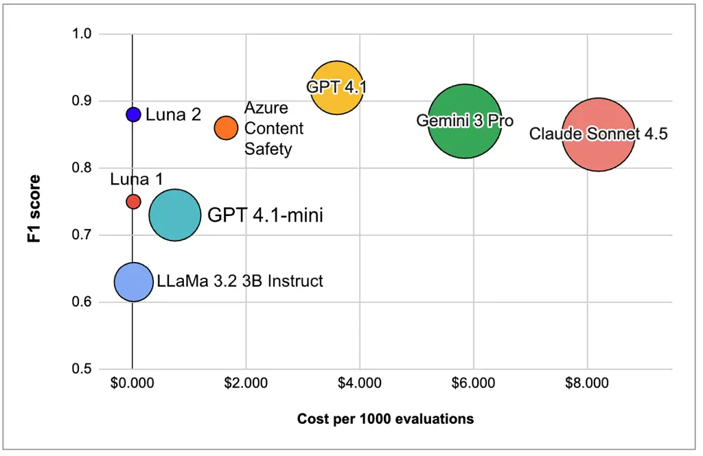
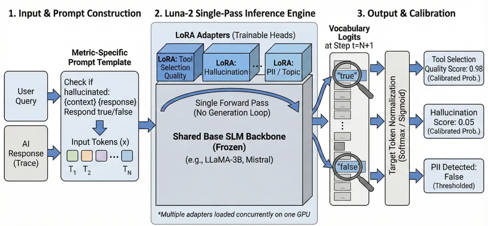
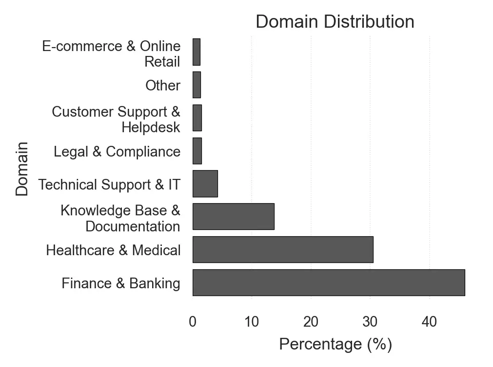
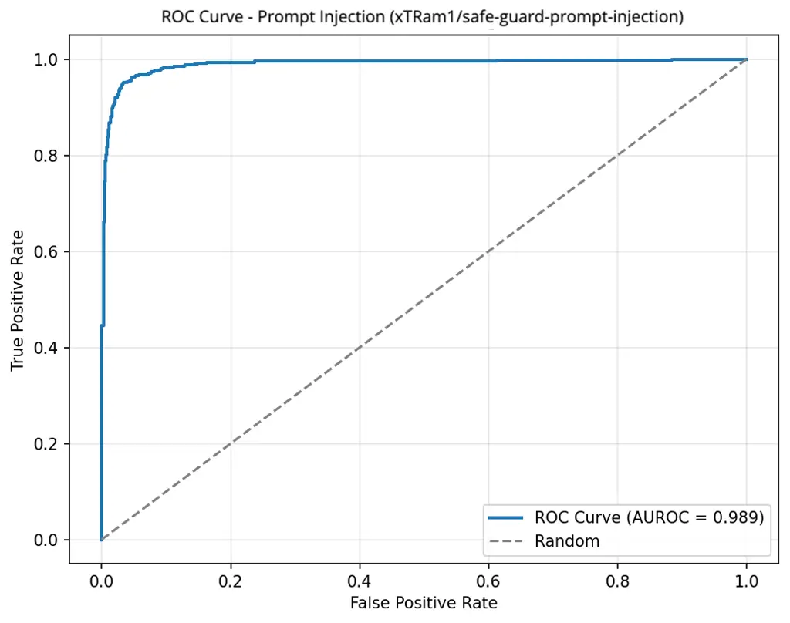
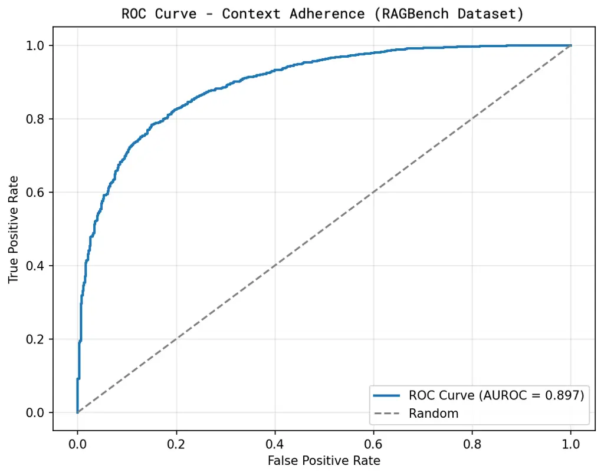

# Luna-2: Scalable Single-Token Evaluation with Small Language Models

Vatsal Goel    Rishon Dsouza    Nikhil Ega    Amey Ramesh Rambatla   
Rob Friel    Shuai Shao    Yash Sheth

###### Abstract

Real-time guardrails require evaluation that is _accurate_, _cheap_, and
_fast_—yet today’s default, LLM-as-a-judge (LLMAJ), is slow, expensive,
and operationally non-deterministic due to multi-token generation. We
present _Luna-2_, a novel architecture that leverages decoder-only small
language models (SLMs) into a _deterministic evaluation model_ to
reliably compute complex task-specific LLMAJ metrics (e.g. toxicity,
hallucination, tool selection quality etc.) at an accuracy at par or
higher than LLMAJ using frontier LLMs while drastically reducing the
cost and latency of computation. Each metric is implemented as a
lightweight LoRA/PEFT head on top of a shared SLM backbone, enabling
hundreds of specialized metrics to run concurrently on a single GPU,
deployable locally next to AI systems in a privacy-preserving and
latency optimizing manner. Across content safety and hallucination
benchmarks, Luna-2 matches the accuracy of state-of-the-art LLM-based
evaluators while reducing inference cost by over 80x and latency by over
20x.

In this paper, we outline the model architecture, training methodology
and report real-world empirical results on accuracy, latency, and
throughput results. In production, Luna-2 is protecting 100M+ AI
sessions and processing over 100B tokens per month for our customers
with eval cost savings of over \$30M annually.

###### Keywords: 

Generative AI, evaluation metrics, RAG, agents, low-latency, small
language models

{vatsal,rishon,nikhil.e,amey,rob,ss,yash}@galileo.ai  
Galileo AI, San Francisco, USA

\icml@noticeprintedtrue



Figure 1: Comparison of Luna-2 with LLM-as-judge and other common
baselines for evaluating guardrails. Note that the Y-axis is the F1
score, X-axis is the cost in dollars per million tokens, and the bubble
size is the latency in milliseconds (shown for comparison).

## 1 Introduction

Deploying generative AI applications (Agents, RAG systems, etc.) safely
at scale requires continuous evaluation of outputs for failures like
hallucinations/ungrounded answers, poor tool selection, prompt
injection, and other safety/privacy issues. The default approach has
been to use _LLM-as-a-judge (LLMAJ)_: prompt a large off-the-shelf model
to critique or score each output. While often effective, enterprise AI
use cases increasingly require 100% observability of their AI
applications in production across multiple LLMAJ metrics and this
approach has some serious drawbacks.

- •
  High Cost: Evaluation of production workloads increase the token
  consumption of AI applications by many-fold due to multiple LLMAJ
  metrics computed on bespoke steps in an AI-powered workflow within an
  application. This greatly increases the cost of running evals on 100%
  of production traffic. This leaves teams to resort to sampling evals
  on production traffic, in turn dealing with a high degree of risk from
  being blind to any unwanted non-determinism.
- •
  High Latency: LLMs have an inherent need to reason out the task at
  hand over multiple tokens in order to generate a high accuracy
  response. (e.g. chain-of-thought (Wei et al., 2022)). This leads to
  slower inference times, making LLMAJ an ineffective method to build
  controls or guardrails for AI applications or AI agents in production.
- •
  Non-determinism: LLMAJ prompts rely on open-ended generation; small
  changes in decoding, prompt wording, or sampling can produce different
  ratings, often requiring repeated polling (Chainpoll) (Friel and
  Sanyal, 2023) to stabilize results.
- •
  Privacy: Privacy and compliance concerns arise when sensitive data is
  sent to external APIs. Anonymization can also lead to inconsistent
  scores as critical aspects of proprietary data are redacted.

In short, LLM-based evaluation is too slow, expensive, and operationally
brittle for real-time guardrails.

Prior work was introduced to solve the same core problem: make
high-quality, low-cost evaluation practical in production (Belyi et al.,
2024). However, that approach used an encoder-style discriminative
classifier stack (e.g., DeBERTa-v3-family models (He et al., 2021)) and
typically required loads of training data ($`\sim`$100K samples) and
hosting an independent backbone per metric. These restrictions made it
very costly to create / manage each metric, making large metric suites
impractical at scale. Moreover, with classification or entailment tasks
not being robust to large variations in the input data, it lead to
frequent maintenance and refreshes of such models.

To address these issues, we introduce _Luna-2_, a model adaptation
methodology to turn a series of open-source small language models (SLMs)
into specialized models for evaluation tasks. Luna-2 uses decoder-only
transformers (e.g. LLaMA-family, Mistral-family, or Qwen-family
backbones (Grattafiori et al., 2024; Jiang et al., 2023; Yang et al.,
2025)) as backbones, but adapts them as single-token classifiers via
fine-tuning. Concretely, for each metric we define a prompt template
asking a question (e.g. “Check if the following output is toxic:”),
include the relevant LLM output, and instruct the model to respond with
exactly one word (e.g. “true” or “false”). We then fine-tune a
lightweight adapter (LoRA) on top of a shared base SLM so that each
metric is just a small head, enabling multi-tenant serving of many
metrics on one backbone (Hu et al., 2021a). During inference, the Luna
model performs a single forward pass and outputs a probability for the
target class token (after normalization), yielding a confidence score.

This design offers several advantages: (1) Latency and Cost: Each metric
requires only one forward pass (and one output token), eliminating
multi-step reasoning. As a result, inference is extremely fast (e.g. 3B
model  150ms for typical inputs on modern GPUs vs 3s for LLMAJ) and
costs drop by 80$`\times`$ (e.g. $`\$0.02`$ per million tokens vs. \$2.0
for GPT 4.1). (2) Simple scoring: By extracting logits for the target
class tokens in a single forward pass, Luna-2 returns a continuous score
for each metric without multi-token generation overhead. (3) Parallel
Metrics: Since fine-tuning is parameter-efficient, hundreds of metrics
(one Luna-2 head per metric) can be loaded on a single GPU for
concurrent evaluation. This throughput boost is crucial for production
systems monitoring many metrics in real time. (4) Customizability: Each
Luna head is a narrow-domain expert (trained on a specific metric). If
the domain changes, the head can be quickly re-tuned on a small in-house
dataset to recover performance.

As illustrated in Figure 1, Luna-2 occupies the low-cost, low-latency,
high-accuracy region of the trade-off space. The plot summarizes F1
(y-axis), cost per million tokens (x-axis), and latency (bubble size)
across common evaluators, highlighting Luna-2’s favorable operating
point for production guardrails.

In this paper, we detail the Luna-2 architecture and training
(Section 3), and present experiments comparing Luna-2 to LLMAJ and open
source baselines (Section 4). We demonstrate comparable accuracy with
dramatically lower latency (Tables 4, 5). We discuss limitations of
specialization and future extensions (Section 5). Our contributions are:

- •
  Single-token SLMs for metrics: We repurpose decoder-only SLMs as
  single-token classifiers for evaluation metrics, including the
  training formulation that maps metric classes to single vocabulary
  tokens with probability normalization for calibrated scores.
- •
  Real-time, low-cost guardrails for production: Leveraging multi-tenant
  LoRA serving, we enable production-grade guardrails that are faster
  and cheaper than existing multi-stage pipelines, supporting real-time
  blocking for any Agentic / RAG applications, with empirical validation
  on cost, latency, and quality.



Figure 2: Luna-2 architecture overview. A shared decoder-only backbone
processes the input prompt, and metric-specific LoRA adapters produce
single-token outputs with calibrated probabilities.

## 2 Related Work

##### LLM-as-Judge Approaches.

The current standard for automated evaluation utilizes large models to
score outputs based on complex rubrics. While effective, these models
suffer from high cost and significant latency. Techniques like
Chain-of-Thought (CoT) and repeated polling (ChainPoll), while improving
accuracy, add additional token and runtime overhead.

##### Standalone Detectors and Faithfulness Metrics.

Beyond LLM judges, specialized detectors offer efficient verification
without invoking massive models at inference time. Techniques like
SelfCheckGPT (Manakul et al., 2023) and Semantic Entropy (Kuhn et al., 2023) identify hallucinations by analyzing agreement across multiple
stochastic model outputs. Others like AlignScore (Zha et al., 2023) and
SummaC (Laban et al., 2021) measure faithfulness through unified
alignment functions that score consistency across diverse tasks or
through atomic decomposition approaches that break text into granular,
individually verifiable facts (Min et al., 2023). Distilled experts like
TrueTeacher (Gekhman et al., 2023) and MiniCheck (Tang et al., 2024)
rival larger judges on synthetic data, while specialized RAG evaluators
like Lynx (Ravi et al., 2024) and HHEM (Li et al., 2024) specifically
target groundedness. Though these detectors substantially reduce runtime
compared to LLM judges, they typically require multi-step pipelines or
auxiliary models, adding complexity and potential error propagation;
necessitating a fundamental shift in how decoder-only architectures are
utilized for discriminative tasks.

##### Encoder Based Classification.

Tracing the evolution of transformer-based text classification
architectures sheds light on the modern approach to efficient
evaluation. Encoder-based models like BERT (Devlin et al., 2019) and
RoBERTa (Liu et al., 2019) dominated industrial text classification
since their inception, with subsequent architectures like DistilBERT
(Sanh et al., 2020) optimizing for inference efficiency and accuracy.
These encoder-centric approaches excelled at traditional classification
tasks such as intent detection, sentiment analysis, and content
moderation at scale. However, they exhibited fundamental limitations for
LLM evaluation tasks: fixed context windows, inability to follow complex
multi-turn instructions, and poor handling of the structured prompts
required for judging generative outputs.

##### Specialization: Small Experts vs. Generalists.

This generative classification paradigm motivates a central question:
can small, domain-specialized models match or exceed the performance of
large general-purpose LLMs? The specialization hypothesis posits that
with task-specific fine-tuning on high-quality data, SLMs can achieve
parity with (or surpass) generalist models on narrow domains (Fu et al.,
2023). This architectural shift enables a favorable trade-off between
cost, latency, and accuracy that is difficult to achieve with generalist
models constrained by their vast parameter count (Zellinger and Thomson,
2025). While standard training typically aims to preserve broad
capabilities, specialized fine-tuning intentionally sacrifices them
(e.g., poetry or code generation), freeing up model capacity to become
highly sensitive to specific guardrail patterns (Luo et al., 2025).
Furthermore, this specialization enables a tight feedback loop:
lightweight adapters can be quickly re-tuned on fresh data to counter
adversarial drift, rather than waiting for infrequent retraining of
large general-purpose models (Xia et al., 2025). Achieving this
efficiently is made possible by parameter-efficient fine-tuning (Xu et
al., 2023) (PEFT) techniques such as LoRA (Hu et al., 2021b), which
enable creating narrow-domain experts without retraining full models.

##### Domain Applications: Safety and RAG.

These techniques find critical applications in safety moderation and
retrieval-augmented generation. Production-grade safety systems include
Llama Guard 3 (Grattafiori et al., 2024), which provides modular
classification across MLCommons 13-hazard taxonomy (Vidgen et al.,
2024). More recently, programmable frameworks like NVIDIA NeMo
Guardrails (Rebedea et al., 2023) have emerged to orchestrate these
checks alongside generation, while benchmarks such as HarmBench (Mazeika
et al., 2024) emphasize the necessity of adversarial robustness against
jailbreaks. For RAG evaluation, systems like RAGAS (Es et al., 2025) and
HaluEval (Li and others, 2023) diagnose retrieval and generation
errors—yet typically rely on multiple calls to large models or
multi-stage scoring pipelines. Newer approaches like ARES (Saad-Falcon
et al., 2024) attempt to reduce this overhead through prediction-powered
evaluation, further validating the need for efficient, specialized
evaluators. Constitutional AI (Bai et al., 2022) further demonstrates
the trade-off between evaluation depth and inference cost. However,
these approaches are largely specialized to security moderation or RAG
evaluation, and do not directly generalize to broader agentic systems
with multi-step tool use and stateful execution.

| Metric Input Node | Variables                  | Metrics                                       |
| ----------------- | -------------------------- | --------------------------------------------- |
| Trace I/O only    | {input}, {output}          | Toxicity, Sexism, Prompt Injection, Tone, PII |
| LLM span          | {input}, {output}          | Context Adherence                             |
| LLM span + tools  | {input}, {output}, {tools} | Tool Selection Quality                        |

Table 1: Example input formats for different Luna metrics, based on
their applied input node



Figure 3: Domain distribution of the Context Adherence training dataset.
The dataset spans multiple domains with Finance & Banking and Healthcare
& Medical representing the largest portions, ensuring robust performance
across diverse production environments.

## 3 Methods

### 3.1 Architecture Overview

Luna-2 uses decoder-only transformer backbones (e.g. LLaMA,
Mistral/Ministral, Qwen). At their core, these SLMs are a
vocabulary-level classifier: given input tokens $`x`$, they compute
logits over its entire vocab for the next token. Traditional generation
picks the highest-probability token and iterates. Luna-2, however,
enforces exactly _one_ output token. Concretely, for each metric we
define a prompt template (no system prompt, just a user prompt)
describing the task and instructing a one-word answer. The prompt
includes placeholders for relevant variables (inputs, outputs, tool
outputs, etc.) as needed for that metric.

In Table 1, we can see the different types of variables across different
metrics. The required placeholders differ across metrics because the
relevant evidence lives in different parts of an application trace, and
we want the metrics inputs to be focused on the most crucial piece of
information. _Trace I/O only_ metrics depend only on the user input and
the LLM response (e.g., toxicity or prompt injection). _LLM span_
metrics evaluate the input / output for a given LLM interaction. There
is another variant of LLM span, where we also add the list of available
tools to the LLM (for agentic usecases), this becomes _LLM span +
tools_. Similarly we also have other span types (retriever span),
looking at full traces / sessions etc.

For example, a boolean metric (context adherence / hallucination
detection) uses a prompt like:

> You are given question, an answer and a reference document. Check if
> the answer is fully supported by the document:
>
> Question:  
> {question}
>
> Answer:  
> {answer}
>
> Documents:  
> {documents}
>
> Respond with true or false.

The model is then constrained to answer with exactly one token (we
choose words that are single tokens; here true and false are assumed
atomic tokens). Luna-2 also extends to multi-class and multi-label
metrics; we demonstrate this empirically in Section 4 with Tone
(multiclass) and PII (multilabel).

##### Shared Backbone, Separate Adapters.

All Luna metrics share the same base SLM weights. Each metric $`m`$ has
its own lightweight adapter (LoRA) parameters. During fine-tuning, we
freeze the base model and only train the adapters. The adapter weights
are generally only 3% of the size of the base model. This means at
inference time, we can activate any subset of metrics by loading the
corresponding adapter weights. Memory and compute cost grow only
modestly per metric, unlike duplicating entire models.

### 3.2 Data Preparation

We utilize a multi-faceted approach to curate training data, ensuring
robust performance across diverse domains. Our strategy combines
real-world data with synthetic augmentation to achieve high coverage and
diversity:

- •
  Human-Annotated Production Data: We leverage anonymized production
  data donated by customers across various domains (e.g., Finance,
  Healthcare). These samples are annotated by team of human labellers,
  ensuring the models are trained on realistic examples that reflect the
  nuances of actual production traffic.
- •
  Synthetic Generation and Adaptation: To ensure coverage of scenarios
  where natural data is scarce, we synthetically generate data using
  frontier LLMs. This involves generating samples that mimic the
  characteristics of production data, as well as applying targeted
  corruption methods (e.g., injecting specific hallucinations into
  faithful responses) to create negative examples. Additionally, we
  identify relevant open-source datasets from a variety of domains and
  use LLMs to rewrite them to align with our specific metric
  definitions.
- •
  LLM Consensus Labeling: In scenarios where large-scale human
  annotation is not feasible (especially for training datasets), we
  employ a “max voting” strategy using an ensemble of diverse, large
  closed-source LLMs from different providers. This allows us to
  generate high-quality pseudo-labels for scaling our training sets.
- •
  Train / Test Split: We construct train / test splits at the level of a
  full interaction trace (or unique input-output pair) to avoid leakage
  from near-duplicate turns across splits. Some of the data sources /
  domains are exclusively reserved for testing to observe
  generalization. The test split is held out and only used for final
  reporting.

Figure 3 shows the domain distribution for our Context Adherence metric
training data across Finance & Banking, Healthcare & Medical, Knowledge
Base & Documentation, and several other domains.

We observe that the required dataset size varies by task complexity,
ranging from $`\sim`$30k examples (e.g., PII) to larger sets of
$`\sim`$100k examples for nuanced reasoning (e.g., Context Adherence).
The ability of Luna-2 to achieve high performance across these varying
data regimes demonstrates its sample efficiency and adaptability.
Crucially, because Luna-2 retains the inherent language modeling
capabilities of the base SLM, it generalizes effectively to the target
tasks from this curated data. Our lightweight fine-tuning recipe further
facilitates this adaptation, allowing the model to learn robust decision
boundaries from these diverse data sources.

### 3.3 Training Procedure

Given a metric and its training dataset, we fine-tune as follows:

Prompt and target construction: We convert each labeled example into a
prompt by filling template placeholders with the example data (see
Table 1). We then define the target token(s) for the metric. For boolean
metrics, there are two targets (true vs false). Crucially, _we ensure
each target word is exactly one vocabulary token_. This is a preflight
check conducted on any base SLM’s vocabulary before we finetune. If our
required classes aren’t available as single tokens, we use other tokens
to symbolize the classes and maintain a mapping (for example:
“true” $`\rightarrow`$ 1, “false” $`\rightarrow`$ 0)

Loss function: For boolean metrics, we use standard cross-entropy over
the target classes. To do this, we restrict the probability distribution
to the relevant class tokens. Let $`V`$ be the model’s full vocabulary
and $`C=\{\texttt{true},\texttt{false}\}`$ be the subset of tokens
representing the metric classes. The standard probability of a token
$`t_{i}`$ from the full vocabulary softmax is:

```math
P_{\text{vocab}}(t_{i})=\frac{\exp(s_{t_{i}})}{\sum_{w\in V}\exp(s_{w})}
```

where $`s_{w}`$ is the logit for token $`w`$. Since we constrain the
output to be within our target set $`C`$, we compute the conditional
probability $`P(t_{i}|C)`$:

```math
P(t_{i}|C)=\frac{P_{\text{vocab}}(t_{i})}{\sum_{t_{j}\in C}P_{\text{vocab}}(t_{j})}
```

Substituting the full softmax expression:

```math
P(t_{i}|C)=\frac{\frac{\exp(s_{t_{i}})}{Z}}{\sum_{t_{j}\in C}\frac{\exp(s_{t_{j}})}{Z}}
```

where $`Z=\sum_{w\in V}\exp(s_{w})`$. The normalization constant $`Z`$
cancels out, simplifying to a softmax over just the target logits:

```math
P(t_{i}|C)=\frac{\exp(s_{t_{i}})}{\sum_{t_{j}\in C}\exp(s_{t_{j}})}
```

For binary metrics (true/false), this reduces to

```math
P(\text{true}|C)=\frac{\exp(s_{\text{true}})}{\exp(s_{\text{true}})+\exp(s_{\text{false}})}\,, \tag{1}
```

We optimize the model using the cross-entropy loss defined over these
conditional probabilities:

```math
\mathcal{L}=-\sum_{t_{i}\in C}y_{t_{i}}\log P(t_{i}|C)
```

where $`y_{t_{i}}\in\{0,1\}`$ is the ground truth label for class
$`t_{i}`$. Only these logits participate in the loss; other vocab
entries are ignored. This encourages the model to assign negligible
probability to irrelevant tokens and concentrate on the two class
tokens.

We fine-tune using AdamW (standard learning rate with decay and warmup)
for a small number of epochs. For LoRA, we specify adapter rank $`r`$,
and scaling $`\alpha`$ (typically on attention projections such as
q_proj, k_proj, v_proj, o_proj); unless otherwise noted we use
$`r{=}16`$, and $`\alpha{=}16`$. In practice, $`\sim`$2k–5k training
examples suffice for stable metric performance.

### 3.4 Inference

At runtime, each Luna metric is evaluated in a single forward pass; we
extract logits at the final unmasked position and normalize over the
class-token set (Algorithm 1).

 Input: logits at final unmasked position; true_token_id, false_token_id

 

 probs = softmax(logits)

 p_true = probs\[true_token_id\]

 p_false = probs\[false_token_id\]

 

 confidence = p_true / (p_true + p_false)

Algorithm 1 Binary-class confidence normalization.

We apply the same procedure by normalizing over the relevant set of
class tokens for the metric.

## 4 Experiments

### 4.1 Accuracy

We evaluate Luna-2 on a suite of guardrail tasks, comparing it to strong
baselines:

- •
  LLM Judge (GPT-4.1) with ChainPoll: Using GPT-4.1 with
  chain-of-thought prompts to score each metric (as often done in
  practice). LLM judged metric are repeated 3 times and averaged. We use
  GPT 4.1 as it is the best non-reasoning model available by OpenAI.
- •
  LLaMA 3B baselines: Directly prompting Llama-3.2-3B-Instruct to output
  a single token, without any finetuning.

Metrics include prompt injection, context adherence, and tool selection
quality. We also include tone (multi-class) and PII (multi-label) to
demonstrate extensibility beyond binary classification. For each metric
we train a Luna-2 head on human / LLM annotated training examples and
validate on human annotated test datasets. We measure: (i) _F1 score_ of
the metric, (ii) _Inference latency_ on GPU (H100, A100, etc.) for
different input lengths, (iii) _Cost_ for a large volume of evaluations

##### Datasets.

- •
  Prompt Injection: We evaluate on the open-source Safe-Guard Prompt
  Injection dataset ¹¹ 1
  [https://huggingface.co/datasets/xTRam1/safe-guard-prompt-injection](https://huggingface.co/datasets/xTRam1/safe-guard-prompt-injection),
  a synthetic dataset with a test split of $`\sim`$2k prompts (1.4k safe
  / 0.6k attacks) generated via a categorical tree of prompt-injection
  types (seeded from open instruction/jailbreak sources and expanded
  with LLMs).
- •
  Context Adherence: We evaluate on an open-source context adherence
  benchmark (Friel et al., 2024), a dataset with $`\sim`$5k examples
  (4.4k adherent / 0.6k non-adherent).
- •
  Tool Selection Quality: We evaluate on BFCL v4 (Patil et al., 2025), a
  multi-component benchmark of several thousand single and multi-turn
  examples that evaluate LLMs’ ability to perform accurate function and
  tool calls across diverse languages, formats, memory tasks, and
  agentic web-search workflows. We sampled the dataset, and then
  re-labelled it according to our metric definition.
- •
  Tone: We use our own internal proprietary test dataset for tone, a
  dataset of $`\sim`$4.5k examples curated by combining multiple
  open-source and proprietary data.
- •
  PII: Similar to above, we use our own internal proprietary test
  dataset for PII.

##### Generalizability.

To test generalization beyond our internal data distributions, we
evaluate Luna-2 heads on open-source benchmarks spanning prompt
injection, context adherence, and tool selection quality. Concretely, we
use Safe-Guard for prompt injection, our own open-source RAG evaluation
benchmark for context adherence, and BFCL v4 for tool selection quality.

Table 2 shows that Luna-2 matches the accuracy of LLM-as-judge with
ChainPoll, while direct single-token prompting of a base SLM has poor
performance. For instance, on context adherence, Luna-2 3B achieves
F1 0.95, comparable to ChainPoll GPT-4.1 (0.96), whereas directly
prompting Llama 3.2 3B to output a single token collapses to 0.43. These
results indicate that specializing the model via fine-tuning is critical
for high-quality, single-token metric evaluation.

To illustrate the scoring behavior of our logit-based confidence scores,
we include ROC curves for the Prompt Injection and Context Adherence
heads in Appendix ROC Curves.

##### Luna-2 is a training paradigm, not a specific backbone.

While many of our headline results use a LLaMA-family 3B model as the
default backbone, Luna-2 is fundamentally a _training and inference
recipe_, independent of the SLM model used. Table 3 shows the
adaptability of Luna-2 across different SLM architectures, including
LLaMA, Mistral, and Qwen backbones. We can see that across different
metrics, the performance achieved is similar for different underlying
architectures.

### 4.2 Latency and Cost

The main advantage of Luna-2 is speed and efficiency. Table 4 compares
cost and latency per metric evaluation by benchmarking Luna-2 on a
representative guardrail task (with an average of $`\sim`$1250 input
tokens) against LLM-as-judge approaches using frontier models with
chain-of-thought prompting and Azure Content Safety.

##### Cost.

For 1000 samples of the representative task, Luna-2 costs only
\$0.01–\$0.02 (depending on model size) versus \$1.65 for Azure Content
Safety and \$2.00 for GPT 4.1. The “Eval Cost” column in Table 4
reflects the total cost for 1000 evaluations at this representative
input length, accounting for both input and output token pricing.

##### Latency.

On the same task, the average inference time on an NVIDIA A100 is about
150 ms for both the 3B and 8B models (see Table 5), while GPT-4.1 takes
$`\sim`$3000 ms—making Luna-2 20$`\times`$ faster. Even on more
accessible hardware such as L40S GPUs, Luna-2 maintains sub-200ms
latency for moderate inputs.

| Metric                 | Methodology       | Model        | F1-Score |
| ---------------------- | ----------------- | ------------ | -------- |
|                        | ChainPoll         | GPT 4.1      | 0.97     |
| Prompt Injection       | Single token      | Llama 3.2 3B | 0.71     |
|                        | Luna-2            | Llama 3.2 3B | 0.94     |
|                        | ChainPoll         | GPT 4.1      | 0.96     |
| Context Adherence      | Single token      | Llama 3.2 3B | 0.43     |
|                        | Luna-2            | Llama 3.2 3B | 0.95     |
|                        | ChainPoll         | GPT 4.1      | 0.95     |
| Tool Selection Quality | Single token      | Llama 3.2 3B | 0.57     |
|                        | Luna-2            | Llama 3.2 3B | 0.94     |
|                        | ChainPoll         | GPT 4.1      | 0.90     |
| Tone (multi-class)     | Single token      | Llama 3.2 3B | 0.66     |
|                        | Luna-2            | Llama 3.2 3B | 0.92     |
|                        | ChainPoll         | GPT 4.1      | 0.88     |
| PII (multi-label)      | Label-constrained | Llama 3.2 3B | 0.21     |
|                        | Luna-2            | Llama 3.2 3B | 0.89     |

Table 2: Accuracy comparison: Luna-2 vs. LLM-as-judge. The LLMAJ prompts
for the binary metrics are shown in Appendix Experiment Prompts.

|              |           |        |          |
| ------------ | --------- | ------ | -------- |
| Model        | Precision | Recall | F1 Score |
| LLaMA-3.2-3B | 0.93      | 0.96   | 0.95     |
| Ministral-3B | 0.87      | 1.00   | 0.93     |
| Qwen-3B      | 0.94      | 0.95   | 0.94     |
| Qwen-4B      | 0.94      | 0.97   | 0.96     |
| LLaMA-3.1-8B | 0.87      | 1.00   | 0.93     |
| Ministral-8B | 0.87      | 1.00   | 0.93     |
| Qwen-8B      | 0.95      | 0.97   | 0.96     |

Table 3: Backbone robustness: Luna-2 performance for context adherence
across common open-source decoder-only SLM backbones.

| Model                         | Eval Cost (\$/1K evals) | Latency (ms) |
| ----------------------------- | ----------------------- | ------------ |
| Luna-2 3B                     | 0.01                    | 150          |
| Azure Content Safety          | 1.65                    | 312          |
| GPT 4.1 mini                  | 0.75                    | 2800         |
| GPT 4.1                       | 3.60                    | 3000         |
| Gemini 3 Pro (”low” thinking) | 5.85                    | 6900         |
| Claude Sonnet 4.5             | 8.20                    | 6700         |

Table 4: Cost and latency comparison: Luna-2 vs. frontier models on a
representative guardrail task (with 1250 average input tokens).

| Model (GPU)      | 500 tokens | 2K tok | 15K tok | 100K tok |
| ---------------- | ---------- | ------ | ------- | -------- |
| Luna-2 3B (H100) | 100        | 100    | 600     | 6000     |
| Luna-2 8B (H100) | 100        | 150    | 1000    | 10000    |
| Luna-2 3B (A100) | 150        | 200    | 1200    | 20000    |
| Luna-2 8B (A100) | 200        | 300    | 2000    | 30000    |

Table 5: Luna-2 inference latency (ms) on different GPUs for various
input lengths (3B and 8B models). These are measured end-to-end per
query (including model forward pass and classification).

The key observation is that Luna-2 latency grows roughly linearly with
input length for short-to-moderate contexts, but for long contexts
(often $`\sim`$10k–20k tokens, depending on model size and GPU)
attention can become the bottleneck and latency can grow superlinearly
(approaching quadratic in the worst case). In practice, this can be
mitigated with engineering techniques such as optimized attention
kernels, KV-cache paging, batching, and context management (e.g.,
chunking/truncation). By contrast, LLM-as-judge would add seconds per
turn even at moderate lengths. In a live system, using Luna-2 allows us
to evaluate typical queries without noticeable delay, enabling
guardrails like blocking harmful inputs / outputs in real time.

##### Throughput.

While a single base SLM backbone typically occupies most of a GPU
(especially for 8B-class models once KV cache and adapter state are
accounted for), Luna-2 scales to large metric suites by hosting _many_
lightweight LoRA adapters (one per metric) on top of that shared
backbone. In practice, we serve Luna metrics via Triton as the serving
platform, with TensorRT-LLM as the underlying inference engine, loading
hundreds of fine-tuned heads in GPU memory for multi-tenant adapter
execution. This results in throughput of thousands of queries/sec for a
suite of metrics, far exceeding what is practical with LLM-as-judge.

## 5 Future Work

One avenue is multi-task adaptation: instead of one head per metric,
train a single model to output multiple classes at once which can
contribute to multiple metrics. For example, a multi-headed Luna could
evaluate context adherence, tool selection quality, and prompt injection
jointly, sharing representation. However, care must be taken to maintain
output distinctness.

Another direction is automated continual adaptation: as model usage
drifts, Luna heads can be re-tuned on fresh data, or even trained
online. The low-cost fine-tuning means one could envision a system that
periodically updates each metric with a few new examples from user
interactions.

In summary, Luna-2 demonstrates that purpose-built small LMs can serve
as fast, cheap, and accurate evaluators. As models become core to
products, such evaluation models will be crucial for safe and responsive
AI.

## Impact Statement

- •
  Luna-2 enables real-time, low-cost evaluation of generative AI,
  supporting safer deployments and improved privacy via on-prem/VPC use.
- •
  Risks include misclassification harms (false positives/negatives) and
  propagation of biases from base models, data, or rubrics, with uneven
  impact across groups and languages.
- •
  Efficiency could be misused for pervasive monitoring or
  over-restrictive moderation if deployed without appropriate
  governance.
- •
  Mitigations: calibrated thresholds and abstention, human-in-the-loop
  for high-stakes uses, transparency/audit logs and model cards,
  privacy-by-design, and domain-specific validation before production.

## References

- Bai et al. (2022) Y. Bai, S. Kadavath, S. Kundu, A. Askell, J.
  Kernion, A. Jones, A. Chen, A. Goldie, A. Mirhoseini, C. McKinnon, C.
  Chen, C. Olsson, C. Olah, D. Hernandez, D. Drain, D. Ganguli, D.
  Li, E. Tran-Johnson, E. Perez, J. Kerr, J. Mueller, J. Ladish, J.
  Landau, K. Ndousse, K. Lukosuite, L. Lovitt, M. Sellitto, N.
  Elhage, N. Schiefer, N. Mercado, N. DasSarma, R. Lasenby, R.
  Larson, S. Ringer, S. Johnston, S. Kravec, S. E. Showk, S. Fort, T.
  Lanham, T. Telleen-Lawton, T. Conerly, T. Henighan, T. Hume, S. R.
  Bowman, Z. Hatfield-Dodds, B. Mann, D. Amodei, N. Joseph, S.
  McCandlish, T. Brown, and J. Kaplan Constitutional ai: harmlessness
  from ai feedback. ArXiv. External Links: 2212.08073,
  [Link](https://arxiv.org/abs/2212.08073) Cited by: §2.
- Belyi et al. (2024) M. Belyi, R. Friel, S. Shao, and A. Sanyal Luna:
  an evaluation foundation model to catch language model hallucinations
  with high accuracy and low cost. arXiv preprint. External Links:
  2406.00975, [Link](https://arxiv.org/abs/2406.00975) Cited by: §1.
- Devlin et al. (2019) J. Devlin, M. Chang, K. Lee, and K. Toutanova
  BERT: pre-training of deep bidirectional transformers for language
  understanding. ArXiv. External Links: 1810.04805,
  [Link](https://arxiv.org/abs/1810.04805) Cited by: §2.
- Es et al. (2025) S. Es, J. James, L. Espinosa-Anke, and S. Schockaert
  Ragas: automated evaluation of retrieval augmented generation. ArXiv.
  External Links: 2309.15217, [Link](https://arxiv.org/abs/2309.15217)
  Cited by: §2.
- Friel et al. (2024) R. Friel, M. Belyi, and A. Sanyal RAGBench:
  explainable benchmark for retrieval-augmented generation systems.
  arXiv preprint. External Links: 2407.11005,
  [Link](https://arxiv.org/abs/2407.11005) Cited by: 2nd item.
- Friel and Sanyal (2023) R. Friel and A. Sanyal Chainpoll: a high
  efficacy method for llm hallucination detection. arXiv preprint.
  External Links: 2310.18344, [Link](https://arxiv.org/abs/2310.18344)
  Cited by: 3rd item.
- Fu et al. (2023) Y. Fu, H. Peng, L. Ou, A. Sabharwal, and T. Khot
  Specializing smaller language models towards multi-step reasoning.
  ArXiv. External Links: 2301.12726,
  [Link](https://arxiv.org/abs/2301.12726) Cited by: §2.
- Gekhman et al. (2023) Z. Gekhman, J. Herzig, R. Aharoni, C. Elkind,
  and I. Szpektor TrueTeacher: learning factual consistency evaluation
  with large language models. arXiv preprint. External Links:
  2305.11171, [Link](https://arxiv.org/abs/2305.11171) Cited by: §2.
- Grattafiori et al. (2024) A. Grattafiori A. Dubey et al. The llama 3
  herd of models. arXiv preprint. External Links: 2407.21783 Cited by:
  §1, §2.
- He et al. (2021) P. He, X. Liu, J. Gao, and W. Chen DeBERTa:
  decoding-enhanced bert with disentangled attention. arXiv preprint.
  External Links: 2006.03654, [Link](https://arxiv.org/abs/2006.03654)
  Cited by: §1.
- Hu et al. (2021a) E. J. Hu, Y. Shen, P. Wallis, Z. Allen-Zhu, Y.
  Li, S. Wang, L. Wang, and W. Chen LoRA: low-rank adaptation of large
  language models. In Advances in Neural Information Processing Systems,
  Cited by: §1.
- Hu et al. (2021b) E. J. Hu, Y. Shen, P. Wallis, Z. Allen-Zhu, Y.
  Li, S. Wang, L. Wang, and W. Chen LoRA: low-rank adaptation of large
  language models. ArXiv. External Links: 2106.09685,
  [Link](https://arxiv.org/abs/2106.09685) Cited by: §2.
- Jiang et al. (2023) A. Q. Jiang, A. Sablayrolles, A. Roux, A.
  Mensch, B. Savary, C. Bamford, et al. Mistral 7b. arXiv preprint.
  External Links: 2310.06825 Cited by: §1.
- Kuhn et al. (2023) L. Kuhn, Y. Gal, and S. Farquhar Semantic
  uncertainty: linguistic invariances for uncertainty estimation in
  natural language generation. arXiv preprint. External Links:
  2302.09664, [Link](https://arxiv.org/abs/2302.09664) Cited by: §2.
- Laban et al. (2021) P. Laban, T. Schnabel, P. N. Bennett, and M. A.
  Hearst SummaC: re-visiting nli-based models for inconsistency
  detection in summarization. arXiv preprint. External Links:
  2111.09525, [Link](https://arxiv.org/abs/2111.09525) Cited by: §2.
- Li et al. (2024) M. Li, R. Luo, and O. Mendelevitch HHEM-hughes
  hallucation evaluation model. Hugging Face. External Links:
  [Link](https://huggingface.co/vectara/hallucination_evaluation_model),
  [Document](https://dx.doi.org/10.57967/hf/3240) Cited by: §2.
- Li et al. (2023) Y. Li et al. HaluEval: a large-scale hallucination
  evaluation benchmark for large language models. arXiv preprint.
  External Links: 2305.11747 Cited by: §2.
- Liu et al. (2019) Y. Liu, M. Ott, N. Goyal, J. Du, M. Joshi, D.
  Chen, O. Levy, M. Lewis, L. Zettlemoyer, and V. Stoyanov RoBERTa: a
  robustly optimized bert pretraining approach. ArXiv. External Links:
  1907.11692, [Link](https://arxiv.org/abs/1907.11692) Cited by: §2.
- Luo et al. (2025) Y. Luo, Z. Yang, F. Meng, Y. Li, J. Zhou, and Y.
  Zhang An empirical study of catastrophic forgetting in large language
  models during continual fine-tuning. ArXiv. External Links:
  2308.08747, [Link](https://arxiv.org/abs/2308.08747) Cited by: §2.
- Manakul et al. (2023) P. Manakul, A. Liusie, and M. J. F. Gales
  SelfCheckGPT: zero-resource black-box hallucination detection for
  generative large language models. arXiv preprint. External Links:
  2303.08896, [Link](https://arxiv.org/abs/2303.08896) Cited by: §2.
- Mazeika et al. (2024) M. Mazeika, L. Phan, X. Yin, A. Zou, Z. Wang, N.
  Mu, E. Sakhaee, N. Li, S. Basart, B. Li, D. Forsyth, and D. Hendrycks
  HarmBench: a standardized evaluation framework for automated red
  teaming and robust refusal. ArXiv. External Links: 2402.04249,
  [Link](https://arxiv.org/abs/2402.04249) Cited by: §2.
- Min et al. (2023) S. Min, K. Krishna, X. Lyu, M. Lewis, W. Yih, P. W.
  Koh, M. Iyyer, L. Zettlemoyer, and H. Hajishirzi FActScore:
  fine-grained atomic evaluation of factual precision in long form text
  generation. arXiv preprint. External Links: 2305.14251,
  [Link](https://arxiv.org/abs/2305.14251) Cited by: §2.
- Patil et al. (2025) S. G. Patil, H. Mao, C. Cheng-Jie Ji, F. Yan, V.
  Suresh, I. Stoica, and J. E. Gonzalez The berkeley function calling
  leaderboard (bfcl): from tool use to agentic evaluation of large
  language models. In Forty-second International Conference on Machine
  Learning, Cited by: 3rd item.
- Ravi et al. (2024) S. S. Ravi, B. Mielczarek, A. Kannappan, D. Kiela,
  and R. Qian Lynx: an open source hallucination evaluation model. arXiv
  preprint. External Links: 2407.08488,
  [Link](https://arxiv.org/abs/2407.08488) Cited by: §2.
- Rebedea et al. (2023) T. Rebedea, R. Dinu, M. Sreedhar, C. Parisien,
  and J. Cohen NeMo guardrails: a toolkit for controllable and safe llm
  applications with programmable rails. ArXiv. External Links:
  2310.10501, [Link](https://arxiv.org/abs/2310.10501) Cited by: §2.
- Saad-Falcon et al. (2024) J. Saad-Falcon, O. Khattab, C. Potts, and M.
  Zaharia ARES: an automated evaluation framework for
  retrieval-augmented generation systems. ArXiv. External Links:
  2311.09476, [Link](https://arxiv.org/abs/2311.09476) Cited by: §2.
- Sanh et al. (2020) V. Sanh, L. Debut, J. Chaumond, and T. Wolf
  DistilBERT, a distilled version of bert: smaller, faster, cheaper and
  lighter. arXiv preprint. External Links: 1910.01108,
  [Link](https://arxiv.org/abs/1910.01108) Cited by: §2.
- Tang et al. (2024) L. Tang, P. Laban, and G. Durrett MiniCheck:
  efficient fact-checking of llms on grounding documents. arXiv
  preprint. External Links: 2404.10774,
  [Link](https://arxiv.org/abs/2404.10774) Cited by: §2.
- Vidgen et al. (2024) B. Vidgen, A. Agrawal, A. M. Ahmed, V.
  Akinwande, N. Al-Nuaimi, N. Alfaraj, E. Alhajjar, L. Aroyo, T.
  Bavalatti, M. Bartolo, B. Blili-Hamelin, K. Bollacker, R.
  Bomassani, M. F. Boston, S. Campos, K. Chakra, C. Chen, C.
  Coleman, Z. D. Coudert, L. Derczynski, D. Dutta, I. Eisenberg, J.
  Ezick, H. Frase, B. Fuller, R. Gandikota, A. Gangavarapu, A.
  Gangavarapu, J. Gealy, R. Ghosh, J. Goel, U. Gohar, S. Goswami, S. A.
  Hale, W. Hutiri, J. M. Imperial, S. Jandial, N. Judd, F. Juefei-Xu, F.
  Khomh, B. Kailkhura, H. R. Kirk, K. Klyman, C. Knotz, M.
  Kuchnik, S. H. Kumar, S. Kumar, C. Lengerich, B. Li, Z. Liao, E. P.
  Long, V. Lu, S. Luger, Y. Mai, P. M. Mammen, K. Manyeki, S.
  McGregor, V. Mehta, S. Mohammed, E. Moss, L. Nachman, D. J.
  Naganna, A. Nikanjam, B. Nushi, L. Oala, I. Orr, A. Parrish, C.
  Patlak, W. Pietri, F. Poursabzi-Sangdeh, E. Presani, F. Puletti, P.
  Röttger, S. Sahay, T. Santos, N. Scherrer, A. S. Sebag, P.
  Schramowski, A. Shahbazi, V. Sharma, X. Shen, V. Sistla, L. Tang, D.
  Testuggine, V. Thangarasa, E. A. Watkins, R. Weiss, C. Welty, T.
  Wilbers, A. Williams, C. Wu, P. Yadav, X. Yang, Y. Zeng, W. Zhang, F.
  Zhdanov, J. Zhu, P. Liang, P. Mattson, and J. Vanschoren Introducing
  v0.5 of the ai safety benchmark from mlcommons. ArXiv. External Links:
  2404.12241, [Link](https://arxiv.org/abs/2404.12241) Cited by: §2.
- Wei et al. (2022) J. Wei, X. Wang, D. Schuurmans, M. Bosma, E.
  Chi, Q. V. Le, and D. Zhou Chain-of-thought prompting elicits
  reasoning in large language models. In Advances in Neural Information
  Processing Systems, Cited by: 2nd item.
- Xia et al. (2025) Y. Xia, S. Mukherjee, Z. Xie, J. Wu, X. Li, R.
  Aponte, H. Lyu, J. Barrow, H. Chen, F. Dernoncourt, B. Kveton, T.
  Yu, R. Zhang, J. Gu, N. K. Ahmed, Y. Wang, X. Chen, H.
  Deilamsalehy, S. Kim, Z. Hu, Y. Zhao, N. Lipka, S. Yoon, T. K.
  Huang, Z. Wang, P. Mathur, S. Pal, K. Mukherjee, Z. Zhang, N.
  Park, T. H. Nguyen, J. Luo, R. A. Rossi, and J. McAuley From selection
  to generation: a survey of llm-based active learning. ArXiv. External
  Links: 2502.11767, [Link](https://arxiv.org/abs/2502.11767) Cited by:
  §2.
- Xu et al. (2023) L. Xu, H. Xie, S. J. Qin, X. Tao, and F. L. Wang
  Parameter-efficient fine-tuning methods for pretrained language
  models: a critical review and assessment. ArXiv. External Links:
  2312.12148, [Link](https://arxiv.org/abs/2312.12148) Cited by: §2.
- Yang et al. (2025) A. Yang A. Li et al. Qwen3 technical report. arXiv
  preprint. External Links: 2505.09388 Cited by: §1.
- Zellinger and Thomson (2025) M. J. Zellinger and M. Thomson Economic
  evaluation of llms. ArXiv. External Links: 2507.03834,
  [Link](https://arxiv.org/abs/2507.03834) Cited by: §2.
- Zha et al. (2023) Y. Zha, Y. Yang, R. Li, and Z. Hu AlignScore:
  evaluating factual consistency with a unified alignment function.
  arXiv preprint. External Links: 2305.16739,
  [Link](https://arxiv.org/abs/2305.16739) Cited by: §2.

## Appendix

### ROC Curves

Figure 4 and Figure 5 show ROC curves for the Prompt Injection and
Context Adherence heads, respectively.



Figure 4: ROC curve for the Prompt Injection metric. Trained on internal
data and evaluated on the xTRam1 Safe-Guard Prompt Injection dataset.



Figure 5: ROC curve for the Context Adherence metric. Trained on
internal data and evaluated on the open-source RAGBench dataset.

### Experiment Prompts

This appendix lists the prompt templates used in our experiments
(Table 2).

#### Prompt Injection

ChainPoll prompt (judge, repeated 3 times):


#### Context Adherence

ChainPoll prompt (judge, repeated 3 times):


#### Tool Selection Quality

ChainPoll prompt (judge, repeated 3 times):


