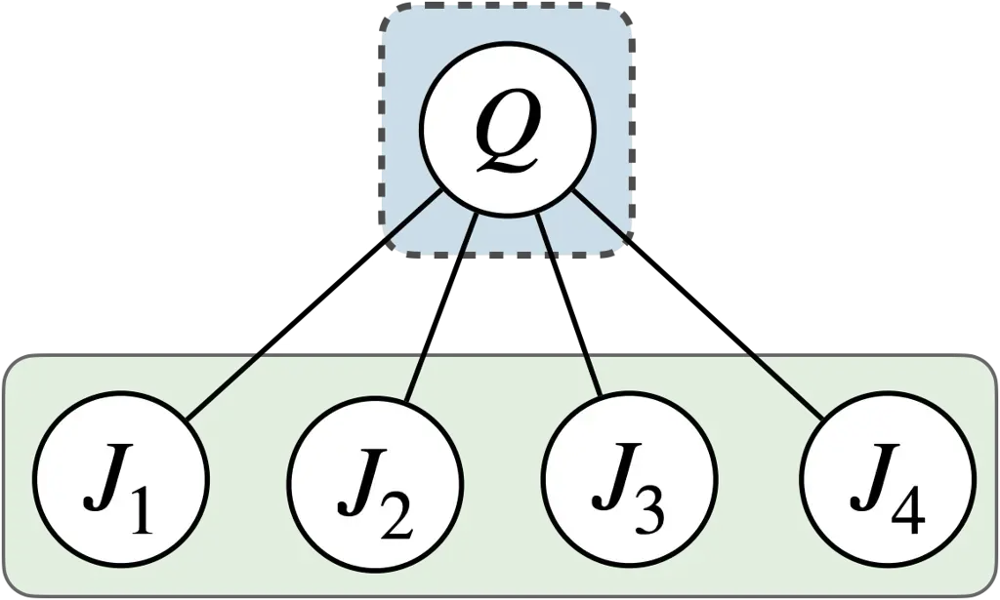
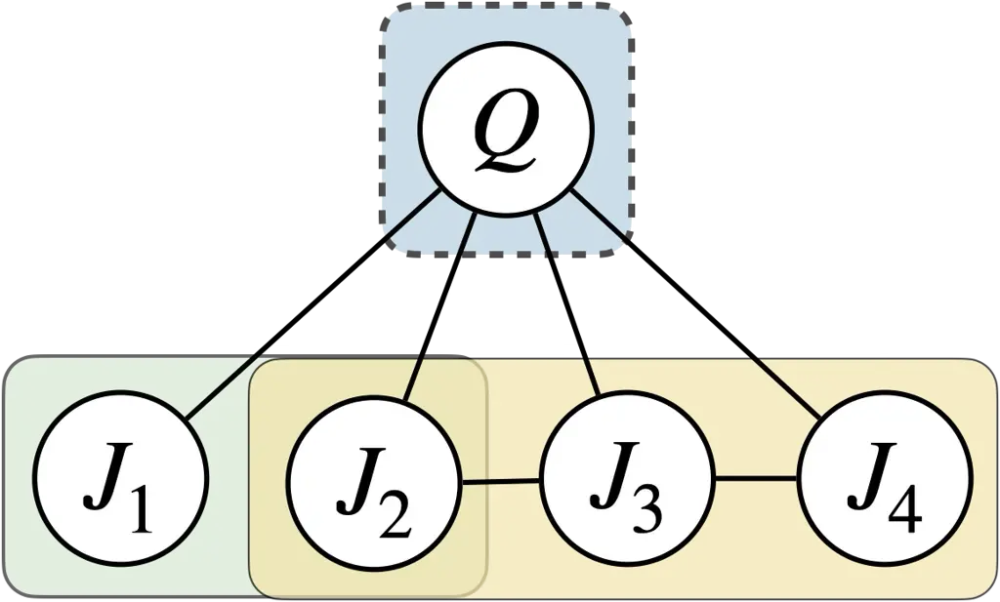
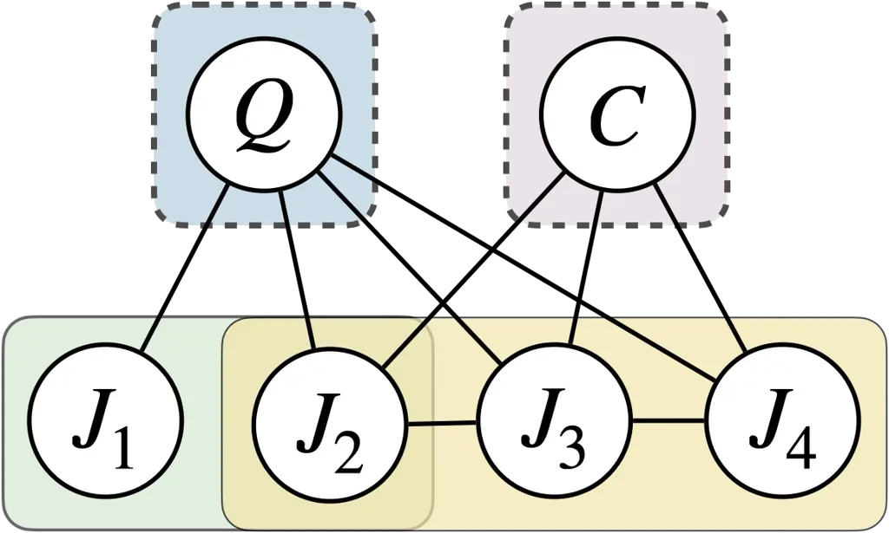
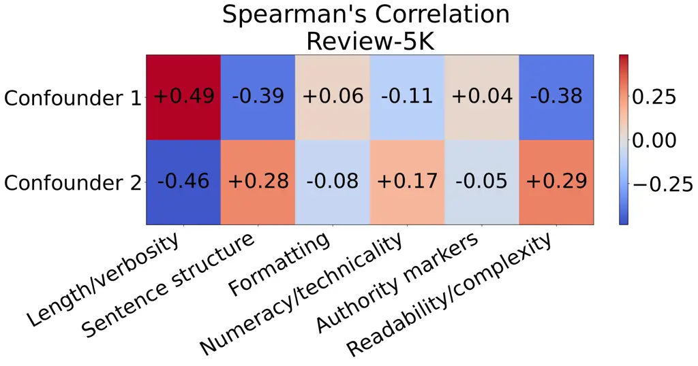
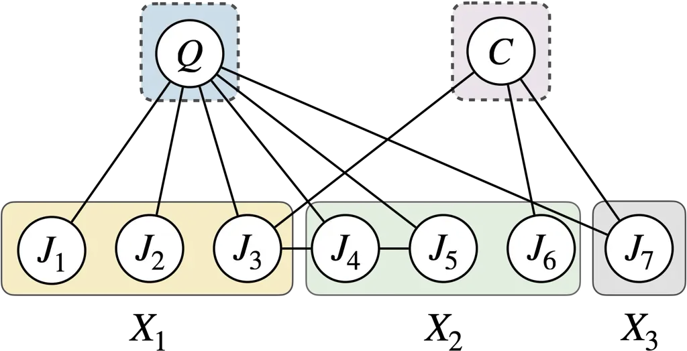
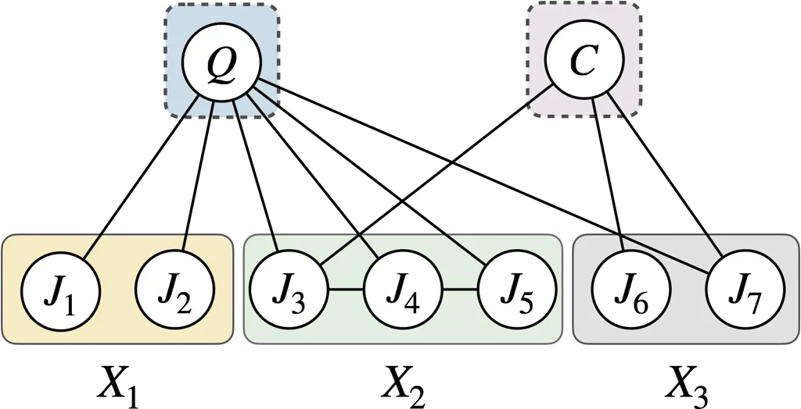

# CARE: Confounder-Aware Aggregation for Reliable LLM Evaluation

Jitian Zhao Affiliation:  Department of Statistics, University of
Wisconsin–Madison, Madison, WI, USA Correspondence to:
<jzhao326@wisc.edu>    Changho Shin Affiliation:  Department of Computer
Sciences, University of Wisconsin–Madison, Madison, WI, USA
Correspondence to: <cshin23@wisc.edu>    Tzu-Heng Huang Affiliation: 
Department of Computer Sciences, University of Wisconsin–Madison,
Madison, WI, USA    Satya Sai Srinath Namburi GNVV Affiliation: 
Department of Computer Sciences, University of Wisconsin–Madison,
Madison, WI, USA    Frederic Sala Affiliation:  Department of Computer
Sciences, University of Wisconsin–Madison, Madison, WI, USA

###### Abstract

LLM-as-a-judge ensembles are the standard paradigm for scalable
evaluation, but their aggregation mechanisms suffer from a fundamental
flaw: they implicitly assume that judges provide independent estimates
of true quality. However, in practice, LLM judges exhibit correlated
errors caused by shared latent confounders—such as verbosity, stylistic
preferences, or training artifacts—causing standard aggregation rules
like majority vote or averaging to provide little gain or even amplify
systematic mistakes. To address this, we introduce CARE, a
confounder-aware aggregation framework that explicitly models LLM judge
scores as arising from both a latent true-quality signal and shared
confounding factors. Rather than heuristically re-weighting judges, CARE
separates quality from confounders without access to ground-truth
labels. We provide theoretical guarantees for identifiability and
finite-sample recovery under shared confounders, and we quantify the
systematic bias incurred when aggregation models omit confounding latent
factors. Across 12 public benchmarks spanning continuous scoring, binary
classification, and pairwise preference settings, CARE improves
aggregation accuracy, reducing error by up to 26.8%.

###### Keywords: 

LLM Evaluation, Weak Supervision, Confounding

## 1 Introduction

Large language models (LLMs) have become the workhorse solution for
automated evaluation of model-generated outputs. _LLM-as-a-judge_
systems offer a scalable alternative to expert annotation by
substantially reducing cost and latency (Zheng et al., 2023a).
Consequently, a common evaluation paradigm ensembles multiple LLM judges
to produce consensus scores (Hu et al., 2024b). While effective,
LLM-based evaluation outputs can be biased or only weakly aligned with
human judgments. Moreover, these judges often exhibit correlated errors
due to shared training data or modeling choices (Ye et al., 2025; Shi
et al., 2024; Wang et al., 2024b; Deutsch et al., 2022; Li et al.,
2025). As a result, heuristic aggregation strategies—such as majority
vote, averaging, or ad-hoc reweighting—can yield diminishing returns and
may even amplify shared mistakes.

Several techniques have been proposed to mitigate these issue, including
_prompt-level interventions_ and *specialized evaluators* (Chen et al.,
2024; Li et al., 2024a; Zhu et al., 2025; Wang et al., 2024b). However,
at the ensemble level, aggregation still typically defaults to majority
voting or simple averaging (Li et al., 2024b), implicitly assuming that
judges are _independent and similarly reliable_—assumptions that often
fail in the presence of shared confounders and correlated errors.
Additionally, existing approaches remain largely heuristic: they target
specific failure modes or rely on assumptions that may be violated when
judges share latent confounders. These limitations motivate the need for
an aggregation framework that can _explicitly model and account for
shared confounders among judges_.

We propose CARE, a _confounder-aware aggregation_ framework that models
evaluations from multiple LLM judges through latent factors
corresponding to both true quality and shared confounders. Rather than
treating judges as independent sources of noisy labels, CARE explicitly
separates the latent quality signal from spurious influences that
simultaneously affect multiple judges. Specially, we instantiate CARE
via two complementary estimators with different scopes:

- •
  CARE-SVD leverages sparse-plus-low-rank structure in the judge score
  matrix to recover a dominant latent quality direction while accounting
  for shared confounders.
- •
  CARE-Tensor builds on the learned dependency structure among judges to
  form an approximate multi-view representation, enabling identifiable
  recovery of quality and confounders through tensor decomposition.

We provide theoretical analysis establishing identifiability and
finite-sample recovery guarantees for latent quality and confounders
under shared confounding. These results characterize regimes in which
heuristic aggregation methods are fundamentally misspecified and
demonstrate when confounder-aware aggregation can reliably recover
latent quality _without access to ground-truth labels_.

Summary of Contributions.

1.  1.  We introduce CARE, a confounder-aware framework for aggregating
        LLM-as-a-judge evaluations that explicitly models shared latent
        confounders among judges.
2.  2.  We develop two complementary estimators, CARE-SVD and CARE-Tensor,
        which operate under different information regimes and together
        support continuous, discrete, and preference-based evaluation
        settings.
3.  3.  We provide theoretical guarantees on identifiability and sample
        complexity in the presence of shared confounders, clarifying when
        reliable aggregation is possible.
4.  4.  We empirically demonstrate consistent improvements across diverse
        public benchmarks, _achieving up to 26.8% error reduction_ over
        existing aggregation methods.

By explicitly modeling shared confounders during aggregation, CARE
offers a principled alternative to heuristic ensembling and
substantially improves the reliability of LLM-as-a-judge evaluation.

## 2 Background and Overview

We begin with brief background on automated evaluation using LLM judges
and its connection to probabilistic graphical models.

LLM-as-a-judge. LLMs can act as inexpensive and fast proxies for human
raters by assessing model generations via (i) _scalar quality scores_
(e.g., 1–10 Likert or percentiles) (Zhu et al., 2025; Wang et al.,
2024b; Shi et al., 2024), or (ii) _pairwise preferences_ indicating
which of two responses is better, as widely used in RLHF
pipelines (Ouyang et al., 2022; Bai et al., 2022). Since individual LLM
judges are often biased, recent work (Verga et al., 2024a) deploys
_multiple_ judges and aggregates their opinions—typically via majority
vote or average pooling—to improve robustness. Our framework builds on
this line of work _but adopts a more principled approach to multi-judge
aggregation by explicitly modeling shared confounders and correlated
errors across judges_.

Graphical Models and Latent-Variable MRFs. Graphical models encode
conditional independence structure in multivariate distributions, with
Markov Random Fields (MRFs) being particularly well suited for modeling
complex dependencies due to their flexibility, efficient inference, and
amenability to structure learning. In the LLM-as-a-judge setting, we use
MRFs to jointly model observed judge scores ($`J`$), shared confounding
factors ($`C`$), and latent quality variables. This formulation allows
us to capture structured dependencies among LLM evaluations while
maintaining computationally efficient and statistically tractable
inference. When key influences are unobserved—most notably the true
underlying quality of a model output—augmenting an MRF with latent nodes
enables recovery of this hidden structure from noisy observations. This
latent-variable MRF perspective is crucial in our context, offering a
principled method to estimate the latent, true-quality signal from
observable judges’ scores while accounting for correlated judging
errors.



(a)



(b)



(c)

Figure 1: Graphical models for aggregating judge scores under different
structural assumptions. (a) A naive model assumes scores reflect only a
true latent quality ($`Q`$) and that all judges are equally reliable and
represent independent views. (b) Connection-aware approach models
intra-judge interactions ($`J_{2}-J_{3}-J_{4}`$), but still assumes the
presence of a single latent quality score. (c) Our Confounder-aware
model introduces additional latent confounders ($`C`$) influencing judge
scores.

## 3 CARE: Confounder-Aware Aggregation for Reliable Evaluation

We introduce CARE (Confounder-Aware Aggregation for Reliable
Evaluation), a graphical model framework and algorithms that aggregates
multiple judge scores into an estimate of latent quality while
accounting for shared confounders.

### 3.1 Framework Setup

Let $`X\in\mathbb{R}^{n\times p}`$ be the judge-score matrix, where each
row corresponds to an evaluation item and contains the $`p`$ judge
scores. Let $`H=(Q,C)\in\mathbb{R}^{k+1}`$ collect a true-quality factor
$`Q`$ and $`k`$ confounders $`C`$. Our graphical model encodes the
conditional independence structure among the nodes in $`(J,Q,C)`$: if
two nodes are not connected by an edge, they are independent conditioned
on all other nodes. An example is shown on the right in Fig. 1. We
assume this conditional dependence structure is _sparse_; i.e., there
are not too many edges in the graph, and make this precise later on.

This framework is general and is compatible with a variety of
distributions. For example, we may take $`J,Q,C`$ to involve discrete
variables, Gaussians, or mixed. We can take the model to be an MRF or
alternatively a mixture model. Our approaches are compatible with a
broad range of choices, with practitioners able to select the most
suitable modeling assumptions for their settings. In this paper, we
focus on two concrete instantiations that match our experimental
settings: CARE-SVD for continuous scores under a joint-Gaussian
assumption, and CARE-Tensor for discrete or preference-based regimes
where tensor methods are applicable.

Goals and Assumptions. Under the chosen modeling assumptions, our goal
is to learn the distribution over $`J,Q,C`$. This involves handling
_three challenges_. First, C1: _we never observe the latents in
$`H`$_—neither ground truth nor confounders. Second, C2: we _cannot
assume any particular interaction_ in the graph. Third, C3: even if we
recover the model parameters, we must be able to distinguish between
$`Q`$ and the confounders $`C`$ _to identify the model_. The latter is
required to discover _which latent is the ground-truth quality—and which
is a confounder_. Once these obstacles are overcome, we seek to perform
aggregation, e.g., compute a posterior $`P(Q|J)`$, the Bayesian estimate
for the latent true quality conditioned on all observable judge scores.

### 3.2 CARE Algorithm

The idea behind CARE is to examine two techniques, each of which is
stymied by one of the obstacles C2 or C3 and to _delicately combine them
in a novel way_. First, the sparsity of the conditional independence
graph is encoded into a two-dimensional object that can be empirically
estimated (e.g., the observable covariance matrix, or a cross-moment
matrix). However, the presence of the latent variables (C1) obscures
this structure—but a _sparse + low-rank decomposition_ can reveal it
(Chandrasekaran et al., 2012). However, while we can decompose the
resulting low-rank term via SVD in the hope of identifying the model, we
can only do so _up to rotations_ and with additional assumptions.
Therefore we are blocked by C3.

Conversely, tensor product decompositions (Anandkumar et al., 2014)
exploit tensor rigidity to enable this decomposition to be uniquely
identified. However, for these techniques the judges must be independent
conditioned on the latents—and we cannot assume this by C2.

CARE (Algorithm 1) is a framework with a shared backbone and
instantiations that combines these approaches. First, from the observed
precision matrix $`\hat{\Theta}(X)`$ of judge scores, it estimates the
underlying sparse graph structure via the sparse + low-rank
decomposition which produces $`\hat{S}`$ that encodes judge-judge
conditional dependency and $`\hat{L}`$ that encodes latent-judge
dependency, overcoming C1 and C2. Second, using the recovered sparse
structure, CARE selects subsets of judges with sufficient conditional
independence, constructs a higher-order moment that can be decomposed to
recover latent factors, mitigating C3.

The remaining _label_ ambiguity (C3) for deciding which recovered
component corresponds to the true-quality factor $`Q`$ rather than a
confounder, can be resolved by a lightweight symmetry-breaking step.
This requires a weak assumption on the quality of the judges. In
practice, even this assumption can be removed by employing simple
heuristics to identify the true-quality factor among the latent factors.
Finally, we aggregate judge scores into robust evaluations by weighting
according to loadings from the identified quality factor.

CARE provides a shared backbone with model-specific _instantiations_.
CARE-SVD uses only second-order structure and a symmetry-breaking rule
to select the quality factor, while CARE-Tensor uses the sparse
dependency structure to form approximately independent judge groups
(“views”) and then applies tensor decomposition for identifiable
recovery in discrete/mixture regimes. Next, we study two special cases
that instantiate this template for different data regimes (fully
Gaussian vs. mixture settings); more general settings are shown in the
Appendix.

CARE for Gaussian Mixtures. For illustrative purposes, we demonstrate
following case with one binary confounder and one binary true quality
variable. However, this can be easily extended to multi-class or
multiple confounders through our framework. We refer this method as
CARE-Tensor.

Consider a Gaussian mixture with binary latent variables
$`(Q,C)\in\{0,1\}^{2}`$ and mixing weights $`\pi_{qc}`$, where

```math
J\,\big|\,(Q=q,C=c)\sim\mathcal{N}(\mu_{qc},\Sigma),\qquad(q,c)\in\{0,1\}^{2}.
```

The sparse + low-rank decomposition produces $`(\hat{S},\hat{L})`$; the
learned sparse graph $`\hat{S}`$ induces a partition of judges into
three conditionally independent groups $`X_{1},X_{2},X_{3}`$. For such a
partition, third-order cross-moments factorize:

```math
\mathbb{E}\bigl[X_{1}\otimes X_{2}\otimes X_{3}\,\big|\,Q,C\bigr]\\
=\mathbb{E}[X_{1}\mid Q,C]\otimes\mathbb{E}[X_{2}\mid Q,C]\otimes\mathbb{E}[X_{3}\mid Q,C].
```

Consequently, the population tensor decomposes as

```math
T:=\mathbb{E}[X_{1}\otimes X_{2}\otimes X_{3}]=\sum_{q,c}\pi_{qc}\,\\
\mu_{qc}^{(1)}\otimes\mu_{qc}^{(2)}\otimes\mu_{qc}^{(3)},
```

where $`\mu_{qc}^{(k)}`$ denotes the mean restricted to group $`X_{k}`$.
A CP decomposition of $`T`$ recovers $`\{\mu_{qc}^{(k)}\}`$,
concatenating the groups yields $`\{\mu_{qc}\}`$, and the weights
$`\{\pi_{qc}\}`$ follow from component norms. With
$`(\mu_{qc},\Sigma,\pi_{qc})`$, Bayes’ rule gives the posteriors

```math
\displaystyle\alpha_{qc}(J):= \displaystyle\Pr(Q=q,C=c\mid J)\propto\pi_{qc}\,\phi(J;\mu_{qc},\Sigma), \tag{1}
```

```math
\displaystyle\mathbb{E}[Q\mid J] \displaystyle=\sum_{c\in\{0,1\}}\alpha_{1c}(J).
```

where $`\phi(\cdot;\mu,\Sigma)`$ is the Gaussian density. Thus, in the
mixed regime CARE leverages third-order moments (enabled by $`\hat{S}`$)
to identify the conditional means and mixture proportions.

This setup also applies when each judge emits a binary label
$`X_{k}\in\{0,1\}^{d_{k}}`$. The sparse-plus-low-rank decomposition and
the induced three-view partition are unchanged, and the third-order
moment factorization holds with
$`\mu_{qc}^{(k)}:=\mathbb{E}[X_{k}\mid Q{=}q,C{=}c]\in[0,1]^{d_{k}}`$
interpreted as per-judge success probabilities. A CP decomposition of
$`T`$ recovers $`\{\mu_{qc}^{(k)}\}`$ and $`\{\pi_{qc}\}`$ exactly as in
the Gaussian case. For the final posterior we adopt a _Gaussian prior_
$`\alpha_{qc}(J)\propto\pi_{qc}\,\phi(J;\mu_{qc},\Sigma)`$ to preserve
residual within-view dependence among judges; this leaves the
identifiable tensor backbone intact and performs well in practice. In
Appendix C, we also cover the fully binary setting, where judges emit
binary labels and $`(Q,C)`$ are binary.

CARE for Fully Gaussian. When all variables are jointly Gaussian, odd
central moments vanish, so third-order tensors carry no information.
CARE therefore relies on second-order structure, which we refer this
method as CARE-SVD. Let
$`\Sigma=\mathrm{Cov}\bigl[(J,H)^{\top}\bigr],\qquad K=\Sigma^{-1}=\begin{pmatrix}K_{JJ}&K_{JH}\\
K_{HJ}&K_{HH}\end{pmatrix}.`$ The marginal precision of $`J`$ satisfies

```math
\Theta:=\Sigma_{JJ}^{-1}=K_{JJ}-K_{JH}K_{HH}^{-1}K_{HJ}=S-L,
```

with sparse component $`S:=K_{JJ}`$ and low-rank component
$`L:=K_{JH}K_{HH}^{-1}K_{HJ}`$. Under the identifiability conditions
summarized in Section 4, the eigenspace of $`\hat{L}`$ recovers
latent–judge loadings up to sign and permutation, and we obtain an
estimate of the latent quality by aggregating the judges with weights
from the identified “quality” factor.

0:  Judge score matrix $`X\in\mathbb{R}^{n\times p}`$, parameters
$`(\gamma_{n},\tau)`$, decomposition method
$`\mathcal{D}\in\{\text{SVD},\text{Tensor}\}`$

0:  Estimated True Quality $`\{\hat{q}^{(i)}\}_{i=1}^{n}`$

1:  Graph Sparse Structure Estimation: Compute precision of the observed
matrix $`\hat{\Theta}(X)`$.

2:  Sparse + low-rank decomposition:

```math
\displaystyle(\hat{S},\hat{L})\in\operatorname*{arg\,min}_{S,L} \displaystyle\frac{1}{2}\bigl\lVert\widehat{\Theta}(X)-(S-L)\bigr\rVert_{F}^{2}
```

```math
\displaystyle+\gamma_{n}(\lVert S\rVert_{1}+\tau\lVert L\rVert_{\ast}\,).
```

3:  Latent Factor Extraction:

4:  if $`\mathcal{D}=\text{SVD}`$ then {Fully Gaussian}

5:   Compute $`U\Lambda U^{\top}\leftarrow\operatorname{SVD}(\hat{L})`$,
where $`U\in\mathbb{R}^{p\times h}`$

6:  else if $`\mathcal{D}=\text{Tensor}`$ then {Gaussian mixture}

7:   Partition judges into conditionally independent groups with
$`\hat{S}`$

8:   Form empirical third-order tensor from judge groups

9:   Run tensor decomposition, obtain latent conditional means
$`\mu_{qc}`$ and mixture proportions $`\pi_{qc}`$

10:  end if

11:  Symmetry Breaking: Identify the true-quality factor using
heuristics described in §3.3

12:  Latent Quality Estimation: Use the identified quality factor,
compute $`\hat{q}^{(i)}`$ for each example, where
$`\hat{q}^{(i)}=P(Q=1\mid J_{i})`$ for mixture model or
$`\hat{q}^{(i)}=\mathbb{E}[Q\mid J]`$ for fully gaussian. See formulas
for each instantiation.

Algorithm 1 CARE: Confounder-Aware Aggregation for Reliable Evaluation

### 3.3 Heuristics for Identifiability and Robust Estimation

Any instantiation of CARE will require symmetry-breaking procedures for
latent variable identifiability. For example, the fully Gaussian case
needs a heuristic to identify the true-quality direction among latent
factors, distinguishing $`Q`$ from confounders $`C`$. In the
binary-Gaussian mixture scenario, an additional step resolves ambiguity
between latent states ($`Q=0`$ vs. $`Q=1`$). Doing so will require
additional information that can come from modeling assumptions, the use
of ground-truth samples, or heuristics. We detail some examples below:

Identifying True-Quality Factor for Fully Gaussian Model. Symmetry
breaking in the fully Gaussian setting amounts to selecting which
recovered low-rank direction corresponds to the true-quality latent
$`Q`$ (rather than a confounder). Our guiding principle is that quality
induces the strongest _shared_ variation across judges, whereas
confounders are typically weaker or concentrated on a subset.
Accordingly, we take the leading eigenvector of the fitted low-rank
component $`\hat{L}`$ as the shared “quality” axis and treat its
associated factor as $`Q`$. This choice is objective and works well when
the dominant shared variation reflects quality. When this assumption may
be violated, we use lightweight alternatives (Appendix C): (a) a small
human-rated anchor set, or (b) a balanced-loading criterion that favors
broadly distributed loadings. We also validate the leading-eigenvector
rule empirically in Appendix E.

Identifying Latent States for Mixed Model. After recovering component
means $`\{\hat{\mu}_{r}\}`$, we compute the leading eigenvector $`v`$ of
$`\hat{L}`$ and score states by $`s_{r}=v^{\top}\hat{\mu}_{r}`$; the
highest-scoring state(s) are mapped to $`Q{=}1`$ and the remainder to
$`Q{=}0`$. If labeled anchors are available, we optionally verify this
mapping by choosing the state whose means best match the $`Q{=}1`$
labeled subset (details in Appendix C).

## 4 Theoretical Analysis

We formalize when CARE recovers the quality/confounder structure and how
much data is needed. The section proceeds in four steps: (i) _exact
identifiability_ under clean structure; (ii) _stability_ under
perturbations; (iii) _finite-sample_ rates for the joint-Gaussian
(spectral) path; and (iv) _sample complexity_ for the binary Gaussian
mixture (tensor) path. We conclude with a brief remark on
misspecification. All technical assumptions and proofs are deferred to
the Appendix.

##### Notation and setup.

Let $`J\in\mathbb{R}^{p}`$ denote judge scores. We write the observable
precision as $`K_{JJ}=S-L`$, where $`S`$ is sparse and $`L`$ is low
rank. In the joint-Gaussian setup, $`L=K_{JH}K_{HH}^{-1}K_{HJ}`$ with
latent factors $`H\in\mathbb{R}^{h}`$. In the mixed binary Gaussian with
three conditionally independent judge groups, we exploit a factorized
third-order moment built from the three views.

We start with fully Gaussian case. To ensure that latent directions are
recoverable from $`L`$, we assume latent independence and orthogonality
in the latent-observable link. Under these conditions, the columns of
$`K_{JH}`$ (and hence the eigen-directions of $`L`$) are uniquely
identified up to sign and permutation; moreover, the recovery is stable
to small violations of orthogonality.

###### Proposition 4.1 (Identifiability and stability of latent–judge directions).

Assume $`K_{HH}=\mathrm{diag}(d_{1},\dots,d_{h})`$ with
$`d_{1}>\cdots>d_{h}>0`$ and the columns of $`K_{JH}`$ are orthogonal.
Then the columns of $`K_{JH}`$ (equivalently, the latent directions
encoded by $`L`$) are identifiable from $`L`$ up to sign and
permutation. Moreover, if $`K_{JH}`$ is perturbed to
$`\tilde{K}_{JH}=K_{JH}+E`$, letting $`\delta_{i}`$ denote the eigengap
of $`L`$ at eigenvector $`u_{i}`$, then

```math
\|\hat{u}_{i}-u_{i}\|_{2}\lesssim\|K_{HH}^{-1}\|_{2}\,\frac{\|E\|_{2}}{\delta_{i}}\qquad(i\in[h]).
```

We next quantify how many samples suffice to estimate these directions
from data via $`S{+}L`$ estimation, highlighting the role of eigengaps
and the curvature of the low-rank tangent space.

###### Theorem 4.2 (Finite-sample recovery for the spectral path).

Let $`L^{\star}=K_{JH}K_{HH}^{-1}K_{HJ}`$ have global eigengap
$`\delta>0`$, and let $`\xi(T)`$ denote the curvature constant of the
tangent space $`T(L^{\star})`$ governing $`S{+}L`$ estimation. Under
standard identifiability/incoherence/curvature conditions (Appendix D),
for any $`\eta>0`$, with probability at least $`1-2e^{-\eta}`$,

```math
\max_{i\leq h}\,\|\hat{u}_{i}-u_{i}\|_{2}=O\!\left(\sqrt{\frac{\eta}{n}}\frac{1}{\xi(T)\,\delta}\right).
```

For the mixed binary Gaussian model with three conditionally independent
judge groups, we show that the CP (CANDECOMP/PARAFAC) structure of the
third-order cross-moment enables recovery of mixture means and weights
at a rate that scales with noise, separation (gap), and the number of
judges.

###### Theorem 4.3 (Sample complexity for recovering $`(\mu_{qc},\pi_{qc})`$).

Assume the three judge groups are conditionally independent given
$`(Q,C)\in\{0,1\}^{2}`$, the third-order moment admits a CP
decomposition with spectral gap $`\delta>0`$, and the within-component
observation covariance $`\Sigma`$ satisfies
$`\|\Sigma\|_{\mathrm{op}}\leq\sigma_{\max}^{2}`$. Let $`p`$ be the
total number of judges and $`\pi_{\min}=\min_{q,c}\pi_{qc}`$. If

```math
n\gtrsim\frac{\sigma_{\max}^{6}}{\delta^{2}\,\pi_{\min}^{2}}p\,\log\!\bigl(p/\varepsilon\bigr),
```

then with probability at least $`1-\varepsilon`$,

```math
\displaystyle\max_{q,c}\bigl\|\hat{\mu}_{qc}-\mu_{qc}\bigr\|_{2} \displaystyle\lesssim\frac{\sigma_{\max}^{3}}{\delta}\sqrt{\frac{p\log(p/\varepsilon)}{n}},
```

```math
\displaystyle\max_{q,c}\lvert\hat{\pi}_{qc}-\pi_{qc}\rvert \displaystyle\lesssim\sqrt{\frac{p\log(p/\varepsilon)}{n}}.
```

Finally, when the model omits confounding latent factors, the estimated
conditional means incur a systematic bias. We provide an explicit bound
on this misspecification error in Appendix D, quantifying how it scales
with the strength of the omitted confounders and their alignment with
the recovered directions.

|          |                              |                             |                             |                             |                             |                             |
| -------- | ---------------------------- | --------------------------- | --------------------------- | --------------------------- | --------------------------- | --------------------------- |
|          | ASSET                        | FeedbackQA                  | Review-5K                   | Summarize                   | UltraFeedback               | Yelp                        |
| MV       | $`31.153\pm 0.000`$          | $`0.822\pm 0.000`$          | $`2.608\pm 0.000`$          | $`1.417\pm 0.000`$          | $`0.851\pm 0.000`$          | $`0.923\pm 0.000`$          |
| AVG      | $`33.663\pm 0.000`$          | $`0.830\pm 0.000`$          | $`2.274\pm 0.000`$          | $`1.394\pm 0.000`$          | $`0.686\pm 0.000`$          | $`1.037\pm 0.000`$          |
| WS       | $`29.073\pm 0.436`$          | $`0.793\pm 0.009`$          | $`2.593\pm 0.052`$          | $`1.364\pm 0.007`$          | $`0.829\pm 0.009`$          | $`0.977\pm 0.008`$          |
| UWS      | $`33.928\pm 0.000`$          | $`0.875\pm 0.000`$          | $`2.602\pm 0.000`$          | $`1.362\pm 0.000`$          | $`0.680\pm 0.000`$          | $`0.987\pm 0.000`$          |
| CARE-SVD | $`\mathbf{27.629\pm 0.156}`$ | $`\mathbf{0.730\pm 0.002}`$ | $`\mathbf{1.957\pm 0.018}`$ | $`\mathbf{1.325\pm 0.004}`$ | $`\mathbf{0.623\pm 0.006}`$ | $`\mathbf{0.694\pm 0.004}`$ |

Table 1: Aggregation performance across different scoring datasets,
measured by MAE ($`\downarrow`$; mean $`\pm`$ std).

|             |                             |                             |                             |                             |                             |                             |
| ----------- | --------------------------- | --------------------------- | --------------------------- | --------------------------- | --------------------------- | --------------------------- |
|             | Chatbot-Arena               | CivilComments               | PKU-BETTER                  | PKU-SAFER                   | SHP                         | Summarize                   |
| MV          | $`0.517\pm 0.000`$          | $`0.691\pm 0.000`$          | $`0.701\pm 0.000`$          | $`0.698\pm 0.000`$          | $`0.626\pm 0.000`$          | $`0.600\pm 0.000`$          |
| AVG         | $`0.551\pm 0.000`$          | $`0.690\pm 0.000`$          | $`0.726\pm 0.000`$          | $`0.717\pm 0.000`$          | $`0.634\pm 0.000`$          | $`0.683\pm 0.000`$          |
| WS          | $`0.543\pm 0.004`$          | $`0.739\pm 0.003`$          | $`0.575\pm 0.002`$          | $`0.570\pm 0.001`$          | $`0.619\pm 0.005`$          | $`0.705\pm 0.002`$          |
| UWS         | $`0.507\pm 0.000`$          | $`0.713\pm 0.000`$          | $`0.703\pm 0.000`$          | $`0.701\pm 0.000`$          | $`0.629\pm 0.000`$          | $`0.713\pm 0.000`$          |
| Dawid–Skene | $`0.546\pm 0.000`$          | $`0.735\pm 0.000`$          | $`0.551\pm 0.000`$          | $`0.548\pm 0.000`$          | $`0.612\pm 0.000`$          | $`0.705\pm 0.000`$          |
| GLAD        | $`0.510\pm 0.009`$          | $`0.695\pm 0.002`$          | $`0.697\pm 0.008`$          | $`0.671\pm 0.013`$          | $`0.644\pm 0.000`$          | $`0.718\pm 0.013`$          |
| MACE        | $`0.550\pm 0.000`$          | $`0.732\pm 0.000`$          | $`0.734\pm 0.000`$          | $`\mathbf{0.735\pm 0.000}`$ | $`0.580\pm 0.000`$          | $`0.706\pm 0.000`$          |
| CARE-SVD    | $`\mathbf{0.580\pm 0.004}`$ | $`\mathbf{0.778\pm 0.004}`$ | $`0.691\pm 0.002`$          | $`0.690\pm 0.002`$          | $`0.543\pm 0.006`$          | $`0.695\pm 0.003`$          |
| CARE-Tensor | $`0.564\pm 0.013`$          | $`0.749\pm 0.002`$          | $`\mathbf{0.779\pm 0.002}`$ | $`0.731\pm 0.002`$          | $`\mathbf{0.695\pm 0.008}`$ | $`\mathbf{0.814\pm 0.001}`$ |

Table 2: Aggregation performance across classification and preference
datasets, measured by Accuracy ($`\uparrow`$).

## 5 Experimental Results

We evaluate the effectiveness of CARE across diverse experimental
setups, real-world and semi-synthetic scenarios. Our goal is to validate
the following key claims:

- •
  Improving aggregation of LLM judges: CARE produces more accurate and
  robust aggregate scores from multiple LLM judges compared to baselines
  (Section 5.1).
- •
  Interpreting latent confounding factors: CARE’s latent structure
  enables diagnosis by revealing associations between latent confounders
  and observable confounder attributes (e.g., length/style/readability)
  (Section 5.2).
- •
  Effective Integration of Program Judges: CARE integrates programmatic
  judges, known to have high bias, by explicitly modeling their biases
  (Section 5.3).
- •
  Demonstrating Robustness under Controlled Confounding Factors: CARE
  remains accurate when evaluations are deliberately affected by
  controlled biases, as demonstrated by the semi-synthetic data from
  (Chen et al., 2024) (Section 5.4).
- •
  Effective Defense against Adversarial Answers. Zhao et al. (2025)
  shows that inserting only a few tokens can fool LLM judges into
  producing incorrect evaluations. Building on such setup, we show that
  CARE provides an effective defense against such attacks (Section 5.5).

Datasets & Metrics. We evaluate on 12 public benchmarks covering
continuous scoring (QA/feedback, summarization, reviews) and
binary/pairwise classification (toxicity and preference). We report MAE
for scoring datasets and Accuracy for classification/preference
datasets; the full dataset list is in Appendix E.

Baselines. We compare CARE to following baseline aggregation methods:
(i) majority voting (MV), (ii) simple averaging (AVG) (Li et al.,
2024b), (iii) discrete-based weak supervision (WS) (Bach et al., 2019a),
and (iv) continuous-based weak supervision (UWS) (Shin et al., 2022).
Both WS and UWS are probabilistic graphical models that do not account
for confounding factors (WS operates on discrete labels, while UWS
handles continuous scores). In the Gaussian mixture setting, where
quality factors are treated as discrete, we additionally include
classical aggregation baselines: Dawid–Skene (Dawid & Skene, 1979), GLAD
(Whitehill et al., 2009), and MACE (Hovy et al., 2013).

LLM Judges. We use 11 - 20 LLMs as our judges ranging from 0.6B to 14B
parameters and extract their judging scores. The full model list is
provided in Appendix E. In scoring tasks, LLM judges assign numeric
ratings within ranges aligned to human annotations. In classification
tasks, they output scores from 0–9, with 4.5 serving as a threshold for
binary decisions, while in preference tasks they assign values from –3
to 3 to indicate the relative strength of preference.

### 5.1 Improving Aggregation of LLM judges

Setup. We compare aggregation methods using CARE-SVD and CARE-Tensor. To
ensure consistency, we adapt the prompt template from (Roucher, 2025),
modifying it to fit our experimental setup. The exact prompt used is
provided in Appendix E.

Results. Table 1 and Table 2 show that CARE consistently outperforms
baseline methods across both scoring and classification/preference
tasks. On scoring datasets, CARE-SVD achieves the lowest MAE in all
cases, reducing error by up to 26.8% compared to MV on UltraFeedback.
Averaged across scoring datasets, CARE-SVD yields a 17.37% relative
improvement over AVG and a 12.75% improvement over MV. On classification
and preference benchmarks, CARE achieves the best accuracy on 5 of 6
datasets, with CARE-Tensor leading on three (PKU-BETTER, SHP, and
Summarize), including a 13.4% relative improvement in accuracy on
Summarize over the strongest baseline. Overall, these results highlight
CARE’s ability to reduce compounding biases and deliver more reliable
aggregation across diverse evaluation settings.

### 5.2 Interpreting Latent Confounding Factors

CARE can also be used as a diagnostic tool. Beyond producing an
aggregate score, its latent factors can point to response attributes
that systematically affect judges but are not necessarily part of the
underlying quality signal. We illustrate this with one representative
example for each setting. The basic procedure is simple: we first
convert each learned latent component into an example-level score, and
then compare these scores with observable response features such as
length, formatting, and readability. These correlations are meant to
help interpret the learned factors; we do not claim that they provide a
unique causal explanation for the factor.

#### 5.2.1 CARE-SVD (Fully Gaussian)

##### Setup.

For CARE-SVD, we use the leading eigen-directions of the learned
low-rank component $`\hat{L}`$. For each example $`i`$ and latent
direction $`u_{r}`$, we compute a factor score
$`z_{r}(i)=\langle u_{r},J_{i}\rangle`$. We then correlate each
non-quality factor score with a small set of response-level features
that capture common sources of judge bias:

- •
  Length/verbosity: total character length of the response.
- •
  Sentence structure: average sentence length.
- •
  Formatting: number of numbered-list items.
- •
  Numeracy/technicality: amount of number-heavy content after regressing
  out length.
- •
  Authority markers: citation-like markers, such as bracketed references
  or URLs.
- •
  Readability/complexity: SMOG score, an estimated grade level based on
  words with three or more syllables.

##### Results.

Figure 2 shows the correlations on Review-5K, the ICLR 2024 peer-review
dataset. The first confounder is most associated with longer reviews: it
has a positive correlation with response length ($`\rho\approx 0.49`$),
and negative correlations with average sentence length and SMOG
complexity ($`\rho\approx-0.39`$ and $`-0.38`$). The second confounder
follows the opposite pattern. It is associated with shorter reviews
($`\rho\approx-0.46`$), but also with more complex sentence structure
and higher readability complexity ($`\rho\approx 0.28`$–$`0.29`$), as
well as slightly more numeric content ($`\rho\approx 0.17`$). These
patterns are consistent with plausible peer-review confounders: judges
may respond to surface cues such as verbosity, technical density, or
writing style, even when these cues are not the same as paper quality.



Figure 2: Interpreting CARE-SVD latent confounders on Review-5K. Heatmap
reports Spearman correlations between inferred confounder scores and
response features.

#### 5.2.2 CARE-Tensor (Gaussian Mixture)

##### Setup.

In the CARE-Tensor setting, interpretability is more direct. We use the
posterior confounder probability $`\Pr(C=1\mid J)`$ as an example-level
confounder score and examine its association with human-interpretable
response attributes. We use the same set of concepts as in the fully
Gaussian case and report results on PKU-Safer.

##### Results.

Figure 3: Interpreting CARE-Tensor latent confounders on PKU-Safer. Bars
show Spearman correlations between inferred confounder posteriors and
response features.

Figure 3 shows that the inferred confounder is most strongly associated
with verbosity-related attributes. Length/verbosity exhibits the largest
positive correlation with $`\Pr(C=1\mid J)`$ ($`\rho\approx+0.12`$),
while numeracy/technicality shows a modest negative association
($`\rho\approx-0.07`$).

Figure 4: Integration results on FeedbackQA dataset with greedy judge
selection guided by validation dataset performance.

### 5.3 Effective Integration of Programmatic Judges

Setup. Next, we evaluate CARE by integrating it with 30 synthesized
programmatic judges. Each judge is constructed by prompting OpenAI’s
GPT-4o to generate evaluation logic, which is then compiled into an
executable program (Huang et al., 2025). Programmatic judges are
designed to assess responses along specific dimensions such as
_structure, readability, safety, relevance, and factuality_. While
cost-effective, their deterministic nature can introduce systematic
biases, resulting in noisy evaluation signals. This setup creates a
challenging aggregation scenario to test CARE’s robustness. Details of
the judge generation process are in Appendix E.

We progressively integrate programmatic judges in a greedy manner: at
each step, we add a judge that yields the largest improvement on a
validation dataset (10% of training dataset), measured by MAE. The
process stops when no further MAE reduction occurs for four consecutive
steps. We then evaluate aggregation methods on the FeedbackQA dataset,
consistent with previous experiments.

Results. Figure 4 shows aggregation performance as judges are
progressively added. With the early-stopping criterion, CARE achieves
the lowest error by integrating eight additional programmatic judges,
reducing MAE by 15.2% compared to MV and by 11.1% compared to UWS. These
results highlight CARE’s ability to adaptively incorporate judges for
improved supervision.

### 5.4 Robustness to Confounding Factors

|          |             |                |
| -------- | ----------- | -------------- |
|          | Beauty Bias | Authority Bias |
| MV       | 0.919       | 0.824          |
| AVG      | 0.506       | 0.325          |
| WS       | 1.229       | 0.754          |
| UWS      | 0.508       | 0.271          |
| CARE-SVD | 0.375       | 0.233          |

Table 3: Robustness to artificially injected bias. Reported as MAE
between bias-injected and original versions; lower values indicate
stronger robustness.

Setup. We assess CARE’s robustness using the dataset from Chen et al.
(2024), where LLM responses are systematically altered through targeted
GPT-4 prompts. We focus on two stylistic biases that preserve semantic
correctness: _beauty_, which adds superficial emojis or formatting, and
_authority_, which includes a fake citation. LLM judges assign scores
from 1 to 10 for each response. Robustness is measured by comparing
aggregated scores before and after perturbation using MAE, where lower
values indicating greater robustness.

Results. Table 3 shows that CARE achieves strong robustness against
beauty and authority biases, with the lowest MAE compared to baseline
methods. This indicates that CARE effectively mitigates superficial
stylistic changes, such as cosmetic formatting or fake citations, while
maintaining consistent aggregated evaluations.

### 5.5 Defending Against Adversarial Responses

LLM judges have been shown to be vulnerable to simple token
manipulations (e.g., “:” or “ ”) and reasoning prompts (e.g., “Let’s
think step by step”), often interpreting them as signs of correctness
(Zhao et al., 2025). We hypothesize that CARE can mitigate these
vulnerabilities by serving as a defense mechanism against such
adversarial triggers.

Setup. We evaluate CARE on adversarial responses from Zhao et al. (2025)
using the multi-subject RLVR dataset (Su et al., 2025). Each judge is
presented with an adversarial response paired with the true reference
answer and asked to assess its correctness. Since adversarial answers
are inherently incorrect, any judgment labeling them as correct is a
false positive. We compare MV, WS, and CARE, reporting the false
positive rate (lower is better).

Results. Table 4 reports false positive rates across different
adversarial response types. CARE consistently reduces the false positive
rate, often by a substantial margin, without requiring additional
interventions.

|                    |       |       |             |
| ------------------ | ----- | ----- | ----------- |
| Attack type        | MV    | WS    | CARE-Tensor |
| “:”                | 0.577 | 0.520 | 0.496       |
| “,”                | 0.441 | 0.546 | 0.000       |
| “Solution”         | 0.558 | 0.522 | 0.371       |
| “Thought process:” | 0.674 | 0.587 | 0.000       |
| “ ”                | 0.641 | 0.577 | 0.432       |
| “Step by step”     | 0.571 | 0.504 | 0.392       |

Table 4: False positive rates on adversarial responses. CARE-Tensor can
reduce false positives significantly across cases.

## 6 Related Work

We review prior work on _bias in LLM-as-a-judge_ and _label
aggregation_, and position our method in relation to both. An extended
discussion appears in Appendix B.

##### Bias in LLM-as-a-judge.

LLMs used as automated evaluators exhibit systematic preferences,
including positional, verbosity, authority, and self-enhancement
biases (Ye et al., 2025; Zhu et al., 2025). Prior work mitigates these
effects primarily at the level of _individual judges_, through
prompt-based interventions (Shi et al., 2024; Jiao et al., 2024; Ye
et al., 2025) or fine-tuned evaluators such as JudgeLM and PandaLM that
better align judgments with human preferences (Zhu et al., 2025; Wang
et al., 2024b; Li et al., 2024d). In contrast, we target the downstream
multi-judge setting: _rather than debiasing individual LLMs, we
explicitly model shared latent confounders that induce correlated errors
across judges, enabling principled aggregation even when single-judge
biases persist._

##### Label Aggregation.

Classic aggregation models such as Dawid–Skene (Dawid & Skene, 1979),
GLAD (Whitehill et al., 2009), and MACE (Hovy et al., 2013) infer latent
truth by modeling annotator-specific noise. Weak supervision frameworks
extend this paradigm to programmatic sources (Bach et al., 2019a; Fu
et al., 2020; Shin et al., 2022). More recently, (Hu et al., 2024b)
propose GED, which ensembles and denoises preference graphs from
multiple weak LLM evaluators, while Wang et al. (2025) analyze inference
and aggregation statistics for LLM-as-a-judge outputs. These methods
typically assume conditional independence or unstructured noise; our
approach departs from this assumption by _explicitly captures shared
latent factors (e.g., verbosity or formality) affecting all judges,
bridging single-judge bias mitigation and statistical aggregation._

## 7 Conclusion

We introduce CARE, a confounder-aware aggregation framework that
formulates multi-judge scoring in a higher-rank latent-variable model
and delivers three main contributions. (i) It explicitly models shared
confounders, providing an aggregation scheme for LLM-judge scenarios.
(ii) It offers statistically principled estimators—sparse-plus-low-rank
covariance recovery and tensor method—with provable identifiability.
(iii) It demonstrates consistent empirical gains, improving accuracy and
robustness across diverse public benchmarks.

## Acknowledgements

We are grateful for the support of the National Science Foundation (NSF)
(CCF2106707), the Defense Advanced Research Projects Agency (DARPA Young
Faculty Award), and the Wisconsin Alumni Research Foundation (WARF).

## Impact Statement

This work presents a novel approach to aggregate scores from multiple
LLMs serving as judges by identifying confounding variables and thus
potentially reducing the bias in the overall judge scores. The potential
broader impact includes a framework for improved LLM-as-a-judge scores
which can be used at various applications. However, it is important to
acknowledge that using LLMs as potential judges to automate
labor-intense annotation tasks which is an active area of research
carries some limitations and past research has discussed some unintended
consequences, such as over-reliance on judge outputs, misuse and
misinterpretation of results which might carry high real-world stakes.
It is crucial to use automated LLM-as-a-judge tools responsibly and
ethically, considering potential biases in data and models, and ensuring
transparency and accountability in their application.

## References

- 01.AI (2024) 01.AI. Yi: Open foundation models by 01. ai. _arXiv
  preprint arXiv:2403.04652_, 2024.
- Alibaba (2025) Alibaba. Qwen3, April 2025. URL
  [https://qwenlm.github.io/blog/qwen3/](https://qwenlm.github.io/blog/qwen3/).
- Alva-Manchego et al. (2020) Alva-Manchego, F., Martin, L., Bordes, A.,
  Scarton, C., Sagot, B., and Specia, L. ASSET: A dataset for tuning and
  evaluation of sentence simplification models with multiple rewriting
  transformations. In _Proceedings of the 58th Annual Meeting of the
  Association for Computational Linguistics_, pp. 4668–4679, Online,
  July 2020. Association for Computational Linguistics. URL
  [https://www.aclweb.org/anthology/2020.acl-main.424](https://www.aclweb.org/anthology/2020.acl-main.424).
- Anandkumar et al. (2014) Anandkumar, A., Ge, R., Hsu, D. J., Kakade,
  S. M., Telgarsky, M., et al. Tensor decompositions for learning latent
  variable models. _J. Mach. Learn. Res._, 15(1):2773–2832, 2014.
- Bach et al. (2019a) Bach, S. H., Rodriguez, D., Liu, Y., Luo, C.,
  Shao, H., Xia, C., Sen, S., Ratner, A., Hancock, B., Alborzi, H.,
  et al. Snorkel drybell: A case study in deploying weak supervision at
  industrial scale. In _Proceedings of the 2019 International Conference
  on Management of Data_, pp. 362–375, 2019a.
- Bach et al. (2019b) Bach, S. H., Rodriguez, D., Liu, Y., Luo, C.,
  Shao, H., Xia, C., Sen, S., Ratner, A., Hancock, B., Alborzi, H.,
  et al. Snorkel drybell: A case study in deploying weak supervision at
  industrial scale. In _Proceedings of the 2019 International Conference
  on Management of Data_, pp. 362–375, 2019b.
- Bai et al. (2022) Bai, Y., Jones, A., Ndousse, K., Askell, A., Chen,
  A., DasSarma, N., Drain, D., Fort, S., Ganguli, D., Henighan, T.,
  et al. Training a helpful and harmless assistant with reinforcement
  learning from human feedback. _arXiv preprint arXiv:2204.05862_, 2022.
- Borkan et al. (2019) Borkan, D., Dixon, L., Sorensen, J., Thain, N.,
  and Vasserman, L. Nuanced metrics for measuring unintended bias with
  real data for text classification. In _Companion Proceedings of The
  2019 World Wide Web Conference_, pp. 491–500, 2019.
- Cachay et al. (2021) Cachay, S. R., Boecking, B., and Dubrawski, A.
  End-to-end weak supervision. In _Advances in Neural Information
  Processing Systems_, 2021.
- Chandrasekaran et al. (2012) Chandrasekaran, V., Parrilo, P. A., and
  Willsky, A. S. Latent variable graphical model selection via convex
  optimization. _The Annals of Statistics_, 40(4), August 2012. ISSN
  0090-5364. doi: 10.1214/11-aos949. URL
  [http://dx.doi.org/10.1214/11-AOS949](http://dx.doi.org/10.1214/11-AOS949).
- Chen et al. (2024) Chen, G. H., Chen, S., Liu, Z., Jiang, F., and
  Wang, B. Humans or LLMs as the judge? a study on judgement bias. In
  _Proceedings of the 2024 Conference on Empirical Methods in Natural
  Language Processing_, pp. 8301–8327, Miami, Florida, USA,
  November 2024. Association for Computational Linguistics. doi:
  10.18653/v1/2024.emnlp-main.474. URL
  [https://aclanthology.org/2024.emnlp-main.474/](https://aclanthology.org/2024.emnlp-main.474/).
- Chiang & yi Lee (2023) Chiang, C.-H. and yi Lee, H. Can large language
  models be an alternative to human evaluations? In _Proceedings of the
  61st Annual Meeting of the Association for Computational Linguistics
  (ACL)_, pp. 15607–15631, 2023.
- Cui et al. (2023) Cui, G., Yuan, L., Ding, N., Yao, G., Zhu, W., Ni,
  Y., Xie, G., Liu, Z., and Sun, M. Ultrafeedback: Boosting language
  models with high-quality feedback. 2023.
- Dawid & Skene (1979) Dawid, A. P. and Skene, A. M. Maximum likelihood
  estimation of observer error-rates from incomplete data. _Journal of
  the Royal Statistical Society: Series C_, 28(1):20–28, 1979.
- (15) DeepMind, G. Gemma 2: Improving open language models at a
  practical size.
- DeepMind (2025) DeepMind, G. Gemma 3 technical report. _arXiv preprint
  arXiv:2503.19786_, 2025.
- Deutsch et al. (2022) Deutsch, D., Dror, R., and Roth, D. On the
  limitations of reference-free evaluations of generated text. In
  _Proceedings of the 2022 Conference on Empirical Methods in Natural
  Language Processing_, pp. 10960–10977, Abu Dhabi, United Arab
  Emirates, December 2022. Association for Computational Linguistics.
  doi: 10.18653/v1/2022.emnlp-main.753. URL
  [https://aclanthology.org/2022.emnlp-main.753/](https://aclanthology.org/2022.emnlp-main.753/).
- Ethayarajh et al. (2022) Ethayarajh, K., Choi, Y., and Swayamdipta, S.
  Understanding dataset difficulty with $`\mathcal{V}`$-usable
  information. In _International Conference on Machine Learning_, pp.
  5988–6008. PMLR, 2022.
- Fu et al. (2020) Fu, D. Y., Chen, M. F., Sala, F., Hooper, S. M.,
  Fatahalian, K., and Ré, C. Fast and three-rious: Speeding up weak
  supervision with triplet methods. In _Proceedings of the 37th
  International Conference on Machine Learning (ICML 2020)_, 2020.
- Hooper et al. (2021) Hooper, S., Wornow, M., Seah, Y. H., Kellman, P.,
  Xue, H., Sala, F., Langlotz, C., and Ré, C. Cut out the annotator,
  keep the cutout: better segmentation with weak supervision. In
  _Proceedings of the International Conference on Learning
  Representations (ICLR 2021)_, 2021.
- Hovy et al. (2013) Hovy, D., Berg-Kirkpatrick, T., Vaswani, A., and
  Hovy, E. Learning whom to trust with MACE. In _Proceedings of
  NAACL‑HLT_, pp. 1120–1130, 2013.
- Hu et al. (2024a) Hu, Z., Zhang, J., Xiong, Z., Ratner, A., Xiong, H.,
  and Krishna, R. Language model preference evaluation with multiple
  weak evaluators. _arXiv preprint arXiv:2410.12869_, 2024a.
- Hu et al. (2024b) Hu, Z., Zhang, J., Xiong, Z., Ratner, A., Xiong, H.,
  and Krishna, R. Language model preference evaluation with multiple
  weak evaluators. _arXiv preprint arXiv:2410.12869_, 2024b.
- (24) Huang, T.-H., Cao, C., Bhargava, V., and Sala, F. The alchemist:
  Automated labeling 500x cheaper than llm data annotators. In _The
  Thirty-eighth Annual Conference on Neural Information Processing
  Systems_.
- Huang et al. (2025) Huang, T.-H., Vishwakarma, H., and Sala, F. Time
  to impeach llm-as-a-judge: Programs are the future of evaluation.
  _arXiv preprint arXiv:2506.10403_, 2025.
- Hurst et al. (2024) Hurst, A., Lerer, A., Goucher, A. P., Perelman,
  A., Ramesh, A., Clark, A., Ostrow, A., Welihinda, A., Hayes, A.,
  Radford, A., et al. Gpt-4o system card. _arXiv preprint
  arXiv:2410.21276_, 2024.
- Ji et al. (2024) Ji, J., Hong, D., Zhang, B., Chen, B., Dai, J.,
  Zheng, B., Qiu, T., Zhou, J., Wang, K., Li, B., et al. Pku-saferlhf:
  Towards multi-level safety alignment for llms with human preference.
  _arXiv preprint arXiv:2406.15513_, 2024.
- Jiao et al. (2024) Jiao, T., Zhang, J., Xu, K., Li, R., Du, X., Wang,
  S., and Song, Z. Enhancing fairness in llm evaluations: Unveiling and
  mitigating biases in standard-answer-based evaluations. In
  _Proceedings of the AAAI Symposium Series_, volume 4, pp. 56–59, 2024.
- Khan et al. (2024) Khan, A., Hughes, J., Valentine, D., Ruis, L.,
  Sachan, K., Radhakrishnan, A., Grefenstette, E., Bowman, S. R.,
  Rockt”aschel, T., and Perez, E. Debating with more persuasive LLMs
  leads to more truthful answers. _arXiv preprint
  arXiv:2402.06782_, 2024.
- Kocmi & Federmann (2023) Kocmi, T. and Federmann, C. Large language
  models are state-of-the-art evaluators of translation quality. In
  _Proceedings of the 24th Annual Conference of the European Association
  for Machine Translation (EAMT)_, pp. 193–203, 2023.
- Kuang et al. (2022) Kuang, Z., Arachie, C., Liang, B., Narayana, P.,
  DeSalvo, G., Quinn, M., Huang, B., Downs, G., and Yang, Y. Firebolt:
  Weak supervision under weaker assumptions. In _Proceedings of the 25th
  International Conference on Artificial Intelligence and
  Statistics_, 2022.
- Lambert et al. (2024) Lambert, N., Pyatkin, V., Morrison, J., Miranda,
  L., Lin, B. Y., Chandu, K., Dziri, N., Kumar, S., Zick, T., Choi, Y.,
  et al. Rewardbench: Evaluating reward models for language modeling.
  _arXiv preprint arXiv:2403.13787_, 2024.
- Li et al. (2025) Li, D., Sun, R., Huang, Y., Zhong, M., Jiang, B.,
  Han, J., Zhang, X., Wang, W., and Liu, H. Preference leakage: A
  contamination problem in llm-as-a-judge. 2025. URL
  [https://arxiv.org/abs/2502.01534](https://arxiv.org/abs/2502.01534).
- Li et al. (2024a) Li, H., Chen, J., Ai, Q., Chu, Z., Zhou, Y., Dong,
  Q., and Liu, Y. Calibraeval: Calibrating prediction distribution to
  mitigate selection bias in llms-as-judges. _arXiv preprint
  arXiv:2410.15393_, 2024a.
- Li et al. (2024b) Li, H., Dong, Q., Chen, J., Su, H., Zhou, Y., Ai,
  Q., Ye, Z., and Liu, Y. Llms-as-judges: a comprehensive survey on
  llm-based evaluation methods. _arXiv preprint arXiv:2412.05579_,
  2024b.
- Li et al. (2024c) Li, R., Patel, T., and Du, X. PRD: Peer rank and
  discussion improve large language model based evaluations.
  _Transactions on Machine Learning Research_, 2024c. ISSN 2835-8856.
  URL
  [https://openreview.net/forum?id=YVD1QqWRaj](https://openreview.net/forum?id=YVD1QqWRaj).
- Li et al. (2022) Li, Z., Sharma, P., Lu, X. H., Cheung, J. C. K., and
  Reddy, S. Using interactive feedback to improve the accuracy and
  explainability of question answering systems post-deployment. In
  _Findings of the Association for Computational Linguistics: ACL 2022_,
  pp. 926–937, 2022.
- Li et al. (2024d) Li, Z., Wang, C., Ma, P., Wu, D., Wang, S., Gao, C.,
  and Liu, Y. Split and merge: Aligning position biases in LLM-based
  evaluators. In _Proceedings of the 2024 Conference on Empirical
  Methods in Natural Language Processing_, pp. 11084–11108, Miami,
  Florida, USA, November 2024d. Association for Computational
  Linguistics. doi: 10.18653/v1/2024.emnlp-main.621. URL
  [https://aclanthology.org/2024.emnlp-main.621/](https://aclanthology.org/2024.emnlp-main.621/).
- Meta (2024) Meta. The llama 3 herd of models. _arXiv preprint
  arXiv:2407.21783_, 2024.
- Microsoft (2025) Microsoft. Phi-4-mini technical report: Compact yet
  powerful multimodal language models via mixture-of-loras. _arXiv
  preprint arXiv:2503.01743_, 2025.
- Mintz et al. (2009) Mintz, M., Bills, S., Snow, R., and Jurafsky, D.
  Distant supervision for relation extraction without labeled data. In
  _Proceedings of the Joint Conference of the 47th Annual Meeting of the
  ACL and the 4th International Joint Conference on Natural Language
  Processing of the AFNLP: Volume 2-Volume 2_, pp. 1003–1011.
  Association for Computational Linguistics, 2009.
- Mistral (2023) Mistral. Mistral 7b, 2023. URL
  [https://arxiv.org/abs/2310.06825](https://arxiv.org/abs/2310.06825).
- Niu et al. (2012) Niu, F., Zhang, C., Ré, C., and Shavlik, J.
  Deepdive: Web-scale knowledge-base construction using statistical
  learning and inference. In Brambilla, M., Ceri, S., Furche, T., and
  Gottlob, G. (eds.), _Proceedings of the Second International Workshop
  on Searching and Integrating New Web Data Sources (VLDS 2012)_, volume
  884 of _CEUR Workshop Proceedings_, pp. 25–28, Istanbul, Turkey,
  August 2012. URL
  [https://ceur-ws.org/Vol-884/VLDS2012_p25_Niu.pdf](https://ceur-ws.org/Vol-884/VLDS2012_p25_Niu.pdf).
- Ouyang et al. (2022) Ouyang, L., Wu, J., Jiang, X., Almeida, D.,
  Wainwright, C., Mishkin, P., Zhang, C., Agarwal, S., Slama, K., Ray,
  A., et al. Training language models to follow instructions with human
  feedback. _Advances in neural information processing systems_,
  35:27730–27744, 2022.
- Park et al. (2024) Park, J., Jwa, S., Ren, M., Kim, D., and Choi, S.
  OffsetBias: Leveraging debiased data for tuning evaluators. In
  _Findings of the Association for Computational Linguistics: EMNLP
  2024_, pp. 1043–1067, 2024.
- Rahmani et al. (2024) Rahmani, H. A., Yilmaz, E., Craswell, N., and
  Mitra, B. Judgeblender: Ensembling judgments for automatic relevance
  assessment. _arXiv preprint arXiv:2412.13268_, 2024.
- Ratner et al. (2017) Ratner, A., Sa, C. D., Wu, S., Selsam, D., and
  Ré, C. Snorkel: Rapid training data creation with weak supervision. In
  _Proceedings of the VLDB Endowment_, volume 11, pp. 269–282, 2017.
- Roucher (2025) Roucher, A. Using LLM-as-a-judge for an automated and
  versatile evaluation.
  [https://huggingface.co/learn/cookbook/en/llm_judge](https://huggingface.co/learn/cookbook/en/llm_judge), 2025.
  Accessed: 2025-05-15.
- Shen et al. (2023) Shen, C., Cheng, L., Nguyen, X.-P., You, Y., and
  Bing, L. Large language models are not yet human-level evaluators for
  abstractive summarization. In _Findings of the Association for
  Computational Linguistics: EMNLP 2023_, pp. 4215–4233, 2023.
- Shi et al. (2024) Shi, L., Ma, C., Liang, W., Ma, W., and Vosoughi, S.
  Judging the judges: A systematic investigation of position bias in
  pairwise comparative assessments by llms. _arXiv preprint
  arXiv:2406.07791_, 2024.
- Shin et al. (2022) Shin, C., Li, W., Vishwakarma, H., Roberts, N. C.,
  and Sala, F. Universalizing weak supervision. In _International
  Conference on Learning Representations (ICLR)_, 2022.
- Shin et al. (2023) Shin, C., Cromp, S., Adila, D., and Sala, F.
  Mitigating source bias for fairer weak supervision. In _Advances in
  Neural Information Processing Systems (NeurIPS)_, 2023.
- Stiennon et al. (2020) Stiennon, N., Ouyang, L., Wu, J., Ziegler,
  D. M., Lowe, R., Voss, C., Radford, A., Amodei, D., and Christiano, P.
  Learning to summarize from human feedback. In _NeurIPS_, 2020.
- Su et al. (2025) Su, Y., Yu, D., Song, L., Li, J., Mi, H., Tu, Z.,
  Zhang, M., and Yu, D. Expanding rl with verifiable rewards across
  diverse domains. _arXiv preprint arXiv:2503.23829_, 2025.
- Varma et al. (2019) Varma, P., Sala, F., Sagawa, S., Fries, J., Fu,
  D., Khattar, S., Ramamoorthy, A., Xiao, K., Fatahalian, K., Priest,
  J., et al. Multi-resolution weak supervision for sequential data.
  _Advances in Neural Information Processing Systems_, 32, 2019.
- Verga et al. (2024a) Verga, P., Hofstatter, S., Althammer, S., Su, Y.,
  Piktus, A., Arkhangorodsky, A., Xu, M., White, N., and Lewis, P.
  Replacing judges with juries: Evaluating llm generations with a panel
  of diverse models. _arXiv preprint arXiv:2404.18796_, 2024a.
- Verga et al. (2024b) Verga, P., Hofstätter, S., Althammer, S., Su, Y.,
  Piktus, A., et al. Replacing judges with juries: Evaluating llm
  generations with a panel of diverse models. _arXiv preprint
  arXiv:2404.18796_, 2024b.
- Wang et al. (2024a) Wang, P., Li, L., Chen, L., Cai, Z., Zhu, D., Lin,
  B., Cao, Y., Kong, L., Liu, Q., Liu, T., and Sui, Z. Large language
  models are not fair evaluators. In _Proceedings of the 62nd Annual
  Meeting of the Association for Computational Linguistics (ACL)_, pp.
  9440–9450, 2024a.
- Wang et al. (2025) Wang, V., Zhang, M. J., and Choi, E. Improving
  llm-as-a-judge inference with the judgment distribution. _arXiv
  preprint arXiv:2503.03064_, 2025.
- Wang et al. (2024b) Wang, Y., Yu, Z., Yao, W., Zeng, Z., Yang, L.,
  Wang, C., Chen, H., Jiang, C., Xie, R., Wang, J., et al. Pandalm: An
  automatic evaluation benchmark for llm instruction tuning
  optimization. In _The Twelfth International Conference on Learning
  Representations_, 2024b.
- Weng et al. (2025) Weng, Y., Zhu, M., Bao, G., Zhang, H., Wang, J.,
  Zhang, Y., and Yang, L. Cycleresearcher: Improving automated research
  via automated review. In _The Thirteenth International Conference on
  Learning Representations_, 2025. URL
  [https://openreview.net/forum?id=bjcsVLoHYs](https://openreview.net/forum?id=bjcsVLoHYs).
- Whitehill et al. (2009) Whitehill, J., Wu, T.-f., Bergsma, J.,
  Movellan, J. R., and Ruvolo, P. Whose vote should count more? optimal
  integration of labels from labelers of unknown expertise. In _Advances
  in Neural Information Processing Systems_, volume 22, pp.
  2035–2043, 2009.
- Ye et al. (2025) Ye, J., Wang, Y., Huang, Y., Chen, D., Zhang, Q.,
  Moniz, N., Gao, T., Geyer, W., Huang, C., Chen, P.-Y., Chawla, N. V.,
  and Zhang, X. Justice or prejudice? quantifying biase in
  LLM-as-a-judge. In _The Thirteenth International Conference on
  Learning Representations_, 2025. URL
  [https://openreview.net/forum?id=3GTtZFiajM](https://openreview.net/forum?id=3GTtZFiajM).
- Yu et al. (2015) Yu, Y., Wang, T., and Samworth, R. J. A useful
  variant of the davis–kahan theorem for statisticians. _Biometrika_,
  102(2):315–323, 2015.
- Zeng et al. (2024) Zeng, Z., Yu, J., Gao, T., Meng, Y., Goyal, T., and
  Chen, D. Evaluating large language models at evaluating instruction
  following. In _Proceedings of the 12th International Conference on
  Learning Representations (ICLR)_, 2024.
- Zhang et al. (2015) Zhang, X., Zhao, J., and LeCun, Y. Character-level
  convolutional networks for text classification. _Advances in neural
  information processing systems_, 28, 2015.
- Zhao et al. (2025) Zhao, Y., Liu, H., Yu, D., Kung, S., Mi, H., and
  Yu, D. One token to fool llm-as-a-judge. _arXiv preprint
  arXiv:2507.08794_, 2025.
- Zheng et al. (2023a) Zheng, L., Chiang, W.-L., Sheng, Y., Zhuang, S.,
  Wu, Z., Zhuang, Y., Lin, Z., Li, Z., Li, D., Xing, E., Zhang, H.,
  Gonzalez, J. E., and Stoica, I. Judging LLM-as-a-judge with MT-bench
  and chatbot arena. In _Thirty-seventh Conference on Neural Information
  Processing Systems Datasets and Benchmarks Track_, 2023a. URL
  [https://openreview.net/forum?id=uccHPGDlao](https://openreview.net/forum?id=uccHPGDlao).
- Zheng et al. (2023b) Zheng, L., Chiang, W.-L., Sheng, Y., Zhuang, S.,
  Wu, Z., Zhuang, Y., Lin, Z., Li, Z., Li, D., Xing, E. P., Zhang, H.,
  Gonzalez, J. E., and Stoica, I. Judging llm-as-a-judge with mt-bench
  and chatbot arena, 2023b.
- Zhu et al. (2025) Zhu, L., Wang, X., and Wang, X. Judgelm: Fine-tuned
  large language models are scalable judges. In _The Thirteenth
  International Conference on Learning Representations_, 2025.

The appendix is structured as follows. It starts with the glossary
table, defining key notations used throughout the paper in Appendix A.
Next, Appendix B discusses additional related work. In Appendix C, we
introduce details about our tensor-based CARE algorithm, discussion for
general CARE method, and additional discussion about method heuristics.
Following this, Appendix D offers theoretical support of our approach
and supported proofs. It includes the graphical model formulation, graph
structure recovery error bound, sample complexity, and the
misspecification error arising from incorrectly characterized
confounding factors. Subsequently, Appendix E provides experimental
details and additional experiment results. Finally, Appendix Impact
Statement concludes by discussing the broader impacts and limitations of
the work.

## Appendix A Glossary

The notations are summarized in Table 5.

|                                                                              |                                                                                                                   |
| ---------------------------------------------------------------------------- | ----------------------------------------------------------------------------------------------------------------- |
| Symbol                                                                       | Definition                                                                                                        |
| $`(J_{1},\dots,J_{p})`$                                                      | $`p`$ vector of Judges score                                                                                      |
| $`Q`$                                                                        | True-quality latent variable                                                                                      |
| $`(C_{1},\dots,C_{k})`$                                                      | $`k`$ latent confounder variables                                                                                 |
| $`H`$                                                                        | All the hidden variables (true + confounder) i.e ($`Q`$ $`C_{1},\dots,C_{k}`$)                                    |
| $`h`$                                                                        | dimension of $`H`$ i.e all hidden variables = $`k`$ + 1                                                           |
| $`X`$                                                                        | Score matrix of dimension ($`n\times p`$) where $`n`$ is the number of examples and $`p`$ is the number of judges |
| $`K`$                                                                        | Precision matrix                                                                                                  |
| $`K_{oo}`$                                                                   | Observable-observable connection matrix                                                                           |
| $`K_{oh}`$                                                                   | Observable-latent connection matrix                                                                               |
| $`K_{hh}`$                                                                   | Latent-latent connection matrix                                                                                   |
| $`\Sigma_{o}`$                                                               | Covariance matrix of observable variables                                                                         |
| $`S`$                                                                        | Sparse matrix ($`\mathbb{R}^{p\times p}`$) which encodes edges between judges                                     |
| $`L`$                                                                        | Low-rank matrix (with $`rank(L)\leq h`$) which captures dependencies mediated by latent variables                 |
| $`R`$                                                                        | Rotation matrix ($`\mathbb{R}^{h\times h}`$)                                                                      |
| $`\gamma_{n}`$                                                               | Regularization for sparse and low-rank matrix $`S`$ in Algorithm 1                                                |
| $`\tau`$                                                                     | Regularization for low-rank matrix $`L`$ in Algorithm 1                                                           |
| $`\hat{s}_{\mathrm{agg}}^{(i)}`$                                             | Aggregated scores for $`i`$th example in the dataset from $`p`$ judges                                            |
| $`\hat{\Sigma}`$                                                             | Sample covariance matrix                                                                                          |
| $`\hat{\Theta}`$                                                             | Sample precision matrix                                                                                           |
| $`\hat{S}`$                                                                  | Sample Sparse matrix ($`\mathbb{R}^{p\times p}`$) which encodes direct connectional edges among judges            |
| $`\hat{L}`$                                                                  | Sample Low-rank matrix (with $`rank(L)\leq h`$) which captures dependencies mediated by latent variables          |
| $`U`$                                                                        | Latent factor extraction matrix i.e latent-judge connections ($`\mathbb{R}^{p\times h}`$) from Algorithm 1        |
| $`\Theta`$                                                                   | Precision matrix                                                                                                  |
| $`w`$                                                                        | Weight for aggregating judges                                                                                     |
| $`\lambda`$                                                                  | Singular values of $`L`$                                                                                          |
| $`u^{\star}`$                                                                | Singular vector of $`L`$ corresponds to true quality factor                                                       |
| $`\lambda^{\star}`$                                                          | Singular value of $`L`$ that corresponds to true quality factor                                                   |
| $`\mu_{qc}`$                                                                 | Conditional mean of judges given $`Q=q,C=c`$                                                                      |
| $`\pi_{qc}`$                                                                 | Probability of $`Q=q,C=c`$                                                                                        |
| $`\alpha_{qc}(J)`$                                                           | Posterior responsibility $`\Pr(Q{=}q,\,C{=}c\mid J)`$. Used to aggregate component-wise inferences                |
| $`\phi(J;\mu,\Sigma)`$                                                       | Gaussian density used in Bayes updates                                                                            |
| $`\hat{\mu}_{qc}`$                                                           | Estimated conditional mean of judges given $`Q=q,C=c`$                                                            |
| $`\hat{\pi}_{qc}`$                                                           | Estimation of probability of $`Q=q,C=c`$                                                                          |
| $`\{\mathcal{G}_{\ell}\}_{\ell=1}^{3}`$                                      | Groups of judges that are independent of judges outside the group                                                 |
| $`\hat{T}`$                                                                  | Empirical 3-way tensor                                                                                            |
| $`\hat{\mu}^{(1)}_{qc}`$, $`\hat{\mu}^{(2)}_{qc}`$, $`\hat{\mu}^{(3)}_{qc}`$ | Estimated conditional mean of three views                                                                         |
| $`\hat{\mu}_{\rho(r)}`$                                                      | Estimated conditional mean of judges after permutation                                                            |
| $`\mu_{\text{anchor}(r)}`$                                                   | Conditional mean of anchor sets                                                                                   |

Table 5: Glossary of variables and symbols used in this paper.

## Appendix B Extended Related Work

Here we discuss other related works, including biases in the use of
LLM-as-a-judge, and aggregation methods in the weak supervision
literature.

### B.1 Biases in LLM–as–a–Judge

LLMs have rapidly become the standard tools for automatically evaluating
generation tasks, as their judgments show strong correlations with those
of human annotators—particularly in areas such as translation and
summarization (Kocmi & Federmann, 2023; Shen et al., 2023; Chiang &
yi Lee, 2023). Yet a growing body of work shows that these models are
far from impartial. Positional bias—preferring the _second_ answer in a
pairwise comparison—was first noted in MT-Bench (Zheng et al., 2023a)
and later quantified in detail by (Wang et al., 2024a), who observed
reversals of up to 30% when simply swapping order. Verbosity bias,
wherein longer answers receive higher scores regardless of quality, is
highlighted by (Chen et al., 2024). LLM judges also display
self‐enhancement bias, overrating responses produced by models from the
same family (Zeng et al., 2024). Less studied but equally problematic
are concreteness/authority biases: judges over-reward answers that
contain citations, numbers, or confident tone even when these features
are irrelevant (Park et al., 2024).

Mitigation strategies span two levels. _Prompt-level interventions_
randomize answer order, enforce symmetric formatting, and instruct the
judge to ignore superficial features (Wang et al., 2024a; Li et al.,
2024d). Adding chain-of-thought rationales or decomposing the rubric
into sub-criteria (accuracy, conciseness, style) also moderates shallow
heuristics (Khan et al., 2024). On the _model level_, fine-tuned
evaluators such as JudgeLM (Zhu et al., 2025) and Split-and-Merge Judge
(Li et al., 2024d) are trained on curated data that explicitly counter
positional and length biases. Peer-review and debate schemes go a step
further: PRD lets a second LLM critique the first judge and often
corrects biased decisions (Li et al., 2024c), while (Khan et al., 2024)
show that dialog with a more persuasive model leads to more truthful
verdicts.

Despite progress, most debiasing work treats a _single_ judge in
isolation. When evaluations aggregate many LLM scorers—for robustness,
cost sharing, or diversity—biases can compound in complex ways that
individual fixes do not capture.

### B.2 Label Aggregation for Multiple Noisy Evaluators

##### Weak-supervision.

Treating each LLM prompt or model as a noisy _labeling function_ aligns
aggregation with modern weak supervision. Snorkel (Ratner et al., 2017;
Bach et al., 2019b) estimates source accuracies and dependencies to
denoise programmatic labels, laying the foundation for LLM-prompt
aggregation. Across domains, weak supervision has powered
industrial-scale text classification and content understanding,
knowledge-base construction and distant-supervision relation extraction,
multi-resolution labeling of sequential video/sensor streams, and weakly
supervised medical-image segmentation (Ratner et al., 2017; Bach et al.,
2019b; Niu et al., 2012; Mintz et al., 2009; Varma et al., 2019; Hooper
et al., 2021). On more technical side, Fu et al. (2020) introduces a
scalable moment-matching estimator with closed-form weights. (Shin
et al., 2022) generalizes label models beyond categorical labels to
arbitrary metric spaces, greatly expanding their applicability. Cachay
et al. (2021) jointly optimizes a classifier and a differentiable label
model, outperforming two-stage pipelines when sources are dependent.
Firebolt further removes requirements on known class priors or source
independence, estimating class-specific accuracies and correlations in
closed form (Kuang et al., 2022). Shin et al. (2023) shows that fixing
source bias in labeling functions using optimal transport can improve
both accuracy and fairness.

##### Aggregation of multiple _LLM_ judges.

Recent work shows that _ensembling smaller evaluators can beat a single
large judge_. The PoLL jury combines three diverse 7–35B models and
attains higher correlation with human ratings than GPT-4 while costing
7× less and reducing bias (Verga et al., 2024b). GED merges preference
graphs from weak evaluators (Llama3-8B, Mistral-7B, Qwen2-7B) and
denoises cycles; its DAG ranking surpasses a single 72B judge on ten
benchmarks (Hu et al., 2024a). JudgeBlender ensembles either multiple
models or multiple prompts, improving precision and consistency of
relevance judgments over any individual LLM (Rahmani et al., 2024).
These findings echo classic “wisdom-of-crowds” results—when paired with
principled aggregation, a panel of smaller, heterogeneous judges can
outperform a much larger model, offering a practical path toward
reliable, low-cost evaluation.

### B.3 Our Contribution in Context

Prior research either (i) debiases one judge at a time or (ii)
aggregates multiple judges assuming independent noise. Our
confounder-aware aggregation unifies these threads. We posit latent
factors (e.g., verbosity, formality) that influence _all_ judges
simultaneously and show how to infer both the latent truth and the
shared confounders. This yields more reliable consensus scores when
individual judges—human or LLM—share systemic biases.

## Appendix C Algorithm Details

This section details the implementation of our CARE framework.
Specifically, it includes the full CARE tensor algorithm, details about
SVD baseline method for comparing our tensor-based algorithm,
generalizations beyond Gaussian assumptions, and practical heuristics to
address non-orthogonality in latent factors and justification for where
the sparse structure lies in mixed Gaussian data.

### C.1 Tensor-based CARE Algorithm

0:  Score matrix $`J\in\mathbb{R}^{n\times p}`$, tolerance
$`\varepsilon`$.

0:  Estimates
$`\bigl\{\hat{\mu}_{qc},\hat{\pi}_{qc}\bigr\}_{q,c\in\{0,1\}}`$.

1:  A. Anchor discovery (graph partition)

2:  Compute the sample covariance $`\hat{\Sigma}=J^{\top}J/n`$

3:  Compute the precision $`\hat{\Theta}=\hat{\Sigma}^{-1}`$

4:  Perform the sparse$`+`$low-rank decomposition
$`\hat{\Theta}\approx\hat{S}-\hat{L}`$ (Alg. 1 Step 2).

5:  Partition judges into three disjoint groups
$`\{\mathcal{G}_{\ell}\}_{\ell=1}^{3}`$ that satisfy

```math
a\!\neq\!b,\;j_{1}\!\in\!\mathcal{G}_{a},\;j_{2}\!\in\!\mathcal{G}_{b}\;\Longrightarrow\;|\hat{S}_{j_{1},j_{2}}|\leq\varepsilon,
```

ensuring no direct edges with strength greater than $`\varepsilon`$ can
exist across groups.

6:  B. Empirical third-order moment tensor

7:  for $`\ell=1,2,3`$ do

8:   $`X_{\ell}\leftarrow`$ columns of $`J`$ indexed by
$`\mathcal{G}_{\ell}`$
{$`X_{\ell}\in\mathbb{R}^{n\times|\mathcal{G}_{\ell}|}`$}

9:  end for

10:  Compute

```math
\hat{T}=\frac{1}{n}\sum_{i=1}^{n}X_{1}^{(i)}\otimes X_{2}^{(i)}\otimes X_{3}^{(i)}\;\in\;\mathbb{R}^{|\mathcal{G}_{1}|\times|\mathcal{G}_{2}|\times|\mathcal{G}_{3}|}.
```

11:  C. Tensor decomposition

12:  Run a CP tensor-power decomposition on $`\hat{T}`$ to obtain $`k`$
= 4 components
$`\bigl\{(\hat{\pi}_{qc},\hat{\mu}^{(1)}_{qc},\hat{\mu}^{(2)}_{qc},\hat{\mu}^{(3)}_{qc})\bigr\}_{q,c\in\{0,1\}^{2}},`$
where $`\hat{\pi}_{qc}>0`$ and
$`\hat{\mu}^{(\ell)}_{qc}\in\mathbb{R}^{|\mathcal{G}_{\ell}|}`$.

13:  D. Assemble full means

14:  for $`q,c\in\{0,1\}^{2}`$ do

15:
  $`\hat{\mu}_{qc}\leftarrow\operatorname{concat}\!\bigl(\hat{\mu}^{(1)}_{qc},\hat{\mu}^{(2)}_{qc},\hat{\mu}^{(3)}_{qc}\bigr)\in\mathbb{R}^{p}`$.

16:  end for

17:  E. Unsupervised state identification (quality axis)

18:  $`v\leftarrow\textsc{TopEigenvector}(\hat{L})`$.

19:  $`s_{r}\leftarrow v^{\top}\hat{\mu}_{r}\quad(r=1,\dots,4)`$.

20:
 $`\mathcal{S}_{Q=1}\leftarrow\textsc{TopTwoIndices}(s_{1},\ldots,s_{4})`$;
$`\mathcal{S}_{Q=0}\leftarrow\{1,2,3,4\}\setminus\mathcal{S}_{Q=1}`$.
{two highest scores $`\rightarrow Q{=}1`$; remainder
$`\rightarrow Q{=}0`$}

21:  F. Optional state alignment with anchors

22:  Find the permutation $`\rho`$ of $`\{1,\dots,4\}`$ that minimizes
$`\sum_{r=1}^{4}\bigl\lVert\hat{\mu}_{\rho(r)}-\mu_{\text{anchor}(r)}\bigr\rVert_{2}^{2}`$,
where the four anchor prototypes correspond to
$`(Q,C)\!=\!\{00,01,10,11\}`$.

23:
 $`(\hat{\mu}_{00},\hat{\mu}_{01},\hat{\mu}_{10},\hat{\mu}_{11})\leftarrow(\hat{\mu}_{\rho(1)},\hat{\mu}_{\rho(2)},\hat{\mu}_{\rho(3)},\hat{\mu}_{\rho(4)}).`$

24:  G. Mixing weights

25:
 $`(\hat{\pi}_{00},\hat{\pi}_{01},\hat{\pi}_{10},\hat{\pi}_{11})\leftarrow(\hat{\pi}_{\rho(1)},\hat{\pi}_{\rho(2)},\hat{\pi}_{\rho(3)},\hat{\pi}_{\rho(4)}).`$

26:  return $`\{\hat{\mu}_{qc},\hat{\pi}_{qc}\}_{q,c\in\{0,1\}}`$.

Algorithm 2 CARE-Tensor

### C.2 SVD Baseline in Synthetic Experiment

We form the empirical two‐way moment between view $`1`$ and view $`2`$:

```math
\displaystyle\widehat{M}_{1,2} \displaystyle=\frac{1}{n}\sum_{i=1}^{n}X_{1}^{(i)}\,X_{2}^{(i)\,\top}
```

```math
\displaystyle=\sum_{q,c}\pi_{q,c}\,\mu_{1,q,c}\,\mu_{2,q,c}^{\top}\;+\;\text{sampling noise},
```

where $`\pi_{q,c}=\Pr[Q=q,C=c]`$ and
$`\mu_{v,q,c}=E[J_{v}\mid Q=q,C=c]`$ for judge/view $`v`$ A
singular‐value decomposition

```math
\widehat{M}_{1,2}\;=\;U_{12}\,\Sigma_{12}\,V_{12}^{\!\top}
```

yields factor matrices

```math
U_{12}\,\Sigma_{12}^{1/2}\approx[\mu_{1,q,c}]\,R,\quad V_{12}\,\Sigma_{12}^{1/2}\approx[\mu_{2,q,c}]\,R,
```

where $`R\in O(4)`$ is an unknown orthogonal matrix.

Repeating on
$`\widehat{M}_{1,3}=\tfrac{1}{n}\sum_{i}X_{1}^{(i)}X_{3}^{(i)\,\top}=U_{13}\,\Sigma_{13}\,V_{13}^{\!\top}`$
produces a second rotated copy of $`[\mu_{1,q,c}]`$. We solve the
Procrustes problem

```math
R\;=\;\arg\min_{O\in O(4)}\bigl\|\,U_{12}\,\Sigma_{12}^{1/2}\;-\;U_{13}\,\Sigma_{13}^{1/2}\,O\bigr\|*{F},
```

then set $`\hat{\mu}_{2,q,c}=(V_{12}\,\Sigma_{12}^{1/2})\,R^{\!\top}`$
and $`\hat{\mu}_{3,q,c}=(V_{13}\,\Sigma_{13}^{1/2})\,R^{\!\top}`$ to
align all three views.

This SVD baseline recovers $`\{\mu_{v,q,c}\}`$ up to the
permutation/sign ambiguity inherent in any orthogonal transform.

### C.3 General CARE Setup

Extension Beyond the Gaussian Observation Model. The
multivariate-Gaussian assumption for $`J|H`$ is convenient—its first two
or three moments already encode all information needed for the sparse +
low-rank and tensor steps—but it is not a requirement. Because CARE
learns the _graphical_ structure, the same pipeline applies whenever
each judge’s conditional distribution lies in an exponential family or,
more generally, a latent-variable generalized linear model (GLM):

- •
  Categorical or ordinal scores. For Likert ratings or pairwise
  preferences we can set

  ```math
  J_{i}\mid H\;\sim\;\begin{cases}\mathrm{Bernoulli}\!\bigl(\sigma(W_{i}^{\!\top}H)\bigr),&\text{(Binary / pairwise preference)},\\[4.0pt]
  \mathrm{Categorical}\!\bigl(\mathrm{softmax}(W_{i}^{\!\top}H)\bigr),&\text{(Categorical)},\\[4.0pt]
  \mathrm{OrderedLogit}\!\bigl(W_{i}^{\!\top}H;\bm{\tau}\bigr),&\text{(Ordinal / Likert)}.\end{cases} \tag{2}
  ```

  Here $`\sigma(t)=1/(1+e^{-t})`$. For
  $`\mathrm{OrderedLogit}(\eta;\bm{\tau})`$ with
  $`\eta=W_{i}^{\!\top}H`$ and
  $`-\infty=\tau_{0}<\tau_{1}<\cdots<\tau_{R-1}<\tau_{R}=+\infty`$, we
  use

  ```math
  \Pr(J_{i}\leq r\mid H)=\sigma(\tau_{r}-\eta),\qquad\Pr(J_{i}=r\mid H)=\sigma(\tau_{r}-\eta)-\sigma(\tau_{r-1}-\eta).
  ```

  The graph—hence the sparse mask $`S`$—is unchanged; only the node-wise
  likelihoods differ. We still recover $`S`$ from
  conditional‐mutual-information or pseudo-likelihood scores, and we
  still factorize higher-order indicator moments such as
  $`\mathbb{E}\bigl[\mathbf{1}_{\{J_{a}=\ell\}}\;\mathbf{1}_{\{J_{b}=m\}}\;\mathbf{1}_{\{J_{c}=n\}}\bigr]`$.

- •
  Mixed Discrete-Continous Scores. When some judges output real scores
  and others categorical flags, we use a mixed conditional distribution:

  ```math
  p(J\mid H)=\prod_{i\in\text{Cont.}}\!\mathcal{N}(J_{i};\mu_{H_{i}},\sigma_{i}^{2})\prod_{j\in\text{Disc.}}\!\mathrm{Bernoulli}(\sigma(W_{j}^{\!\top}H)).
  ```

  CARE forms mixed raw/indicator moments, and identifiability again
  follows from standard tensor-decomposition guarantees for mixed
  conditional means.

- •
  Heavy-tailed or skewed real scores. When numeric scores are skewed or
  contain outliers, a multivariate-$`t`$ or Gaussian scale mixture is
  appropriate. Up to a scalar factor, the covariance still decomposes as
  sparse $`+`$ low-rank, so Steps 1–2 of Algorithm 1 work after a simple
  rescaling.

Empirically, we find that replacing the Gaussian local likelihood only
affects the estimation of sparse structure and extraction of latent
factors, not the subsequent symmetry-breaking or posterior computation;
thus the overall CARE pipeline generalizes with minimal adjustments.

### C.4 Heuristics and Justifications

More Heuristics for Symmetry Breaking in CARE For CARE-SVD, we introduce
two complementary heuristics to distinguish the true-quality latent
factor from confounders. First, the _human-anchor criterion_ uses a
small validation set with human ratings: among the estimated factors, we
select the one whose loadings best agree with human judgments. Second, a
_loading-balance heuristic_ prefers a factor that loads broadly and with
comparable magnitude across competent judges, while rejecting factors
dominated by a small subset (often judge-specific confounders, e.g.,
length-sensitive factor).

Additionally for CARE-Tensor, if high-quality labeled samples are
available (e.g. known samples with $`Q=1`$), we can anchor the
configuration by aligning the state whose conditional means best match
labeled $`Q{=}1`$ samples. Without labels, we automate this by taking
the leading eigenvector $`v`$ of the learned low-rank factor $`\hat{L}`$
(a proxy for the shared “quality” axis), scoring each recovered
conditional mean $`\hat{\mu}_{r}`$ via $`s_{r}=v^{\top}\hat{\mu}_{r}`$,
and assigning the highest-scoring state(s) to $`Q{=}1`$.

Heuristic for Addressing Orthogonality Violations in CARE (SVD).

(a) Orthogonal

(b) Non-Orthogonal

Figure 5: Effect of the proposed heuristic in a fully Gaussian synthetic
setup. We estimate the true quality variable $`Q`$ and report the mean
squared error. The heuristic improves estimation in the non-orthogonal
setting, but slightly degrades performance in the orthogonal setting
where true and confounding components are disjoint.

Existing heuristics for identifying the true quality latent factor can
estimate corresponding weights, but they often suffer from bias when the
orthogonality assumption—central to the application of SVD—is violated.
This issue commonly arises in real-world datasets. We found the
following weighting rule effective in both synthetic and real-world
settings:

```math
w\leftarrow\lambda^{\star}u^{\star}-\sum_{u_{i}\in U\setminus\{u^{\star}\}}\lambda_{i}u_{i},
```

where $`w`$ represents the learned weights for each judge,
$`\lambda^{*}`$ and $`u^{*}`$ is the singular value and vector of $`L`$
that corresponds to the direction that is closest to true quality latent
variable, $`\lambda_{i},u_{i}`$ represent rest of the singular values
and vectors, which can be interpreted as spurious/confounding factors.

This rule intuitively subtracts the influence of overlapping
(non-orthogonal) confounding components from the estimated true score
factor.

Figure 5 illustrates the effect of this heuristic in a synthetic fully
Gaussian setup. In the non-orthogonal case—where confounding components
overlap with the true signal—the heuristic improves the estimation of
the true latent variable. In contrast, it underperforms in the
orthogonal case, where judges influenced by true scores are cleanly
separated from those influenced by confounders.

## Appendix D Theory

We formalize the graphical model under joint gaussian distribution and
notation (Section D.1), then discuss the identifiability of graph
structure with exact and approximate recovery (Section D.2) and quantify
the sample complexity required for consistent recovery of our SVD-based
algorithm (Section D.3). Next, we present the model misspecification
error when confounding factor is not correctly characterized (Section
D.4). Finally, we discuss sample complexity required for tensor-based
algorithm under mixed Gaussian distribution (Section D.5. All proofs are
included in Section D.6.

### D.1 Model and Notation

We discuss the model under joint-gaussian distribution where all
variables follow the same definitions as in Section 3. Briefly,
$`J=(J_{1},\dots,J_{p})^{\top}`$ stacks the $`p`$ observable judge
scores, and $`H=(Q,C_{1},\dots,C_{k})^{\top}`$ collects the $`h=k+1`$
latent variables.

```math
\Sigma=\mathrm{Cov}\!\bigl[(J,H)^{\top}\bigr],\qquad\Sigma^{-1}=K=\begin{pmatrix}K_{JJ}&K_{JH}\\
K_{HJ}&K_{HH}\end{pmatrix},
```

where the subscript $`J`$ (resp. $`H`$) refers to observable (resp.
latent) coordinates.

The observable block factorizes via the Schur complement:

```math
(\Sigma_{JJ})^{-1}=S-L,\quad S=K_{JJ},\quad L=K_{JH}\,K_{HH}^{-1}\,K_{HJ}.
```

Here $`\Sigma_{o}`$ is the covariance matrix of observable variables,
$`S\in\mathbb{R}^{p\times p}`$ is sparse and encodes direct conditional
edges among judges, $`L`$ is low-rank with $`rank(L)\leq h`$ and
captures dependencies mediated by the latent variables. Entry
$`(K_{JH})_{i\ell}`$ is the edge weight between judge $`i`$ and latent
factor $`\ell`$.

### D.2 Graph Structure Identifiability

While $`(S,L)`$ can be recovered (e.g. via convex sparse-plus-low-rank
regularization (Chandrasekaran et al., 2012), the finer structure of
$`K_{JH}`$ is usually not identifiable from $`L`$. For example, for
arbitrary rotation matrix $`R\in\mathbb{R}^{h\times h}`$,
$`L=(K_{JH}K_{HH}^{-1/2}R)(R^{\top}K_{HH}^{-1/2}K_{HJ})`$, this
indicates one cannot distinguish $`K_{JH}K_{HH}^{-1/2}`$ from
$`K_{JH}K_{HH}^{-1/2}R`$ without further constraints. Hence, we need to
impose additional assumptions:

###### Assumption D.1 (Latent–latent independence and eigengap in $`K_{HH}^{-1}`$).

$`K_{HH}^{-1}=\mathrm{diag}(\lambda_{1},\dots,\lambda_{h})`$ with
$`\lambda_{1}>\lambda_{2}>\dots>\lambda_{h}>0`$. (Equivalently,
$`K_{HH}=\mathrm{diag}(1/\lambda_{1},\dots,1/\lambda_{h})`$.)

###### Assumption D.2 (Orthonormal latent–observable connections).

The columns of $`K_{JH}`$ are orthonormal, i.e.
$`K_{JH}^{\top}K_{JH}=I_{h}`$. A special case is the _disjoint-support_
model where each judge connects to exactly one latent factor.

Next, we provide an exact recovery result given the above assumptions.

###### Theorem D.3 (Exact Recovery).

Under Assumptions 1 and 2, columns in $`K_{JH}`$ are identifiable up to
column permutations and sign flips.

Real-world data rarely satisfy the exact orthogonality in Assumption
D.2. To assess robustness, consider the following perturbed connection
matrix:

```math
\tilde{K}_{JH}=K_{JH}+E,\qquad\|E\|_{2}\ \text{small}.
```

The associated low-rank part is
$`\tilde{L}=\tilde{K}_{JH}K_{HH}^{-1}\tilde{K}_{HJ}.`$ Let the
eigen-pairs of $`L=K_{JH}K_{HH}^{-1}K_{HJ}`$ and $`\tilde{L}`$ be
$`\{(\lambda_{i},u_{i})\}_{i=1}^{h}`$ and
$`\{(\tilde{\lambda}_{i},\tilde{u}_{i})\}_{i=1}^{h}`$, ordered so that
$`\lambda_{1}>\dots>\lambda_{h}>0`$, and denote the eigen-gap by

```math
\delta_{i}=\min_{j\neq i}|\lambda_{i}-\lambda_{j}|>0.
```

###### Theorem D.4 (Stability under approximate orthogonality).

Assume Assumptions D.1–D.2 and that $`K_{JH}`$ has orthonormal columns.
Let $`\tilde{K}_{JH}=K_{JH}+E`$ with $`\|E\|_{2}`$ small, and define
$`\tilde{L}=\tilde{K}_{JH}K_{HH}^{-1}\tilde{K}_{HJ}`$. Let
$`\{(\lambda_{i},u_{i})\}_{i=1}^{h}`$ and
$`\{(\tilde{\lambda}_{i},\tilde{u}_{i})\}_{i=1}^{h}`$ be the top-$`h`$
eigenpairs of $`L`$ and $`\tilde{L}`$, ordered so
$`\lambda_{1}>\cdots>\lambda_{h}>0`$. Define the (full-spectrum)
eigengap

```math
\delta_{i}\;:=\;\min\Bigl\{\lambda_{i},\ \min_{j\in[h],\,j\neq i}|\lambda_{i}-\lambda_{j}|\Bigr\}.
```

Then for each $`i\in[h]`$, there exists a sign $`s_{i}\in\{\pm 1\}`$
such that

```math
\|\tilde{u}_{i}-s_{i}u_{i}\|_{2}\;\leq\;\frac{4\,\|K_{HH}^{-1}\|_{2}\,\|E\|_{2}}{\delta_{i}}\;+\;O\!\bigl(\|E\|_{2}^{2}\bigr).
```

### D.3 Sample Complexity Bound

We now quantify how many i.i.d. samples are needed for the two–stage
estimator in Algorithm 1 to recover the latent–observable directions
$`K_{JH}\!\in\!\mathbb{R}^{p\times h}`$.

As detailed in Algorithm 1, our estimator for $`K_{JH}`$ proceeds in two
stages: first, a sparse $`+`$ low-rank decomposition of sample precision
matrix. Second, we extract the latent–observable directions by taking
the rank-$`h`$ eigen-decomposition
$`\hat{L}_{n}=\sum_{i=1}^{h}\hat{\lambda}_{i}\,\hat{u}_{i}\hat{u}_{i}^{\!\top}`$
and setting $`\hat{K}_{JH}:=[\hat{u}_{1},\dots,\hat{u}_{h}]`$.

###### Theorem D.5 (Sample complexity for recovering $`K_{JH}`$).

Let $`L^{*}=K_{JH}K_{HH}^{-1}K_{HJ}\in\mathbb{R}^{p\times p}`$ have
distinct eigenvalues $`\lambda_{1}>\cdots>\lambda_{h}`$ and define the
(global) eigengap
$`\delta:=\min_{1\leq i<j\leq h}|\lambda_{i}-\lambda_{j}|.`$ Assume the
identifiability, incoherence, and curvature conditions of
(Chandrasekaran et al., 2012). Then for any $`\eta>0`$, with probability
at least $`1-2e^{-\eta}`$,

```math
\max_{i\leq h}\;\bigl\|\,\hat{u}_{i}-u_{i}\,\bigr\|_{2}=O\!\Bigl(\frac{\sqrt{\eta}}{\sqrt{n}\,\xi(T)\,\delta}\Bigr),
```

where $`n`$ is the sample size and $`T=T(L^{*})`$.

We defer the proof to Appendix D.6. At a high-level, we adapt the
identifiability, incoherence and curvature conditions from Theorem 4.1
of (Chandrasekaran et al., 2012) and combine it with extended result of
Davis-Khan’s theorem (Yu et al., 2015).

This bound shows that the column-wise $`\ell_{2}`$ error decays at the
standard parametric rate $`n^{-1/2}`$, and is attenuated by both the
manifold curvature $`\xi(T)`$ and the eigengap $`\delta`$. Achieving an
accuracy of at most $`\alpha\in(0,1)`$ therefore requires

```math
n=\tilde{O}\!\bigl(\frac{\epsilon}{\xi(T)^{2}\delta^{2}\alpha^{2}}\bigr)
```

samples, up to universal constants and log-factors.

### D.4 Misspecification Error

Many label aggregation frameworks (e.g.,(Bach et al., 2019a; Fu et al.,
2020; Shin et al., 2022)) assume a _single_ latent variable that
explains the observed labels. However, in setups like LLM-as-a-judge,
the scores may be influenced by additional latent factors or confounders
that also affect the observed annotations. Ignoring these _confounder_
latents leads to model misspecification, which can bias the aggregated
labels. We characterize this bias and analyze its impact on the
estimated aggregation weights.

Let
$`L^{*}=\sum_{\ell=1}^{h}\frac{1}{d_{\ell}}\mathbf{k}_{\ell}\mathbf{k}_{\ell}^{T}`$
be the true rank-$`h`$ low-rank component of the observable precision
matrix, derived from the latent-observable connection matrix
$`K_{JH}=[\mathbf{k}_{1},\dots,\mathbf{k}_{h}]`$ and latent-latent
precision $`K_{HH}=\textnormal{diag}(d_{1},\dots,d_{h})`$. Let
$`\mathbf{u}_{1}^{\textnormal{true}}=\mathbf{k}_{1}/||\mathbf{k}_{1}||_{2}`$
be the true direction of influence for the quality score latent variable
$`Q`$ (assuming $`\mathbf{k}_{1}\neq\mathbf{0}`$).

Define $`\mathbf{A}=\frac{1}{d_{1}}\mathbf{k}_{1}\mathbf{k}_{1}^{T}`$.
Its principal (and only non-zero) eigenvalue is
$`\lambda_{1}=\frac{1}{d_{1}}||\mathbf{k}_{1}||_{2}^{2}`$, and its
spectral gap (to its other zero eigenvalues) is $`\delta=\lambda_{1}`$.
Let
$`\mathbf{E}=\sum_{\ell=2}^{h}\frac{1}{d_{\ell}}\mathbf{k}_{\ell}\mathbf{k}_{\ell}^{T}`$
be the confounding component, so $`L^{*}=\mathbf{A}+\mathbf{E}`$. Let
$`\mathbf{v}_{1}`$ be the principal unit-norm eigenvector of $`L^{*}`$.
When a rank-1 model is fitted, the estimated direction is
$`\hat{\mathbf{u}}_{1}^{\textnormal{pop}}=\mathbf{v}_{1}`$.

###### Theorem D.6.

If $`\left|\left|\mathbf{E}\right|\right|_{\text{op}}\leq\delta/2`$, the
$`\ell_{2}`$ deviation of the estimated direction $`\mathbf{v}_{1}`$
from $`\mathbf{u}_{1}^{\textnormal{true}}`$ is bounded by:

```math
\left|\left|\mathbf{v}_{1}-s\mathbf{u}_{1}^{\textnormal{true}}\right|\right|_{2}\leq\frac{2\left|\left|\mathbf{E}\right|\right|_{\text{op}}}{\delta}=\frac{2\left|\left|\sum_{\ell=2}^{h}\frac{1}{d_{\ell}}\mathbf{k}_{\ell}\mathbf{k}_{\ell}^{T}\right|\right|_{\text{op}}}{\frac{1}{d_{1}}\left|\left|\mathbf{k}_{1}\right|\right|_{2}^{2}}
```

for a sign $`s=\pm 1`$ (chosen so that
$`s(\mathbf{u}_{1}^{\textnormal{true}})^{T}\mathbf{v}_{1}\geq 0`$).

###### Proof.

By Davis-Kahan theorem (Theorem 2 in (Yu et al., 2015)), if
$`\left|\left|\mathbf{E}\right|\right|_{\text{op}}\leq\delta/2`$, then
the $`\ell_{2}`$ distance between $`\mathbf{v}_{1}`$ and
$`\mathbf{u}_{1}^{\textnormal{true}}`$ (after aligning their signs via
$`s=\pm 1`$) is bounded by:

```math
\left|\left|\mathbf{v}_{1}-s\cdot\mathbf{u}_{1}^{\textnormal{true}}\right|\right|_{2}\leq\frac{2\left|\left|\mathbf{E}\right|\right|_{\text{op}}}{\delta}.
```

Plugging in $`E`$ yields the desired result:

```math
\left|\left|\mathbf{v}_{1}-s\cdot\mathbf{u}_{1}^{\textnormal{true}}\right|\right|_{2}\leq\frac{2\left|\left|\sum_{\ell=2}^{h}\frac{1}{d_{\ell}}\mathbf{k}_{\ell}\mathbf{k}_{\ell}^{T}\right|\right|_{\text{op}}}{\frac{1}{d_{1}}\left|\left|\mathbf{k}_{1}\right|\right|_{2}^{2}}.
```

∎

The theorem quantifies the directional bias in the estimated influence
of $`Q`$ when confounders are ignored. This bias is proportional to the
collective “strength” of confounders in the precision domain (numerator)
and inversely proportional to $`Q`$’s own “strength” (denominator).
Fitting a rank-1 model forces this bias, while a higher-rank model
offers the capacity to separate these influences.

###### Corollary D.7 (Error Bound for Estimated Conditional Mean of $`Q`$).

Denote the true conditional mean of true quality score latent variable
$`Q`$ given the observable variables $`O=(J_{1},...,J_{p})`$ be denoted
by $`\mathbb{E}[Q|O]_{\textnormal{true}}`$. Then,
$`\mathbb{E}[Q|\mathbf{o}]_{\textnormal{true}}=-\frac{\left|\left|\mathbf{k}_{1}\right|\right|_{2}}{d_{1}}(\mathbf{u}_{1}^{\textnormal{true}})^{T}\mathbf{o}`$.
Let an estimated conditional mean with the misspecified direction,
$`\mathbb{E}[Q|\mathbf{o}]_{\textnormal{mis}}`$, be formed using the
misspecified direction $`\mathbf{v}_{1}`$ be
$`\mathbb{E}[Q|\mathbf{o}]_{\textnormal{mis}}=-\frac{\left|\left|\mathbf{k}_{1}\right|\right|_{2}}{d_{1}}(s\cdot\mathbf{v}_{1})^{T}\mathbf{o}`$,
where $`s=\pm 1`$ is chosen such that
$`s\cdot(\mathbf{u}_{1}^{\textnormal{true}})^{T}\mathbf{v}_{1}\geq 0`$.
Then, the absolute error in the estimated conditional mean due to the
directional misspecification is bounded by:

```math
\left|\mathbb{E}[Q|\mathbf{o}]_{\textnormal{mis}}-\mathbb{E}[Q|\mathbf{o}]_{\textnormal{true}}\right|\leq\frac{2\left|\left|\sum_{\ell=2}^{h}\frac{1}{d_{\ell}}\mathbf{k}_{\ell}\mathbf{k}_{\ell}^{T}\right|\right|_{\text{op}}}{\left|\left|\mathbf{k}_{1}\right|\right|_{2}}\left|\left|\mathbf{o}\right|\right|_{2}
```

This holds if the condition from the main theorem,
$`\left|\left|\mathbf{E}\right|\right|_{\text{op}}\leq\delta/2=\frac{1}{2d_{1}}\left|\left|\mathbf{k}_{1}\right|\right|_{2}^{2}`$,
is met, where
$`\mathbf{E}=\sum_{\ell=2}^{h}\frac{1}{d_{\ell}}\mathbf{k}_{\ell}\mathbf{k}_{\ell}^{T}`$.

###### Proof.

The absolute difference is:

```math
\displaystyle\bigl|\mathbb{E}[Q\!\mid\!\mathbf{o}]_{\text{mis}}-\mathbb{E}[Q\!\mid\!\mathbf{o}]_{\text{true}}\bigr| \displaystyle=\frac{\|\mathbf{k}_{1}\|_{2}}{d_{1}}\bigl|(s\mathbf{v}_{1}-\mathbf{u}_{1}^{\text{true}})^{\!\top}\mathbf{o}\bigr|.
```

By the Cauchy-Schwarz inequality,
$`\left|(\mathbf{x})^{T}\mathbf{y}\right|\leq\left|\left|\mathbf{x}\right|\right|_{2}\left|\left|\mathbf{y}\right|\right|_{2}`$.
Applying this:

```math
\left|\mathbb{E}[Q|\mathbf{o}]_{\textnormal{mis}}-\mathbb{E}[Q|\mathbf{o}]_{\textnormal{true}}\right|\leq\frac{\left|\left|\mathbf{k}_{1}\right|\right|_{2}}{d_{1}}\left|\left|s\cdot\mathbf{v}_{1}-\mathbf{u}_{1}^{\textnormal{true}}\right|\right|_{2}\left|\left|\mathbf{o}\right|\right|_{2}
```

The term
$`\left|\left|s\cdot\mathbf{v}_{1}-\mathbf{u}_{1}^{\textnormal{true}}\right|\right|_{2}`$
is equivalent to
$`\left|\left|\mathbf{v}_{1}-s\cdot\mathbf{u}_{1}^{\textnormal{true}}\right|\right|_{2}`$
from the main theorem statement, where $`s`$ aligns
$`\mathbf{u}_{1}^{\textnormal{true}}`$ with $`\mathbf{v}_{1}`$. From the
preceding Theorem, we have the bound (where
$`\delta=\frac{1}{d_{1}}\left|\left|\mathbf{k}_{1}\right|\right|_{2}^{2}`$):

```math
\left|\left|\mathbf{v}_{1}-s\cdot\mathbf{u}_{1}^{\textnormal{true}}\right|\right|_{2}\leq\frac{2\left|\left|\mathbf{E}\right|\right|_{\text{op}}}{\delta}=\frac{2\left|\left|\sum_{\ell=2}^{h}\frac{1}{d_{\ell}}\mathbf{k}_{\ell}\mathbf{k}_{\ell}^{T}\right|\right|_{\text{op}}}{\frac{1}{d_{1}}\left|\left|\mathbf{k}_{1}\right|\right|_{2}^{2}}
```

Substituting this bound into the inequality for the error in the
conditional mean:

```math
\displaystyle\left|\mathbb{E}[Q|\mathbf{o}]_{\textnormal{mis}}-\mathbb{E}[Q|\mathbf{o}]_{\textnormal{true}}\right| \displaystyle\leq\frac{\left|\left|\mathbf{k}_{1}\right|\right|_{2}}{d_{1}}\left(\frac{2\left|\left|\mathbf{E}\right|\right|_{\text{op}}}{\frac{1}{d_{1}}\left|\left|\mathbf{k}_{1}\right|\right|_{2}^{2}}\right)\left|\left|\mathbf{o}\right|\right|_{2}
```

```math
\displaystyle=\frac{\left|\left|\mathbf{k}_{1}\right|\right|_{2}}{d_{1}}\cdot\frac{2d_{1}\left|\left|\mathbf{E}\right|\right|_{\text{op}}}{\left|\left|\mathbf{k}_{1}\right|\right|_{2}^{2}}\cdot\left|\left|\mathbf{o}\right|\right|_{2}
```

```math
\displaystyle=\frac{2\left|\left|\mathbf{E}\right|\right|_{\text{op}}}{\left|\left|\mathbf{k}_{1}\right|\right|_{2}}\left|\left|\mathbf{o}\right|\right|_{2}
```

```math
\displaystyle=\frac{2\left|\left|\sum_{\ell=2}^{h}\frac{1}{d_{\ell}}\mathbf{k}_{\ell}\mathbf{k}_{\ell}^{T}\right|\right|_{\text{op}}}{\left|\left|\mathbf{k}_{1}\right|\right|_{2}}\left|\left|\mathbf{o}\right|\right|_{2}
```

∎

This corollary shows that the error in the estimated conditional mean of
$`Q`$ (due to using the misspecified direction for $`Q`$’s influence)
scales with:

- •
  The magnitude of the observable vector $`\mathbf{o}`$ (specifically,
  $`\left|\left|\mathbf{o}\right|\right|_{2}`$).
- •
  The collective strength of the confounding latent variables in the
  precision domain
  ($`\left|\left|\sum_{\ell=2}^{h}\frac{1}{d_{\ell}}\mathbf{k}_{\ell}\mathbf{k}_{\ell}^{T}\right|\right|_{\text{op}}`$).
- •
  Inversely with the $`\ell_{2}`$-norm of the true connection weights of
  $`Q`$ ($`\left|\left|\mathbf{k}_{1}\right|\right|_{2}`$).

Especially, we see that strong confounders widen the gap bound, whereas
heavier connection weights to the true score shrink it. Put differently,
misspecification hurts most when confounders are strong and the quality
signal is weak.

### D.5 Sample Complexity for CARE tensor algorithm

###### Assumption D.8 (Model and identifiability).

Let
$`J=(X_{1}^{\top},X_{2}^{\top},X_{3}^{\top})^{\top}\in\mathbb{R}^{p}\;(p=p_{1}+p_{2}+p_{3})`$
be one observations i.i.d generated as

```math
\displaystyle(Q,C) \displaystyle\sim\mathrm{Multinomial}\!\bigl(\{\pi_{qc}\}_{q,c\in\{0,1\}}\bigr),
```

```math
\displaystyle X_{\ell}\mid(Q=q,\,C=c) \displaystyle\sim\mathcal{N}\!\bigl(\mu_{qc}^{(\ell)},\,\Sigma\bigr).
```

with $`\ell\in\{1,2,3\}`$. Write
$`r\in[4]\leftrightarrow(q,c)\in\{0,1\}^{2}`$ and define
$`w_{r}:=\pi_{qc}`$,
$`a_{r}:=\mu_{qc}^{(1)}\in\mathbb{R}^{p_{1}},\,b_{r}:=\mu_{qc}^{(2)}\in\mathbb{R}^{p_{2}},\,c_{r}:=\mu_{qc}^{(3)}\in\mathbb{R}^{p_{3}}`$.

1.  (A1)
    Block-conditional independence. 
    $`X_{1}\perp X_{2}\perp X_{3}\mid(Q,C)`$.
2.  (A2)
    Full-rank moment tensor.  The population third-order moment
    $`M:=\mathbb{E}[X_{1}\otimes X_{2}\otimes X_{3}]=\sum_{r=1}^{4}w_{r}\,a_{r}\otimes b_{r}\otimes c_{r}`$
    has rank 4, with $`\pi_{\min}:=\min_{r}\pi_{r}>0`$ and
    $`\lambda_{\min}:=\min_{r}\|a_{r}\|_{2}\|b_{r}\|_{2}\|c_{r}\|_{2}>0`$.
3.  (A3)
    Non-degenerate covariance. 
    $`\sigma_{\max}^{2}:=\|\Sigma\|_{\mathrm{op}}<\infty`$.
4.  (A4)
    Spectral gap.  The CP factors are uniquely defined up to
    scaling/sign and satisfy the eigenvalue-gap condition of Theorem 5.1
    in (Anandkumar et al., 2014). Denote that gap by $`\delta>0`$.
5.  (A5)
    Correct graph partition.  There exist a graph partition such that
    judges between different groups are conditional independent. Step A
    of Algorithm 2 returns the true groups
    $`\mathcal{G}_{1},\mathcal{G}_{2},\mathcal{G}_{3}`$.

###### Theorem D.9 (Sample complexity of CARE tensor step).

Fix $`0<\varepsilon<1`$ and let the assumptions above hold. Run
Algorithm 2 (CARE) on $`n`$ i.i.d. samples to obtain
$`\{\hat{\mu}_{qc},\hat{\pi}_{qc}\}_{q,c\in\{0,1\}}`$. Under Assumption
D.8, there exist universal constants $`C_{1},C_{2}>0`$ such that if

```math
n\;\;\geq\;\;C_{1}\;\frac{\sigma_{\max}^{6}}{\delta^{2}\,\pi_{\min}^{2}}\;p\,\log\!\bigl(p/\varepsilon\bigr),
```

then with probability at least $`1-\varepsilon`$

```math
\displaystyle\max_{q,c}\|\hat{\mu}_{qc}-\mu_{qc}\|_{2} \displaystyle\leq C_{1}\frac{\sigma_{\max}^{3}}{\delta}\sqrt{\tfrac{p\log(p/\varepsilon)}{n}},
```

```math
\displaystyle\max_{q,c}|\hat{\pi}_{qc}-\pi_{qc}| \displaystyle\leq C_{2}\sqrt{\tfrac{p\log(p/\varepsilon)}{n}}.
```

We defer the proof to D.6.

### D.6 Proofs

##### Proof of Theorem D.3

###### Proof.

Let $`K_{JH}=[\mathbf{k}_{1},\dots,\mathbf{k}_{h}]`$ and
$`K_{HH}^{-1}=\mathrm{diag}(\lambda_{1},\dots,\lambda_{h})`$. Then

```math
L=K_{JH}K_{HH}^{-1}K_{HJ}=\sum_{i=1}^{h}\lambda_{i}\,\mathbf{k}_{i}\mathbf{k}_{i}^{\!\top}.
```

Under Assumption D.2 strengthened to orthonormal columns, we have
$`\mathbf{k}_{i}^{\top}\mathbf{k}_{j}=\delta_{ij}`$. Hence, for each
$`i`$,

```math
L\,\mathbf{k}_{i}=\sum_{j=1}^{h}\lambda_{j}\,\mathbf{k}_{j}(\mathbf{k}_{j}^{\top}\mathbf{k}_{i})=\lambda_{i}\,\mathbf{k}_{i},
```

so $`(\lambda_{i},\mathbf{k}_{i})`$ is an eigenpair of $`L`$. Because
$`\lambda_{1}>\cdots>\lambda_{h}>0`$ are distinct, these eigenvectors
are unique up to sign, and ordering is only up to permutation. Therefore
the columns of $`K_{JH}`$ are identifiable from $`L`$ up to sign flips
and permutations. ∎

##### Proof of Theorem D.4

###### Proof.

Write $`\tilde{L}=L+\Delta`$, where

```math
\displaystyle\tilde{L} \displaystyle=(K_{JH}+E)\,K_{HH}^{-1}\,(K_{JH}+E)^{\top}
```

```math
\displaystyle=K_{JH}K_{HH}^{-1}K_{HJ}+K_{JH}K_{HH}^{-1}E^{\top}+EK_{HH}^{-1}K_{HJ}+EK_{HH}^{-1}E^{\top}.
```

Thus

```math
\Delta=K_{JH}K_{HH}^{-1}E^{\top}+EK_{HH}^{-1}K_{HJ}+EK_{HH}^{-1}E^{\top}.
```

By sub-multiplicativity of the operator norm,

```math
\|\Delta\|_{2}\leq 2\,\|K_{JH}\|_{2}\,\|K_{HH}^{-1}\|_{2}\,\|E\|_{2}+\|K_{HH}^{-1}\|_{2}\,\|E\|_{2}^{2}.
```

Under the orthonormal-column assumption $`K_{JH}^{\top}K_{JH}=I_{h}`$,
the singular values of $`K_{JH}`$ are all $`1`$, hence
$`\|K_{JH}\|_{2}=1`$. Therefore,

```math
\|\Delta\|_{2}\leq 2\,\|K_{HH}^{-1}\|_{2}\,\|E\|_{2}+\|K_{HH}^{-1}\|_{2}\,\|E\|_{2}^{2}.
```

Applying the Davis–Kahan eigenvector perturbation theorem for symmetric
matrices to the isolated eigenvalue $`\lambda_{i}`$ (gap $`\delta_{i}`$)
yields that there exists $`s_{i}\in\{\pm 1\}`$ such that

```math
\|\tilde{u}_{i}-s_{i}u_{i}\|_{2}\leq\frac{2\|\Delta\|_{2}}{\delta_{i}}.
```

Substituting the bound on $`\|\Delta\|_{2}`$ gives

```math
\|\tilde{u}_{i}-s_{i}u_{i}\|_{2}\leq\frac{4\,\|K_{HH}^{-1}\|_{2}\,\|E\|_{2}}{\delta_{i}}+O(\|E\|_{2}^{2}),
```

which completes the proof. ∎

##### Proof of Theorem D.5

###### Proof.

Step 1 – Spectral error of $`\hat{L}_{n}`$. Apply Chandrasekaran et
al.’s Theorem 4.1 with the regularization parameters

```math
\displaystyle\gamma_{n} \displaystyle=\frac{48\sqrt{2}\,D\psi(2-\nu)}{\xi(T)\nu}\sqrt{\tfrac{\epsilon}{n}},
```

```math
\displaystyle\sigma,\theta \displaystyle\text{ as in conditions (3)–(4).}
```

Under the incoherence and curvature conditions of their Proposition 3.3,
there exists a universal constant $`C_{1}>0`$ such that, with
probability at least $`1-2e^{-\epsilon}`$,

```math
\bigl\|\,\hat{L}_{n}-L^{*}\bigr\|_{2}\;\leq\;C_{1}\,\frac{\sqrt{\epsilon/n}}{\xi(T)}. \tag{3}
```

Step 2 – Eigenvector perturbation via Davis–Kahan. Let
$`L^{*}=U\Lambda U^{\!\top}`$ with
$`\Lambda=\operatorname{diag}(\lambda_{1},\dots,\lambda_{h},0,\dots,0)`$
and collect the top–$`h`$ eigenvectors in $`U_{h}=[u_{1},\dots,u_{h}]`$.
Write the spectral decomposition of the estimator as
$`\hat{L}_{n}=\hat{U}_{h}\hat{\Lambda}\hat{U}_{h}^{\!\top}+R,`$ where
$`R`$ contains only the eigen-components of rank $`>h`$. Set the
perturbation $`E:=\hat{L}_{n}-L^{*}`$.

Applying Corollary 3 from (Yu et al., 2015) to the $`i`$-th eigenpair
gives

```math
\|u_{i}-\hat{u}_{i}\|_{2}\;\leq\;\frac{2^{3/2}\|E\|_{2}}{\delta_{i}}. \tag{4}
```

Step 3 – Combine the two bounds. Insert equation 3 into equation 4:

```math
\|\,\hat{u}_{i}-u_{i}\,\|_{2}\;\leq\;\frac{2^{3/2}C_{1}}{\delta\,\xi(T)}\sqrt{\frac{\epsilon}{n}}\qquad\forall\,i\in[h],
```

and take the maximum over $`i`$. This proves the advertised
high-probability bound

```math
\max_{i\leq h}\|\,\hat{u}_{i}-u_{i}\,\|_{2}\;=\;O\!\Bigl(\tfrac{\sqrt{\epsilon/n}}{\xi(T)\,\delta}\Bigr).
```

Step 4 – Invert to a sample-size requirement. Set the right-hand side to
a target accuracy $`\alpha\in(0,1)`$, i.e.,

```math
\frac{2^{3/2}C_{1}}{\xi(T)\,\delta}\sqrt{\frac{\eta}{n}}\leq\alpha.
```

Solving for $`n`$ yields

```math
n\;\geq\;\frac{8C_{1}^{2}}{\xi(T)^{2}\,\delta^{2}}\cdot\frac{\eta}{\alpha^{2}}.
```

Equivalently, to ensure failure probability at most $`\zeta\in(0,1)`$,
set $`\eta=\log(2/\zeta)`$. ∎

Proof for Theorem D.9.

###### Proof.

Throughout the proof, we condition on that Step A of Algorithm 2 returns
the true partition
$`(\mathcal{G}_{1},\mathcal{G}_{2},\mathcal{G}_{3})`$, which holds by
Assumption D.8(A5). Hence each sample can be written as
$`J=(X_{1}^{\top},X_{2}^{\top},X_{3}^{\top})^{\top}`$ with
$`X_{\ell}\in\mathbb{R}^{p_{\ell}}`$ and $`p=p_{1}+p_{2}+p_{3}`$.

We start by identifying population data structure. Recall the indexing
$`r\in[4]\leftrightarrow(q,c)\in\{0,1\}^{2}`$ and define
$`w_{r}=\pi_{qc}`$, $`a_{r}=\mu^{(1)}_{qc}`$, $`b_{r}=\mu^{(2)}_{qc}`$,
$`c_{r}=\mu^{(3)}_{qc}`$. By block-conditional independence (A1),

```math
\mathbb{E}[X_{1}\otimes X_{2}\otimes X_{3}\mid(Q,C)=r]=\mathbb{E}[X_{1}\mid r]\otimes\mathbb{E}[X_{2}\mid r]\otimes\mathbb{E}[X_{3}\mid r]=a_{r}\otimes b_{r}\otimes c_{r}.
```

Taking expectation over $`r`$ yields

```math
M:=\mathbb{E}[X_{1}\otimes X_{2}\otimes X_{3}]=\sum_{r=1}^{4}w_{r}\,a_{r}\otimes b_{r}\otimes c_{r}. \tag{5}
```

Assumption D.8(A2) ensures this CP representation has rank $`4`$ and
each component is non-degenerate.

To bound the estimation error, we consider the empirical tensor:

```math
\hat{M}:=\frac{1}{n}\sum_{i=1}^{n}X_{1}^{(i)}\otimes X_{2}^{(i)}\otimes X_{3}^{(i)}\in\mathbb{R}^{p_{1}\times p_{2}\times p_{3}}.
```

Let the tensor operator norm be

```math
\|T\|_{\text{op}}:=\sup_{\|u\|_{2}=\|v\|_{2}=\|w\|_{2}=1}\;\langle T,\;u\otimes v\otimes w\rangle.
```

Fix unit vectors $`(u,v,w)`$ and set

```math
Z_{i}(u,v,w):=\langle X_{1}^{(i)},u\rangle\,\langle X_{2}^{(i)},v\rangle\,\langle X_{3}^{(i)},w\rangle.
```

Then

```math
\langle\hat{M}-M,\;u\otimes v\otimes w\rangle=\frac{1}{n}\sum_{i=1}^{n}\Bigl(Z_{i}(u,v,w)-\mathbb{E}Z_{i}(u,v,w)\Bigr).
```

Under Assumption D.8(A3), each one-dimensional projection
$`\langle X_{\ell}^{(i)}-\mathbb{E}[X_{\ell}^{(i)}\mid(Q,C)],t\rangle`$
is centered Gaussian with variance at most
$`\|\Sigma\|_{\text{op}}=\sigma_{\max}^{2}`$, hence is sub-Gaussian with
parameter $`O(\sigma_{\max})`$. Since (A1) gives conditional
independence of $`X_{1},X_{2},X_{3}`$ given $`(Q,C)`$, a standard
product-of-sub-Gaussians argument yields that
$`Z_{i}(u,v,w)-\mathbb{E}Z_{i}(u,v,w)`$ is sub-exponential with
parameter $`O(\sigma_{\max}^{3})`$ uniformly over unit $`(u,v,w)`$.
Therefore Bernstein’s inequality implies that for universal constants
$`c,C>0`$,

```math
\Pr\!\Bigl(\bigl|\langle\hat{M}-M,\;u\otimes v\otimes w\rangle\bigr|\geq t\Bigr)\leq 2\exp\!\Bigl(-c\,n\min\bigl\{t^{2}/\sigma_{\max}^{6},\;t/\sigma_{\max}^{3}\bigr\}\Bigr). \tag{6}
```

To upgrade from fixed $`(u,v,w)`$ to the supremum, take an $`\eta`$-net
$`\mathcal{N}_{\ell}`$ of the unit sphere in $`\mathbb{R}^{p_{\ell}}`$
with $`|\mathcal{N}_{\ell}|\leq(1+2/\eta)^{p_{\ell}}`$. Choosing
$`\eta=1/6`$ gives $`|\mathcal{N}_{\ell}|\leq 13^{p_{\ell}}`$ and hence
$`|\mathcal{N}_{1}\times\mathcal{N}_{2}\times\mathcal{N}_{3}|\leq 13^{p}`$.
A standard net argument for multilinear forms yields

```math
\|\hat{M}-M\|_{\text{op}}\leq 2\max_{u\in\mathcal{N}_{1},\;v\in\mathcal{N}_{2},\;w\in\mathcal{N}_{3}}\bigl|\langle\hat{M}-M,\;u\otimes v\otimes w\rangle\bigr|. \tag{7}
```

Applying the union bound over the net in equation 7 and then equation 6
yields: for a sufficiently large universal constant $`C>0`$, taking
$`t=C\,\sigma_{\max}^{3}\sqrt{\tfrac{p\log(p/\varepsilon)}{n}}`$ gives

```math
\|\hat{M}-M\|_{\text{op}}\leq C\,\sigma_{\max}^{3}\sqrt{\frac{p\log(p/\varepsilon)}{n}}\qquad\text{with probability at least }1-\varepsilon/2. \tag{8}
```

Given this concentration result, we treat $`E:=\hat{M}-M`$ as the
perturbation. By Assumption D.8(A4), the rank-$`4`$ CP decomposition
equation 5 is identifiable (up to permutation/sign/scale) and moreover
lies in the perturbation regime of the robust tensor power method
analyzed by Anandkumar et al. (2014). Concretely, their perturbation
theorem provides the following implication: there exist constants
$`c_{0},C_{\text{dec}}>0`$ such that whenever

```math
\|E\|_{\text{op}}\leq c_{0}\,\delta, \tag{9}
```

the tensor power/deflation routine returns a set of $`4`$ recovered
components
$`\{(\hat{w}_{r},\hat{a}_{r},\hat{b}_{r},\hat{c}_{r})\}_{r=1}^{4}`$ for
which there exist a permutation $`\tau`$ of $`[4]`$ and signs
$`s_{r,\ell}\in\{\pm 1\}`$ such that for all $`r\in[4]`$,

```math
\|\hat{a}_{\tau(r)}-s_{r,1}a_{r}\|_{2}\;\vee\;\|\hat{b}_{\tau(r)}-s_{r,2}b_{r}\|_{2}\;\vee\;\|\hat{c}_{\tau(r)}-s_{r,3}c_{r}\|_{2}\;\leq\;C_{\text{dec}}\frac{\|E\|_{\text{op}}}{\delta}, \tag{10}
```

and the recovered mixing weights satisfy a Lipschitz stability bound of
the form

```math
\max_{r\in[4]}|\hat{w}_{\tau(r)}-w_{r}|\;\leq\;C_{\pi}\,\|E\|_{\text{op}}, \tag{11}
```

for a constant $`C_{\pi}>0`$ that depends only on the (fixed) rank $`4`$
and the conditioning quantities implicit in Assumption D.8(A4).

We then aggregate these factors into the full mean vectors
$`\mu_{r}:=\mathrm{concat}(a_{r},b_{r},c_{r})\in\mathbb{R}^{p}`$ and
$`\hat{\mu}_{\tau(r)}:=\mathrm{concat}(\hat{a}_{\tau(r)},\hat{b}_{\tau(r)},\hat{c}_{\tau(r)})`$.
After aligning signs as in equation 10,

```math
\|\hat{\mu}_{\tau(r)}-\mu_{r}\|_{2}^{2}=\|\hat{a}_{\tau(r)}-a_{r}\|_{2}^{2}+\|\hat{b}_{\tau(r)}-b_{r}\|_{2}^{2}+\|\hat{c}_{\tau(r)}-c_{r}\|_{2}^{2}\;\leq\;3C_{\text{dec}}^{2}\frac{\|E\|_{\text{op}}^{2}}{\delta^{2}}.
```

Taking square roots and maximizing over $`r`$ gives

```math
\max_{r\in[4]}\|\hat{\mu}_{\tau(r)}-\mu_{r}\|_{2}\;\leq\;\sqrt{3}\,C_{\text{dec}}\frac{\|E\|_{\text{op}}}{\delta}. \tag{12}
```

Combining equation 12 with equation 8 yields

```math
\max_{r\in[4]}\|\hat{\mu}_{\tau(r)}-\mu_{r}\|_{2}\;\leq\;C_{1}\frac{\sigma_{\max}^{3}}{\delta}\sqrt{\frac{p\log(p/\varepsilon)}{n}}
```

with probability at least $`1-\varepsilon/2`$, after enlarging $`C_{1}`$
by an absolute factor. Translating $`r\leftrightarrow(q,c)`$ gives the
first claimed bound.

Similarly, the recovered mixing weights satisfy the stability bound. By
equation 11 and equation 8, with probability at least
$`1-\varepsilon/2`$,

```math
\max_{r\in[4]}|\hat{w}_{\tau(r)}-w_{r}|\;\leq\;C_{\pi}\,\|E\|_{\text{op}}\;\leq\;C_{\pi}\,C\,\sigma_{\max}^{3}\sqrt{\frac{p\log(p/\varepsilon)}{n}}.
```

Under the normalization implicit in Assumption D.8(A4) (which fixes the
scaling ambiguity in CP factors), the above translates to the stated
$`O\!\bigl(\sqrt{p\log(p/\varepsilon)/n}\bigr)`$ rate for
$`\max_{q,c}|\hat{\pi}_{qc}-\pi_{qc}|`$ (after absorbing
model-independent fixed scalings into the constant $`C_{2}`$).
Translating $`r\leftrightarrow(q,c)`$ gives the second bound.

Finally, it remains to ensure the decomposition operates in the
perturbative regime equation 9. By equation 8, the sufficient condition
$`\|E\|_{\text{op}}\leq c_{0}\delta`$ holds whenever

```math
C\,\sigma_{\max}^{3}\sqrt{\frac{p\log(p/\varepsilon)}{n}}\;\leq\;c_{0}\,\delta,\quad\text{i.e.,}\quad n\;\geq\;\frac{C^{2}}{c_{0}^{2}}\,\frac{\sigma_{\max}^{6}}{\delta^{2}}\,p\log\!\bigl(p/\varepsilon\bigr).
```

Incorporating the additional detectability requirement for the smallest
component (Assumption D.8(A2) with $`\pi_{\min}>0`$) yields the stated
sufficient sample size condition
$`n\geq C_{1}\,\sigma_{\max}^{6}(\delta^{2}\pi_{\min}^{2})^{-1}p\log(p/\varepsilon)`$.
Finally, union-bounding the concentration event with the internal
success probability of the randomized initialization in the tensor
power/deflation routine yields the final success probability
$`1-\varepsilon`$. ∎

## Appendix E Experiment Details

In this section, we provide experimental details and additional
experimental results. We describe datasets details, evaluation prompts
we used to collect LLM judgments. In addition, we introduce the
construction of programmatic judge and examples. Finally, we include
additional synthetic experiments to show the robustness of our method in
ideal settings.

### E.1 Datasets

We evaluate our methods on a diverse set of public benchmarks covering
both scoring and pairwise preference tasks. In scoring datasets, LLM
judges assign real-valued ratings whose range matches the human
annotation scale of each dataset (e.g., 0–4, 1–5, 0–10, or 0–100). In
preference datasets, LLM judges provide comparative ratings on a
$`{-3,\ldots,3}`$ scale, where the sign indicates which response is
preferred and the magnitude reflects confidence in that preference.

##### ASSET (Text Simplification) (Alva-Manchego et al., 2020).

A sentence simplification dataset where each original sentence is paired
with multiple simplified versions, annotated by human raters across
multiple aspects such as meaning preservation, fluency, and simplicity,
each scored from 0 to 100. We use the human_rating field as the scalar
target and evaluate aggregation quality against these human scores. The
dataset is publicly available at
[facebook/asset](https://huggingface.co/datasets/facebook/asset).

##### FeedbackQA (Li et al., 2022).

A question-answering dataset with human-provided scalar ratings of
answer helpfulness, ranging from 1 to 5. We use the validation set in
our experiments, treating the average of two human ratings as the ground
truth. The dataset is publicly available at
[McGill-NLP/feedbackQA](https://huggingface.co/datasets/McGill-NLP/feedbackQA).

##### Review-5K (Peer Review) (Weng et al., 2025).

The Review-5K dataset is a collection of peer reviews and associated
metadata from the ICLR 2024 conference. Each review includes reviewer
messages with guidelines and paper content, along with multiple aspect
ratings such as clarity, originality, and soundness, all scored from 1
to 10 following ICLR’s review format. We use the average of available
ratings (avg_rate) as the ground-truth scalar. The dataset is publicly
available at
[WestlakeNLP/Review-5K.](https://huggingface.co/datasets/WestlakeNLP/Review-5K)

##### Summarize-from-Feedback (Stiennon et al., 2020).

A large-scale summarization dataset introduced by OpenAI, containing
human and model-written summaries with human feedback annotations. For
scoring experiments, we use the axis split, which provides scalar
ratings (0–7) assessing summary quality along multiple axes such as
helpfulness, correctness, and coherence. For preference experiments, we
use the comparisons split, which contains pairwise judgments indicating
which of two summaries is preferred; these examples are taken from the
Summarize-from-Feedback subset of the
[allenai/preference-test-sets](https://huggingface.co/datasets/allenai/preference-test-sets)
(Lambert et al., 2024) collection. We randomly sample 5,000 examples for
each setting. The original dataset is publicly available at
[openai/summarize_from_feedback](https://huggingface.co/datasets/openai/summarize_from_feedback).

##### UltraFeedback (Cui et al., 2023).

A scalar feedback dataset where assistant responses are rated from 0 to
10 based on overall quality, using scores aggregated from GPT-4 and
human raters. We randomly sample 5,000 examples for evaluation. The
dataset is publicly available at
[openbmb/UltraFeedback](https://huggingface.co/datasets/openbmb/UltraFeedback).

##### Yelp (Zhang et al., 2015)

A large-scale review dataset containing user-written reviews with 5-star
ratings ($`1`$–$`5`$) as ground-truth labels, where higher scores
indicate more positive sentiment. For fully-Gaussian evaluation, we
randomly sample 5,000 examples from the test split with its numeric
ratings as scalar targets. The dataset is publicly available at
[Yelp/yelp_review_full](https://huggingface.co/datasets/Yelp/yelp_review_full).

##### Chatbot Arena Conversations (Zheng et al., 2023b)

A large-scale pairwise comparison dataset from LMSYS, where annotators
select the better of two model responses to the same user prompt. We use
the dataset’s binary preference signal ("A" vs. "B") as the ground
truth. For evaluation, we randomly sample 5,000 examples. The dataset is
publicly available at
[lmsys/chatbot_arena_conversations](https://huggingface.co/datasets/lmsys/chatbot_arena_conversations).

##### CivilComments (Borkan et al., 2019)

We use a random subset of 5,000 examples from the CivilComments dataset
(Borkan et al., 2019). Each comment is annotated with a continuous
toxicity score between 0 and 1, representing the fraction of annotators
who labeled it as toxic; for binary classification, we threshold this
score at 0.5. In our setup, LLM judges are asked to assign real-valued
toxicity ratings on a 0–9 scale to enable scalar aggregation analysis.
The dataset is publicly available at
[google/civil_comments](https://huggingface.co/datasets/google/civil_comments).

##### PKU Preferences (Better/Safer, Pairwise) (Ji et al., 2024).

Two pairwise preference datasets reflecting judgments of which response
is _overall better_ or _safer_. We use the provided "A" vs. "B"
preference labels as the binary ground truth for each split. These
datasets are taken from the PKU-BETTER and PKU-SAFER subsets of the
[allenai/preference-test-sets](https://huggingface.co/datasets/allenai/preference-test-sets)
(Lambert et al., 2024) collection.

##### SHP (Stanford Human Preferences, Pairwise) (Ethayarajh et al., 2022).

A pairwise preference dataset containing prompts, two model responses,
and a human-selected preferred response. We use the binary preference
("A" vs. "B") as the ground-truth label for aggregation experiments. The
dataset is taken from the SHP subset of the
[allenai/preference-test-sets](https://huggingface.co/datasets/allenai/preference-test-sets)
(Lambert et al., 2024) collection.

##### Humans–LLMs Judgment Bias Dataset (Section 5.4) (Chen et al., 2024).

A semi-synthetic benchmark introduced to analyze bias in LLM-as-a-judge
evaluations. Each example includes an original model response and a
stylistically perturbed variant crafted to induce a specific bias while
preserving semantics. In our robustness experiments, we use only
stylistic perturbations—authority and beauty—to test aggregation
robustness against superficial confounders. The authority bias is
simulated by adding fake citations to evoke a sense of credibility,
e.g., “…(Weisstein, Eric W. ‘Square Root.’ _MathWorld_…).” The beauty
bias is simulated by inserting emojis or decorative formatting, e.g., “6
multiplied by 6 equals 36.” The dataset is publicly available at
[Humans_LLMs_Judgement_Bias](https://github.com/FreedomIntelligence/Humans_LLMs_Judgement_Bias).

##### Multi-subject RLVR (Section 5.5) (Zhao et al., 2025; Su et al., 2025).

A multi-domain QA corpus used in RL with verifiable rewards, adapted
here to test judge robustness to “master-key” trigger attacks. Following
the setup in Section 5.4, each item pairs the question and its reference
answer with an _adversarially crafted, incorrect_ response (e.g.,
minimal token triggers or reasoning openers). LLM judges are asked to
assess correctness; because the adversarial response is wrong by
construction, any “correct” judgment is a false positive. We report
false-positive rates by attack type to evaluate CARE’s effectiveness as
a defense against trigger-based failures of LLM-as-a-judge.

### E.2 Computing Resources

We used a server equipped with an NVIDIA A100 (40GB). Generating LLM
judge outputs took up to 3 hours per dataset.

### E.3 Hyperparameter Tuning

We reserve 15% of the data as a validation set. For CARE-SVD, we search
over $`\gamma_{n}\in\{0.1,0.2,0.25,0.5,0.75,1,2,3,5,7,10\}`$ and select
the value that yields the best performance on the validation set. For
CARE-Tensor, we perform a grid search over
$`\gamma_{n}\in\{10^{-3},5{\times}10^{-3},10^{-2},5{\times}10^{-2},10^{-1}\}`$
and
$`\tau\in\{10^{-3},5{\times}10^{-3},10^{-2},5{\times}10^{-2},10^{-1}\}`$,
choosing the combination that achieves the best validation performance.

### E.4 LLM Judge Models

We use the following large language models (LLMs) as judges. For
continuous scoring tasks, we employ Llama-3.2-{1,3}B (Meta, 2024),
Mistral-7B-Instruct-v0.3 (Mistral, 2023), Qwen3-{0.6,1.7,4,8}B (Alibaba,
2025), Phi-4-mini-instruct (Microsoft, 2025), and
Gemma-3-{1,4}B-IT (DeepMind, 2025). For classification and preference
tasks, we additionally include Llama-3.2-{1,3}B-Instruct (Meta, 2024),
Gemma-2-9B-IT (DeepMind, ), Qwen2.5-{0.6,1.7,4,8}B, and
Yi-1.5-{6,9}B-Chat (01.AI, 2024). In each dataset, we exclude any model
whose outputs contain more than 10% missing values or out-of-range
outputs.

### E.5 Prompt Templates

In this subsection we provide the prompts we used for collecting LLM
judgements.


### E.6 Programmatic Judges

Programmatic judges, synthesized by LLMs, distill the evaluation logic
of LLMs into interpretable and cost-effective program code (Huang
et al., 2025; Huang et al., ). These programmatic judges provide
specialized and independent assessments, offering an alternative to
using LLMs directly as evaluators. Although cheap to obtain, they may
inherently encode the biases or noise present in the originating LLMs.
We incorporate these judges to evaluate CARE’s aggregation effectiveness
under conditions with increased signal noise.

We describe the creation of programmatic judges and the criteria we
consider. We use OpenAI’s GPT-4o (Hurst et al., 2024) to generate
programmatic judges with the following prompt:


We follow the suggested criteria from Huang et al. (2025), which are
studied that can be translated into executable code. Specifically, we
synthesize 30 programmatic judges and progressively integrate them into
our 10 LLM-based evaluators. The considered evaluation criteria include:
(i) factual accuracy, (ii) logical coherence, (iii) clarity and
conciseness, (iv) completeness or coverage of the answer, (v) relevance
to the query (semantic similarity), (vi) language quality and
readability, (vii) bias detection, (viii) safety and toxicity, and (ix)
response verbosity or redundancy. For example:

- •
  Coherence: The judge evaluates logical coherence by checking whether
  entities mentioned in the query also appear in the response. Greater
  overlap indicates stronger consistency (see Program ).
- •
  Relevance: A judge uses TF-IDF to convert questions and responses into
  word vectors, computing cosine similarity to measure semantic
  alignment (see Program ).
- •
  Readability: A judge leverages a third-party API to evaluate language
  complexity, using metrics like the Flesch–Kincaid grade level (see
  Program ).

All the used judging logic, conditions, and pre-defined keyword lists
are generated by the LLM.

Here we provide several examples in our selected programs in Figure 4 to
illustrate this approach.

Language Quality/Readability.

import textstat

def program_judge(query: str, response: str) -\> dict:

\# Use Flesch Reading Ease score to evaluate readability. Higher scores
indicate easier readability.

score = textstat.flesch_reading_ease(response)

\# Normalize the score to a 0-10 scale (original scale is 0-100)

normalized_score = score / 10

\# Reasoning includes the original FRE score for transparency

reasoning = f”The response received a Flesch Reading Ease score of
{score}, indicating its readability. Higher scores mean the text is
easier to read.”

return {’score’: normalized_score, ’reasoning’: reasoning, ’criteria’:
”Language Quality/Readability”}

Logical Coherence.

import spacy

nlp = spacy.load(”en_core_web_sm”)

def program_judge(query: str, response: str) -\> dict:

”””

Judges responses based on Logical Coherence.

Checks if entities in the query also appear in the response.

”””

q_ents = \[ent.text for ent in nlp(query).ents\]

r_ents = \[ent.text for ent in nlp(response).ents\]

matched = \[e for e in q_ents if e in r_ents\]

score = (len(matched) / len(q_ents) \* 10) if q_ents else 10.0

reasoning = f”The response contained {len(matched)} out of {len(q_ents)}
important entities from the query.”

return {’score’: score, ’reasoning’: reasoning, ’criteria’: ”Logical
Coherence”}

Completeness/Coverage of Answer.

from sklearn.feature_extraction.text import TfidfVectorizer

from sklearn.metrics.pairwise import cosine_similarity

def program_judge(query: str, response: str) -\> dict:

”””

Judges responses based on completeness and coverage of the query using
TF-IDF and cosine similarity.

”””

tfidf = TfidfVectorizer()

tfidf_matrix = tfidf.fit_transform(\[query, response\])

similarity = cosine_similarity(tfidf_matrix\[0:1\],
tfidf_matrix\[1:2\])\[0\]\[0\]

score = similarity \* 10

reasoning = f”The response covers {similarity\*100:.2f}% of the query.”

return {’score’: score, ’reasoning’: reasoning, ’criteria’:
”Completeness/Coverage of Answer”}

|                          |                      |                   |
| ------------------------ | -------------------- | ----------------- |
| Judge                    | $`Q`$ (true quality) | Length confounder |
| Qwen3-8B                 | 0.396                | -0.240            |
| Llama-3.1-8B-Instruct    | 0.664                | -0.076            |
| gemma-3-4b-it            | 0.706                | -0.152            |
| Llama-3.2-1B             | -0.009               | -0.140            |
| Qwen3-4B                 | 0.180                | 0.008             |
| gemma-3-1b-it            | 0.243                | 0.595             |
| Llama-3.2-3B             | 0.033                | 0.057             |
| Phi-4-mini-instruct      | 0.715                | -0.051            |
| Qwen3-1.7B               | 0.199                | -0.012            |
| Mistral-7B-Instruct-v0.3 | 0.804                | 0.016             |
| dummy_eval_1             | 0.098                | 0.742             |
| dummy_eval_2             | 0.035                | 0.290             |
| human_eval_1             | 0.337                | 0.078             |
| human_eval_2             | 0.338                | 0.059             |

Table 6: Judge loadings on latent factors in CARE-SVD. Factor 1
corresponds to true quality $`Q`$; Factor 2 reflects a length
confounder.

### E.7 Additional Controlled Experiment on Confounding Factors

Unlike the semi-synthetic perturbations in Section 5.4, here we
investigate whether CARE can separate the true quality latent factor
from naturally arising confounders in a more controlled setting.
Specifically, we introduce two dummy judges whose scores are directly
correlated with response length or the presence of specific words. If
CARE functions as intended, CARE should recover a factor structure in
which high-quality judges align with the true quality factor $`Q`$,
while the dummy judges align with a distinct confounder.

##### Setup.

We ran CARE-SVD on FeedbackQA with 14 judges: 10 LLM judges, 2
programmatic “dummy” judges (length/keyword-sensitive), and 2 human
annotators. Factor loadings are reported in Table 6.

##### Results.

The observed loadings align with our hypothesis:

- •
  Factor 1 (true quality $`Q`$). This factor exhibits _broad, balanced
  loadings_ across competent LLM judges and the two human judges, with
  much weaker loadings for the programmatic dummy judges. Within model
  families, larger models have higher loadings (e.g., Llama-3.1-8B $`>`$
  Llama-3.2-3B $`\approx`$ Llama-3.2-1B), suggesting that $`Q`$ reflects
  underlying capability. Instruction-tuned models (Mistral-7B-Instruct,
  Phi-4-mini-instruct, Llama-3.1-8B-Instruct, Gemma-3-4B-it) also show
  above-median loadings, consistent with their alignment to human
  rubrics.
- •
  Factor 2 (length confounder). This factor is dominated by a _high,
  concentrated loading_ on the length-sensitive dummy_eval_1, with a
  secondary loading on gemma-3-1b-it (0.59). In contrast, nearly all
  other judges—including both humans and stronger instruction-tuned
  models—have near-zero loadings. Such a one-sided, few-judge pattern is
  characteristic of a confounder rather than true quality.

### E.8 Ablation on Quality-Factor Selection in CARE-SVD

We validate the effectiveness of the heuristic that chooses the leading
eigenvector as the quality factor in CARE-SVD.

##### Setup.

We use the same scoring-task setup as in Table 1. Beyond the default
heuristic (choosing the first factor), we also evaluate all recovered
latent factors with non-negligible eigenvalues (eigenvalue
$`>10^{-8}`$). For each dataset, we treat each factor in turn as the
quality factor, construct the corresponding aggregation rule, and report
its test-set MAE. This allows us to quantify how close the default
choice is to the best-performing factor in hindsight.¹¹ 1 The “best
factor” uses the test set for selection and is therefore optimistic; the
goal is diagnostic rather than a deployable selection rule.

|            |                              |                             |                             |                             |                             |                             |
| ---------- | ---------------------------- | --------------------------- | --------------------------- | --------------------------- | --------------------------- | --------------------------- |
|            | ASSET                        | FeedbackQA                  | Review-5K                   | Summarize                   | UltraFeedback               | Yelp                        |
| 1st Factor | $`\mathbf{27.148\pm 0.133}`$ | $`\mathbf{0.753\pm 0.003}`$ | $`\mathbf{1.950\pm 0.006}`$ | $`\mathbf{1.325\pm 0.003}`$ | $`\mathbf{0.622\pm 0.006}`$ | $`\mathbf{0.694\pm 0.005}`$ |
| 2nd Factor | $`31.757\pm 0.100`$          | –                           | $`2.222\pm 0.007`$          | –                           | $`0.781\pm 0.045`$          | $`1.067\pm 0.062`$          |
| 3rd Factor | $`32.399\pm 0.159`$          | –                           | $`3.115\pm 0.006`$          | –                           | $`0.939\pm 0.010`$          | $`0.955\pm 0.023`$          |
| 4th Factor | $`30.529\pm 0.144`$          | –                           | $`2.667\pm 0.004`$          | –                           | $`0.996\pm 0.005`$          | $`1.125\pm 0.012`$          |
| 5th Factor | $`31.807\pm 0.170`$          | –                           | $`3.369\pm 0.004`$          | –                           | $`1.040\pm 0.062`$          | $`1.099\pm 0.003`$          |

Table 7: Aggregation performance across different scoring datasets,
measured by MAE ($`\downarrow`$; mean $`\pm`$ std).

##### Results.

Table 7 shows that the leading factor consistently yields the best MAE
among all recovered factors, supporting our default choice of the top
eigenvector as the quality direction in CARE-SVD. We also observe that
on datasets where higher-order factors are effectively negligible (e.g.,
FeedbackQA and Summarize), alternative factors are not meaningfully
recoverable, and the benefit of CARE-SVD is correspondingly limited.

### E.9 Synthetic Experiments with Latent Confounding Factor

To evaluate the robustness of CARE under latent confounding, we report
two synthetic regimes with increasing confounder strength. The first is
a _second-order-sufficient_ regime, where the dominant shared
second-order structure remains aligned with the true-quality factor
$`Q`$, so both CARE-SVD and CARE-Tensor remain robust as confounding
increases. The second is a _second-order-insufficient_ regime, where
pairwise structure is dominated by a confounder $`C`$ (with
$`C\perp Q`$), causing spectral recovery to degrade toward chance, while
multi-view third-order moments remain identifiable. Across both regimes,
CARE degrades substantially more gracefully than standard aggregation
baselines as confounding strengthens.

(a) Second-order-sufficient. CARE-SVD and CARE-Tensor remain robust as
confounding increases, while baselines collapse.

(b) Second-order-insufficient. Baselines and CARE-SVD degrade toward
chance, while CARE-Tensor remains robust.

Figure 6: Two synthetic regimes under latent confounding. (a) In a
second-order-sufficient regime, both CARE-SVD and CARE-Tensor remain
accurate across the confounder-strength sweep, whereas standard
baselines (AVG, MV, WS, UWS) deteriorate sharply at high confounding.
(b) In a second-order-insufficient regime where $`C\perp Q`$ and
second-order structure is confounder-dominated, baselines and CARE-SVD
approach chance as confounding increases, while CARE-Tensor remains
accurate by exploiting identifiable three-view third-order
cross-moments.

##### Second-order-sufficient regime.

Setup. We synthesize a binary true-quality label ($`Q`$) and a binary
confounder ($`C`$), evaluated by five simulated judges under a Gaussian
mixture model. Each view has a $`4\times 5`$ conditional-mean table over
the four $`(C,Q)`$ states. One view is primarily $`Q`$-driven, while the
other two encode strong but oppositely signed confounder effects. We
vary confounder strength $`g\in[0,1]`$ via linear interpolation:

```math
\tilde{\mu}_{(1,q)}(g):=\mu_{(0,q)}+g\big(\mu_{(1,q)}-\mu_{(0,q)}\big),\qquad q\in\{0,1\},
```

where $`g=0`$ removes the confounder and $`g=1`$ restores its full
effect. We generate $`50{,}000`$ i.i.d. samples by sampling $`(C,Q)`$
with probabilities $`(0.2,0.3,0.3,0.2)`$, drawing each view from
$`\mathcal{N}(\mu_{(C,Q)},0.01I)`$, and concatenating the three views.
Across 10 random seeds, we sweep $`g\in\{0.0,0.05,\ldots,1.0\}`$ and
evaluate aggregation methods for recovering $`Q`$.

Results. Figure 6a shows that CARE-SVD and CARE-Tensor maintain high
accuracy across the entire sweep, whereas baselines (AVG, MV, WS, UWS)
degrade markedly as confounding strengthens.

##### Second-order-insufficient regime.

Setup. We sample $`(C,Q)`$ uniformly with $`C\perp Q`$ (each state has
probability $`0.25`$). Each sample has three views, each with $`d=12`$
continuous judge features (total dimension $`36`$), drawn from

```math
X^{(v)}\mid(C,Q)\sim\mathcal{N}\!\big(\mu^{(v)}_{(C,Q)},\,0.01I\big),\qquad v\in\{1,2,3\}.
```

Within each view, the first $`q_{\text{only}}=3`$ features are
$`Q`$-only, the next $`c_{\text{only}}=8`$ are $`C`$-only, and the
remaining feature depends on both. We sweep a confounder strength
$`c\in[0,1]`$ by scaling only the confounder-dependent mean shifts:

```math
\tilde{\mu}^{(v)}_{(1,q)}(c):=\mu^{(v)}_{(0,q)}+c\big(\mu^{(v)}_{(1,q)}-\mu^{(v)}_{(0,q)}\big),\qquad q\in\{0,1\}.
```

Because most features are $`C`$-only, increasing $`c`$ makes the
dominant second-order structure align with $`C`$, so CARE-SVD’s leading
low-rank direction becomes uninformative for predicting $`Q`$. In
contrast, CARE-Tensor remains identifiable from three-view third-order
cross-moments; we map recovered components to $`Q`$ using a small
validation split (and use oracle tri-view grouping plus cross-view
alignment to isolate the tensor step). For each seed, we sample
$`3{,}000`$ examples and evaluate methods over
$`c\in\{0.0,0.1,\ldots,1.0\}`$ We report mean $`\pm`$ standard deviation
over 25 seeds.

Results. Figure 6b shows that as confounding strengthens, baselines and
CARE-SVD degrade toward chance accuracy, while CARE-Tensor remains
robust across the sweep.



(a)



(b)

Figure 7: Random Partitioning vs. Graph Aware Partitioning. A random
partitioning (a) leaves cross-view edges that violate the independence
assumptions of tensor methods, whereas the graph-aware partitioning (b)
considers cross-view edges and restores the required separation.

### E.10 Synthetic Experiment on Graph-Aware Tensor Decomposition

Tensor decomposition relies on a multi-view assumption: the judge groups
(views) should be (approximately) conditionally independent given the
latent variables. When judges exhibit conditional dependencies, a naive
(random) split of judges into views can create many cross-view edges,
violating this assumption and degrading tensor recovery. A key component
of CARE-Tensor is to form views _using_ the learned dependency
structure, so as to minimize cross-view interactions. In this
experiment, we evaluate whether this graph-aware view formation improves
estimation accuracy.

##### Setup.

We simulated $`n=10{,}000`$ items scored by $`p=12`$ judges and
partitioned the judges into three views of four judges each. To induce
conditional dependencies, we planted within-view edges of strength
$`0.3`$ at $`40\%`$ density (and no edges across the true views). We
compared two view-formation strategies over ten random seeds (Figure 7):

- •
  Random partitioning: assign judges to views uniformly at random,
  ignoring the dependency structure.
- •
  Graph-aware partitioning: assign judges to views to minimize
  cross-block edges in the empirical precision matrix, aligning views
  with the learned conditional dependency structure.

Performance is measured by the $`\ell_{2}`$ error in recovering latent
component means, i.e.,
$`\left|\left|\mu_{qc}-\hat{\mu}_{qc}\right|\right|_{2}`$.

##### Results.

As shown in Figure 8, graph-aware partitioning reduces reconstruction
error by more than an order of magnitude compared to random
partitioning. This shows that respecting judge dependencies during view
formation is critical for accurate tensor recovery, validating
graph-aware view formation as a key component of CARE-Tensor.

Figure 8: $`\ell_{2}`$ reconstruction error (mean $`\pm`$ SD) for random
vs. graph-aware grouping.
