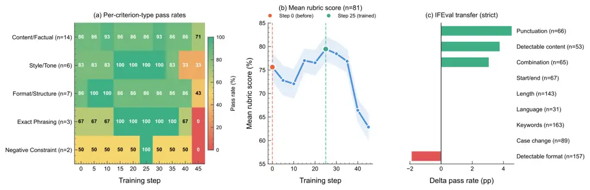
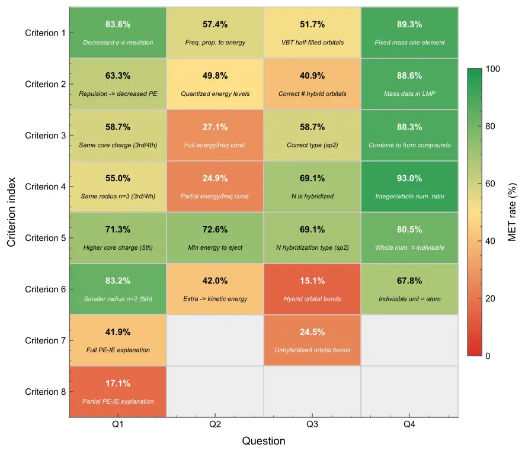
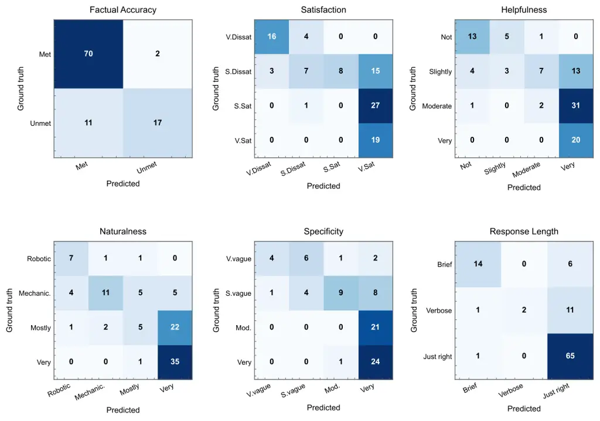

# Autorubric: A Unifying Framework for Rubric-Based LLM Evaluation on Non-Verifiable Tasks

Delip Rao ^(†)^(†)thanks: Corresponding author Affiliation: University
of Pennsylvania Email: [delip@seas.upenn.edu](mailto:)    Chris
Callison-Burch Affiliation: University of Pennsylvania
Email: [ccb@seas.upenn.edu](mailto:)

###### Abstract

Rubric-based LLM judges have become indispensable for evaluating and
optimizing systems on non-verifiable tasks, where success cannot be
reduced to exact programmatic checks. Yet the underlying judges remain
vulnerable to position bias, stochastic inconsistency, criterion
conflation, forced judgments under uncertainty, and model-dependent
calibration. Rubrics structure evaluation but do not eliminate these
failures; they add consequential choices about criterion design, scale
types, weighting, aggregation, abstention, calibration, and reliability
measurement. Despite extensive research across LLM evaluation,
educational measurement, and psychometrics, the relevant methods remain
scattered across papers and partial implementations. Researchers
therefore pay a _reinvention tax_, repeatedly rebuilding evaluation
machinery instead of accumulating knowledge on a common substrate. We
introduce Autorubric, an open-source framework that makes rubric and
judge choices explicit, reusable, and auditable. Through a unified API,
it supports atomic evaluation of mixed criterion types alongside
configurable bias mitigations, calibration, ensembling, abstention, and
psychometric diagnostics. Evaluations spanning college chemistry
grading, deep-research systems, and CHARM-100—a new mixed-criterion
chatbot benchmark—reveal criterion-specific failures, systematic
judge-family differences, and configuration effects that do not support
a universal mitigation stack. We further demonstrate how per-criterion
scores and explanations can support agent skill revision and reward
modeling for reinforcement learning. By providing shared infrastructure
from measurement through optimization, Autorubric gives the community a
common basis for comparing methods, reproducing evaluation choices, and
accumulating evidence across studies.

|     |
| --- |
|     |

## 1 Introduction

The LLM-as-a-Judge (LaaJ) paradigm is the default approach for
evaluating text generation at scale (Zheng et al., 2023; Liu et al.,
2023; Gu et al., 2026), yet the techniques that make LaaJ evaluation
reliable—ensemble judging (Verga et al., 2024), position bias
mitigation (Wang et al., 2024a), explicit abstention (Xin et al.,
2021)—are scattered across papers with inconsistent terminology and not
consistently applied in LLM-based rubric evaluations. Practitioners must
compose these techniques ad hoc, resulting in repeated reimplementation.
A separate gap compounds the problem: educational measurement and
psychometrics offer decades of methodology on designing and scoring
rubrics and inter-rater reliability (McKeown & Lenarcic Biss, 2018;
Brookhart, 2018), yet this body of work has yet to be systematically
applied to LaaJ evaluations.

Part of this problem is the perception that a rubric is just a prompt.
However, when examined deeply, rubrics offer a plethora of design and
operationalization choices, each consequential to the evaluation problem
and judge model at hand. For starters, rubrics can be ‘holistic’ (single
score over multiple criteria) or ‘analytical’. Analytic rubrics
decompose evaluation into independent criteria scored separately,
conferring three advantages: (1) per-criterion evaluation reduces the
risk of criterion conflation and halo effects (Lee et al., 2025; Wei
et al., 2025); (2) independent criterion scores enable reliability
measurement via Cohen’s $`\kappa`$ and weighted $`\kappa`$, so
practitioners can identify which criteria are unreliable; and (3)
structured per-criterion verdicts and explanations serve as optimization
signals—a system that knows which criteria it fails can target those
dimensions, whereas a holistic score provides no such decomposition. We
review many more such design choices in Section 2.

This paper presents Autorubric, an open-source framework¹¹ 1 Project
website and documentation:
[https://autorubric.org/](https://autorubric.org/). Framework and API
descriptions in this paper target release v1.5.3; readers should consult
the public site for the latest API documentation. Reported experiments
retain their contemporaneous configurations and were not rerun under
v1.5.3. that unifies rubric-based LLM evaluation design and
operationalization choices with opinionated defaults drawn from
LLM-as-a-judge, education testing, and psychometrics literature. Its
design centers on per-criterion atomic evaluation, bias mitigations for
position and criterion conflation, ensemble judging with configurable
aggregation, few-shot calibration with verdict-balanced sampling, and
psychometric reliability metrics. The framework supports heterogeneous
mixtures of binary, ordinal, and nominal criteria within a single
rubric, enabling richer evaluations. Figure 1 shows the evaluation
pipeline.

Our contributions are:

1.  1.  Autorubric, an open-source framework unifying rubric-based LLM
        evaluation—analytic rubrics with mixed criterion types, ensemble
        judging, few-shot calibration, bias mitigations, and psychometric
        reliability metrics—with opinionated defaults (Section 2).
2.  2.  CHARM-100, a synthetically authored chatbot evaluation dataset
        combining binary, ordinal, and nominal criteria with per-sample
        reference labels and a recorded 50-item second-annotation agreement
        audit (Section 4.3).
3.  3.  Validation on three benchmarks with an exploratory
        configuration-sensitivity analysis across three judge-model families
        (Section 4).
4.  4.  Two downstream applications of Autorubric demonstrating that
        per-criterion rubric scores serve as optimization signals for agent
        skill improvement (Section 5) and reinforcement learning with
        rubric-based rewards (Section 6).

## 2 Background and framework design

Figure 1: Autorubric evaluation pipeline. A RubricDataset packages a
task prompt, rubric, and submissions. The CriterionGrader issues
$`N\times M`$ independent LLM calls ($`N`$ judges, $`M`$ criteria) in
parallel, each evaluating one criterion under one judge with optional
option shuffling. Per-criterion votes are combined by a configurable
aggregation strategy to produce an EnsembleEvaluationReport. Response
caching, per-provider rate limiting, checkpoint-based resumable
evaluation, concurrent execution, and cost tracking per LLM call with
per-item and run-level totals operate under an EvalRunner. Details are
in Appendix B.

A rubric is a scoring instrument comprising _criteria_ that specify what
is being evaluated and performance-level descriptions that characterize
quality (Brookhart, 2018). Rubric criteria can have associated
weights (Kim et al., 2024; Gunjal et al., 2025; Hong et al., 2026).
While holistic rubrics assign a single overall score, analytic rubrics
decompose evaluation into separate criteria scored
independently (Mrangu, 2022). Autorubric adopts analytic rubrics as the
default, as motivated in Section 1. Figure 5 illustrates the space of
rubric design and implementation choices that we explore in our
framework.

Criterion types. Individual criteria take three forms. _Binary_ criteria
(MET/UNMET) express thresholded decisions using the smallest label
space. _Ordinal_ criteria use ordered levels (Likert scales) to capture
gradations; we encourage bounded scales with clear behavioral anchors.
Direct LLM scoring can concentrate on a single label (e.g., 3 on a 1–5
scale) and produce tied integer ratings even when decimals are
requested (Liu et al., 2023). _Nominal_ criteria offer unordered
categories for classification-style evaluation. Autorubric supports all
three types, with explicit numeric values (0–1) for multi-choice options
to decouple score from presentation order. Reliability depends on the
construct, label design, and judge configuration, so agreement should be
assessed with type-appropriate metrics rather than assumed from
criterion type alone. As a design choice, continuous-valued criteria are
intentionally excluded in favor of bounded categorical options with
explicit numeric mappings.

Weighting and aggregation. Criteria carry configurable positive or
negative weights. Negative criteria apply explicit penalties when
specified anti-patterns are detected. After applying the configured
abstention strategy, let $`\mathcal{I}`$ be the criteria retained for
scoring and $`\tilde{v}_{i}`$ their effective values. Define
$`S=\sum_{i\in\mathcal{I}}\tilde{v}_{i}w_{i}`$,
$`W_{+}=\sum_{i\in\mathcal{I}:w_{i}>0}w_{i}`$, and
$`W_{-}=\sum_{i\in\mathcal{I}:w_{i}<0}|w_{i}|`$. The normalized score is

```math
\text{score}=\begin{cases}\operatorname{clip}_{[0,1]}(S/W_{+}),&W_{+}>0,\\
\operatorname{clip}_{[0,1]}(1+S/W_{-}),&W_{+}=0,\ W_{-}>0,\\
0,&W_{+}=W_{-}=0,\end{cases} \tag{1}
```

where $`w_{i}`$ denotes weight and, for ordinary verdicts,
$`\tilde{v}_{i}`$ is 1 for MET, 0 for UNMET, or the option’s explicit
value for multi-choice criteria; retained abstentions use the
strategy-defined effective value. Also,
$`\operatorname{clip}_{[0,1]}(x)=\max(0,\min(1,x))`$. When $`W_{+}>0`$,
negative weights subtract penalties while $`W_{+}`$ defines the maximum
attainable positive score. When $`W_{+}=0`$ and $`W_{-}>0`$, the
effective rubric is penalty-only: its score starts at 1 and falls in
proportion to the triggered penalty weight. If no nonzero-weight
criteria remain after abstention handling, the score is 0. Listings 1–3
in Appendix B illustrate rubric definitions with all three criterion
types.

Evaluation modes and judging strategies. Autorubric implements
pointwise, reference-free evaluation by default; optional reference
submissions are supported. Each criterion is evaluated in a separate LLM
call to reduce criterion conflation and halo effects (Lee et al., 2025;
Wei et al., 2025). Ensemble grading via diverse-model panels is
supported because such panels can outperform individual judges in some
settings (Verga et al., 2024), with majority vote, weighted vote,
unanimous, and any-vote aggregation strategies (Listing 4). The grader
makes $`N\times M`$ concurrent calls ($`N`$ judges, $`M`$ criteria) with
mean inter-judge agreement tracked as a reliability indicator.

Calibration and reasoning. Few-shot calibration includes example
submissions with correct verdicts drawn from a training split, with
verdict balancing to prevent the judge from inferring a base-rate
prior (Hong et al., 2026). Reasoning-enhanced judging is configurable
via thinking levels or explicit token budgets per judge. Evidence for
reasoning benefits is mixed (Gunjal et al., 2025; Haldar & Hockenmaier,
2025), so thinking is best treated as a tunable option. Code examples
are in Appendix B.

## 3 Failure modes in LLM-based evaluation and Autorubric mitigations

Position bias. Many LLM judges are sensitive to option position (Wang
et al., 2024a; Zheng et al., 2023). Autorubric randomizes option order
per evaluation by default, using explicit numeric values to decouple
score from position. Shuffling is deterministic via a per-item seed
derived from the master seed, so reruns are reproducible.

| Failure Mode         | Mitigation                 | Autorubric Mechanism                  |
| -------------------- | -------------------------- | ------------------------------------- |
| Position bias        | Option shuffling           | shuffle_options + value-based scoring |
| Low reliability      | Ensemble judging           | Multi-judge CriterionGrader           |
| Criterion conflation | Atomic decomposition       | Independent per-criterion LLM calls   |
| Uncertainty          | Explicit abstention        | CANNOT_ASSESS + strategies            |
| Opacity              | Per-criterion explanations | Mandatory reason field per verdict    |

Table 1: Failure modes in LLM-based evaluation and corresponding
Autorubric mitigations.

Low reliability. Individual LLM judgments exhibit high unexplained
variance (Feuer et al., 2025) and stochastic self-inconsistency (Haldar
& Hockenmaier, 2025). Multi-judge ensembles with per-criterion voting
reduce variance and mitigate model-specific biases. Autorubric controls
non-LLM randomness via a single master seed persisted in the experiment
manifest.

Criterion conflation. When multiple quality dimensions are evaluated
together, judgments conflate distinct constructs (Lee et al., 2025; Wei
et al., 2025). Autorubric evaluates each criterion in a separate LLM
call, with concurrent execution and prompt caching offsetting evaluation
throughput and cost respectively.

Uncertainty. Selective prediction permits abstention rather than a
forced label on uncertain examples (Xin et al., 2021). Some submissions
similarly do not provide enough information to assess a particular
rubric criterion. Autorubric provides a native CANNOT_ASSESS verdict
with configurable strategies: SKIP, ZERO, PARTIAL, or FAIL.

Interpretability and auditability. Every verdict includes a mandatory
explanation field for enabling evaluation audits and downstream
optimization (See Sec. 5 for an example application). In ensemble mode,
per-judge reasoning is preserved so reviewers can inspect disagreement
rationales, though LLM explanations are post-hoc
rationalizations (Turpin et al., 2023) and not a replacement for human
review.

## 4 Evaluation

In addition to an extensive suite of unit tests for each Autorubric
feature, we empirically sanity check the framework with benchmarks.

### 4.1 College-level chemistry grading (RiceChem)

The RiceChem dataset (Sonkar et al., 2024) comprises 1,240 human-graded
long-form student responses to four college-level chemistry exam
questions, each graded against an independent binary rubric for a total
of 27 criteria. The four questions cover ionization energies (Q1, 8
criteria, 327 students), quantized absorption versus photoejection (Q2,
6 criteria, 317), hybrid orbital analysis (Q3, 7 criteria, 298), and the
Law of Multiple Proportions (Q4, 6 criteria, 298). Responses average
approximately 120 words. Sonkar et al. (2024) frame grading as _rubric
entailment_: for each (response, criterion) pair, determine whether the
response satisfies the criterion. Criterion weights, not provided in the
raw data, were inferred via least-squares regression from TA-assigned
scores. The inferred weights cluster near integer values with
$`R^{2}\geq 0.985`$ for three of four questions (Appendix D).

This benchmark exercises two capabilities: per-criterion binary
evaluation with criterion-level agreement metrics, and few-shot
calibration via FewShotConfig with verdict-balanced sampling.²² 2 Unless
otherwise noted, benchmark runs use one judge, option shuffling,
majority aggregation for binary criteria, and SKIP for unassessable
criteria. Few-shot use is experiment-specific: the primary RiceChem
comparison is 0-shot versus 5-shot, the primary ResearcherBench and
CHARM-100 evaluations are zero-shot, and the CHARM
configuration-sensitivity study uses 3-shot calibration except in the
explicitly ablated conditions. Each criterion is evaluated atomically
via a structured prompt that elicits a JSON verdict
(MET/UNMET/CANNOT_ASSESS) with a 1–2 sentence evidence-citing
explanation. Appendix B distinguishes historical experiment provenance
from the v1.5.3 API. All models were accessed in Feb.–March 2026.
Published baselines—zero-shot GPT-4 (70.9% accuracy) and fine-tuned
RoBERTa+MNLI (86.8%)—serve as reference points.

|                                                |          |
| ---------------------------------------------- | -------- |
| Method                                         | Accuracy |
| (Sonkar et al., 2024):                         |          |
|    $`\hookrightarrow`$ GPT-4 zero-shot         | 70.9%    |
|    $`\hookrightarrow`$ RoBERTa+MNLI fine-tuned | 86.8%    |
| Autorubric + Gemini-3-Flash:                   |          |
|    $`\hookrightarrow`$ 0-shot                  | 78.0%    |
|    $`\hookrightarrow`$ 5-shot                  | 80.7%    |

Table 2: Comparison on the RiceChem rubric-entailment task (1,240
student responses, 27 binary criteria). Autorubric values are from the
paired rerun over all 819 held-out response–criterion decisions;
baselines are from Sonkar et al. (2024).

Following Sonkar et al. (2024), we use the same 80-10-10 split and
report micro-averaged accuracy on the held-out test set. In a paired
rerun over all 819 response–criterion decisions, 5-shot calibration
improves accuracy from 78.0% (639/819) to 80.7% (661/819), a gain of 2.7
percentage points; 54 decisions improve and 32 degrade. Because multiple
criterion decisions are nested within each student response, we treat
this gain as descriptive and do not use a decision-level McNemar test or
flat bootstrap interval as cluster-adjusted inference. The gap to
fine-tuned RoBERTa+MNLI (86.8%) is expected for a zero/few-shot
approach. Appendix D reports the paired per-question results and clearly
labels two independent diagnostic runs.

### 4.2 Deep research system evaluation (ResearcherBench)

ResearcherBench (Xu et al., 2025) evaluates Deep Research³³ 3
[https://openai.com/index/introducing-deep-research/](https://openai.com/index/introducing-deep-research/)
like systems---agents that perform multi-step literature search,
synthesis, and reasoning---on 65 expert-curated questions spanning 34 AI
research subjects. Each question carries a per-item rubric of weighted
binary criteria designed by experienced AI researchers. Rubrics contain
931 total criteria (mean 14.3 per question), with weights from 1
(nice-to-have) to 3 (core finding). The benchmark defines a coverage
score⁴⁴ 4 The coverage score, introduced by Xu et al. (2025), is the
weighted proportion of binary criteria satisfied:
$`\text{Coverage}=\sum_{i}w_{i}c_{i}/\sum_{i}w_{i}`$, where
$`c_{i}\in\{0,1\}`$ indicates whether criterion $`i`$ is met and
$`w_{i}`$ is its importance weight. identical to Autorubric’s normalized
weighted score for binary criteria (Equation 1).

We evaluate three systems (OpenAI DeepResearch, Gemini DeepResearch,
Grok3 DeepSearch) using two judges: Claude Sonnet-4.5 and
Gemini-3-Flash, for a total of 5,586 criterion-level judgments.

|                     |                      |                      |                  |
| ------------------- | -------------------- | -------------------- | ---------------- |
|                     | Autorubric           |                      | Xu et al. (2025) |
|                     | Sonnet-4.5           | Gemini-3-Flash       | Sonnet-3.5       |
| OpenAI DeepResearch | 0.620 \[.569, .670\] | 0.771 \[.723, .818\] | 0.703            |
| Gemini DeepResearch | 0.692 \[.640, .741\] | 0.810 \[.751, .864\] | 0.693            |
| Grok3 DeepSearch    | 0.579 \[.520, .637\] | 0.618 \[.569, .667\] | 0.441            |

Table 3: ResearcherBench mean coverage scores with 95% bootstrap CIs (65
questions, 931 criteria). The top-two systems’ CIs overlap for
Sonnet-4.5; a paired permutation test (Table 20) shows the gap is
significant under Sonnet-4.5 but not Gemini-3-Flash. The Xu et al.
(2025) column uses Sonnet-3.5 (CIs not available). Cost analysis is in
Appendix E.

Table 3 reports mean coverage scores with 95% bootstrap confidence
intervals. Both Autorubric judges produce the same aggregate ranking
(Gemini $`>`$ OpenAI $`>`$ Grok3), though CIs overlap for the top two. A
paired permutation test (Table 20) confirms the Gemini–OpenAI gap is
significant under Sonnet-4.5 ($`p=0.003`$, Cohen’s $`d=0.39`$) but not
under Gemini-3-Flash ($`p=0.219`$), making the top-two ranking
judge-dependent. Cross-judge Spearman correlations on per-question
scores are moderate to strong ($`\rho=0.54`$–$`0.82`$, $`p<0.001`$),
indicating judges agree on _which questions are hard_ more consistently
than on _which system is best_. At the criterion level, inter-judge
agreement is moderate (pooled $`\kappa=0.53`$, 78.5% raw agreement),
with the non-exclusive keyword taxonomy yielding a higher disagreement
rate for critical-analysis criteria (27.9%) than for enumeration and
depth criteria (14–15%; Table 22). Autorubric’s cost and token usage
tracking, for example, reveals Gemini-3-Flash is 5–6$`\times`$ cheaper
while preserving the aggregate ranking (Appendix E), giving
practitioners evidence for cost–quality tradeoffs in large-scale
deployments.

### 4.3 Chatbot assessment with heterogeneous criteria (CHARM-100)

To validate Autorubric’s support for multiple criterion types and
heterogeneous criteria, we introduce CHARM-100 (Chatbot Assessment with
Mixed Rubric Metrics), 100 annotated single-turn chatbot conversations
evaluated against six criteria spanning three types: one binary (factual
accuracy), four ordinal (satisfaction, helpfulness, naturalness,
specificity), and one nominal (response length)⁵⁵ 5 Existing evaluation
benchmarks adopt a single scale type: Likert scales (Zheng et al.,
2023), pairwise judgments (Li et al., 2025), binary checklists (Lin
et al., 2025), or multi-dimensional ratings (Wang et al., 2024b; Hashemi
et al., 2024). None combine ordinal, nominal, and binary criteria in a
single rubric with per-sample reference labels.. The conversations and
reference labels were generated synthetically to control quality-label
distributions. Cross-criteria conflicts (e.g., factually wrong but
naturally written) are designed to expose reliance on a single
overall-quality shortcut. Reference labels are broadly distributed (mean
normalized entropy 0.92), and a recorded second annotation pass covers a
stratified 50-item subset. The full annotation schema is in Table 25;
dataset details are in Appendix F.

Table 31 (Appendix G) reports per-criterion results using Gemini-3-Flash
as the judge⁶⁶ 6 For the CHARM-100 evaluation results, $`\kappa`$
compares judge predictions with reference labels. Ordinal criteria use
quadratic-weighted $`\kappa`$; binary and nominal criteria use
unweighted $`\kappa`$. A separate second-annotation audit reports mean
agreement with the reference labels of $`\kappa=0.69`$ on 50 items
(Appendix F.11).. Under this configuration, factual accuracy, the sole
binary criterion, has the highest exact accuracy (87.0%; unweighted
$`\kappa=0.642`$). The four ordinal criteria show lower exact agreement
(38–58%) despite high adjacent accuracy (85–93%): the judge is usually
within one step of ground truth but clusters toward scale extremes.
Naturalness has the highest reported type-appropriate $`\kappa`$ (0.719,
quadratic-weighted), and the ordinal criteria show strong rank
correlations (Spearman 0.698–0.786). The sole nominal criterion,
response length, achieves 81.0% exact accuracy but detects brevity (0.70
recall) far better than verbosity (0.14 recall). Because CHARM-100
contains only one binary and one nominal criterion and uses
type-specific $`\kappa`$ weighting, these results describe
criterion-specific error profiles rather than a general reliability
hierarchy. Figure 2 visualizes these patterns.

In aggregate, the model exhibits a positive bias (+0.170), consistent
with documented LLM judge leniency (Zheng et al., 2023; Ye et al.,
2024), though score-level ranking remains strong (Spearman = 0.810).
Full confusion matrices are in Appendix G.

Figure 2: CHARM-100 per-criterion exact accuracy (left) and
type-appropriate $`\kappa`$ (right) under Gemini-3-Flash, grouped by
criterion type. The right panel uses unweighted $`\kappa`$ for binary
and nominal criteria and quadratic-weighted $`\kappa`$ for ordinal
criteria, so it is not a common-metric ranking of types. Factual
accuracy has the highest exact accuracy; naturalness has the highest
displayed $`\kappa`$.

### 4.4 Configuration sensitivity

We conduct an exploratory configuration-sensitivity analysis on
CHARM-100 across three model families: Gemini-3-Flash, GPT-5.4-nano, and
LLaMA-3.1-8B. The Default configuration uses option shuffling, 3-shot
verdict-balanced calibration, and the SKIP abstention strategy. The
$`-`$Shuffle and $`-`$Few-shot rows remove one component; the ensemble
rows add repeated judges, Bare removes multiple components, and
Cross-family combines the three Default runs. All configurations use the
same 80-item test set (20 items reserved for few-shot training,
stratified split, seed 42). These runs are independent stochastic
evaluations from the primary CHARM result above. Because each
configuration was run once, differences are descriptive and include
model-output variability.

|                       | Gemini-3-Flash |            |          |       | GPT-5.4-nano |            |          |       | LLaMA-3.1-8B |            |          |       |
| --------------------- | -------------- | ---------- | -------- | ----- | ------------ | ---------- | -------- | ----- | ------------ | ---------- | -------- | ----- |
| Configuration         | Exact          | $`\kappa`$ | $`\rho`$ | RMSE  | Exact        | $`\kappa`$ | $`\rho`$ | RMSE  | Exact        | $`\kappa`$ | $`\rho`$ | RMSE  |
| Default               | 60.4%          | 0.679      | 0.800    | 0.213 | 51.0%        | 0.462      | 0.562    | 0.242 | 19.4%        | -0.001     | 0.022    | 0.605 |
| $`-`$Shuffle          | 60.0%          | 0.660      | 0.828    | 0.217 | 46.7%        | 0.425      | 0.539    | 0.262 | 24.0%        | 0.033      | 0.200    | 0.512 |
| $`-`$Few-shot         | 59.8%          | 0.657      | 0.825    | 0.231 | 48.3%        | 0.434      | 0.614    | 0.248 | 21.5%        | 0.087      | 0.071    | 0.560 |
| +Ens($`k{=}3`$, maj.) | 61.3%          | 0.673      | 0.813    | 0.217 | 46.9%        | 0.437      | 0.493    | 0.272 | 21.5%        | 0.018      | 0.125    | 0.575 |
| +Ens($`k{=}5`$, maj.) | 61.5%          | 0.678      | 0.812    | 0.216 | 49.0%        | 0.456      | 0.533    | 0.263 | 24.0%        | 0.044      | 0.310    | 0.521 |
| +Ens($`k{=}3`$, mean) | 61.3%          | 0.670      | 0.828    | 0.215 | 47.9%        | 0.451      | 0.504    | 0.264 | 24.8%        | 0.043      | 0.135    | 0.509 |
| Bare (no mitigations) | 57.3%          | 0.629      | 0.767    | 0.225 | 48.3%        | 0.428      | 0.644    | 0.261 | 19.2%        | -0.038     | -0.053   | 0.594 |
| Cross-family ens.     | 57.1%          | 0.626      | 0.769    | 0.200 | —            |            |          |       | —            |            |          |       |

Table 4: Configuration sensitivity on CHARM-100 (80 test items, 6
criteria). Exact is pooled exact-label accuracy over all 480
item–criterion decisions, including N/A as a label. $`\kappa`$ is the
unweighted mean of six per-criterion Cohen’s $`\kappa`$ values
(quadratic-weighted for ordinal criteria; N/A pairs excluded); $`\rho`$
and RMSE are item-score metrics. The cross-family ensemble
majority-votes across the three Default runs.

Judge family is the largest source of variation: under Default, pooled
exact accuracy/$`\kappa`$ is 60.4%/0.679 for Gemini, 51.0%/0.462 for
GPT, and 19.4%/$`-0.001`$ for LLaMA. Configuration effects are not
universal. Removing few-shot examples changes pooled exact accuracy by
$`-0.6`$, $`-2.7`$, and $`+2.1`$pp for Gemini, GPT, and LLaMA,
respectively; removing shuffling changes it by $`-0.4`$, $`-4.3`$, and
$`+4.6`$pp. Same-model ensembles raise Gemini exact accuracy by at most
1.1pp, lower GPT accuracy by 2.0–4.1pp, and raise LLaMA accuracy by
2.1–5.4pp while leaving its $`\kappa`$ near zero. Relative to Bare,
Default improves pooled exact accuracy by 3.1pp (Gemini), 2.7pp (GPT),
and 0.2pp (LLaMA). The cross-family panel has lower exact accuracy and
$`\kappa`$ than Gemini alone (57.1%/0.626 vs. 60.4%/0.679), although its
score RMSE is slightly lower (0.200 vs. 0.213), and it costs more. These
single-run comparisons support model- and criterion-dependent
configuration choices, not a universally beneficial mitigation stack;
Appendix G.4 provides the per-type breakdown.

## 5 Application: agent skill improvement

Per-criterion measurements can serve as an optimization signal to
improve an LLM agent’s _skill_---a structured collection of instructions
that enable an agent to execute a specific task reliably⁷⁷ 7 See
[https://agentskills.io/what-are-skills](https://agentskills.io/what-are-skills).

(a) Rubric-guided skill improvement loop

(b) Improvement results

Figure 3: Agent skill improvement via rubric-guided feedback. (a) The
iterative loop uses Autorubric grading as the optimization signal. (b)
Starting from a vague skill (0.47), a single rubric-guided revision
produces point estimates of 0.85 (Gemini-3-Flash revision) and 0.86
(GPT-5.4 revision), compared with 0.82 for the expert-curated baseline
(dashed); all three 95% bootstrap CIs overlap. Gemini-3-Flash served as
the rubric grading model in both revision conditions, but the conditions
independently sampled the feedback used for revision and the reviews
used for evaluation. Their similar point estimates therefore do not
isolate revision-model self-preference or establish equivalence or
superiority. Confidence intervals are in Table 40 (Appendix H).

As a demonstration, we consider the task of peer reviewing 10 scientific
papers using Llama 3.1 8B, graded against a 10-criterion binary rubric
covering outcome quality, style, efficiency, and a factual
misrepresentation penalty. We establish performance boundaries: no skill
(score: 0.17), vague one-line skill (0.47), and expert-curated skill
(0.82). In a setup similar to prompt induction (Agrawal et al., 2026;
Yuksekgonul et al., 2025), an improvement loop grades reviews against
the rubric, formats failing criteria into feedback, and sends the
feedback to a revision LLM. Starting from the vague skill, a single
revision raises the score to 0.85. This slightly exceeds the
expert-curated point estimate of 0.82, but their bootstrap CIs overlap
and no revised-versus-curated superiority test was conducted (Figure 3).
As a descriptive robustness check, we repeat the full pipeline with
GPT-5.4 as the revision model (score: 0.86, overlapping CIs). The two
revision arms independently sample the initial reviews and Gemini
grading feedback supplied to the reviser, as well as the post-revision
reviews and grades, so their similar point estimates do not isolate
revision-model self-preference. With GPT-5.4-mini as a second grader on
freshly generated reviews, the vague-to-revised increase persists
($`0.58\to 0.74`$), while the revised point estimate remains below the
expert-curated point estimate (0.78). Across these end-to-end robustness
runs, improvement over the vague skill appears under both graders, but
the design does not establish superiority over expert curation or
isolate revision-model or grading-model effects (Table 40 in
Appendix H).

## 6 Application: reinforcement learning with rubric-based rewards

In contrast to per-criterion explanations, the per-criterion scores can
serve as a continuous reward signal for reinforcement learning.⁸⁸ 8
Unlike RLVR where rewards derive from programmatic checks, rubric-based
rewards are interpretable but not deterministically verifiable. We
demonstrate this on the complex_if_single_turn_v5 subset of
AdvancedIF (He et al., 2025b): 402 single-turn prompts with 7.44
expert-curated binary criteria on average, split 80/20 into training and
validation⁹⁹ 9 This subset is the most uniform of the three AdvancedIF
categories (rubric counts 4–9, mean 7.4), reducing confounds from
rubric-count variance.. The policy model is Qwen/Qwen3-4B-Instruct,
trained with LoRA via the Tinker RL framework¹⁰¹⁰ 10
[https://thinkingmachines.ai/tinker/](https://thinkingmachines.ai/tinker/)
(rank 32, LR $`5\times 10^{-4}`$, group size 8, batch size 32). The
reward is the Autorubric normalized score from gemini-3-flash-preview.
Total judge cost: approximately \$12 for 50 training steps (5 epochs).

Mean training rubric score rises from 0.774 (epoch 1) to 0.825 (epoch
3), then declines in epochs 4–5. We evaluate the 81-prompt validation
split every five steps and report step 25, the highest-scoring of the
ten monitored checkpoints (Figure 21). On this same validation split
used for checkpoint selection, mean rubric score increases from 0.756 to
0.795 (+0.039; nominal paired two-sided Wilcoxon signed-rank
$`p=0.032`$; Cohen’s $`d=0.26`$, 95% bootstrap CI $`[0.04,0.51]`$). This
$`p`$-value is unadjusted for checkpoint selection and is descriptive
rather than an independent test. Responses with rubric score 1.0
increase from 21/81 to 30/81 (+43%), and mean validation response length
falls 33% (1,097 to 733 tokens). Across all 50 training batches,
response length is non-monotonic and has no detectable linear trend
(+1.9 tokens/step, $`r=0.08`$, $`p=0.568`$); KL divergence remains below
0.003 and format compliance remains stable (Appendix J).

To probe judge dependence, we independently regenerate responses from
the base and step-25 models and grade them with GPT-5.4-mini. This check
yields a smaller positive difference (+0.023; nominal paired two-sided
Wilcoxon $`p=0.243`$; Cohen’s $`d=0.13`$, 95% bootstrap CI
$`[-0.09,0.35]`$). Because it changes both sampled responses and judge,
it is directionally consistent but inconclusive and does not isolate
judge coupling (Appendix J).



Figure 4: Reinforcement learning with Autorubric rewards. (a)
Exploratory keyword-derived category pass rates from four rollout groups
per checkpoint. (b) Mean score on 81 validation prompts; step 25 is the
best monitored checkpoint (0.795 vs. 0.756). (c) IFEval (Zhou et al., 2023) strict pass-rate changes; eight of nine instruction types show
non-negative transfer. Qualifications and diagnostics are in Appendix J.

Figure 4(a–b) reveals which criterion groups benefit in this run. Style,
phrasing, and format criteria show the largest gains through the
selected checkpoint, while some content and factual criteria remain
unresolved. On IFEval (Zhou et al., 2023) (Figure 4(c)), eight of nine
instruction types show non-negative out-of-domain transfer, with the
largest gains in punctuation (+4.5pp) and detectable content (+3.8pp).
The transfer gains are directionally positive but not statistically
significant (McNemar $`p=0.28`$).

## 7 Additional Related Works

Rubric-based evaluation draws on educational measurement and
psychometrics. Three rubric-authoring principles motivate Autorubric’s
criterion-level structure: _unidimensionality_, _behavioral anchors_,
and *construct alignment* (McKeown & Lenarcic Biss, 2018). These remain
author responsibilities; the framework does not enforce or certify them.
From psychometrics (Comer, 2009), it provides Cohen’s $`\kappa`$,
quadratic weighted $`\kappa`$, rank correlations, and Earth Mover’s
Distance (He et al., 2025a). LLM-specific concerns—position bias, prompt
sensitivity, self-preference bias (Panickssery et al., 2024; Wataoka
et al., 2024)—have no educational precedent and require the mitigations
in Section 3.

Several frameworks address bias and calibration in LLM evaluation.
RULERS (Hong et al., 2026) learns a distributional mapping from 200+
labeled examples per dataset, operating in the supervised regime with
fixed rubrics. Autorubric targets a different setting: user-defined
analytic rubrics without task-specific calibration data, relying on
generation-time mitigations. In the pairwise paradigm, Zhou et al.
(2024a) show that optimizing toward balanced decision rates improves
alignment; the analogous concern in pointwise evaluation is option
position bias, addressed by Autorubric’s automatic shuffling. At the
classification level, Batch Calibration (Zhou et al., 2024b) removes
contextual bias via batch statistics over logit vectors; the principle
that prompt-induced priors distort judgments motivates Autorubric’s
verdict-balanced few-shot design. Xia et al. (2025) produce calibrated
confidence from inter-model agreement for factoid QA; Autorubric’s
ensemble mode surfaces a related quantity as a reliability diagnostic
rather than a confidence score.

## 8 Discussion and conclusion

Criterion format and construct shape error profiles. In the CHARM-100
Gemini-3-Flash evaluation, factual accuracy has the highest exact
accuracy (87%), whereas the ordinal criteria show lower exact accuracy
(38–58%) but high adjacent accuracy (85–93%); naturalness has the
highest reported type-appropriate $`\kappa`$ (0.719). With only one
binary and one nominal criterion, criterion identity is confounded with
type, and the type-specific $`\kappa`$ variants are not directly
comparable as a reliability hierarchy. The practical implication is to
match criterion format to the construct—binary for defensible thresholds
and ordinal for meaningful gradations—and report type-appropriate
metrics rather than treating one format as universally preferable.

Per-criterion decomposition as measurement and optimization. The central
finding across Sections 4.3–6 is that per-criterion analytic rubrics
serve two purposes with a single representation. For measurement,
per-criterion scores diagnose where judges agree and disagree—e.g.,
CHARM-100 reveals 0.70 recall for brevity but 0.14 for verbosity, a
distinction invisible in holistic scores. The same scores provide
actionable optimization feedback: the skill improvement loop uses
per-criterion pass rates to raise a peer review agent’s score from 0.47
to 0.85, and per-criterion RL rewards yield a positive
validation-selected difference on AdvancedIF with directionally positive
out-of-domain transfer to IFEval. Holistic scores can support scalar
black-box optimization, but they do not directly localize which
requirements failed.

Autorubric provides a common implementation, but consistency cannot
establish construct validity.

This paper represents a snapshot of Autorubric as it existed at the time
of the COLM peer-review submission in March 2026. By the camera-ready
submission in August 2026, Autorubric had already gained substantial new
capabilities beyond that snapshot, and it continues to evolve. For
example, users can now integrate Autorubric directly into agent
harnesses through a skill without needing to write any code, assess
rubric quality, induce rubrics, and more. We strongly encourage readers
to consult the extensive documentation, cookbook recipes, and latest
MIT-licensed source code at
[https://autorubric.org/](https://autorubric.org/).

## Limitations

We group limitations into two categories. _Evaluation limitations_: (1)
LLM judges exhibit ordinal scale-extreme clustering, producing
misleadingly low exact accuracy on graded criteria; coarser scales or
reporting adjacent accuracy as the primary metric partially mitigate
this; batch calibration or ordinal regression methods may further reduce
scale clustering, but we leave this to future work. (2) Some constructs
resist binary categorization; multi-choice criteria address this at the
cost of more careful rubric design. (3) Gemini-3-Flash at 5–6$`\times`$
lower cost produced the same aggregate ranking as Sonnet-4.5 on
ResearcherBench (Section 4.2), although bootstrap CIs overlap for the
top two systems; inexpensive judges may not suffice for criterion-level
analysis where absolute calibration matters. (4) Ensemble judging with
$`k`$ judges requires $`k\times`$ LLM calls; the
configuration-sensitivity analysis shows small and model-dependent
changes for same-model ensembles, limiting the evidence for systematic
error correction. Adaptive ensembling—using multiple judges only for
low-confidence items—could reduce cost while targeting the cases most
likely to benefit. (5) Verbosity bias (Dubois et al., 2024) is not
explicitly mitigated in the current framework; length-controlled
evaluation or post-hoc calibration methods are potential directions. (6)
Each CHARM configuration was run once, so comparisons include stochastic
model-output variation and do not identify causal mitigation effects.
Judge-family differences are larger than the within-model ranges for
Gemini and GPT, but the framework’s mitigations cannot compensate for
the weakest judge tested. (7) All experiments and default prompts are
English-only. The framework is language-agnostic in design, but
criterion evaluation prompts and few-shot exemplars may require
adaptation for other languages; we do not test this. _Optimization
limitations_: (8) The optimized skill is tightly coupled to both rubric
and model; a different rubric may reward different tradeoffs, and
factual-grounding failures were not eliminated in this setup. (9) The
AdvancedIF validation split is used both to select step 25 and estimate
its gain; the nominal $`p`$-value is unadjusted for selection, and no
independent test split was evaluated. The independent-judge check
regenerates responses, so it cannot isolate judge effects from
generation variability. (10) The framework assumes rubrics are
well-designed. Rubric quality assessment—validating that criteria
measure what they claim to measure—remains an open problem.

## Acknowledgments

This research was developed with funding from the Defense Advanced
Research Projects Agency’s (DARPA) SciFy program (Agreement No.
HR00112520300) and is based upon work supported in part by the Office of
the Director of National Intelligence (ODNI), Intelligence Advanced
Research Projects Activity (IARPA), via 56000026C0019 (the BENGAL
program). The views and conclusions contained herein are those of the
authors and should not be interpreted as necessarily representing the
official policies, either expressed or implied, of DARPA, ODNI, IARPA,
the Department of Defense, or the U.S. Government. The U.S. Government
is authorized to reproduce and distribute reprints for governmental
purposes notwithstanding any copyright annotation therein.

## Generative AI Use Disclosure

The authors used LLMs both as experimental components and in preparing
this manuscript. As described in the corresponding methods, LLMs served
as evaluation judges, revision models, and a reinforcement-learning
reward model; a language model also generated the CHARM-100
conversations and reference labels, followed by a recorded second
annotation pass on 50 items. For manuscript preparation, the authors
used Gemini 3 Pro Preview and Claude Sonnet 4.5 to organize references,
proofread drafts, make plots, and provide light rewrites. The authors
reviewed the resulting prose, figures, data artifacts, and citations and
take full responsibility for the paper’s contents.

## Ethics Statement

A consolidated framework like Autorubric creates ethical tradeoffs. By
lowering barriers to deployment, we enable evaluation at scales
previously infeasible—with benefits (practitioners gain access to bias
mitigations) but also risks (reduced friction may prompt deployment
without careful consideration of appropriateness). Clean APIs can
produce overconfidence: a score between 0 and 1 obscures uncertainty and
systematic error. Those deploying automated evaluation benefit from cost
savings while those being evaluated bear the risk of biased judgments.
Autorubric surfaces uncertainty indicators (mean_agreement,
per-criterion vote distributions) alongside scores, and we recommend
treating low-agreement cases as requiring human review. The analytic
rubric design produces per-criterion explanations suitable for
disclosure to evaluated parties. We caution against interpreting this
framework as endorsement of automated evaluation in high-stakes human
assessment; organizations should validate against human judgments for
their specific populations and maintain oversight proportional to
decision stakes.

## References

- Agrawal et al. (2026) Lakshya A Agrawal, Shangyin Tan, Dilara Soylu,
  Noah Ziems, Rishi Khare, Krista Opsahl-Ong, Arnav Singhvi, Herumb
  Shandilya, Michael J Ryan, Meng Jiang, Christopher Potts, Koushik Sen,
  Alexandros G. Dimakis, Ion Stoica, Dan Klein, Matei Zaharia, and Omar
  Khattab. GEPA: Reflective prompt evolution can outperform
  reinforcement learning, 2026. URL
  [https://arxiv.org/abs/2507.19457](https://arxiv.org/abs/2507.19457).
- Brookhart (2018) Susan M. Brookhart. Appropriate criteria: Key to
  effective rubrics. _Frontiers in Education_, 3:22, 2018. doi:
  10.3389/feduc.2018.00022.
- Comer (2009) Keith Comer. Developing valid and reliable rubrics for
  writing assessment: Research and practice. Technical report, Ako
  Aotearoa, Wellington, New Zealand, 2009. URL
  [https://mro.massey.ac.nz/handle/10179/10631](https://mro.massey.ac.nz/handle/10179/10631).
- Dubois et al. (2024) Yann Dubois, Balázs Galambosi, Percy Liang, and
  Tatsunori B. Hashimoto. Length-controlled AlpacaEval: A simple way to
  debias automatic evaluators. In _First Conference on Language
  Modeling_, 2024. URL
  [https://openreview.net/forum?id=CybBmzWBX0](https://openreview.net/forum?id=CybBmzWBX0).
- Feuer et al. (2025) Benjamin Feuer, Chiung-Yi Tseng, Astitwa Sarthak
  Lathe, Oussama Elachqar, and John P. Dickerson. When judgment becomes
  noise: How design failures in LLM judge benchmarks silently undermine
  validity. _arXiv preprint_, 2025. doi: 10.48550/arXiv.2509.20293.
- Gu et al. (2026) Jiawei Gu, Xuhui Jiang, Zhichao Shi, Hexiang Tan,
  Xuehao Zhai, Chengjin Xu, Wei Li, Yinghan Shen, Shengjie Ma, Honghao
  Liu, Saizhuo Wang, Kun Zhang, Zhouchi Lin, Bowen Zhang, Lionel Ni, Wen
  Gao, Yuanzhuo Wang, and Jian Guo. A survey on LLM-as-a-judge. _The
  Innovation_, 7(6):101253, 2026. doi: 10.1016/j.xinn.2025.101253.
- Gunjal et al. (2025) Anisha Gunjal, Anthony Wang, Elaine Lau, Vaskar
  Nath, Yunzhong He, Bing Liu, and Sean Hendryx. Rubrics as rewards:
  Reinforcement learning beyond verifiable domains. _arXiv
  preprint_, 2025. doi: 10.48550/arXiv.2507.17746.
- Haldar & Hockenmaier (2025) Rajarshi Haldar and Julia Hockenmaier.
  Rating roulette: Self-inconsistency in LLM-as-a-judge frameworks. In
  _Findings of the Association for Computational Linguistics: EMNLP
  2025_, pp. 24986–25004. Association for Computational
  Linguistics, 2025. doi: 10.18653/v1/2025.findings-emnlp.1361.
- Hashemi et al. (2024) Helia Hashemi, Jason Eisner, Corby Rosset,
  Benjamin Van Durme, and Chris Kedzie. LLM-rubric: A multidimensional,
  calibrated approach to automated evaluation of natural language texts.
  In _Proceedings of the 62nd Annual Meeting of the Association for
  Computational Linguistics (Volume 1: Long Papers)_, pp. 13806–13834.
  Association for Computational Linguistics, 2024. doi:
  10.18653/v1/2024.acl-long.745.
- He et al. (2025a) Junda He, Jieke Shi, Terry Yue Zhuo, Christoph
  Treude, Jiamou Sun, Zhenchang Xing, Xiaoning Du, and David Lo.
  LLM-as-a-judge for software engineering: Literature review, vision,
  and the road ahead. _arXiv preprint_, 2025a. doi:
  10.48550/arXiv.2510.24367.
- He et al. (2025b) Yun He, Wenzhe Li, Hejia Zhang, Songlin Li, Karishma
  Mandyam, Sopan Khosla, Yuanhao Xiong, Nanshu Wang, Xiaoliang Peng,
  Beibin Li, Shengjie Bi, Shishir G. Patil, Qi Qi, Shengyu Feng, Julian
  Katz-Samuels, Richard Yuanzhe Pang, Sujan Gonugondla, Hunter Lang, Yue
  Yu, Yundi Qian, Maryam Fazel-Zarandi, Licheng Yu, Amine Benhalloum,
  Hany Awadalla, and Manaal Faruqui. AdvancedIF: Rubric-based
  benchmarking and reinforcement learning for advancing LLM instruction
  following, 2025b. URL
  [https://arxiv.org/abs/2511.10507](https://arxiv.org/abs/2511.10507).
- Hong et al. (2026) Yihan Hong, Huaiyuan Yao, Bolin Shen, Wanpeng Xu,
  Hua Wei, and Yushun Dong. From rubrics to reliable scores:
  Evidence-grounded text evaluation with LLM judges. _arXiv
  preprint_, 2026. doi: 10.48550/arXiv.2601.08654.
- Kim et al. (2024) Seungone Kim, Juyoung Suk, Shayne Longpre,
  Bill Yuchen Lin, Jamin Shin, Sean Welleck, Graham Neubig, Moontae Lee,
  Kyungjae Lee, and Minjoon Seo. Prometheus 2: An open source language
  model specialized in evaluating other language models. In _Proceedings
  of the 2024 Conference on Empirical Methods in Natural Language
  Processing_, pp. 4334–4353, 2024. doi:
  10.18653/v1/2024.emnlp-main.248.
- Lee et al. (2025) Yukyung Lee, JoongHoon Kim, Jaehee Kim, Hyowon Cho,
  Jaewook Kang, Pilsung Kang, and Najoung Kim. CheckEval: A reliable
  LLM-as-a-judge framework for evaluating text generation using
  checklists. In _Proceedings of the 2025 Conference on Empirical
  Methods in Natural Language Processing_, pp. 15782–15809, 2025. doi:
  10.18653/v1/2025.emnlp-main.796.
- Li et al. (2025) Tianle Li, Wei-Lin Chiang, Evan Frick, Lisa Dunlap,
  Tianhao Wu, Banghua Zhu, Joseph E. Gonzalez, and Ion Stoica. From
  crowdsourced data to high-quality benchmarks: Arena-Hard and
  BenchBuilder pipeline. In _Proceedings of the 42nd International
  Conference on Machine Learning_, volume 267 of _Proceedings of Machine
  Learning Research_, pp. 34209–34231. PMLR, 2025. URL
  [https://proceedings.mlr.press/v267/li25h.html](https://proceedings.mlr.press/v267/li25h.html).
- Lin et al. (2025) Bill Yuchen Lin, Yuntian Deng, Khyathi Chandu, Faeze
  Brahman, Abhilasha Ravichander, Valentina Pyatkin, Nouha Dziri,
  Ronan Le Bras, and Yejin Choi. WildBench: Benchmarking LLMs with
  challenging tasks from real users in the wild. In _International
  Conference on Learning Representations (ICLR)_, pp. 47852–47870, 2025.
  doi: 10.48550/arXiv.2406.04770.
- Liu et al. (2023) Yang Liu, Dan Iter, Yichong Xu, Shuohang Wang,
  Ruochen Xu, and Chenguang Zhu. G-Eval: NLG evaluation using GPT-4 with
  better human alignment. In _Proceedings of the 2023 Conference on
  Empirical Methods in Natural Language Processing_, pp. 2511–2522.
  Association for Computational Linguistics, 2023. doi:
  10.18653/v1/2023.emnlp-main.153.
- McKeown & Lenarcic Biss (2018) Jessica McKeown and Diane
  Lenarcic Biss. HEQCO’s guide to developing valid and reliable rubrics.
  Technical report, Higher Education Quality Council of Ontario,
  Toronto, ON, 2018. URL
  [https://heqco.ca/wp-content/uploads/2020/06/Formatted_Rubric-Guide_FINAL.pdf](https://heqco.ca/wp-content/uploads/2020/06/Formatted_Rubric-Guide_FINAL.pdf).
- Mrangu (2022) Leah Mrangu. Rubric as assessment tool for lecturers and
  students in higher education institution. _Acta Pedagogia Asiana_,
  1(1):26–33, 2022. doi: 10.53623/apga.v1i1.98.
- Panickssery et al. (2024) Arjun Panickssery, Samuel R. Bowman, and Shi
  Feng. LLM evaluators recognize and favor their own generations. In
  _Advances in Neural Information Processing Systems (NeurIPS)_, pp.
  68772–68802, 2024. doi: 10.52202/079017-2197.
- Sonkar et al. (2024) Shashank Sonkar, Kangqi Ni, Lesa Tran Lu, Kristi
  Kincaid, John S. Hutchinson, and Richard G. Baraniuk. Automated long
  answer grading with RiceChem dataset. In _Proceedings of the 25th
  International Conference on Artificial Intelligence in Education (AIED 2024)_, volume 14829 of _Lecture Notes in Computer Science_, pp.
  163–176. Springer, 2024. doi: 10.1007/978-3-031-64302-6_12. URL
  [https://arxiv.org/abs/2404.14316](https://arxiv.org/abs/2404.14316).
- Turpin et al. (2023) Miles Turpin, Julian Michael, Ethan Perez, and
  Samuel R. Bowman. Language models don’t always say what they think:
  Unfaithful explanations in chain-of-thought prompting. In _Advances in
  Neural Information Processing Systems (NeurIPS)_, 2023. URL
  [https://proceedings.neurips.cc/paper_files/paper/2023/hash/ed3fea9033a80fea1376299fa7863f4a-Abstract-Conference.html](https://proceedings.neurips.cc/paper_files/paper/2023/hash/ed3fea9033a80fea1376299fa7863f4a-Abstract-Conference.html).
- Verga et al. (2024) Pat Verga, Sebastian Hofstatter, Sophia Althammer,
  Yixuan Su, Aleksandra Piktus, Arkady Arkhangorodsky, Minjie Xu, Naomi
  White, and Patrick Lewis. Replacing judges with juries: Evaluating LLM
  generations with a panel of diverse models. _arXiv preprint_, 2024.
  doi: 10.48550/arXiv.2404.18796.
- Wang et al. (2024a) Peiyi Wang, Lei Li, Liang Chen, Zefan Cai, Dawei
  Zhu, Binghuai Lin, Yunbo Cao, Lingpeng Kong, Qi Liu, Tianyu Liu, and
  Zhifang Sui. Large language models are not fair evaluators. In
  _Proceedings of the 62nd Annual Meeting of the Association for
  Computational Linguistics (Volume 1: Long Papers)_, pp. 9440–9450.
  Association for Computational Linguistics, 2024a. doi:
  10.18653/v1/2024.acl-long.511.
- Wang et al. (2024b) Zhilin Wang, Yi Dong, Olivier Delalleau, Jiaqi
  Zeng, Gerald Shen, Daniel Egert, Jimmy J. Zhang, Makesh Narsimhan
  Sreedhar, and Oleksii Kuchaiev. HelpSteer 2: Open-source dataset for
  training top-performing reward models. In _Advances in Neural
  Information Processing Systems_, volume 37, pp. 1474–1501. Curran
  Associates, Inc., 2024b. doi: 10.52202/079017-0047.
- Wataoka et al. (2024) Koki Wataoka, Tsubasa Takahashi, and Ryokan Ri.
  Self-preference bias in LLM-as-a-judge. In _NeurIPS Safe Generative AI
  Workshop_, 2024. doi: 10.48550/arXiv.2410.21819.
- Wei et al. (2025) Tianjun Wei, Wei Wen, Ruizhi Qiao, Xing Sun, and
  Jianghong Ma. RocketEval: Efficient automated LLM evaluation via
  grading checklist. In _International Conference on Learning
  Representations (ICLR)_, pp. 58593–58619, 2025. doi:
  10.48550/arXiv.2503.05142.
- Xia et al. (2025) Yuxi Xia, Pedro Henrique Luz De Araujo, Klim
  Zaporojets, and Benjamin Roth. Influences on LLM calibration: A study
  of response agreement, loss functions, and prompt styles. In
  _Proceedings of the 63rd Annual Meeting of the Association for
  Computational Linguistics (Volume 1: Long Papers)_, pp. 3740–3761.
  Association for Computational Linguistics, 2025. doi:
  10.18653/v1/2025.acl-long.188.
- Xin et al. (2021) Ji Xin, Raphael Tang, Yaoliang Yu, and Jimmy Lin.
  The art of abstention: Selective prediction and error regularization
  for natural language processing. In _Proceedings of the 59th Annual
  Meeting of the Association for Computational Linguistics and the 11th
  International Joint Conference on Natural Language Processing (Volume
  1: Long Papers)_, pp. 1040–1051, Online, 2021. Association for
  Computational Linguistics. doi: 10.18653/v1/2021.acl-long.84. URL
  [https://aclanthology.org/2021.acl-long.84](https://aclanthology.org/2021.acl-long.84).
- Xu et al. (2025) Tianze Xu, Pengrui Lu, Lyumanshan Ye, Xiangkun Hu,
  and Pengfei Liu. ResearcherBench: Evaluating deep AI research systems
  on the frontiers of scientific inquiry, 2025. URL
  [https://arxiv.org/abs/2507.16280](https://arxiv.org/abs/2507.16280).
- Ye et al. (2024) Seonghyeon Ye, Doyoung Kim, Sungdong Kim, Hyeonbin
  Hwang, Seungone Kim, Yongrae Jo, James Thorne, Juho Kim, and Minjoon
  Seo. FLASK: Fine-grained language model evaluation based on alignment
  skill sets. In _Proceedings of the Twelfth International Conference on
  Learning Representations_, pp. 55361–55414, 2024. doi:
  10.48550/arXiv.2307.10928.
- Yuksekgonul et al. (2025) Mert Yuksekgonul, Federico Bianchi, Joseph
  Boen, Sheng Liu, Pan Lu, Zhi Huang, Carlos Guestrin, and James Zou.
  Optimizing generative AI by backpropagating language model feedback.
  _Nature_, 639(8055):609–616, 2025. doi: 10.1038/s41586-025-08661-4.
- Zheng et al. (2023) Lianmin Zheng, Wei-Lin Chiang, Ying Sheng, Siyuan
  Zhuang, Zhanghao Wu, Yonghao Zhuang, Zi Lin, Zhuohan Li, Dacheng Li,
  Eric P. Xing, Hao Zhang, Joseph E. Gonzalez, and Ion Stoica. Judging
  LLM-as-a-judge with MT-Bench and Chatbot Arena. In _Advances in Neural
  Information Processing Systems (Datasets and Benchmarks Track)_,
  volume 36, pp. 46595–46623, 2023.
- Zhou et al. (2024a) Han Zhou, Xingchen Wan, Yinhong Liu, Nigel
  Collier, Ivan Vulić, and Anna Korhonen. Fairer preferences elicit
  improved human-aligned large language model judgments. In _Proceedings
  of the 2024 Conference on Empirical Methods in Natural Language
  Processing_, pp. 1241–1252. Association for Computational Linguistics,
  2024a. doi: 10.18653/v1/2024.emnlp-main.72.
- Zhou et al. (2024b) Han Zhou, Xingchen Wan, Lev Proleev, Diana Mincu,
  Jilin Chen, Katherine Heller, and Subhrajit Roy. Batch calibration:
  Rethinking calibration for in-context learning and prompt engineering.
  In _Proceedings of the Twelfth International Conference on Learning
  Representations_, pp. 49–70, 2024b. doi: 10.48550/arXiv.2309.17249.
- Zhou et al. (2023) Jeffrey Zhou, Tianjian Lu, Swaroop Mishra,
  Siddhartha Brahma, Sujoy Basu, Yi Luan, Denny Zhou, and Le Hou.
  Instruction-following evaluation for large language models, 2023. URL
  [https://arxiv.org/abs/2311.07911](https://arxiv.org/abs/2311.07911).

## Appendix

## Outline of the Appendix

The appendix spans ten sections containing implementation details,
dataset documentation, and extended results that support but are not
essential for following the main text. We summarize them here for
navigability.

- •
  Appendix A presents a visual taxonomy of rubric-based evaluation
  design choices across five dimensions.
- •
  Appendix B provides code examples, educational measurement
  foundations, production infrastructure details, default evaluation
  prompts, hyperparameters, and correctness verification.
- •
  Appendix C shows an example concrete evaluation report produced by
  Autorubric.
- •
  Appendix D details the RiceChem dataset conversion, per-question
  rubrics, paired inference, an independent per-criterion diagnostic, an
  exploratory few-shot sweep, weight inference, score distributions,
  cold-start results, and prior baselines.
- •
  Appendix E covers additional details of the ResearcherBench dataset,
  rubric structure, cross-judge agreement, statistical significance
  tests, disagreement taxonomy, score calibration, cost analysis, and
  rubric statistics.
- •
  Appendix F documents the CHARM-100 dataset: motivation, annotation
  schema, design principles, topic coverage, label distributions,
  anti-pattern taxonomy, edge cases, second-annotation agreement, and
  limitations.
- •
  Appendix G reports CHARM-100 evaluation results including confusion
  matrices, aggregate metrics, N/A handling, and the
  configuration-sensitivity analysis.
- •
  Appendix H describes cross-model robustness probes for skill revision
  and their limits for identifying judge self-preference.
- •
  Appendix I synthesizes reliability patterns across all three
  benchmarks.
- •
  Appendix J reports additional RL training diagnostics,
  checkpoint-selection details, and a cross-judge robustness probe.

## Appendix A Design space taxonomy

Figure 5: Design space for rubric-based LLM evaluation across five
dimensions. Green pills indicate Autorubric defaults, blue pills
indicate supported options, and gray dashed pills indicate paradigms
covered in this paper but not yet implemented in the framework.

## Appendix B Framework details

This appendix provides the code examples, educational foundations, and
production infrastructure details summarized in the main text.

#### Version provenance.

Listings and framework defaults in this appendix target the public
v1.5.3 release. The reported experiments are stored historical runs
rather than v1.5.3 reruns: the primary ResearcherBench and CHARM
artifacts were introduced with Autorubric 0.3.2 (commit d81bea9), while
the separate CHARM sensitivity artifacts used their contemporaneous
March 2026 code. Prompt and default changes after those runs are
therefore documented as current API behavior, not retroactively
attributed to the reported predictions.

### B.1 Code examples

The following listings illustrate Autorubric’s API for each major
capability described in Sections 2–3. All listings target Autorubric
v1.5.3; readers using later releases should consult the current public
API documentation at
[https://autorubric.org/docs/api/](https://autorubric.org/docs/api/).

from autorubric import Rubric, Criterion

rubric = Rubric(\[

Criterion(weight=10.0, requirement="States the correct answer"),

Criterion(weight=8.0, requirement="Provides supporting evidence"),

Criterion(weight=5.0, requirement="Uses clear, concise language"),

\])

from autorubric import Criterion

\# Binary criterion (default)

Criterion(weight=10.0, requirement="The answer is factually correct")

\# Ordinal criterion with explicit values

Criterion(

weight=10.0,

requirement="Rate the clarity of explanation",

scale_type="ordinal",

options=\[

{"label": "Unclear", "value": 0.0},

{"label": "Somewhat clear", "value": 0.5},

{"label": "Very clear", "value": 1.0},

\]

)

\# Nominal criterion (unordered categories)

Criterion(

weight=5.0,

requirement="Primary error type (if any)",

scale_type="nominal",

options=\[

{"label": "Factual error", "value": 0.0},

{"label": "Logical error", "value": 0.0},

{"label": "No error", "value": 1.0},

\]

)

from autorubric import Rubric

rubric = Rubric.from_dict(\[

\# Positive criteria (reward when met)

{"weight": 10.0, "requirement": "Correctly identifies the main claim"},

{"weight": 8.0, "requirement": "Cites at least two sources"},

\# Negative criteria (penalty when met)

{"weight": -15.0, "requirement": "Contains hallucinated citations"},

{"weight": -10.0, "requirement": "Contradicts established facts"},

\])

from autorubric import LLMConfig

from autorubric.graders import CriterionGrader, JudgeSpec

\# Single judge

grader = CriterionGrader(

llm_config=LLMConfig(model="openai/gpt-4.1-mini")

)

\# Ensemble with three judges from different model families

grader = CriterionGrader(

judges=\[

JudgeSpec(

llm_config=LLMConfig(model="openai/gpt-4.1"),

judge_id="gpt-4",

weight=1.0,

),

JudgeSpec(

llm_config=LLMConfig(model="anthropic/claude-sonnet-4-5-20250929"),

judge_id="claude-sonnet",

weight=1.2,

),

JudgeSpec(

llm_config=LLMConfig(model="gemini/gemini-2.5-flash"),

judge_id="gemini-flash",

weight=1.0,

),

\],

aggregation="weighted", \# or "majority", "unanimous", "any"

)

\# Grade a submission

result = await rubric.grade(to_grade=response, grader=grader,
query=prompt)

score = f"{result.score:.2f}" if result.score is not None else "n/a"

agreement = (

f"{result.mean_agreement:.1%}"

if result.mean_agreement is not None else "n/a"

)

print(f"Score: {score}, Agreement: {agreement}")

from autorubric import FewShotConfig, LLMConfig, RubricDataset

from autorubric.graders import CriterionGrader

dataset = RubricDataset.from_file("labeled_data.json")

\# Split dataset into training (for examples) and test

train_data, test_data = dataset.split_train_test(n_train=100,
stratify=True, seed=42)

\# Configure few-shot calibration

grader = CriterionGrader(

llm_config=LLMConfig(model="openai/gpt-4.1-mini"),

training_data=train_data,

few_shot_config=FewShotConfig(

n_examples=3, \# Include 3 examples per criterion

balance_verdicts=True, \# Balance available label classes

include_reason=True, \# Include labeled-example explanations

seed=42,

),

)

from autorubric import LLMConfig, ThinkingConfig

from autorubric.graders import CriterionGrader, JudgeSpec

grader = CriterionGrader(

judges=\[

JudgeSpec(

llm_config=LLMConfig(

model="anthropic/claude-sonnet-4-20250514",

thinking=ThinkingConfig(level="high"),

),

judge_id="claude-high",

weight=2.0,

),

JudgeSpec(

llm_config=LLMConfig(model="openai/gpt-4.1"),

judge_id="gpt-no-thinking",

weight=1.0, \# no thinking

),

\],

aggregation="weighted",

)

from autorubric import LLMConfig

from autorubric.graders import CriterionGrader

\# Position bias mitigation is enabled by default

grader = CriterionGrader(

llm_config=LLMConfig(model="openai/gpt-4.1-mini"),

shuffle_options=True, \# Default: randomize option order

seed=42, \# Reproducible non-LLM randomness

)

\# Disable shuffling (e.g., for manual prompt inspection)

grader = CriterionGrader(

llm_config=LLMConfig(model="openai/gpt-4.1-mini"),

shuffle_options=False,

)

from autorubric import CannotAssessConfig, CannotAssessStrategy,
LLMConfig

from autorubric.graders import CriterionGrader

\# Default: skip unassessable criteria (adjust denominator)

grader =
CriterionGrader(llm_config=LLMConfig(model="openai/gpt-4.1-mini"))

\# Conservative: treat cannot-assess as failure

grader = CriterionGrader(

llm_config=LLMConfig(model="openai/gpt-4.1-mini"),

cannot_assess_config=CannotAssessConfig(

strategy=CannotAssessStrategy.FAIL

),

)

\# Give partial credit (50%)

grader = CriterionGrader(

llm_config=LLMConfig(model="openai/gpt-4.1-mini"),

cannot_assess_config=CannotAssessConfig(

strategy=CannotAssessStrategy.PARTIAL,

partial_credit=0.5,

),

)

from autorubric import CriterionVerdict

report = await rubric.grade(

to_grade=submission,

grader=grader,

query=prompt,

)

\# Extract explanations for unmet criteria

for criterion_report in report.report or \[\]:

if criterion_report.final_verdict == CriterionVerdict.UNMET:

print(f"Criterion: {criterion_report.criterion.requirement}")

print(f"Reason: {criterion_report.final_reason}")

### B.2 Educational measurement and psychometrics

Educational measurement provides frameworks for designing valid and
reliable assessments (McKeown & Lenarcic Biss, 2018). Autorubric’s
design is informed by three principles from this literature.
_Unidimensionality_: each criterion should measure a single construct. A
criterion that conflates multiple constructs (e.g., “The response is
accurate and well-written”) produces scores that are difficult to
interpret. Autorubric supports criterion-level decomposition by
evaluating each Criterion.requirement separately, but v1.5.3 does not
verify that the requirement is semantically unidimensional. _Behavioral
anchors_: score levels should be defined by observable behaviors rather
than evaluative adjectives. “The response cites at least three
peer-reviewed sources” is behavioral; “The response demonstrates
excellent research” is evaluative and subject to interpretation. For
multi-choice criteria, option labels serve as behavioral anchors.
_Construct alignment_: criteria should align with the construct being
measured. If the goal is to measure “helpfulness,” criteria should
operationalize helpfulness (task completion, user satisfaction proxies)
rather than proxies that may not correlate (length, formality).
Construct alignment is a rubric design responsibility; Autorubric cannot
enforce it but provides the structure for explicit criteria that can be
audited for alignment.

From psychometrics (Comer, 2009), the framework provides quantitative
methods for assessing measurement quality. _Reliability metrics_: for
categorical judgments, Cohen’s $`\kappa`$ adjusts for chance agreement;
for ordinal scales, quadratic weighted $`\kappa`$ accounts for the
magnitude of disagreement. Psychometrics also uses intraclass
correlation for continuous scores and multiple raters, but Autorubric
v1.5.3 does not implement that statistic. _Validity_: reliability is
necessary but not sufficient—a measure can be reliable but not valid.
Content validity asks whether criteria cover the intended domain;
criterion validity asks whether scores correlate with external measures;
construct validity asks whether the measure behaves as theory predicts.
Distribution analysis via Earth Mover’s Distance, following He et al.
(2025a), can reveal systematic biases (e.g., central tendency) that
point estimates miss.

Some LLM-specific concerns—token-level position bias, prompt
sensitivity, self-preference bias (Panickssery et al., 2024; Wataoka
et al., 2024)—have no educational precedent and require the mitigations
in Section 3.

from autorubric import evaluate

\# Run evaluation on dataset with ground truth

result = await evaluate(dataset, grader, show_progress=True)

\# Compute metrics against human judgments

metrics = result.compute_metrics(

dataset,

bootstrap=True, \# Confidence intervals

n_bootstrap=1000,

per_judge=True, \# Per-judge breakdown for ensembles

)

\# Access results

accuracy = metrics.criterion_accuracy

kappa = metrics.mean_kappa

rho = metrics.score_spearman.coefficient

print(f"Accuracy: {accuracy:.1%}" if accuracy is not None else
"Accuracy: n/a")

print(f"Cohen’s kappa: {kappa:.3f}" if kappa is not None else "Cohen’s
kappa: n/a")

print(f"Score correlation: {rho:.3f}" if rho is not None else "Score
correlation: n/a")

print(metrics.summary()) \# Formatted report

### B.3 Production infrastructure

For production deployment, Autorubric provides response caching for
reproducibility and cost control (keyed on the model, prompts, response
schema, and standard sampling and thinking parameters), checkpoint-based
resumable evaluation that stores intermediate results and selected
grader settings, including the master seed—allowing continuation after
interruptions and exact replication of the recorded non-LLM randomness,
and per-provider rate limiting via semaphores to prevent throttling
while maximizing throughput. The manifest is not a complete
serialization of every prompt, model, or grader option, so exact
reconstruction additionally requires retaining the evaluation code and
inputs. Each LLM call records a transient cost via LiteLLM’s
completion_cost(), and aggregation accumulates per-item and run-level
totals. Per-item wall-clock duration_seconds uses time.perf_counter();
the returned EvalResult exposes total cost and EvalTimingStats (mean,
min, max, p50, p95, and items-per-second). By default, items.jsonl
stores per-item cost and duration, while manifest.json stores selected
configuration fields, seed, status, and total wall time.

from autorubric import EvalConfig, EvalRunner, LLMConfig

from autorubric.graders import CriterionGrader

\# Caching: avoid redundant LLM calls

grader = CriterionGrader(

llm_config=LLMConfig(

model="openai/gpt-4.1-mini",

cache_enabled=True,

cache_dir=".autorubric_cache",

cache_ttl=3600, \# 1 hour TTL

)

)

\# Rate limiting: respect provider quotas

grader = CriterionGrader(

llm_config=LLMConfig(

model="openai/gpt-4.1-mini",

max_parallel_requests=10, \# Per-provider semaphore

)

)

\# Checkpointing: resumable batch evaluation

config = EvalConfig(

experiment_name="my-eval",

experiments_dir="./experiments",

resume=True, \# Continue from checkpoint if interrupted

)

runner = EvalRunner(dataset=dataset, grader=grader, config=config)

result = await runner.run()

\# Cost tracking

tokens = result.total_token_usage.total_tokens if
result.total_token_usage else 0

cost = result.total_completion_cost or 0.0

print(f"Tokens: {tokens}")

print(f"Cost: {cost:.4f} USD")

### B.4 Default evaluation prompts

Listings  and  show abridged adaptations of the v1.5.3 base system
prompts for binary and multi-choice criterion evaluation, respectively.
They summarize the principal verdict and output rules rather than
reproducing the constants verbatim. The complete, exact prompts are
available in the tagged source at
[https://github.com/delip/autorubric/blob/v1.5.3/src/autorubric/prompts.py](https://github.com/delip/autorubric/blob/v1.5.3/src/autorubric/prompts.py).
When a default prompt is used, supplying labeled training data appends
the corresponding few-shot addition. A custom prompt replaces the base
and must include any desired few-shot instructions itself.

You are an expert evaluation judge. Your task is to determine whether

a single criterion is satisfied by a given submission. Be precise,

evidence-based, and consistent.

You will receive a \<criterion_type\> (positive or negative),

a \<criterion\>, and a \<submission\> to evaluate. Your verdict must

be one of:

\- "MET": The thing described in the criterion IS present

\- "UNMET": The thing described in the criterion IS NOT present

\- "CANNOT_ASSESS": Insufficient evidence to determine (use rarely)

Evaluate this criterion independently. Do not let overall submission

quality influence your judgment.

CRITERION TYPES:

\<criterion_type\> indicates whether the criterion describes something

desirable (positive) or undesirable (negative). Your job is THE SAME

for both: determine if the thing described is present.

POSITIVE CRITERIA: desired traits that should be present.

NEGATIVE CRITERIA: active errors or mistakes. MET means the

submission advocates or states the problematic thing; UNMET means

it does NOT make this error or mentions it only to warn against it.

EVALUATION RULES:

\- For numerical values: check specified ranges or exact matches.

\- For factual claims: verify presence and accuracy.

\- For required elements: confirm presence, count precisely.

\- For exclusion requirements: confirm restricted content is absent.

\- Be strict about factual accuracy but flexible about wording.

\- Accept semantically equivalent statements or logical implications.

IMPLICIT SATISFACTION:

A criterion can be satisfied implicitly through context, tone, or

logical implication.

CANNOT_ASSESS VERDICT:

Use only when you genuinely cannot determine if the criterion is met

(e.g., missing attachments, garbled text). Do NOT use when you can

make a reasonable inference or when the criterion is simply not met.

RESPONSE FORMAT:

Respond with valid JSON:

{"criterion_status": "MET"\|"UNMET"\|"CANNOT_ASSESS",

"explanation": "…"}

Provide a 1-2 sentence explanation. Cite specific text from the

submission as evidence for your verdict.

You are an expert evaluation judge. Your task is to select the best

matching option for a given submission from a set of predefined

choices. Be precise, evidence-based, and consistent.

You will receive a \<question\>, numbered \<options\>, and a
\<submission\>.

EVALUATION RULES:

\- Review ALL options before selecting.

\- Base judgment on submission content, not assumptions about intent.

\- Be strict about factual accuracy but flexible about wording.

\- For ordinal scales, treat options as points on a continuum.

\- Do not default to middle options out of uncertainty.

\- When borderline, select the option whose description more precisely

matches the specific evidence in the submission.

NA / NOT APPLICABLE OPTIONS:

Select NA only when the question genuinely cannot be answered

(missing attachments, garbled text). Do NOT select NA when you can

make a reasonable inference or when the submission simply does not

match well (select the closest match instead).

RESPONSE FORMAT:

Respond with valid JSON:

{"selected_option": \<number\>, "explanation": "…"}

Provide a 1-2 sentence explanation. Cite specific text from the

submission as evidence for your selection.

### B.5 Default hyperparameters

Table 5 lists the principal v1.5.3 evaluation defaults. Few-shot
calibration is opt-in: its defaults apply only when training data are
supplied, and the settings used in each experiment are stated in the
corresponding methods.

| Component       | Parameter                           | Default  |
| --------------- | ----------------------------------- | -------- |
| Few-shot        | examples per criterion              | 3        |
|                 | label-class balancing               | on       |
|                 | include labeled-example explanation | off      |
| Single-LLM mode | effective judges                    | 1        |
| Aggregation     | binary                              | majority |
|                 | ordinal                             | mean     |
|                 | nominal                             | mode     |
| Multi-choice    | option shuffling                    | on       |
|                 | automatic N/A option                | on       |
| Cannot-assess   | strategy                            | SKIP     |
| Scoring         | normalized score                    | on       |

Table 5: Principal framework evaluation defaults in v1.5.3.
CriterionGrader requires either llm_config or an explicit judges list;
single-LLM mode is normalized internally to one effective judge.
Few-shot defaults apply only when labeled training data are supplied.
Reported experiments use the settings stated in their methods.

### B.6 Correctness verification

Score calculation must be correct by construction. We verify
Autorubric’s score aggregation against hand-computed examples covering
standard positive criteria with varying weights, all four CANNOT_ASSESS
handling strategies, the penalty-only normalization branch in
Equation 1, mixed positive and negative weights, and multi-choice
criteria with explicit option values. All tested cases agree with the
hand calculations within floating-point tolerance. The test suite of
more than 400 tests, covering edge cases in score computation, metric
calculation, and ensemble aggregation, is included in the repository.

## Appendix C Rubric evaluation report example

====================================================

AutoRubric Demo: Criterion-Level Accuracy Evaluation

Model: gemini/gemini-2.5-flash

Thinking: medium

Max Parallel Requests: 10

=====================================================

Prompt: Explain the causes and effects of the Industrial Revolution.

Rubric Criteria (total positive weight: 80.0):

1. Causes \[ +30.0\]

2. Effects \[ +30.0\]

3. Structure \[ +12.0\]

4. Britain \[ +8.0\]

5. Errors \[ -15.0\]

—————————————————-

Grading 11 items with EvalRunner…

(Checkpoints saved to experiments/ directory for resumption)

Evaluating ————– 11/11 (0.43/s) 0:00:25 0:00:00

Experiment saved to: experiments/slim-deer

====================

METRICS SUMMARY

====================

Items: 11, Criteria: 5

Criterion-Level Metrics:

Accuracy: 92.2%

Precision: 0.95

Recall: 0.87

F1: 0.91

Mean Kappa: 0.846

Score-Level Metrics:

RMSE: 0.3246

MAE: 0.1489

Spearman: 0.6413 (moderate positive)

Kendall: 0.6527 (moderate positive)

Pearson: 0.6699 (moderate positive)

Bias Analysis:

Mean Bias: -0.0875 (negative)

Significant: No

Bootstrap CIs (95%):

Accuracy: \[84.3%, 98.0%\]

Kappa: \[0.667, 0.961\]

RMSE: \[0.0452, 0.5417\]

Per-Criterion Breakdown:

Criterion Acc Prec Rec F1 Kappa

—————————————————————–

Causes 100.0% 1.00 1.00 1.00 1.000

Effects 90.0% 0.88 1.00 0.93 0.737

Structure 72.7% 1.00 0.57 0.73 0.492

Britain 100.0% 1.00 1.00 1.00 1.000

Errors 100.0% 1.00 1.00 1.00 1.000

Total Cost: \$0.090 (11 items, 124K tokens)

## Appendix D RiceChem additional results

### D.1 Dataset and conversion details

The RiceChem dataset (Sonkar et al., 2024) was introduced for automated
long answer grading (ALAG), framed as a rubric entailment problem: given
a student response and a rubric criterion, determine whether the
response satisfies (entails) the criterion. The raw data comprises eight
CSV files (four student answer files and four graded rubric files), one
pair per question. Each graded rubric file contains per-student binary
criterion annotations, numerical scores, and optional TA adjustment
columns.

#### Criterion selection.

The original rubric files contain both positive criteria (knowledge
demonstrated) and negative/flag columns (error indicators and blanks).
Following Sonkar et al. (2024), who report 27 rubric items, we retain
only positive criteria: 8 of 11 columns for Q1 (excluding incorrect,
Blank, Core charge calculation error), 6 of 9 for Q2 (excluding
Incorrect statement included, Incorrect, Blank), 7 of 9 for Q3
(excluding Correct response, Incorrect/Blank response), and 6 of 8 for
Q4 (excluding incorrect/misleading statement, incorrect/missing answer).

#### Blank filtering.

Empty or blank-flagged submissions are excluded: 1 from Q1, 11 from Q2,
10 from Q3, and 2 from Q4.

#### Ground truth encoding.

Each binary annotation is mapped to a CriterionVerdict: TRUE
$`\rightarrow`$ MET, FALSE $`\rightarrow`$ UNMET. The resulting verdict
vectors enable direct computation of criterion-level agreement metrics.

### D.2 Per-question criteria and weights

Table 6 summarizes the rubric structure for each question.

| Question | Topic                                  | Criteria | Students | Max Score |
| -------- | -------------------------------------- | -------- | -------- | --------- |
| Q1       | Ionization energies (Coulomb’s Law)    | 8        | 327      | $`\sim`$8 |
| Q2       | Quantized absorption vs. photoejection | 6        | 317      | $`\sim`$8 |
| Q3       | Hybrid orbitals in methanimine         | 7        | 298      | 9         |
| Q4       | Law of Multiple Proportions            | 6        | 298      | $`\sim`$8 |
| Total    |                                        | 27       | 1,240    |           |

Table 6: RiceChem question structure. All criteria are binary
(MET/UNMET). Questions 1–3 expect responses of approximately 150 words;
Question 4 approximately 75 words.

Tables 7–10 list each criterion with its inferred weight and the
proportion of students who satisfied it (MET rate).

| Q1 Criterion                                                    | Weight | MET Rate |
| --------------------------------------------------------------- | ------ | -------- |
| Correctly cites decreased electron-electron repulsion           | 1.01   | 83.8%    |
| Relates decreased repulsion to decreased potential energy       | 1.03   | 63.3%    |
| 3rd and 4th electrons feel same core charge                     | 0.96   | 58.7%    |
| 3rd and 4th electrons ionized from $`n{=}3`$ shell, same radius | 1.00   | 55.0%    |
| 5th electron from $`n{=}2`$ shell feels higher core charge      | 0.95   | 71.3%    |
| 5th electron from $`n{=}2`$ shell has smaller radius            | 0.98   | 83.2%    |
| Correctly explains PE–IE relationship (full)                    | 1.97   | 41.9%    |
| Partially explains PE–IE relationship                           | 0.99   | 17.1%    |

Table 7: Q1 criteria: Silicon ionization energies. Students explain why
successive ionization energies increase and why the 4th-to-5th jump is
disproportionately large, using core charge and Coulomb’s Law.

| Q2 Criterion                                  | Weight | MET Rate |
| --------------------------------------------- | ------ | -------- |
| Frequency proportional to energy of light     | 1.93   | 57.4%    |
| Energy levels of an electron are quantized    | 0.96   | 49.8%    |
| Fully explains energy/frequency condition     | 2.04   | 27.1%    |
| Partially explains energy/frequency condition | 1.02   | 24.9%    |
| Minimum energy needed to eject electron       | 0.96   | 72.6%    |
| Additional energy becomes kinetic energy      | 1.98   | 42.0%    |

Table 8: Q2 criteria: Light absorption vs. photoejection. Students
reconcile quantized absorption (only specific frequencies excite
electrons) with continuous photoejection (any frequency above threshold
ejects electrons).

| Q3 Criterion                                     | Weight | MET Rate |
| ------------------------------------------------ | ------ | -------- |
| Sentence 1 correct: VBT half-filled orbitals     | 2.00   | 51.7%    |
| Sentence 2: correct number of hybrid orbitals    | 2.00   | 40.9%    |
| Sentence 2: correct type (sp2)                   | 1.00   | 58.7%    |
| Sentence 3: nitrogen is hybridized               | 1.00   | 69.1%    |
| Sentence 3: correct hybridization type (sp2)     | 1.00   | 69.1%    |
| Sentence 3: hybrid orbital bonds described       | 1.00   | 15.1%    |
| Sentence 3: unhybridized orbital bonds described | 1.00   | 24.5%    |

Table 9: Q3 criteria: Hybrid orbitals in methanimine (CH₂NH). Students
assess a deliberately flawed peer response, identifying errors in sp3
hybridization of carbon and the claim that nitrogen does not hybridize.

| Q4 Criterion                             | Weight | MET Rate |
| ---------------------------------------- | ------ | -------- |
| Fixed mass of one element                | 0.98   | 89.3%    |
| Mass data in Law of Multiple Proportions | 0.98   | 88.6%    |
| Combine to form compounds                | 0.98   | 88.3%    |
| Integer/whole number ratio               | 1.01   | 93.0%    |
| Whole numbers mean indivisible/discrete  | 1.98   | 80.5%    |
| Indivisible unit of mass = atom          | 2.00   | 67.8%    |

Table 10: Q4 criteria: Law of Multiple Proportions. Students explain how
this law provides evidence that matter is composed of atoms. Most
criteria have MET rates above 80%, making Q4 the easiest question.

### D.3 Per-question and per-criterion reliability

Table 11 reports per-question aggregate Cohen’s $`\kappa`$ for the
paired 5-shot rerun used in the main text (661/819 correct). Q3 achieves
the highest agreement ($`\kappa=0.831`$), consistent with its
error-identification task producing unambiguous MET/UNMET distinctions.
Q1 is lowest ($`\kappa=0.435`$), dragged down by the partial-credit
criterion discussed below. Q2 and Q4 show moderate agreement
($`\kappa\approx 0.49`$), though Q4’s high accuracy (86.2%) masks low
$`\kappa`$ due to high base rates on several criteria.

| Question                          | N   | Acc.  | $`\kappa`$ | 95% CI           |
| --------------------------------- | --- | ----- | ---------- | ---------------- |
| Q1 (ionization energies)          | 256 | 73.4% | 0.435      | \[0.318, 0.544\] |
| Q2 (absorption vs. photoejection) | 186 | 73.7% | 0.492      | \[0.380, 0.604\] |
| Q3 (hybrid orbitals)              | 203 | 91.6% | 0.831      | \[0.750, 0.902\] |
| Q4 (Law of Multiple Proportions)  | 174 | 86.2% | 0.489      | \[0.302, 0.656\] |
| Aggregate                         | 819 | 80.7% | 0.587      | \[0.531, 0.643\] |

Table 11: Per-question aggregate Cohen’s $`\kappa`$ for the paired
RiceChem rerun (5-shot, Gemini-3-Flash; 661/819 correct). Reported 95%
bootstrap CIs use 10,000 decision-level resamples and are descriptive
because they do not cluster by student response. Each row pools all
criteria within that question.

Separately, Table 12 disaggregates an independent 5-shot diagnostic
replicate (663/819 correct, 81.0%). Its stochastic predictions are not
the paired rerun used for the 80.7% descriptive result. Three patterns
emerge. First, Q3 criteria achieve the highest per-criterion $`\kappa`$
(six of seven above 0.76), likely because the task (identifying errors
in a flawed peer response) produces clear-cut MET/UNMET distinctions.
Second, criteria with very high MET rates ($`>`$89%, e.g., Q4’s
combine_compounds at 93.1%) produce $`\kappa\approx 0`$ despite high
accuracy, because chance agreement is also high—the judge can achieve
93% accuracy by predicting MET uniformly. Third,
partial_pe_ie_explanation (Q1) shows negative $`\kappa`$ ($`-0.385`$),
indicating systematic disagreement: the judge tends to award credit for
partial explanations that the human grader did not, a known difficulty
with partial-credit criteria in automated grading.

|     |                              |     |       |            |                            |
| --- | ---------------------------- | --- | ----- | ---------- | -------------------------- |
| Q   | Criterion                    | N   | Acc.  | $`\kappa`$ | 95% CI                     |
| Q1  | higher_core_charge           | 32  | 96.9% | 0.932      | \[0.753, 1.000\]           |
| Q1  | same_core_charge             | 32  | 93.8% | 0.871      | \[0.676, 1.000\]           |
| Q1  | decreased_repulsion          | 32  | 93.8% | 0.833      | \[0.524, 1.000\]           |
| Q1  | same_shell_radius            | 32  | 81.2% | 0.602      | \[0.242, 0.867\]           |
| Q1  | smaller_radius               | 32  | 84.4% | 0.452      | \[$`-`$0.053, 0.818\]      |
| Q1  | repulsion_potential_energy   | 32  | 65.6% | 0.362      | \[0.098, 0.632\]           |
| Q1  | full_pe_ie_explanation       | 32  | 65.6% | 0.323      | \[0.000, 0.629\]           |
| Q1  | partial_pe_ie_explanation    | 32  | 15.6% | $`-`$0.385 | \[$`-`$0.708, $`-`$0.113\] |
| Q2  | additional_kinetic           | 31  | 93.5% | 0.865      | \[0.650, 1.000\]           |
| Q2  | energy_levels_quantized      | 31  | 80.6% | 0.594      | \[0.305, 0.860\]           |
| Q2  | full_energy_freq             | 31  | 77.4% | 0.553      | \[0.268, 0.807\]           |
| Q2  | min_energy_eject             | 31  | 83.9% | 0.471      | \[0.000, 0.839\]           |
| Q2  | freq_proportional_energy     | 31  | 67.7% | 0.365      | \[0.097, 0.624\]           |
| Q2  | partial_energy_freq          | 31  | 45.2% | 0.108      | \[$`-`$0.095, 0.326\]      |
| Q3  | sentence3_n_hybridized       | 29  | 96.6% | 0.910      | \[0.701, 1.000\]           |
| Q3  | sentence2_correct_type_sp2   | 29  | 96.6% | 0.901      | \[0.633, 1.000\]           |
| Q3  | sentence1_vbt_half_filled    | 29  | 93.1% | 0.848      | \[0.613, 1.000\]           |
| Q3  | sentence3_correct_type_sp2   | 29  | 93.1% | 0.847      | \[0.589, 1.000\]           |
| Q3  | sentence2_correct_number     | 29  | 93.1% | 0.828      | \[0.525, 1.000\]           |
| Q3  | sentence3_unhybridized_bonds | 29  | 89.7% | 0.765      | \[0.482, 1.000\]           |
| Q3  | sentence3_hybrid_bonds       | 29  | 79.3% | 0.494      | \[0.110, 0.812\]           |
| Q4  | indivisible_atom             | 29  | 79.3% | 0.586      | \[0.289, 0.861\]           |
| Q4  | fixed_mass                   | 29  | 93.1% | 0.473      | \[0.000, 1.000\]           |
| Q4  | mass_data_lomp               | 29  | 93.1% | 0.473      | \[0.000, 1.000\]           |
| Q4  | whole_numbers_indivisible    | 29  | 58.6% | 0.028      | \[$`-`$0.169, 0.261\]      |
| Q4  | combine_compounds            | 29  | 93.1% | 0.000      | \[0.000, 0.000\]           |
| Q4  | integer_ratio                | 29  | 89.7% | 0.000      | \[0.000, 0.000\]           |
|     | Aggregate                    | 819 | 81.0% | 0.593      | \[0.536, 0.651\]           |

Table 12: Per-criterion Cohen’s $`\kappa`$ in an independent RiceChem
diagnostic replicate (5-shot, Gemini-3-Flash; 663/819 correct). This run
is separate from the paired rerun. Reported 95% bootstrap confidence
intervals use 1,000 decision-level resamples; pooled summaries are
descriptive because resampling is not clustered by student response. All
criteria are binary (MET/UNMET).

### D.4 Weight inference

The raw data does not encode per-criterion point values. We infer
weights by solving a least-squares regression per question:

```math
\text{Score}_{i}-\text{Adjustment}_{i}=\sum_{j=1}^{m}w_{j}\cdot\mathbf{1}[\text{criterion}_{j}=\text{TRUE}] \tag{2}
```

where the Adjustment column captures manual TA score modifications. The
inferred weights cluster around integer values (1 or 2 points per
criterion), consistent with the rubric design. Table 13 reports
goodness-of-fit.

| Question | $`R^{2}`$ | Inferred Weight Range |
| -------- | --------- | --------------------- |
| Q1       | 0.994     | 0.95 – 1.97           |
| Q2       | 0.986     | 0.96 – 2.04           |
| Q3       | 0.542     | 1.00 – 2.00           |
| Q4       | 0.985     | 0.98 – 2.00           |

Table 13: Weight inference quality per question. Q3’s lower $`R^{2}`$ is
attributable to annotation artifacts (see text).

Q3’s lower $`R^{2}`$ (0.542) has two identified causes. First, 13 of 15
students flagged with Correct response = TRUE received full marks (9
points) but have all individual criteria marked FALSE; these were graded
holistically rather than criterion-by-criterion. Because Correct
response is a summary flag (not a rubric criterion), it is excluded from
the converted rubric, leaving these 13 responses with ground truth
labels that undercount their actual performance. Second, 51 of the 298
released converted Q3 responses (17.1%) carry manual Adjustment values
of $`\pm 1`$ or $`\pm 2`$ points, introducing variance not captured by
the binary criteria alone. For Q1, Q2, and Q4, the near-perfect
$`R^{2}`$ values ($`\geq 0.985`$) confirm that the inferred weights
faithfully recover the original scoring rubric.

### D.5 Score distributions

| Question | Mean | Std Dev | Min | Max |
| -------- | ---- | ------- | --- | --- |
| Q1       | 5.09 | 2.10    | 0.0 | 7.9 |
| Q2       | 3.92 | 2.20    | 0.0 | 7.9 |
| Q3       | 4.18 | 2.60    | 0.0 | 9.0 |
| Q4       | 6.65 | 1.75    | 0.0 | 7.9 |

Table 14: RiceChem score distributions per question. Scores are
$`\sum_{j}w_{j}\cdot\mathbf{1}[\text{criterion}_{j}=\text{MET}]`$ using
inferred weights. Q4 has the highest average; Q2 is the most
challenging, with several criteria below 30% MET rate.

Figure 6: Mean MET rate by question on RiceChem with individual
criterion rates overlaid.

Figure 7: Student score distributions on RiceChem.



Figure 8: MET rates across all 27 RiceChem criteria organized by
question.

### D.6 Paired comparison and exploratory few-shot sweep

The primary paired rerun compares 0-shot and 5-shot predictions on the
same 819 held-out response–criterion decisions: accuracy increases from
78.0% (639/819) to 80.7% (661/819), with 54 decisions improving and 32
degrading. Because each response contributes multiple correlated
criterion decisions, these counts and per-question differences are
descriptive; we do not claim significance from the unclustered
decision-level comparison.

Table 15 instead reports the original exploratory sweep across five shot
counts. It is a separate stochastic run, so its 0-shot and 5-shot
accuracies (77.2% and 80.0%) should not be combined with the paired test
above. In both runs, few-shot exemplars come exclusively from the 80%
training split with verdict-balanced sampling; no exemplar appears in
the 10% test split, and the fixed train–test partition is shared across
shot counts.

| Shots | Accuracy | Cost (USD) |
| ----- | -------- | ---------- |
| 0     | 77.2%    | \$0.51     |
| 3     | 79.0%    | \$0.77     |
| 5     | 80.0%    | \$0.92     |
| 10    | 79.7%    | \$0.84     |
| 20    | 80.8%    | \$1.07     |

Table 15: Original exploratory RiceChem few-shot sweep. These values
come from a separate stochastic run from the paired 0-shot/5-shot
comparison. The non-monotonic observed costs reflect run-to-run
cache-hit variation.

Figure 9: Accuracy versus cost in the original exploratory RiceChem
few-shot sweep, a separate run from the paired comparison.

### D.7 Cold-start results

Following Sonkar et al. (2024), Table 16 reports cold-start performance
where models are trained on three questions and tested on the held-out
fourth. This simulates rubric application to a new question type.

| Held-out Question | Accuracy | F1    |
| ----------------- | -------- | ----- |
| Q1                | 65.9%    | 0.705 |
| Q2                | 68.7%    | 0.629 |
| Q3                | 66.7%    | 0.633 |
| Q4                | 60.6%    | 0.717 |

Table 16: Cold-start results from Sonkar et al. (2024) (RoBERTa+MNLI,
train on 3 questions, test on held-out 4th). These represent supervised
transfer learning performance for comparison with zero/few-shot
approaches.

### D.8 Prior results from Sonkar et al.

For reference, Table 17 reproduces the in-distribution results from
Sonkar et al. (2024), evaluated on the rubric entailment task with an
80-10-10 split. Fine-tuned model results are averaged across 5 random
seeds; metrics are micro-averaged across all criterion–response pairs in
the test set. The NLI-based approach (RoBERTa-large + MNLI)
substantially outperforms zero-shot GPT-4; both approaches treat grading
as pairwise entailment between student response and rubric criterion.

| Model                | Accuracy | F1    |
| -------------------- | -------- | ----- |
| RoBERTa-large + MNLI | 86.8%    | 0.888 |
| BART-large + MNLI    | 85.4%    | 0.876 |
| RoBERTa-large        | 84.1%    | 0.864 |
| GPT-4 (zero-shot)    | 70.9%    | 0.689 |

Table 17: In-distribution results from Sonkar et al. (2024) on RiceChem
rubric entailment. NLI pretraining provides a substantial boost over
standard fine-tuning, and both supervised approaches outperform
zero-shot GPT-4.

## Appendix E ResearcherBench additional results

### E.1 Dataset description

ResearcherBench (Xu et al., 2025) is a benchmark for evaluating deep AI
research systems on genuinely open-ended, frontier scientific questions
that require synthesis across papers, expert judgment, and nuanced
reasoning. The benchmark contains 65 expert-curated questions across 34
AI research subjects, with responses from 11 AI systems (7 evaluated in
the original paper, 4 additional from the public repository).

Table 18 summarizes the three question categories. Open Consulting
questions, which comprise roughly half the benchmark, require subjective
interpretation and strategic insight, qualities that make automated
evaluation particularly challenging.

| Category          | Count | Description                                                                               |
| ----------------- | ----- | ----------------------------------------------------------------------------------------- |
| Open Consulting   | 33    | Emerging trends, strategic insights, subjective interpretation and expert judgment        |
| Literature Review | 20    | Synthesizing findings across multiple papers, comparing methodologies, identifying trends |
| Technical Details | 12    | Precise explanations of methodologies, implementations, or theoretical concepts           |

Table 18: ResearcherBench question categories. Open Consulting
questions, which require the most subjective judgment, form the majority
of the benchmark.

### E.2 Rubric structure

Each question carries its own per-item rubric of weighted binary
criteria. There is no global rubric; all criteria are question-specific.
Rubrics were designed by experienced AI researchers (masters and PhD
students) through a three-step process: insight extraction from
reference materials, human annotation of criteria, and quality control
review.

Each criterion has an integer weight from 1 to 3 reflecting its
importance: weight 1 for nice-to-have details (35% of criteria), weight
2 for supporting points (51%), and weight 3 for core findings (14%).

Table 19 reports summary statistics for criteria counts across the 65
questions.

| Statistic           | Value   |
| ------------------- | ------- |
| Total criteria      | 931     |
| Mean per question   | 14.3    |
| Median per question | 14      |
| Standard deviation  | 3.1     |
| Minimum             | 6       |
| Maximum             | 21      |
| Interquartile range | 12–16.5 |

Table 19: Rubric criteria statistics across the 65 ResearcherBench
questions. All criteria are binary (MET/UNMET).

### E.3 Coverage score

The ResearcherBench coverage score is defined as:

```math
\text{Coverage}=\frac{\sum_{i}w_{i}\cdot c_{i}}{\sum_{i}w_{i}},\quad c_{i}\in\{0,1\} \tag{3}
```

where $`w_{i}`$ is the criterion weight and $`c_{i}`$ indicates whether
criterion $`i`$ is met. This is identical to Autorubric’s normalized
EvaluationReport.score calculation for binary criteria with positive
weights (Equation 1), so no score transformation is needed when using
Autorubric to evaluate ResearcherBench. The raw_score field instead
stores the unnormalized weighted sum.

### E.4 Systems evaluated

We evaluate three Deep AI Research Systems from the benchmark:

- •
  OpenAI DeepResearch: OpenAI’s deep research agent
- •
  Gemini DeepResearch: Google’s deep research system (Gemini-2.5-Pro)
- •
  Grok3 DeepSearch: xAI’s deep search system

The original benchmark includes additional systems (Grok3 DeeperSearch,
Perplexity Deep Research, GPT-4o Search Preview, Sonar Reasoning Pro)
and four systems from the public repository (Claude, Doubao, Mita,
Perplexity Sonar). We selected the three popular systems above to keep
the evaluation costs reasonable.

### E.5 Cross-judge agreement analysis

With only three systems, aggregate rank correlations are degenerate
(Spearman $`\rho=1.0`$, Kendall $`\tau=1.0`$ between our two judges).
Per-question analysis provides a more informative picture.

#### Per-question rank concordance.

For each of the 65 questions, we rank the three systems by coverage
score under each judge and measure agreement. The two judges agree on
the full three-system ranking for only 15 of 65 questions (23.1%). They
agree on the top-ranked system 57% of the time and the bottom-ranked
system 52% of the time—better than the 33% expected by chance, but far
from unanimous.

#### Per-question Spearman.

Computing Spearman $`\rho`$ between judges across the three systems on
each question yields a mean $`\rho=0.433`$ \[95% bootstrap CI: 0.266,
0.584\] over 61 questions with non-degenerate rankings. Exact reverse
rankings ($`\rho=-1`$) occur on 3 of these 61 questions (4.9%).

#### Cross-judge score correlations.

A complementary view asks whether judges agree on _which questions are
hard_ for a given system, correlating the 65 per-question scores across
judges. These Spearman correlations are moderate to strong:
$`\rho=0.71`$ for OpenAI, $`\rho=0.54`$ for Gemini, and $`\rho=0.82`$
for Grok3 (all $`p<0.001`$). Judges thus agree more on question
difficulty than on system ordering.

#### Cross-study comparison.

Alignment with Xu et al. (2025)’s Sonnet-3.5 assessment yields Spearman
$`\rho=0.5`$ and Kendall $`\tau=0.33`$, with the disagreement arising
from a reversal of the top two systems—consistent with the overlapping
bootstrap CIs reported in Table 3.

### E.6 Paired permutation test for system ranking

Because bootstrap CIs overlap for the top two systems (Table 3), we
apply a two-sided paired permutation test to the 65 per-question score
differences (Gemini DeepResearch minus OpenAI DeepResearch). Table 20
reports results for each judge.

| Judge          | Mean $`\Delta`$ | 95% CI            | Cohen’s $`d`$ | $`p`$ (perm.) |
| -------------- | --------------- | ----------------- | ------------- | ------------- |
| Sonnet-4.5     | +0.073          | \[0.027, 0.117\]  | 0.39          | 0.003\*       |
| Gemini-3-Flash | +0.039          | \[-0.025, 0.097\] | 0.16          | 0.219         |

Table 20: Paired permutation test for Gemini DeepResearch vs. OpenAI
DeepResearch coverage scores (65 questions, 9,999 permutations).
$`\Delta`$ = Gemini DR $`-`$ OpenAI DR. $`{}^{*}p<0.05`$.

Under Sonnet-4.5, the difference is significant ($`p=0.003`$,
$`d=0.39`$), with the bootstrap CI excluding zero. Under Gemini-3-Flash,
the CI includes zero and the test is not significant ($`p=0.219`$). The
top-two ranking is therefore judge-dependent: Sonnet-4.5 separates the
systems, while Gemini-3-Flash does not distinguish them at the 5% level.

### E.7 Per-criterion agreement by weight band

To assess whether judges agree more on high-importance criteria, we
compare criterion-level verdicts across judges for all 2,793 paired
judgments (931 criteria $`\times`$ 3 systems). Table 21 reports raw
agreement and Cohen’s $`\kappa`$ by criterion weight band.

|                     | W=1   |            | W=2   |            | W=3   |            | Overall |            |
| ------------------- | ----- | ---------- | ----- | ---------- | ----- | ---------- | ------- | ---------- |
| System              | Agr.  | $`\kappa`$ | Agr.  | $`\kappa`$ | Agr.  | $`\kappa`$ | Agr.    | $`\kappa`$ |
| OpenAI DeepResearch | 71.2% | 0.412      | 80.2% | 0.542      | 81.9% | 0.558      | 77.2%   | 0.497      |
| Gemini DeepResearch | 73.0% | 0.417      | 76.6% | 0.389      | 77.2% | 0.314      | 75.4%   | 0.398      |
| Grok3 DeepSearch    | 78.5% | 0.569      | 85.9% | 0.707      | 83.5% | 0.644      | 82.9%   | 0.654      |
| Pooled              | 74.2% | 0.477      | 80.9% | 0.566      | 80.8% | 0.532      | 78.5%   | 0.532      |

Table 21: Per-weight-band inter-judge agreement (Sonnet-4.5 vs.
Gemini-3-Flash) on ResearcherBench criterion verdicts. W=1: nice-to-have
($`N=990`$), W=2: supporting ($`N=1{,}422`$), W=3: core ($`N=381`$).
Agreement is raw percentage; $`\kappa`$ is Cohen’s kappa.

Weight-1 (nice-to-have) criteria show the lowest agreement
($`\kappa=0.477`$), while weight-2 and weight-3 criteria are comparable
($`\kappa=0.566`$ and $`0.532`$). Across systems, Grok3 shows the
highest agreement ($`\kappa=0.654`$), consistent with being the clearly
weakest system where both judges identify the same unmet criteria.
Gemini DeepResearch shows the lowest agreement ($`\kappa=0.398`$),
particularly on core criteria ($`\kappa=0.314`$), suggesting the top
system is hardest to evaluate consistently. The disagreement direction
is asymmetric: of 600 disagreements, 452 (75%) are cases where
Gemini-3-Flash marks MET while Sonnet-4.5 marks UNMET, consistent with
Gemini-3-Flash’s higher-scoring tendency reported in Section E.9.
Figure 10 visualizes the per-system kappa by weight band.

Figure 10: Cohen’s $`\kappa`$ by criterion weight band and system on
ResearcherBench. Grok3 (clearly weakest system) shows highest
inter-judge agreement; Gemini DeepResearch (top-ranked system) shows
lowest, especially on core criteria.

### E.8 Disagreement taxonomy

To examine whether disagreements concentrate in particular rubric
constructs, we classify each criterion’s requirement text into
non-exclusive categories using keyword patterns (Table 22).

| Rubric construct  | $`N`$ | Disagree | Rate  | $`\Delta`$ |
| ----------------- | ----- | -------- | ----- | ---------- |
| Quantitative      | 30    | 11       | 36.7% | +15.2%     |
| Critical analysis | 513   | 143      | 27.9% | +6.4%      |
| Other             | 183   | 42       | 23.0% | +1.5%      |
| Mention           | 1,107 | 238      | 21.5% | +0.0%      |
| Explanation       | 2,061 | 435      | 21.1% | $`-`$0.4%  |
| Comparison        | 597   | 118      | 19.8% | $`-`$1.7%  |
| Enumeration       | 27    | 4        | 14.8% | $`-`$6.7%  |
| Depth             | 84    | 12       | 14.3% | $`-`$7.2%  |
| Overall           | 2,793 | 600      | 21.5% | —          |

Table 22: Disagreement rates by rubric construct type (pooled across 3
systems, 931 criteria $`\times`$ 3 = 2,793 judgments). Categories are
non-exclusive. $`\Delta`$ is the difference from the overall
disagreement rate. Quantitative criteria ($`N=30`$) and
critical-analysis criteria show elevated disagreement; enumeration and
depth criteria show reduced disagreement.

Critical-analysis criteria—those requiring evaluation of strengths,
limitations, or assessment quality—show the highest disagreement rate
among well-represented categories (27.9% vs. 21.5% overall).
Quantitative-threshold criteria show even higher disagreement (36.7%)
but on a small sample ($`N=30`$). In contrast, criteria matching
enumeration and depth keywords show the lowest disagreement rates
(14–15%). Because the categories are non-exclusive and keyword-derived,
this analysis is descriptive and does not establish that rewriting
criteria would improve reliability.

### E.9 Cross-judge score differences

Gemini-3-Flash assigns higher mean coverage scores than Sonnet-4.5 for
all three systems. The differences (Gemini-3-Flash minus Sonnet-4.5) are
$`+0.151`$ for OpenAI DeepResearch, $`+0.118`$ for Gemini DeepResearch,
and $`+0.039`$ for Grok3 DeepSearch, with an equal-weight mean
difference of $`+0.103`$. The consistently positive direction indicates
a higher-scoring tendency for Gemini-3-Flash in this evaluation.
However, the varying magnitudes leave open judge-by-system interactions,
and without independent criterion adjudication these differences do not
establish which judge is better calibrated.

### E.10 Cost analysis

Evaluation cost varies substantially across both judge models and
evaluated systems. Table 23 summarizes the cost comparison.

| System              | Sonnet-4.5 | Gemini-3-Flash |
| ------------------- | ---------- | -------------- |
| OpenAI DeepResearch | \$37.98    | \$6.72         |
| Gemini DeepResearch | \$61.23    | \$9.77         |
| Grok3 DeepSearch    | \$12.37    | \$1.99         |

Table 23: Evaluation cost (USD) per system and judge. Gemini-3-Flash is
5.7–6.3$`\times`$ cheaper than Sonnet-4.5. Cost differences across
systems reflect differences in response length.

The total cost for evaluating all three systems across all 65 questions
with both judges is \$130.06 (5,586 criterion-level judgments). Gemini
DeepResearch is the most expensive to evaluate because its responses are
the longest, requiring more tokens per criterion evaluation. Grok3
DeepSearch is the cheapest for the same reason.

Figure 11: Cross-judge coverage scores on ResearcherBench. Both
Autorubric judges produce the same aggregate ranking despite positive
cross-judge score differences, but bootstrap CIs overlap for the top two
systems (Table 3).

Figure 12: Cost vs. coverage on ResearcherBench. At 5.7–6.3$`\times`$
lower cost, Gemini-3-Flash assigns higher coverage scores while
preserving the aggregate system ranking; no independent adjudication
establishes which judge is better calibrated.

Figure 13: Distribution of criteria counts per question in
ResearcherBench (65 questions).

### E.11 Rubric statistics

Across the 65 questions, criteria counts range from 6 to 21 (mean 14.3,
median 14, SD 3.1; IQR 12–16.5). Weight distribution: 35% weight-1
(nice-to-have), 51% weight-2 (supporting), 14% weight-3 (core). All
criteria are binary.

## Appendix F CHARM-100 dataset

This appendix provides the full specification of the CHARM-100 (Chatbot
Assessment with Mixed Rubric Metrics) dataset introduced in Section 4.3.
The benchmark evaluates LLM-as-a-judge systems on their ability to apply
heterogeneous rubric criteria simultaneously.

### F.1 Motivation

Several chatbot evaluation benchmarks exist, but they uniformly adopt a
single scale type across all criteria. MT-Bench (Zheng et al., 2023) and
Vicuna Bench use 1–5 Likert scales; Arena-Hard-Auto (Li et al., 2025)
uses pairwise ordinal judgments; WildBench (Lin et al., 2025) uses
binary checklists aggregated into a composite score; and
HelpSteer2 (Wang et al., 2024b) and LLM-Rubric (Hashemi et al., 2024)
use multi-dimensional Likert ratings. Real-world evaluation rubrics
rarely consist of a single criterion type. A benchmark restricted to one
measurement scale gives an incomplete picture of judge capabilities: it
cannot reveal whether a judge handles binary verification differently
from ordinal placement, or whether nominal classification produces
different error patterns than either.

The CHARM-100 dataset was created to fill this gap and to exercise the
capabilities of rubric evaluation frameworks that support heterogeneous
criterion types. Because the rubric contains binary, ordinal, and
nominal criteria in a single evaluation pass, it enables
criterion-type-specific error analysis and type-appropriate agreement
metrics (weighted kappa for ordinal, unweighted kappa for nominal and
binary).

### F.2 Dataset overview

|                       |                                              |
| --------------------- | -------------------------------------------- |
| Property              | Value                                        |
| Name                  | charm-100                                    |
| Size                  | 100 annotated samples                        |
| Format                | JSON (RubricDataset schema)                  |
| Language              | English                                      |
| Source                | Synthetically authored chatbot conversations |
| Criteria per sample   | 6                                            |
| Criterion types       | 1 binary, 4 ordinal, 1 nominal               |
| Unique system prompts | 100                                          |
| Unique topic domains  | 35+                                          |

Table 24: CHARM-100 dataset overview.

Each sample is a single-turn chatbot conversation (one system message,
one user message, one assistant response) with synthetically assigned
reference labels for all six criteria. In the tables and code, “ground
truth” denotes this dataset field; it should be read as the operational
reference annotation rather than independently adjudicated truth.

### F.3 Annotation schema

The rubric combines ordinal, nominal, and binary criteria. Each sample
receives exactly six ground truth labels, one per criterion. Table 25
provides the full schema.

| Criterion        | Type    | Weight | Scale     | Options (value)                                |
| ---------------- | ------- | ------ | --------- | ---------------------------------------------- |
| satisfaction     | Ordinal | 10.0   | 4-pt      | V. dissatisfied (0.0), S. dissatisfied (0.33), |
|                  |         |        |           | S. satisfied (0.67), V. satisfied (1.0)        |
| helpfulness      | Ordinal | 8.0    | 4-pt      | Not helpful (0.0), Slightly (0.33),            |
|                  |         |        |           | Moderately (0.67), Very (1.0)                  |
| naturalness      | Ordinal | 5.0    | 4-pt      | Robotic (0.0), Mechanical (0.33),              |
|                  |         |        |           | Mostly natural (0.67), Very natural (1.0)      |
| response_length  | Nominal | 4.0    | 3-class   | Too brief (0.0), Too verbose (0.0),            |
|                  |         |        |           | Just right (1.0)                               |
| factual_accuracy | Binary  | 10.0   | MET/UNMET | MET (1.0), UNMET (0.0)                         |
| specificity      | Ordinal | 6.0    | 5-pt      | V. vague (0.0), S. vague (0.33),               |
|                  |         |        |           | Mod. specific (0.67), V. specific (1.0), N/A   |

Table 25: Full CHARM-100 annotation schema. The nominal criterion
response_length assigns value 0.0 to both failure modes (too brief, too
verbose). The specificity criterion includes an N/A option excluded from
scoring.

Scoring semantics. The four ordinal criteria are scored using the value
field (0.0–1.0) associated with each option. Because these criteria have
a natural ordering, inter-rater agreement is measured with weighted
(quadratic) kappa. The nominal criterion response_length has two failure
modes that both receive value 0.0 and one success mode at 1.0; because
the failure modes have no ordering relative to each other, agreement is
measured with unweighted Cohen’s kappa. The binary criterion uses
MET/UNMET verdicts scored as 1.0 and 0.0. The specificity criterion
includes an N/A option (flagged with na: true) for questions that do not
call for concrete recommendations (e.g., definitional or philosophical
questions). Samples labeled N/A are excluded from the specificity score
denominator under the configured SKIP strategy. The final score is a
weighted sum of per-criterion scores, normalized by total positive
weight (all weights in this rubric are positive). The reported March
2026 runs predate v1.5.3’s automatic N/A-option injection; to reproduce
their original label space with v1.5.3, set auto_na_option=False,
leaving only specificity’s author-defined N/A option.

### F.4 Design principles

The dataset was constructed according to four principles.

Description-derived quality strata. The released JSON does not contain
an explicit quality-tier field. For the second-annotation audit, the
recorded generator deterministically maps description prefixes and
failure keywords into five quality strata plus an Edge Case stratum
(Table 26). These post hoc tags support stratified sampling; they are
not independently authored annotations.

| Stratum        | Count | Description                                                                                                                          |
| -------------- | ----- | ------------------------------------------------------------------------------------------------------------------------------------ |
| Excellent      | 15    | All or nearly all top marks. Specific, accurate, well-structured, natural.                                                           |
| Good           | 12    | Mostly high ratings with one or two minor shortcomings (e.g., slightly verbose or mildly mechanical).                                |
| Mediocre/Mixed | 27    | Split verdicts across criteria with deliberate conflicts.                                                                            |
| Below Average  | 15    | Generic, mechanical, missing key information, or deflective. Partially addresses the question but falls short on several dimensions. |
| Poor           | 11    | Useless, evasive, broken, or containing dangerous misinformation.                                                                    |
| Edge Cases     | 20    | Borderline or debatable labels designed to challenge automated judges.                                                               |

Table 26: Description-derived CHARM-100 quality strata produced by the
fixed audit classifier ($`N=100`$). The tags are heuristic metadata used
for the second-annotation subset, not an explicit field in the released
JSON.

Criteria independence. Cross-criteria conflicts were deliberately
introduced. A response might be factually wrong but naturally written,
or technically correct but robotic. These conflicts are designed to
expose reliance on a single “overall quality” heuristic projected across
all criteria.

Non-trivial responses. Even descriptions classified into the
lowest-quality strata correspond to substantive text with identifiable
flaws, not empty outputs or obviously broken formatting. The benchmark
tests identification of subtle problems in realistic-looking text.

Diversity. The 100 samples use 100 unique system prompts across more
than 35 topic domains and more than 25 distinct assistant personas. This
reduces the risk that a judge’s accuracy is inflated by topic-specific
heuristics or memorized patterns.

### F.5 Topic and domain coverage

For descriptive coverage, we assigned each sample post hoc to one of
nine mutually exclusive primary-topic clusters, using the main
information need in the user message rather than the system persona or
incidental context. This annotation is not part of the CHARM-100 grading
ground truth and is not used in any evaluation. The counts below cover
all 100 items. Coverage is broad (6–17 items per cluster; normalized
entropy $`H/\log 9=0.98`$), with no single topic accounting for more
than 17% of the dataset; it is not intended to estimate deployment
traffic.

| Cluster                                 | Domains                                                                                                    | Count |
| --------------------------------------- | ---------------------------------------------------------------------------------------------------------- | ----- |
| Computing & Technology                  | Programming, ML/AI, cybersecurity, digital privacy, software operations, computer support                  | 9     |
| Science & Mathematics                   | Mathematics, statistics, physics, chemistry, biology, astronomy, environmental science                     | 14    |
| Health & Wellness                       | Medicine, nutrition, mental health, sleep, exercise, rehabilitation, first aid                             | 12    |
| Home & Practical Skills                 | Cooking, baking, home repair, electrical safety, automotive maintenance, gardening                         | 17    |
| Finance, Law & Consumer Affairs         | Budgeting, saving and investing, taxation, legal rights, major purchases                                   | 9     |
| Work & Business                         | Project management, presentations, interviewing, career development, negotiation, entrepreneurship         | 6     |
| Humanities, Social Sciences & Education | History, philosophy, literature, economics, geography, art history, psychology, study and research methods | 12    |
| Arts, Hobbies & Animal Care             | Photography, music and audio production, gaming, crafts, creative writing, pets, aquariums                 | 10    |
| Language, Culture & Social Life         | Travel, etiquette, language learning and translation, media literacy, parenting, relationships             | 11    |

Table 27: Post hoc primary-topic coverage of CHARM-100 ($`N=100`$). Each
item receives one cluster; counts sum to 100. The largest cluster
contains 17% of items ($`H/\log 9=0.98`$).

### F.6 Ground truth label distributions

Reference labels are broadly distributed for the four ordinal criteria,
whose majority-class baselines are 27–36% and normalized entropies are
0.93–0.98. Response length and factual accuracy are intentionally more
skewed, with majority baselines of 66% and 72%, respectively. CHARM-100
therefore spans relatively balanced and imbalanced criteria rather than
being uniformly balanced across all six.

| Criterion        | Labels (count)                                               | Majority % | Norm. Entropy |
| ---------------- | ------------------------------------------------------------ | ---------- | ------------- |
| satisfaction     | V. dissat. (20), S. dissat. (33), S. sat. (28), V. sat. (19) | 33%        | 0.98          |
| helpfulness      | Not (19), Slightly (27), Moderately (34), Very (20)          | 34%        | 0.98          |
| naturalness      | Robotic (9), Mechanical (25), Mostly (30), Very (36)         | 36%        | 0.93          |
| response_length  | Brief (20), Verbose (14), Just right (66)                    | 66%        | 0.79          |
| factual_accuracy | MET (72), UNMET (28)                                         | 72%        | 0.86          |
| specificity      | V. vague (13), S. vague (27), Mod. (26), Very (25), N/A (9)  | 27%        | 0.95          |

Table 28: Ground truth distributions per criterion. Mean normalized
entropy across criteria is 0.92. Naturalness is the most skewed ordinal
criterion, leaning toward the upper end; response_length has the lowest
entropy because “Just right” accounts for 66% of this synthetically
constructed dataset.

The satisfaction and helpfulness criteria have the most uniform
distributions (normalized entropy 0.98). Naturalness is the most skewed
ordinal criterion (0.93): even synthetically authored responses tend to
sound at least somewhat natural, making “Robotic/unnatural” the hardest
label to construct convincingly. Response length has the lowest entropy
(0.79), driven by the intentional 66% prevalence of “Just right.” The
factual-accuracy split is 72/28; these designed prevalences characterize
CHARM-100 and are not estimates of deployment base rates.

Figure 14: Ground truth label distributions for all six CHARM-100
criteria, with normalized entropy annotated.

### F.7 Response anti-pattern taxonomy

The dataset includes a structured taxonomy of response failure modes
distributed across the description-derived strata. These anti-patterns
provide coverage of the failures automated judges must detect.

Factual failures. The 28 UNMET samples for factual accuracy exhibit six
patterns: (1) outright errors (confidently stating incorrect facts), (2)
subtle hallucinations (mostly correct with one non-obvious error
requiring domain knowledge), (3) outdated information, (4) confident
confabulation (inventing plausible but fictitious details such as
nonexistent laws or fabricated studies), (5) partially correct with
critical error (sound reasoning depending on one wrong premise), and (6)
misleading framing (individually true statements arranged to support a
false conclusion).

Helpfulness failures. Five patterns test whether a judge can distinguish
looking informative from being useful: evasive/deflective responses that
ask for already-provided information, tangential responses that answer a
related but different question, over-hedged responses where qualifiers
eliminate all actionable advice, circular responses that restate the
question as the answer, and information dumps that provide encyclopedic
text without addressing the specific question.

Naturalness failures. Patterns include overly formal/stilted prose
inappropriate for conversational settings, excessive disclaimers
front-loading paragraphs of caveats, bullet-only walls without
connective prose, patronizing tone, and robotic enumeration without
context or transitions.

Length failures. Three subcategories: too-brief responses (one-liners
for questions requiring detail), too-verbose responses (bloated
repetition, unnecessary preamble, kitchen-sink coverage), and
preamble-heavy responses (useful content buried under unnecessary
context-setting). The third category tests whether a judge evaluates
length based on total word count or on the ratio of useful content to
filler.

Compound anti-patterns. The most diagnostically valuable samples combine
failures across criteria: factually wrong but naturally written, correct
but robotic, helpful but excessively verbose, natural but vague,
condescending but technically specific, empathetic but without
actionable advice. These force the judge to evaluate each criterion
independently rather than relying on a single quality signal.

### F.8 Edge cases

Ten to twenty samples are deliberately ambiguous or borderline, serving
as stress tests for automated judges. These fall into several
categories:

- •
  Criteria conflicts: Factually wrong but well-written, or correct but
  robotic. Tests whether a judge maintains independent assessments or
  collapses into a single “overall quality” judgment.
- •
  Factual borderlines: Mostly correct with one subtle error, reasonable
  rounding versus wrong numbers, previously-correct-but-now-outdated
  information.
- •
  Length borderlines: Three sentences may be appropriate for a simple
  question but insufficient for a complex one. Tests whether the judge
  adjusts length expectations to question complexity.
- •
  N/A ambiguity: Questions ranging from clearly definitional (N/A
  appropriate for specificity) to clearly requiring actionable advice,
  with a subset at the boundary.
- •
  Context mismatches: Correct advice for the wrong context (wrong
  jurisdiction, wrong climate, wrong cultural setting).
- •
  Polite refusals: Appropriate safety redirects that nonetheless fail to
  answer the question.
- •
  Satisfaction-helpfulness divergence: Correct but unsatisfying
  responses, or entertaining but unhelpful ones.
- •
  Oversimplification vs. accessibility: Tests the boundary at which
  simplification becomes misleading.

### F.9 Sample format

Each item in the dataset has three fields: submission (a JSON-encoded
string of the messages array), description (a human-readable summary of
quality characteristics, not used in scoring), and ground_truth (an
array of six labels in fixed criterion order). All conversations are
single-turn: one system message, one user message, one assistant
response. User messages have a median length of 19 words. Assistant
responses range from 9 to 497 words (mean 167, standard deviation 98).

### F.10 Summary statistics

| Statistic                                      | Value                                                   |
| ---------------------------------------------- | ------------------------------------------------------- |
| Total samples                                  | 100                                                     |
| Unique topic domains                           | 35+                                                     |
| Unique system prompts                          | 100                                                     |
| User message length (median)                   | 19 words                                                |
| Assistant response length (min / median / max) | 9 / 180 / 497 words                                     |
| Assistant response length (mean / stdev)       | 167 / 98 words                                          |
| Criteria per sample                            | 6                                                       |
| Ordinal criteria                               | 4 (satisfaction, helpfulness, naturalness, specificity) |
| Nominal criteria                               | 1 (response_length)                                     |
| Binary criteria                                | 1 (factual_accuracy)                                    |
| Samples with N/A labels                        | 9 (specificity only)                                    |
| Mean normalized entropy (across criteria)      | 0.92                                                    |

Table 29: CHARM-100 summary statistics.

### F.11 Second-annotation agreement

To audit the stability of the CHARM-100 reference labels, a second
annotation pass independently judged a fixed, seed-42,
description-stratified subset of 50 items (50% of the dataset): 8
Excellent, 6 Good, 14 Mediocre/Mixed, 8 Below Average, 6 Poor, and 8
Edge Case. The second pass used the annotation guidelines (criteria
definitions and scale options) without access to the reference labels.
Table 30 reports per-criterion Cohen’s $`\kappa`$ between the reference
labels and the second annotations.

| Criterion        | Type        | Weighting  | $`N`$ | $`\kappa`$ |
| ---------------- | ----------- | ---------- | ----- | ---------- |
| Satisfaction     | Ordinal (4) | Quadratic  | 50    | 0.781      |
| Helpfulness      | Ordinal (4) | Quadratic  | 50    | 0.777      |
| Naturalness      | Ordinal (4) | Quadratic  | 50    | 0.870      |
| Response length  | Nominal (3) | Unweighted | 50    | 0.506      |
| Factual accuracy | Binary (2)  | Unweighted | 50    | 0.622      |
| Specificity      | Ordinal (4) | Quadratic  | 47    | 0.565      |
| Macro-average    |             |            | —     | 0.687      |

Table 30: Agreement between the reference labels and a second annotation
pass on a fixed description-stratified 50-item subset of CHARM-100.
Ordinal criteria use quadratic weighting; binary and nominal criteria
use unweighted Cohen’s $`\kappa`$. For specificity, three N/A–N/A pairs
are excluded, leaving 47 complete cases and four effective ordered
levels. The displayed mean (0.687) is a descriptive macro-average across
these differently weighted coefficients.

Naturalness has the highest agreement ($`\kappa=0.870`$), followed by
satisfaction ($`0.781`$) and helpfulness ($`0.777`$). Response length
($`0.506`$) and specificity ($`0.565`$) have the lowest agreement,
consistent with the greater subjectivity of these criteria—particularly
the boundary between “just right” and “too brief.” Factual accuracy
($`0.622`$) falls between these groups; disagreements typically involve
borderline cases where one annotation treats an omission as a factual
gap and the other does not.

The descriptive macro-average is $`\kappa=0.687`$. Because it averages
quadratic-weighted and unweighted coefficients across different
criterion types, it is not a single common-scale reliability statistic
and we do not interpret it against a qualitative threshold. The original
labels were assigned during synthetic authoring and only half the
dataset received a second annotation, so this is an audit of
reference-label stability rather than a full-dataset human–human
reliability estimate. The recorded subset, label key, guidelines, and
summary statistics are included with the paper artifacts in
data/charm100_iaa\_\*.

### F.12 Limitations

Synthetic construction. All conversations were authored by a language
model rather than collected from a production chatbot system. The
distribution of response patterns, error types, and conversational
styles may not fully represent real-world deployments. Synthetic
authoring provides precise control over the joint distribution of
quality labels but reduces ecological validity.

Partial second-annotation coverage. Agreement was measured on a fixed
stratum-sampled 50-item subset (50% of the dataset), with the subset
counts reported above; it is not proportional to the six
description-derived strata. Criterion-level $`\kappa`$ estimates use
$`n=50`$, except specificity ($`n=47`$ after excluding N/A–N/A pairs),
and have substantial sampling uncertainty. The remaining 50 items have
reference labels only.

English only. All prompts, queries, and responses are in English. The
evaluation criteria assume English-language conventions for naturalness,
formality, and specificity. Results may not generalize to multilingual
settings.

Single-turn only. All conversations are single-turn. Multi-turn dialogue
quality dimensions (coherence across turns, context tracking, topic
management, conversational repair) are not captured.

Fixed rubric. The rubric is fixed at six criteria with predetermined
scales and weights. Alternative rubric designs (different granularity,
different criteria such as creativity or safety, domain-specific
criteria) are not represented. The benchmark tests a judge’s ability to
apply this particular rubric, not to adapt to arbitrary rubrics.

Static snapshot. The dataset does not capture how chatbot quality
evolves over time, across model versions, or in response to changing
user expectations.

## Appendix G CHARM-100 evaluation results

This section reports the full evaluation results for CHARM-100 using
Gemini-3-Flash as the judge. For the dataset description, see
Appendix F.

| Criterion        | Type    | Exact Acc. | Adj. Acc. | $`\kappa`$ | Spearman | EMD   |
| ---------------- | ------- | ---------- | --------- | ---------- | -------- | ----- |
| factual_accuracy | Binary  | 87.0%      | —         | 0.642^(u)  | —        | —     |
| naturalness      | Ordinal | 58.0%      | 93.0%     | 0.719^(q)  | 0.743    | 0.370 |
| satisfaction     | Ordinal | 42.0%      | 85.0%     | 0.648^(q)  | 0.786    | 0.650 |
| specificity      | Ordinal | 39.5%      | 86.4%     | 0.549^(q)  | 0.698    | 0.716 |
| helpfulness      | Ordinal | 38.0%      | 85.0%     | 0.625^(q)  | 0.747    | 0.650 |
| response_length  | Nominal | 81.0%      | —         | 0.552^(u)  | —        | —     |

Table 31: Per-criterion results on CHARM-100 (100 samples, 6 criteria)
with Gemini-3-Flash as judge. Specificity metrics use 81 complete cases
after excluding the 19 pairs with an N/A label on either side; its exact
and adjacent accuracies are 32/81 and 70/81, respectively.
$`\kappa`$^(u) = unweighted Cohen’s $`\kappa`$; $`\kappa`$^(q) =
quadratic-weighted $`\kappa`$ (appropriate for ordinal scales, credits
near-misses). EMD = Earth Mover’s Distance between ground truth and
predicted label distributions (ordinal steps; lower is better). Adjacent
accuracy is within one ordinal step.



Figure 15: Confusion matrix heatmaps for all six CHARM-100 criteria.
Ordinal criteria show a clear positive bias: predictions cluster toward
the highest category. The specificity panel contains the 81 complete
cases with neither label N/A.

Figure 16: Ground truth vs. predicted label distributions for the four
ordinal CHARM-100 criteria. The judge systematically over-predicts the
highest category and under-predicts intermediate categories.

### G.1 Confusion matrices

Factual accuracy (binary, rows = ground truth, columns = predicted):

|       | MET | UNMET |
| ----- | --- | ----- |
| MET   | 70  | 2     |
| UNMET | 11  | 17    |

Table 32: Factual accuracy confusion matrix. High recall (0.97) but
moderate precision (0.86) indicates the model occasionally marks
incorrect responses as correct.

Satisfaction (ordinal, 4-point):

|                 | V. Dissat. | S. Dissat. | S. Sat. | V. Sat. |
| --------------- | ---------- | ---------- | ------- | ------- |
| V. Dissatisfied | 16         | 4          | 0       | 0       |
| S. Dissatisfied | 3          | 7          | 8       | 15      |
| S. Satisfied    | 0          | 1          | 0       | 27      |
| V. Satisfied    | 0          | 0          | 0       | 19      |

Table 33: Satisfaction confusion matrix. The model predicts “Somewhat
satisfied” for only 8 samples (vs. 28 in ground truth) and assigns “Very
satisfied” to 61 samples vs. 19 in ground truth.

Helpfulness (ordinal, 4-point):

|                    | Not helpful | Slightly | Moderately | Very |
| ------------------ | ----------- | -------- | ---------- | ---- |
| Not helpful at all | 13          | 5        | 1          | 0    |
| Slightly helpful   | 4           | 3        | 7          | 13   |
| Moderately helpful | 1           | 0        | 2          | 31   |
| Very helpful       | 0           | 0        | 0          | 20   |

Table 34: Helpfulness confusion matrix. “Moderately helpful” receives 10
predictions vs. 34 in ground truth; “Very helpful” receives 64 vs. 20.

Naturalness (ordinal, 4-point):

|                         |         |            |             |           |
| ----------------------- | ------- | ---------- | ----------- | --------- |
|                         | Robotic | Mechanical | Mostly nat. | Very nat. |
| Robotic/unnatural       | 7       | 1          | 1           | 0         |
| Somewhat mechanical     | 4       | 11         | 5           | 5         |
| Mostly natural          | 1       | 2          | 5           | 22        |
| Very natural/human-like | 0       | 0          | 1           | 35        |

Table 35: Naturalness confusion matrix. The easiest ordinal criterion
(weighted $`\kappa=0.719`$), with most errors pulling toward “Very
natural.”

Specificity (ordinal, 4-point; $`N=81`$ complete cases, with pairs
containing N/A on either side excluded):

|                     | Very vague | S. vague | Mod. spec. | Very spec. |
| ------------------- | ---------- | -------- | ---------- | ---------- |
| Very vague          | 4          | 6        | 1          | 2          |
| Somewhat vague      | 1          | 4        | 9          | 8          |
| Moderately specific | 0          | 0        | 0          | 21         |
| Very specific       | 0          | 0        | 1          | 24         |

Table 36: Specificity confusion matrix ($`N=81`$ complete cases; N/A on
either side excluded). Exact accuracy is 32/81 (39.5%), and adjacent
accuracy is 70/81 (86.4%). This is the hardest ordinal criterion
($`\kappa=0.549`$); all “Moderately specific” samples are misclassified
as “Very specific.”

Response length (nominal, 3-class):

|             | Too brief | Too verbose | Just right |
| ----------- | --------- | ----------- | ---------- |
| Too brief   | 14        | 0           | 6          |
| Too verbose | 1         | 2           | 11         |
| Just right  | 1         | 0           | 65         |

Table 37: Response length confusion matrix. The model detects brevity
(0.70 recall) but misses verbosity (0.14 recall). Of 14 verbose
responses, 11 are classified as “Just right.”

### G.2 Aggregate metrics

| Metric                                               | Value  | 95% Bootstrap CI |
| ---------------------------------------------------- | ------ | ---------------- |
| Accuracy (binary criterion)                          | 87.0%  | \[80.0%, 93.0%\] |
| Mean $`\kappa`$ (all criteria; weighted for ordinal) | 0.623  | \[0.451, 0.794\] |
| Mean EMD (ordinal criteria)                          | 0.597  | —                |
| Spearman correlation (scores)                        | 0.810  | —                |
| Kendall correlation (scores)                         | 0.663  | —                |
| RMSE (scores)                                        | 0.246  | \[0.212, 0.274\] |
| Mean bias                                            | +0.170 | —                |

Table 38: CHARM-100 aggregate metrics. The positive mean bias indicates
that the model rates responses higher than the reference labels on
average; no inferential test is reported for this statistic.

### G.3 N/A handling analysis

Across all 100 items, the judge predicts N/A 16 times versus 9 reference
labels. The N/A-status confusion counts are TP$`{}=6`$, FP$`{}=10`$,
FN$`{}=3`$, and TN$`{}=81`$ (87.0% raw agreement; Cohen’s
$`\kappa=0.412`$). Treating N/A as positive, precision is 37.5%, recall
is 66.7%, and Jaccard similarity is 31.6%: six of nine reference N/A
cases are recovered, but 10 of 16 predictions are false positives.
Specificity label metrics exclude any pair with N/A on either side
($`N=81`$). By contrast, score aggregation under SKIP omits only
predicted N/A verdicts from each item’s weighted-score denominator.

### G.4 Configuration-sensitivity details

#### Per-criterion-type breakdown.

Table 39 disaggregates the single-run configuration comparisons by
criterion type. Removing few-shot examples changes binary exact accuracy
by $`-1.2`$, $`-3.7`$, and $`-15.0`$pp for Gemini, GPT, and LLaMA,
respectively; ordinal adjacent accuracy changes by $`-2.5`$, $`-2.7`$,
and $`+20.5`$pp; and nominal exact accuracy changes by $`+2.5`$,
$`-2.5`$, and $`+21.2`$pp. The sign reversals across criterion and model
types reinforce that these runs measure configuration sensitivity plus
output variability, not an isolated causal effect of few-shot
calibration.

|                       |                | Binary |            | Ordinal |                | Nominal |            |
| --------------------- | -------------- | ------ | ---------- | ------- | -------------- | ------- | ---------- |
| Configuration         | Model          | Acc    | $`\kappa`$ | Adj.Acc | $`\kappa_{q}`$ | Acc     | $`\kappa`$ |
| Default               | Gemini-3-Flash | 90.0%  | 0.689      | 91.4%   | 0.690          | 81.2%   | 0.626      |
|                       | GPT-5.4-nano   | 72.5%  | 0.362      | 83.2%   | 0.502          | 72.5%   | 0.404      |
|                       | LLaMA-3.1-8B   | 41.2%  | 0.026      | 31.9%   | -0.008         | 18.8%   | 0.000      |
| $`-`$Shuffle          | Gemini-3-Flash | 90.0%  | 0.689      | 90.3%   | 0.679          | 77.5%   | 0.556      |
|                       | GPT-5.4-nano   | 72.5%  | 0.362      | 85.0%   | 0.462          | 70.0%   | 0.341      |
|                       | LLaMA-3.1-8B   | 68.8%  | 0.264      | 31.9%   | -0.016         | 18.8%   | 0.000      |
| $`-`$Few-shot         | Gemini-3-Flash | 88.8%  | 0.657      | 88.9%   | 0.661          | 83.8%   | 0.638      |
|                       | GPT-5.4-nano   | 68.8%  | 0.329      | 80.5%   | 0.488          | 70.0%   | 0.326      |
|                       | LLaMA-3.1-8B   | 26.2%  | 0.022      | 52.4%   | 0.120          | 40.0%   | 0.018      |
| +Ens($`k{=}3`$, maj.) | Gemini-3-Flash | 90.0%  | 0.689      | 90.4%   | 0.677          | 82.5%   | 0.643      |
|                       | GPT-5.4-nano   | 72.5%  | 0.362      | 82.9%   | 0.485          | 70.0%   | 0.323      |
|                       | LLaMA-3.1-8B   | 51.2%  | 0.111      | 32.2%   | -0.002         | 20.0%   | 0.008      |
| +Ens($`k{=}5`$, maj.) | Gemini-3-Flash | 90.0%  | 0.689      | 91.1%   | 0.690          | 81.2%   | 0.622      |
|                       | GPT-5.4-nano   | 72.5%  | 0.362      | 83.5%   | 0.509          | 70.0%   | 0.341      |
|                       | LLaMA-3.1-8B   | 67.5%  | 0.270      | 32.2%   | -0.002         | 18.8%   | 0.000      |
| +Ens($`k{=}3`$, mean) | Gemini-3-Flash | 90.0%  | 0.689      | 90.4%   | 0.678          | 81.2%   | 0.622      |
|                       | GPT-5.4-nano   | 72.5%  | 0.362      | 84.1%   | 0.496          | 70.0%   | 0.357      |
|                       | LLaMA-3.1-8B   | 70.0%  | 0.281      | 32.8%   | -0.007         | 20.0%   | 0.008      |
| Bare (no mitigations) | Gemini-3-Flash | 88.8%  | 0.657      | 88.5%   | 0.630          | 81.2%   | 0.593      |
|                       | GPT-5.4-nano   | 68.8%  | 0.329      | 79.7%   | 0.486          | 68.8%   | 0.297      |
|                       | LLaMA-3.1-8B   | 26.2%  | 0.004      | 51.6%   | -0.030         | 31.2%   | -0.114     |

Table 39: Per-criterion-type breakdown of the single-run CHARM-100
configuration-sensitivity analysis. Binary = factual*accuracy (1
criterion); Ordinal = satisfaction, helpfulness, naturalness,
specificity (4 criteria, mean reported); Nominal = response_length (1
criterion). $`\kappa*{q}`$ = quadratic-weighted $`\kappa`$.

#### Cross-family ensemble.

The cross-family ensemble reconstructs a 3-judge panel from the
individual Default runs (one per model family). For each item and
criterion, verdicts from the three models are combined via majority
vote. It achieves 57.1% pooled exact accuracy, $`\kappa=0.626`$,
$`\rho=0.769`$, and RMSE $`=0.200`$. Relative to Gemini alone, exact
accuracy and $`\kappa`$ are lower (60.4% and 0.679 for Gemini), while
score RMSE is slightly lower (0.213 for Gemini). Inter-family agreement
(61.9%) is substantially lower than same-model ensembles (86–98%), and
the cross-family panel costs the sum of all three judges’ inference. The
stored runs therefore show no general accuracy or reliability advantage
over the strongest single judge.

## Appendix H Agent skill improvement details

This appendix provides additional details on the agent skill improvement
application (Section 5).

Tradeoff analysis. Two tradeoffs emerge from per-criterion analysis.
First, thoroughness competes with conciseness: the revised skill’s
detailed structural requirements cause concise_review to drop from 100%
to 50%, while the curated skill maintains 100%. The revised skill is
tightly coupled to the rubric and model; a different rubric might reward
different tradeoffs. Second, factual_misrepresentation remains a
recurring error: even with explicit source-checking constraints, Llama
3.1 8B fabricates details in 40–60% of reviews in this 10-paper setup.
The longer, more structured output format creates more opportunities for
hallucination, and this revision does not resolve the problem.

Implications. Per-criterion pass rates provide a more actionable
optimization signal than aggregate scores: the revision LLM can target
specific failing criteria rather than optimizing a scalar. In this
setup, a small model improves from 0.47 to 0.85 after rubric-guided
skill revision. Under the primary judge, the revised point estimate
slightly exceeds the expert-curated point estimate of 0.82, but the
overlapping CIs and absence of a revised-versus-curated superiority test
do not establish outperformance. Factual-grounding errors remain
frequent and are not resolved by this revision.

Figure 17: Per-criterion pass rates across three skill conditions (10
papers, 10 criteria). The improved skill matches or exceeds the curated
skill on 9 of 10 criteria in this run.

### H.1 Cross-model robustness probes

The original experiment uses Gemini-3-Flash as both the rubric grading
judge and the revision model, raising two concerns: (1) the revision
model may produce skill instructions that align especially well with the
same model’s grading preferences (self-preference), and (2) the grading
judge may have systematic biases that inflate post-revision scores
regardless of which model revised the skill.

Cross-revision probe. To examine concern (1), we rerun the full pipeline
with GPT-5.4 as the revision model while keeping Gemini-3-Flash as the
rubric grading judge. Each revision arm comprises 3 independent
executions on the same 10-paper set (30 scores per revision row). The
displayed vague and expert-curated comparators pool their separately
generated controls across both arms (6 executions, 60 scores per
comparator row). We compute descriptive 95% IID per-score bootstrap
intervals over 10,000 resamples; these intervals do not account for
repeated paper identity across executions. The conditions independently
generate and grade their vague-skill reviews, so the revisers receive
separately sampled pass rates and failure explanations; they also
independently generate and grade their post-revision reviews. The
comparison therefore changes the reviser together with upstream feedback
and downstream generation and grading realizations. The resulting point
estimates are similar (0.85 vs. 0.86) with overlapping CIs, but this
pattern neither isolates revision-model self-preference nor establishes
equivalence. Both point estimates slightly exceed the pooled
expert-curated point estimate of 0.82, but the revised-versus-curated
CIs overlap and no superiority test was conducted.

Cross-grading probe. To examine concern (2), we take the Gemini-revised
skill from each run, generate fresh reviews with Llama 3.1 8B, and grade
them with GPT-5.4-mini as a second rubric grading judge. Table 40
reports both sets of results. Under GPT-5.4-mini, the vague-to-revised
point-estimate increase persists ($`0.58\to 0.74`$), while the revised
point estimate is below the expert-curated point estimate (0.78); their
CIs overlap. Relative to the original Gemini-graded run, the
GPT-5.4-mini run assigns a higher score to the vague condition and a
lower score to the revised condition. Because the second run uses
freshly generated reviews, these between-run differences reflect both
review sampling and judge choice and cannot estimate relative judge
calibration or grading-judge bias. The repeated vague-to-revised
direction is therefore an end-to-end robustness observation under a
joint change in generated reviews and grader. Testing transfer to a
perturbed rubric remains a direction for future work; the current
experiment does not test rubric-specific overfitting.

| Condition               | Gemini-3-Flash \[95% CI\] | GPT-5.4-mini \[95% CI\] |
| ----------------------- | ------------------------- | ----------------------- |
| Vague skill             | 0.47 \[0.44, 0.51\]       | 0.58 \[0.52, 0.63\]     |
| Expert curated          | 0.82 \[0.79, 0.85\]       | 0.78 \[0.74, 0.83\]     |
| Gemini-3-Flash revision | 0.85 \[0.81, 0.89\]       | 0.74 \[0.69, 0.78\]     |
| GPT-5.4 revision        | 0.86 \[0.82, 0.90\]       | —                       |

Table 40: Skill-revision robustness results under two graders. In the
Gemini-3-Flash column, vague and expert-curated rows pool 6 runs
$`\times`$ 10 papers ($`N=60`$), while each revision row uses 3 runs
$`\times`$ 10 papers ($`N=30`$). The GPT-5.4-mini column uses 3 runs
$`\times`$ 10 freshly generated reviews per reported row. Column
differences therefore conflate review sampling and judge choice and are
not cross-judge calibration estimates. Both end-to-end evaluations show
a large vague-to-Gemini-revised point-estimate increase. Under Gemini
grading, the two revision point estimates (0.85 and 0.86) slightly
exceed the expert-curated point estimate (0.82); under GPT grading, the
Gemini-revised point estimate (0.74) is below the expert-curated point
estimate (0.78). Revised-versus-curated CIs overlap in every reported
comparison, and no superiority or equivalence test was conducted. The
95% CIs are descriptive IID per-score bootstrap intervals over 10,000
resamples and do not account for repeated paper identity across runs.

Figure 18: Concrete example from one rubric-guided revision run. The
initial one-line skill (run score 0.46) is evaluated against 10 binary
criteria; 7 failing criteria are formatted as structured feedback for
the revision LLM, which produces a detailed skill with explicit sections
addressing each deficiency (run score 0.89). These illustrative run
scores differ from the pooled point estimates of 0.47 and 0.85 reported
in Figure 3.

## Appendix I Cross-benchmark reliability

In the primary CHARM-100 configuration, Gemini-3-Flash shows
scale-extreme clustering on the four ordinal criteria: adjacent accuracy
is high (85–93%) despite lower exact accuracy (38–58%), with the judge
avoiding intermediate categories. These observations motivate evaluating
coarser scales or adjacent accuracy for similar rubrics, but CHARM-100
does not compare scale widths. Because criterion identity is confounded
with type and $`\kappa`$ weighting differs by type, these data do not
support binary criteria as a universal default.

Figure 19: CHARM-100 criterion-level agreement under Gemini-3-Flash,
grouped by type. Ordinal exact accuracy (44.4%) is lower than factual
accuracy (87%) and response-length accuracy (81%), while ordinal
adjacent accuracy is 87.3%. The displayed $`\kappa`$ is unweighted for
binary and nominal criteria and quadratic-weighted for ordinal criteria;
these values characterize criterion-specific agreement rather than a
common-metric ranking of types.

## Appendix J RL training details

This appendix provides additional training diagnostics for the RL
experiment in Section 6.

Figure 20 shows per-step training metrics. Mean training rubric score
improves from 0.774 (epoch 1) to 0.825 (epoch 3), then declines in
epochs 4 and 5 (0.793 and 0.698), consistent with late-training
degradation on the 321 training prompts.

Figure 21 shows evaluation on the 81-prompt validation split every five
steps. Step 25 is the observed maximum (0.795) among the ten monitored
checkpoints and is selected for reporting; this was not a prespecified
early-stopping rule, and training continued through step 49. The mean
validation score falls to 0.629 by the step-45 evaluation. Checkpoints
at steps 15–35 all have positive mean differences from the step-0
baseline, but these repeated measurements on the selection split are
descriptive rather than independent confirmation.

Figure 22 tracks four health indicators. Response length is
non-monotonic across training, while KL divergence remains bounded and
format compliance is stable. These diagnostics do not show a simple
monotonic verbosity-exploitation pattern, but they cannot exclude other
forms of reward misspecification. The entropy decline in later epochs
accompanies the late-training score decline.

Figure 20: Training rubric score, reward, and format compliance across
50 steps (5 epochs, boundaries marked). Rubric scores improve through
epoch 3, then show late-training degradation.

Figure 21: Rubric score on the 81-prompt validation split at ten
monitored checkpoints, with standard error bands. Step 25, selected
after observing this curve, has the highest mean score (0.795 versus
0.756 at step 0; Cohen’s $`d=0.26`$, 95% CI $`[0.04,0.51]`$). All
checkpoints at steps 15–35 have positive mean differences, but no
independent test split was evaluated.

Figure 22: Training health indicators across 50 steps. (a) Response
length is non-monotonic: the epoch mean falls from 1,158 tokens in
epoch 1 to 782 in epoch 3, then rises to 1,452 in epoch 5; over all
batches, the linear slope is +1.9 tokens/step ($`r=0.08`$, $`p=0.568`$).
(b) Entropy declines from 1.0 to 0.3. (c) KL divergence from the
reference policy stays below 0.003. (d) Format compliance fluctuates
around 0.80 with no detectable trend.

### J.1 Cross-judge robustness probe

The RL experiment uses gemini-3-flash-preview as both the training
reward judge and the evaluation judge. To probe judge dependence, we
regenerate fresh responses from the base model and the step-25
checkpoint on all 81 validation prompts (temperature 1.0, matching
training conditions) and grade both sets with GPT-5.4-mini as an
independent judge. Because these are not the same sampled responses used
by the original judge, the comparison changes both response realization
and judge and therefore cannot isolate judge coupling.

Table 41 compares the two evaluations. Under GPT-5.4-mini, the
trained-model mean also rounds to 0.795, while the base-model mean is
higher (0.772 vs. 0.756), reducing the observed difference from +0.039
to +0.023. The nominal paired two-sided Wilcoxon signed-rank result is
inconclusive ($`p=0.243`$; Cohen’s $`d=0.13`$, 95% bootstrap CI
$`[-0.09,0.35]`$). Per prompt, 25 validation cases improve, 38 remain
unchanged, and 18 regress.

The attenuated, directionally consistent difference and the IFEval
transfer results (Section 6) are useful robustness probes, but neither
provides a confirmatory estimate of the selected checkpoint’s in-domain
effect.

|                                 |                     |                          |
| ------------------------------- | ------------------- | ------------------------ |
|                                 | Gemini-3-Flash      | GPT-5.4-mini             |
|                                 | (original)          | (independent)            |
| Base mean score                 | 0.756               | 0.772                    |
| Trained mean score              | 0.795               | 0.795                    |
| $`\Delta`$                      | +0.039              | +0.023                   |
| Paired two-sided Wilcoxon $`p`$ | 0.032               | 0.243                    |
| Cohen’s $`d`$ \[95% CI\]        | 0.26 \[0.04, 0.51\] | 0.13 \[$`-`$0.09, 0.35\] |
| Rubric-score-1.0 count          | 21 $`\to`$ 30       | 25 $`\to`$ 26            |

Table 41: Cross-judge robustness probe on 81 AdvancedIF validation
prompts. The GPT-5.4-mini column uses freshly regenerated responses, so
differences between columns reflect both judge and generation
variability. Reported Wilcoxon $`p`$-values are nominal, paired,
two-sided, and unadjusted for checkpoint selection.
