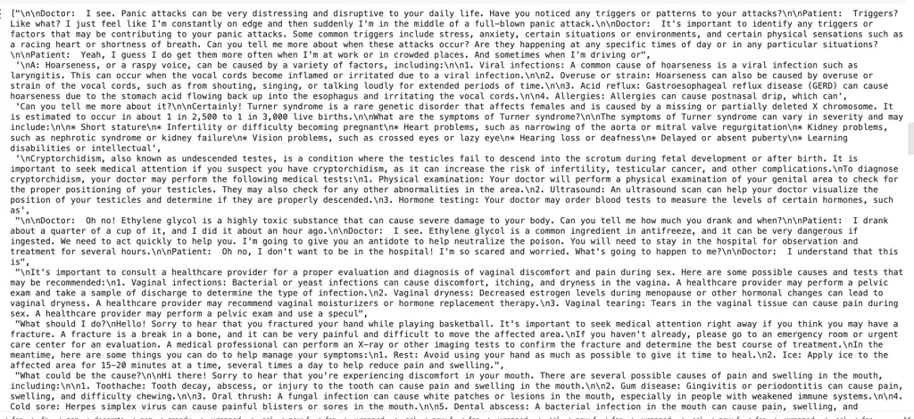
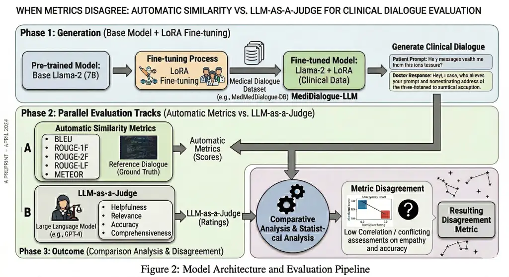

# When Metrics Disagree: Automatic Similarity vs. LLM-as-a-Judge for Clinical Dialogue Evaluation

Bian Sun Affiliation: Heinz College Affiliation: Carnegie Mellon
University Email: [bians@andrew.cmu.edu](mailto:)    Zhenjian Wang
Affiliation: Heinz College Affiliation: Carnegie Mellon University
Affiliation: zhenjiaw@andrew.cmu.edu    Orvill de la Torre
Affiliation: School of Computer Science Affiliation: Carnegie Mellon
University Email: [odelator@andrew.cmu.edu](mailto:)    Zirui Wang
Affiliation: Heinz College Affiliation: Carnegie Mellon University
Email: [ziruiw2@andrew.cmu.edu](mailto:)

April 2024

###### Abstract

As Large Language Models (LLMs) are increasingly integrated into
healthcare to address complex medical inquiries, ensuring their
reliability remains a critical challenge. Recent studies, including
those from Long Island University, have highlighted that generic LLMs
often struggle in clinical contexts, occasionally producing misleading
or harmful guidance. To mitigate these risks, this research focuses on
the domain-specific adaptation of Llama-2-7B, a transformer-based,
decoder-only architecture, using the Low-Rank Adaptation (LoRA)
technique. By injecting trainable low-rank matrices into the Transformer
layers, we efficiently adapted the model using authentic
patient-physician conversational transcripts while preserving the
foundational knowledge of the base model. Our objective was to enhance
the model’s precision and contextual relevance in responding to medical
queries by capturing the specialized nuances of clinical discourse.

Due to the resource-intensive nature of large-scale human expert
validation, the performance of the fine-tuned model was evaluated
through a dual-track framework: Track A utilized traditional lexical
similarity metrics (e.g., BLEU, ROUGE), while Track B employed an
"LLM-as-a-Judge" paradigm using GPT-4 for semantic assessment. Our
results demonstrate that while the LoRA-enhanced model achieved
statistically significant improvements across all quantitative lexical
dimensions, a profound disagreement surfaced in the GPT-4 evaluation,
which marginally favored the baseline model’s conversational flow. This
metric divergence underscores a pivotal finding: traditional automated
scores may not fully reflect clinical utility. Consequently, we propose
that while automated metrics and LLM judges serve as valuable
developmental proxies, rigorous validation by human medical experts
remains an indispensable requirement for the safe deployment of LLMs in
healthcare settings.

   

|     |
| --- |
|     |

August 24, 2026

## 1 Introduction

In the rapidly evolving landscape of Natural Language Processing (NLP),
Large Language Models (LLMs) have emerged as a cornerstone technology
for understanding and generating human-like text. At the forefront of
this revolution is Llama, a foundational open-source model released by
Meta AI. Characterized by its multi-billion parameter scale, Llama \[1\]
leverages a refined decoder-only Transformer architecture that has
demonstrated extraordinary efficiency in a variety of downstream tasks.
Unlike closed-source alternatives, the open-source nature of Llama
enables researchers to delve into its source code, facilitating the
implementation of domain-specific fine-tuning—a process that adjusts
model parameters by introducing specialized training data to align the
model with high-stakes fields, such as clinical medicine.

We selected the Llama-2-7B variant as our baseline due to its optimal
balance between computational feasibility and generative performance.
Llama’s architecture incorporates several sophisticated innovations:
data scaling is managed via \[2\] (Root Mean Square Layer
Normalization), while the traditional ReLU activation function is
substituted with \[3\] to enhance non-linear representation.
Furthermore, absolute positional embeddings are replaced by Rotary
Positional Embeddings (RoPE) to improve sequence flexibility. For
optimization, Llama utilizes the AdamW optimizer
($`\beta_{1}=0.9,\beta_{2}=0.95`$) paired with a cosine learning rate
scheduler, weight decay of 0.1, and gradient clipping to ensure training
stability.

The adoption of Llama offers distinct strategic advantages. Its
self-supervised training on massive unlabeled datasets eliminates the
need for labor-intensive manual annotation, allowing the model to
internalize vast linguistic patterns. Compared to proprietary models
like ChatGPT, Llama features a more streamlined architecture that
requires fewer computational resources, making it highly accessible for
both commercial and academic research. Its versatility makes it ideal
for applications such as text categorization, automated summarization,
and entity recognition. However, certain limitations persist; the 7B
parameter scale may constrain complex creative writing or highly nuanced
narrative generation. Additionally, while efficient, these models still
demand significant storage and can exhibit fragile generalization when
applied to domains far removed from their pre-training distribution.

The potential of LLMs is particularly transformative in the medical
sector, where the accuracy and reliability of information are paramount.
Recent advancements have shown that models like Llama, when fine-tuned
on clinical datasets, can improve diagnostic accuracy and patient
interactions. Our project contributes to this effort by fine-tuning
Llama specifically for patient-doctor dialogues in real-world scenarios.
Leveraging a robust dataset of 5,000 conversational exchanges and a
comprehensive disease database, we utilized Low-Rank Adaptation
(LoRA)\[4\] to enhance the model’s clinical intuition.

Crucially, this research explores the Evaluation Paradox inherent in
specialized AI. While our experimental results indicate that the
fine-tuned model surpasses the "vanilla" baseline across all traditional
lexical metrics (Track A: BLEU, ROUGE, and METEOR) \[5, 6, 7\], we
observed a profound disagreement when employing GPT-4 as a Judge (Track
B)\[8\]. This divergence—where automatic similarity metrics and
LLM-based semantic evaluations provide conflicting conclusions—exposes a
critical gap in current AI validation. Through this study, we highlight
that while automated metrics are essential developmental proxies, they
cannot replace the necessity for human expert evaluation in ensuring
patient safety and diagnostic reliability in healthcare applications.

## 2 Related Work

### 2.1 Evolution of Neural Language Modeling

The progression toward Large Language Models (LLMs) originates from
fundamental research in deep learning applied to sequence modeling.
Early architectures utilized Recurrent Neural Networks (RNNs) and Long
Short-Term Memory (LSTM) networks to address the challenges of vanishing
gradients and long-range dependencies in natural language \[9, 10\].
However, the introduction of the Transformer architecture \[11\]
catalyzed a paradigm shift by employing self-attention mechanisms. This
innovation allowed for unprecedented scalability and contextual
understanding, moving beyond the sequential constraints of previous
models and enabling the development of massive pre-trained models that
define the current state-of-the-art.

### 2.2 The Llama Framework and Open-Source Adaptation

Meta AI’s release of Llama represented a significant milestone by
providing a high-performance, open-source alternative to proprietary
models like ChatGPT. Ranging from 7B to 65B parameters, Llama was
designed for versatility and efficiency \[1\]. Research has consistently
demonstrated that Llama achieves comparable fluency and coherence to
larger models while maintaining lower computational complexity. Its
open-source nature has proven particularly advantageous for the research
community, as it allows for direct architectural intervention and
parameter-efficient fine-tuning (PEFT) in specialized domains where the
source code of closed-source counterparts remains inaccessible.

### 2.3 LLMs in Clinical Medicine and Healthcare

The application of LLMs in the medical domain has seen rapid growth,
with several key studies benchmarking the potential of model adaptation:

Medical Dialogue Systems: Li et al. \[12\] developed ChatDoctor
(MediDialogue-LLM), a conversational agent fine-tuned for diagnostic
assistance and patient interaction. Their findings underscored the
model’s ability to handle complex clinical queries but also highlighted
a persistent need for professional oversight due to occasional
generative inaccuracies.

Medical Licensing and Knowledge: Cerebras Systems utilized
high-performance computing to adapt Llama-2-70B for medical
examinations. The resulting model, Med42, achieved a significant 72%
score on the USMLE, demonstrating that large-scale clinical datasets and
computational scaling can push open-source models beyond expert-level
benchmarks \[13\].

Administrative and Diagnostic Optimization: Wang et al. \[14\] explored
the utility of Llama-7B for Diagnosis-Related Group (DRG) assignment
within the U.S. inpatient payment system. Despite limitations in data
and computational resources, their work indicated that LLMs could
significantly improve the efficiency of automated clinical coding and
administrative workflows.

## 3 Method

### 3.1 Baseline Selection

For our baseline architecture, we selected Llama-2-7B \[1\], a highly
capable large language model optimized for robust dialogue and text
generation. To illustrate the foundational conversational capabilities
of our baseline model prior to clinical evaluation, we documented its
responses to various prompts. Figure 1 showcases a sample interaction
generated during this initial testing phase.



Figure 1: Our Execution Output of the Baseline Model

The Llama architecture operates on a decoder-only transformer framework.
To stabilize training, it utilizes Root Mean Square Normalization
(RMSNorm) \[2\]at the input of each transformer sub-layer, replacing
standard layer normalization. Additionally, Llama replaces the
traditional ReLU non-linearity with the SwiGLU \[3\] activation
function, which has empirically demonstrated superior performance.
SwiGLU is a fusion of the Swish and Gated Linear Unit (GLU) activation
functions, designed to leverage their combined strengths.
Mathematically, it is defined as:

```math
\text{SwiGLU}(x)=x\cdot\sigma(\beta\cdot x)+(1-\sigma(\beta\cdot x))\cdot(Wx+b) \tag{1}
```

where $`x`$ represents the input, and $`W`$, $`b`$, and $`\beta`$ are
trainable parameters. By employing the Swish function to gate the linear
function of the GLU, SwiGLU effectively captures complex, non-linear
patterns in the data while maintaining computational efficiency. SwiGLU
offers several distinct advantages over alternative activation
functions, primarily due to its smoothness, non-monotonicity, and gating
mechanism. First, it provides smoother gradients than ReLU, facilitating
better optimization and faster convergence. Second, its non-monotonic
nature enables the network to learn highly intricate relationships
between inputs and outputs. Finally, the gating mechanism allows for the
selective activation of neurons based on the input context, which helps
reduce overfitting and enhances generalization. Consistent with our
observations in conversational modeling, empirical studies demonstrate
that SwiGLU outperforms both standard Swish and GLU across a variety of
domains, including advanced language modeling and machine translation.



Figure 2: Model Architecture and Evaluation Pipeline

### 3.2 Domain Adaptation for Clinical Dialogue via LoRA

To generate the specialized medical responses required for our
comparative evaluation pipeline, we adapted the baseline Llama-2 model
into our clinical dialogue system, MediDialogue-LLM. To optimize this
system efficiently, we employed Low-Rank Adaptation (LoRA) \[4\], a
highly effective Parameter-Efficient Fine-Tuning (PEFT) \[15\]
methodology. LoRA achieves downstream model improvement with minimal
computational overhead, proving functionally comparable to full
fine-tuning while significantly lowering the economic and hardware
barriers to LLM development.

LoRA operates on the premise that the weight matrices of pre-trained
LLMs possess a low intrinsic dimension, meaning they often contain
substantial redundancies. Rather than updating the entire parameter
space during fine-tuning, LoRA streamlines the process by freezing the
pre-trained model weights and injecting trainable rank-decomposition
matrices into the Transformer architecture.

Mathematically, the LoRA-based fine-tuning process is defined as:

```math
W=W_{o}+\Delta W=W_{o}+BA \tag{2}
```

where $`W_{0}\in\mathbb{R}^{d\times k}`$ denotes the frozen pre-trained
parameter weights, $`\Delta W`$ represents the learned weight updates,
and $`W`$ is the final weight matrix utilized during inference. The
update $`\Delta W`$ is factorized into two matrices:
$`B\in\mathbb{R}^{d\times r}`$ and $`A\in\mathbb{R}^{r\times k}`$. By
restricting the rank such that $`r\ll\min(d,k)`$, this approach
drastically reduces the number of trainable parameters.Fine-tuning with
LoRA offers several critical advantages for our study. It inherently
reduces memory and storage constraints, mitigates the risk of
catastrophic forgetting of the model’s foundational language
capabilities, and introduces no additional inference latency.
Consequently, it provides an efficient and practical mechanism for
adapting pre-trained LLMs to the specialized clinical domain \[12\].
This ensures that the generated medical dialogues are both contextually
accurate and linguistically fluent, thereby providing a robust testing
ground for our core investigation: comparing automatic similarity
metrics against LLM-as-a-judge paradigms.

### 3.3 Fine-Tuning Objective

During the LoRA adaptation phase, we optimize the ChatDoctor (Llama-2)
model using the standard causal language modeling objective. Consistent
with the model’s pre-training stage, the parameter updates are driven by
minimizing the cross-entropy loss over the generated clinical responses.

In the context of autoregressive language generation, the cross-entropy
loss evaluates the divergence between the true token distribution and
the model’s predicted probability distribution over the vocabulary. For
a given clinical dialogue sequence $`X=(x_{1},x_{2},...,x_{T})`$, the
model is trained to predict the next token $`x_{t}`$ given the preceding
context $`x_{<t}`$. The loss function $`\mathcal{L}`$ is mathematically
defined as:

```math
\mathcal{L}=-\frac{1}{T}\sum_{t=1}^{T}\log P(x_{t}|x_{<t};\Theta) \tag{3}
```

where:

- •
  $`T`$ represents the total number of tokens in the generated target
  sequence.
- •
  $`x_{t}`$ is the true target token at time step $`t`$.
- •
  $`x_{<t}`$ denotes the contextual sequence of all preceding tokens.
- •
  $`P(x_{t}|x_{<t};\Theta)`$ is the conditional probability of
  generating the correct token $`x_{t}`$, as estimated by the model with
  parameters $`\Theta`$.

By iteratively minimizing this cross-entropy loss during the LoRA
fine-tuning process, the model effectively maximizes the likelihood of
generating contextually accurate and medically relevant tokens, thereby
aligning its underlying language representations with the specialized
clinical domain.

## 4 Experimental Setup

### 4.1 Dataset Description

To establish a controlled baseline for our fine-tuning and evaluation
pipeline, we primarily utilized the GenMedGPT-5k dataset. This curated
corpus consists of 5,000 synthetic patient-physician conversational
exchanges, generated via ChatGPT guided by a structured medical disease
database to ensure clinical relevance.¹¹ 1 The GenMedGPT-5k dataset is
accessible via the ChatDoctor repository:
[https://github.com/Kent0n-Li/ChatDoctor](https://github.com/Kent0n-Li/ChatDoctor)

While our long-term objective includes scaling this evaluation framework
to larger, real-world datasets—such as the HealthCareMagic-100k corpus,
which contains 100,000 patient-doctor dialogues from an online
consultation platform²² 2 Available at: [Hugging Face -
HealthCareMagic-100k](https://huggingface.co/datasets/wangrongsheng/HealthCareMagic-100k-en)—the
current scope of this study strictly focuses on the GenMedGPT-5k corpus.
This smaller, highly structured dataset provides a noise-free
environment essential for rigorously observing the divergence between
automatic similarity metrics and LLM-based judgments.

Furthermore, to operationalize our LLM-as-a-Judge framework (Track B),
we compiled the structured evaluation outputs generated by GPT-4. These
GPT-4 assessments form the comparative basis against our traditional
metric scores (Track A).

### 4.2 Evaluation Metrics

#### 4.2.1 Track A: Automatic Similarity Metrics

Bilingual Evaluation Understudy (BLEU): BLEU \[7\]is a popular metric
for evaluating the quality of text which has been machine-translated
from one natural language to another. It measures the correspondence
between a machine’s output and that of a human. Commonly, BLEU scores
are calculated based on n-gram precision, with a penalty for too-short
translations. The BLEU score is computed as follows:

```math
\text{BLEU}=BP\cdot\exp\left(\sum_{n=1}^{N}w_{n}\log p_{n}\right) \tag{4}
```

where $`p_{n}`$ is the precision of n-grams, $`w_{n}`$ are weights
summing to 1, $`N`$ is the length of n-gram, and $`BP`$ is the brevity
penalty to penalize short machine-generated translations.

Recall-Oriented Understudy for Gisting Evaluation - Unigram F1 Score
(ROUGE-1F): ROUGE-1F \[6\]measures the overlap of unigrams between the
system-generated output and reference texts. It is used particularly in
the evaluation of summary texts. The F1 score is the harmonic mean of
precision and recall, calculated as follows:

```math
\text{ROUGE-1F}=\frac{2\times(\text{Precision}\times\text{Recall})}{\text{Precision}+\text{Recall}} \tag{5}
```

where Precision is the ratio of the number of overlapping unigrams in
generated and reference texts to the total number of unigrams in the
generated text, and Recall is the ratio of overlapping unigrams to the
total number of unigrams in the reference text.

Recall-Oriented Understudy for Gisting Evaluation - Bigram F1 Score
(ROUGE-2F): ROUGE-2F assesses the overlap of bigrams between the system
output and a set of reference translations. It is useful for evaluating
the coherence of generated texts. The equation for ROUGE-2F, similar to
ROUGE-1F, is:

```math
\text{ROUGE-2F}=\frac{2\times(\text{Precision}\times\text{Recall})}{\text{Precision}+\text{Recall}} \tag{6}
```

This score considers bigrams, thus providing insight into the fluency of
the text. $`P`$ (precision) and $`R`$ (recall) are measures of matching
unigrams between the machine output and human reference.

Recall-Oriented Understudy for Gisting Evaluation - Longest Common
Subsequence F-measure (ROUGE-LF): ROUGE-LF is a metric specifically
designed to evaluate the quality of text summarization by measuring the
longest common subsequence between the system-generated output and the
reference texts. Unlike other metrics that may consider only exact
matches, ROUGE-LF appreciates the order of words, making it particularly
sensitive to the fluency and flow of the generated text. The ROUGE-LF
score is formulated as:

```math
\text{ROUGE-LF}=\frac{(1+\beta^{2})\cdot P\cdot R}{R+\beta^{2}\cdot P} \tag{7}
```

where $`P`$ (precision) is the proportion of the longest common
subsequence words in the generated text that are also in the reference
text, $`R`$ (recall) is the proportion of the longest common subsequence
words in the reference that are also in the generated text, and
$`\beta`$ is typically set to favor recall (e.g., $`\beta=1.2`$) to
stress the importance of capturing more of the reference content.

Metric for Evaluation of Translation with Explicit ORdering (METEOR):
METEOR \[5\]is another metric for evaluating translation output quality.
Unlike BLEU, METEOR considers synonym matches and stems alongside exact
word correspondences, and also incorporates structure into its
evaluation. The METEOR score is calculated as follows:

```math
\text{METEOR}=\frac{10\cdot P\cdot R}{R+9\cdot P} \tag{8}
```

where $`P`$ (precision) and $`R`$ (recall) are measures of matching
unigrams between the machine output and human reference.

#### 4.2.2 Track B: LLM-as-a-Judge

While human expert evaluation by clinical professionals represents the
gold standard for assessing medical dialogue, the resource-intensive
nature of manual scoring inherently limits the scalability of
large-scale evaluations. To overcome this limitation and enable a
comprehensive analysis of our generated dialogues, we adopted the
"LLM-as-a-Judge" \[8\]. Recent literature demonstrates that strong large
language models, when guided by rigorously defined rubrics, exhibit high
agreement with human domain experts. Following this methodology, we
employed GPT-4 as an automated evaluator to assess the quality of the
model responses across four critical clinical dimensions:

Helpfulness: Measures the extent to which the generated text practically
aids the patient in achieving their specific health-related goals or
resolving their medical inquiry.

Relevance: Assesses the strict alignment of the generated response with
the specific symptoms, queries, or clinical concerns posed by the user,
penalizing off-topic or generic generation.

Accuracy: Evaluates the factual and medical correctness of the
information provided, ensuring that the model’s advice is scientifically
valid, safe, and aligned with current medical consensus.

Comprehensiveness: Refers to the depth and breadth of the clinical
information provided. A highly comprehensive output covers all essential
aspects and nuances of the user’s query without overwhelming the patient
with tangential information or overly dense medical jargon.

### 4.3 Implemented Details

To generate the domain-specific clinical responses required for our
comparative metric analysis, we implemented a fine-tuning pipeline
optimized for an NVIDIA A100 GPU environment. The foundational
architecture selected was the instruction-tuned llama-2-7b-chat-hf
variant.

The domain adaptation was executed using the LoRA (Low-Rank Adaptation)
methodology to ensure parameter efficiency. The model was trained on the
previously detailed 5,000-sample clinical dataset, with 120 randomly
sampled dialogue pairs strategically withheld as the validation set to
monitor generalization and prevent overfitting.

To stabilize the training process within our computational constraints,
we established the following hyperparameter configuration:

- •
  Learning Rate: $`3\times 10^{-5}`$. This conservative value was
  selected to facilitate clinical domain adaptation while mitigating the
  risk of catastrophic forgetting of the base model’s conversational
  capabilities.
- •
  Epochs and Batching: The optimization was conducted over a single
  training epoch ($`\text{num\_epochs}=1`$), utilizing a strict batch
  size and micro-batch size of 1.
- •
  Sequence Length: The maximum input sequence length (cutoff_len) was
  capped at 256 tokens to optimize memory allocation during the gradient
  update phase.

## 5 Results

### 5.1 Automatic Evaluation Results

To quantify the impact of clinical domain adaptation, we first evaluated
the model outputs using our suite of automatic similarity metrics: BLEU,
ROUGE-1F, ROUGE-2F, ROUGE-LF, and METEOR. For this evaluation, we
utilized a filtered evaluation set of $`N=84`$ complete, well-formed
patient-doctor dialogue exchanges, explicitly excluding truncated
outputs or responses impacted by weight-merging latency to ensure a fair
comparison.

Table 1 summarizes the performance comparison between the baseline
Llama-2 model and our fine-tuned clinical model. The results demonstrate
that the fine-tuned model achieves strict superiority across all
evaluated metrics when compared against the ground-truth reference
responses.

Notably, the BLEU and ROUGE-2F indices exhibited the most pronounced
sensitivity to the fine-tuning process. The fine-tuned model achieved a
massive 548.99% relative improvement in BLEU score and an 84.35%
relative improvement in ROUGE-2F. These specific gains indicate that the
domain adaptation successfully taught the model not just to use the
correct clinical vocabulary (captured by unigram metrics), but to
sequence those terms into coherent, exact-match phrases that closely
mirror professional medical discourse.

To validate the robustness of these improvements, we conducted a
non-parametric Mann-Whitney U test across all score distributions. As
detailed in Table 1, the $`p`$-values for all five automatic metrics
fall well below the standard threshold of statistical significance
($`p<0.05`$). This confirms that the lexical and structural enhancements
observed in the fine-tuned model’s replies are statistically distinct
from the baseline, establishing a strong, quantitatively validated
foundation before introducing our semantic LLM-as-a-Judge evaluation.

|                    |         |          |          |          |         |
| ------------------ | ------- | -------- | -------- | -------- | ------- |
| Model              | BLEU    | ROUGE-1F | ROUGE-2F | ROUGE-LF | METEOR  |
| Llama-2 (Baseline) | 0.0033  | 0.1819   | 0.0298   | 0.1696   | 0.1004  |
| Fine-tuned Model   | 0.0216  | 0.2211   | 0.0549   | 0.2061   | 0.1227  |
| Difference         | +0.0183 | +0.0392  | +0.0251  | +0.0365  | +0.0223 |
| Improvement (%)    | 548.99% | 21.54%   | 84.35%   | 21.56%   | 22.19%  |
| $`p`$-value        | 0.0040  | 0.0070   | 0.0162   | 0.0100   | 0.0450  |

Table 1: Performance Comparison of Models across Automatic Similarity
Metrics

### 5.2 Track B Results: LLM-as-a-Judge (GPT-4) Evaluation

To conduct our semantic evaluation framework (Track B), we randomly
sampled a subset of $`N=20`$ clinical queries and extracted the
corresponding responses generated by both the baseline Llama-2 and the
fine-tuned MediDialogue-LLM. We then employed GPT-4 to blindly score
these responses on a scale of 1 to 5 across the four previously defined
dimensions: Accuracy, Comprehensiveness (Detail), Helpfulness, and
Relevance.

The aggregate results of this evaluation are presented in Table 2,
reporting the mean scores for each model alongside the corresponding
$`p`$-values.

| Evaluation Dimension | Llama-2 (Baseline) | Fine-tuned Model | $`p`$-value |
| -------------------- | ------------------ | ---------------- | ----------- |
| Accuracy             | 2.80               | 2.65             | 0.6868      |
| Comprehensiveness    | 3.55               | 3.30             | 0.4026      |
| Helpfulness          | 3.25               | 3.15             | 0.7605      |
| Relevance            | 2.75               | 2.60             | 0.6889      |

Table 2: GPT-4 Evaluation Results (Mean Scores out of 5, $`N=20`$)

Strikingly, the results from the LLM-as-a-Judge evaluation completely
diverge from the conclusions drawn by the automatic similarity metrics
in Track A. While BLEU and ROUGE metrics heavily favored the fine-tuned
model, GPT-4 assigned marginally higher mean scores to the baseline
Llama-2 across all four semantic dimensions. However, subsequent
statistical testing revealed that all $`p`$-values significantly exceed
the 0.05 threshold, indicating that the performance difference between
the two models from GPT-4’s perspective is not statistically
significant.

### 5.3 The Disagreement: Why Human Evaluation Remains Indispensable

The conflicting outcomes between Track A and Track B expose a critical
vulnerability in current automated evaluation paradigms for clinical
dialogue.

Quantitative metrics like BLEU and ROUGE (Track A) are highly sensitive
to surface-level lexical overlap. The massive score improvements
observed in the fine-tuned model suggest it successfully memorized and
replicated specific medical terminology and phrasing structures from the
training data. Conversely, the GPT-4 evaluator (Track B) prioritizes
narrative flow, conversational coherence, and general semantic
alignment. The baseline model’s slight edge in these scores implies that
while the fine-tuned model learned domain-specific vocabulary, the base
model may still retain a more generalized, fluent conversational ability
that the LLM judge inherently prefers.

More importantly, neither automated approach possesses genuine clinical
expertise. Automatic metrics mechanically reward exact word matches
without understanding medical context, while the GPT-4 judge—despite its
advanced reasoning capabilities—evaluates medical accuracy and
helpfulness based on probabilistic language generation rather than
rigorous medical training.

Therefore, we conclude that while automatic similarity metrics and LLM
judges are valuable for establishing baseline functional differences
during model development, their profound disagreement underscores their
collective inadequacy for ultimate clinical validation. To ensure
patient safety, mitigate medical hallucination, and truly assess the
diagnostic reliability of medical LLMs, gold-standard evaluation by
human medical professionals remains indispensable.

## 6 Conclusion

This study investigated the efficacy of domain-specific fine-tuning for
clinical dialogue generation and, crucially, the reliability of the
paradigms used to evaluate it. By applying Low-Rank Adaptation (LoRA) to
the foundational Llama-2-7B model, we developed a specialized model
optimized for medical inquiries. Our initial quantitative analysis
demonstrated that the fine-tuned model vastly outperformed the baseline
across all traditional lexical similarity metrics, achieving
statistically significant improvements in BLEU, ROUGE, and METEOR
scores.

However, our semantic evaluation using the LLM-as-a-Judge paradigm
(GPT-4) revealed a stark divergence: the automated judge favored the
conversational outputs of the baseline model across all qualitative
dimensions, including accuracy, comprehensiveness, and helpfulness.

This profound disagreement between evaluation tracks forms the core
insight of our research. It exposes the intrinsic limitations of relying
solely on surface-level n-gram metrics, which blindly reward the
replication of clinical vocabulary but fail to capture semantic
coherence, conversational fluency, or genuine medical helpfulness.
Conversely, it highlights that even advanced LLM evaluators may
prioritize generalized conversational flow over strict, domain-adapted
clinical precision. Ultimately, our findings underscore a critical
reality in medical AI development: while automated metrics are valuable
developmental proxies, they possess inherent biases. To ensure
diagnostic reliability and patient safety, the deployment of medical
LLMs continues to necessitate rigorous, gold-standard validation by
human clinical experts. Here use ChatGPT4 evaluation, the results of the
ChatGPT 4 are quite different from the evaluation metrics. It may need
more data and computer resources to give a deeper research. And here we
suggest that, the human evaluation is very important, because this two
evaluations did not have the same outcome. So we need more time to find
what are the reasons which lead to the difference.

These findings are encouraging as they doubt the effectiveness of
fine-tuning in transforming LLMs into specialized tools across various
industries. Our methodology offers a replicable framework for other
research teams interested in adapting models for enhanced performance in
other specialized fields.

## References

- \[1\] H. Touvron, L. Martin, K. Stone, P. Albert, A. Almahairi, Y.
  Babaei, N. Bashlykov, S. Batra, P. Bhargava, S. Bhosale, D. Bikel, L.
  Blecher, C. C. Ferrer, M. Chen, G. Cucurull, D. Esiobu, J.
  Fernandes, J. Fu, W. Fu, B. Fuller, C. Gao, V. Goswami, N. Goyal, A.
  Hartshorn, S. Hosseini, R. Hou, H. Inan, M. Kardas, V. Kerkez, M.
  Khabsa, I. Kloumann, A. Korenev, P. S. Koura, M. Lachaux, T.
  Lavril, J. Lee, D. Liskovich, Y. Lu, Y. Mao, X. Martinet, T.
  Mihaylov, P. Mishra, I. Molybog, Y. Nie, A. Poulton, J.
  Reizenstein, R. Rungta, K. Saladi, A. Schelten, R. Silva, E. M.
  Smith, R. Subramanian, X. E. Tan, B. Tang, R. Taylor, A.
  Williams, J. X. Kuan, P. Xu, Z. Yan, I. Zarov, Y. Zhang, A. Fan, M.
  Kambadur, S. Narang, A. Rodriguez, R. Stojnic, S. Edunov, and T.
  Scialom (2023) Llama 2: open foundation and fine-tuned chat models.
  External Links: 2307.09288, [Link](https://arxiv.org/abs/2307.09288)
  Cited by: §1, §2.2, §3.1.
- \[2\] B. Zhang and R. Sennrich (2019) Root mean square layer
  normalization. External Links: 1910.07467,
  [Link](https://arxiv.org/abs/1910.07467) Cited by: §1, §3.1.
- \[3\] N. Shazeer (2020) GLU variants improve transformer. External
  Links: 2002.05202, [Link](https://arxiv.org/abs/2002.05202) Cited by:
  §1, §3.1.
- \[4\] E. J. Hu, Y. Shen, P. Wallis, Z. Allen-Zhu, Y. Li, S. Wang, L.
  Wang, and W. Chen (2021) LoRA: low-rank adaptation of large language
  models. External Links: 2106.09685,
  [Link](https://arxiv.org/abs/2106.09685) Cited by: §1, §3.2.
- \[5\] S. Banerjee and A. Lavie (2005) METEOR: an automatic metric for
  MT evaluation with improved correlation with human judgments. In
  Proceedings of the ACL Workshop on Intrinsic and Extrinsic Evaluation
  Measures for Machine Translation and/or Summarization, J.
  Goldstein, A. Lavie, C. Lin, and C. Voss (Eds.), Ann Arbor, Michigan,
  pp. 65–72. External Links: [Link](https://aclanthology.org/W05-0909/)
  Cited by: §1, §4.2.1.
- \[6\] C. Lin (2004) ROUGE: a package for automatic evaluation of
  summaries. In Text Summarization Branches Out, Barcelona, Spain,
  pp. 74–81. External Links: [Link](https://aclanthology.org/W04-1013/)
  Cited by: §1, §4.2.1.
- \[7\] K. Papineni, S. Roukos, T. Ward, and W. Zhu (2002) Bleu: a
  method for automatic evaluation of machine translation. In Annual
  Meeting of the Association for Computational Linguistics, External
  Links: [Link](https://api.semanticscholar.org/CorpusID:11080756) Cited
  by: §1, §4.2.1.
- \[8\] L. Zheng, W. Chiang, Y. Sheng, S. Zhuang, Z. Wu, Y. Zhuang, Z.
  Lin, Z. Li, D. Li, E. P. Xing, H. Zhang, J. E. Gonzalez, and I.
  Stoica (2023) Judging llm-as-a-judge with mt-bench and chatbot arena.
  External Links: 2306.05685, [Link](https://arxiv.org/abs/2306.05685)
  Cited by: §1, §4.2.2.
- \[9\] R. M. Schmidt (2019) Recurrent neural networks (rnns): a gentle
  introduction and overview. External Links: 1912.05911,
  [Link](https://arxiv.org/abs/1912.05911) Cited by: §2.1.
- \[10\] R. C. Staudemeyer and E. R. Morris (2019) Understanding lstm –
  a tutorial into long short-term memory recurrent neural networks.
  External Links: 1909.09586, [Link](https://arxiv.org/abs/1909.09586)
  Cited by: §2.1.
- \[11\] A. Vaswani, N. Shazeer, N. Parmar, J. Uszkoreit, L.
  Jones, A. N. Gomez, L. Kaiser, and I. Polosukhin (2023) Attention is
  all you need. External Links: 1706.03762,
  [Link](https://arxiv.org/abs/1706.03762) Cited by: §2.1.
- \[12\] Y. Li, Z. Li, K. Zhang, R. Dan, S. Jiang, and Y. Zhang (2023)
  ChatDoctor: a medical chat model fine-tuned on a large language model
  meta-ai (llama) using medical domain knowledge. External Links:
  2303.14070, [Link](https://arxiv.org/abs/2303.14070) Cited by: §2.3,
  §3.2.
- \[13\] C. Christophe, P. K. Kanithi, T. Raha, S. Khan, and M. A.
  Pimentel (2024) Med42-v2: a suite of clinical llms. External Links:
  2408.06142, [Link](https://arxiv.org/abs/2408.06142) Cited by: §2.3.
- \[14\] H. Wang, C. Gao, C. Dantona, B. Hull, and J. Sun (2024)
  DRG-llama : tuning llama model to predict diagnosis-related group for
  hospitalized patients. npj Digital Medicine 7 (1). External Links:
  ISSN 2398-6352,
  [Document](https://dx.doi.org/10.1038/s41746-023-00989-3) Cited by:
  §2.3.
- \[15\] L. Xu, H. Xie, S. J. Qin, X. Tao, and F. L. Wang (2023)
  Parameter-efficient fine-tuning methods for pretrained language
  models: a critical review and assessment. External Links: 2312.12148,
  [Link](https://arxiv.org/abs/2312.12148) Cited by: §3.2.

## Appendix

## 7 Discussion

### 7.1 Relevance of Results

Our project’s primary aim was to enhance the Llama model for medical
applications, particularly in handling patient inquiries with high
accuracy and reliability. The fine-tuning process applied to the Llama
model significantly improved its performance metrics such as BLEU,
ROUGE, and METEOR scores. These enhancements are crucial as they
directly correlate with the model’s ability to understand and generate
medically relevant responses.

### 7.2 Sensitivity Analysis

Our paper compares quantitative assessment methods with evaluations
performed by ChatGPT-4. We observe the effectiveness and reliability of
the fine-tuned models under different evaluations. Since the outputs of
generative AI are typically textual, direct quantitative assessments are
challenging. Furthermore, quantitative assessments do not consider the
specialized content expressed in the sentences, merely comparing
similarity to ground truth, which is actually incorrect. Therefore, we
hope to include human review, but due to time constraints on the part of
our collaborators, we are using GPT-4 for comparative testing.

### 7.3 Risks and Uncertainties

Several risks and uncertainties associated with our model’s deployment
in real-world scenarios were identified. The primary concern is the
model’s dependency on the quality and diversity of the training data.
Any biases or inaccuracies in the training data could potentially lead
to erroneous medical advice. Additionally, while the model performs well
on structured queries, its performance on ambiguous or poorly structured
questions remains a challenge. These factors could significantly impact
the model’s reliability and safety in clinical environments.

And, when comparing the results of the two models, we removed some empty
answers due to network factors, model version, and computing resource
limited etc.

### 7.4 Comparison of Experiments

In our experiments, we compared the baseline Llama model with our
fine-tuned version. The fine-tuned model consistently outperformed the
baseline across all quantitative metrics, indicating that our
modifications effectively enhanced the model’s capabilities. This
comparison not only validates our approach but also underscores the
necessity for continuous improvements and adaptations to maintain the
relevance and efficacy of AI tools in healthcare.

Also we use ChatGPT4 evaluation, the results of the ChatGPT 4 are quite
different from the evaluation metrics. It may need more data and
computer resources to do deeper research.

## 8 Future Work

### 8.1 Addressing Shortcomings in Current Experiments

While our experiments with the fine-tuned Llama model demonstrated
substantial improvements in key performance metrics, several
shortcomings require attention. Quantitatively, although there was a
significant increase in BLEU score from 0.0033 to 0.0216, a BLEU score
of 0.0216 still indicates room for considerable improvement in the
model’s linguistic accuracy and relevance. Similarly, the ROUGE-2F score
improvement from 0.0298 to 0.0549, though notable, suggests that the
model’s ability to replicate more complex sentence structures remains
limited.

These quantitative results underline the need for further refinement in
the model’s understanding of medical terminology and patient
interactions. Our analysis revealed that the model struggles
particularly with less common medical conditions and treatments, which
were underrepresented in the training dataset.

Here, we not only suggest, but also propose that, the result should be
evaluated by the medical experts. Because the results of the ChatGPT4
are quite different from the quantitative results.

### 8.2 Proposed Future Experiments

To address these shortcomings and enhance the model’s performance, we
propose the following experiments:

The evaluation part should be participated by the medical experts. It is
very important because we think that regardless of whether the model is
fine-tuned or not, the large model has the problem of illusion, which
cannot exist in the medical field, and this is a kind of irresponsible
to the patient.

Expansion of Training Dataset: Incorporating a larger and more diverse
dataset that includes rare medical conditions and treatments can help
improve the model’s comprehension and response generation capabilities.
Future experiments should focus on integrating additional data sources
from medical journals and patient forums, which could provide a broader
spectrum of medical scenarios and vocabulary.

Advanced Fine-Tuning Techniques: Employing more sophisticated
fine-tuning methods such as Transfer Learning and Multi-Task Learning
could potentially boost the model’s performance across various metrics.
By training the model not only to respond to inquiries but also to
perform related tasks like symptom analysis and diagnostic support, we
can improve its contextual understanding and versatility.

Evaluation on Real-World Data: Conducting trials with real patient
inquiries in a controlled environment can provide deeper insights into
the model’s practical efficacy and limitations. This experiment would
involve deploying the model in a clinical setting to handle actual
patient interactions, monitored and assessed by medical professionals.
The outcomes of these trials should be used to adjust the model
iteratively.

Implementing Model Interpretability and Trustworthiness Measures: As AI
applications in healthcare require high levels of accuracy and trust,
future work should also include the development of mechanisms to assess
and interpret the model’s decision-making process. Techniques such as
Layer-wise Relevance Propagation (LRP) could be explored to provide
insights into the model’s reasoning, enhancing trustworthiness among
users.

Introducing Retrieval Augmented Generation (RAG) technique. RAG is a
technique in natural language processing that combines the strengths of
both retrieval-based and generative models to enhance the quality and
relevance of generated text. The approach leverages a large repository
of textual data, from which it retrieves information relevant to a given
query or context, and then uses this information to inform the
generation process conducted by a neural network.

These experiments are designed not only to refine the model’s abilities
but also to ensure that it adheres to the stringent requirements of
medical applications in terms of accuracy, reliability, and ethical
considerations. By systematically addressing these areas, we aim to
advance the deployment of AI in healthcare towards more personalized and
effective patient care.

## 9 Evaluation Document

[\[1\] Google Doc: History of GPT-4
Evaluation](https://docs.google.com/document/d/16aLG4DLMmJ1eSd-AVYzz4tRA_kHE4GdnG2FIoh6KV2k/edit#heading=h.bysuzog4ggj7)

## 10 Training Dynamics and Output Generation

Throughout the fine-tuning phase, training convergence was validated by
continuous monitoring of the evaluation loss. The loss trajectory
exhibited a steady, monotonic decrease, confirming successful parameter
adaptation to the medical dialogue distribution. atively few additional
parameters.

![[Uncaptioned
image]](arxiv-2603-00314v2--d17222b947f0.figures/figure-3.webp)

|                                                                                |
| ------------------------------------------------------------------------------ |
| ![[Uncaptioned image]](arxiv-2603-00314v2--d17222b947f0.figures/figure-4.webp) |

## 11 GPT-4 Envalution Detail

![[Uncaptioned
image]](arxiv-2603-00314v2--d17222b947f0.figures/figure-5.webp)

## 12 Score Comparison

|                                                                                |
| ------------------------------------------------------------------------------ |
| ![[Uncaptioned image]](arxiv-2603-00314v2--d17222b947f0.figures/figure-6.webp) |

|                                                                                |
| ------------------------------------------------------------------------------ |
| ![[Uncaptioned image]](arxiv-2603-00314v2--d17222b947f0.figures/figure-7.webp) |
