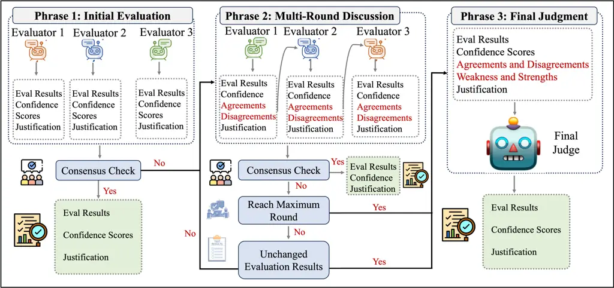
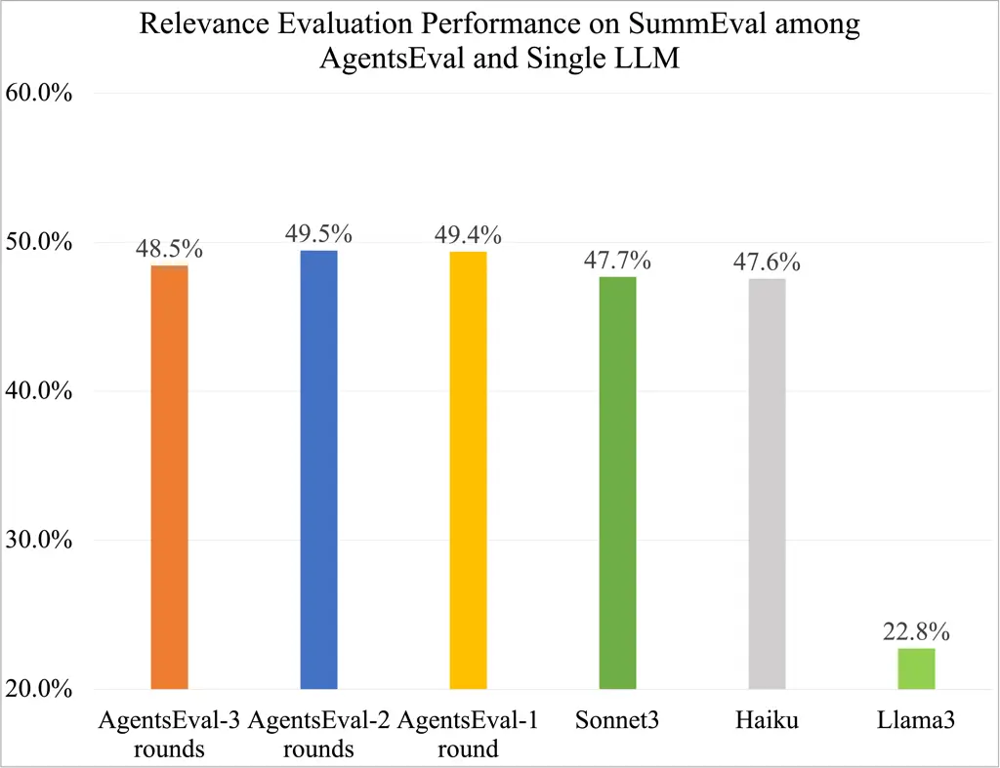
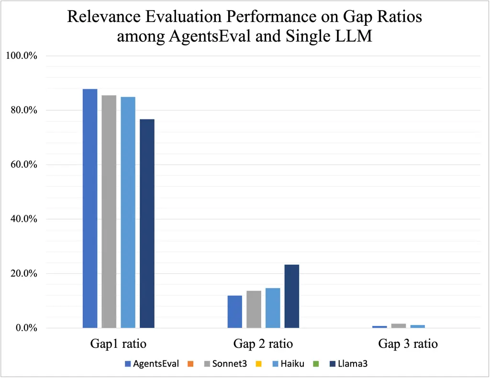
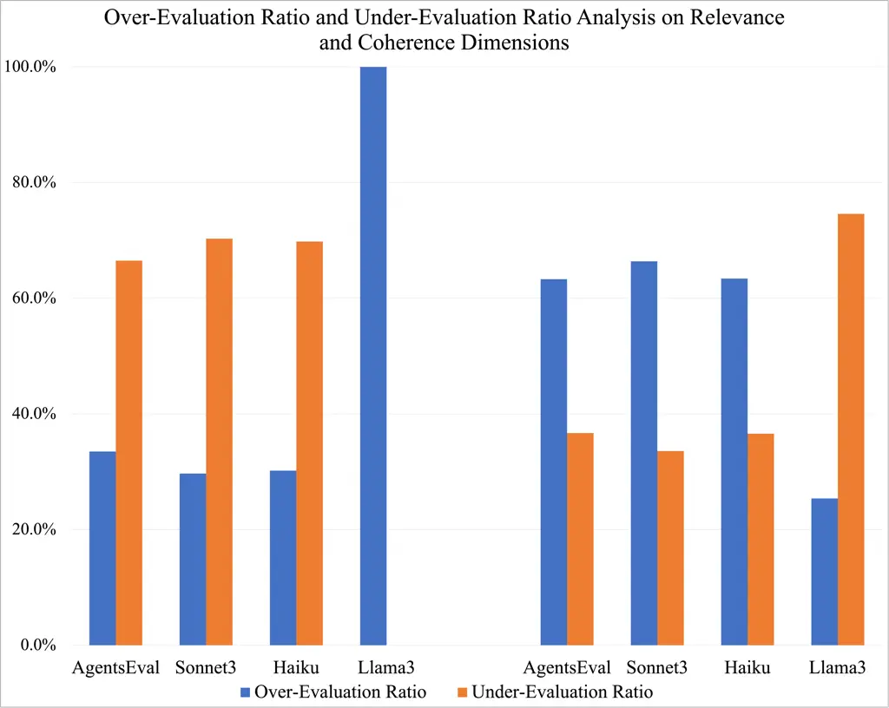
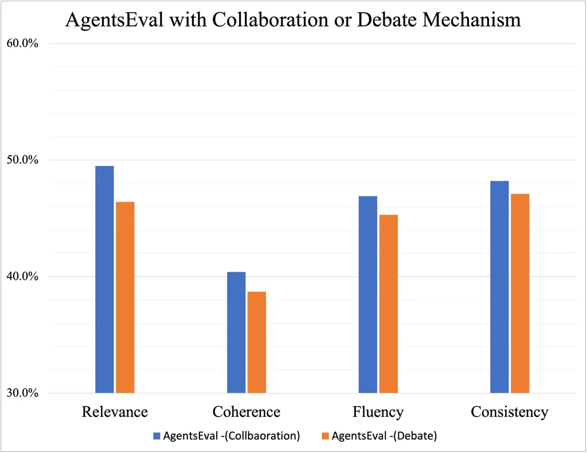

# CollabEval: Enhancing LLM-as-a-Judge via Multi-Agent Collaboration

Yiyue Qian    Shinan Zhang    Yun Zhou    Haibo Ding    Diego Socolinsky
   Yi Zhang

###### Abstract

Large Language Models (LLMs) have revolutionized AI-generated content
evaluation, with the LLM-as-a-Judge paradigm becoming increasingly
popular. However, current single-LLM evaluation approaches face
significant challenges, including inconsistent judgments and inherent
biases from pre-training data. To address these limitations, we propose
CollabEval, a novel multi-agent evaluation framework that implements a
three-phase Collaborative Evaluation process: initial evaluation,
multi-round discussion, and final judgment. Unlike existing approaches
that rely on competitive debate or single-model evaluation, CollabEval
emphasizes collaboration among multiple agents with strategic consensus
checking for efficiency. Our extensive experiments demonstrate that
CollabEval consistently outperforms single-LLM approaches across
multiple dimensions while maintaining robust performance even when
individual models struggle. The framework provides comprehensive support
for various evaluation criteria while ensuring efficiency through its
collaborative design.

{iamyiyue, shinanz, yunzzhou, hbding, sclinsky, yizhngn}@amazon.com

¹Amazon AWS Generative AI Innovation Center

²Amazon AWS Bedrock

## Introduction

The rapid advancement of Large Language Models (LLMs) has revolutionized
AI-generated content evaluation, making the LLM-as-a-Judge paradigm
increasingly popular (Chiang et al. 2024; Wang et al. 2024b; Raina et
al. 2024; Chan et al. 2024; Li et al. 2025; Ma et al. 2025b; Song et al.
2025; Ma et al. 2025a; Qian et al. 2025). Recent studies have
demonstrated the potential of using single LLMs as evaluators, with
notable work (Bai et al. 2024) introducing MT-bench for systematic LLM
evaluation, and another work  (Chiang et al. 2024) developing Chatbot
Arena as an open platform for LLM assessment through human preference
alignment. These approaches have shown promising results in automating
evaluation processes across various dimensions including coherence,
relevance, and fluency. However, recent studies have identified
significant limitations in current evaluation methodologies. One recent
research  (Raina et al. 2024) reveals that LLM-based evaluations are
vulnerable to universal adversarial attacks, raising concerns about
their reliability. Additionally, Wang et al.  (Wang et al. 2024b)
demonstrated that self-taught evaluators often struggle with consistency
and objectivity in their assessments, highlighting the critical need for
more robust evaluation frameworks.

Generally speaking, current evaluation methodologies face several
critical challenges: (i). single-LLM evaluations lack robustness due to
inherent biases from their pre-training data and knowledge (Huang et al.
2024). Recent studies (Bai et al. 2024; Huang et al. 2024) have found
significant variations in judgment quality across different LLM
evaluators, with ChatEval (Chan et al. 2024) further highlighting that
individual LLMs may excel in certain dimensions while underperforming in
others. (ii). While recent works (Chan et al. 2024; Chen et al. 2023;
Chern et al. 2024) have developed agent-based frameworks to address
these limitations, with ChatEval (Chan et al. 2024) notably implementing
multiple debate agents for evaluation, these approaches often lack the
flexibility and efficiency needed for diverse evaluation scenarios.
These challenges underscore the need for a more robust and adaptable
evaluation framework.

To address these limitations, we present CollabEval, a novel multi-agent
evaluation framework that implements a structured (i.e., three-phrase)
collaborative assessment process. Unlike previous approaches (Chan et
al. 2024; Chen et al. 2023), our framework emphasizes collaboration
rather than competitive debate, addressing the need for diverse model
perspectives in evaluation as identified by (Verga et al. 2024).
Specifically, CollabEval employs a sophisticated three-phase design: (1)
initial evaluation, where different agents independently assess the
content; (2) multi-round collaborative discussion, where agents share
and refine their evaluations through structured dialogue, including
confidence scores, agreements, disagreements, and reasoning; and (3)
final judgment, where ultimate evaluation decisions are made based on
prior discussions. Notably, CollabEval performs consensus checks at each
phase, allowing for early termination when agreement is reached, thus
ensuring efficiency compared to existing agent-based LLM-as-a-Judge
methods. The key contributions of our work include:

- •
  Novel: We introduce a three-stage evaluation framework that uniquely
  combines independent assessment with collaborative refinement among
  agents.
- •
  Comprehensive: CollabEval supports both criteria-based and pairwise
  comparisons across multiple dimensions, demonstrating superior
  performance over single-LLM evaluations via extensive experimental
  validation.
- •
  Robust and Efficient: Our framework maintains strong performance even
  when individual LLMs show weaknesses, while ensuring efficiency
  through strategic consensus checking and early termination.

Figure 1: The framework of CollabEval consists of three main phases: (a)
Phase 1: Initial Evaluation - Three evaluators independently assess
content, providing evaluation results, confidence scores, and
justifications. A consensus check is performed; if consensus is reached,
final results are returned, otherwise proceeding to Phase 2. (b) Phase
2: Multi-Round Discussion - Evaluators engage in collaborative
discussion sharing agreements, disagreements, and justifications. After
each round, a consensus check is performed. If consensus is reached,
results are returned; if not, the system checks for maximum rounds or
unchanged results before proceeding. (c) Phase 3: Final Judgment - When
consensus cannot be reached through discussion, a final judge analyzes
all previous evaluation results, confidence scores,
agreements/disagreements, and justifications to make the ultimate
evaluation decision.

## Related Work

LLM-as-a-Judge. Recent advances in LLMs have led to increasing adoption
of the LLM-as-a-Judge paradigm for evaluating AI-generated content. Bai
et al. introduced MT-bench as a systematic framework for LLM evaluation,
establishing benchmarks for assessing model performance across various
dimensions (Bai et al. 2024). Chiang et al. developed Chatbot Arena as
an open platform leveraging human preference alignment for LLM
assessment, demonstrating the potential of structured evaluation
frameworks (Chiang et al. 2024). However, existing single-LLM approaches
face significant limitations. Raina et al. revealed critical
vulnerabilities to universal adversarial attacks in LLM-based
evaluations (Raina et al. 2024), while Wang et al. demonstrated that
self-taught evaluators struggle with consistency and objectivity (Wang
et al. 2024b). Huang et al. further highlighted how single-LLM
evaluations often lack robustness due to inherent biases from their
pre-training data and knowledge (Huang et al. 2024), showing significant
variations in judgment quality across different LLM evaluators.

Multi-agents in LLMs. Recent research has explored multi-agent
approaches (Chen et al. 2023; Hong et al. 2024; Shah et al. 2024; Wang
et al. 2024a; Wu et al. 2024; Zhang et al. 2024; Han et al. 2024) for
enhancing LLM capabilities across various tasks. For instance,
ReConcile (Chen et al. 2023), a framework that improves reasoning
through round-table conferences among diverse LLMs. Their approach
enables collaborative reasoning between LLM agents via multiple rounds
of discussion, incorporating confidence-weighted voting mechanisms to
achieve better consensus.

In the context of LLM-as-a-Judge, several works (Zhuge et al. 2024; Chan
et al. 2024; Chern et al. 2024; Rasheed et al. 2024) have explored
multi-agent evaluation frameworks. ChatEval (Chan et al. 2024) is
developed by implementing multiple debate agents for autonomous
discussion and evaluation of AI-generated content. It showed that
collaborative evaluation through debate can lead to more reliable
assessments. Besides, Chern et al. investigated the potential of agent
debate for meta-evaluation (Chern et al. 2024). These approaches
demonstrated that multi-agent evaluation systems can effectively address
the limitations of single-LLM judges, particularly in terms of
robustness and consistency. However, many existing approaches rely
heavily on competitive debate rather than collaboration, potentially
leading to inefficiencies in the evaluation process. This limitation
motivates our work on CollabEval, which emphasizes collaboration over
competitive debate to achieve more reliable and efficient evaluations.

## Proposed Framework

In this section, we present the details of CollabEval including three
main phrases: initial evaluation, multi-round collaborative discussion
among agents, and final judgement .

### Initial Evaluation

Single LLM evaluators often exhibit inherent biases stemming from their
pre-training data and knowledge bases. These biases, coupled with
varying pre-training datasets and knowledge across different LLMs, can
lead to inconsistent judgments when evaluating AI-generated content. To
address these limitations and leverage the diversity of different LLMs,
we propose a multi-agent collaborative evaluation framework.

In Phase 1, as illustrated in Figure 1, CollabEval employs multiple
independent evaluators to conduct initial assessments. Each evaluator
independently analyzes the content and provides three key components:
evaluation results, confidence scores, and detailed justifications for
their assessments. This independent evaluation ensures that each agent’s
unique perspective and capabilities are captured without influence from
other evaluators. Once all evaluators complete their initial
assessments, CollabEval performs a consensus check to determine whether
the evaluators have reached agreement in their judgments. If consensus
is achieved, the system returns the final evaluation results,
demonstrating efficient early termination. However, if evaluators show
significant disagreement, the process advances to Phase 2, where
evaluators engage in multi-round discussions to resolve differences and
refine their assessments.

### Multi-Round Discussion

Agents Collaboration. During Phase 2, evaluators share their initial
evaluations, confidence scores, and justifications with each other. The
collaboration focuses on identifying agreements and disagreements in
their assessments. Each evaluator reviews others’ evaluations and
provides updated assessments based on the collective insights. This
process enables evaluators to refine their judgments by incorporating
multiple perspectives and addressing potential biases or oversights in
their initial evaluations.

Iterative Process. The discussion proceeds iteratively, with evaluators
using all available data from both initial evaluations and ongoing
discussions to refine their assessments. Each evaluator considers:

- •
  Initial evaluation results from all agents
- •
  Confidence scores from previous rounds
- •
  Areas of agreement and disagreement from other evaluators
- •
  Justifications provided by other evaluators

For instance, as illustrated in Figure 1, at the 1-round discussion,
Evaluator 1 begins by analyzing all initial evaluation results and
provides updated assessments with specific agreements and disagreements.
Evaluator 2 then considers both the initial evaluations and Evaluator
1’s updated assessment before providing its refined evaluation. Finally,
Evaluator 3 reviews all previous evaluations - both initial and
updated - before contributing its assessment. To mitigate potential
biases from model capabilities, we randomly shuffle the order of
evaluators in discussion rounds.

Consensus Check. After each discussion round, CollabEval performs three
critical checks to determine the next steps in the evaluation process.
First, the system examines whether all evaluators have reached consensus
on their evaluations at the current-round discussion. If consensus is
achieved, the system returns the final results. Otherwise, CollabEval
then proceeds to verify two additional conditions: whether the maximum
number of discussion rounds has been reached, and whether the evaluation
results remain unchanged from the previous round. When any of these two
conditions are met - either the maximum rounds are reached, or
evaluations remain static - the process advances to the final evaluation
stage. However, if none of these conditions are satisfied, CollabEval
initiates another round of discussion to further refine the evaluations.

### Final Judge Evaluation

When the multi-round discussion fails to reach consensus or evaluations
remain unchanged, CollabEval employs a strong model as the final judge.
The final judge makes the ultimate evaluation decision by analyzing all
evaluation results from previous rounds, confidence scores and
justifications, areas of agreement and disagreement among evaluators,
and the progression of evaluations through discussion rounds. The final
judge considers this comprehensive information to provide a decisive
assessment that considers all perspectives and reasoning presented
during the evaluation process.

## Experiments

In this section, we present a comprehensive evaluation of CollabEval
across two distinct evaluation modes: criteria-based evaluation and
pair-wise comparison. We conduct experiments using three benchmark
datasets to assess the framework’s performance. Finally, we discuss key
findings and insights derived from our experiments.

### Experiment Setup

#### Evaluation Mode.

To comprehensively evaluate the capability of our CollabEval, we conduct
experiments in two distinct evaluation modes:  
Criteria-based Evaluation: This mode assesses content across multiple
pre-defined dimensions, such as coherence, consistency, fluency, and
relevance. Each dimension is scored on specific scales, allowing for
fine-grained assessment of different aspects of the generated content.  
Pair-wise Comparison: In this mode, evaluators determine which of two
responses is better by directly comparing them. This approach is
particularly useful for relative quality assessment and helps establish
preference rankings between different model outputs.

#### Datasets.

We utilize three benchmark datasets including one criteria-based dataset
(i.e., SummEval dataset (Fabbri et al. 2021)) and two pair-wise
comparison dataset (i.e., chatbot_arena_conversation dataset (LMSYSOrg 2023) and lmsys_arena_human_preference_55k dataset (Chiang et al.
2024)). Next, we will introduce more details about these benchmark
datasets.  
Criteria-based Dataset: We first utilize SummEval (Fabbri et al. 2021),
a comprehensive benchmark dataset containing 1600 examples generated
from 100 source news articles. These summaries are produced by 16
different models, ensuring a diverse range of generation qualities and
styles. Each summary undergoes rigorous evaluation by 8 expert
annotators across four critical dimensions: coherence, consistency,
fluency, and relevance. The scoring system employs a 5-point scale
ranging from 1 to 5, allowing for fine-grained assessment of quality.
The dataset is structured in a detailed format including (id,
machine_summary, source_news, coherence_score, consistency_score,
fluency_score, relevance_score), enabling comprehensive analysis of each
dimension independently.  
Pair-wise Comparison Dataset: For pair-wise comparison evaluation, we
employ two distinct datasets. Specifically, for the
chatbot_arena_conversations  (LMSYSOrg 2023) dataset, instead of using
all datasets, we randomly select 1,000 samples. This dataset focuses on
direct comparisons between different model responses in conversational
settings. Besides, for the lmsys_arena_human_preference_55k
dataset (Chiang et al. 2024), we also utilize 1,000 random samples. This
dataset is particularly valuable as it incorporates human preference
judgments, providing a robust ground truth for evaluation. Both datasets
follow a standardized format of (id, query, response_a, response_b,
winner), enabling direct comparison between two alternative responses
and clear identification of the superior option.

#### Baseline.

In this work, we compare our model CollabEval with two groups of
baseline methods including single LLM-as-a-Judge and Agent-based
LLM-as-a-Judge.  
B1: Single LLM-as-a-Judge: This baseline represents the traditional
approach where a single LLM evaluates content independently. We
implement multiple state-of-the-art models including Mistral Large (AI
2024b), Claude Haiku (Anthropic 2024b), Claude Sonnet 3  (Anthropic
2024b), and Llama 3 70b (AI 2024a) as individual evaluators. Each model
serves as an independent judge to demonstrate the capability of relying
on individual model judgments and to establish a performance benchmark
for comparison.  
B2: Agent-based LLM-as-a-Judge: For agent-based approach, we also
explored another round-table discussion mechanism, called Round-Table
Agents Eval in Table 1. Instead of following the three-stage mechanism,
we follow the round-table mechanism in this work (Chen et al. 2023) and
implement a sequential round-table discussion where agents evaluate
content one after another. Specifically, for each evaluation task, we
randomly select one agent to provide an initial assessment. The next
agent then reviews this evaluation, provides its own assessment, and
either agrees with or revises the previous evaluation. This process
continues sequentially through all agents. To reduce potential biases
from agent ordering, we randomly shuffle the sequence of agents for each
new evaluation task. The discussion continues until either all agents
reach consensus or a maximum of rounds is completed. If no consensus is
reached after the maximum rounds, a majority voting mechanism is applied
to determine the final evaluation result. This more sophisticated
baseline implements a round-table discussion approach where multiple
LLMs engage in collaborative evaluation. This method serves as an
intermediate step between single-agent and our proposed CollabEval
approach.

#### Experimental Setting.

CollabEval employs multiple state-of-the-art LLM agents (Mistral Large,
Claude Haiku, Claude Sonnet, and Llama 3 70b) for evaluation. In Phase
1, each agent independently provides initial assessments. To mitigate
potential biases from model ordering, we randomly shuffle the sequence
of evaluators in both the initial evaluation and multi-round discussion
phases. During Phase 2, if consensus is not reached initially, the
evaluation process continues through multiple rounds of discussion, with
a maximum of 3 rounds. If consensus remains unachieved after the
discussion phase, we employ Claude Sonnet 3.5 (Anthropic 2024a) as the
final judge in Phase 3, leveraging its strong reasoning capabilities to
analyze the comprehensive evaluation history and make the ultimate
decision.

|                    |          |        |           |           |           |           |                |                |
| ------------------ | -------- | ------ | --------- | --------- | --------- | --------- | -------------- | -------------- |
| Model              | Accuracy | Avg    | Gap 1     | Gap 2     | Gap 3     | Gap 4     | Over-          | Under-         |
| Setting            | (%)      | Rounds | Ratio (%) | Ratio (%) | Ratio (%) | Ratio (%) | eval Ratio (%) | eval Ratio (%) |
| Relevance          |          |        |           |           |           |           |                |                |
| CollabEval         | 49.5     | 2.073  | 87.8      | 12.0      | 0.5       | 0         | 31.9           | 68.1           |
| Single-LLM Sonnet  | 47.7     | 1      | 85.5      | 13.7      | 1.6       | 0         | 29.7           | 70.3           |
| Single-LLM Haiku   | 47.6     | 1      | 84.9      | 14.7      | 1.1       | 0         | 30.2           | 69.8           |
| Single-LLM Llama3  | 22.8     | 1      | 76.7      | 23.3      | 0.0       | 0         | 100.0          | 0.0            |
| Coherence          |          |        |           |           |           |           |                |                |
| CollabEval         | 40.4     | 2.343  | 77.8      | 20.8      | 1.5       | 0         | 63.3           | 36.7           |
| Single-LLM Sonnet  | 37.4     | 1      | 71.4      | 23.9      | 4.9       | 0         | 66.4           | 33.6           |
| Single-LLM Haiku   | 38.9     | 1      | 76.9      | 22.4      | 0.8       | 0         | 63.4           | 36.6           |
| Single-LLM Llama3  | 29.5     | 1      | 77.0      | 22.0      | 2.2       | 0         | 25.4           | 74.6           |
| Fluency            |          |        |           |           |           |           |                |                |
| CollabEval         | 46.9     | 2.103  | 77.8      | 18.0      | 4.5       | 0         | 21.9           | 78.1           |
| Single-LLM Sonnet  | 46.8     | 1      | 65.9      | 24.0      | 21.4      | 5         | 29.7           | 70.3           |
| Single-LLM Haiku   | 13.8     | 1      | 75.9      | 22.3      | 6.2       | 0         | 30.2           | 69.8           |
| Single-LLM Mistral | 45.8     | 1      | 86.7      | 13.3      | 0.0       | 0         | 25.0           | 75.0           |
| Consistency        |          |        |           |           |           |           |                |                |
| CollabEval         | 48.2     | 2.181  | 79.6      | 18.2      | 7.0       | 0         | 10.2           | 89.8           |
| Single-LLM Sonnet  | 46.9     | 1      | 65.8      | 25.2      | 19.8      | 0         | 10.4           | 89.6           |
| Single-LLM Haiku   | 12.6     | 1      | 77.7      | 20.9      | 5.3       | 0         | 4.7            | 95.3           |
| Single-LLM Mistral | 55.9     | 1      | 93.8      | 5.4       | 2.8       | 0         | 24.4           | 75.6           |

Table 1: Comparison results among CollabEval and single LLM-as-a-Judge
on SummEval dataset for criteria-based evaluation. Best accuracy for
each dimension is in bold.

|                             |              |                |                            |                           |
| --------------------------- | ------------ | -------------- | -------------------------- | ------------------------- |
| Model Setting               | Accuracy (%) | Average Rounds | GT_Win \_Pred_Tie Ratio(%) | GT_Tie_Pred_Win Ratio (%) |
| Chatbot Arena Data          |              |                |                            |                           |
| CollabEval (Ours)           | 60.2         | 1.542          | 50.00                      | 2.63                      |
| Round-Table Agents Eval     | 57.7         | 1.214          | 15.84                      | 43.97                     |
| Single-LLM Mistral Large    | 58.2         | 1              | 45.54                      | 4.22                      |
| Single-LLM Haiku            | 57.2         | 1              | 46.30                      | 3.38                      |
| Single-LLM Llama3 70b       | 59.7         | 1              | 53.85                      | 0.00                      |
| Arena Human Preference Data |              |                |                            |                           |
| CollabEval (Ours)           | 51.5         | 1.517          | 53.20                      | 9.07                      |
| Round-Table Agents Eval     | 48.7         | 1.258          | 12.70                      | 47.37                     |
| Single-LLM Sonnet           | 48.4         | 1              | 48.06                      | 13.95                     |
| Single-LLM Mistral Large    | 50.5         | 1              | 54.95                      | 5.25                      |
| Single-LLM Llama3 70b       | 48.8         | 1              | 55.47                      | 0.39                      |

Table 2: Comparison results among multi-agents and single LLM-as-a-Judge
on two Arena datasets for pairwise comparison evaluation. Best accuracy
for each dataset is in bold.

### Performance Discussion

#### Discussion about criteria-based evaluation.

Table 1 shows the comparison results of all methods for criteria-based
evaluation on SummEval dataset. This table employs several key metrics
to assess performance. Accuracy measures the percentage of correct
evaluations compared to ground-truth labels. Average Rounds indicates
the number of discussion iterations required for evaluators to reach
consensus. The Gap Ratios (1-4) measure the percentage of samples having
absolute difference between LLM-assigned scores and ground-truth labels
among all misevaluated samples, where Gap 1 represents a one-point
difference, Gap 2 a two-point difference, and so on. The evaluation bias
is captured through Over-evaluation Ratio, indicating the percentage of
misevaluated samples where LLM scores exceed ground-truth labels among
all misevaluated samples, and Under-evaluation Ratio, where scores fall
below ground-truth labels.

Our experimental results demonstrate CollabEval’s superior performance
across all evaluation dimensions. In relevance assessment, CollabEval
achieves 49.5% accuracy with 2.073 average rounds, showing the highest
Gap 1 Ratio (87.8%) and minimal severe misjudgments (0.5% Gap 3, 0% Gap
4). The coherence evaluation reveals CollabEval’s robust performance
with 40.4% accuracy and balanced error distribution (77.8% Gap 1, 20.8%
Gap 2, 1.5% Gap 3), significantly outperforming single-LLM approaches.
For fluency assessment, CollabEval maintains competitive accuracy
(46.9%) while demonstrating better error distribution (77.8% Gap 1,
18.0% Gap 2, 4.5% Gap 3) compared to Single-LLM Sonnet’s more scattered
profile. In consistency evaluation, CollabEval achieves 48.2% accuracy
with the most balanced error distribution (79.6% Gap 1, 18.2% Gap 2, 7%
Gap 3).

Notably, while requiring additional computational rounds (average
2.073-2.343), CollabEval consistently shows more balanced
over/under-evaluation ratios across all dimensions, particularly evident
in relevance (31.9%/68.1%) and coherence (63.3%/36.7%), demonstrating
significant improvement over single-LLM approaches such as Llama3’s
extreme 100%/0% split in relevance evaluation. The analysis of
over-evaluation and down-evaluation ratios reveals distinct behavioral
patterns across different LLMs in their evaluation tendencies. Most
notably, Llama3 exhibits extreme evaluation patterns, showing a 100%
over-evaluation ratio in the relevance dimension, indicating a
consistent bias toward higher scores. This contrasts sharply with its
behavior in coherence evaluation, where it demonstrates a 74.6%
down-evaluation tendency. Other LLMs like Sonnet and Haiku show more
moderate patterns, with balanced ratios between over and
down-evaluation. CollabEval maintains the most balanced evaluation
pattern, demonstrating its ability to mitigate extreme evaluation biases
through collaborative assessment.

#### Discussion about pair-wise comparison evaluation.

Table 2 shows the comparison results of multi-agents and single
LLM-as-a-Judge for pair-wise evaluation on two Arena datasets. This
table employs four key metrics to assess model performance. Accuracy
measures the percentage of correct predictions compared to ground truth.
Average Rounds indicates the number of discussion iterations needed for
consensus. GT_Win_Pred_Tie Ratio represents the percentage of samples
where ground truth indicates a clear winner but the model predicts a tie
among all misevaluated samples, while GT_Tie_Pred_Win Ratio shows the
percentage of instances where ground truth indicates a tie but the model
predicts a winner among all misevaluated samples.

Our experimental results in Table 2 demonstrate CollabEval’s superior
performance across both datasets. On the Chatbot Arena Data, CollabEval
achieves the highest accuracy of 60.2% with 1.542 average rounds,
significantly outperforming both Round-Table Eval (57.7%) and single-LLM
approaches. CollabEval shows balanced evaluation capabilities with a
GT_Win_Pred_Tie ratio of 50.00% and a notably low GT_Tie_Pred_Win ratio
of 2.63%, indicating its discrimination ability in ambiguous cases. For
the Arena Human Preference Data, which presents more challenging
evaluations, CollabEval maintains its performance advantage with 51.5%
accuracy and 1.517 average rounds, compared to Round-Table Eval’s 48.7%
and single-LLM approaches ranging from 48.4% to 50.5%. While Single-LLM
Llama3 70b shows competitive accuracy rates, its extreme ratios
(53.85%/0.00% for Arena Data and 55.47%/0.39% for Preference Data)
suggest potential bias in decision-making. Single-LLM Sonnet
demonstrates more balanced performance but with lower accuracy (48.4%)
and higher GT_Tie_Pred_Win ratio (13.95%), indicating a tendency to make
definitive judgments in ambiguous cases. These results consistently
demonstrate that CollabEval’s multi-agent approach, despite requiring
additional computational rounds, provides more reliable and balanced
evaluations compared to both round-table and single-LLM evaluation
methods.

### Findings and Analysis

Figure 2: Accuracy performance Analysis on relevance evaluation.

Figure 3: Gap ratio performance analysis on relevance evaluation.

Figure 4: Evaluation trends analysis on relevance (left) and coherence
(right) evaluations.

Discussion Rounds. The impact of discussion rounds on CollabEval’s
performance reveals several key patterns and underlying factors. In
relevance evaluation, as illustrated in Figure 2, we observe a
progressive improvement from one to three rounds: CollabEval with 1
round achieves 49.4% accuracy, increasing to 49.5% with 2 rounds, and
slightly decreasing to 48.5% with 3 rounds. This pattern demonstrates
the trade-off between efficiency and accuracy, where initial
collaboration brings significant improvements but faces diminishing
returns beyond two rounds.

The diminishing returns phenomenon can be attributed to several key
mechanisms. First, information saturation occurs as evaluators exchange
most critical insights during early rounds, with subsequent rounds
adding minimal new perspectives. This is evidenced by the Gap 1 ratio
analysis in Table 1, where CollabEval achieves 87.8% compared to
single-model performances (Sonnet: 85.5%, Haiku: 84.9%), showing that
major evaluation refinements happen early. Second, when compared to
single-LLM performances (Sonnet: 47.7%, Haiku: 47.6%), even CollabEval
with a single discussion round (49.4%) outperforms these baselines,
indicating that the multi-agent framework’s primary benefits emerge from
initial evaluation and first-round discussion.

These findings have important implications for practical deployment:
while additional rounds of discussion can refine evaluations, the
optimal configuration should balance the performance with reasonable
computational overhead. This insight aligns with CollabEval’s design
principle of being cost-effective and efficient while maintaining
comprehensive evaluation capabilities across various dimensions.

Gap Ratio Analysis. The Gap Ratio analysis on relevance evaluation in
Figure 3 reveals significant patterns in evaluation precision across
different models. CollabEval demonstrates superior performance with the
highest Gap 1 ratio, followed by Sonnet, Haiku, and Llama3. This
distribution pattern indicates several key findings about evaluation
behavior. First, the close clustering of Gap 1 ratios among CollabEval,
Sonnet, and Haiku suggests a consistent level of precision among
advanced models, while Llama3’s lower performance indicates a gap in
relevance evaluation.

The progression of error severity provides further insights into model
reliability. CollabEval shows a steep decline from Gap 1 to Gap 2 to Gap
3, indicating that when errors occur, they tend to be minor. This
contrasts with Llama3’s flatter distribution, suggesting less
discrimination in error magnitude. The minimal occurrence of Gap 3
errors and Gap 4 errors across all models indicates that severe
misjudgments are rare, though CollabEval maintains the lowest rate of
such errors.

These findings suggest that while all models generally avoid severe
misjudgments, CollabEval’s collaborative approach leads to more refined
evaluations with a higher concentration of minimal errors, demonstrating
the effectiveness of multi-agent evaluation in maintaining precision
while minimizing severe evaluation mistakes.

Evaluation Patterns. The analysis of evaluation patterns in Figure 4
reveals distinct dimensional behaviors across different models. In the
relevance dimension, CollabEval, Sonnet, and Haiku demonstrate a
consistent tendency toward down-evaluation, with under-evaluation ratios
of approximately 68.1%, 70.3%, and 69.8% respectively in Table 1. This
conservative evaluation approach suggests these models are more
stringent in assessing relevance. Conversely, in the coherence
dimension, these same models show a pronounced shift toward
over-evaluation, with CollabEval showing a 63.3% over-evaluation ratio,
Sonnet at 66.4%, and Haiku at 63.4%, indicating a more lenient
assessment of coherence qualities.

Llama3 presents a particularly interesting case with extreme evaluation
patterns that deviate significantly from other models. In relevance
assessment, it shows a stark 100% over-evaluation ratio, suggesting a
consistent bias toward higher scores. This contrasts sharply with its
coherence evaluation, where it demonstrates a 74.6% under-evaluation
tendency. These extreme patterns highlight two critical insights: first,
the potential for individual models to develop strong biases in specific
dimensions, and second, the importance of employing a balanced
multi-agent approach to mitigate such extreme tendencies.

The contrasting evaluation patterns between dimensions and models
underscore the value of CollabEval’s collaborative approach, which helps
balance these inherent biases through multi-agent consensus, resulting
in more nuanced and reliable evaluations across different dimensions.

Figure 5: Accuracy analysis of CollabEval with collaboration or debate
mechanisms on SummEval dataset.

Robustness and Consistency. CollabEval further demonstrates remarkable
robustness across evaluation scenarios, particularly evident in its
ability to maintain consistent performance despite individual model
limitations. In relevance evaluation, while Llama3 shows significant
performance degradation (22.8%) in Figure 2 and Table 1, CollabEval
maintains a strong accuracy of 49.4% even with just one round of
discussion. This performance stability extends across different
dimensions, with CollabEval achieving 40.2% in coherence evaluation
compared to Llama3’s 29.5%, and similar patterns in other dimensions.

The assembling mechanism operates through several channels. First, when
one model shows extreme evaluation patterns (such as Llama3’s 100%
over-evaluation tendency in relevance), CollabEval’s collaborative
framework effectively balances this through input from other evaluators,
resulting in more moderate and accurate assessments (31.9%
over-evaluation ratio). Second, the multi-agent setup allows for
cross-validation of evaluations, where stronger models can help correct
the biases of weaker ones. This is particularly evident in the Gap ratio
analysis, where CollabEval maintains the highest Gap 1 ratio (87.8%)
despite incorporating inputs from models with varying individual
performances.

These findings suggest that CollabEval’s robust performance is not
merely an averaging effect but rather an orchestration mechanism that
leverages the strengths of each model while mitigating their individual
weaknesses through collaborative evaluation.

Collaborative Advantage. We last explored the mechanisms of CollabEval,
collaboration mechanism or debate mechanism, as shown in Figure 5. The
experimental results demonstrate that CollabEval’s collaborative
approach consistently outperforms the debate mechanism across all
evaluation dimensions. In relevance assessment, the collaborative
mechanism shows a clear advantage in this critical dimension. Similar
patterns emerge in coherence, fluency, and consistency evaluations.

This consistent performance gap suggests that collaboration, where
agents focus on sharing insights and building upon each other’s
evaluations, is more effective than competitive debate mechanisms. The
collaborative approach’s superior performance can be attributed to its
emphasis on constructive information sharing and consensus building,
rather than adversarial discussion. This aligns with our findings from
the criteria-based evaluation results, where CollabEval’s collaborative
framework demonstrates robust performance across different dimensions
while maintaining reasonable computational efficiency through optimal
round limitation.

## Conclusion

In this paper, we propose CollabEval, a novel multi-agent framework for
evaluating AI-generated content. Through extensive experiments, we
demonstrate that CollabEval consistently outperforms single-LLM
approaches across multiple dimensions, achieving optimal performance
with several discussion rounds and showing superior capability. The
framework’s robust performance, even when individual models struggle,
validates the effectiveness of our collaborative evaluation approach.
Future work could explore extending the framework to more complex
evaluation scenarios and investigating the impact of different model
combinations on evaluation outcomes.

## References

- AI (2024a) M. AI Introducing meta llama 3: the most capable openly
  available llm. External Links:
  [Link](https://%5Curlhttps://ai.meta.com/blog/meta-llama-3/) Cited by:
  Baseline..
- AI (2024b) M. AI Mistral large: a model overview. External Links:
  [Link](https://%5Curlhttps://docs.mistral.ai/getting-started/models/models_overview/)
  Cited by: Baseline..
- Anthropic (2024a) Anthropic Claude 3.5 sonnet: what it is, how it
  works, use cases, and artifacts. External Links:
  [Link](https://%5Curlhttps://www.datacamp.com/blog/claude-sonnet-anthropic)
  Cited by: Experimental Setting..
- Anthropic (2024b) Anthropic Introducing the next generation of claude.
  External Links:
  [Link](https://%5Curlhttps://www.anthropic.com/news/claude-3-family)
  Cited by: Baseline..
- Bai et al. (2024) G. Bai, J. Liu, X. Bu, Y. He, J. Liu, Z. Zhou, Z.
  Lin, W. Su, T. Ge, B. Zheng, et al. Mt-bench-101: a fine-grained
  benchmark for evaluating large language models in multi-turn
  dialogues. arXiv preprint arXiv:2402.14762. Cited by: Introduction,
  Introduction, Related Work.
- Chan et al. (2024) C. Chan, W. Chen, Y. Su, J. Yu, W. Xue, S.
  Zhang, J. Fu, and Z. Liu ChatEval: towards better llm-based evaluators
  through multi-agent debate. In ICLR, Cited by: Introduction,
  Introduction, Introduction, Related Work.
- Chen et al. (2023) J. C. Chen, S. Saha, and M. Bansal Reconcile:
  round-table conference improves reasoning via consensus among diverse
  llms. arXiv preprint arXiv:2309.13007. Cited by: Introduction,
  Introduction, Related Work, Baseline..
- Chern et al. (2024) S. Chern, E. Chern, G. Neubig, and P. Liu Can
  large language models be trusted for evaluation? scalable
  meta-evaluation of llms as evaluators via agent debate. arXiv preprint
  arXiv:2401.16788. Cited by: Introduction, Related Work.
- Chiang et al. (2024) W. Chiang, L. Zheng, Y. Sheng, A. N.
  Angelopoulos, T. Li, D. Li, H. Zhang, B. Zhu, M. Jordan, J. E.
  Gonzalez, and I. Stoica Chatbot arena: an open platform for evaluating
  llms by human preference. External Links: 2403.04132 Cited by:
  Introduction, Related Work, Datasets..
- Fabbri et al. (2021) A. R. Fabbri, W. Kryściński, B. McCann, C.
  Xiong, R. Socher, and D. Radev Summeval: re-evaluating summarization
  evaluation. Transactions of the Association for Computational
  Linguistics 9, pp. 391–409. Cited by: Datasets..
- Han et al. (2024) S. Han, Q. Zhang, Y. Yao, W. Jin, Z. Xu, and C. He
  LLM multi-agent systems: challenges and open problems. arXiv preprint
  arXiv:2402.03578. Cited by: Related Work.
- Hong et al. (2024) S. Hong, M. Zhuge, J. Chen, X. Zheng, Y. Cheng, J.
  Wang, C. Zhang, Z. Wang, S. K. S. Yau, Z. Lin, et al. MetaGPT: meta
  programming for a multi-agent collaborative framework. In ICLR, Cited
  by: Related Work.
- Huang et al. (2024) Y. Huang, Y. Bai, Z. Zhu, J. Zhang, J. Zhang, T.
  Su, J. Liu, C. Lv, Y. Zhang, Y. Fu, et al. C-eval: a multi-level
  multi-discipline chinese evaluation suite for foundation models. In
  NeurIPS, Vol. 36. Cited by: Introduction, Related Work.
- Li et al. (2025) H. Li, S. You, F. Di Palo, Y. Qian, and A. Jain
  Verification-guided context optimization for tool calling via
  hierarchical llms-as-editors. arXiv preprint arXiv:2512.13860. Cited
  by: Introduction.
- LMSYSOrg (2023) LMSYSOrg Chatbot arena conversation dataset release.
  Note: https://lmsys.org/blog/2023-07-20-dataset/ Cited by: Datasets..
- Ma et al. (2025a) T. Ma, Y. Qian, Z. Wang, Z. Zhang, C. Zhang, and Y.
  Ye Llm-empowered class imbalanced graph prompt learning for online
  drug trafficking detection. In Findings of the Association for
  Computational Linguistics: ACL 2025, pp. 14095–14114. Cited by:
  Introduction.
- Ma et al. (2025b) T. Ma, Y. Qian, Z. Zhang, Z. Wang, X. Qian, F.
  Bai, Y. Ding, X. Luo, S. Zhang, K. Murugesan, et al. AutoData: a
  multi-agent system for open web data collection. In The Thirty-ninth
  Annual Conference on Neural Information Processing Systems, Cited by:
  Introduction.
- Qian et al. (2025) Y. Qian, S. Zhang, L. Chen, D. Socolinsky, N.
  Sokhandan, S. Cui, D. Chen, and S. Sathyanarayana Enhancing e-commerce
  representation learning via hypergraph contrastive learning and
  interpretable llm-driven analysis. In Companion Proceedings of the ACM
  on Web Conference 2025, pp. 2512–2520. Cited by: Introduction.
- Raina et al. (2024) V. Raina, A. Liusie, and M. Gales Is
  llm-as-a-judge robust? investigating universal adversarial attacks on
  zero-shot llm assessment. arXiv preprint arXiv:2402.14016. Cited by:
  Introduction, Related Work.
- Rasheed et al. (2024) Z. Rasheed, M. Waseem, K. Systä, and P.
  Abrahamsson Large language model evaluation via multi ai agents:
  preliminary results. arXiv preprint arXiv:2404.01023. Cited by:
  Related Work.
- Shah et al. (2024) M. I. A. Shah, A. Wahid, E. Barrett, and K. Mason
  Multi-agent systems in peer-to-peer energy trading: a comprehensive
  survey. Engineering Applications of Artificial Intelligence,
  pp. 107847. Cited by: Related Work.
- Song et al. (2025) H. Song, D. Razdan, Y. Qian, A. G. Chowdhury, P.
  Patwa, A. Chadha, S. Zhang, S. Keshava, and H. Marlowe Learning from
  generalization patterns: an evaluation-driven approach to enhanced
  data augmentation for fine-tuning small language models. arXiv
  preprint arXiv:2510.18143. Cited by: Introduction.
- Verga et al. (2024) P. Verga, S. Hofstatter, S. Althammer, Y. Su, A.
  Piktus, A. Arkhangorodsky, M. Xu, N. White, and P. Lewis Replacing
  judges with juries: evaluating llm generations with a panel of diverse
  models. arXiv preprint arXiv:2404.18796. Cited by: Introduction.
- Wang et al. (2024a) Q. Wang, Z. Wang, Y. Su, H. Tong, and Y. Song
  Rethinking the bounds of llm reasoning: are multi-agent discussions
  the key?. arXiv preprint arXiv:2402.18272. Cited by: Related Work.
- Wang et al. (2024b) T. Wang, I. Kulikov, O. Golovneva, P. Yu, W.
  Yuan, J. Dwivedi-Yu, R. Y. Pang, M. Fazel-Zarandi, J. Weston, and X.
  Li Self-taught evaluators. CoRR. Cited by: Introduction, Related Work.
- Wu et al. (2024) Q. Wu, G. Bansal, J. Zhang, Y. Wu, B. Li, E. Zhu, L.
  Jiang, X. Zhang, S. Zhang, J. Liu, et al. AutoGen: enabling next-gen
  llm applications via multi-agent conversation. In ICLR 2024 Workshop
  on Large Language Model (LLM) Agents, Cited by: Related Work.
- Zhang et al. (2024) Y. Zhang, S. Yang, C. Bai, F. Wu, X. Li, Z. Wang,
  and X. Li Towards efficient llm grounding for embodied multi-agent
  collaboration. arXiv preprint arXiv:2405.14314. Cited by: Related
  Work.
- Zhuge et al. (2024) M. Zhuge, C. Zhao, D. Ashley, W. Wang, D.
  Khizbullin, Y. Xiong, Z. Liu, E. Chang, R. Krishnamoorthi, Y. Tian, et
  al. Agent-as-a-judge: evaluate agents with agents. arXiv preprint
  arXiv:2410.10934. Cited by: Related Work.
