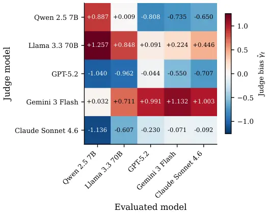
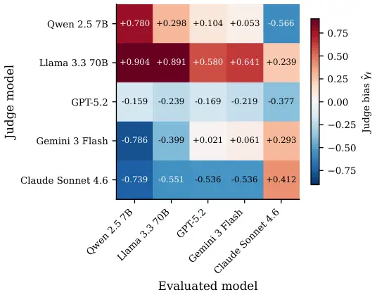

# CyclicJudge: Mitigating Judge Bias Efficiently in LLM-based Evaluation

Ziyi Zhu Affiliation: Slingshot AI
Email: [ziyi@slingshotai.com](mailto:)    Olivier Tieleman
Affiliation: Slingshot AI Email: [olivier@slingshotai.com](mailto:)   
Alexey Bukhtiyarov Affiliation: Slingshot AI
Email: [jc2124@cam.ac.uk](mailto:)    Jinghong Chen
Affiliation: Department of Engineering, University of Cambridge

###### Abstract

LLM-as-judge evaluation has become standard practice for open-ended
model assessment; however, judges exhibit systematic biases that cannot
be averaged out by increasing the number of scenarios or generations.
These biases are often similar in magnitude to the model differences
that benchmarks are designed to detect, resulting in unreliable rankings
when single-judge evaluations are used. We introduce a variance
decomposition that partitions benchmark score variance into scenario,
generation, judge, and residual components. Based on this analysis,
CyclicJudge, a round-robin assignment of judges to scenarios, is
demonstrated to be the optimal strategy for a fixed judge panel and
judge-call budget: it cancels the average additive judge offsets while
matching the cost of single-judge evaluation. Empirical results on
MT-Bench and MindEval validate the effectiveness of CyclicJudge as
predicted, across both general-purpose and domain-specific evaluation
settings, reducing benchmark score variance and stabilizing the
resulting model ranking.

## 1 Introduction

LLM-as-judge evaluation has become the de facto standard for open-ended
model assessment (Zheng et al., 2023). A growing body of work indicates
that LLM judges are systematically biased: some models are consistently
lenient, others strict, with additional position, verbosity, and
self-preference effects (Zheng et al., 2023; Shi et al., 2025; Wang et
al., 2024). A standard Analysis of Variance (ANOVA; Fisher, 1925) on our
data confirms that judge main effect is highly significant (§4.2).

Crucially, systematic bias does not average away across more scenarios
or generations: reducing them requires aggregating across multiple
judges. Yet running every judge on every item multiplies evaluation cost
by the panel size and sacrifices generation diversity at a fixed budget.
Throughout this work, we treat the mean score of a diverse
$`K_{\text{tot}}`$-judge panel as the reference for evaluation; our goal
is to recover this panel mean efficiently.

We show that CyclicJudge, a round-robin assignment of judges to items,
resolves this tension. To establish this formally, we develop a variance
decomposition rooted in generalizability theory (Brennan, 2001;
Shavelson and Webb, 1991) that separates benchmark score variance into
scenario, generation, judge, and residual components. Our contributions
are:

1.  1.  A mixed-effects model that decomposes benchmark variance into random
        noise and panel-relative judge offsets, showing they require
        fundamentally different remedies (§3.1–3.2).
2.  2.  A proof that round-robin cycling achieves lower variance than
        alternative strategies: it cancels the average panel-relative
        offsets while maximizing generation diversity at any budget (§3.3).
3.  3.  Empirical results on MT-Bench and MindEval showing that CyclicJudge
        lowers benchmark score variance as predicted (§4.4) and recovers the
        panel leaderboard more reliably than the alternative strategies at
        equal budget (§4.5).

## 2 Related Work

#### LLM judge biases and multi-judge approaches.

LLM judges exhibit systematic position bias (Wang et al., 2024; Shi et
al., 2025), length bias (Dubois et al., 2024), self-preference (Wataoka
et al., 2024), and cognitive biases (Koo et al., 2024); we refer readers
to Gu et al. (2026) for a comprehensive survey. Multi-judge panels
mitigate these biases by averaging over diverse judge tendencies (Verga
et al., 2024), while psychometric reliability analyses further
demonstrate that single-judge evaluations yield insufficiently stable
scores (Schroeder and Wood-Doughty, 2024).

#### Benchmark reliability and generation variance.

Madaan et al. (2024) empirically quantifies variance across hundreds of
models and benchmarks, and Alvarado Gonzalez et al. (2025) shows via
ANOVA that unrepeated evaluations frequently produce rank inversions
across benchmark subcategories. Zhang et al. (2026) proposes a
hierarchical model decomposing variance into within-prompt and
between-prompt components, and Mizrahi et al. (2024) shows that prompt
paraphrasing alone can reverse model rankings. Our work extends this
line by further separating systematic judge bias from random noise.

#### Budget-constrained evaluation.

Perlitz et al. (2024) frames benchmark design as a compute–reliability
tradeoff and shows that most of a benchmark’s reliability survives
evaluating only a fraction of its examples; our allocation analysis asks
the same question along the judge axis instead of the example axis. Saha
et al. (2026) frames judge selection as a multi-armed bandit problem,
Luettgau et al. (2025) applies hierarchical Bayesian partial pooling in
low-data regimes, and Miller (2024) derives standard errors and power
formulas for benchmark scores; Dorner et al. (2025) further establishes
fundamental scaling limits on the accuracy gains from additional judge
queries.

## 3 Methodology

### 3.1 Model Specification

Consider evaluating model $`\theta`$ on $`n`$ scenarios from a dataset
$`\mathcal{D}`$ of $`N`$ total scenarios, with $`m`$ independent
generations per scenario, each scored by $`K`$ judges drawn from a pool
of $`K_{\text{tot}}`$. The same $`K`$ judges score every
scenario–generation cell (a crossed design). We model each score as:

```math
X_{ij\ell}=\mu_{\theta}+\alpha_{i}+\beta_{ij}+\gamma_{\ell}+\varepsilon_{ij\ell} \tag{1}
```

where $`i\in\{1,\ldots,n\}`$ indexes scenarios, $`j\in\{1,\ldots,m\}`$
indexes generations within scenario $`i`$, and $`\ell`$ indexes the
$`K`$ selected judges. Each term has a distinct source:

- •
  $`\mu_{\theta}`$: _panel-mean estimand_ for model $`\theta`$—the
  average score the $`K_{\text{tot}}`$-judge panel would assign in
  expectation, with random noise removed.
- •
  $`\alpha_{i}\overset{\text{iid}}{\sim}(0,\,\sigma_{\alpha}^{2})`$:
  scenario effect—how much individual scenario difficulty varies for
  model $`\theta`$. A dataset whose scenarios all test the same aspects
  of model $`\theta`$ equally has $`\sigma_{\alpha}^{2}=0`$.
- •
  $`\beta_{ij}\overset{\text{iid}}{\sim}(0,\,\sigma_{\beta}^{2})`$:
  generation effect—variability from stochastic decoding.
  $`\sigma_{\beta}^{2}`$ is model-specific; a deterministic model has
  $`\sigma_{\beta}^{2}=0`$.
- •
  $`\gamma_{\ell}`$: _judge offset relative to the panel mean_—a fixed
  constant for each judge, with centering constraint
  $`\sum_{\ell=1}^{K_{\text{tot}}}\gamma_{\ell}=0`$ and population
  dispersion
  $`\sigma_{\gamma}^{2}=K_{\text{tot}}^{-1}\sum_{\ell}\gamma_{\ell}^{2}`$.
  $`\gamma_{\ell}`$ measures deviation from the panel reference, not
  from absolute truth: bias shared by all panel members is absorbed into
  $`\mu_{\theta}`$.
- •
  $`\varepsilon_{ij\ell}\overset{\text{iid}}{\sim}(0,\,\sigma_{\varepsilon}^{2})`$:
  residual—captures judge-level noise and all interaction terms; we
  discuss these modeling choices in Appendix J.

The random effects $`(\alpha,\beta,\varepsilon)`$ are mutually
independent with finite second moments; no distributional assumptions
(e.g., Gaussianity) are needed. The $`n`$ scenarios and $`K`$ judges are
each drawn by simple random sampling without replacement, independently
of each other and of all random effects.

### 3.2 Variance Decomposition

The benchmark score is the grand mean
$`\bar{X}=\frac{1}{nmK}\sum_{i,j,\ell}X_{ij\ell}`$, which decomposes as
$`\bar{X}=\mu_{\theta}+\bar{\alpha}+\bar{\beta}+\bar{\gamma}+\bar{\varepsilon}`$,
where each bar denotes a hierarchical sample mean.

###### Proposition 1 (Variance decomposition).

```math
\operatorname{Var}(\bar{X})=\underbrace{\frac{\sigma_{\alpha}^{2}}{n}+\frac{\sigma_{\beta}^{2}}{nm}+\frac{\sigma_{\varepsilon}^{2}}{nmK}}_{\text{random noise}}+\underbrace{\frac{\sigma_{\gamma}^{2}}{K}\cdot\frac{K_{\text{tot}}-K}{K_{\text{tot}}-1}}_{V_{\gamma}\text{: judge bias}} \tag{2}
```

Each noise term shrinks with more data at or above its hierarchy level.
The bias term $`V_{\gamma}`$ responds only to $`K`$ and vanishes exactly
at $`K=K_{\text{tot}}`$. The proof uses the law of total variance,
conditioning on the judge selection, combined with a finite population
correction for sampling $`K`$ from $`K_{\text{tot}}`$ centered bias
values (Appendix C).

### 3.3 Allocation Strategies

Given a per-scenario budget of $`B`$ judge calls, the design question is
how to allocate judges across generations. The scenario term
$`\sigma_{\alpha}^{2}/n`$ is fixed once scenarios are chosen; we compare
three strategies for the remaining variance.

#### Strategy A: All judges per generation.

Use all $`K_{\text{tot}}`$ judges for each of $`m=B/K_{\text{tot}}`$
generations. The mean of all judge offsets is zero ($`\bar{\gamma}=0`$):

```math
V_{A}(B)=\frac{K_{\text{tot}}\,\sigma_{\beta}^{2}+\sigma_{\varepsilon}^{2}}{nB} \tag{3}
```

#### Strategy B: Random single judge per generation.

Use $`m=B`$ generations, each scored by one randomly sampled judge.
Random judge selection injects the panel-relative offset as additional
sampling noise:

```math
V_{B}(B)=\frac{\sigma_{\beta}^{2}+\sigma_{\gamma}^{2}+\sigma_{\varepsilon}^{2}}{nB} \tag{4}
```

#### Strategy C: CyclicJudge (round-robin).

Use $`m=B`$ generations, assigning judge $`j\bmod K_{\text{tot}}`$ to
generation $`j`$. Each judge appears equally often, so the
panel-relative offsets sum to zero ($`\bar{\gamma}=0`$):

```math
V_{C}(B)=\frac{\sigma_{\beta}^{2}+\sigma_{\varepsilon}^{2}}{nB} \tag{5}
```

#### Cycling across scenarios.

When $`B`$ is not a multiple of $`K_{\text{tot}}`$, we can write
$`B=qK_{\text{tot}}+r`$ with $`0\leq r<K_{\text{tot}}`$. Each scenario
receives $`q`$ full cycles, which cancel within the scenario, plus $`r`$
remainder calls. We run one continuous cycle across the whole benchmark:
shuffle the scenarios, then hand out judges in round-robin order to the
$`nB`$ judge calls, so each scenario’s remainder picks up where the
previous one left off. Shuffling keeps the cycle from aligning with any
latent ordering of the dataset. Offsets then cancel _exactly_ whenever
$`K_{\text{tot}}\mid nB`$, and otherwise leave fewer than
$`K_{\text{tot}}`$ uncancelled calls, a residual bias adding
$`O\bigl((1/nB)^{2}\bigr)`$ to the mean squared error (Appendix E). In
the case of the smallest budget $`B=1`$, where $`q=0`$ and $`r=1`$,
every call is a remainder call, so each scenario receives a single
generation scored by a single judge, and the cycle runs entirely across
scenarios.

#### Advantage of CyclicJudge.

Direct comparison (Appendix E) shows $`V_{C}\leq\min(V_{A},V_{B})`$ for
all $`B`$, with gaps of $`O(1/B)`$, so CyclicJudge’s advantage is
largest at small budgets of judge calls. The ranking of A vs. B depends
on whether
$`(K_{\text{tot}}{-}1)\sigma_{\beta}^{2}\gtrless\sigma_{\gamma}^{2}`$:
all judges beat random only when judge bias is large relative to
generation variance.

## 4 Experiments

### 4.1 Domain and Data

We validate our approach on two benchmarks:

#### MT-Bench

(Zheng et al., 2023) is a general-purpose multi-turn conversational
benchmark with 80 two-turn questions spanning 8 categories, scored on a
1–10 scale per turn (averaged).

#### MindEval

(Pombal et al., 2025) is a domain-specific benchmark for multi-turn
mental health support with 50 scenarios and composite scores on a 1–5
scale covering empathy, safety, and clinical appropriateness. Each
scenario simulates a full 10-turn therapeutic session with a synthetic
patient.

For both benchmarks, we evaluate five models—Qwen 2.5 7B Instruct (Yang
et al., 2024), Llama 3.3 70B Instruct (Grattafiori et al., 2024),
GPT-5.2, Gemini 3 Flash, and Claude Sonnet 4.6, which also serve as
judges in a symmetric design. MT-Bench uses $`m{=}10`$ generations per
scenario (4,000 scores per model); MindEval uses $`m{=}5`$ (1,250 scores
per model). We follow the default judge decoding hyperparameters from
reference (Appendix K).

### 4.2 Judge Bias Estimates

As a complementary omnibus check on the mixed-effects decomposition
(§3.1), we test whether judge identity has a significant effect using a
two-way ANOVA, treating each scenario–generation pair as a subject
crossed with $`K`$ judges. On both benchmarks, the judge main effect is
highly significant ($`p<0.001`$ in all cases; see Appendix I).

Table 1 demonstrates that single-judge evaluation produces unreliable
rankings. On MT-Bench at the default operating point ($`m{=}1`$,
$`K{=}1`$), the top-ranked model varies with the judge: three different
models take the top slot across the five judges, and two of the five
disagree with the panel winner (Appendix H). Qwen ties itself for first
under its own judgment despite ranking last by consensus, a pattern
consistent with the self-preference bias documented by Wataoka et al.
(2024). The per-observation variance estimates (Table 2) show that judge
variance $`\hat{\sigma}^{2}_{\gamma}`$ ranges from 0.34 to 0.95 across
models. Since competitive models on current leaderboards are routinely
separated by $`<0.5`$ points (Chiang et al., 2024), single-judge
evaluation can easily reverse rankings. On MindEval, rankings are also
notably more stable across single judges: four of five produce an
identical ordering. Two plausible factors include: domain-specific
rubrics may leave less room for stylistic self-preference, and the
markedly lower scenario and generation variance on MindEval (§4.3)
compresses the absolute size of any model-dependent fluctuations.

\(a\) MT-Bench (1–10 scale, $`n{=}80`$)

|        | Judge          |                |                |                |                |
| ------ | -------------- | -------------- | -------------- | -------------- | -------------- |
| Model  | Qwen           | Llama          | GPT            | Gemini         | Claude         |
| Gemini | 8.02$`\pm`$.16 | 8.98$`\pm`$.08 | 8.20$`\pm`$.12 | 9.88$`\pm`$.06 | 8.68$`\pm`$.10 |
| GPT    | 7.91$`\pm`$.16 | 8.81$`\pm`$.11 | 8.67$`\pm`$.12 | 9.71$`\pm`$.11 | 8.49$`\pm`$.13 |
| Claude | 7.96$`\pm`$.17 | 9.06$`\pm`$.06 | 7.91$`\pm`$.13 | 9.62$`\pm`$.12 | 8.52$`\pm`$.13 |
| Llama  | 7.87$`\pm`$.18 | 8.71$`\pm`$.11 | 6.90$`\pm`$.20 | 8.58$`\pm`$.25 | 7.26$`\pm`$.22 |
| Qwen   | 8.02$`\pm`$.15 | 8.39$`\pm`$.16 | 6.09$`\pm`$.20 | 7.16$`\pm`$.27 | 5.99$`\pm`$.23 |

\(b\) MindEval (1–5 scale, $`n{=}50`$)

|        | Judge          |                |                |                |                |
| ------ | -------------- | -------------- | -------------- | -------------- | -------------- |
| Model  | Qwen           | Llama          | GPT            | Gemini         | Claude         |
| Claude | 3.86$`\pm`$.08 | 4.67$`\pm`$.07 | 4.05$`\pm`$.06 | 4.72$`\pm`$.06 | 4.84$`\pm`$.04 |
| GPT    | 4.04$`\pm`$.09 | 4.51$`\pm`$.07 | 3.76$`\pm`$.09 | 3.95$`\pm`$.16 | 3.39$`\pm`$.15 |
| Gemini | 3.90$`\pm`$.08 | 4.49$`\pm`$.06 | 3.63$`\pm`$.05 | 3.91$`\pm`$.12 | 3.31$`\pm`$.08 |
| Llama  | 3.70$`\pm`$.07 | 4.29$`\pm`$.05 | 3.16$`\pm`$.06 | 3.00$`\pm`$.10 | 2.85$`\pm`$.06 |
| Qwen   | 3.26$`\pm`$.12 | 3.38$`\pm`$.21 | 2.32$`\pm`$.08 | 1.69$`\pm`$.08 | 1.74$`\pm`$.05 |

Table 1: Mean score $`\pm`$ 95% CI at the default operating point
($`m{=}1`$, $`K{=}1`$). Bold: highest score per judge column. Underline:
second highest.

### 4.3 Variance Components

Table 2 reports the per-observation variance component estimates via
crossed ANOVA (see Appendix D). On MT-Bench, scenario variance
$`\hat{\sigma}^{2}_{\alpha}`$ is the largest per-observation component;
maximizing the number of distinct scenarios always reduces total
variance (Appendix F). Generation variance $`\hat{\sigma}^{2}_{\beta}`$
drops with capability, consistent with the observation that stronger
models produce more deterministic outputs. As frontier models
increasingly rely on RL post-training, generation variance may shrink
further (Matsutani et al., 2026). The judge offset variance
$`\hat{\sigma}^{2}_{\gamma}`$ remains substantial for all models,
accounting for $`>`$94% of benchmark variance at the default operating
point (see Appendix B).

On MindEval, both scenario and generation variance are markedly lower.
Scenario variance $`\hat{\sigma}^{2}_{\alpha}`$ drops by one to two
orders of magnitude because all MindEval scenarios evaluate the same
rubrics across different user profiles, so difficulty varies far less
than on MT-Bench. Generation variance is similarly suppressed: each
MindEval generation is a full 10-turn therapeutic session, so
per-response decoding randomness averages out over many turns. The judge
offset variance remains the dominant component throughout, exceeding
both scenario and generation variance by an order of magnitude.

\(a\) MT-Bench ($`n{=}80`$)

| Component                                     | Qwen  | Llama | GPT   | Gemini | Claude |
| --------------------------------------------- | ----- | ----- | ----- | ------ | ------ |
| $`\hat{\sigma}^{2}_{\alpha}`$ (scenario)      | 1.530 | 0.882 | 0.634 | 0.408  | 0.393  |
| $`\hat{\sigma}^{2}_{\beta}`$ (generation)     | 0.266 | 0.238 | 0.076 | 0.000  | 0.000  |
| $`\hat{\sigma}^{2}_{\gamma}`$ (judge)         | 0.947 | 0.503 | 0.339 | 0.435  | 0.427  |
| $`\hat{\sigma}^{2}_{\varepsilon}`$ (residual) | 1.486 | 1.130 | 0.564 | 0.661  | 0.830  |

\(b\) MindEval ($`n{=}50`$)

| Component                                     | Qwen  | Llama | GPT   | Gemini | Claude |
| --------------------------------------------- | ----- | ----- | ----- | ------ | ------ |
| $`\hat{\sigma}^{2}_{\alpha}`$ (scenario)      | 0.034 | 0.014 | 0.021 | 0.015  | 0.005  |
| $`\hat{\sigma}^{2}_{\beta}`$ (generation)     | 0.100 | 0.019 | 0.047 | 0.016  | 0.002  |
| $`\hat{\sigma}^{2}_{\gamma}`$ (judge)         | 0.523 | 0.280 | 0.132 | 0.150  | 0.155  |
| $`\hat{\sigma}^{2}_{\varepsilon}`$ (residual) | 0.159 | 0.069 | 0.207 | 0.103  | 0.061  |

Table 2: Per-observation variance component estimates.

### 4.4 Strategy Comparison

Figure 1 validates the three allocation strategies via 5,000 subsampling
repetitions at each budget level on both benchmarks. Markers show
empirical variance; dashed lines show exact predictions from empirical
pool variances (Appendix G). CyclicJudge achieves lower variance
everywhere on both benchmarks, and predictions match empirical results
precisely. At $`B{=}5`$, switching from random to cycling cuts variance
by $`{\sim}`$27–40% across models on MT-Bench.

The optimal strategy among the two alternatives depends on the sign of
$`(K_{\text{tot}}{-}1)\sigma_{\beta}^{2}-\sigma_{\gamma}^{2}`$:
all-judges wins when
$`\sigma_{\gamma}^{2}/\sigma_{\beta}^{2}>K_{\text{tot}}{-}1=4`$. On
MT-Bench, this ratio is below the threshold for Qwen (3.6) and Llama
(2.1), so random judging is preferable; for Gemini and Claude
($`\hat{\sigma}^{2}_{\beta}\approx 0`$), all-judges converges to
CyclicJudge. On MindEval, the ratio exceeds the threshold for nearly
every model, so all-judges consistently outperforms random. The driver
is not a larger judge offset variance, but rather a sharply lower
generation variance $`\hat{\sigma}^{2}_{\beta}`$. Meanwhile, judges’
disagreement over subjective clinical criteria keeps
$`\hat{\sigma}^{2}_{\gamma}`$ substantial relative to
$`\hat{\sigma}^{2}_{\beta}`$. CyclicJudge outperforms both alternatives
regardless of this ratio.

(a) MT-Bench (1–10 scale, $`n{=}80`$, $`m_{\max}{=}10`$)

(b) MindEval (1–5 scale, $`n{=}50`$, $`m_{\max}{=}5`$)

Figure 1: Benchmark score variance $`\operatorname{Var}(\bar{X})`$ vs.
per-scenario budget for three strategies: all judges (A), random single
judge (B), and CyclicJudge (C).

### 4.5 Ranking Stability

Benchmarks are commonly read as leaderboards, so we also measure how
often each strategy recovers the _ranking_ induced by the reference
panel. Alongside the three allocation strategies of §3.3 we include a
_single judge_ baseline: one judge, drawn at random per repetition,
scores all $`B`$ generations of every scenario. The reference is the
panel leaderboard computed from the full crossed data using all
$`K_{\text{tot}}`$ judges and all generations. For each strategy and
budget we draw 5,000 subsampling repetitions, rank the five models
within each repetition, and report the mean Spearman $`\rho`$ and
Kendall $`\tau`$-b against the reference ranking together with the top-1
flip frequency (see Appendix H).

Table 3 compares the allocations at $`B{=}5`$, the smallest budget that
gives every scenario a full cycle. A single judge flips the top-ranked
model in more than half of the repetitions; CyclicJudge reduces the flip
rate by 61% and attains the highest rank correlation on both
coefficients. The ordering of the strategies is preserved as $`B`$ grows
(Appendix H). MindEval separates the same two regimes: a single judge
flips the top model in 20% of repetitions ($`\tau=0.91`$), while
all-judges, random, and CyclicJudge all reach $`\tau\approx 0.99`$ with
zero flips at $`B{=}5`$. MindEval’s much smaller scenario and generation
variance (§4.3) leaves the multi-judge strategies little room to differ.

| Allocation     | Spearman $`\rho`$ | Kendall $`\tau`$-b | Top-1 flip |
| -------------- | ----------------- | ------------------ | ---------- |
| Single judge   | 0.716             | 0.661              | 0.513      |
| Random 1 judge | 0.955             | 0.916              | 0.328      |
| All 5 judges   | 0.969             | 0.938              | 0.272      |
| CyclicJudge    | 0.980             | 0.960              | 0.200      |

Table 3: Ranking stability against the reference panel leaderboard on
MT-Bench at a common budget of $`B{=}5`$ judge calls per scenario, over
5,000 subsampling repetitions. Higher is better for $`\rho`$ and
$`\tau`$-b, lower is better for top-1 flip. Bold: best per column.

## 5 Conclusion

We develop a variance decomposition for LLM-as-judge evaluation that
separates systematic between-judge offsets from random noise and use it
to derive CyclicJudge, a round-robin judge assignment strategy. Our
analysis and experiments on both a general-purpose benchmark (MT-Bench)
and a domain-specific clinical benchmark (MindEval) yield three main
findings: (1) Systematic judge offsets dominate benchmark score variance
at default operating points. (2) Random noise components decrease with
model capability and multi-turn evaluation, but the panel-relative
offset variance does not. (3) CyclicJudge achieves the lowest variance
among all allocation strategies at every budget level, regardless of the
model’s variance profile, by canceling the average judge offsets while
maximizing generation diversity, and it converts this into a more stable
leaderboard: at equal budget it significantly cuts the rate at which the
top-ranked model differs from the panel’s. The method requires no
model-specific tuning and maintains the same per-item cost as
single-judge evaluation, providing practitioners with a cost-neutral
drop-in replacement for more reliable LLM evaluation.

## Limitations

#### Heterogeneous judge cost.

Our budget $`B`$ counts judge calls, which is exact only when the panel
is price-homogeneous. Under heterogeneous prices, latency, or rate
limits the balanced cycle is no longer cost-optimal. Allocation then
becomes a weighted design problem in which the optimum trades a bounded
offset against reduced noise, which we leave to future work.

#### Scope of the cancellation guarantee.

Eq. 1 treats each judge’s bias as a single additive offset
$`\gamma_{\ell}`$, so what a balanced cycle cancels is each judge’s
_average_ panel-relative offset. Real judges also vary by scenario and
by generation, and those interactions are absorbed into the residual
(Appendix J).

#### Judge panel size.

Our strategy comparison subsamples from fully crossed evaluations,
making an exact ground-truth panel mean available. The cost of full
crossing, however, grows as
$`K_{\text{tot}}\times(\text{models}\times\text{scenarios}\times\text{repetitions})`$,
which limits us to $`K_{\text{tot}}=5`$. Empirical validation with
larger and more diverse judge pools would strengthen the practical
recommendations.

#### Panel-mean reference.

Our analysis treats the mean score of the $`K_{\text{tot}}`$-judge panel
as the reference for evaluation. A diverse panel drawn from disjoint
model families typically correlates more strongly with human judgments
than any single judge (Verga et al., 2024), but the panel mean is not a
substitute for absolute ground truth. Biases shared across the panel
members are absorbed into $`\mu_{\theta}`$ and propagate into the panel
mean. CyclicJudge addresses the within-panel offsets between individual
judges, not biases that all panel members share; calibrating the panel
itself against human or expert references is complementary work.

#### Linear model approximation.

Our variance decomposition assumes a linear random effects model, which
treats scores as unbounded and continuous. LLM-as-judge scores are in
fact bounded ordinal variables, so the linear model can produce boundary
artifacts and heteroscedastic residuals near the scale endpoints. A
generalized linear mixed model (GLMM), such as a cumulative-link mixed
model, would properly account for the ordinal, bounded nature of the
responses. However, GLMMs do not yield the closed-form variance
decomposition that our allocation analysis relies on. We therefore
retain the linear approximation, noting that it remains reasonable when
the scale range is large relative to the observed score dispersion, as
in our benchmarks.

#### Scenario exchangeability.

The “maximize scenarios” recommendation assumes scenarios are
interchangeable draws from the dataset; in practice, some scenarios may
be more informative than others, and item-selection methods (Maia Polo
et al., 2024) could alter the tradeoff.

#### Balanced design assumption.

The allocation analysis assumes a balanced design in which every
scenario receives the same number of judge calls. Extensions to adaptive
or sequential designs remain future work.

## References

- Alvarado Gonzalez et al. (2025) M. A. Alvarado Gonzalez, M. Bruno
  Hernandez, M. A. Peñaloza Perez, B. Lopez Orozco, J. T. Cruz Soto,
  and S. Malagon Do repetitions matter? strengthening reliability in LLM
  evaluations. External Links: 2509.24086,
  [Document](https://dx.doi.org/10.48550/arXiv.2509.24086),
  [Link](https://arxiv.org/abs/2509.24086) Cited by: §2.
- Brennan (2001) R. L. Brennan Generalizability theory. Springer, New
  York, NY. External Links: ISBN 978-0-387-95282-6,
  [Document](https://dx.doi.org/10.1007/978-1-4757-3456-0),
  [Link](https://doi.org/10.1007/978-1-4757-3456-0) Cited by: §1.
- Chiang et al. (2024) W. Chiang, L. Zheng, Y. Sheng, A. N.
  Angelopoulos, T. Li, D. Li, B. Zhu, H. Zhang, M. Jordan, J. E.
  Gonzalez, and I. Stoica Chatbot Arena: an open platform for evaluating
  LLMs by human preference. In Proceedings of the 41st International
  Conference on Machine Learning, R. Salakhutdinov, Z. Kolter, K.
  Heller, A. Weller, N. Oliver, J. Scarlett, and F. Berkenkamp (Eds.),
  Proceedings of Machine Learning Research, Vol. 235, pp. 8359–8388.
  External Links:
  [Link](https://proceedings.mlr.press/v235/chiang24b.html) Cited by:
  §4.2.
- Dorner et al. (2025) F. E. Dorner, V. Y. Nastl, and M. Hardt Limits to
  scalable evaluation at the frontier: LLM as judge won’t beat twice the
  data. In The Thirteenth International Conference on Learning
  Representations (ICLR), Singapore, pp. 26467–26491. External Links:
  2410.13341, [Link](https://openreview.net/forum?id=NO6Tv6QcDs) Cited
  by: §2.
- Dubois et al. (2024) Y. Dubois, P. Liang, and T. Hashimoto
  Length-controlled AlpacaEval: a simple debiasing of automatic
  evaluators. In First Conference on Language Modeling (COLM),
  Philadelphia, PA, USA. External Links:
  [Link](https://openreview.net/forum?id=CybBmzWBX0), 2404.04475 Cited
  by: §2.
- Fisher (1925) R. A. Fisher Statistical methods for research workers.
  1st edition, Biological Monographs and Manuals, Oliver and Boyd,
  Edinburgh. Cited by: §1.
- Grattafiori et al. (2024) A. Grattafiori, A. Dubey, A. Jauhri, A.
  Pandey, A. Kadian, A. Al-Dahle, A. Letman, A. Mathur, A. Schelten, A.
  Vaughan, A. Yang, A. Fan, A. Goyal, A. Hartshorn, A. Yang, A.
  Mitra, A. Sravankumar, A. Korenev, A. Hinsvark, A. Rao, A. Zhang, A.
  Rodriguez, A. Gregerson, A. Spataru, B. Roziere, B. Biron, B. Tang, B.
  Chern, C. Caucheteux, C. Nayak, C. Bi, C. Marra, C. McConnell, C.
  Keller, C. Touret, C. Wu, C. Wong, C. C. Ferrer, C. Nikolaidis, D.
  Allonsius, D. Song, D. Pintz, D. Livshits, D. Wyatt, D. Esiobu, D.
  Choudhary, D. Mahajan, D. Garcia-Olano, D. Perino, D. Hupkes, E.
  Lakomkin, E. AlBadawy, E. Lobanova, E. Dinan, E. M. Smith, F.
  Radenovic, F. Guzmán, F. Zhang, G. Synnaeve, G. Lee, G. L.
  Anderson, G. Thattai, G. Nail, G. Mialon, G. Pang, G. Cucurell, H.
  Nguyen, H. Korevaar, H. Xu, H. Touvron, I. Zarov, I. A. Ibarra, I.
  Kloumann, I. Misra, I. Evtimov, J. Zhang, J. Copet, J. Lee, J.
  Geffert, J. Vranes, J. Park, J. Mahadeokar, J. Shah, J. van der
  Linde, J. Billock, J. Hong, J. Lee, J. Fu, J. Chi, J. Huang, J.
  Liu, J. Wang, J. Yu, J. Bitton, J. Spisak, J. Park, J. Rocca, J.
  Johnstun, J. Saxe, J. Jia, K. V. Alwala, K. Prasad, K. Upasani, K.
  Plawiak, K. Li, K. Heafield, K. Stone, K. El-Arini, K. Iyer, K.
  Malik, K. Chiu, K. Bhalla, K. Lakhotia, L. Rantala-Yeary, L. van der
  Maaten, L. Chen, L. Tan, L. Jenkins, L. Martin, L. Madaan, L. Malo, L.
  Blecher, L. Landzaat, L. de Oliveira, M. Muzzi, M. Pasupuleti, M.
  Singh, M. Paluri, M. Kardas, M. Tsimpoukelli, M. Oldham, M. Rita, M.
  Pavlova, M. Kambadur, M. Lewis, M. Si, M. K. Singh, M. Hassan, N.
  Goyal, N. Torabi, N. Bashlykov, N. Bogoychev, N. Chatterji, N.
  Zhang, O. Duchenne, O. Çelebi, P. Alrassy, P. Zhang, P. Li, P.
  Vasic, P. Weng, P. Bhargava, P. Dubal, P. Krishnan, P. S. Koura, P.
  Xu, Q. He, Q. Dong, R. Srinivasan, R. Ganapathy, R. Calderer, R. S.
  Cabral, R. Stojnic, R. Raileanu, R. Maheswari, R. Girdhar, R.
  Patel, R. Sauvestre, R. Polidoro, R. Sumbaly, R. Taylor, R. Silva, R.
  Hou, R. Wang, S. Hosseini, S. Chennabasappa, S. Singh, S. Bell, S. S.
  Kim, S. Edunov, S. Nie, S. Narang, S. Raparthy, S. Shen, S. Wan, S.
  Bhosale, S. Zhang, S. Vandenhende, S. Batra, S. Whitman, S. Sootla, S.
  Collot, S. Gururangan, S. Borodinsky, T. Herman, T. Fowler, T.
  Sheasha, T. Georgiou, T. Scialom, T. Speckbacher, T. Mihaylov, T.
  Xiao, U. Karn, V. Goswami, V. Gupta, V. Ramanathan, V. Kerkez, V.
  Gonguet, V. Do, V. Vogeti, V. Albiero, V. Petrovic, W. Chu, W.
  Xiong, W. Fu, W. Meers, X. Martinet, X. Wang, X. Wang, X. E. Tan, X.
  Xia, X. Xie, X. Jia, X. Wang, Y. Goldschlag, Y. Gaur, Y. Babaei, Y.
  Wen, Y. Song, Y. Zhang, Y. Li, Y. Mao, Z. D. Coudert, Z. Yan, Z.
  Chen, Z. Papakipos, A. Singh, A. Srivastava, A. Jain, A. Kelsey, A.
  Shajnfeld, A. Gangidi, A. Victoria, A. Goldstand, A. Menon, A.
  Sharma, A. Boesenberg, A. Baevski, A. Feinstein, A. Kallet, A.
  Sangani, A. Teo, A. Yunus, A. Lupu, A. Alvarado, A. Caples, A. Gu, A.
  Ho, A. Poulton, A. Ryan, A. Ramchandani, A. Dong, A. Franco, A.
  Goyal, A. Saraf, A. Chowdhury, A. Gabriel, A. Bharambe, A.
  Eisenman, A. Yazdan, B. James, B. Maurer, B. Leonhardi, B. Huang, B.
  Loyd, B. De Paola, B. Paranjape, B. Liu, B. Wu, B. Ni, B. Hancock, B.
  Wasti, B. Spence, B. Stojkovic, B. Gamido, B. Montalvo, C. Parker, C.
  Burton, C. Mejia, C. Liu, C. Wang, C. Kim, C. Zhou, C. Hu, C. Chu, C.
  Cai, C. Tindal, C. Feichtenhofer, C. Gao, D. Civin, D. Beaty, D.
  Kreymer, D. Li, D. Adkins, D. Xu, D. Testuggine, D. David, D.
  Parikh, D. Liskovich, D. Foss, D. Wang, D. Le, D. Holland, E.
  Dowling, E. Jamil, E. Montgomery, E. Presani, E. Hahn, E. Wood, E.
  Le, E. Brinkman, E. Arcaute, E. Dunbar, E. Smothers, F. Sun, F.
  Kreuk, F. Tian, F. Kokkinos, F. Ozgenel, F. Caggioni, F. Kanayet, F.
  Seide, G. M. Florez, G. Schwarz, G. Badeer, G. Swee, G. Halpern, G.
  Herman, G. Sizov, G. Zhang, G. Lakshminarayanan, H. Inan, H.
  Shojanazeri, H. Zou, H. Wang, H. Zha, H. Habeeb, H. Rudolph, H.
  Suk, H. Aspegren, H. Goldman, H. Zhan, I. Damlaj, I. Molybog, I.
  Tufanov, I. Leontiadis, I. Veliche, I. Gat, J. Weissman, J.
  Geboski, J. Kohli, J. Lam, J. Asher, J. Gaya, J. Marcus, J. Tang, J.
  Chan, J. Zhen, J. Reizenstein, J. Teboul, J. Zhong, J. Jin, J.
  Yang, J. Cummings, J. Carvill, J. Shepard, J. McPhie, J. Torres, J.
  Ginsburg, J. Wang, K. Wu, K. H. U, K. Saxena, K. Khandelwal, K.
  Zand, K. Matosich, K. Veeraraghavan, K. Michelena, K. Li, K.
  Jagadeesh, K. Huang, K. Chawla, K. Huang, L. Chen, L. Garg, L. A, L.
  Silva, L. Bell, L. Zhang, L. Guo, L. Yu, L. Moshkovich, L.
  Wehrstedt, M. Khabsa, M. Avalani, M. Bhatt, M. Mankus, M. Hasson, M.
  Lennie, M. Reso, M. Groshev, M. Naumov, M. Lathi, M. Keneally, M.
  Liu, M. L. Seltzer, M. Valko, M. Restrepo, M. Patel, M. Vyatskov, M.
  Samvelyan, M. Clark, M. Macey, M. Wang, M. J. Hermoso, M. Metanat, M.
  Rastegari, M. Bansal, N. Santhanam, N. Parks, N. White, N. Bawa, N.
  Singhal, N. Egebo, N. Usunier, N. Mehta, N. P. Laptev, N. Dong, N.
  Cheng, O. Chernoguz, O. Hart, O. Salpekar, O. Kalinli, P. Kent, P.
  Parekh, P. Saab, P. Balaji, P. Rittner, P. Bontrager, P. Roux, P.
  Dollar, P. Zvyagina, P. Ratanchandani, P. Yuvraj, Q. Liang, R.
  Alao, R. Rodriguez, R. Ayub, R. Murthy, R. Nayani, R. Mitra, R.
  Parthasarathy, R. Li, R. Hogan, R. Battey, R. Wang, R. Howes, R.
  Rinott, S. Mehta, S. Siby, S. J. Bondu, S. Datta, S. Chugh, S.
  Hunt, S. Dhillon, S. Sidorov, S. Pan, S. Mahajan, S. Verma, S.
  Yamamoto, S. Ramaswamy, S. Lindsay, S. Lindsay, S. Feng, S. Lin, S. C.
  Zha, S. Patil, S. Shankar, S. Zhang, S. Zhang, S. Wang, S. Agarwal, S.
  Sajuyigbe, S. Chintala, S. Max, S. Chen, S. Kehoe, S. Satterfield, S.
  Govindaprasad, S. Gupta, S. Deng, S. Cho, S. Virk, S. Subramanian, S.
  Choudhury, S. Goldman, T. Remez, T. Glaser, T. Best, T. Koehler, T.
  Robinson, T. Li, T. Zhang, T. Matthews, T. Chou, T. Shaked, V.
  Vontimitta, V. Ajayi, V. Montanez, V. Mohan, V. S. Kumar, V.
  Mangla, V. Ionescu, V. Poenaru, V. T. Mihailescu, V. Ivanov, W. Li, W.
  Wang, W. Jiang, W. Bouaziz, W. Constable, X. Tang, X. Wu, X. Wang, X.
  Wu, X. Gao, Y. Kleinman, Y. Chen, Y. Hu, Y. Jia, Y. Qi, Y. Li, Y.
  Zhang, Y. Zhang, Y. Adi, Y. Nam, Y. Wang, Y. Zhao, Y. Hao, Y. Qian, Y.
  Li, Y. He, Z. Rait, Z. DeVito, Z. Rosnbrick, Z. Wen, Z. Yang, Z. Zhao,
  and Z. Ma The Llama 3 herd of models. External Links: 2407.21783,
  [Document](https://dx.doi.org/10.48550/arXiv.2407.21783),
  [Link](https://arxiv.org/abs/2407.21783) Cited by: §4.1.
- Gu et al. (2026) J. Gu, X. Jiang, Z. Shi, H. Tan, X. Zhai, C. Xu, W.
  Li, Y. Shen, S. Ma, H. Liu, S. Wang, K. Zhang, Z. Lin, B. Zhang, L.
  Ni, W. Gao, Y. Wang, and J. Guo A survey on LLM-as-a-judge. The
  Innovation 7 (6), pp. 101253. External Links: ISSN 2666-6758,
  [Document](https://dx.doi.org/10.1016/j.xinn.2025.101253),
  [Link](https://doi.org/10.1016/j.xinn.2025.101253) Cited by: §2.
- Koo et al. (2024) R. Koo, M. Lee, V. Raheja, J. I. Park, Z. M. Kim,
  and D. Kang Benchmarking cognitive biases in large language models as
  evaluators. In Findings of the Association for Computational
  Linguistics: ACL 2024, L. Ku, A. Martins, and V. Srikumar (Eds.),
  Bangkok, Thailand, pp. 517–545. External Links:
  [Link](https://aclanthology.org/2024.findings-acl.29/),
  [Document](https://dx.doi.org/10.18653/v1/2024.findings-acl.29) Cited
  by: §2.
- Luettgau et al. (2025) L. Luettgau, H. Coppock, M. Dubois, C.
  Summerfield, and C. Ududec HiBayES: a hierarchical Bayesian modeling
  framework for AI evaluation statistics. External Links: 2505.05602,
  [Document](https://dx.doi.org/10.48550/arXiv.2505.05602),
  [Link](https://arxiv.org/abs/2505.05602) Cited by: §2.
- Madaan et al. (2024) L. Madaan, A. K. Singh, R. Schaeffer, A.
  Poulton, S. Koyejo, P. Stenetorp, S. Narang, and D. Hupkes Quantifying
  variance in evaluation benchmarks. External Links: 2406.10229,
  [Link](https://arxiv.org/abs/2406.10229),
  [Document](https://dx.doi.org/10.48550/arXiv.2406.10229) Cited by: §2.
- Maia Polo et al. (2024) F. Maia Polo, L. Weber, L. Choshen, Y. Sun, G.
  Xu, and M. Yurochkin TinyBenchmarks: evaluating LLMs with fewer
  examples. In Proceedings of the 41st International Conference on
  Machine Learning, R. Salakhutdinov, Z. Kolter, K. Heller, A.
  Weller, N. Oliver, J. Scarlett, and F. Berkenkamp (Eds.), Proceedings
  of Machine Learning Research, Vol. 235, pp. 34303–34326. External
  Links: [Link](https://proceedings.mlr.press/v235/maia-polo24a.html)
  Cited by: Scenario exchangeability..
- Matsutani et al. (2026) K. Matsutani, S. Takashiro, G. Minegishi, T.
  Kojima, Y. Iwasawa, and Y. Matsuo RL squeezes, SFT expands: a
  comparative study of reasoning LLMs. In The Fourteenth International
  Conference on Learning Representations (ICLR), Vol. 2026,
  pp. 141482–141526. External Links:
  [Link](https://proceedings.iclr.cc/paper_files/paper/2026/hash/e52554a70e0df57a0bea11d1eca0c9b5-Abstract-Conference.html),
  2509.21128 Cited by: §4.3.
- Miller (2024) E. Miller Adding error bars to evals: a statistical
  approach to language model evaluations. External Links: 2411.00640,
  [Document](https://dx.doi.org/10.48550/arXiv.2411.00640),
  [Link](https://arxiv.org/abs/2411.00640) Cited by: §2.
- Mizrahi et al. (2024) M. Mizrahi, G. Kaplan, D. Malkin, R. Dror, D.
  Shahaf, and G. Stanovsky State of what art? a call for multi-prompt
  LLM evaluation. Transactions of the Association for Computational
  Linguistics 12, pp. 933–949. External Links:
  [Link](https://aclanthology.org/2024.tacl-1.52/),
  [Document](https://dx.doi.org/10.1162/tacl%5Fa%5F00681) Cited by: §2.
- Perlitz et al. (2024) Y. Perlitz, E. Bandel, A. Gera, O. Arviv, L.
  Ein-Dor, E. Shnarch, N. Slonim, M. Shmueli-Scheuer, and L. Choshen
  Efficient benchmarking (of language models). In Proceedings of the
  2024 Conference of the North American Chapter of the Association for
  Computational Linguistics: Human Language Technologies (Volume 1: Long
  Papers), K. Duh, H. Gomez, and S. Bethard (Eds.), Mexico City, Mexico,
  pp. 2519–2536. External Links:
  [Link](https://aclanthology.org/2024.naacl-long.139/),
  [Document](https://dx.doi.org/10.18653/v1/2024.naacl-long.139) Cited
  by: §2.
- Pombal et al. (2025) J. Pombal, M. D’Eon, N. M. Guerreiro, P. H.
  Martins, A. Farinhas, and R. Rei MindEval: Benchmarking Language
  Models on Multi-turn Mental Health Support. External Links:
  2511.18491, [Document](https://dx.doi.org/10.48550/arXiv.2511.18491),
  [Link](https://arxiv.org/abs/2511.18491) Cited by: §4.1.
- Saha et al. (2026) A. Saha, A. Wagde, and B. Kveton LLM-as-judge on a
  budget. External Links: 2602.15481,
  [Document](https://dx.doi.org/10.48550/arXiv.2602.15481),
  [Link](https://arxiv.org/abs/2602.15481) Cited by: §2.
- Schroeder and Wood-Doughty (2024) K. Schroeder and Z. Wood-Doughty Can
  you trust LLM judgments? reliability of LLM-as-a-judge. External
  Links: 2412.12509,
  [Document](https://dx.doi.org/10.48550/arXiv.2412.12509),
  [Link](https://arxiv.org/abs/2412.12509) Cited by: §2.
- Searle et al. (1992) S. R. Searle, G. Casella, and C. E. McCulloch
  Variance components. Wiley Series in Probability and Mathematical
  Statistics, Wiley, New York. External Links: ISBN 9780471621621,
  [Document](https://dx.doi.org/10.1002/9780470316856),
  [Link](https://doi.org/10.1002/9780470316856) Cited by: Appendix B.
- Shavelson and Webb (1991) R. J. Shavelson and N. M. Webb
  Generalizability theory: a primer. Measurement Methods for the Social
  Sciences, Vol. 1, Sage Publications, Newbury Park, CA. External Links:
  ISBN 978-0-8039-3745-1,
  [Link](https://books.google.com/books?id=gzyKRZWrm9EC) Cited by: §1.
- Shi et al. (2025) L. Shi, C. Ma, W. Liang, X. Diao, W. Ma, and S.
  Vosoughi Judging the judges: a systematic study of position bias in
  LLM-as-a-judge. In Proceedings of the 14th International Joint
  Conference on Natural Language Processing and the 4th Conference of
  the Asia-Pacific Chapter of the Association for Computational
  Linguistics, K. Inui, S. Sakti, H. Wang, D. F. Wong, P.
  Bhattacharyya, B. Banerjee, A. Ekbal, T. Chakraborty, and D. P. Singh
  (Eds.), Mumbai, India, pp. 292–314. External Links:
  [Link](https://aclanthology.org/2025.ijcnlp-long.18/),
  [Document](https://dx.doi.org/10.18653/v1/2025.ijcnlp-long.18), ISBN
  979-8-89176-298-5 Cited by: §1, §2.
- Verga et al. (2024) P. Verga, S. Hofstätter, S. Althammer, Y. Su, A.
  Piktus, A. Arkhangorodsky, M. Xu, N. White, and P. Lewis Replacing
  judges with juries: evaluating LLM generations with a panel of diverse
  models. External Links: 2404.18796,
  [Document](https://dx.doi.org/10.48550/arXiv.2404.18796),
  [Link](https://arxiv.org/abs/2404.18796) Cited by: §2, Panel-mean
  reference..
- Wang et al. (2024) P. Wang, L. Li, L. Chen, Z. Cai, D. Zhu, B. Lin, Y.
  Cao, L. Kong, Q. Liu, T. Liu, and Z. Sui Large language models are not
  fair evaluators. In Proceedings of the 62nd Annual Meeting of the
  Association for Computational Linguistics (Volume 1: Long Papers), L.
  Ku, A. Martins, and V. Srikumar (Eds.), Bangkok, Thailand,
  pp. 9440–9450. External Links:
  [Link](https://aclanthology.org/2024.acl-long.511/),
  [Document](https://dx.doi.org/10.18653/v1/2024.acl-long.511) Cited by:
  §1, §2.
- Wataoka et al. (2024) K. Wataoka, T. Takahashi, and R. Ri
  Self-preference bias in LLM-as-a-judge. Note: Accepted at the NeurIPS
  2024 Safe Generative AI Workshop External Links: 2410.21819,
  [Document](https://dx.doi.org/10.48550/arXiv.2410.21819),
  [Link](https://arxiv.org/abs/2410.21819) Cited by: §2, §4.2.
- Yang et al. (2024) A. Yang, B. Yang, B. Zhang, B. Hui, B. Zheng, B.
  Yu, C. Li, D. Liu, F. Huang, H. Wei, H. Lin, J. Yang, J. Tu, J.
  Zhang, J. Yang, J. Yang, J. Zhou, J. Lin, K. Dang, K. Lu, K. Bao, K.
  Yang, L. Yu, M. Li, M. Xue, P. Zhang, Q. Zhu, R. Men, R. Lin, T.
  Li, T. Tang, T. Xia, X. Ren, X. Ren, Y. Fan, Y. Su, Y. Zhang, Y.
  Wan, Y. Liu, Z. Cui, Z. Zhang, and Z. Qiu Qwen2.5 technical report.
  External Links: 2412.15115,
  [Document](https://dx.doi.org/10.48550/arXiv.2412.15115),
  [Link](https://arxiv.org/abs/2412.15115) Cited by: §4.1.
- Zhang et al. (2026) W. Zhang, H. Cai, and W. Chen Beyond the singular:
  revealing the value of multiple generations in benchmark evaluation.
  In Findings of the Association for Computational Linguistics: ACL
  2026, M. Liakata, V. P. Moreira, J. Zhang, and D. Jurgens (Eds.), San
  Diego, California, United States, pp. 10033–10043. External Links:
  [Link](https://aclanthology.org/2026.findings-acl.488/),
  [Document](https://dx.doi.org/10.18653/v1/2026.findings-acl.488), ISBN
  979-8-89176-395-1 Cited by: §2.
- Zheng et al. (2023) L. Zheng, W. Chiang, Y. Sheng, S. Zhuang, Z.
  Wu, Y. Zhuang, Z. Lin, Z. Li, D. Li, E. P. Xing, H. Zhang, J. E.
  Gonzalez, and I. Stoica Judging LLM-as-a-judge with MT-Bench and
  Chatbot Arena. In Advances in Neural Information Processing Systems 36
  (NeurIPS 2023) Datasets and Benchmarks Track, Vol. 36,
  pp. 46595–46623. External Links:
  [Document](https://dx.doi.org/10.52202/075280-2020),
  [Link](https://proceedings.neurips.cc/paper_files/paper/2023/hash/91f18a1287b398d378ef22505bf41832-Abstract-Datasets_and_Benchmarks.html)
  Cited by: §1, §4.1.

## Appendix A Judge Bias Estimates

Figure 2 shows the estimated per-judge bias for each judge–model pair on
both benchmarks. A pronounced self-preference is visible along the
diagonal: on MindEval, Claude Sonnet 4.6’s self-bias of $`+0.412`$ is
the _only_ positive entry in its otherwise uniformly negative row, and
Qwen 2.5 7B’s self-bias is the largest in its row on both benchmarks.

Judge temperament is not stable across benchmarks: Gemini 3 Flash is the
most lenient judge on MT-Bench (all biases positive), yet becomes one of
the harshest on MindEval, suggesting that judge personality is
benchmark-dependent. Strictness does not track model capability. On
MT-Bench the uniformly negative judges are GPT-5.2 and Claude Sonnet
4.6, and the uniformly positive ones are Llama 3.3 70B and Gemini 3
Flash, so the strongest model by consensus (Gemini, Table 4) is also the
single most lenient judge, while Qwen 2.5 7B, the weakest model, is
neither: its row mixes a large positive self-bias with negative biases
toward the three strongest models. Finally, the harshest judge–model
interactions concentrate on capability-mismatched pairs: GPT-5.2 and
Claude penalize Qwen by over one full scale point on MT-Bench ($`-1.04`$
and $`-1.14`$), whereas their biases toward each other are markedly
smaller ($`-0.71`$ and $`-0.23`$).



(a) MT-Bench



(b) MindEval

Figure 2: Estimated judge biases
$`\hat{\gamma}_{\ell}=\bar{X}_{\cdot\cdot\ell}-\bar{X}_{\cdots}`$ for
each judge–model pair.

## Appendix B Variance Component Estimates

\(a\) MT-Bench ($`n{=}80`$)

|                                                                        |        |        |        |        |        |
| ---------------------------------------------------------------------- | ------ | ------ | ------ | ------ | ------ |
| Component                                                              | Qwen   | Llama  | GPT    | Gemini | Claude |
| $`\hat{\mu}_{\theta}`$ (mean score)                                    | 7.13   | 7.87   | 8.72   | 8.75   | 8.61   |
| _Per-observation variance_                                             |        |        |        |        |        |
| $`\hat{\sigma}^{2}_{\alpha}`$ (scenario)                               | 1.530  | 0.882  | 0.634  | 0.408  | 0.393  |
| $`\hat{\sigma}^{2}_{\beta}`$ (generation)                              | 0.266  | 0.238  | 0.076  | 0.000  | 0.000  |
| $`\hat{\sigma}^{2}_{\gamma}`$ (judge)                                  | 0.947  | 0.503  | 0.339  | 0.435  | 0.427  |
| $`\hat{\sigma}^{2}_{\varepsilon}`$ (residual)                          | 1.486  | 1.130  | 0.564  | 0.661  | 0.830  |
| _Contribution to $`\operatorname{Var}(\bar{X})`$ ($`\times 10^{-3}`$)_ |        |        |        |        |        |
| $`\hat{\sigma}^{2}_{\alpha}/n`$                                        | 19.13  | 11.03  | 7.92   | 5.11   | 4.92   |
| $`\hat{\sigma}^{2}_{\beta}/nm`$                                        | 3.33   | 2.97   | 0.94   | 0.00   | 0.00   |
| $`\hat{\sigma}^{2}_{\gamma}\cdot\text{FPC}/K`$                         | 946.50 | 502.50 | 339.00 | 435.40 | 426.60 |
| $`\hat{\sigma}^{2}_{\varepsilon}/nmK`$                                 | 18.57  | 14.12  | 7.05   | 8.27   | 10.38  |

\(b\) MindEval ($`n{=}50`$)

|                                                                        |        |        |        |        |        |
| ---------------------------------------------------------------------- | ------ | ------ | ------ | ------ | ------ |
| Component                                                              | Qwen   | Llama  | GPT    | Gemini | Claude |
| $`\hat{\mu}_{\theta}`$ (mean score)                                    | 2.478  | 3.400  | 3.931  | 3.846  | 4.431  |
| _Per-observation variance_                                             |        |        |        |        |        |
| $`\hat{\sigma}^{2}_{\alpha}`$ (scenario)                               | 0.034  | 0.014  | 0.021  | 0.015  | 0.005  |
| $`\hat{\sigma}^{2}_{\beta}`$ (generation)                              | 0.100  | 0.019  | 0.047  | 0.016  | 0.002  |
| $`\hat{\sigma}^{2}_{\gamma}`$ (judge)                                  | 0.523  | 0.280  | 0.132  | 0.150  | 0.155  |
| $`\hat{\sigma}^{2}_{\varepsilon}`$ (residual)                          | 0.159  | 0.069  | 0.207  | 0.103  | 0.061  |
| _Contribution to $`\operatorname{Var}(\bar{X})`$ ($`\times 10^{-3}`$)_ |        |        |        |        |        |
| $`\hat{\sigma}^{2}_{\alpha}/n`$                                        | 0.67   | 0.28   | 0.43   | 0.29   | 0.09   |
| $`\hat{\sigma}^{2}_{\beta}/nm`$                                        | 2.01   | 0.38   | 0.93   | 0.31   | 0.04   |
| $`\hat{\sigma}^{2}_{\gamma}\cdot\text{FPC}/K`$                         | 522.50 | 280.20 | 132.00 | 150.20 | 154.80 |
| $`\hat{\sigma}^{2}_{\varepsilon}/nmK`$                                 | 3.18   | 1.37   | 4.14   | 2.05   | 1.23   |

Table 4: Variance component estimates. _Per-observation variances_ and
their _contribution to $`\operatorname{Var}(\bar{X})`$_ at the default
operating point ($`m{=}1`$, $`K{=}1`$).

Table 4 reports the full variance component estimates. The generation
variance entries $`\hat{\sigma}^{2}_{\beta}=0.000`$ (e.g., Gemini and
Claude on MT-Bench) arise because the method-of-moments estimator
$`\hat{\sigma}_{\beta}^{2}=(\mathrm{MS}_{G}-\mathrm{MS}_{W})/K`$
(Appendix D) can return a negative value when the between-generation
mean square is smaller than the residual mean square. Because a variance
is non-negative by definition, negative estimates are set to zero based
on the standard truncation convention (Searle et al., 1992). These
zeros, therefore, indicate that generation-to-generation variability is
negligible relative to residual noise for these models, not that it is
exactly absent.

## Appendix C Proof of Proposition 1

We prove the variance decomposition in three steps:

#### Step 1: Grand mean decomposition.

Starting from
$`X_{ij\ell}=\mu_{\theta}+\alpha_{i}+\beta_{ij}+\gamma_{\ell}+\varepsilon_{ij\ell}`$,
we average hierarchically.

_Average over $`K`$ judges within generation $`(i,j)`$._ The terms
$`\mu_{\theta}`$, $`\alpha_{i}`$, and $`\beta_{ij}`$ are constant across
judges:

```math
\displaystyle\bar{X}_{ij\cdot} \displaystyle=\frac{1}{K}\sum_{\ell\in S_{J}}X_{ij\ell}
```

```math
\displaystyle=\mu_{\theta}+\alpha_{i}+\beta_{ij}+\underbrace{\frac{1}{K}\sum_{\ell\in S_{J}}\gamma_{\ell}}_{\bar{\gamma}}+\underbrace{\frac{1}{K}\sum_{\ell\in S_{J}}\varepsilon_{ij\ell}}_{\bar{\varepsilon}_{ij}} \tag{6}
```

The judge bias mean $`\bar{\gamma}`$ is the same for every $`(i,j)`$
cell because the same $`S_{J}`$ evaluates all cells (crossed design).

_Average over $`m`$ generations within scenario $`i`$._

```math
\displaystyle\bar{X}_{i\cdot\cdot} \displaystyle=\mu_{\theta}+\alpha_{i}+\underbrace{\frac{1}{m}\sum_{j=1}^{m}\beta_{ij}}_{\bar{\beta}_{i}}+\bar{\gamma}+\underbrace{\frac{1}{mK}\sum_{j,\ell}\varepsilon_{ij\ell}}_{\bar{\varepsilon}_{i\cdot}} \tag{7}
```

_Average over $`n`$ scenarios._

```math
\displaystyle\bar{X} \displaystyle=\mu_{\theta}+\bar{\gamma}+\underbrace{\frac{1}{n}\sum_{i=1}^{n}\alpha_{i}}_{\bar{\alpha}}+\underbrace{\frac{1}{nm}\sum_{i,j}\beta_{ij}}_{\bar{\beta}}
```

```math
\displaystyle\quad+\underbrace{\frac{1}{nmK}\sum_{i,j,\ell}\varepsilon_{ij\ell}}_{\bar{\varepsilon}} \tag{8}
```

#### Step 2: Law of total variance.

Let $`\mathcal{S}`$ denote the judge selection. By the law of total
variance:

```math
\operatorname{Var}(\bar{X})=\operatorname{E}\bigl[\operatorname{Var}(\bar{X}\mid\mathcal{S})\bigr]+\operatorname{Var}\bigl(\operatorname{E}[\bar{X}\mid\mathcal{S}]\bigr) \tag{9}
```

Conditioning on $`\mathcal{S}`$:

_Term (I): Conditional variance._ Given $`\mathcal{S}`$, the bias
$`\bar{\gamma}`$ is a constant. The remaining randomness comes from
$`\bar{\alpha}`$, $`\bar{\beta}`$, $`\bar{\varepsilon}`$, which are
means of mutually independent zero-mean random variables:

```math
\operatorname{Var}(\bar{X}\mid\mathcal{S})=\frac{\sigma_{\alpha}^{2}}{n}+\frac{\sigma_{\beta}^{2}}{nm}+\frac{\sigma_{\varepsilon}^{2}}{nmK} \tag{10}
```

This does not depend on $`\mathcal{S}`$, so
$`\operatorname{E}[\operatorname{Var}(\bar{X}\mid\mathcal{S})]`$ equals
the same expression.

_Term (II): Variance of conditional mean._ Since
$`\operatorname{E}[\alpha_{i}]=\operatorname{E}[\beta_{ij}]=\operatorname{E}[\varepsilon_{ij\ell}]=0`$:

```math
\operatorname{E}[\bar{X}\mid\mathcal{S}]=\mu_{\theta}+\bar{\gamma}\implies\operatorname{Var}\bigl(\operatorname{E}[\bar{X}\mid\mathcal{S}]\bigr)=\operatorname{Var}(\bar{\gamma}) \tag{11}
```

#### Step 3: Finite population correction.

$`\bar{\gamma}`$ is a sample mean of $`K`$ values drawn without
replacement from the centered population
$`\{\gamma_{1},\ldots,\gamma_{K_{\text{tot}}}\}`$.

###### Lemma 2 (Finite population correction).

Let $`a_{1},\ldots,a_{P}`$ satisfy $`\sum_{i}a_{i}=0`$ with
$`\sigma_{a}^{2}=P^{-1}\sum_{i}a_{i}^{2}`$. If $`S`$ is a simple random
sample of size $`k`$ drawn without replacement:

```math
\operatorname{Var}\!\left(\frac{1}{k}\sum_{i\in S}a_{i}\right)=\frac{\sigma_{a}^{2}}{k}\cdot\frac{P-k}{P-1} \tag{12}
```

###### Proof.

Define indicator variables $`Z_{i}\in\{0,1\}`$ for $`i=1,\ldots,P`$,
where $`Z_{i}=1`$ if and only if element $`i`$ is selected in the sample
$`S`$. The sample sum is $`T=\sum_{i=1}^{P}Z_{i}a_{i}`$, and the sample
mean is $`\bar{a}_{S}=T/k`$.

Under simple random sampling without replacement (SRSWOR) of size $`k`$
from $`P`$ elements, each element is selected with probability
$`\Pr(Z_{i}=1)=k/P`$, so:

```math
\operatorname{Var}(Z_{i})=\frac{k}{P}\!\left(1-\frac{k}{P}\right)=\frac{k(P{-}k)}{P^{2}} \tag{13}
```

For $`i\neq j`$, the joint selection probability is
$`\Pr(Z_{i}{=}1,\,Z_{j}{=}1)=\frac{k(k-1)}{P(P-1)}`$, giving:

```math
\displaystyle\operatorname{Cov}(Z_{i},Z_{j}) \displaystyle=\operatorname{E}[Z_{i}Z_{j}]-\operatorname{E}[Z_{i}]\operatorname{E}[Z_{j}]
```

```math
\displaystyle=\frac{k(k{-}1)}{P(P{-}1)}-\frac{k^{2}}{P^{2}}=-\frac{k(P{-}k)}{P^{2}(P{-}1)} \tag{14}
```

Since $`T=\sum_{i}Z_{i}a_{i}`$ and the $`a_{i}`$ are constants,
expanding the variance gives:

```math
\displaystyle\operatorname{Var}(T)
```

```math
\displaystyle=\sum_{i=1}^{P}a_{i}^{2}\,\operatorname{Var}(Z_{i})+2\!\sum_{i<j}a_{i}a_{j}\,\operatorname{Cov}(Z_{i},Z_{j})
```

```math
\displaystyle=\frac{k(P{-}k)}{P^{2}}\sum_{i}a_{i}^{2}-\frac{k(P{-}k)}{P^{2}(P{-}1)}\cdot 2\!\sum_{i<j}a_{i}a_{j} \tag{15}
```

We now simplify each factor. By definition,
$`\sum_{i}a_{i}^{2}=P\sigma_{a}^{2}`$. For the cross-term, the centering
constraint $`\sum_{i}a_{i}=0`$ implies:

```math
\begin{split}0=\Bigl(\sum_{i}a_{i}\Bigr)^{\!2}=\sum_{i}a_{i}^{2}+2\!\sum_{i<j}a_{i}a_{j}\\
\implies 2\!\sum_{i<j}a_{i}a_{j}=-P\sigma_{a}^{2}\end{split} \tag{16}
```

Substituting both identities into (15) (the two negatives in the second
term yield a positive contribution):

```math
\displaystyle\operatorname{Var}(T) \displaystyle=\frac{k(P{-}k)}{P^{2}}\cdot P\sigma_{a}^{2}+\frac{k(P{-}k)}{P^{2}(P{-}1)}\cdot P\sigma_{a}^{2}
```

```math
\displaystyle=\frac{k(P{-}k)\,\sigma_{a}^{2}}{P{-}1} \tag{17}
```

Finally, dividing by $`k^{2}`$:

```math
\operatorname{Var}(\bar{a}_{S})=\frac{\operatorname{Var}(T)}{k^{2}}=\frac{\sigma_{a}^{2}}{k}\cdot\frac{P{-}k}{P{-}1}\qed \tag{18}
```

The FPC factor equals 1 when $`k=1`$ and 0 when $`k=P`$ (offsets cancel
exactly). Applying to judge biases ($`a_{\ell}=\gamma_{\ell}`$,
$`P=K_{\text{tot}}`$, $`k=K`$):

```math
\operatorname{Var}(\bar{\gamma})=\frac{\sigma_{\gamma}^{2}}{K}\cdot\frac{K_{\text{tot}}-K}{K_{\text{tot}}-1} \tag{19}
```

Combining Terms (I) and (II) completes the proof.

## Appendix D Estimation of Variance Components

Because judges are crossed (not nested), we use a crossed ANOVA.

#### Residual noise.

The residual mean square estimates $`\sigma_{\varepsilon}^{2}`$:

```math
\displaystyle\hat{\sigma}_{\varepsilon}^{2} \displaystyle=\mathrm{MS}_{W}
```

```math
\displaystyle=\frac{\sum_{i,j,\ell}(X_{ij\ell}-\bar{X}_{ij\cdot}-\bar{X}_{\cdot\cdot\ell}+\bar{X}_{\cdots})^{2}}{(nm-1)(K-1)} \tag{20}
```

#### Generation variance.

The between-generation mean square:

```math
\mathrm{MS}_{G}=\frac{K}{n(m-1)}\sum_{i,j}(\bar{X}_{ij\cdot}-\bar{X}_{i\cdot\cdot})^{2} \tag{21}
```

with
$`\operatorname{E}[\mathrm{MS}_{G}]=\sigma_{\varepsilon}^{2}+K\sigma_{\beta}^{2}`$.
Judge bias drops out because the same judges evaluate every generation
within a scenario.

#### Scenario variance.

The between-scenario mean square:

```math
\mathrm{MS}_{S}=\frac{mK}{n-1}\sum_{i}(\bar{X}_{i\cdot\cdot}-\bar{X}_{\cdots})^{2} \tag{22}
```

with
$`\operatorname{E}[\mathrm{MS}_{S}]=\sigma_{\varepsilon}^{2}+K\sigma_{\beta}^{2}+mK\,\sigma_{\alpha}^{2}`$.

#### Method-of-moments estimators.

```math
\displaystyle\hat{\sigma}_{\beta}^{2} \displaystyle=(\mathrm{MS}_{G}-\mathrm{MS}_{W})/K \tag{23}
```

```math
\displaystyle\hat{\sigma}_{\alpha}^{2} \displaystyle=(\mathrm{MS}_{S}-\mathrm{MS}_{G})/(mK) \tag{24}
```

#### Judge bias.

We estimate
$`\hat{\gamma}_{\ell}=\bar{X}_{\cdot\cdot\ell}-\bar{X}_{\cdots}`$ and
compute:

```math
\hat{\sigma}_{\gamma}^{2}=\frac{1}{K_{\text{tot}}}\sum_{\ell}\hat{\gamma}_{\ell}^{2}-\frac{\hat{\sigma}_{\varepsilon}^{2}}{nm}\cdot\frac{K_{\text{tot}}-1}{K_{\text{tot}}} \tag{25}
```

## Appendix E Allocation Strategy Derivations

We derive the benchmark score variance for each strategy. The $`n`$
scenarios are fixed, so $`\sigma_{\alpha}^{2}/n`$ contributes a constant
offset and is excluded.

#### Strategy A: All $`K_{\text{tot}}`$ judges per generation.

Budget $`B=mK_{\text{tot}}`$, so $`m=B/K_{\text{tot}}`$. Per-scenario
mean:

```math
\displaystyle\bar{X}_{i} \displaystyle=\mu_{\theta}+\alpha_{i}+\frac{1}{m}\sum_{j}\beta_{ij}+\underbrace{\frac{1}{K_{\text{tot}}}\sum_{\ell}\gamma_{\ell}}_{=\,0}
```

```math
\displaystyle\quad+\frac{1}{mK_{\text{tot}}}\sum_{j,\ell}\varepsilon_{ij\ell} \tag{26}
```

The judge offsets sum to zero by the centering constraint, so the score
equals the panel-mean estimand. The benchmark variance from generation
and residual noise:

```math
V_{A}=\frac{1}{n}\!\left(\frac{\sigma_{\beta}^{2}}{m}+\frac{\sigma_{\varepsilon}^{2}}{mK_{\text{tot}}}\right)=\frac{K_{\text{tot}}\sigma_{\beta}^{2}+\sigma_{\varepsilon}^{2}}{nB} \tag{27}
```

#### Strategy B: Random single judge per generation.

Budget $`B=m`$, each generation scored by
$`\ell_{j}\sim\text{Uniform}(\{1,\ldots,K_{\text{tot}}\})`$.
Per-scenario mean:

```math
\bar{X}_{i}=\mu_{\theta}+\alpha_{i}+\frac{1}{m}\sum_{j}\bigl(\beta_{ij}+\gamma_{\ell_{j}}+\varepsilon_{ij\ell_{j}}\bigr) \tag{28}
```

Each term in the sum is independent with variance
$`\sigma_{\beta}^{2}+\sigma_{\gamma}^{2}+\sigma_{\varepsilon}^{2}`$:

```math
V_{B}=\frac{\sigma_{\beta}^{2}+\sigma_{\gamma}^{2}+\sigma_{\varepsilon}^{2}}{nB} \tag{29}
```

#### Strategy C: Round-robin cycling.

Budget $`B=m`$ (multiple of $`K_{\text{tot}}`$), generation $`j`$ scored
by judge $`j\bmod K_{\text{tot}}`$. Each judge appears
$`m/K_{\text{tot}}`$ times, so the panel-relative offsets average to
zero:

```math
\frac{1}{m}\sum_{j=1}^{m}\gamma_{j\bmod K_{\text{tot}}}=\frac{1}{K_{\text{tot}}}\sum_{\ell=1}^{K_{\text{tot}}}\gamma_{\ell}=0 \tag{30}
```

The residuals for different $`j`$ are independent with variance
$`\sigma_{\varepsilon}^{2}`$:

```math
V_{C}=\frac{\sigma_{\beta}^{2}+\sigma_{\varepsilon}^{2}}{nB} \tag{31}
```

#### Pairwise comparisons.

Direct subtraction yields:

```math
\displaystyle V_{A}-V_{C} \displaystyle=\frac{(K_{\text{tot}}-1)\sigma_{\beta}^{2}}{nB}\geq 0 \tag{32}
```

```math
\displaystyle V_{B}-V_{C} \displaystyle=\frac{\sigma_{\gamma}^{2}}{nB}\geq 0 \tag{33}
```

```math
\displaystyle V_{A}-V_{B} \displaystyle=\frac{(K_{\text{tot}}-1)\sigma_{\beta}^{2}-\sigma_{\gamma}^{2}}{nB} \tag{34}
```

#### Incomplete cycles.

When $`B`$ is not a multiple of $`K_{\text{tot}}`$, write
$`B=qK_{\text{tot}}+r`$ with $`0\leq r<K_{\text{tot}}`$. Each scenario’s
$`q`$ full cycles contribute $`q\sum_{\ell}\gamma_{\ell}=0`$ by the
centering constraint, leaving $`r`$ remainder calls per scenario.
Letting the cycle run on across scenario boundaries makes these
remainders cancel against each other as well. The benchmark-level offset
is then a single global average over all $`nB`$ calls, and writing
$`nB=QK_{\text{tot}}+s`$ with $`0\leq s<K_{\text{tot}}`$, the $`Q`$
complete passes cancel and exactly $`s<K_{\text{tot}}`$ calls are left
over:

```math
\bar{\gamma}=\frac{1}{nB}\sum_{\ell\in S}\gamma_{\ell},\qquad|\bar{\gamma}|\leq\frac{(K_{\text{tot}}-1)\max_{\ell}|\gamma_{\ell}|}{nB} \tag{35}
```

where $`S`$ is the set of $`s`$ judges receiving one extra call. The
leftover count $`s`$ is bounded by the panel size, so $`\bar{\gamma}`$
is _exactly_ zero whenever $`K_{\text{tot}}\mid nB`$ and is $`O(1/nB)`$
otherwise. Since the assignment is deterministic once the scenarios are
shuffled, this leftover bias enters the mean squared error as
$`\bar{\gamma}^{2}=O\bigl((1/nB)^{2}\bigr)`$: a factor $`O(1/nB)`$ below
the leading $`\sigma_{\varepsilon}^{2}/(nB)`$ noise term, hence
negligible at any realistic $`n`$, so CyclicJudge retains its advantage
over Strategy B at every budget.

#### The smallest budget.

At $`B=1`$ every call is a remainder call ($`q=0`$, $`r=1`$), so each
scenario receives a single generation ($`m=1`$) scored by a single judge
and the cycle runs entirely across scenarios. The bound above applies
with $`nB=n`$: the offsets cancel exactly when $`K_{\text{tot}}\mid n`$,
and otherwise leave a bias contributing $`O\bigl((1/n)^{2}\bigr)`$ to
the mean squared error, against the $`\sigma_{\gamma}^{2}/n`$
judge-offset variance that Strategy B pays at the same budget. Note that
a thematically ordered dataset makes judge identity a deterministic
function of scenario content, so shuffling becomes essential.

## Appendix F Scenario Coverage

The strategies above fix $`n`$ and optimize the per-scenario budget. A
complementary question is how to split a generation budget
$`B_{\text{gen}}=nm`$ between scenarios and generations per scenario.
Under cycling, substituting $`n=B_{\text{gen}}/m`$ into Eq. 5 gives:

```math
V_{C}(B_{\text{gen}},m)=\frac{m\,\sigma_{\alpha}^{2}+\sigma_{\beta}^{2}+\sigma_{\varepsilon}^{2}}{B_{\text{gen}}} \tag{36}
```

This is linear in $`m`$ with positive slope
$`\sigma_{\alpha}^{2}/B_{\text{gen}}`$, so variance is minimized at
$`m=1`$, maximizing the number of distinct scenarios up to the dataset
size $`N`$. The same monotonicity holds for Strategies A and B. Once the
scenario pool is exhausted ($`n=N`$), excess budget should go to
additional generations.

## Appendix G Exact Bootstrap Predictions

The allocation formulas in §3.3 assume infinite-population generation
draws. When validating via bootstrap subsampling from a finite pool of
$`m_{\max}`$ observed generations, we compute exact predictions using
the empirical pool variances. For all three strategies, the subsampling
observations within each scenario are i.i.d. draws from the relevant
pool, so $`V(B)=C/(nB)`$ where $`C`$ is the pool variance.

#### Strategy A.

Each draw is a generation-level mean $`\bar{X}_{ig\cdot}`$, with
$`m=B/K_{\text{tot}}`$ draws per scenario. The pool variance is:

```math
C_{A}=K_{\text{tot}}\cdot\frac{1}{n}\sum_{i}\frac{1}{m_{\max}}\sum_{g}(\bar{X}_{ig\cdot}-\bar{X}_{i\cdot\cdot})^{2} \tag{37}
```

#### Strategy B.

Each draw is a single cell $`X_{ig\ell}`$ with generation and judge
chosen uniformly at random, with $`m=B`$ draws per scenario:

```math
C_{B}=\frac{1}{n}\sum_{i}\frac{1}{m_{\max}K_{\text{tot}}}\sum_{g,\ell}(X_{ig\ell}-\bar{X}_{i\cdot\cdot})^{2} \tag{38}
```

#### Strategy C.

Each judge $`\ell`$ gets $`B/K_{\text{tot}}`$ independent draws from its
column; the per-scenario mean averages these $`K_{\text{tot}}`$
independent sub-means. The relevant pool variance is the within-column
generation variance:

```math
C_{C}=\frac{1}{nK_{\text{tot}}}\sum_{i,\ell}\frac{1}{m_{\max}}\sum_{g}(X_{ig\ell}-\bar{X}_{i\cdot\ell})^{2} \tag{39}
```

These empirical constants converge to the population formulas (Eqs. 3–5)
as $`m_{\max}\to\infty`$, but for finite $`m_{\max}`$ they account for
the bias in plug-in variance estimates (the
$`\nicefrac{{(m_{\max}{-}1)}}{{m_{\max}}}`$ correction) and the fact
that the crossed ANOVA residual uses global judge centering while
$`C_{C}`$ uses within-scenario-judge centering.

## Appendix H Ranking Stability

#### Method.

Models are compared on the intersection of scenarios present for all
five evaluated models, so the leaderboard is well defined ($`n=80`$ on
MT-Bench, $`n=50`$ on MindEval). The _reference panel ranking_ is the
leaderboard induced by the full-data grand mean of each model, averaging
over all generations and all $`K_{\text{tot}}`$ judges. It orders the
models Gemini $`>`$ GPT $`>`$ Claude $`>`$ Llama $`>`$ Qwen on MT-Bench,
and Claude $`>`$ GPT $`>`$ Gemini $`>`$ Llama $`>`$ Qwen on MindEval,
matching the $`\hat{\mu}_{\theta}`$ estimates of Table 4. For each
strategy and per-scenario budget $`B`$ we draw $`5{,}000`$ subsampling
repetitions using the same subsampler as the variance experiments (§4),
obtaining a $`5{,}000\times 5`$ matrix of benchmark scores, and compute
three statistics per repetition:

- •
  Spearman $`\rho`$: the Pearson correlation between the tie-corrected
  ranks of the repetition’s scores and the reference ranks.
- •
  Kendall $`\tau`$-b: computed over all $`\binom{5}{2}=10`$ model pairs
  as the concordant-minus-discordant count normalized by
  $`\sqrt{(10-t_{\text{ref}})(10-t_{\text{rep}})}`$, where
  $`t_{\text{ref}}`$ and $`t_{\text{rep}}`$ count pairs tied in the
  reference and in the repetition respectively. The $`\tau`$-b form is
  used because subsampled scores can tie.
- •
  Top-1 flip: the indicator that the repetition’s top-1 model differs
  from the reference.

The _single judge_ strategy is the budget-matched version of picking one
judge in practice: each repetition draws one judge uniformly at random
and uses it to score all generations. Generations are drawn
independently per model, as for the other strategies. Separately,
Table 5 reports the _full-data_ per-judge leaderboards corresponding to
Table 1, where each judge scores every model on all scenarios and
generations. These are the $`B\to\infty`$ limit of the single-judge
strategy, in which generation and residual noise have averaged away and
only the judge’s systematic offset remains; they therefore understate
how unstable a single judge is at any finite budget.

\(a\) MT-Bench — panel top-1: Gemini 3 Flash

| Judge             | Top-1 model           | $`\rho`$ | $`\tau`$-b |
| ----------------- | --------------------- | -------- | ---------- |
| Qwen 2.5 7B       | Gemini 3 Flash        | 0.300    | 0.200      |
| Llama 3.3 70B     | Claude Sonnet 4.6^(†) | 0.700    | 0.600      |
| GPT-5.2           | GPT-5.2^(†)           | 0.900    | 0.800      |
| Gemini 3 Flash    | Gemini 3 Flash        | 1.000    | 1.000      |
| Claude Sonnet 4.6 | Gemini 3 Flash        | 0.900    | 0.800      |
| _Mean_            | 3/5 distinct          | 0.760    | 0.680      |

\(b\) MindEval — panel top-1: Claude Sonnet 4.6

| Judge             | Top-1 model       | $`\rho`$ | $`\tau`$-b |
| ----------------- | ----------------- | -------- | ---------- |
| Qwen 2.5 7B       | GPT-5.2^(†)       | 0.700    | 0.600      |
| Llama 3.3 70B     | Claude Sonnet 4.6 | 1.000    | 1.000      |
| GPT-5.2           | Claude Sonnet 4.6 | 1.000    | 1.000      |
| Gemini 3 Flash    | Claude Sonnet 4.6 | 1.000    | 1.000      |
| Claude Sonnet 4.6 | Claude Sonnet 4.6 | 1.000    | 1.000      |
| _Mean_            | 2/5 distinct      | 0.940    | 0.920      |

Table 5: Per-judge leaderboards from the full crossed data (each judge
scores every model on all scenarios and generations), with rank
correlation to the reference panel ranking. Rows marked ^(†) disagree
with the panel top-1 model.

#### Results.

Table 5 reports the fixed single-judge leaderboards. On MT-Bench three
distinct models take the top slot depending on which judge is used, and
two of the five judges disagree with the panel winner. MindEval is
markedly more stable: only Qwen 2.5 7B, the weakest judge, produces a
different top-1 model.

Sweeping the budget confirms that the ordering of Table 3 is not
specific to $`B{=}5`$. On MT-Bench, CyclicJudge is best on all three
metrics at every budget we tested ($`B=5,10,\ldots,50`$), and its
advantage in top-1 flip frequency widens in relative terms as $`B`$
grows: at $`B{=}50`$ its flip rate is $`0.002`$, against $`0.067`$ for
random single-judge and $`0.025`$ for all-judges. The single-judge flip
rate, by contrast, does not improve with budget at all, staying between
$`0.49`$ and $`0.51`$ across the entire sweep: extra generations average
away generation and residual noise but leave the judge’s own offset
untouched, which is the practical form of the $`V_{\gamma}`$ term of
Eq. 2. On MindEval the three multi-judge allocations attain a
near-perfect ordering from $`B{=}5`$ upward with no top-1 flips at any
budget, so that benchmark cannot discriminate between them; CyclicJudge
is best or tied throughout. The single judge again does not improve with
budget, holding a flip rate near $`0.20`$ across the sweep. The gap
between allocations is therefore benchmark-dependent.

## Appendix I ANOVA $`F`$-Test for Judge Effects

We test for a systematic judge effect using a two-way crossed ANOVA that
treats each scenario–generation pair as a subject crossed with $`K`$
judges. The judge sum of squares
$`\text{SS}_{J}=N\sum_{\ell=1}^{K}(\bar{X}_{\cdot\cdot\ell}-\bar{X}_{\cdots})^{2}`$
(where $`N=nm`$) is compared to the residual
$`\text{SS}_{R}=\text{SS}_{T}-\text{SS}_{J}-\text{SS}_{S}`$, yielding
$`F=\text{MS}_{J}/\text{MS}_{R}`$ with $`K{-}1`$ and $`(N{-}1)(K{-}1)`$
degrees of freedom. The $`p`$-value is the survival function of the
$`F`$-distribution, computed via scipy.stats.f.sf. Table 6 reports
results for both benchmarks; in all cases, the null hypothesis of no
judge effect is rejected at $`p<0.001`$.

|                   | MT-Bench        | MindEval       |
| ----------------- | --------------- | -------------- |
| Model             | $`F(4,\,3196)`$ | $`F(4,\,996)`$ |
| Qwen 2.5 7B       | 638.2           | 1029.5         |
| Llama 3.3 70B     | 445.8           | 1280.1         |
| GPT-5.2           | 601.7           | 200.1          |
| Gemini 3 Flash    | 659.2           | 458.0          |
| Claude Sonnet 4.6 | 514.9           | 788.9          |

Table 6: ANOVA $`F`$-statistic for the judge main effect. All
$`p<0.001`$.

## Appendix J Omitted Interactions

A full factorial design has $`2^{3}=8`$ terms: a grand mean, three main
effects, three two-way interactions, and one three-way interaction. Our
model (Eq. 1) retains the grand mean and three main effects, absorbing
all interaction terms into the residual $`\varepsilon_{ij\ell}`$. This
is why CyclicJudge should be understood as canceling each judge’s
_average_ additive offset rather than as recovering the full panel mean
exactly: whatever interaction structure exists is pushed into
$`\sigma_{\varepsilon}^{2}`$, where cycling reduces it at the $`O(1/B)`$
noise rate instead of removing it. We enumerate each omitted interaction
below.

#### Scenario–generation.

Because generations are nested within scenarios, there is no separable
scenario–generation interaction: any such effect is already confounded
with the generation main effect $`\beta_{ij}`$, which captures all
within-scenario generation variability by construction.

#### Scenario–judge.

This interaction captures the extent to which a judge’s bias varies
across scenarios (e.g., a judge being lenient on reasoning tasks but
strict on creative ones). It is in principle estimable, but explicitly
modeling it would add $`n(K_{\text{tot}}{-}1)`$ parameters and
complicate the closed-form variance decomposition without changing the
allocation analysis: the interaction enters only through the per-cell
residual variance, which our empirical predictions (§4) already capture
without parametric assumptions on its structure.

#### Generation–judge.

This interaction reflects judge-specific reactions to particular
generation artifacts (e.g., one judge penalizing verbose outputs more
than another). Since generations are independent stochastic draws, this
term is exchangeable across $`j`$ and acts as additional i.i.d. noise on
each cell, making it naturally absorbed into
$`\sigma_{\varepsilon}^{2}`$.

## Appendix K Experimental Configuration

For all judge calls we follow the default decoding hyperparameters
specified by the MT-Bench and MindEval reference implementations,
summarized in Table 7. For models in our judge pool that fall outside
the original API tables of either reference implementation (e.g., Gemini
3 Flash and Claude Sonnet 4.6 for MT-Bench), we apply the closest
equivalent setting supported by the provider.

|                           |              |
| ------------------------- | ------------ |
| Parameter                 | Default      |
| _MT-Bench_                |              |
|    temperature            | $`0`$        |
|    max_tokens (OpenAI)    | $`2048`$     |
|    max_tokens (Anthropic) | $`1024`$     |
| _MindEval_                |              |
|    judge_template_version | v0_1         |
|    max_completion_tokens  | $`16{,}000`$ |
|    reasoning_effort       | high         |

Table 7: Default judge decoding hyperparameters used by each benchmark’s
reference implementation.

#### Effect of hyperparameters.

Decoding hyperparameters such as temperature and reasoning effort
primarily control the within-judge stochasticity of a single call. In
the model of Eq. 1, this stochasticity is absorbed into the residual
$`\varepsilon_{ij\ell}`$, contributing to $`\sigma_{\varepsilon}^{2}`$.
The systematic offset $`\gamma_{\ell}`$, by contrast, is a property of
the judge model itself, not of how its outputs are sampled. Increasing
temperature would inflate $`\sigma_{\varepsilon}^{2}`$ but, to first
order, leave $`\gamma_{\ell}`$ and $`\sigma_{\gamma}^{2}`$ unchanged. At
the default operating point, the judge-offset contribution exceeds the
residual contribution by roughly two orders of magnitude on both
benchmarks (Table 4). Reasonable perturbations of the decoding
hyperparameters can only shift $`\sigma_{\varepsilon}^{2}`$ within a
window that is much smaller than $`\sigma_{\gamma}^{2}`$, so the
qualitative ranking of allocation strategies in §3.3 and Figure 1 is
robust to this choice.

#### Licenses and intended use.

MT-Bench is released under CC BY 4.0, and MindEval is publicly released
for research purposes; both benchmarks are intended for model
evaluation.
