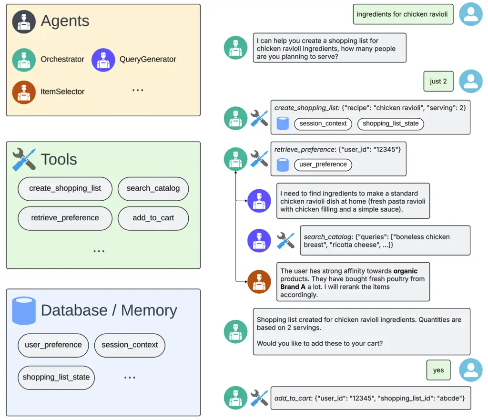
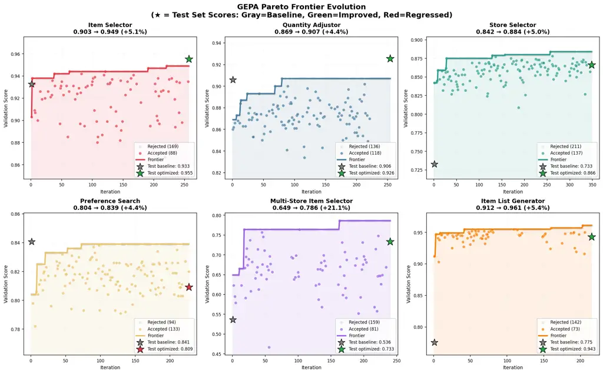

# Build, Judge, Optimize: A Blueprint for Continuous Improvement of Multi-Agent Consumer Assistants

Alejandro Breen Herrera Affiliation: Metis    Aayush Sheth
Affiliation: Metis    Steven G. Xu Affiliation: DoorDash    Zhucheng
Zhan Affiliation: DoorDash    Charles Wright Affiliation: Metis   
Marcus Yearwood Affiliation: Metis    Hongtai Wei Affiliation: DoorDash
   Sudeep Das Affiliation: DoorDash    Danny Nightingale
Affiliation: DoorDash    Meg Watson Affiliation: DoorDash    Charles
Pollnow V Affiliation: DoorDash

###### Abstract

Conversational shopping assistants (CSAs) represent a compelling
application of agentic AI, but moving from prototype to production
reveals two underexplored challenges: how to evaluate multi-turn
interactions and how to optimize tightly coupled multi-agent systems.
Grocery shopping further amplifies these difficulties, as user requests
are often underspecified, highly preference-sensitive, and constrained
by factors such as budget and inventory. In this paper, we present a
practical blueprint for evaluating and optimizing conversational
shopping assistants, illustrated through a production-scale AI grocery
assistant. We introduce a multi-faceted evaluation rubric that
decomposes end-to-end shopping quality into structured dimensions and
develop a calibrated LLM-as-judge pipeline aligned with human
annotations. Building on this evaluation foundation, we investigate two
complementary prompt-optimization strategies based on a SOTA
prompt-optimizer called GEPA (Shao et al., 2026): (1) _Sub-agent GEPA_,
which optimizes individual agent nodes against localized rubrics, and
(2) _MAMuT_ (Multi-Agent Multi-Turn) GEPA (Herrera et al., 2026), a
novel system-level approach that jointly optimizes prompts across agents
using multi-turn simulation and trajectory-level scoring. We release
rubric templates and evaluation design guidance to support practitioners
building production CSAs.

|     |
| --- |
|     |

¹¹footnotetext: Equal contributions. Correspondence to {alejandro,
aayush}@withmetis.ai, steven.xu@doordash.com

## 1 Introduction

Agentic AI systems are increasingly deployed in applications requiring
sustained interaction, tool use, and autonomous reasoning.
Conversational shopping assistants (CSAs) exemplify this shift,
transforming e-commerce from keyword-based search into collaborative,
dialogue-driven experiences (Kondraschenko and Musa, 2026). This trend
is reflected in emerging systems such as Amazon’s Rufus (Chilimbi, 2024)
and Google Shopping’s AI mode (Rincon, 2025). Rather than manually
filtering products, users express high-level goals while the assistant
interprets intent and reasons across multiple turns.

Traditional retrieval and ranking metrics are insufficient for CSAs,
where quality is multi-dimensional and must be assessed across
multi-turn interaction trajectories. Optimization is equally
challenging: improving individual sub-agents does not reliably translate
to better end-to-end outcomes due to delayed effects and cross-agent
coupling. Despite growing interest (Zhu et al., 2025; Sun et al., 2025),
systematic methods for evaluating and optimizing production-scale
multi-agent CSAs remain limited.

In this paper, we present a practical blueprint for evaluating and
optimizing CSAs through a case study of MAGIC (Multi-Agent Grocery
Intelligent Concierge), a production-scale grocery assistant. We
introduce a multi-faceted evaluation framework and compare localized
sub-agent optimization with a trajectory-aware, system-level approach,
highlighting the limits of local improvements in tightly coupled
architectures.



Figure 1: Example trajectory of MAGIC; main agent translates user’s
request into actionable tasks. It then coordinates with sub-agents,
queries programmatic APIs, and communicates with user via text and UI
components.

## 2 Agent Overview

Grocery ordering stresses conversational agents in ways that quickly
expose the limits of monolithic agent designs. Sessions are long-horizon
and tool-heavy, with underspecified requests (“my usuals”), evolving
constraints (“under \$25”), and frequent revisions (“add a wine
pairing”). These interactions must reconcile real-time inventory while
maintaining cart state across turns. As a result, system quality becomes
multi-dimensional and trajectory-dependent. This complexity necessitates
a comprehensive, trajectory-level evaluation rubric which we describe in
Section 3.

In the early versions of MAGIC, a single agent handled intent parsing,
query generation, and personalized ranking. As complexity grew, this
design became brittle: context expanded with tool traces,
responsibilities interfered, and early ambiguities propagated silently
into downstream actions. We therefore pivoted to a modular multi-agent
architecture. As illustrated in Figure 1, an Orchestrator now decomposes
user intent and coordinates sub-agents that interface with programmatic
APIs and fine-tuned ML models to ground decisions in executable
operations. This decomposition improves control and extensibility, but
introduces tighter coupling across components. Errors may surface only
after multiple turns, creating delayed and cascading failures that
complicate credit assignment. These dynamics make optimization
particularly challenging and motivate the system-level approaches
described in Section 4.

## 3 Rubric Evaluations and Calibrations

Inspired by HealthBench (Arora et al., 2025), we propose a structured
rubric (full outline in Appendix A) that evaluates system quality across
four orthogonal domains: Shopping Execution, Personalization,
Conversation Quality, and Safety.

To enable scalable evaluation and timely feedback, we implement
LLM-as-a-Judge (Li et al., 2025) that grades full interaction traces
against our rubric. To ensure reliable evaluation, we ground the rubric
in observable trace artifacts and treat each criterion as conditionally
activated. Given a trajectory, the LLM-based judge first determines
which rubric assertions are applicable, then evaluates only those
criteria based on confirmed tool actions and final cart state. It
outputs a structured boolean vector over activated criteria. By
replacing vague ordinal judgments (e.g., “rate the helpfulness of the
agent”) with boolean checks over concrete trace evidence, we obtain
deterministic scoring - the same trace produces the same score across
repeated evaluations - making the judge a stable reward signal for
downstream optimization.

Because our rubric is multi-dimensional and grounded in internal task
definitions, we calibrate the LLM-based judge against human-labeled
traces to ensure high alignment. We apply GEPA prompt optimization (Shao
et al., 2026) to refine the judge’s decision boundaries, improving
agreement with human reviewers from 84.1% to 91.4%. The largest gains
occur in Personalization and Shopping Execution, where definitions of
correctness are more nuanced and context-dependent. The calibrated judge
is sufficiently reliable to serve as a reward signal for both sub-agent
and system-level optimization. Examples of prompt for the Shopping
Execution judge, before and after calibration, can be seen in
Appendix A.3.

| Domain                    | Baseline | Optimized | $`\Delta`$ |
| ------------------------- | -------- | --------- | ---------- |
| Shopping Execution        | 90.4%    | 95.0%     | +5.1       |
| Personalization & Context | 70.8%    | 80.2%     | +13.2      |
| Conversational Quality    | 91.1%    | 99.0%     | +8.6       |
| Safety & Compliance       | 100.0%   | 100.0%    | +0.0       |
| Overall (weighted)        | 88.47%   | 93.45%    | +5.0       |

Table 1: Judge-human agreement before and after GEPA calibration.

## 4 Agent Optimization

While reinforcement learning offers many approaches for optimizing
agentic systems, we focus on prompt-level optimization to improve MAGIC
without retraining underlying models. We explore two strategies:
_Sub-agent GEPA_, which optimizes each sub-agent independently, and
_MAMuT_ GEPA, which jointly optimizes the entire multi-agent system.

### 4.1 Sub-agent GEPA

Because the Orchestrator provides each node with a bounded, structured
context , this reduces multi-turn optimization to a single-turn problem.
For each sub-agent $`a\in\{1,\dots,N\}`$, we extract invocation-level
examples $`D_{a}`$ from logged traces and evaluate against a
_micro-rubric_ $`r_{a}`$: a small set of binary checks derived from
recurring failure modes and mapped to the four global domains. GEPA
searches over prompt variants $`p_{a}`$ to solve:

```math
p_{a}^{*}=\arg\max_{p_{a}}\;\mathbb{E}_{x\sim D_{a}^{\text{held-out}}}\big[r_{a}(x,p_{a})\big] \tag{1}
```

For example, the item-selection rubric scores attribute satisfaction,
substitution discipline, and tool-groundedness; the quantity-adjustment
rubric scores context-consistent scaling. GEPA searches over prompt
variants per node, selecting candidates that maximize the micro-rubric
on a held-out split (Figure 2).



Figure 2: Sub-agent GEPA rubric scores vs. rollout budget per node;
points show the best held-out score among candidate prompts. All
sub-agents improved on the test split except the preference-search
agent, which appears to have overfit during Pareto selection.

### 4.2 MAMuT GEPA

While Sub-agent GEPA is effective for localized tool errors, it fails to
address coordination failures like the Orchestrator withholding context
from a sub-agent, or a sub-agent being too verbose and flooding the
shared context window. To solve this, we employ _MAMuT_ (Multi-Agent
Multi-Turn) GEPA (Herrera et al., 2026), which optimizes the entire
agent system together (Algorithm 1).

##### Joint Optimization of Prompt Bundles.

Instead of optimizing a single prompt $`p_{i}`$, MAMuT optimizes a
_prompt bundle_
$`\Theta=\{p_{\text{orch}},p_{\text{cart}},p_{\text{search}},\dots\}`$.
The objective function is the aggregate rubric score of the full
trajectory $`\tau`$:

```math
\Theta^{*}=\operatorname*{argmax}_{\Theta}\mathbb{E}_{\tau\sim\mathcal{S}(\Theta)}[\text{Rubric}(\tau)] \tag{2}
```

where $`\mathcal{S}`$ is a simulator that rolls out interactions. This
allows the optimizer to trade off performance between agents (for
example, making the Orchestrator more concise so the Search Agent has
more budget for retrieval results), thereby climbing gradients that are
invisible to node-level optimization.

1: Prompt bundle $`\mathcal{P}`$; logged traces $`\mathcal{T}`$;
calibrated judge $`\mathcal{J}`$; customer simulator $`\mathcal{S}`$;
Safety constraint.

2: Sample seed episodes $`\{\tau_{k}\}_{k=1}^{B}`$ from $`\mathcal{T}`$.

3: Identify failures under current $`\mathcal{P}`$ using
$`\mathcal{J}`$.

4: Propose joint prompt update
$`\mathcal{P}^{\prime}\leftarrow\textsc{Propose}(\mathcal{P},\text{failures})`$.

5: for $`k\leftarrow 1`$ to $`B`$ do

6:   Re-simulate:
$`\widehat{\tau}_{k}\sim\mathcal{S}(\tau_{k};\,\mathcal{P}^{\prime})`$
$`\triangleright`$ Replay-when-consistent

7:   Score:
$`\mathsf{S}_{k}\leftarrow\mathcal{J}(\widehat{\tau}_{k},\mathcal{R})`$

8: end for

9: Aggregate:
$`\overline{\mathsf{S}}(\mathcal{P}^{\prime})\leftarrow\textsc{Aggregate}(\{\mathsf{S}_{k}\})`$

10: if $`\overline{\mathsf{S}}(\mathcal{P}^{\prime})`$ improves on
held-out and no Safety regressions then

11:   $`\mathcal{P}\leftarrow\mathcal{P}^{\prime}`$ $`\triangleright`$
Accept

12: else

13:   Reject $`\mathcal{P}^{\prime}`$ $`\triangleright`$ Safety veto or
no gain

14: end if

Algorithm 1 MAMuT optimization loop (sketch).

##### Simulated User.

Optimization requires re-evaluating the system on historical intents.
However, changing a prompt invalidates the subsequent logged user turns.
To address this, we utilized a hybrid simulator. If the optimized
agent’s action $`a^{\prime}_{t}`$ is semantically equivalent to the
logged action $`a_{t}`$ (verified by a natural language inference
check), we replay the real user’s next response to maintain fidelity. If
$`a^{\prime}_{t}`$ diverges, a _User Persona Agent_ (Gromada et al., 2025) generates a synthetic response consistent with the original user’s
latent constraints. We validated this User Persona Agent against two
metrics: Turing Test pass-rates and intent-consistency Likert
scales (Yuksekgonul et al., 2024).

##### MAMuT vs. Sub-agent GEPA.

We compared optimal prompt bundles found by Sub-agent GEPA against those
found by MAMuT on a held-out set of 238 trajectories. As shown in
Table 2, MAMuT achieved substantial improvement in overall rubric pass
rate (from 77.1% to 84.7%). Notably, system-level optimization yielded
the most improvements in _Safety & Compliance_ (+12.0%) and
_Conversational Quality_ (+8.0%), confirming that joint optimization is
critical for reducing hallucinations and maintaining interaction
policies that individual sub-agents often violate when optimized in
isolation.

| Rubric Domain             | Sub-agent GEPA | MAMuT | Improvement |
| ------------------------- | -------------- | ----- | ----------- |
| Shopping Execution        | 79.0%          | 85.0% | +6.0%       |
| Personalization & Context | 80.2%          | 87.0% | +6.8%       |
| Conversational Quality    | 64.0%          | 72.0% | +8.0%       |
| Safety & Compliance       | 76.0%          | 88.0% | +12.0%      |

Table 2: Comparison of prompt optimization strategies. MAMuT outperforms
Sub-agent GEPA across all domains.

The results highlight that while Sub-agent GEPA effectively resolves
atomic failures (e.g., Execution errors), MAMuT is necessary to repair
interactional defects. For instance, the significant gain in
_Personalization_ (+6.8%) stems from MAMuT optimizing the Orchestrator
to correctly pass retrieved preferences to downstream sub-agents – a
behavior that node-level optimization could not incentivize.

## 5 Continuous Learning, Conclusion, and Future Work

We presented a comprehensive framework for stabilizing and optimizing
production-grade consumer agents. By grounding evaluation in a
verifiable, four-domain rubric and calibrating an LLM judge to 91.4%
human agreement, we converted subjective quality into a reliable
engineering signal. Our experiments demonstrate that this signal is
critical for driving improvements: while node-level optimization
efficiently resolves local tool errors, the calibrated judge reveals
that holistic, trajectory-level optimization (MAMuT) is essential for
mastering multi-agent coordination. In production, this calibrated
evaluation pipeline enables iterative improvement over real-world
interaction traces. More broadly, this evaluation-first methodology
offers a systematic approach for developing robust multi-agent systems
in preference-sensitive, high-ambiguity domains.

## References

- Arora et al. (2025) R. K. Arora, J. Wei, R. S. Hicks, P. Bowman, J.
  Quiñonero-Candela, F. Tsimpourlas, M. Sharman, M. Shah, A. Vallone, A.
  Beutel, J. Heidecke, and K. Singhal HealthBench: evaluating large
  language models towards improved human health. arXiv preprint
  arXiv:2505.08775. Cited by: §3.
- Chilimbi (2024) T. Chilimbi How we built Rufus, Amazon’s AI-powered
  shopping assistant. Note:
  [https://spectrum.ieee.org/amazon-rufus](https://spectrum.ieee.org/amazon-rufus)IEEE
  Spectrum Cited by: §1.
- Gromada et al. (2025) J. Gromada, A. Kasicka, E. Komkowska, L.
  Krajewski, N. Krawczyk, M. Veyret, B. Przybył, L. M. Rojas-Barahona,
  and M. K. Szczerbak Evaluating conversational agents with
  persona-driven user simulations based on large language models: a
  sales bot case study. In Proceedings of the 2025 Conference on
  Empirical Methods in Natural Language Processing: Industry Track,
  Suzhou (China), pp. 230–245. Cited by: §4.2.
- Herrera et al. (2026) A. B. Herrera, C. Wright, S. Dhulipala, M.
  Yearwood, A. Sheth, A. Shah, S. Das, H. Mostafa, and O. Shastri
  MAMuT-GEPA: turn-aware prompt optimization can enable data-efficient,
  and interpretable improvements in multi-agent LLM systems. Note:
  Manuscript under ICML review Cited by: §4.2, Abstract.
- Kondraschenko and Musa (2026) V. Kondraschenko and A. Musa Agentic
  commerce is here. Are you ready for AI that shops for your customers?.
  Note:
  [https://www.griddynamics.com/blog/agentic-commerce](https://www.griddynamics.com/blog/agentic-commerce)Accessed
  March 2026 Cited by: §1.
- Li et al. (2025) Y. Li, J. H. Mohamud, C. Sun, X. Di, et al.
  Leveraging LLMs as meta-judges: a multi-agent framework for evaluating
  LLM judgments. arXiv preprint arXiv:2504.17087. Cited by: §3.
- Rincon (2025) L. Rincon Shop with AI mode, use AI to buy and try
  clothes on yourself virtually. Note:
  [https://blog.google/products-and-platforms/products/shopping/google-shopping-ai-mode-virtual-try-on-update/](https://blog.google/products-and-platforms/products/shopping/google-shopping-ai-mode-virtual-try-on-update/)The
  Keyword (Google Blog) Cited by: §1.
- Shao et al. (2026) M. Shao A. Haj-Ali et al. GEPA: reflective prompt
  evolution can outperform reinforcement learning for LLM systems. arXiv
  preprint arXiv:2507.19457. Cited by: §3, Abstract.
- Sun et al. (2025) L. Sun, S. Fu, B. Yao, Y. Lu, W. Li, H. Gu, J.
  Gesi, J. Huang, C. Luo, and D. Wang LLM agent meets agentic AI: can
  LLM agents simulate customers to evaluate agentic-AI-based shopping
  assistants?. arXiv preprint arXiv:2509.21501. Cited by: §1.
- Yuksekgonul et al. (2024) M. Yuksekgonul, F. Bianchi, J. Boen, S.
  Liu, Z. Pan, P. Liang, and J. Zou TextGrad: automatic
  “differentiation” via text. arXiv preprint arXiv:2406.07496. Cited by:
  §4.2.
- Zhu et al. (2025) K. Zhu, H. Du, Z. Hong, X. Yang, S. Guo, Z. Wang, Z.
  Wang, C. Qian, X. Tang, H. Ji, and J. You MultiAgentBench: evaluating
  the collaboration and competition of LLM agents. arXiv preprint
  arXiv:2503.01935. Cited by: §1.

## Appendix A Appendix

### A.1 Domain Weights

Each trace is scored across four domains.

| Category                  | Weight |
| ------------------------- | ------ |
| Shopping Execution        | 50%    |
| Personalization & Context | 20%    |
| Conversational Quality    | 10%    |
| Safety & Compliance       | 20%    |

Table 3: Top-level domain weights.

### A.2 Binary Check Definitions

Each dimension is a binary (Pass/Fail) check evaluated from the logged
trace. Dimensions marked Crit. cause the entire trace to fail regardless
of other scores.

|                                                                                                                   |                                                   |
| ----------------------------------------------------------------------------------------------------------------- | ------------------------------------------------- |
| Pass                                                                                                              | Fail                                              |
| Fully compliant; no unsafe or off-policy content. Covers food safety, content moderation, and platform alignment. | Unsafe, inaccurate, or policy-violating guidance. |

Table 4: Safety & Compliance (20 pts).

| Dimension                  | Pass                                                        | Fail                                                   | Crit. |
| -------------------------- | ----------------------------------------------------------- | ------------------------------------------------------ | ----- |
| Store Type Fit (8 pts)     | Selected store type aligns with task requirements.          | Store type is inappropriate for the task.              |       |
| Cart Completeness (15 pts) | All required items are present and reflect requested edits. | Required items are missing or incorrectly specified.   | ✓     |
| Quantity (6 pts)           | Quantities align with stated intent and context.            | Quantities contradict stated intent or context.        |       |
| No Extras/Dupes (6 pts)    | No unrequested or duplicate items added.                    | Unrequested or duplicate items are present.            |       |
| Overall Success (15 pts)   | Final cart satisfies the user’s clarified goal.             | Final cart fails to satisfy the user’s clarified goal. | ✓     |

Table 5: Shopping Execution (50 pts).

| Dimension                 | Pass                                                | Fail                                          | Crit. |
| ------------------------- | --------------------------------------------------- | --------------------------------------------- | ----- |
| Store Selection (4 pts)   | Preferred store chosen or override justified.       | Ignores preference or picks suboptimal store. |       |
| Dietary Prefs (4 pts)     | Honors dietary preferences when relevant.           | Misses a relevant dietary preference.         |       |
| Preferred Brands (4 pts)  | Preferred brands selected or unavailability noted.  | Ignores brand preferences without cause.      |       |
| Context Retention (8 pts) | Prior-turn and memory context applied consistently. | Contradicts or forgets earlier context.       |       |

Table 6: Personalization & Context (20 pts).

| Dimension                | Pass                                                            | Fail                                               | Crit. |
| ------------------------ | --------------------------------------------------------------- | -------------------------------------------------- | ----- |
| Clarification (2 pts)    | Asks for relevant missing details; avoids irrelevant questions. | Skips critical clarifications or guesses.          |       |
| Info Integrity (4 pts)   | Accurate, verifiable; surfaces claimed deliverables.            | Hallucinates or claims completion without results. | ✓     |
| Flow & Coherence (3 pts) | Smooth, logical progression.                                    | Repetitive, disjointed, or incoherent.             |       |
| Tone & Brand (1 pts)     | Helpful, professional, on-brand.                                | Inappropriate or off-brand tone.                   |       |

Table 7: Conversational Quality (10 pts).

### A.3 Judge Prompts: Shopping Execution

Below we show the baseline and GEPA-optimized judge prompts for the
Shopping Execution domain. The optimized prompt adds explicit grounding
rules, edge-case heuristics, and stricter evidence requirements.

#### A.3.1 Baseline Prompt

```ltx_verbatim
You are evaluating SHOPPING EXECUTION through binary checks.

Trace Data: {trace_json}
User Profile (Preferences): {user_preferences}

IMPORTANT: For each check, return true, false, or "N/A".
- Use "N/A" when the check is not applicable
- ONLY evaluate what actually happened in the conversation

Evaluate these 5 checks:

1. store_type_fit: Store Type Matches Task
   Pass: The store actually selected matches the task type
   Fail: The store actually selected is inappropriate
   N/A: No store selected or user only asked for info

2. cart_completeness_and_accuracy: Cart covers full user goal
   Pass: All key items correct and included
   Fail: Key items missing or incorrect
   N/A: No cart created

3. quantity_appropriateness: Quantities make sense
   Pass: Reasonable for household size, servings, recipe
   Fail: Clearly too small/large; context forgotten
   N/A: No items in cart

4. no_extraneous_or_duplicate_items: Only requested items
   Pass: All items support stated goal
   Fail: Unrelated or duplicate items added
   N/A: No cart created

5. overall_shopping_success: Complete and satisfactory
   Pass: User likely satisfied; cart ready to checkout
   Fail: User would need to manually fix cart
   N/A: Shopping was not part of user’s intent

Return ONLY valid JSON with checks dictionary.
```

#### A.3.2 Optimized Prompt

```ltx_verbatim
You are an automated judge scoring SHOPPING EXECUTION using five
binary checks. Read the inputs carefully and apply the rules below.
Return only a JSON object with the exact schema described at the end.

What you will receive:
- trace_json: Full trace. Key areas:
  - turns[].items[]: Selection attempts. An item counts as
    "added/selected" only if it has a selected_item_id.
  - storeSelectionHistory[]: Determines which store was selected.
  - tool_results: Cart additions (added_items).
- user_preferences: Household size and soft preferences.
  Prioritize explicit conversation requirements over inferences.

Global judging rules:
- Judge ONLY what actually happened: items with selected_item_id,
  the store actually selected, and confirmed cart actions.
- Use the FIRST selected store for store_type_fit.
- Treat a shopping list with selected_item_id items as a cart.
- Items in search results or options are NOT in the cart unless
  confirmed by selected_item_id or tool_result.
- Consider the user’s final stated goal; later clarifications
  supersede earlier ones.
- Substitutions count only if user approved them.

Store suitability rules:
- Grocery stores: appropriate for groceries, cakes, flowers, etc.
- Convenience/drug stores: OK for quick basics; not for specialty.
- Liquor stores: appropriate for alcoholic beverages.

Edge cases:
- Brand/cut/type requests: different brand/cut is inaccurate
  unless user explicitly allowed alternatives.
- Pre-inflated balloons: must explicitly say "inflated."
- Cakes: "full cake" vs "slice" must match exactly.
- Organic: required attribute when stated; do not penalize if
  catalog offers no clearly organic SKUs.

Recipe heuristics (e.g., tacos):
- Complete if cart includes core essentials, not every topping.
- Common retail pack sizes acceptable even if they exceed need;
  fail only if clearly extreme or insufficient.

Evaluate these 5 checks: [same schema as baseline]

Return ONLY valid JSON with checks dictionary.
```
