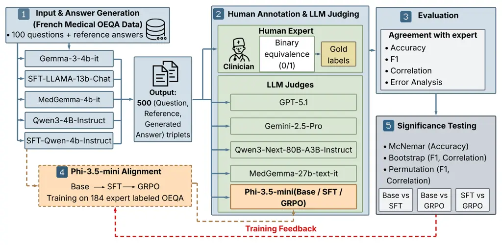
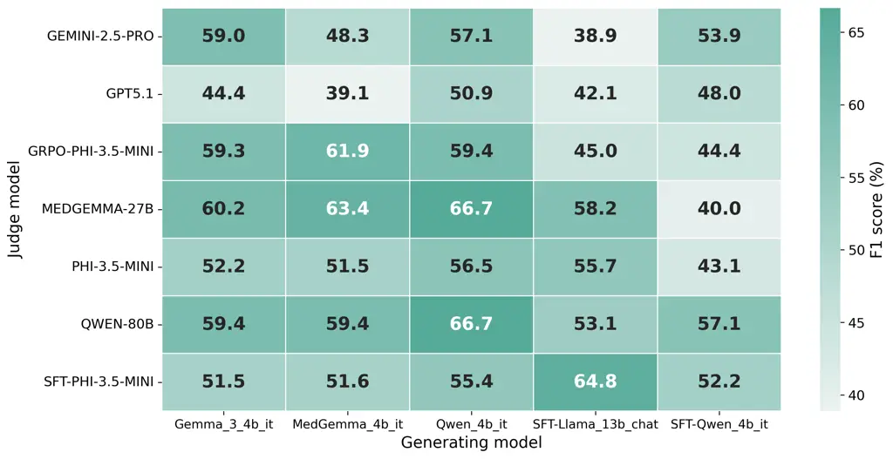
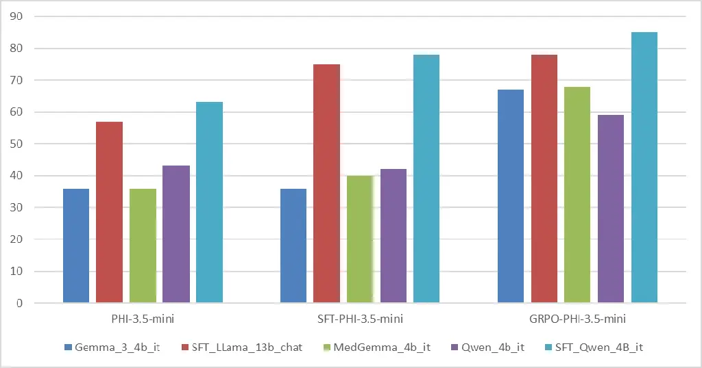

# Who Judges the Judge? Evaluating LLM-as-a-Judge for French Medical open-ended QA

Ikram Belmadani Affiliation:  Aix-Marseille Univ., CNRS, LIS UMR 7020,
13000 Marseille, France    Oumaima El Khettari    Pacôme Constant dit
Beaufils Richard Dufour Affiliation:  Nantes Univ., École Centrale
Nantes, CNRS, LS2N, UMR 6004, 44000 Nantes, France Affiliation:  Nantes
Université, CHU Nantes, PHU 11: Santé PubliqueClinique des données,
INSERM, CIC 1413, 44000 Nantes, France Affiliation:  Nantes Université,
CNRS, INSERM, L’institut du thorax, 44000 Nantes, France    Benoit Favre
Affiliation:  Aix-Marseille Univ., CNRS, LIS UMR 7020, 13000 Marseille,
France Affiliation:  Université Grenoble Alpes, CNRS, INRIA, Grenoble
INPLIG UMR 5217, 38100 Grenoble,
FranceCorrespondence:[{first.last}@{univ-amu.fr, univ-nantes.fr,
chu-nantes.fr}](mailto:email@domain)

###### Abstract

Automatic evaluation of medical open-ended question answering (OEQA)
remains challenging due to the need for expert annotations. We evaluate
whether large language models (LLMs) can act as judges of semantic
equivalence in French medical OEQA, comparing closed-access,
general-purpose, and biomedical domain-adapted models. Our results show
that LLM-based judgments are strongly influenced by the model that
generated the answer, with agreement varying substantially across
generators. Domain-adapted and large general-purpose models achieve the
highest alignment with expert annotations. We further show that
lightweight adaptation of a compact model using supervised fine-tuning
(SFT) and Group Relative Policy Optimization (GRPO) substantially
improves performance and reduces generator sensitivity, even with
limited data. Overall, our findings highlight the need for
generator-aware evaluation and suggest that carefully adapted small
models can support scalable evaluation in low-resource medical settings.

¹¹footnotetext: Equal contribution.



Figure 1: Overview of the evaluation and alignment pipeline. French
medical OEQA questions are answered by multiple LLM generators and
annotated by a clinician for binary semantic equivalence. LLM evaluators
judge the same instances using an identical prompt. A lightweight
evaluator (Phi-3.5-mini) is further aligned via SFT and GRPO, and
improvements are validated through paired significance testing.

## 1 Introduction

Automatically evaluating OEQA systems in specialized domains such as
medicine remains a major challenge. Correctness depends on semantic
fidelity, factual accuracy, and clinical relevance rather than surface
similarity, making automatic metrics such as BLEU (Papineni et al.,
2002), ROUGE (Lin, 2004), or BERTScore (Zhang et al., 2019) poorly
suited for capturing medically valid paraphrases or detecting subtle but
clinically meaningful errors. As a consequence, progress in medical LLM
development critically depends on reliable evaluation. Yet, most current
evaluation pipelines rely on multiple-choice QA (MCQA) benchmarks such
as PubMedQA (Jin et al., 2019), MedQA (Jin et al., 2021), and
MedMCQA (Pal et al., 2022). These benchmarks evaluate classification
performance, where the model selects the correct option from a
predefined set, rather than generating a clinically valid free-form
answer. As a result, strong MCQA performance does not necessarily
reflect a model’s ability to perform open-ended medical reasoning. OEQA
provides a more informative and clinically realistic evaluation setting,
but it is also expensive, since it requires domain experts performing
manual evaluation.

The emerging paradigm of _LLM-as-a-Judge_ offers a potential alternative
to human expert evaluation, with LLMs showing encouraging performance in
general-domain evaluation tasks (Gu et al., 2025). However, several
questions remain open in the context of medical OEQA: their reliability
in specialized medical settings, their sensitivity to the model
producing the answer, and their applicability to OEQA, a setting that
remains largely unexplored compared to MCQA-based evaluation pipelines.
Furthermore, it is unclear whether compact models can be effectively
aligned to serve as trustworthy evaluators with only limited expert
supervision, enabling more accessible and cost-efficient evaluation
workflows.

This work presents a preliminary investigation of these questions.
Although our dataset is small, the study constitutes a first step toward
scalable, domain-aware evaluation frameworks for French medical OEQA.
Focusing on French is particularly important, as it provides a testbed
for LLM-as-a-Judge evaluation beyond English and enables analysis in a
medical setting that differs from US/UK clinical practice and
terminology. These characteristics make French medical OEQA a meaningful
case for studying the robustness and transferability of LLM-based
evaluation methods and for informing larger-scale future efforts.

We structure our study around the following research questions:

- •
  RQ1: How accurately do current LLMs reproduce expert judgments of
  semantic equivalence in French medical OEQA?
- •
  RQ2: How sensitive are LLM-based evaluators to the specific answer
  generators they assess?
- •
  RQ3: Can small models be effectively aligned to act as domain-aware
  medical judges using limited expert supervision?
- •
  RQ4: Does reinforcement optimization on limited training data improve
  evaluator reliability beyond supervised fine-tuning on the same
  equivalence task?

This study offers three main contributions:

1.  1.  A systematic assessment of LLM-as-a-Judge in French medical OEQA,
        showing how different families of evaluators, closed-access,
        open-source, and biomedical models, align with expert semantic
        equivalence judgments.
2.  2.  An empirical analysis revealing that LLM judges are not
        generator-invariant, highlighting consistent evaluation biases
        linked to answer style, model family, and domain adaptation, and
        underscoring the need for generator-aware evaluation design.
3.  3.  A demonstration that compact models can be effectively adapted into
        reliable evaluators, where lightweight SFT and GRPO substantially
        improve judgment stability and alignment with medical experts,
        suggesting a viable path for low-resource, domain-specific
        evaluation.

All data and code used in this study are released publicly:
[https://github.com/ikram28/LLM-as-a-Judge-for-medical-oeqa](https://github.com/ikram28/LLM-as-a-Judge-for-medical-oeqa).

## 2 Related Work

### 2.1 Automatic Evaluation of OEQA

Automatic evaluation of OEQA has traditionally relied on lexical or
embedding-based metrics such as BLEU (Papineni et al., 2002),
ROUGE (Lin, 2004), METEOR (Banerjee and Lavie, 2005), and
BERTScore (Zhang et al., 2019). Although these metrics capture
surface-level similarity, they are insensitive to paraphrastic variation
and often fail to reflect factual correctness or reasoning quality,
resulting in weak correlation with human judgments in generative QA
settings (Liu et al., 2023). These limitations are amplified in
biomedical contexts, where clinically appropriate answers may diverge
from reference formulations and correctness depends on precise domain
knowledge (Yim et al., 2025). Medical QA thus presents unique evaluation
challenges, involving specialized terminology and subtle semantic
distinctions central to clinical validity (Berger et al., 2025). Despite
recent progress in French biomedical NLP, evaluation practices remain
underdeveloped, with most approaches still relying on lexical overlap,
limiting the reliability of current assessments (Yim et al., 2025).

### 2.2 LLM-as-a-Judge

The use of LLMs as automated evaluators, commonly referred to as
LLM-as-a-Judge, has gained significant momentum as a scalable
alternative to manual assessment. A comprehensive survey (Gu et al., 2025) highlights this paradigm’s promise for achieving consistent and
cost-effective assessment, while also underscoring the challenges of
reliability and bias control. Early work showed that GPT-4 can
approximate human judgments in tasks such as summarization and dialogue
when guided by structured prompting (Liu et al., 2023). Subsequent
studies demonstrated that LLM judges can outperform traditional metrics
in semantic evaluation tasks such as automated query parsing (Baysan et
al., 2025) and can be further stabilized through preference-based
calibration (Liu et al., 2024). Practical toolkits like  Li and Sun
(2025) have begun standardizing these methodologies for multi-criteria
evaluation.

Despite this progress, growing evidence highlights systematic biases in
LLM-based evaluators, such as a tendency to favor fluent or verbose
responses even when they are factually incorrect, as well as sensitivity
to stylistic or demographic cues unrelated to answer correctness (Ye et
al., 2025; Saito et al., 2023). These concerns are particularly acute in
domains requiring factual precision and safety.

In biomedical NLP, only a handful of studies have assessed LLMs as
judges. Some works report encouraging alignment with human annotators on
medical QA dimensions, while also noting substantial weaknesses in
subjective or safety-critical categories such as empathy, harm
assessment, and contextual clinical reasoning (Diekmann et al., 2025).
Other research highlights reduced agreement with experts on specialized
knowledge tasks, reinforcing the need for human oversight (Szymanski et
al., 2024). Additional efforts toward automated medical QA evaluation
suggest that LLMs can reduce annotation burden but remain limited in
complex or domain-specific cases (Krolik et al., 2024).

To our knowledge, no prior work has investigated LLM-as-a-Judge for
French medical OEQA. Our study complements existing work in the medical
domain by focusing on a non-English language and by framing evaluation
as a binary semantic equivalence judgment between a generated answer and
a reference, rather than graded scoring or safety annotation, thereby
broadening the scope of automated medical QA evaluation.

### 2.3 Model Alignment for Evaluation

Most LLM-as-a-judge systems rely on SFT on large GPT-4 (Achiam et al., 2023) derived judgment datasets. Prometheus (Kim et al., 2024) uses SFT
on rubric-based feedback to induce evaluation capabilities comparable to
GPT-4. JudgeLM Zhu et al. (2025) similarly applies SFT on
GPT-4–generated judgments with bias-mitigation strategies, achieving
strong agreement with its teacher judge. PandaLM (Wang et al., 2024)
also adopts an SFT approach, training a lightweight evaluator on human
preference data to offer an efficient alternative.

While these systems illustrate the effectiveness of SFT for building
evaluator models, reinforcement optimization remains largely unexplored
for judgment tasks, especially in biomedical NLP where domain expertise
and safety considerations are essential. Motivated by this gap, we apply
GRPO (Shao et al., 2024) to align a small LM
(Phi-3.5-mini-instruct (Abdin et al., 2024)) on expert French medical
OEQA annotations, exploring whether reinforcement-based alignment can
complement SFT-only approaches.

## 3 Experimental Setup

### 3.1 Task Definition

We frame the evaluation of OEQA as a binary equivalence judgment: given
a question, a ground-truth reference answer, and a candidate answer
produced by an LLM, the evaluator must decide whether the candidate is
semantically equivalent to the reference in terms of medical correctness
and clinical validity. An example of the question, its ground truth
answer, and the generated answers, are given in Appendix E. We adopt
this binary formulation for two reasons. First, it provides a practical
and cognitively light annotation protocol for the medical expert, who
can reliably determine equivalence without producing detailed rubrics or
multi-point scores. This could make large-scale expert annotation
feasible in a demanding domain. Second, binary equivalence offers a
simple and interpretable target for LLM evaluators, avoiding the
instability and ambiguity that often arise with graded scoring schemes.
It also mirrors the behavior of exact match evaluation commonly used in
multiple-choice QA: the reference answer is treated as the canonical
correct solution, and the model output is judged according to whether it
preserves the medically relevant meaning.

### 3.2 Dataset

Our study relies on two datasets: a small training set used for aligning
the evaluator model, and a larger evaluation set used to benchmark
LLM-as-a-Judge performance.

#### Training Set

The training set consists of 100 French OEQA instances scraped from
S-EDITION¹¹ 1 [https://s-editions.fr/](https://s-editions.fr/), an
online platform providing educational material for medical students. For
each question, we generated a candidate answer using a medical-adapted
version of Qwen3-4B-Instruct-2507 ²² 2
[https://huggingface.co/MedInjection-FR/QWEN-4B-ALL](https://huggingface.co/MedInjection-FR/QWEN-4B-ALL).
The clinician was then presented with the triplets (question, reference
answer, generated answer) and annotated semantic equivalence following
the protocol described in 3.1.

To increase the diversity of training signals, we constructed 42
contrastive negative examples by swapping answers between originally
positive (equivalent) and negative (non-equivalent) instances. We also
created 42 additional positive examples by paraphrasing the reference
answer with GPT-4o Achiam et al. (2023) and treating the paraphrased
version as the generated answer. This augmentation strategy expands the
range of valid equivalence patterns while maintaining strict medical
correctness. The paraphrasing prompt is provided in Appendix B.1.

#### Evaluation Set

The evaluation set contains 500 OEQA instances. We first extracted 100
questions and their reference answers from the MediQAl (Bazoge, 2025)
dataset. For each question, we then generated five answers, one from
each of five LLMs: Gemma-3-4B-Instruct (Team et al., 2025), a medically
adapted version of LLaMA-13B-Chat (referred to as SFT-LLaMA-13B-Chat,
not provided for anonymity), MedGemma-4B-Instruct (Sellergren et al.,
2025), SFT-Qwen-4B-Instruct, and Qwen3-4B-Instruct-2507 (Team, 2025).
This procedure yields 5 responses per question, resulting in 500
model-generated answers that were annotated by a board-certified
physician specialized in neurovascular medicine, with five years of
senior clinical experience.

To assess annotation consistency, a subset of 10 items was independently
annotated by a second clinician. The two annotators agreed on 9 out of
10 cases (90% agreement), with a single disagreement.

### 3.3 LLM Evaluators

We evaluate a diverse set of LLMs as judges, covering both proprietary
and open-source models, as well as general-purpose and medically adapted
architectures. The evaluator models include GPT-5.1³³ 3
[https://openai.com/index/gpt-5-1/](https://openai.com/index/gpt-5-1/),
Gemini-2.5-Pro (Comanici et al., 2025),
Qwen3-Next-80B-A3B-Instruct (Team, 2025), Phi-3.5-mini-instruct (Abdin
et al., 2024) and Medgemma-27b-text-it (Sellergren et al., 2025). This
selection enables us to examine how factors such as parameter scale,
domain specialization, and training data influence alignment with expert
medical decisions. By comparing generalist models to medically oriented
ones, we assess whether reliable factual judgment in French medical QA
is driven primarily by model size or by medical pretraining.

### 3.4 Prompting Strategies

We use a direct equivalence prompt that is strictly aligned with the
task definition and the human annotation protocol. The evaluator is
provided with the question, the reference answer, and the generated
answer, and is required to output 1 if the two answers are equivalent, 0
otherwise. Using the same formulation for both human and model
evaluation ensures conceptual consistency between annotation and
automated judging, allowing agreement scores to be interpreted directly.
This prompt also minimizes instruction complexity, reducing variability
introduced by prompt design.

For LLM evaluators, we provide an English version of the prompt since
all evaluated models are primarily trained on English and their
capabilities in French may be uneven or uncertain. This choice ensures a
more controlled and comparable evaluation across models. The full prompt
is provided in Appendix B.2.

### 3.5 Evaluation Metrics

To assess the alignment between LLM judges and the medical expert, we
use accuracy as the primary evaluation metric, capturing the overall
proportion of correct equivalence decisions. We additionally report
Pearson correlation between model predictions and human labels,
providing a rank-based measure of agreement that is insensitive to class
imbalance and reflects consistency in the relative ordering of
judgments. Beyond quantitative metrics, we conduct a targeted error
analysis by manually inspecting cases where evaluators disagree with the
clinician. This qualitative analysis aims to uncover systematic failure
modes, such as over-sensitivity to paraphrasing, unwarranted
penalization of concise but clinically valid answers, or medical
hallucinations introduced during the evaluation process.

### 3.6 LLM Alignment

Beyond evaluating existing LLM judges, we investigate whether a
lightweight model trained on a small dataset (184 instances) can be
turned into a reliable evaluator through reinforcement alignment. We
first fine-tune Phi-3.5-mini-instruct with SFT for 5 epochs, stopping
when the validation loss plateaued. We then apply GRPO for an additional
2 epochs to further align the model with expert equivalence annotations.
Importantly, the adaptation data is kept strictly disjoint from the
500-instance evaluation set. This choice avoids adapting to the
answer-generating models used at evaluation time, allowing us to assess
whether alignment improves general judgment behavior rather than
overfitting to generation biases.

The goal of this two-stage procedure (_SFT+GRPO_) is to encourage the
model not only to reproduce the expert’s binary decisions but also to
learn more stable and discriminative decision boundaries than those
obtained through SFT alone.

This experiment is an exploratory study of reinforcement-based alignment
for evaluator models in French medical OEQA. Additional ablation
experiments are reported in Appendix D, and hyperparameter details are
provided in Appendix A.

### 3.7 Statistical Significance Testing

To assess whether GRPO alignment leads to statistically significant
improvements, we conduct paired significance tests across three model
comparisons: base vs. SFT-only, base vs. GRPO-aligned, and SFT-only vs.
GRPO-aligned. All tests are performed in a paired setting on the test
set, with each model evaluated on identical test instances.

For accuracy, we use the exact McNemar test, which is appropriate for
paired binary predictions. Let $`b_{01}`$ denote the number of instances
where model A is incorrect and model B is correct, and $`b_{10}`$ the
reverse. The two-sided exact p-value is computed from the binomial
distribution over the $`b_{01}+b_{10}`$ discordant pairs.

For F1-score and correlation, we apply paired bootstrap and paired
permutation tests, as the sampling distributions of these metrics are
not analytically tractable. In the bootstrap test, we draw
$`B=10{,}000`$ samples with replacement from the test set and compute
the metric difference

```math
\Delta=m(H,P_{A})-m(H,P_{B}),
```

where $`H`$ denotes human labels and $`P_{A}`$, $`P_{B}`$ the
predictions of the two models. The p-value is estimated as

```math
p=\mathbb{P}(|\Delta^{(b)}|\geq|\Delta_{\text{obs}}|).
```

In the permutation test, we generate $`K=10{,}000`$ permutations by
randomly swapping model predictions at the instance level and
recomputing $`\Delta`$. This test evaluates the null hypothesis that
both models are exchangeable with respect to the evaluation metric.

Together, these complementary tests allow us to verify whether observed
gains from SFT and GRPO alignment are statistically reliable across
accuracy, F1-score, and correlation with expert judgments.

## 4 Results & Discussion

|                   |         |         |         |          |               |
| ----------------- | ------- | ------- | ------- | -------- | ------------- |
| Judge             | P       | R       | F1      | Accuracy | Pearson $`r`$ |
| MedGemma-27B      | 52.17   | 72.00   | 60.50   | 71.80    | 40.67         |
| Qwen-80B          | 64.62   | 56.00   | 60.00   | 77.60    | 44.77         |
| Gemini-2.5-Pro    | 65.35   | 44.00   | 52.59   | 76.20    | 38.81         |
| GPT-5.1           | 76.19   | 32.00   | 45.07   | 76.60    | 38.27         |
| Phi-3.5-mini      | 35.94   | 98.00\* | 52.59   | 47.00    | 27.49         |
| SFT-Phi-3.5-mini  | 38.81   | 91.33   | 54.47   | 54.20    | 29.79         |
| GRPO-Phi-3.5-mini | 51.91\* | 63.33   | 57.06\* | 71.40\*  | 36.33\*       |

Table 1: Agreement between LLM judges and the medical expert on binary
equivalence judgments. Best scores are shown in bold. The symbol \*
indicates the best-performing variant among the base, SFT-aligned, and
GRPO-aligned models.

We evaluate the ability of different LLMs to act as automatic judges for
semantic equivalence in French medical OEQA. Table 1 reports the
agreement metrics between each LLM judge and the expert’s annotations on
the evaluation set of 500 instances.

### 4.1 Limits of Similarity-Based Evaluation

| Metric       | Pearson $`r`$ |
| ------------ | ------------- |
| ROUGE-L      | 25.40         |
| BLEU         | 17.16         |
| BERTScore-F1 | 14.88         |

Table 2: Pearson correlation between automatic similarity metrics and
expert equivalence judgments.

To evaluate whether standard automatic metrics align with expert
annotations of answer equivalence, we compute Pearson correlations
between each metric score and binary equivalence labels assigned by
medical experts, and report the results in Table 2. ROUGE-L, BLEU and
BERTScore’s F1 exhibit weak correlations with expert judgments,
indicating that lexical overlap and embedding-based similarity are poor
indicators of clinical equivalence. In the medical QA setting,
clinically equivalent answers may differ substantially in form, while
surface-level similarity can mask missing or inaccurate clinical
information. Consequently, automatic metrics fail to differentiate
equivalent from non-equivalent answers according to expert criteria.

### 4.2 Bias Analysis Across Generating Models



Figure 2: Heatmap of F1 scores for each judge model across
answer-generating models.

Since each question is associated with multiple answers generated by
different answer-generating models, we analyze LLM judges at a finer
granularity by reporting their performance separately for each
generating model. This allows us to identify potential biases toward
specific answer styles or model families. Results are shown in the
heatmap of Figure 2, and detailed results are reported in Appendix F.1.

Overall, none of the evaluated judges is fully invariant to the source
of answer generation. All models show noticeable variation in precision,
recall, and F1 score across different generators, indicating that
LLM-based evaluation is influenced not only by semantic content but also
by characteristics of the generated answers.

Closed-access models such as GPT-5.1 and Gemini-2.5-Pro exhibit
relatively stable accuracy across generators, but their precision–recall
balance varies. In particular, both models achieve high precision but
lower recall on answers produced by fine-tuned Llama models, suggesting
a conservative tendency to reject equivalence for more concise
generations. Indeed, the fine-tuned models (Llama and Qwen) are less
verbose compared to the remaining answers generators. A table showing
the average mean of characters produced by each of the models is shown
in Appendix F.2.

MedGemma-27B shows a more consistent performance across generators,
maintaining relatively stable F1 scores for both general-purpose and
domain-adapted answers. Notably, it does not show a systematic
preference for outputs from its own model family, indicating reduced
sensitivity to surface-level variation. In contrast, Qwen-80B performs
best on answers generated by Qwen-based models and shows lower agreement
on outputs from other families, suggesting generator dependent bias.

Finally, the base Phi-3.5-mini model exhibits a strong bias toward
predicting equivalence, with very high recall but low precision. Its F1
score varies across generators, with better performance on answers from
fine-tuned Qwen and LLama models, reflecting sensitivity to differences
specific to generators.

Overall, the analysis shows that LLM-based judges are not fully
invariant to the source of generation, with noticeable variations in
agreement across different answer-generating models

### 4.3 LLM-as-a-Judge Evaluation

#### Alignment with human judgments:

Across all models, a substantial variability is observed in alignment
with the manual annotations. The best performing evaluators in terms of
balanced agreement are MedGemma-27B and Qwen-80B, achieving the highest
F1 scores (60.5% and 60% respectively) while maintaining a reasonable
accuracy. These models also obtain the highest Pearson correlations,
which suggests that they best capture the relative structure of expert
judgment beyond simple label matching. Interestingly, MedGemma-27B is
substantially smaller than Qwen-80B, yet it has been specifically
adapted to the biomedical domain, whereas Qwen-80B is a larger,
general-purpose model without such specialization.

In contrast, GPT-5.1, despite its remarkable performance on a diversity
of tasks, is surpassed by both MedGemma and Qwen in balanced agreement
with the expert annotations. While GPT-5.1 achieves high precision
(76.2%), its recall is very low (32.0%), reflecting a conservative
tendency to reject equivalence. This suggests that even state-of-the-art
general-purpose models may struggle in domain-specific evaluation. In
the same scope of closed-access models, Gemini-2.5-Pro, a thinking LLM,
achieves a more balanced performance resulting in an F1 score of 52.6%,
and an accuracy of 76.2%. Shifting to the smallest open-source model in
the evaluation, Phi-3.5-mini, with only 3.8B parameters, achieves
competitive performance. The model exhibits very high recall (98.0%) but
the lowest precision, yielding an F1 score of 52.6% and an accuracy of
47.0%. This is primarily caused by its tendency to over-predict the
positive class (409 positives), which contrasts with the behavior
observed in the other models.

#### Correlation with expert judgments:

Pearson correlation provides a complementary view of alignment that is
less sensitive to class imbalance. Once again, Qwen and MedGemma achieve
the highest correlations, indicating that they not only match individual
labels more accurately but also better preserve the relative ordering of
equivalence decisions across instances. Models with extreme
precision/recall imbalance exhibit notably lower correlations,
suggesting that biased decision strategies negatively impact global
alignment with expert reasoning.

### 4.4 Lightweight adaptation strategies

#### Overall Results:

We selected Phi-3.5 for adaptation experiments for two main reasons.
First, its compact size (3.8B parameters) makes it suitable for
low-resource settings, where the available training data does not exceed
100 instances. Second, its base behavior differs markedly from the other
models, exhibiting extremely high recall and low precision due to
over-predicting the positive class (409 positives). The goal of these
experiments is to assess whether lightweight fine-tuning can
significantly improve performance under data scarcity.

Applying SFT alone yields a moderate improvement: the model partially
corrects its tendency to overgenerate positive predictions, improving
the F1 score to 54.47% (Table 1). However, the most substantial gains
are obtained after the additional GRPO adaptation step. This procedure
further balances precision and recall, correcting the over-prediction of
positives, bringing its overall performance above GPT and Gemini, and
achieving an F1 score close to that of MedGemma. These results highlight
that even extremely lightweight LLMs can achieve competitive evaluation
performance when adapted to domain-specific tasks in low-resource
scenarios.



Figure 3: Comparison of F1 scores of Phi models on the text generated by
multiple LLMs

#### Impact of adaptation strategies on generating models:

To better understand how SFT and GRPO affect Phi-3.5-mini, we analyze
its predictions on instances generated by each of the 5 answer
generators. Results are shown in Figure 3. Overall, the predictions are
better on the less verbose models, the fine-tuned Llama and Qwen. Before
any adaptation, Phi’s equivalence predictions were roughly similar for
instances generated by Gemma-3-4B and MedGemma-4B, while instances
generated by the base Qwen-4B achieved slightly higher equivalence. The
finetuned Llama-13B instances surpassed the later, and the highest
performance was observed on instances generated by the finetuned Qwen-4B
model.

Applying SFT had the largest effect on instances generated by the
finetuned Llama and finetuned Qwen models, partially correcting Phi’s
over-prediction of positives. With the GRPO step, further light
improvements are observed on these same instances, but the most
significant gains occur for predictions on the remaining generations,
particularly those from the Gemma family, bringing their equivalence
predictions closer to those of the finetuned Qwen instances. Overall,
these results indicate that lightweight adaptation not only improves
Phi’s balance between precision and recall but also reduces variability
across different types of generated instances, with the greatest impact
on domain-relevant or underperforming generations.

#### Significance testing:

As shown in Table 3, McNemar’s exact test indicates a significant
reduction in classification errors for both SFT and GRPO compared to the
base model, with GRPO yielding the largest improvement. The difference
between SFT and GRPO is also significant, confirming that GRPO provides
additional corrective effects beyond supervised fine-tuning. However,
bootstrap and permutation tests on F1 and correlation (Tables 6 and 5)
do not show statistically significant differences ($`p>0.1`$),
suggesting that the adapted judges behave similarly in terms of
positive-class performance and overall correlation with human
annotations. Taken together, these results indicate that
GRPO-Phi-3.5-mini is clearly superior in terms of overall classification
accuracy, but its improvements do not translate into substantially
better handling of the positive (equivalent) class.

[TABLE]

Table 3: McNemar test results for accuracy differences between the base,
SFT-only, and GRPO-aligned evaluators on the test set.

In conclusion, the results show that LLM judges are sensitive to the
source of generated answers, with substantial variation in precision,
recall, and F1 scores across different generators. Closed-access and
general-purpose models such as GPT-5.1 and Gemini-2.5-Pro maintain
stable accuracy but exhibit imbalanced decision behavior, often
over-rejecting equivalence for certain answer styles. Domain-adapted
models like MedGemma-27B achieve more consistent performance and reduced
generator-dependent bias, while Qwen-80B performs best on answers from
its own family, highlighting some preferential behavior. Smaller models,
exemplified by Phi-3.5-mini, initially over-predict equivalence, but
lightweight adaptation via SFT and GRPO significantly improves the
balance between precision and recall, and reduces variability across
generators. These findings underscore that both model size and
adaptation strategy impact reliability as automatic judges, with
carefully adapted models achieving performance and alignment comparable
to larger or domain-specialized LLMs.

## 5 Conclusion

This work presents a preliminary investigation into the use of LLMs as
judges for evaluating semantic equivalence in French medical OEQA. Our
results demonstrate that current LLM judges vary widely in their
alignment with expert annotations and are strongly influenced by the
model that generated the answer being evaluated. Domain-adapted models
such as MedGemma-27B achieve more consistent agreement with expert
judgments than general-purpose models, which exhibit stronger
generator-dependent biases. These results raise the question of whether
current LLM judges are sufficiently accurate to be trusted beyond
auxiliary evaluation roles. We further showed that compact models can be
transformed into effective evaluators with minimal supervision.
Lightweight SFT and GRPO substantially improved the performance of
Phi-3.5-mini, reducing variability across generators and achieving
agreement levels comparable to much larger domain-adapted models.
Significance testing confirmed that GRPO provides statistically
meaningful gains in overall correctness, though improvements remain
limited for positive-class detection.

While our dataset is small, this study provides evidence that
generator-aware evaluation and alignment strategies are essential
components for building reliable medical LLM judges in low-resource
settings. Future work will scale the dataset, extend the evaluation to
richer clinical tasks, explore multilingual generalization, and
investigate more advanced optimization methods for robust,
domain-specialized evaluators.

## Limitations

Although our findings provide initial insights into the feasibility of
LLM-as-a-Judge for French medical OEQA, several limitations must be
acknowledged.

First, the study relies on a relatively small number of expert
annotations. While sufficient to reveal systematic trends, such as
generator-dependent biases and the impact of lightweight adaptation, the
dataset is not large enough to capture the full variability of medical
reasoning or to provide stable estimates of performance across all
metrics. This also limits the statistical power of tests based on F1
score and correlation.

Second, our evaluation focuses exclusively on binary semantic
equivalence. This simplifies the annotation process but does not capture
more nuanced errors related to incompleteness, misleading statements,
style, or clinical safety. A richer annotation schema would allow a more
comprehensive assessment of LLM evaluators in real clinical QA settings.

Third, while our analysis highlights that Qwen-based judges exhibit a
bias toward the Qwen generator family, we do not conduct a comparable
bias analysis for other judges such as Phi-3.5 or GPT-5.1, as these
models are used exclusively as evaluators and not as generators.
Consequently, the absence of observed bias for these judges should not
be interpreted as evidence of neutrality, but rather as an untested
assumption, which may lead to overly optimistic expectations regarding
their robustness as evaluators.

Fourth, we do not evaluate the judges in multilingual or cross-domain
contexts. The conclusions drawn here may not generalize beyond French
medical OEQA, particularly given the strong generator-dependence
observed. Larger and more diverse datasets are needed to understand how
widely these findings extend.

Finally, the alignment experiments are limited to one compact model
(Phi-3.5-mini) and use only SFT and GRPO. Other preference optimization
methods, additional reward formulations, or more diverse supervision
signals may yield further improvements.

Despite these limitations, the study offers actionable insights and
establishes a foundation for more extensive future work in scalable
medical OEQA evaluation.

## Ethical Considerations

This work focuses on the evaluation of medical question answering
systems and does not involve deploying LLMs for clinical
decision-making. All medical judgments used in this study were provided
by qualified clinicians acting in a research capacity, and the
annotations reflect assessments of semantic equivalence rather than
medical advice.

The datasets used consist of publicly available educational and
benchmark resources, and no personally identifiable patient information
was accessed or generated. The annotation protocol was designed to
minimize cognitive load and risk for clinicians by using a binary
equivalence task, and annotation was conducted independently of any
downstream clinical application.

We emphasize that the LLM-based evaluators studied here exhibit only
moderate agreement with expert judgments and are not suitable for use as
autonomous evaluators in clinical or safety-critical settings. Their
role is limited to supporting large-scale or exploratory evaluation,
where expert review remains indispensable. Over-reliance on automated
judges in medical contexts could obscure clinically meaningful errors,
particularly given the generator-dependent biases identified in our
analysis.

Finally, while our study explores lightweight adaptation of evaluator
models, we intentionally keep training and evaluation data disjoint to
reduce risks of overfitting to annotator or generator biases. All
results are reported transparently, and code and data are released to
encourage reproducibility and scrutiny. We view this work as a
preliminary step toward more robust and ethically grounded evaluation
frameworks for medical LLMs.

## Acknowledgments

This work was financially supported by ANR MALADES (ANR-23-IAS1-0005).
It was provided with computing HPC and storage resources by GENCI at
IDRIS thanks to the grants 2025-AD011015256R1 and 2025-AD011016540 on
the supercomputer Jean Zay’s H100 partition.

## References

- Abdin et al. (2024) M. Abdin, J. Aneja, H. Awadalla, A.
  Awadallah, A. A. Awan, N. Bach, A. Bahree, A. Bakhtiari, J. Bao, H.
  Behl, A. Benhaim, M. Bilenko, J. Bjorck, S. Bubeck, M. Cai, Q. Cai, V.
  Chaudhary, D. Chen, D. Chen, W. Chen, Y. Chen, Y. Chen, H. Cheng, P.
  Chopra, X. Dai, M. Dixon, R. Eldan, V. Fragoso, J. Gao, M. Gao, M.
  Gao, A. Garg, A. D. Giorno, A. Goswami, S. Gunasekar, E. Haider, J.
  Hao, R. J. Hewett, W. Hu, J. Huynh, D. Iter, S. A. Jacobs, M.
  Javaheripi, X. Jin, N. Karampatziakis, P. Kauffmann, M. Khademi, D.
  Kim, Y. J. Kim, L. Kurilenko, J. R. Lee, Y. T. Lee, Y. Li, Y. Li, C.
  Liang, L. Liden, X. Lin, Z. Lin, C. Liu, L. Liu, M. Liu, W. Liu, X.
  Liu, C. Luo, P. Madan, A. Mahmoudzadeh, D. Majercak, M.
  Mazzola, C. C. T. Mendes, A. Mitra, H. Modi, A. Nguyen, B. Norick, B.
  Patra, D. Perez-Becker, T. Portet, R. Pryzant, H. Qin, M. Radmilac, L.
  Ren, G. de Rosa, C. Rosset, S. Roy, O. Ruwase, O. Saarikivi, A.
  Saied, A. Salim, M. Santacroce, S. Shah, N. Shang, H. Sharma, Y.
  Shen, S. Shukla, X. Song, M. Tanaka, A. Tupini, P. Vaddamanu, C.
  Wang, G. Wang, L. Wang, S. Wang, X. Wang, Y. Wang, R. Ward, W. Wen, P.
  Witte, H. Wu, X. Wu, M. Wyatt, B. Xiao, C. Xu, J. Xu, W. Xu, J.
  Xue, S. Yadav, F. Yang, J. Yang, Y. Yang, Z. Yang, D. Yu, L. Yuan, C.
  Zhang, C. Zhang, J. Zhang, L. L. Zhang, Y. Zhang, Y. Zhang, Y. Zhang,
  and X. Zhou Phi-3 technical report: a highly capable language model
  locally on your phone. External Links: 2404.14219,
  [Link](https://arxiv.org/abs/2404.14219) Cited by: §2.3, §3.3.
- Achiam et al. (2023) J. Achiam, S. Adler, S. Agarwal, L. Ahmad, I.
  Akkaya, F. L. Aleman, D. Almeida, J. Altenschmidt, S. Altman, S.
  Anadkat, et al. Gpt-4 technical report. arXiv preprint
  arXiv:2303.08774. Cited by: §2.3, §3.2.
- Banerjee and Lavie (2005) S. Banerjee and A. Lavie METEOR: an
  automatic metric for MT evaluation with improved correlation with
  human judgments. In Proceedings of the ACL Workshop on Intrinsic and
  Extrinsic Evaluation Measures for Machine Translation and/or
  Summarization, J. Goldstein, A. Lavie, C. Lin, and C. Voss (Eds.), Ann
  Arbor, Michigan, pp. 65–72. External Links:
  [Link](https://aclanthology.org/W05-0909/) Cited by: §2.1.
- Baysan et al. (2025) M. S. Baysan, S. Uysal, İ. İşlek, Ç. Çığ Karaman,
  and T. Güngör LLM-as-a-judge: automated evaluation of search query
  parsing using large language models. Frontiers in Big Data Volume 8 - 2025. External Links:
  [Link](https://www.frontiersin.org/journals/big-data/articles/10.3389/fdata.2025.1611389),
  [Document](https://dx.doi.org/10.3389/fdata.2025.1611389), ISSN
  2624-909X Cited by: §2.2.
- Bazoge (2025) A. Bazoge MediQAl: a french medical question answering
  dataset for knowledge and reasoning evaluation. arXiv preprint
  arXiv:2507.20917. Cited by: §3.2.
- Berger et al. (2025) A. Berger, S. Khanna, D. Berghaus, and R. Sifa
  Reasoning llms in the medical domain: a literature survey. External
  Links: 2508.19097, [Link](https://arxiv.org/abs/2508.19097) Cited by:
  §2.1.
- Comanici et al. (2025) G. Comanici, E. Bieber, M. Schaekermann, I.
  Pasupat, N. Sachdeva, I. Dhillon, M. Blistein, O. Ram, D. Zhang, E.
  Rosen, et al. Gemini 2.5: pushing the frontier with advanced
  reasoning, multimodality, long context, and next generation agentic
  capabilities. arXiv preprint arXiv:2507.06261. Cited by: §3.3.
- Diekmann et al. (2025) Y. Diekmann, C. Fensore, R. Carrillo-Larco, E.
  Castejon Rosales, S. Shiromani, R. Pai, M. Shah, and J. Ho LLMs as
  medical safety judges: evaluating alignment with human annotation in
  patient-facing QA. In Proceedings of the 24th Workshop on Biomedical
  Language Processing, D. Demner-Fushman, S. Ananiadou, M. Miwa, and J.
  Tsujii (Eds.), Viena, Austria, pp. 217–224. External Links:
  [Link](https://aclanthology.org/2025.bionlp-1.19/),
  [Document](https://dx.doi.org/10.18653/v1/2025.bionlp-1.19), ISBN
  979-8-89176-275-6 Cited by: §2.2.
- Gu et al. (2025) J. Gu, X. Jiang, Z. Shi, H. Tan, X. Zhai, C. Xu, W.
  Li, Y. Shen, S. Ma, H. Liu, S. Wang, K. Zhang, Y. Wang, W. Gao, L. Ni,
  and J. Guo A survey on llm-as-a-judge. External Links: 2411.15594,
  [Link](https://arxiv.org/abs/2411.15594) Cited by: §1, §2.2.
- Jin et al. (2021) D. Jin, E. Pan, N. Oufattole, W. Weng, H. Fang,
  and P. Szolovits What disease does this patient have? a large-scale
  open domain question answering dataset from medical exams. Applied
  Sciences 11 (14), pp. 6421. Cited by: §1.
- Jin et al. (2019) Q. Jin, B. Dhingra, Z. Liu, W. Cohen, and X. Lu
  PubMedQA: a dataset for biomedical research question answering. In
  Proceedings of the 2019 Conference on Empirical Methods in Natural
  Language Processing and the 9th International Joint Conference on
  Natural Language Processing (EMNLP-IJCNLP), K. Inui, J. Jiang, V. Ng,
  and X. Wan (Eds.), Hong Kong, China, pp. 2567–2577. External Links:
  [Link](https://aclanthology.org/D19-1259/),
  [Document](https://dx.doi.org/10.18653/v1/D19-1259) Cited by: §1.
- Kang et al. (2025) X. Kang, S. Wu, Z. Wang, Y. Liu, X. Jin, K.
  Huang, W. Wang, Y. Yue, X. Huang, and Q. Wang Can GRPO boost complex
  multimodal table understanding?. In Proceedings of the 2025 Conference
  on Empirical Methods in Natural Language Processing, C.
  Christodoulopoulos, T. Chakraborty, C. Rose, and V. Peng (Eds.),
  Suzhou, China, pp. 12642–12655. External Links:
  [Link](https://aclanthology.org/2025.emnlp-main.637/),
  [Document](https://dx.doi.org/10.18653/v1/2025.emnlp-main.637), ISBN
  979-8-89176-332-6 Cited by: Appendix D.
- Kim et al. (2024) S. Kim, J. Shin, Y. Cho, J. Jang, S. Longpre, H.
  Lee, S. Yun, S. Shin, S. Kim, J. Thorne, and M. Seo Prometheus:
  inducing fine-grained evaluation capability in language models. In The
  Twelfth International Conference on Learning Representations, External
  Links: [Link](https://openreview.net/forum?id=8euJaTveKw) Cited by:
  §2.3.
- Krolik et al. (2024) J. Krolik, H. Mahal, F. Ahmad, G. Trivedi, and B.
  Saket Towards leveraging large language models for automated medical
  q&a evaluation. External Links: 2409.01941,
  [Link](https://arxiv.org/abs/2409.01941) Cited by: §2.2.
- Li and Sun (2025) Y. Li and Y. Sun EasyJudge: an easy-to-use tool for
  comprehensive response evaluation of LLMs. In Proceedings of the 31st
  International Conference on Computational Linguistics: System
  Demonstrations, O. Rambow, L. Wanner, M. Apidianaki, H.
  Al-Khalifa, B. D. Eugenio, S. Schockaert, B. Mather, and M. Dras
  (Eds.), Abu Dhabi, UAE, pp. 91–103. External Links:
  [Link](https://aclanthology.org/2025.coling-demos.10/) Cited by: §2.2.
- Lin (2004) C. Lin ROUGE: a package for automatic evaluation of
  summaries. In Text Summarization Branches Out, Barcelona, Spain,
  pp. 74–81. External Links: [Link](https://aclanthology.org/W04-1013/)
  Cited by: §1, §2.1.
- Liu et al. (2023) Y. Liu, D. Iter, Y. Xu, S. Wang, R. Xu, and C. Zhu
  G-eval: NLG evaluation using gpt-4 with better human alignment. In
  Proceedings of the 2023 Conference on Empirical Methods in Natural
  Language Processing, H. Bouamor, J. Pino, and K. Bali (Eds.),
  Singapore, pp. 2511–2522. External Links:
  [Link](https://aclanthology.org/2023.emnlp-main.153/),
  [Document](https://dx.doi.org/10.18653/v1/2023.emnlp-main.153) Cited
  by: §2.1, §2.2.
- Liu et al. (2024) Y. Liu, T. Yang, S. Huang, Z. Zhang, H. Huang, F.
  Wei, W. Deng, F. Sun, and Q. Zhang Calibrating LLM-based evaluator. In
  Proceedings of the 2024 Joint International Conference on
  Computational Linguistics, Language Resources and Evaluation
  (LREC-COLING 2024), N. Calzolari, M. Kan, V. Hoste, A. Lenci, S.
  Sakti, and N. Xue (Eds.), Torino, Italia, pp. 2638–2656. External
  Links: [Link](https://aclanthology.org/2024.lrec-main.237/) Cited by:
  §2.2.
- Pal et al. (2022) A. Pal, L. K. Umapathi, and M. Sankarasubbu MedMCQA:
  a large-scale multi-subject multi-choice dataset for medical domain
  question answering. In Proceedings of the Conference on Health,
  Inference, and Learning, G. Flores, G. H. Chen, T. Pollard, J. C. Ho,
  and T. Naumann (Eds.), Proceedings of Machine Learning Research, Vol.
  174, pp. 248–260. External Links:
  [Link](https://proceedings.mlr.press/v174/pal22a.html) Cited by: §1.
- Papineni et al. (2002) K. Papineni, S. Roukos, T. Ward, and W. Zhu
  Bleu: a method for automatic evaluation of machine translation. In
  Proceedings of the 40th Annual Meeting of the Association for
  Computational Linguistics, P. Isabelle, E. Charniak, and D. Lin
  (Eds.), Philadelphia, Pennsylvania, USA, pp. 311–318. External Links:
  [Link](https://aclanthology.org/P02-1040/),
  [Document](https://dx.doi.org/10.3115/1073083.1073135) Cited by: §1,
  §2.1.
- Saito et al. (2023) K. Saito, A. Wachi, K. Wataoka, and Y. Akimoto
  Verbosity bias in preference labeling by large language models. ArXiv
  abs/2310.10076. External Links:
  [Link](https://api.semanticscholar.org/CorpusID:264147087) Cited by:
  §2.2.
- Sellergren et al. (2025) A. Sellergren, S. Kazemzadeh, T.
  Jaroensri, A. Kiraly, M. Traverse, T. Kohlberger, S. Xu, F. Jamil, C.
  Hughes, C. Lau, et al. Medgemma technical report. arXiv preprint
  arXiv:2507.05201. Cited by: §3.2, §3.3.
- Shao et al. (2024) Z. Shao, P. Wang, Q. Zhu, R. Xu, J. Song, X. Bi, H.
  Zhang, M. Zhang, Y. Li, Y. Wu, et al. Deepseekmath: pushing the limits
  of mathematical reasoning in open language models. arXiv preprint
  arXiv:2402.03300. Cited by: Appendix D, §2.3.
- Szymanski et al. (2024) A. Szymanski, N. Ziems, H. A.
  Eicher-Miller, T. J. Li, M. Jiang, and R. A. Metoyer Limitations of
  the llm-as-a-judge approach for evaluating llm outputs in expert
  knowledge tasks. External Links: 2410.20266,
  [Link](https://arxiv.org/abs/2410.20266) Cited by: §2.2.
- Team et al. (2025) G. Team, A. Kamath, J. Ferret, S. Pathak, N.
  Vieillard, R. Merhej, S. Perrin, T. Matejovicova, A. Ramé, M.
  Rivière, L. Rouillard, T. Mesnard, G. Cideron, J. Grill, S. Ramos, E.
  Yvinec, M. Casbon, E. Pot, I. Penchev, G. Liu, F. Visin, K.
  Kenealy, L. Beyer, X. Zhai, A. Tsitsulin, R. Busa-Fekete, A. Feng, N.
  Sachdeva, B. Coleman, Y. Gao, B. Mustafa, I. Barr, E. Parisotto, D.
  Tian, M. Eyal, C. Cherry, J. Peter, D. Sinopalnikov, S.
  Bhupatiraju, R. Agarwal, M. Kazemi, D. Malkin, R. Kumar, D. Vilar, I.
  Brusilovsky, J. Luo, A. Steiner, A. Friesen, A. Sharma, A.
  Sharma, A. M. Gilady, A. Goedeckemeyer, A. Saade, A. Feng, A.
  Kolesnikov, A. Bendebury, A. Abdagic, A. Vadi, A. György, A. S.
  Pinto, A. Das, A. Bapna, A. Miech, A. Yang, A. Paterson, A. Shenoy, A.
  Chakrabarti, B. Piot, B. Wu, B. Shahriari, B. Petrini, C. Chen, C. L.
  Lan, C. A. Choquette-Choo, C. Carey, C. Brick, D. Deutsch, D.
  Eisenbud, D. Cattle, D. Cheng, D. Paparas, D. S. Sreepathihalli, D.
  Reid, D. Tran, D. Zelle, E. Noland, E. Huizenga, E. Kharitonov, F.
  Liu, G. Amirkhanyan, G. Cameron, H. Hashemi, H. Klimczak-Plucińska, H.
  Singh, H. Mehta, H. T. Lehri, H. Hazimeh, I. Ballantyne, I.
  Szpektor, I. Nardini, J. Pouget-Abadie, J. Chan, J. Stanton, J.
  Wieting, J. Lai, J. Orbay, J. Fernandez, J. Newlan, J. Ji, J.
  Singh, K. Black, K. Yu, K. Hui, K. Vodrahalli, K. Greff, L. Qiu, M.
  Valentine, M. Coelho, M. Ritter, M. Hoffman, M. Watson, M.
  Chaturvedi, M. Moynihan, M. Ma, N. Babar, N. Noy, N. Byrd, N. Roy, N.
  Momchev, N. Chauhan, N. Sachdeva, O. Bunyan, P. Botarda, P.
  Caron, P. K. Rubenstein, P. Culliton, P. Schmid, P. G. Sessa, P.
  Xu, P. Stanczyk, P. Tafti, R. Shivanna, R. Wu, R. Pan, R. Rokni, R.
  Willoughby, R. Vallu, R. Mullins, S. Jerome, S. Smoot, S. Girgin, S.
  Iqbal, S. Reddy, S. Sheth, S. Põder, S. Bhatnagar, S. R. Panyam, S.
  Eiger, S. Zhang, T. Liu, T. Yacovone, T. Liechty, U. Kalra, U.
  Evci, V. Misra, V. Roseberry, V. Feinberg, V. Kolesnikov, W. Han, W.
  Kwon, X. Chen, Y. Chow, Y. Zhu, Z. Wei, Z. Egyed, V. Cotruta, M.
  Giang, P. Kirk, A. Rao, K. Black, N. Babar, J. Lo, E. Moreira, L. G.
  Martins, O. Sanseviero, L. Gonzalez, Z. Gleicher, T. Warkentin, V.
  Mirrokni, E. Senter, E. Collins, J. Barral, Z. Ghahramani, R.
  Hadsell, Y. Matias, D. Sculley, S. Petrov, N. Fiedel, N. Shazeer, O.
  Vinyals, J. Dean, D. Hassabis, K. Kavukcuoglu, C. Farabet, E.
  Buchatskaya, J. Alayrac, R. Anil, Dmitry, Lepikhin, S. Borgeaud, O.
  Bachem, A. Joulin, A. Andreev, C. Hardin, R. Dadashi, and L. Hussenot
  Gemma 3 technical report. External Links: 2503.19786,
  [Link](https://arxiv.org/abs/2503.19786) Cited by: §3.2.
- Team (2025) Q. Team Qwen3 technical report. External Links:
  2505.09388, [Link](https://arxiv.org/abs/2505.09388) Cited by: §3.2,
  §3.3.
- Wang et al. (2024) Y. Wang, Z. Yu, W. Yao, Z. Zeng, L. Yang, C.
  Wang, H. Chen, C. Jiang, R. Xie, J. Wang, X. Xie, W. Ye, S. Zhang,
  and Y. Zhang PandaLM: an automatic evaluation benchmark for LLM
  instruction tuning optimization. In The Twelfth International
  Conference on Learning Representations, External Links:
  [Link](https://openreview.net/forum?id=5Nn2BLV7SB) Cited by: §2.3.
- Ye et al. (2025) J. Ye, Y. Wang, Y. Huang, D. Chen, Q. Zhang, N.
  Moniz, T. Gao, W. Geyer, C. Huang, P. Chen, N. V. Chawla, and X. Zhang
  Justice or prejudice? quantifying biases in LLM-as-a-judge. In The
  Thirteenth International Conference on Learning Representations,
  External Links: [Link](https://openreview.net/forum?id=3GTtZFiajM)
  Cited by: §2.2.
- Yim et al. (2025) W. Yim, A. B. Abacha, Z. Yu, R. Doerning, F. Xia,
  and M. Yetisgen MORQA: benchmarking evaluation metrics for medical
  open-ended question answering. arXiv preprint arXiv:2509.12405. Cited
  by: §2.1.
- Zhang et al. (2019) T. Zhang, V. Kishore, F. Wu, K. Q. Weinberger,
  and Y. Artzi Bertscore: evaluating text generation with bert. arXiv
  preprint arXiv:1904.09675. Cited by: §1, §2.1.
- Zhu et al. (2025) L. Zhu, X. Wang, and X. Wang JudgeLM: fine-tuned
  large language models are scalable judges. In The Thirteenth
  International Conference on Learning Representations, External Links:
  [Link](https://openreview.net/forum?id=xsELpEPn4A) Cited by: §2.3.

## Appendix A Training Hyperparameters

Table 4 summarizes the hyperparameters used for SFT and GRPO alignment
of the Phi-3.5-mini-instruct evaluator.

| Hyperparameter               | SFT                 | GRPO                |
| ---------------------------- | ------------------- | ------------------- |
| Training set size            | 166                 | 184                 |
| Validation set size          | 18                  | –                   |
| Number of epochs             | 5                   | 2                   |
| Learning rate                | $`5\times 10^{-6}`$ | $`1\times 10^{-5}`$ |
| Batch size                   | 1                   | 1                   |
| Gradient accumulation steps  | 4                   | 4                   |
| Max sequence / prompt length | 1024                | 1024                |
| Max completion length        | –                   | 8                   |
| Learning rate scheduler      | Cosine              | –                   |
| Warmup ratio                 | 0.05                | –                   |
| Number of generations        | –                   | 4                   |

Table 4: Hyperparameters used for SFT and GRPO alignment of the Phi-3.5
evaluator.

### A.1 GRPO Reward Function

The GRPO reward combines prediction correctness and output format
constraints:

```math
R=R_{\text{correctness}}+R_{\text{format}},
```

where $`R_{\text{correctness}}=+1.0`$ if the predicted label matches the
gold label and $`-1.0`$ otherwise, and $`R_{\text{format}}=+0.5`$ if the
output is exactly 0 or 1, and $`0`$ otherwise.

## Appendix B Prompt Templates

We report the prompt templates used for data augmentation and automated
evaluation.

### B.1 Paraphrasing Prompt


### B.2 Evaluation Prompt


## Appendix C Significance Testing Results

[TABLE]

Table 5: Paired bootstrap and permutation test results for correlation
differences between the base, SFT-only, and GRPO-aligned evaluators on
the test set.

[TABLE]

Table 6: Paired bootstrap and permutation test results for F1-score
differences between the base, SFT-only, and GRPO-aligned evaluators on
the test set.

## Appendix D Additional Alignment Experiments

To better understand the effect of different alignment schedules, we
conducted several exploratory experiments combining SFT and GRPO on
Phi-3.5-mini. These experiments were designed to assess whether the
duration of SFT influence the effectiveness of subsequent
reinforcement-based alignment.

We considered three alignment variants: (i) a short SFT phase followed
by GRPO, (ii) GRPO applied directly without any prior SFT, and (iii)
extended SFT until the validation loss stabilized, followed by GRPO.
Table 7 summarizes the aggregated confusion statistics and F1 scores for
each configuration.

| Model Variant                             | TP  | FP  | TN  | FN  | F1    |
| ----------------------------------------- | --- | --- | --- | --- | ----- |
| PHI-3.5 (Base)                            | 147 | 262 | 88  | 3   | 0.526 |
| PHI-3.5 + GRPO (after SFT-60 steps)       | 142 | 246 | 104 | 8   | 0.528 |
| PHI-3.5 + GRPO (after SFT to convergence) | 95  | 88  | 262 | 55  | 0.571 |
| PHI-3.5 + GRPO (from scratch)             | 139 | 219 | 131 | 11  | 0.547 |

Table 7: Ablation of alignment schedules for Phi-3.5-mini. We compare
the base model, GRPO applied from scratch, GRPO after a short SFT
warm-up, and GRPO applied after SFT convergence. The strongest
performance is obtained when GRPO is applied after SFT loss
stabilization.

Across experiments, we observe that applying GRPO without sufficient
prior SFT leads to unstable behavior. Although direct GRPO from scratch
improves recall relative to the base model, it does not consistently
balance precision and recall, resulting in lower overall F1. A short SFT
warm-up (60 steps) before GRPO yields only marginal improvements,
suggesting that limited exposure is insufficient to meaningfully shape
the model’s decision boundaries.

The best performance is obtained when GRPO is applied _after_ SFT has
converged and the validation loss has stabilized. In this setting, SFT
appears to provide a strong initialization that clarifies the task
structure and reduces noise in the reward signal, allowing GRPO to
refine decision boundaries more effectively. This finding is consistent
with prior work on reinforcement learning for language models, which
commonly recommends an initial SFT phase to ensure instruction-following
and output format stability before applying policy optimization (Shao et
al., 2024; Kang et al., 2025).

It is worth noting that Phi-3.5-mini already follows the required binary
output format in its base form, meaning that SFT is not strictly
necessary for format compliance in our task. Instead, we hypothesize
that the main role of SFT here is to reduce variance in early GRPO
updates and anchor the policy closer to expert-labeled decision regions.
Once this stabilization is achieved, GRPO can more reliably correct
systematic biases, such as over-prediction of equivalence, leading to
the strongest overall performance.

These exploratory results motivate our final alignment strategy, which
applies GRPO only after SFT convergence. While preliminary, they suggest
that even in low-resource settings, the ordering and duration of
alignment stages play a critical role in achieving stable and reliable
evaluator behavior.

## Appendix E Illustrative Example of Semantic Equivalence

Table 8 presents an illustrative example from the evaluation set,
highlighting the challenges of assessing semantic equivalence in French
medical OEQA. The example shows multiple model-generated answers to the
same question, all judged against a single ground-truth reference by a
clinician. Despite substantial variation in formulation, verbosity, and
technical framing, several answers are annotated as equivalent,
illustrating that equivalence depends on the presence of essential
medical information rather than surface form.

|                                                                                                                                                                                                                           |
| ------------------------------------------------------------------------------------------------------------------------------------------------------------------------------------------------------------------------- |
| Question                                                                                                                                                                                                                  |
| _Citez par quels moyens réaliser une laryngoscopie indirecte ?_                                                                                                                                                           |
| Clinical Context                                                                                                                                                                                                          |
| Un homme de 60 ans consulte pour une dysphagie aux solides s’aggravant depuis 2 mois. Il a perdu 6 kg en 6 mois. L’examen ORL par laryngoscopie indirecte retrouve une lésion d’allure tumorale du sinus piriforme droit. |
| Ground Truth (Expert Reference)                                                                                                                                                                                           |
| – Au miroir (miroir laryngé avec lumière frontale, de Clar)                                                                                                                                                               |
| – Au nasofibroscope                                                                                                                                                                                                       |
| Model Answers and Expert Judgments                                                                                                                                                                                        |
| Gemma-3-4B-Instruct:                                                                                                                                                                                                      |
| _En se basant sur l’instruction médicale demandée ("Citez par quels moyens réaliser une laryngoscopie indirecte ?") et le contexte fourni (…)_                                                                            |
| La laryngoscopie indirecte, également appelée laryngoscopie par la voix ou laryngoscopie phonodynamique, est réalisée en utilisant la phonation du patient. Elle consiste à :                                             |
| 1. Poser le patient en position assise…                                                                                                                                                                                   |
| 2. Placer un otoscope…                                                                                                                                                                                                    |
| 3. Demander au patient de produire des sons vocaux…                                                                                                                                                                       |
| 4. Observer attentivement les structures laryngées…                                                                                                                                                                       |
| Important : La laryngoscopie indirecte est un outil diagnostique utile, mais elle offre une visualisation limitée.                                                                                                        |
| _Expert equivalence: Yes_                                                                                                                                                                                                 |
| _Summary: Long procedural description; essential means are indirectly covered._                                                                                                                                           |
| SFT-LLaMA-13B-Chat:                                                                                                                                                                                                       |
| La laryngoscopie indirecte peut être réalisée par endoscopie ou par examen visuel à l’aide d’un laryngoscope.                                                                                                             |
| _Expert equivalence: Yes_                                                                                                                                                                                                 |
| _Summary: Very concise answer mentioning endoscopic and visual means._                                                                                                                                                    |
| MedGemma-4B-Instruct:                                                                                                                                                                                                     |
| Pour réaliser une laryngoscopie indirecte, les étapes suivantes sont nécessaires :                                                                                                                                        |
| 1. Préparation…                                                                                                                                                                                                           |
| 2. Technique…                                                                                                                                                                                                             |
| 3. Documentation…                                                                                                                                                                                                         |
| Important: Cette réponse est basée sur l’instruction médicale fournie et ne remplace pas un avis médical professionnel.                                                                                                   |
| _Expert equivalence: Yes_                                                                                                                                                                                                 |
| _Summary: Structured procedural explanation; means are implied rather than explicitly listed._                                                                                                                            |
| Qwen-4B-Instruct:                                                                                                                                                                                                         |
| La laryngoscopie indirecte est réalisée en utilisant un miroir et une lumière…                                                                                                                                            |
| En résumé :                                                                                                                                                                                                               |
| – L’utilisation d’un miroir de laryngoscopie indirecte                                                                                                                                                                    |
| – Une source de lumière                                                                                                                                                                                                   |
| _Expert equivalence: Yes_                                                                                                                                                                                                 |
| _Summary: Explicit mention of the expected instruments._                                                                                                                                                                  |
| SFT-Qwen-4B-Instruct:                                                                                                                                                                                                     |
| L’irrigation de la langue, du pharynx et du larynx                                                                                                                                                                        |
| _Expert equivalence: No_                                                                                                                                                                                                  |
| _Summary: Incorrect procedure; does not correspond to indirect laryngoscopy._                                                                                                                                             |

Table 8: Illustrative example of semantic equivalence judgments in
French medical OEQA. Answers with widely different formulations, levels
of detail, and terminology can still be judged equivalent by the
clinician as long as the essential medical content is preserved, while
concise but incorrect answers are rejected.

This example illustrates why surface-level automatic metrics are
insufficient for medical OEQA evaluation. Answers that differ
substantially in wording or verbosity may remain clinically valid,
whereas superficially similar responses can fail to convey the required
medical meaning.

## Appendix F Detailed Results for Judge Bias Analysis

### F.1 Overall Results

| Judge             | Generator          | Accuracy | P      | R      | F1    | Spearman $`\rho`$ |
| ----------------- | ------------------ | -------- | ------ | ------ | ----- | ----------------- |
| GEMINI-2.5-PRO    | Gemma-3-4B-IT      | 75.00    | 69.23  | 51.43  | 59.02 | 42.54             |
| GEMINI-2.5-PRO    | SFT-LLaMA-13B-Chat | 78.00    | 100.00 | 24.14  | 38.89 | 42.93             |
| GEMINI-2.5-PRO    | MedGemma-4B-IT     | 70.00    | 58.33  | 41.18  | 48.28 | 28.87             |
| GEMINI-2.5-PRO    | Qwen-4B-IT         | 70.00    | 60.61  | 54.05  | 57.14 | 34.31             |
| GEMINI-2.5-PRO    | SFT-Qwen-4B        | 88.00    | 63.64  | 46.67  | 53.85 | 47.89             |
| GPT-5.1           | Gemma-3-4B-IT      | 75.00    | 100.00 | 28.57  | 44.44 | 45.43             |
| GPT-5.1           | SFT-LLaMA-13B-Chat | 78.00    | 88.89  | 27.59  | 42.11 | 41.51             |
| GPT-5.1           | MedGemma-4B-IT     | 72.00    | 75.00  | 26.47  | 39.13 | 31.96             |
| GPT-5.1           | Qwen-4B-IT         | 71.00    | 68.18  | 40.54  | 50.85 | 34.30             |
| GPT-5.1           | SFT-Qwen-4B        | 87.00    | 60.00  | 40.00  | 48.00 | 42.01             |
| MEDGEMMA-27B      | Gemma-3-4B-IT      | 67.00    | 52.08  | 71.43  | 60.24 | 34.41             |
| MEDGEMMA-27B      | SFT-LLaMA-13B-Chat | 77.00    | 61.54  | 55.17  | 58.18 | 42.50             |
| MEDGEMMA-27B      | MedGemma-4B-IT     | 70.00    | 54.17  | 76.47  | 63.41 | 40.90             |
| MEDGEMMA-27B      | Qwen-4B-IT         | 66.00    | 52.31  | 91.89  | 66.67 | 43.21             |
| MEDGEMMA-27B      | SFT-Qwen-4B        | 79.00    | 35.00  | 46.67  | 40.00 | 28.01             |
| PHI-3.5-MINI      | Gemma-3-4B-IT      | 36.00    | 35.35  | 100.00 | 52.24 | 7.37              |
| PHI-3.5-MINI      | SFT-LLaMA-13B-Chat | 57.00    | 39.71  | 93.10  | 55.67 | 34.39             |
| PHI-3.5-MINI      | MedGemma-4B-IT     | 36.00    | 34.69  | 100.00 | 51.52 | 10.25             |
| PHI-3.5-MINI      | Qwen-4B-IT         | 43.00    | 39.36  | 100.00 | 56.49 | 19.36             |
| PHI-3.5-MINI      | SFT-Qwen-4B        | 63.00    | 28.00  | 93.33  | 43.08 | 36.41             |
| SFT-PHI-3.5-MINI  | Gemma-3-4B-IT      | 36.00    | 35.05  | 97.14  | 51.52 | 0.61              |
| SFT-PHI-3.5-MINI  | SFT-LLaMA-13B-Chat | 75.00    | 54.76  | 79.31  | 64.79 | 48.31             |
| SFT-PHI-3.5-MINI  | MedGemma-4B-IT     | 40.00    | 35.56  | 94.12  | 51.61 | 9.85              |
| SFT-PHI-3.5-MINI  | Qwen-4B-IT         | 42.00    | 38.71  | 97.30  | 55.38 | 12.91             |
| SFT-PHI-3.5-MINI  | SFT-Qwen-4B        | 78.00    | 38.71  | 80.00  | 52.17 | 44.51             |
| GRPO-PHI-3.5-MINI | Gemma-3-4B-IT      | 67.00    | 52.17  | 68.57  | 59.26 | 33.23             |
| GRPO-PHI-3.5-MINI | SFT-LLaMA-13B-Chat | 78.00    | 81.82  | 31.03  | 45.00 | 40.92             |
| GRPO-PHI-3.5-MINI | MedGemma-4B-IT     | 68.00    | 52.00  | 76.47  | 61.90 | 38.00             |
| GRPO-PHI-3.5-MINI | Qwen-4B-IT         | 59.00    | 46.88  | 81.08  | 59.41 | 27.27             |
| GRPO-PHI-3.5-MINI | SFT-Qwen-4B        | 85.00    | 50.00  | 40.00  | 44.44 | 36.20             |
| QWEN-80B          | Gemma-3-4B-IT      | 74.00    | 65.52  | 54.29  | 59.38 | 40.89             |
| QWEN-80B          | SFT-LLaMA-13B-Chat | 77.00    | 65.00  | 44.83  | 53.06 | 39.67             |
| QWEN-80B          | MedGemma-4B-IT     | 74.00    | 63.33  | 55.88  | 59.38 | 40.54             |
| QWEN-80B          | Qwen-4B-IT         | 75.00    | 65.79  | 67.57  | 66.67 | 46.68             |
| QWEN-80B          | SFT-Qwen-4B        | 88.00    | 61.54  | 53.33  | 57.14 | 50.38             |

Table 9: Detailed agreement metrics between LLM judges and the expert
annotations, broken down by answer-generating model.

Table 9 provides the detailed agreement metrics between LLM judges and
the expert annotations.

### F.2 Verbosity of Answers Generators

| Generating Model   | Mean \# Characters |
| ------------------ | ------------------ |
| Gemma-3-4B-IT      | 1852.88            |
| SFT-LLaMA-13B-Chat | 121.26             |
| MedGemma-4B-IT     | 1909.31            |
| Qwen-4B-IT         | 1620.27            |
| SFT-Qwen-4B        | 296.27             |

Table 10: Average number of characters per answer for each generating
model.
