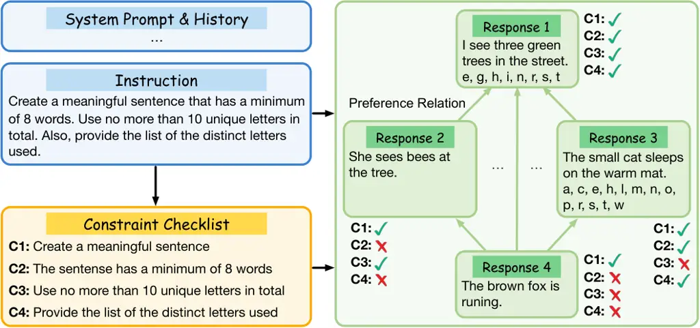
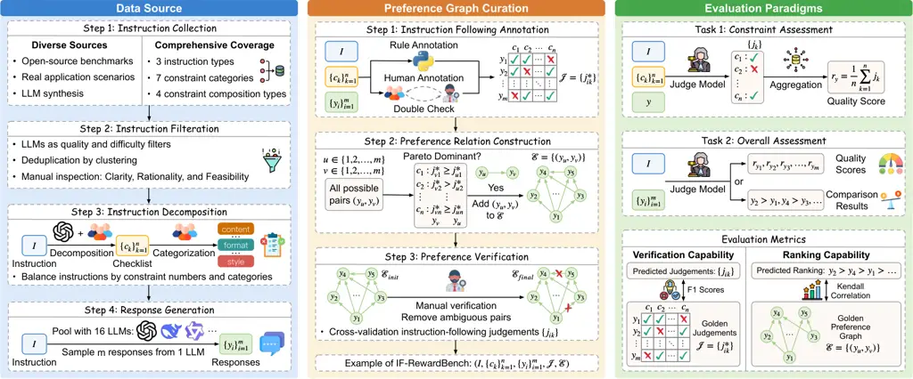
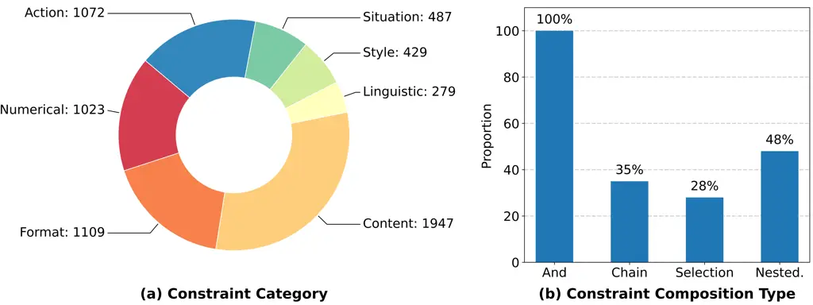
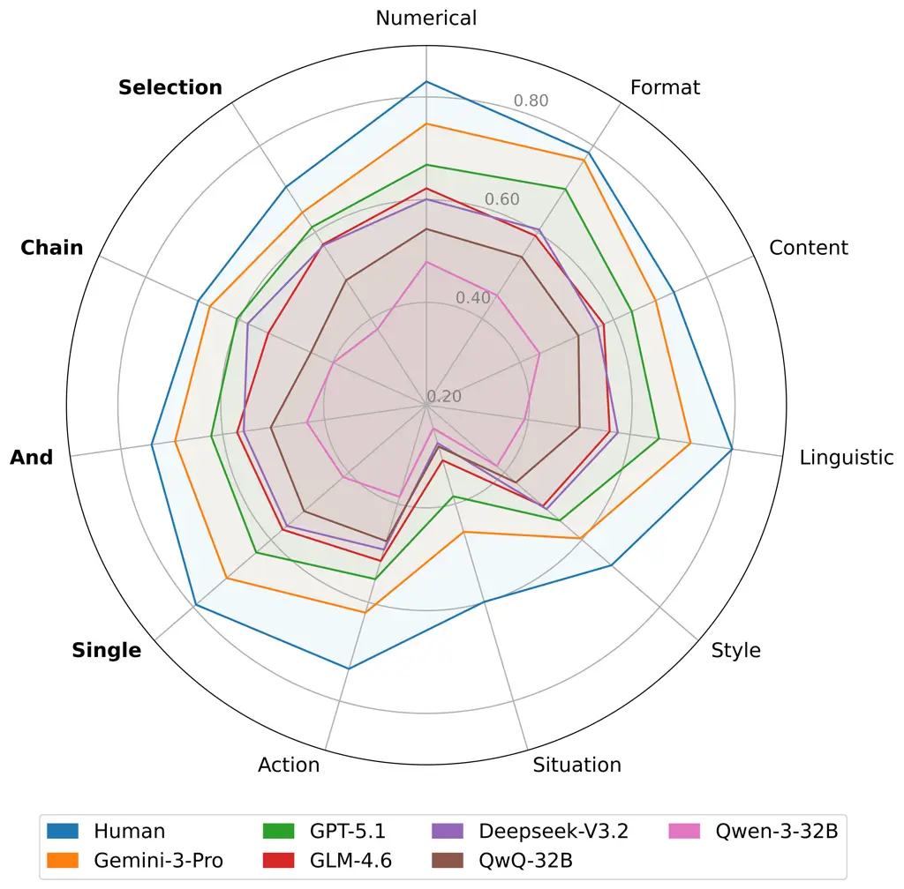
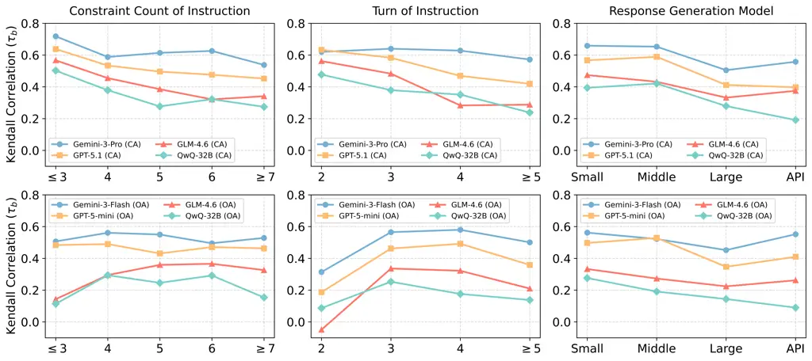
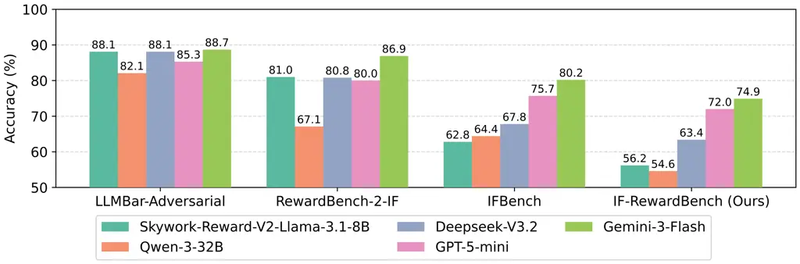
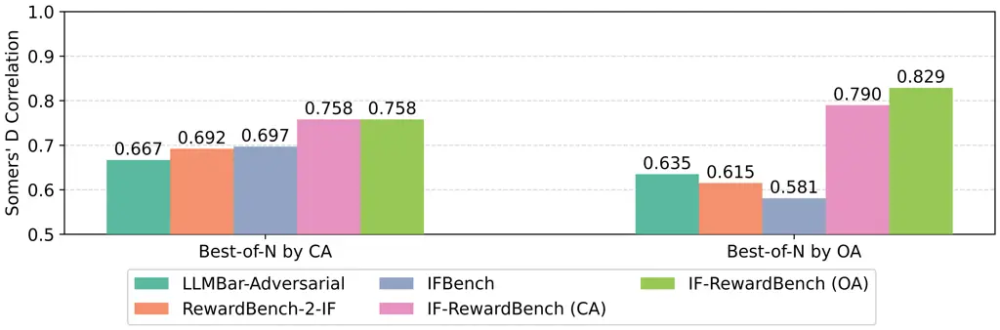

# IF-RewardBench: Benchmarking Judge Models for Instruction-Following Evaluation

Bosi Wen Affiliation: The Conversational Artificial Intelligence (CoAI)
Group, Tsinghua University Email: <wbs23@mails.tsinghua.edu.cn>    Yilin
Niu Affiliation: Zhipu AI Email: <aihuang@tsinghua.edu.cn>    Cunxiang
Wang Affiliation: Zhipu AI    Xiaoying Ling Affiliation: Zhipu AI   
Ying Zhang  Pei Ke  Hongning Wang   Minlie Huang Affiliation: The
Conversational Artificial Intelligence (CoAI) Group, Tsinghua University
Affiliation: Zhipu AI Affiliation: University of Electronic Science and
Technology of China

###### Abstract

Instruction-following is a foundational capability of large language
models (LLMs), with its improvement hinging on scalable and accurate
feedback from judge models. However, the reliability of current judge
models in instruction-following remains underexplored due to several
deficiencies of existing meta-evaluation benchmarks, such as their
insufficient data coverage and oversimplified pairwise evaluation
paradigms that misalign with model optimization scenarios. To this end,
we propose IF-RewardBench, a comprehensive meta-evaluation benchmark for
instruction-following that covers diverse instruction and constraint
types. For each instruction, we construct a preference graph containing
all pairwise preferences among multiple responses based on
instruction-following quality. This design enables a listwise evaluation
paradigm that assesses the capabilities of judge models to rank multiple
responses, which is essential in guiding model alignment. Extensive
experiments on IF-RewardBench reveal significant deficiencies in current
judge models and demonstrate that our benchmark achieves a stronger
positive correlation with downstream task performance compared to
existing benchmarks. Our codes and data are available at
[https://github.com/thu-coai/IF-RewardBench](https://github.com/thu-coai/IF-RewardBench).

^(†)^(†) ^(†)Work done when this author interned at Zhipu AI.^(†)^(†)
^(‡)Corresponding author

## 1 Introduction

Large language models (LLMs) have exhibited remarkable capabilities
across a broad range of NLP tasks Zhao et al. (2023). Among these,
instruction-following is a foundational requirement for practical LLM
applications Ouyang et al. (2022). In real-world deployments, most tasks
are formulated as an instruction-following paradigm, where human
instructions specify task requirements and impose corresponding
constraints on model outputs Jiang et al. (2024). Therefore, faithfully
following instructions is critical to ensure the reliability of LLMs and
enable their generalization to novel and complex tasks Huang et al.
(2024).

Improving this capability of LLMs hinges on an accurate evaluation of
whether model responses follow each constraint within instructions.
Rigorous evaluation not only enables reliable progress measurement and
failure modes diagnosis Wen et al. (2024); Qin et al. (2025a), but also
provides the reward signals essential for steering model alignment Peng
et al. (2025a); Qin et al. (2025b). Recently, LLM-as-a-Judge has been
widely adopted as a scalable approach for this purpose Liu et al.
(2025c); He et al. (2025). These developments underscore the need for a
systematic examination of its reliability for instruction-following
evaluation.



Figure 1: An example from IF-RewardBench, containing a user instruction,
a constraint checklist, and multiple responses with various
instruction-following quality that form a preference graph.

As previous benchmarks for judge models often focus on reasoning or
general chat, neglecting fine-grained instruction-following Tan et al.
(2025); Lambert et al. (2025), specialized benchmarks have emerged to
fill this gap Peng et al. (2025b); Malik et al. (2025). They typically
ask judge models to identify the best response from multiple candidates
that follows all constraints. Despite these efforts, they still suffer
from three serious limitations: (1) Insufficient Data Coverage: existing
benchmarks predominantly focus on single-turn instruction and narrow
constraint types (i.e., code-verifiable constraints and their And
composition) Frick et al. (2025), failing to capture the heterogeneity
of real-world user instructions, which frequently involve system
prompts, conversation history, and a diverse spectrum of constraints.
This discrepancy hinders a comprehensive and robust evaluation. (2)
Oversimplified Evaluation Paradigms: Realistic model optimization
scenarios require judge models to precisely rank multiple responses of
varying quality to derive relative reward advantages for parameter
updates Shao et al. (2024). However, prevailing pairwise or Best-of-N
(BoN) selection paradigms reduce evaluation to a winner-take-all
decision that merely identifies the single best response. This
oversimplification ignores the intricate partial order among multiple
responses and limits the assessment of the ranking capability essential
for effective alignment guidance. (3) Unreliable Ground Truth Labels:
Many existing benchmarks solely rely on judge models or evaluation
scripts to construct preference pairs without human verification,
rendering them susceptible to evaluation bias Zheng et al. (2023) and
confounding factors unrelated to instruction-following.

|                         |              |         |         |         |               |                  |               |           |                      |
| ----------------------- | ------------ | ------- | ------- | ------- | ------------- | ---------------- | ------------- | --------- | -------------------- |
| Benchmark               | Dataset Size |         |         |         | Diverse       | Instruction Type |               | Annotator | Evaluation Paradigms |
|                         | \#Inst.      | \#Resp. | \#Rela. | \#Model | Constraint    | Multi-Turn       | System Prompt |           |                      |
| LLMBar (2024)           | 419          | 836     | 419     | 3       | ✗             | ✗                | ✗             | Human     | Pairwise             |
| InfoBench (2024)        | 50           | 250     | 0       | 5       | $`\triangle`$ | ✗                | ✗             | Human     | Pointwise            |
| IFBench (2025b)         | 444          | 888     | 444     | 1       | $`\triangle`$ | ✗                | ✗             | GPT-4o    | Pairwise             |
| PPE-IF (2025)           | 512          | 16384   | 2560    | 4       | $`\triangle`$ | ✗                | ✗             | Synthetic | Paiwise & BoN        |
| RewardBench-2-IF (2025) | 160          | 640     | 480     | 5       | $`\triangle`$ | ✗                | ✗             | Synthetic | BoN                  |
| IF-RewardBench (ours)   | 842          | 6011    | 9145    | 16      | ✓             | ✓                | ✓             | Human     | Pointwise & Listwise |

Table 1: Comparisons of IF-RewardBench and other meta-evaluation
benchmarks for instruction-following. The data size contains the number
of instructions (#Inst.), responses (#Resp.), preference relations
(#Rela.), and models to generate responses (#Model). $`\triangle`$
denotes partially satisfied.

To this end, we propose IF-RewardBench, a comprehensive benchmark to
assess the capability of judge models in instruction-following
evaluation, which is characterized by three key advantages:

- •
  Comprehensive Coverage. IF-RewardBench comprises 842 instructions
  covering 3 critical instruction types: single-turn interaction,
  multi-turn interaction, and system-prompt steerability. These
  instructions include a diverse spectrum of constraints and their
  compositions. A total of 6,011 responses are generated by 16 different
  LLMs to ensure diversity.
- •
  Realistic Evaluation Paradigms. We introduce a novel listwise
  evaluation paradigm for judge models extending from pairwise or BoN
  selection. For each instruction, we collect multiple responses and
  annotate their adherence to each constraint within the instruction.
  Based on the Pareto dominance relations derived from these
  annotations, we establish all pairwise preferences among these
  responses to construct a preference graph, as shown in Figure 1. Judge
  models are required to rank these responses to best align with the
  underlying preferences, a setting that closely mirrors realistic model
  optimization scenarios.
- •
  Reliability. Each example in IF-RewardBench is annotated by multiple
  human experts and undergoes multi-step rigorous inspection, ensuring
  data quality and evaluation reliability.

We conduct a comprehensive evaluation of 22 popular judge models on
IF-RewardBench, including state-of-the-art dedicated reward models and
general LLMs. Our results highlight a substantial capability gap: even
the leading proprietary LLM, Gemini-3-Pro, achieves only a moderate
Kendall correlation of 0.609 in ranking responses, significantly falling
behind the human performance of 0.755. Top-tier open-source models, such
as GLM-4.6 and Deepseek-V3.2, remain below or near 0.4, while all
dedicated reward models fail to exceed 0.2. In-depth analysis reveals
several critical insights: (1) Although constraint-level scoring
outperforms overall pairwise comparison, the limited capacity for
detecting constraint violation remains a primary performance bottleneck.
(2) Incorporating system instructions or conversation history
exacerbates evaluation difficulty for overall pairwise comparison. (3)
Situation and Style constraints that involve subjectivity prove harder
to verify than objective ones. (4) Judge performance degrades with
increased constraint composition complexity, number of constraints
within instructions, and response quality, underscoring the growing
challenge of evaluating advanced models in complex application
scenarios. Notably, IF-RewardBench presents greater difficulty than
existing benchmarks and demonstrates a significantly stronger positive
correlation with the downstream BoN sampling performance of judge
models. These findings establish IF-RewardBench as a valuable resource
for advancing instruction-following evaluation.

## 2 Related Work

##### Instruction-Following.

As LLMs are increasingly applied to address complex real-world tasks,
instruction-following emerges as a key determinant of their practical
utility Liu et al. (2023); Lou et al. (2024), motivating extensive
efforts to evaluate and improve this capability of LLMs. For evaluation,
numerous instruction-following benchmarks have been proposed from
various perspectives. They often employ judge models to assess whether
the model response can follow each constraint in the input instruction
Jiang et al. (2024); Qin et al. (2024); Wen et al. (2024); Qin et al.
(2025a); Zhang et al. (2025b). For improvement, a growing body of work
attempts to leverage reward signals from judge models to drive
instruction-following optimization via preference or reinforcement
learning Zhang et al. (2025c); Cheng et al. (2025); Ren et al. (2025);
Liu et al. (2025c); Peng et al. (2025a); Wen et al. (2025).
Consequently, judge models serve as a linchpin in both the evaluation
and optimization pipelines. However, their reliability in this domain
remains insufficiently explored.

##### Evaluation of Judge Models.

Given the pivotal role of judge models in alignment, numerous benchmarks
have been introduced to evaluate their capability across diverse
domains, including chat Lambert et al. (2025); Zhou et al. (2025),
reasoning Tan et al. (2025), and agents Men et al. (2025); Lù et al.
(2025). These benchmarks typically curate instruction-winner-loser
triplets to assess the accuracy of judge models in making preference
judgments. For instruction-following, IFBench Peng et al. (2025b)
employs GPT-4o to synthesize preference pairs. PPE Frick et al. (2025)
and RewardBench 2 Malik et al. (2025) focus on code-verifiable
constraints derived from IFEval Zhou et al. (2023), employing both the
pairwise and BoN evaluation paradigms. However, existing benchmarks
mainly consider single-turn instructions and a narrow set of
constraints. The lack of human verification could diminish evaluation
reliability. And the pairwise or BoN evaluation paradigms may diverge
from realistic model optimization scenarios. These are the limitations
our work aims to address.

## 3 IF-RewardBench



Figure 2: Overall framework of IF-RewardBench. Left: Collect
instructions and responses from diverse sources. Center: Curate
preference graphs via multi-stage annotation and verification. Right:
Assess various judge models based on different evaluation paradigms.

### 3.1 Task Definition

To conduct a comprehensive meta-evaluation of instruction-following, we
first define the evaluation tasks and identify the core capabilities
required for effective evaluation.

#### 3.1.1 Evaluation Tasks of Judge Models

Following previous works Wen et al. (2024); Peng et al. (2025a); Ren et
al. (2025); Malik et al. (2025), we consider two prevalent
instruction-following evaluation tasks of judge models:

1\) Constraint Assessment: Given an instruction $`I`$ (which may contain
the system prompt and conversation history), a constraint checklist
$`\{c_{k}\}^{n}_{k=1}`$ derived for $`I`$, and a model response $`y`$,
the judge model is tasked to evaluate whether $`y`$ follows each
constraint $`c_{k}`$, providing a binary judgement $`j_{k}\in\{0,1\}`$
for each constraint. The instruction-following quality of $`y`$ is then
quantified as:

```math
\displaystyle r_{y}=\frac{1}{n}\sum_{k=1}^{n}j_{k} \tag{1}
```

2\) Overall Assessment: Given an instruction $`I`$ and a set of model
responses $`\{y_{i}\}_{i=1}^{m}`$, the judge model is tasked to provide
quality scores or pairwise comparison results for these responses.

#### 3.1.2 Core Capabilities of Judge Models

Ideally, a judge model should possess two core capabilities: (1)
Verification: Accurately verify each constraint in constraint
assessment, enabling granular progress tracking. (2) Ranking: Ensure
that the assessments for multiple responses (derived via Equation 1 or
directly generated) faithfully reflect the partial order of their
instruction-following quality, thereby guiding model alignment.
IF-RewardBench is designed to comprehensively evaluate judge models
across both aspects.

### 3.2 Dataset Construction

In this section, we introduce the construction of IF-RewardBench, as
illustrated in Figure 2. Each example in IF-RewardBench is structured as
a preference graph
$`(I,\{c_{k}\}_{k=1}^{n},\{y_{i}\}_{i=1}^{m},\mathcal{J},\mathcal{E})`$.
The set $`\mathcal{J}`$ contains the ground truth following judgement
$`j^{*}_{ik}`$ for each response $`y_{i}`$ to each constraint $`c_{k}`$,
providing the basis for assessing Verification. And the set
$`\mathcal{E}`$ contains all preference relations among these responses:
a directed edge $`(y_{u},y_{v})\in\mathcal{E}`$ indicates that $`y_{v}`$
has better instruction-following quality than $`y_{u}`$, providing the
basis for assessing Ranking. Unlike previous benchmarks that typically
curate a single preference pair per instruction Zeng et al. (2024);
Lambert et al. (2025); Men et al. (2025), our preference graph captures
the complex partial order among multiple responses, which better
accommodates the realistic application of judge models in alignment
guidance. To construct IF-RewardBench, we first collect instructions and
responses from diverse sources (§3.2.1), and then utilize a multi-stage
annotation and verification pipeline to curate preference graphs
(§3.2.2).

#### 3.2.1 Data Source

##### Instruction Collection.

To obtain diverse and representative instructions for benchmark
construction, we collect instructions from real-world application
scenarios and 14 open-source instruction-following benchmarks. This
collection covers a diverse spectrum of constraints and 3 critical
instruction types: single-turn interaction, multi-turn interaction, and
system-prompt steerability. Multi-turn interaction requires following
constraints carried from previous turns He et al. (2024); He et al.
(2025), while system-prompt steerability requires following system
prompts and prioritizing them over user prompts Qin et al. (2025a);
Zhang et al. (2025d). Given the scarcity of complex constraint
compositions in existing benchmarks Wen et al. (2024); Qin et al.
(2025b), we further leverage LLMs to synthesize complex instructions
based on seeds from real-world application scenarios, guided by a
comprehensive taxonomy encompassing 7 primary constraint categories
(Numerical, Format, Content, Linguistic, Style, Situation, and Action)
and 4 constraint composition types (Single, And, Chain, and Selection).
In total, we collect approximately 24.6k instructions. Details of the
constraint taxonomy and instruction sources are in Appendix A and B.

##### Instruction Filtration.

We then implement a multi-step instruction filtration process to ensure
their quality and complexity. After heuristic length filtering, we first
utilize LLMs to score instruction quality and complexity, retaining only
those with high scores on both aspects. Detailed prompts are in Appendix
C. Then, we select a representative subset via DBSCAN Ester et al.
(1996) clustering, based on the embeddings of instructions using
Conan-embedding Li et al. (2024). Finally, manual inspection is
conducted to eliminate three problematic cases: (1) those with
unreasonable, ambiguous, or inconsistent constraints, (2) those beyond
LLM capabilities (e.g., image generation), and (3) those demanding
highly specialized domain knowledge. This process yields a final set of
3,978 instructions.

##### Instruction Decomposition.

For each instruction $`I`$, we employ LLMs to automatically decompose
constraints and generate a checklist $`\{c_{k}\}^{n}_{k=1}`$, whose
prompt is in Appendix C. Existing checklists from source benchmarks are
directly adapted where available. All checklists are then manually
revised to correct any errors. For each constraint, we also ask
annotators to label all included constraint categories and composition
types following the above taxonomy. Finally, we balance instructions by
constraint numbers and categories, yielding 2,459 instructions with high
representativeness.

##### Response Generation.

To obtain diverse responses for our elaborately curated instructions, we
utilize 16 widely used LLMs with varying capabilities to generate
responses. For each instruction, all responses are generated by a single
LLM, which can effectively control confounding variation unrelated to
instruction-following, such as writing quality and style Malik et al.
(2025). Appendix D details the LLMs used for response generation.

#### 3.2.2 Preference Graph Curation

##### Instruction-Following Annotation.

We first obtain the golden truth following judgement $`j^{*}_{ik}`$ for
each response $`y_{i}`$ to each constraint $`c_{k}`$, enabling the
evaluation of verification capability and preference derivation in
subsequent steps. For instructions with provided evaluation scripts, we
employ them directly. For other instructions, we recruit 22 college
students for manual evaluation. All of them pass the mandatory
proficiency examination and annotation tutorial. Each response is
independently judged by two annotators, with a third inspector
conducting spot checks. Any discrepancies are re-annotated by the
inspector and discussed to reach a consensus. Details of human
annotation and quality control processes are in Appendix E.

##### Preference Relation Construction.

Based on the judgements, we examine all possible pairs to construct
preference relations. Since instructions contain multiple constraints,
deriving preferences from the quality score according to Equation 1 may
induce constraint-level inconsistencies and ambiguity. To address this,
we only retain pairs where the positive response Pareto dominates the
negative one across all constraints. Formally, a preference relation
$`(y_{u},y_{v})`$ is constructed if and only if:

```math
\displaystyle\forall k\in\{1,2,…,n\},j^{*}_{vk}\geq j^{*}_{uk} \tag{2}
```

```math
\displaystyle\exists k\in\{1,2,…,n\},j^{*}_{vk}>j^{*}_{uk} \tag{3}
```

##### Preference Verification.

To further enhance data quality, we manually review and filter the
constructed preference relations to create the final dataset. Annotators
are asked to cross-validate all instruction-following judgements and
remove any ambiguous preference relations, especially for cases where:
(1) both responses violate a constraint, but the negative response
violates it less severely, (2) responses differ significantly in factors
unrelated to instruction-following (e.g., style, format, writing
quality), or the negative response is superior in these aspects. Each
relation is independently verified by two annotators, and only those
with unanimous agreement on correctness are retained, accounting for
71.2% of the total data.

|                            |         |         |         |         |         |
| -------------------------- | ------- | ------- | ------- | ------- | ------- |
| Instruction Type           | \#Inst. | \#Turn. | \#Cons. | \#Resp. | \#Rela. |
| Single-Turn Interaction    | 393     | 1.00    | 5.52    | 7.05    | 10.57   |
| Multi-Turn Interaction     | 202     | 3.23    | 4.50    | 7.20    | 11.21   |
| System-Prompt Steerability | 247     | 2.01    | 5.89    | 7.23    | 11.04   |
| Overall                    | 842     | 1.83    | 5.38    | 7.14    | 10.86   |

Table 2: Statistics of IF-RewardBench, including the number of
instructions (\#Inst.), the average dialog turns (\#Turn), the number of
constraints (\#Cons.) per instruction, the average number of responses
(\#Resp.) and preference relations (\#Rela.) per preference graph.

|                                                               |             |       |              |            |       |              |               |       |              |         |       |              |
| ------------------------------------------------------------- | ----------- | ----- | ------------ | ---------- | ----- | ------------ | ------------- | ----- | ------------ | ------- | ----- | ------------ |
| Model                                                         | Single-Turn |       |              | Multi-Turn |       |              | System-Prompt |       |              | Average |       |              |
|                                                               | P-F1        | N-F1  | $`\tau_{b}`$ | P-F1       | N-F1  | $`\tau_{b}`$ | P-F1          | N-F1  | $`\tau_{b}`$ | P-F1    | N-F1  | $`\tau_{b}`$ |
| Human                                                         | 0.926       | 0.782 | 0.789        | 0.927      | 0.710 | 0.714        | 0.917         | 0.739 | 0.761        | 0.923   | 0.744 | 0.755        |
| Proprietary general language models, prompted as judge models |             |       |              |            |       |              |               |       |              |         |       |              |
| Gemini-3-Pro                                                  | 0.911       | 0.693 | 0.639        | 0.912      | 0.688 | 0.570        | 0.904         | 0.662 | 0.619        | 0.909   | 0.681 | 0.609        |
| Gemini-3-Flash                                                | 0.908       | 0.666 | 0.561        | 0.908      | 0.682 | 0.599        | 0.886         | 0.630 | 0.555        | 0.901   | 0.660 | 0.572        |
| GPT-5.1                                                       | 0.895       | 0.607 | 0.513        | 0.896      | 0.627 | 0.514        | 0.869         | 0.595 | 0.550        | 0.887   | 0.610 | 0.525        |
| GPT-5-mini                                                    | 0.899       | 0.628 | 0.523        | 0.910      | 0.641 | 0.510        | 0.882         | 0.614 | 0.523        | 0.897   | 0.628 | 0.519        |
| Open-source general language models, prompted as judge models |             |       |              |            |       |              |               |       |              |         |       |              |
| DeepSeek-V3.2                                                 | 0.880       | 0.481 | 0.359        | 0.891      | 0.495 | 0.412        | 0.875         | 0.513 | 0.415        | 0.882   | 0.496 | 0.395        |
| GLM-4.6                                                       | 0.882       | 0.527 | 0.429        | 0.895      | 0.542 | 0.428        | 0.864         | 0.524 | 0.409        | 0.880   | 0.531 | 0.422        |
| GLM-4.5-Air                                                   | 0.858       | 0.354 | 0.256        | 0.878      | 0.388 | 0.301        | 0.826         | 0.436 | 0.369        | 0.854   | 0.393 | 0.308        |
| QwQ-32B                                                       | 0.867       | 0.460 | 0.335        | 0.864      | 0.410 | 0.301        | 0.863         | 0.495 | 0.433        | 0.865   | 0.455 | 0.356        |
| Qwen-3-32B                                                    | 0.848       | 0.305 | 0.244        | 0.869      | 0.289 | 0.259        | 0.842         | 0.415 | 0.352        | 0.853   | 0.336 | 0.285        |
| Qwen-3-8B                                                     | 0.845       | 0.278 | 0.219        | 0.864      | 0.215 | 0.196        | 0.834         | 0.354 | 0.276        | 0.848   | 0.282 | 0.230        |
| Llama-3.3-70B-Instruct                                        | 0.844       | 0.299 | 0.202        | 0.863      | 0.293 | 0.214        | 0.827         | 0.413 | 0.296        | 0.845   | 0.335 | 0.238        |
| Llama-3.1-8B-Instruct                                         | 0.780       | 0.279 | 0.021        | 0.778      | 0.251 | 0.075        | 0.695         | 0.360 | 0.172        | 0.751   | 0.297 | 0.089        |
| Qwen-2.5-72B-Instruct                                         | 0.832       | 0.195 | 0.149        | 0.871      | 0.198 | 0.148        | 0.816         | 0.361 | 0.244        | 0.840   | 0.251 | 0.181        |
| Qwen-2.5-7B-Instruct                                          | 0.816       | 0.141 | 0.092        | 0.850      | 0.091 | 0.063        | 0.738         | 0.221 | 0.127        | 0.801   | 0.151 | 0.094        |

Table 3: The F1-scores for both positive (P-F1) and negative (N-F1)
classes in verification, and Kendall ($`\tau_{b}`$) correlation in
ranking on constraint assessment.

### 3.3 Dataset Stastics



Figure 3: The distribution of constraint categories and constraint
composition types for instructions in IF-RewardBench.

The final IF-RewardBench contains 842 instructions across three types,
as shown in Table 2. For each instruction, we collect $`m=8`$ responses
from a single LLM, filtering out those responses unrelated to any
preference relations. On average, each preference graph contains 7.14
responses and 10.86 preference relations, highlighting its structural
complexity. Among these responses, 74.6% of constraints are annotated as
"followed". Our annotation process achieves a Cohen’s Kappa coefficient
Cohen (1960) of 0.67 in initial instruction-following annotation and
0.87 in cross-validation, indicating almost perfect agreement and high
data quality. Unlike existing benchmarks that mainly consider
code-verifiable constraints and their And composition, IF-RewardBench
covers a more diverse spectrum of constraints categories and their
composition types, as shown in Figure 3. We also conduct a length
difference analysis in Appendix F and confirm that the preference
relations are not confounded by length bias Zheng et al. (2023).

## 4 Experiments

### 4.1 Evaluation Setup

##### Metrics.

For constraint assessment, we compute the F1-scores for both positive
and negative classes in each example to assess verification capability,
capturing both error detection and the avoidance of over-criticism. The
Kendall ($`\tau_{b}`$) correlation coefficient between the quality
scores derived from Equation 1 and the golden truth preference relations
in each preference graph is used to assess ranking capability. For
overall assessment, we also calculate the Kendall ($`\tau_{b}`$)
correlation coefficient as the evaluation metric for ranking capability.

##### Models.

We evaluate a total of 22 popular judge models, including
state-of-the-art dedicated reward models and general LLMs, as listed in
Appendix G.1. General LLMs are applicable to both constraint and overall
assessment via elaborate prompting, while dedicated reward models are
only suitable for overall assessment. For general LLMs in overall
assessment, we adapt the widely used pairwise comparison paradigm. In
this paradigm, we follow RRM Guo et al. (2025b) and compare all possible
response pairs to calculate the ELO Elo (1978) scores for ranking
multiple responses. More implementation details are in Appendix G.2.

##### Human Baseline.

We establish a human baseline for constraint assessment by assigning
each sample to annotators and inspectors distinct from the data
construction, utilizing the procedure of instruction-following
annotation to obtain human judgements.

|                                        |         |        |         |       |
| -------------------------------------- | ------- | ------ | ------- | ----- |
| Model                                  | Single- | Multi- | System- | Avg.  |
|                                        | Turn    | Turn   | Prompt  |       |
| General language models                |         |        |         |       |
| Gemini-3-Flash                         | 0.589   | 0.460  | 0.489   | 0.513 |
| GPT-5-mini                             | 0.521   | 0.438  | 0.410   | 0.456 |
| DeepSeek-V3.2                          | 0.397   | 0.257  | 0.208   | 0.288 |
| GLM-4.6                                | 0.359   | 0.263  | 0.189   | 0.270 |
| GLM-4.5-Air                            | 0.211   | 0.152  | 0.081   | 0.148 |
| QwQ-32B                                | 0.280   | 0.146  | 0.107   | 0.178 |
| Qwen-3-32B                             | 0.189   | 0.163  | 0.035   | 0.129 |
| Llama-3.3-70B-Instruct                 | 0.098   | 0.127  | -0.062  | 0.054 |
| Qwen-2.5-72B-Instruct                  | 0.052   | 0.097  | -0.003  | 0.048 |
| Dedicated discriminative reward models |         |        |         |       |
| Skywork-Reward-V2-Llama-3.1-8B         | 0.153   | 0.205  | 0.039   | 0.133 |
| Llama-3.1-70B-Instruct-RM-RB2          | 0.109   | 0.208  | 0.054   | 0.124 |
| LMUnit-Qwen-2.5-72B                    | 0.126   | 0.108  | 0.009   | 0.081 |
| Qwen2.5-Math-RM-72B                    | 0.056   | 0.092  | 0.002   | 0.050 |
| InternLM2-20B-Reward                   | 0.061   | 0.052  | 0.007   | 0.040 |
| Dedicated generative reward models     |         |        |         |       |
| RRM-32B                                | 0.144   | 0.069  | 0.004   | 0.072 |
| RM-R1-DeepSeek-Distilled-Qwen-32B      | 0.114   | 0.075  | -0.032  | 0.052 |
| M-Prometheus-14B                       | 0.010   | 0.005  | 0.045   | 0.020 |

Table 4: Kendall ($`\tau_{b}`$) correlation in ranking on overall
assessment.

### 4.2 Evaluation Results

##### Main Results.

Tables 3 and 4 present the performance of judge models on constraint and
overall assessment, respectively. Firstly, IF-RewardBench poses a
rigorous challenge to current judge models. Even the leading proprietary
LLM, Gemini-3-Pro, achieves only a moderate Kendall correlation of 0.609
on constraint assessment, significantly falling below the human
performance of 0.755. Meanwhile, most open-source models fall below 0.4.
This highlights substantial room for improvement in
instruction-following evaluation. Notably, all general LLMs exhibit
relatively low negative F1 scores, underscoring their deficiency in
error detection. Secondly, model scale is a key performance driver, as
evidenced by consistent improvements across model families (e.g.,
Qwen-2.5 / 3 and GLM-4). However, top-tier open-source LLMs, GLM-4.6 and
Deepseek-V3.2, still lag significantly behind proprietary counterparts
and necessitate further advancement. Thirdly, general LLMs perform worse
on overall assessment than constraint assessment, likely due to the
difficulty of identifying constraints within complex instructions.
Nevertheless, strong general LLMs still significantly outperform
dedicated reward models on overall assessment, demonstrating the
latter’s poor generalization. Finally, for different instruction types,
strong judge models perform similarly in constraint assessment guided by
constraint checklists. However, in overall assessment without such
guidance, multi-turn interaction and system-prompt steerability prove
significantly more difficult than single-turn interaction. This
underscores the deficiency of judge models in complex instruction types
and aligns with our motivation for assessing them in these contexts.

##### Performance on different constraint types.

To fairly dissect the capability of judge models to evaluate specific
constraint types, we calculate the Matthews Correlation Coefficient
(MCC) for each constraint category and composition type, ensuring fair
comparison despite class imbalance. The results are shown in Figure 4.
Firstly, for constraint categories, judge models generally perform
better on Numerical and Format constraints that have relatively explicit
evaluation standards. Conversely, they struggle with Situation and Style
constraints and exhibit the most pronounced performance gap with human
performance. As these constraints require a deep understanding of social
context, binary judgments may be ill-suited, highlighting the need for
finer-grained evaluation signals. Secondly, more complex constraint
composition types Chain and Selection pose greater challenges to judge
models compared to the simpler Single and And types.



Figure 4: The performance of judge models in verification across
different constraint categories and composition types. The constraint
composition types are bold.



Figure 5: Various factors that influence the performance of judge models
in ranking. "CA" and "OA" denote Constraint Assessment and Overall
Assessment, respectively.

##### Key factors that influence performance.

To further explore judge performance across various scenarios, we
investigate the impact of three key factors: constraint counts of
instructions, dialog turns, and response generation models. The results
are shown in Figure 5. Firstly, for instruction complexity, both higher
constraint counts and dialog turns ($`\geq`$ 4 turns) impose greater
challenges and lead to performance degradation. Notably, an anomalous
performance dip occurs for instructions with 2 dialog turns and fewer
than 3 constraints. Data examination reveals this degradation stems from
judge models failing to distinguish the priority of system prompts
versus user prompts, as detailed in Appendix G.3. Secondly, for response
quality, we categorize response generation models into four types:
Small, Middle, Large open-source LLMs, and API-based proprietary LLMs,
as detailed in Table 11. We observe that responses from stronger models
intensify the evaluation difficulty, likely due to their higher quality
and lower variance.

In summary, given the escalating capabilities of LLMs and their
increasing application to complex tasks, the above results indicate that
accurate instruction-following evaluation for LLMs will become
progressively challenging, underscoring the significance of
IF-RewardBench for systematically assessing judge models in this domain.

### 4.3 Analysis

##### Effects of inference-time scaling.

Given the success of inference-time scaling in improving the performance
of LLMs Wang et al. (2023); Brown et al. (2024), we investigate its
applicability to judge models in instruction-following evaluation,
focusing on two widely used strategies: long-chain reasoning and
self-consistency Wang et al. (2023). For long-chain reasoning, we
disable the thinking mode of Qwen-3-32B and GLM-4.6. The results in
Table 5 show a consistent performance decline across all tasks,
underscoring its critical role in improving evaluation capabilities. For
self-consistency, we independently sample $`K`$ judgements
($`1\leq K\leq 9`$) for these models and apply majority voting to derive
the final conclusion. While all models exhibit advantages as sampling
increases, performance saturates beyond $`K=7`$, as shown in Table 5.
These findings demonstrate the potential of inference-time scaling for
evaluation tasks while highlighting the need for more effective scaling
approaches.

|                      |                |                |                |                |
| -------------------- | -------------- | -------------- | -------------- | -------------- |
| Model                | Qwen-3-32B     |                | GLM-4.6        |                |
| Task                 | CA             | OA             | CA             | OA             |
| Baseline             | 0.285          | 0.129          | 0.422          | 0.270          |
| Long-Chain Reasoning |                |                |                |                |
| w/o Thinking         | 0.253 (-11.2%) | 0.106 (-17.8%) | 0.284 (-32.7%) | 0.253 (-6.3%)  |
| Self-Consistency     |                |                |                |                |
| w/ Maj@3             | 0.298 (+4.6%)  | 0.147 (+14.0%) | 0.460 (+9.0%)  | 0.297 (+10.0%) |
| w/ Maj@5             | 0.296 (+3.9%)  | 0.165 (+27.9%) | 0.484 (+14.7%) | 0.302 (+11.9%) |
| w/ Maj@7             | 0.298 (+4.6%)  | 0.163 (+26.4%) | 0.484 (+14.7%) | 0.304 (+12.6%) |
| w/ Maj@9             | 0.294 (+3.2%)  | 0.158 (+22.5%) | 0.480 (+13.7%) | 0.293 (+8.5%)  |

Table 5: Kendall ($`\tau_{b}`$) correlation in ranking under different
inference-time scaling strategies for Qwen-3-32B and GLM-4.6.

##### Comparison with other existing benchmarks.

We compare IF-RewardBench with existing meta-evaluation benchmarks for
instruction-following on two critical aspects: difficulty and downstream
task correlation. For difficulty, we evaluate five judge models on
existing benchmarks using the pairwise comparison paradigm described in
Appendix G.2. To ensure fairness, we calculate the average accuracy of
all preference pairs in these benchmarks. The results in Figure 6 show
that IF-RewardBench poses the greatest challenge to judge models and
yields the lowest average accuracy, as it necessitates fine-grained
discrimination of preference relations within multiple responses. In
contrast, LLMBar and RewardBench-2 are approaching saturation as model
capabilities advance.



Figure 6: Pairwise accuracy of judge models in various meta-evaluation
benchmarks.



Figure 7: Somers’ D correlation between the performance of 15 judge
models in various meta-evaluation benchmarks and Best-of-8 sampling.

For downstream task correlation, we follow PRMBench Song et al. (2025)
and conduct BoN sampling with different judge models, calculating the
Somers’ D correlation between their performance in meta-evaluation
benchmarks and BoN sampling. Since instructions from many
instruction-following benchmarks have been included in IF-RewardBench,
we randomly sample fresh instructions from an online LLM-based chat
platform. After embedding-based deduplication to avoid data
contamination, we yield 300 instructions for BoN evaluation. For each
instruction, 1 of 16 LLMs is used to generate 8 responses. Following the
procedure in Section 3, annotators decompose instructions into
constraint checklists and evaluate the adherence of each response to
each constraint. Finally, we use 15 judge models to select the best
response by constraint or overall assessment results. The quality of the
selected response is calculated based on annotation results via Equation

1. As shown in Figure 7, IF-RewardBench achieves significantly higher
   positive downstream task correlation than existing benchmarks,
   validating its effectiveness in reflecting the practical efficacy of
   judge models. More details are in Appendix G.4.

## 5 Conclusion

Our work introduces IF-RewardBench, a comprehensive meta-evaluation
benchmark for instruction-following, which covers diverse instruction
and constraint types. IF-RewardBench curates a preference graph for each
instruction, utilizing both pointwise and listwise paradigms to assess
judge models in verifying constraints and ranking responses. Extensive
experiments reveal critical limitations of existing judge models and
validate a strong positive correlation between our benchmark results and
downstream performance. IF-RewardBench can serve as a practical tool to
advance future research in instruction-following evaluation.

## Limitations

The limitations of our work are summarized as follows:

##### Analysis of language-specific judge performance.

While IF-RewardBench has integrated instructions from diverse
open-source Chinese and English instruction-following benchmarks. The
performance disparity of judge models across different languages and
their capabilities to verify linguistically specific constraints have
not been thoroughly examined. Given that these nuances are integral
components of instruction following, we reserve this granular analysis
for future work.

##### Subjectivity of annotation.

Although we have established a rigorous human annotation mechanism in
data construction and achieved almost perfect inter-annotator agreement
(an agreement of 0.95 and a Cohen’s Kappa of 0.87) during the
cross-validation phase, the process may still introduce subjective
biases. Acknowledging the inevitability of annotation subjectivity,
designing a human-in-the-loop annotation pipeline in collaboration with
LLMs may further reduce errors and enhance reliability. We consider this
an important direction for our future research to enhance data
reliability.

## Ethical Considerations

In this work, we recruit a large number of human annotators for
benchmark construction. The annotator pool primarily consists of college
students, as detailed in Appendix E. Throughout the data annotation
process, we adhere to the following key principles: (1) All annotators
are fully informed about the purpose of the study, the specific tasks
involved, and the intended use of their annotated data. (2) All
annotators receive fair compensation for their time and contributions
based on the market price. (3) All annotators are granted full autonomy
to withdraw from the project at any time without penalty. (4) Any
harmful instructions are filtered before annotation to avoid ethical
issues.

Regarding instructions derived from real-world application scenarios, we
only use the portion of data that is granted for research purposes by
users and conduct a strict deidentification and desensitization process
to protect user privacy.

## Acknowledgments

This work was supported by the National Science Foundation for
Distinguished Young Scholars (with No. 62125604) and the Natural Science
Foundation of China (No. 62536008). We would also like to thank Zhipu AI
for sponsoring the computational resources and annotation costs in this
work.

## References

- Agarwal et al. (2025) S. Agarwal, L. Ahmad, J. Ai, S. Altman, A.
  Applebaum, E. Arbus, R. K. Arora, Y. Bai, B. Baker, H. Bao, et al.
  Gpt-oss-120b & gpt-oss-20b model card. arXiv preprint
  arXiv:2508.10925. Cited by: Table 11.
- Anthropic (2025) Anthropic Claude sonnet 4.5. External Links:
  [Link](https://www.anthropic.com/claude/sonnet) Cited by: Table 11.
- Brown et al. (2024) B. Brown, J. Juravsky, R. Ehrlich, R. Clark, Q. V.
  Le, C. Ré, and A. Mirhoseini Large language monkeys: scaling inference
  compute with repeated sampling. arXiv preprint arXiv:2407.21787. Cited
  by: §4.3.
- ByteDance (2025) ByteDance Seed1.6 tech introduction. External Links:
  [Link](https://seed.bytedance.com/en/seed1_6) Cited by: Table 11.
- Cai et al. (2024) Z. Cai, M. Cao, H. Chen, K. Chen, K. Chen, X.
  Chen, X. Chen, Z. Chen, Z. Chen, P. Chu, et al. Internlm2 technical
  report. arXiv preprint arXiv:2403.17297. Cited by: Table 12.
- Chen et al. (2025) X. Chen, G. Li, Z. Wang, B. Jin, C. Qian, Y.
  Wang, H. Wang, Y. Zhang, D. Zhang, T. Zhang, et al. Rm-r1: reward
  modeling as reasoning. arXiv preprint arXiv:2505.02387. Cited by:
  Table 12.
- Cheng et al. (2025) J. Cheng, X. Liu, C. Wang, X. Gu, Y. Lu, D.
  Zhang, Y. Dong, J. Tang, H. Wang, and M. Huang SPar: self-play with
  tree-search refinement to improve instruction-following in large
  language models. In The Thirteenth International Conference on
  Learning Representations, External Links:
  [Link](https://openreview.net/forum?id=9chRqsPOGL) Cited by: §2.
- Cohen (1960) J. Cohen A coefficient of agreement for nominal scales.
  Educational and psychological measurement 20 (1), pp. 37–46. Cited by:
  §3.3.
- Comanici et al. (2025) G. Comanici, E. Bieber, M. Schaekermann, I.
  Pasupat, N. Sachdeva, I. Dhillon, M. Blistein, O. Ram, D. Zhang, E.
  Rosen, et al. Gemini 2.5: pushing the frontier with advanced
  reasoning, multimodality, long context, and next generation agentic
  capabilities. arXiv preprint arXiv:2507.06261. Cited by: Table 11,
  Table 12, Table 12.
- Deshpande et al. (2025) K. Deshpande, V. Sirdeshmukh, J. B. Mols, L.
  Jin, E. Hernandez-Cardona, D. Lee, J. Kritz, W. E. Primack, S. Yue,
  and C. Xing MultiChallenge: a realistic multi-turn conversation
  evaluation benchmark challenging to frontier LLMs. In Findings of the
  Association for Computational Linguistics: ACL 2025, W. Che, J.
  Nabende, E. Shutova, and M. T. Pilehvar (Eds.), Vienna, Austria,
  pp. 18632–18702. External Links:
  [Link](https://aclanthology.org/2025.findings-acl.958/),
  [Document](https://dx.doi.org/10.18653/v1/2025.findings-acl.958), ISBN
  979-8-89176-256-5 Cited by: Table 10.
- Dubey et al. (2024) A. Dubey, A. Jauhri, A. Pandey, A. Kadian, A.
  Al-Dahle, A. Letman, A. Mathur, A. Schelten, A. Yang, A. Fan, et al.
  The llama 3 herd of models. arXiv e-prints, pp. arXiv–2407. Cited by:
  Table 11, Table 12, Table 12, Table 12.
- Elo (1978) A. E. Elo The rating of chessplayers, past and present.
  Arco Pub., New York. External Links: ISBN 0668047216 9780668047210,
  [Link](http://www.amazon.com/Rating-Chess-Players-Past-Present/dp/0668047216)
  Cited by: §4.1.
- Ester et al. (1996) M. Ester, H. Kriegel, J. Sander, X. Xu, et al. A
  density-based algorithm for discovering clusters in large spatial
  databases with noise. In kdd, Vol. 96, pp. 226–231. Cited by: §3.2.1.
- Frick et al. (2025) E. Frick, T. Li, C. Chen, W. Chiang, A. N.
  Angelopoulos, J. Jiao, B. Zhu, J. E. Gonzalez, and I. Stoica How to
  evaluate reward models for RLHF. In The Thirteenth International
  Conference on Learning Representations, External Links:
  [Link](https://openreview.net/forum?id=cbttLtO94Q) Cited by: Table 1,
  §1, §2.
- GLM et al. (2024) T. GLM, A. Zeng, B. Xu, B. Wang, C. Zhang, D.
  Yin, D. Zhang, D. Rojas, G. Feng, H. Zhao, et al. Chatglm: a family of
  large language models from glm-130b to glm-4 all tools. arXiv preprint
  arXiv:2406.12793. Cited by: Table 11.
- Guo et al. (2025a) D. Guo, D. Yang, H. Zhang, J. Song, P. Wang, Q.
  Zhu, R. Xu, R. Zhang, S. Ma, X. Bi, et al. Deepseek-r1 incentivizes
  reasoning in llms through reinforcement learning. Nature 645 (8081),
  pp. 633–638. Cited by: §B.2, Table 11.
- Guo et al. (2025b) J. Guo, Z. Chi, L. Dong, Q. Dong, X. Wu, S. Huang,
  and F. Wei Reward reasoning model. arXiv preprint arXiv:2505.14674.
  Cited by: Table 12, §4.1.
- He et al. (2024) Y. He, D. Jin, C. Wang, C. Bi, K. Mandyam, H.
  Zhang, C. Zhu, N. Li, T. Xu, H. Lv, et al. Multi-if: benchmarking llms
  on multi-turn and multilingual instructions following. arXiv preprint
  arXiv:2410.15553. Cited by: Table 10, §3.2.1.
- He et al. (2025) Y. He, W. Li, H. Zhang, S. Li, K. Mandyam, S.
  Khosla, Y. Xiong, N. Wang, S. Peng, B. Li, et al. Rubric-based
  benchmarking and reinforcement learning for advancing llm instruction
  following. arXiv preprint arXiv:2511.10507. Cited by: §1, §3.2.1.
- Hu et al. (2024) S. Hu, Y. Tu, X. Han, C. He, G. Cui, X. Long, Z.
  Zheng, Y. Fang, Y. Huang, W. Zhao, et al. Minicpm: unveiling the
  potential of small language models with scalable training strategies.
  arXiv preprint arXiv:2404.06395. Cited by: Table 11.
- Huang et al. (2024) X. Huang, W. Ruan, W. Huang, G. Jin, Y. Dong, C.
  Wu, S. Bensalem, R. Mu, Y. Qi, X. Zhao, et al. A survey of safety and
  trustworthiness of large language models through the lens of
  verification and validation. Artificial Intelligence Review 57 (7),
  pp. 175. Cited by: §1.
- Jiang et al. (2024) Y. Jiang, Y. Wang, X. Zeng, W. Zhong, L. Li, F.
  Mi, L. Shang, X. Jiang, Q. Liu, and W. Wang FollowBench: a multi-level
  fine-grained constraints following benchmark for large language
  models. In Proceedings of the 62nd Annual Meeting of the Association
  for Computational Linguistics (Volume 1: Long Papers), L. Ku, A.
  Martins, and V. Srikumar (Eds.), Bangkok, Thailand, pp. 4667–4688.
  External Links: [Link](https://aclanthology.org/2024.acl-long.257/),
  [Document](https://dx.doi.org/10.18653/v1/2024.acl-long.257) Cited by:
  Appendix A, Table 10, §1, §2.
- Kwon et al. (2023) W. Kwon, Z. Li, S. Zhuang, Y. Sheng, L.
  Zheng, C. H. Yu, J. Gonzalez, H. Zhang, and I. Stoica Efficient memory
  management for large language model serving with pagedattention. In
  Proceedings of the 29th Symposium on Operating Systems Principles,
  pp. 611–626. Cited by: §G.2.
- Lambert et al. (2024) N. Lambert, J. Morrison, V. Pyatkin, S.
  Huang, H. Ivison, F. Brahman, L. J. V. Miranda, A. Liu, N. Dziri, S.
  Lyu, et al. Tulu 3: pushing frontiers in open language model
  post-training. arXiv preprint arXiv:2411.15124. Cited by: Table 11.
- Lambert et al. (2025) N. Lambert, V. Pyatkin, J. Morrison, L.
  Miranda, B. Y. Lin, K. Chandu, N. Dziri, S. Kumar, T. Zick, Y.
  Choi, N. A. Smith, and H. Hajishirzi RewardBench: evaluating reward
  models for language modeling. In Findings of the Association for
  Computational Linguistics: NAACL 2025, L. Chiruzzo, A. Ritter, and L.
  Wang (Eds.), Albuquerque, New Mexico, pp. 1755–1797. External Links:
  [Link](https://aclanthology.org/2025.findings-naacl.96/),
  [Document](https://dx.doi.org/10.18653/v1/2025.findings-naacl.96),
  ISBN 979-8-89176-195-7 Cited by: §1, §2, §3.2.
- Li et al. (2025a) J. Li, J. Li, Y. Wang, Y. Chang, and Y. Wu
  StructFlowBench: a structured flow benchmark for multi-turn
  instruction following. In Findings of the Association for
  Computational Linguistics: ACL 2025, W. Che, J. Nabende, E. Shutova,
  and M. T. Pilehvar (Eds.), Vienna, Austria, pp. 9322–9341. External
  Links: [Link](https://aclanthology.org/2025.findings-acl.486/),
  [Document](https://dx.doi.org/10.18653/v1/2025.findings-acl.486), ISBN
  979-8-89176-256-5 Cited by: Table 10.
- Li et al. (2024) S. Li, Y. Tang, S. Chen, and X. Chen Conan-embedding:
  general text embedding with more and better negative samples. arXiv
  preprint arXiv:2408.15710. Cited by: §3.2.1.
- Li et al. (2025b) Z. Li, K. Chen, Y. Long, X. Bai, Y. Zhang, X.
  Wei, J. Li, and M. Zhang Xifbench: evaluating large language models on
  multilingual instruction following. arXiv preprint arXiv:2503.07539.
  Cited by: Appendix A.
- Liu et al. (2025a) A. Liu, A. Mei, B. Lin, B. Xue, B. Wang, B. Xu, B.
  Wu, B. Zhang, C. Lin, C. Dong, et al. Deepseek-v3.2: pushing the
  frontier of open large language models. arXiv preprint
  arXiv:2512.02556. Cited by: Table 12.
- Liu et al. (2025b) C. Y. Liu, L. Zeng, Y. Xiao, J. He, J. Liu, C.
  Wang, R. Yan, W. Shen, F. Zhang, J. Xu, et al. Skywork-reward-v2:
  scaling preference data curation via human-ai synergy. arXiv preprint
  arXiv:2507.01352. Cited by: Table 12.
- Liu et al. (2025c) W. Liu, Z. Guo, M. Xie, J. Xu, Z. Huang, M.
  Tian, J. Xu, M. Wu, X. Wang, C. Lv, et al. RECAST: strengthening llms’
  complex instruction following with constraint-verifiable data. arXiv
  preprint arXiv:2505.19030. Cited by: §1, §2.
- Liu et al. (2023) Y. Liu, Y. Yao, J. Ton, X. Zhang, R. Guo, H.
  Cheng, Y. Klochkov, M. F. Taufiq, and H. Li Trustworthy llms: a survey
  and guideline for evaluating large language models’ alignment. arXiv
  preprint arXiv:2308.05374. Cited by: §2.
- Lou et al. (2024) R. Lou, K. Zhang, and W. Yin Large language model
  instruction following: a survey of progresses and challenges.
  Computational Linguistics 50 (3), pp. 1053–1095. Cited by: §2.
- Lu et al. (2025) J. Lu, J. Li, G. Shen, L. Gui, S. An, Y. He, D. Yin,
  and X. Sun RoleMRC: a fine-grained composite benchmark for
  role-playing and instruction-following. In Findings of the Association
  for Computational Linguistics: ACL 2025, W. Che, J. Nabende, E.
  Shutova, and M. T. Pilehvar (Eds.), Vienna, Austria, pp. 21008–21030.
  External Links:
  [Link](https://aclanthology.org/2025.findings-acl.1082/),
  [Document](https://dx.doi.org/10.18653/v1/2025.findings-acl.1082),
  ISBN 979-8-89176-256-5 Cited by: Table 10.
- Lù et al. (2025) X. H. Lù, A. Kazemnejad, N. Meade, A. Patel, D.
  Shin, A. Zambrano, K. Stanczak, P. Shaw, C. Pal, and S. Reddy
  AgentRewardBench: evaluating automatic evaluations of web agent
  trajectories. In Second Conference on Language Modeling, External
  Links: [Link](https://openreview.net/forum?id=fQcUZMPIvu) Cited by:
  §2.
- Malik et al. (2025) S. Malik, V. Pyatkin, S. Land, J. Morrison, N. A.
  Smith, H. Hajishirzi, and N. Lambert RewardBench 2: advancing reward
  model evaluation. arXiv preprint arXiv:2506.01937. Cited by: Table 1,
  §1, §2, §3.1.1, §3.2.1.
- Men et al. (2025) T. Men, Z. Jin, P. Cao, Y. Chen, K. Liu, and J. Zhao
  Agent-RewardBench: towards a unified benchmark for reward modeling
  across perception, planning, and safety in real-world multimodal
  agents. In Proceedings of the 63rd Annual Meeting of the Association
  for Computational Linguistics (Volume 1: Long Papers), W. Che, J.
  Nabende, E. Shutova, and M. T. Pilehvar (Eds.), Vienna, Austria,
  pp. 17521–17541. External Links:
  [Link](https://aclanthology.org/2025.acl-long.857/),
  [Document](https://dx.doi.org/10.18653/v1/2025.acl-long.857), ISBN
  979-8-89176-251-0 Cited by: §2, §3.2.
- OpenAI (2025) OpenAI Introducing gpt-5. External Links:
  [Link](https://openai.com/index/introducing-gpt-5/) Cited by: Table
  11, Table 12, Table 12.
- Ouyang et al. (2022) L. Ouyang, J. Wu, X. Jiang, D. Almeida, C.
  Wainwright, P. Mishkin, C. Zhang, S. Agarwal, K. Slama, A. Ray, et al.
  Training language models to follow instructions with human feedback.
  Advances in neural information processing systems 35, pp. 27730–27744.
  Cited by: §1.
- Peng et al. (2025a) H. Peng, Y. Qi, X. Wang, B. Xu, L. Hou, and J. Li
  VerIF: verification engineering for reinforcement learning in
  instruction following. In Proceedings of the 2025 Conference on
  Empirical Methods in Natural Language Processing, C.
  Christodoulopoulos, T. Chakraborty, C. Rose, and V. Peng (Eds.),
  Suzhou, China, pp. 30312–30327. External Links:
  [Link](https://aclanthology.org/2025.emnlp-main.1542/),
  [Document](https://dx.doi.org/10.18653/v1/2025.emnlp-main.1542), ISBN
  979-8-89176-332-6 Cited by: §B.2, §1, §2, §3.1.1.
- Peng et al. (2025b) H. Peng, Y. Qi, X. Wang, Z. Yao, B. Xu, L. Hou,
  and J. Li Agentic reward modeling: integrating human preferences with
  verifiable correctness signals for reliable reward systems. In
  Proceedings of the 63rd Annual Meeting of the Association for
  Computational Linguistics (Volume 1: Long Papers), W. Che, J.
  Nabende, E. Shutova, and M. T. Pilehvar (Eds.), Vienna, Austria,
  pp. 15934–15949. External Links:
  [Link](https://aclanthology.org/2025.acl-long.775/),
  [Document](https://dx.doi.org/10.18653/v1/2025.acl-long.775), ISBN
  979-8-89176-251-0 Cited by: Table 1, §1, §2.
- Pombal et al. (2025) J. Pombal, D. Yoon, P. Fernandes, I. Wu, S.
  Kim, R. Rei, G. Neubig, and A. F. Martins M-prometheus: a suite of
  open multilingual llm judges. arXiv preprint arXiv:2504.04953. Cited
  by: Table 12.
- Pyatkin et al. (2025) V. Pyatkin, S. Malik, V. Graf, H. Ivison, S.
  Huang, P. Dasigi, N. Lambert, and H. Hajishirzi Generalizing
  verifiable instruction following. arXiv preprint arXiv:2507.02833.
  Cited by: Table 10.
- Qi et al. (2025) Y. Qi, H. Peng, X. Wang, A. Xin, Y. Liu, B. Xu, L.
  Hou, and J. Li Agentif: benchmarking instruction following of large
  language models in agentic scenarios. arXiv preprint arXiv:2505.16944.
  Cited by: Table 10.
- Qin et al. (2025a) Y. Qin, T. Zhang, T. Zhang, Y. Shen, W. Luo,
  sunhaoze, Y. Zhang, Y. Qiao, weipeng chen, Z. Zhou, W. Zhang, and B.
  CUI SysBench: can LLMs follow system message?. In The Thirteenth
  International Conference on Learning Representations, External Links:
  [Link](https://openreview.net/forum?id=KZWaxtzIRx) Cited by: Appendix
  A, §G.3, Table 10, §1, §2, §3.2.1.
- Qin et al. (2024) Y. Qin, K. Song, Y. Hu, W. Yao, S. Cho, X. Wang, X.
  Wu, F. Liu, P. Liu, and D. Yu InFoBench: evaluating instruction
  following ability in large language models. In Findings of the
  Association for Computational Linguistics: ACL 2024, L. Ku, A.
  Martins, and V. Srikumar (Eds.), Bangkok, Thailand, pp. 13025–13048.
  External Links:
  [Link](https://aclanthology.org/2024.findings-acl.772/),
  [Document](https://dx.doi.org/10.18653/v1/2024.findings-acl.772) Cited
  by: Appendix A, Table 10, Table 1, §2.
- Qin et al. (2025b) Y. Qin, G. Li, Z. Li, Z. Xu, Y. Shi, Z. Lin, X.
  Cui, K. Li, and X. Sun Incentivizing reasoning for advanced
  instruction-following of large language models. arXiv preprint
  arXiv:2506.01413. Cited by: §1, §3.2.1.
- Ren et al. (2025) Q. Ren, J. Zeng, Q. He, J. Liang, Y. Xiao, W.
  Zhou, Z. Sun, and F. Yu Step-by-step mastery: enhancing soft
  constraint following ability of large language models. In Findings of
  the Association for Computational Linguistics: ACL 2025, W. Che, J.
  Nabende, E. Shutova, and M. T. Pilehvar (Eds.), Vienna, Austria,
  pp. 19581–19596. External Links:
  [Link](https://aclanthology.org/2025.findings-acl.1004/),
  [Document](https://dx.doi.org/10.18653/v1/2025.findings-acl.1004),
  ISBN 979-8-89176-256-5 Cited by: §B.2, §2, §3.1.1.
- Saad-Falcon et al. (2024) J. Saad-Falcon, R. Vivek, W. Berrios, N. S.
  Naik, M. Franklin, B. Vidgen, A. Singh, D. Kiela, and S. Mehri Lmunit:
  fine-grained evaluation with natural language unit tests. arXiv
  preprint arXiv:2412.13091. Cited by: Table 12.
- Shao et al. (2024) Z. Shao, P. Wang, Q. Zhu, R. Xu, J. Song, X. Bi, H.
  Zhang, M. Zhang, Y. Li, Y. Wu, et al. Deepseekmath: pushing the limits
  of mathematical reasoning in open language models. arXiv preprint
  arXiv:2402.03300. Cited by: §1.
- Song et al. (2025) M. Song, Z. Su, X. Qu, J. Zhou, and Y. Cheng
  PRMBench: a fine-grained and challenging benchmark for process-level
  reward models. In Proceedings of the 63rd Annual Meeting of the
  Association for Computational Linguistics (Volume 1: Long Papers), W.
  Che, J. Nabende, E. Shutova, and M. T. Pilehvar (Eds.), Vienna,
  Austria, pp. 25299–25346. External Links:
  [Link](https://aclanthology.org/2025.acl-long.1230/),
  [Document](https://dx.doi.org/10.18653/v1/2025.acl-long.1230), ISBN
  979-8-89176-251-0 Cited by: §4.3.
- Tan et al. (2025) S. Tan, S. Zhuang, K. Montgomery, W. Y. Tang, A.
  Cuadron, C. Wang, R. Popa, and I. Stoica JudgeBench: a benchmark for
  evaluating LLM-based judges. In The Thirteenth International
  Conference on Learning Representations, External Links:
  [Link](https://openreview.net/forum?id=G0dksFayVq) Cited by: §1, §2.
- Team et al. (2025) K. Team, Y. Bai, Y. Bao, G. Chen, J. Chen, N.
  Chen, R. Chen, Y. Chen, Y. Chen, Y. Chen, et al. Kimi k2: open agentic
  intelligence. arXiv preprint arXiv:2507.20534. Cited by: Table 11.
- Wang et al. (2023) X. Wang, J. Wei, D. Schuurmans, Q. V. Le, E. H.
  Chi, S. Narang, A. Chowdhery, and D. Zhou Self-consistency improves
  chain of thought reasoning in language models. In The Eleventh
  International Conference on Learning Representations, External Links:
  [Link](https://openreview.net/forum?id=1PL1NIMMrw) Cited by: §4.3.
- Wen et al. (2024) B. Wen, P. Ke, X. Gu, L. Wu, H. Huang, J. Zhou, W.
  Li, B. Hu, W. Gao, J. Xu, et al. Benchmarking complex
  instruction-following with multiple constraints composition. Advances
  in Neural Information Processing Systems 37, pp. 137610–137645. Cited
  by: Appendix A, Table 10, Table 9, §1, §2, §3.1.1, §3.2.1.
- Wen et al. (2025) B. Wen, Y. Niu, C. Wang, P. Ke, X. Ling, Y.
  Zhang, A. Zeng, H. Wang, and M. Huang IF-critic: towards a
  fine-grained llm critic for instruction-following evaluation. arXiv
  preprint arXiv:2511.01014. Cited by: §G.2, §2.
- Yang et al. (2025) A. Yang, A. Li, B. Yang, B. Zhang, B. Hui, B.
  Zheng, B. Yu, C. Gao, C. Huang, C. Lv, et al. Qwen3 technical report.
  arXiv preprint arXiv:2505.09388. Cited by: §G.2, Table 11, Table 11,
  Table 11, Table 12, Table 12, Table 12.
- Yang et al. (2024a) A. Yang, B. Yang, B. Zhang, B. Hui, B. Zheng, B.
  Yu, C. Li, D. Liu, F. Huang, H. Wei, et al. Qwen2.5 technical report.
  arXiv preprint arXiv:2412.15115. Cited by: Table 12, Table 12.
- Yang et al. (2024b) A. Yang, B. Zhang, B. Hui, B. Gao, B. Yu, C.
  Li, D. Liu, J. Tu, J. Zhou, J. Lin, et al. Qwen2. 5-math technical
  report: toward mathematical expert model via self-improvement. arXiv
  preprint arXiv:2409.12122. Cited by: Table 12.
- Zeng et al. (2025) A. Zeng, X. Lv, Q. Zheng, Z. Hou, B. Chen, C.
  Xie, C. Wang, D. Yin, H. Zeng, J. Zhang, et al. Glm-4.5: agentic,
  reasoning, and coding (arc) foundation models. arXiv preprint
  arXiv:2508.06471. Cited by: Table 11, Table 11, Table 12, Table 12.
- Zeng et al. (2024) Z. Zeng, J. Yu, T. Gao, Y. Meng, T. Goyal, and D.
  Chen Evaluating large language models at evaluating instruction
  following. In The Twelfth International Conference on Learning
  Representations, External Links:
  [Link](https://openreview.net/forum?id=tr0KidwPLc) Cited by: Table 1,
  §3.2.
- Zhang et al. (2025a) Q. Zhang, X. Lei, R. Miao, Y. Fu, H. Fan, L.
  Chang, J. Hou, D. Zhang, Z. Hou, Z. Yang, et al. Inverse ifeval: can
  llms unlearn stubborn training conventions to follow real
  instructions?. arXiv preprint arXiv:2509.04292. Cited by: Table 10.
- Zhang et al. (2025b) T. Zhang, C. Zhu, Y. Shen, W. Luo, Y. Zhang, H.
  Liang, T. Zhang, F. Yang, M. Lin, Y. Qiao, W. Chen, B. Cui, W. Zhang,
  and Z. Zhou CFBench: a comprehensive constraints-following benchmark
  for LLMs. In Proceedings of the 63rd Annual Meeting of the Association
  for Computational Linguistics (Volume 1: Long Papers), W. Che, J.
  Nabende, E. Shutova, and M. T. Pilehvar (Eds.), Vienna, Austria,
  pp. 32926–32944. External Links:
  [Link](https://aclanthology.org/2025.acl-long.1581/),
  [Document](https://dx.doi.org/10.18653/v1/2025.acl-long.1581), ISBN
  979-8-89176-251-0 Cited by: Table 10, §2.
- Zhang et al. (2025c) X. Zhang, H. Yu, C. Fu, F. Huang, and Y. Li IOPO:
  empowering LLMs with complex instruction following via input-output
  preference optimization. In Proceedings of the 63rd Annual Meeting of
  the Association for Computational Linguistics (Volume 1: Long
  Papers), W. Che, J. Nabende, E. Shutova, and M. T. Pilehvar (Eds.),
  Vienna, Austria, pp. 22185–22200. External Links:
  [Link](https://aclanthology.org/2025.acl-long.1079/),
  [Document](https://dx.doi.org/10.18653/v1/2025.acl-long.1079), ISBN
  979-8-89176-251-0 Cited by: §2.
- Zhang et al. (2025d) Z. Zhang, S. Li, Z. Zhang, X. Liu, H. Jiang, X.
  Tang, Y. Gao, Z. Li, H. Wang, Z. Tan, Y. Li, Q. Yin, B. Yin, and M.
  Jiang IHEval: evaluating language models on following the instruction
  hierarchy. In Proceedings of the 2025 Conference of the Nations of the
  Americas Chapter of the Association for Computational Linguistics:
  Human Language Technologies (Volume 1: Long Papers), L. Chiruzzo, A.
  Ritter, and L. Wang (Eds.), Albuquerque, New Mexico, pp. 8374–8398.
  External Links: [Link](https://aclanthology.org/2025.naacl-long.425/),
  [Document](https://dx.doi.org/10.18653/v1/2025.naacl-long.425), ISBN
  979-8-89176-189-6 Cited by: §G.3, §G.3, Table 10, §3.2.1.
- Zhao et al. (2023) W. X. Zhao, K. Zhou, J. Li, T. Tang, X. Wang, Y.
  Hou, Y. Min, B. Zhang, J. Zhang, Z. Dong, et al. A survey of large
  language models. arXiv preprint arXiv:2303.18223 1 (2). Cited by: §1.
- Zhao et al. (2025) Y. Zhao, P. Ding, J. Kuang, Y. Shen, Z. Tang, Y.
  Jin, Z. Wang, X. Li, X. Cao, X. Cai, et al. Meeseeks: a
  feedback-driven, iterative self-correction benchmark evaluating llms’
  instruction following capability. arXiv preprint arXiv:2504.21625.
  Cited by: Table 10.
- Zheng et al. (2023) L. Zheng, W. Chiang, Y. Sheng, S. Zhuang, Z.
  Wu, Y. Zhuang, Z. Lin, Z. Li, D. Li, E. Xing, et al. Judging
  llm-as-a-judge with mt-bench and chatbot arena. Advances in neural
  information processing systems 36, pp. 46595–46623. Cited by: Appendix
  F, §G.2, §1, §3.3.
- Zhou et al. (2025) E. Zhou, G. Zheng, B. Wang, Z. Xi, S. Dou, R.
  Bao, W. Shen, L. Xiong, J. Fan, Y. Mou, R. Zheng, T. Gui, Q. Zhang,
  and X. Huang RMB: comprehensively benchmarking reward models in LLM
  alignment. In The Thirteenth International Conference on Learning
  Representations, External Links:
  [Link](https://openreview.net/forum?id=kmgrlG9TR0) Cited by: §2.
- Zhou et al. (2023) J. Zhou, T. Lu, S. Mishra, S. Brahma, S. Basu, Y.
  Luan, D. Zhou, and L. Hou Instruction-following evaluation for large
  language models. arXiv preprint arXiv:2311.07911. Cited by: §2.

## Appendix A Details of Constraint Taxonomy

To comprehensively evaluate the capability of judge models in various
instruction-following scenarios, we first propose a hierarchical
constraint taxonomy that delineates both constraint categories and their
composition types. For the former, we merge the categories from several
previous works Qin et al. (2024); Jiang et al. (2024); Qin et al.
(2025a); Li et al. (2025b) to establish a comprehensive taxonomy
comprising 7 primary constraint categories and 54 secondary categories.
For the latter, we adapt the taxonomy from ComplexBench Wen et al.
(2024) to define 4 constraint composition types. The detailed
description and corresponding example of each primary constraint
category and constraint composition type are presented in Table 8 and 9,
respectively.

## Appendix B Details of Instruction Sources

### B.1 Open-source Instruction-following Benchmarks

Table 10 shows the original instruction-following benchmarks from which
we extract high-quality instructions. For IHEval, we only use the subset
of rule-following. For benchmarks accompanied by constraint checklists,
we adapt their original checklists in the instruction decomposition step
without automatic instruction decomposition. Note that IFBench,
Multi-IF, and IHEval also provide the evaluation script for each
constraint. We use these scripts in the instruction-following annotation
step for automatic evaluation.

### B.2 Instruction Synthesis

Given the difficulty of simulating realistic user behaviors in
multi-turn interaction scenarios, we only leverage LLMs to synthesize
complex instructions in the single-turn interaction scenario. The seeds
are collected from an online LLM-based chat service platform that serves
more than a million users daily. We utilize LLMs to automatically score
the difficulty of these seed instructions and retain those with lower
difficulty to facilitate constraint synthesis. During the instruction
synthesis step, we randomly sample 2 to 5 secondary constraint
categories from the taxonomy described in Appendix A and prompt
Deepseek-R1 Guo et al. (2025a) to inject several corresponding
constraints into the seed instructions, thereby elevating their
complexity. Unlike previous works that primarily focus on independent
and atomic constraints Ren et al. (2025); Peng et al. (2025a), we
further instruct Deepseek-R1 to combine multiple constraints using 4
composition types: Single, And, Chain, Selection, and the nested
structure of the above composition types. The detailed definition of
these composition types is provided in Appendix A. In this way, our
instruction synthesis framework can capture the multifaceted instruction
types in real-world scenarios more comprehensively. Finally, we employ
Deepseek-R1 to validate the generated instructions, ensuring they are
reasonable, unambiguous, and logically consistent.

In this context, it is notable that many hard constraints cannot be
reliably verified using verification codes alone, such as constraints
targeting for specific segments of the response (e.g., Generate 10
titles, each no more than 8 words) and the composition of soft and hard
constraints (e.g., Bold all adjectives that express feelings, such as
happy), as it is challenging for verification code to accurately extract
the corresponding segments of the response that should follow these
constraints.

## Appendix C List for Prompt Templates

This section lists all applied prompt templates throughout this work,
including the prompt for scoring the quality and difficulty of user
instructions in Table 17 and 18, the prompt for instruction
decomposition in Table 19, the prompt for constraint assessment in Table
20, and the prompt for pairwise comparison in overall assessment in
Table

## Appendix D Model List for Response Generation

As shown in Table 11, we use a total of 16 representative LLMs in
response generation, covering 4 API-based proprietary LLMs and 12
open-sourced LLMs, range from 8B to 1T. These models possess varying
abilities in instruction-following, which ensures the diversity of
generated responses.

## Appendix E Details of Human Annotation

### E.1 Annotation Guidelines

For checklist revision, we provide annotators with an instruction and
the corresponding constraint checklist. Annotators are instructed to
check the correctness of the checklist and correct any errors. The
detailed guideline is shown in Table 15. For instruction-following
annotation, we provide annotators with an instruction, the corresponding
constraint checklist, and the model response. Annotators are instructed
to judge whether the model response follows each constraint in the
checklist and provide a brief justification. The detailed guideline is
shown in Table 16.

For preference verification, we provide annotators with an instruction,
the corresponding constraint checklist, and two model responses
alongside their previously obtained instruction-following judgments and
justifications. Human annotators are instructed to cross-validate these
judgments and verify the preference relation with these two responses,
removing any ambiguous preference relations, especially for cases where:
(1) both responses violate a constraint, but the negative response
violates it less severely, (2) responses differ significantly in factors
unrelated to instruction-following (e.g., style, format, writing
quality), or the negative response is superior in these aspects.

### E.2 Profile of Annotation Persons

In the dataset annotation of IF-RewardBench, we recruit a diverse group
of 22 highly qualified annotators who are either holding or pursuing a
bachelor’s degree from top universities. This cohort includes 5 Master’s
and 6 Bachelor’s graduates in Computer Science, 1 Master’s graduate in
Mathematics, 1 Master’s graduate in Chemistry, 1 Master’s graduate in
Civil Engineering, 1 Master’s and 1 Bachelor’s graduates in Economics,
and 3 Master’s and 3 Bachelor’s graduates in Literature. All of them are
required to pass the mandatory proficiency examination and annotation
tutorial. Additionally, 5 professional data engineers and the authors
are tasked with conducting spot checks on the annotations.

### E.3 Quality Assurance and Validation

We establish a rigorous quality control workflow to ensure the high
quality and consistency of our annotations. For instruction-following
annotation, each response is independently judged by two annotators,
while a third inspector conducts spot checks. The spot checks cover all
samples with inconsistent annotations and a random selection of
approximately one-third of the remaining samples. Any discrepancies are
re-annotated by the inspector and discussed to reach a consensus. For
preference verification, each preference relation is independently
verified by two annotators. Only pairs where both annotators deem
correct and unambiguous are retained in the final dataset. Furthermore,
annotators at this stage are asked to cross-validate all judgments from
the previous step, correcting potential errors to further enhance data
quality. We regularly check the annotation quality and provide feedback
to annotators, while annotation protocols undergo iterative refinement
through collective discussion to improve clarity and precision.

Through this rigorous process, the two annotators of
instruction-following annotations achieve an initial inter-annotator
agreement of 0.92 and a Cohen’s Kappa of 0.67, indicating substantial
agreement. During the cross-validation phase, the agreement between the
annotators and the final instruction-following judgments reach 0.95 with
a Cohen’s Kappa of 0.87, indicating almost perfect agreement. These
results demonstrate that our annotation process ensures high data
quality and minimizes subjective bias, while subjectivity cannot be
entirely eliminated.

### E.4 Data Curation Cost

We spend approximately 15,000\$ on the curation of IF-RewardBench.

## Appendix F Length Difference Analysis

Across all preference relations in IF-RewardBench, the average character
counts for positive and negative responses are 1,275.68 and 1,248.31,
respectively, while positive responses are longer than negative ones in
49.35% of these relations. These results confirm that the preference
relations are not confounded by length bias Zheng et al. (2023),
enabling evaluation based on the response instruction-following quality
rather than verbosity.

## Appendix G Details of Experiments

### G.1 Evaluated Judge Models

As shown in Table 12, we evaluate a total of 22 popular judge models on
IF-RewardBench, including representative general LLMs, fine-tuned
discriminative reward models, and generative reward models.

### G.2 Implementation Details of Judge Models

For constraint assessment, we employ the prompt strategy of IF-Critic
Wen et al. (2025). This strategy requires LLMs to evaluate the following
of all constraints in the given checklist within a single inference
pass, which has been proven to be more cost-efficient and enables large
reasoning models (LRMs) to achieve superior performance. For overall
assessment, we employ a modified version of the MT-Bench Zheng et al.
(2023) pairwise comparison prompt, which emphasizes the priority of
instruction following quality. Detailed prompt templates are provided in
Appendix C. To mitigate potential evaluation bias Zheng et al. (2023),
we randomly shuffle the positions of candidate responses and explicitly
instruct the judge model to ignore response order and length, unless
they affect the instruction-following quality. For generation settings,
while greedy search decoding is used for non-thinking LLMs to ensure
reproducibility, we employ default decoding hyperparameters and thinking
budgets for LRMs to avoid the endless repetition and performance
degradation issues with greedy search decoding Yang et al. (2025). The
inference of all open-source judge models is conducted on 4 H100 GPUs
with the vllm Kwon et al. (2023) framework.

|                                   |              |
| --------------------------------- | ------------ |
| Model                             | $`\tau_{b}`$ |
| Gemini-3-Flash                    | 0.161        |
| GPT-5-mini                        | 0.211        |
| DeepSeek-V3.2                     | -0.474       |
| GLM-4.6                           | -0.568       |
| GLM-4.5-Air                       | -0.347       |
| QwQ-32B                           | -0.324       |
| Qwen-3-32B                        | -0.454       |
| Llama-3.3-70B-Instruct            | -0.397       |
| Qwen-2.5-72B-Instruct             | -0.417       |
| Skywork-Reward-V2-Llama-3.1-8B    | -0.489       |
| Llama-3.1-70B-Instruct-RM-RB2     | -0.406       |
| LMUnit-Qwen-2.5-72B               | -0.340       |
| InternLM2-20B-Reward              | -0.269       |
| RRM-32B                           | -0.459       |
| RM-R1-DeepSeek-Distilled-Qwen-32B | -0.386       |
| M-Prometheus-14B                  | -0.091       |

Table 6: Kendall ($`\tau_{b}`$) correlation in ranking on overall
assessment, calculated on a subset of IF-RewardBench whose instructions
are curated from IHEval.

|                                |       |       |        |       |         |                |                |
| ------------------------------ | ----- | ----- | ------ | ----- | ------- | -------------- | -------------- |
| Model                          | BoN   | BoN   | LLMBar | RB2   | IFBench | IF-RewardBench | IF-RewardBench |
|                                | (CA)  | (OA)  |        |       |         | (CA)           | (OA)           |
| Gemini-3-Flash                 | 0.851 | 0.854 | 0.887  | 0.794 | 0.802   | 0.572          | 0.513          |
| GPT-5-mini                     | 0.838 | 0.857 | 0.853  | 0.713 | 0.757   | 0.519          | 0.456          |
| DeepSeek-V3.2                  | 0.820 | 0.835 | 0.881  | 0.681 | 0.678   | 0.395          | 0.288          |
| GLM-4.6                        | 0.817 | 0.837 | 0.868  | 0.513 | 0.617   | 0.422          | 0.270          |
| GLM-4.5-Air                    | 0.815 | 0.826 | 0.824  | 0.506 | 0.640   | 0.308          | 0.148          |
| QwQ-32B                        | 0.824 | 0.821 | 0.846  | 0.531 | 0.637   | 0.356          | 0.183          |
| Qwen-3-32B                     | 0.811 | 0.819 | 0.821  | 0.381 | 0.644   | 0.285          | 0.129          |
| Qwen-3-8B                      | 0.808 | 0.816 | 0.787  | 0.400 | 0.601   | 0.230          | 0.097          |
| Llama-3.3-70B-Instruct         | 0.810 | 0.809 | 0.831  | 0.381 | 0.624   | 0.238          | 0.054          |
| Llama-3.1-8B-Instruct          | 0.811 | 0.796 | 0.439  | 0.331 | 0.577   | 0.089          | 0.000          |
| Qwen-2.5-72B-Instruct          | 0.808 | 0.803 | 0.705  | 0.419 | 0.572   | 0.181          | 0.048          |
| Qwen-2.5-7B-Instruct           | 0.807 | 0.815 | 0.611  | 0.294 | 0.552   | 0.094          | 0.041          |
| Skywork-Reward-V2-Llama-3.1-8B | \-    | 0.817 | 0.881  | 0.644 | 0.628   | \-             | 0.133          |
| Llama-3.1-70B-Instruct-RM-RB2  | \-    | 0.804 | 0.815  | 0.388 | 0.599   | \-             | 0.124          |
| InternLM2-20B-Reward           | \-    | 0.798 | 0.718  | 0.344 | 0.631   | \-             | 0.040          |

Table 7: Detailed results of judge models on Best-of-8 selection and
different meta-evaluation benchmarks. "LLMBar" denotes
"LLMBar-Adversarial". "RB2" denotes "RewardBench-2-IF". "CA" and "OA"
denote Constraint Assessment and Overall Assessment, respectively. Since
the last three models are dedicated discriminative reward models, we
only report their performance in the overall assessment task.

### G.3 Error Analysis in Instruction Hierarchy

The instruction hierarchy, which establishes a priority order from
system prompts to user prompts, is essential for ensuring consistent and
safe behavior of LLMs Zhang et al. (2025d); Qin et al. (2025a). However,
we observe that when conflicts arise between system and user prompts,
judge models often fail to distinguish the correct priority, tending to
prefer responses that follow user prompts but violate system prompts in
pairwise comparison. Two representative examples of this phenomenon are
provided in Tables 13 and 14.

Approximately 20% of the instructions containing system prompts in
IF-RewardBench are sourced from IHEval Zhang et al. (2025d). These
instructions are characterized by frequent conflicts between system and
user prompts and limited complexity ($`\leq`$ 2 dialog turns and
$`\leq`$ 3 constraint counts). As shown in Table 6, most judge models
perform significantly worse than random guessing on examples curated
from these instructions. Consequently, this systemic failure leads to
the anomalous performance degradation observed in Figure 5.

### G.4 Details of Calculating Downstream Task Correlation

For each instruction, we randomly select one of the LLMs listed in Table
11 to generate 8 candidate responses. We then select the best response
by constraint or overall assessment results of different judge models.
For overall assessment, we use the same procedure as Section 4.1, which
conducts pairwise comparisons of all possible response pairs to
calculate the ELO score for each response. If multiple responses all get
the highest score of judge models, we calculate the average golden truth
quality score according to Equation 1 of these tied responses as the
final Best-of-8 result. The used judge models, their detailed
performance in Best-of-8 selection, and various meta-evaluation
benchmarks are presented in Table 7.

|                     |                                                                                                                                                                                                                                                |                                                                                                                                                                                                                                                                                        |
| ------------------- | ---------------------------------------------------------------------------------------------------------------------------------------------------------------------------------------------------------------------------------------------- | -------------------------------------------------------------------------------------------------------------------------------------------------------------------------------------------------------------------------------------------------------------------------------------- |
| Constraint Category | Description                                                                                                                                                                                                                                    | Example                                                                                                                                                                                                                                                                                |
| Numerical           | Constraints that specify quantitative requirements, such as the count of words, sentences, or paragraphs, are typically independent of the specific content.                                                                                   | • Please write a 15-line poem. • The article must not exceed 1000 words. • Please provide two different solutions.                                                                                                                                                                     |
| Format              | Constraints that involve presentation format or structural organization of the response, such as JSON, Markdown, or bullet points. Note that formats implicitly defined through in-context examples are also considered as format constraints. | • Entire response must be output in JSON format. • Mark all typos in the text using ^, for example: ^(typo)^. • Use "First / Second / Third" to list the points in the answer.                                                                                                         |
| Content             | Constraints that involve the specific content of the response, such as topic, subject, and entity.                                                                                                                                             | • The article must / must not contain the keyword "happy". • The response must follow the "Phenomenon-Cause-Solution" three-part structure. • Your article must not contain any specific examples or anecdotes.                                                                        |
| Linguistic          | Constraints that involve language and linguistic properties of the response, such as language, grammar, vocabulary, and rhetorical devices.                                                                                                    | • The first paragraph must be in German, the second in Chinese, and the third in Classical Chinese. • The last word of every sentence should rhyme. • Employ metaphor and parallelism in your article.                                                                                 |
| Style               | Constraints that involve the writing style of the response, such as literary genre, emotion, tone, and narrative perspective.                                                                                                                  | • Write an article in the style of magical realism. • Use a first-person perspective. • Write a diary entry in the style of a Xiaohongshu post.                                                                                                                                        |
| Situation           | Constraints that require the model to respond within a specific scenario or adapt a specific persona, ensuring the output aligns with the prescribed situational conditions or role-specific characteristics.                                  | • Assume you are Churchill near the end of World War II. • You live in a world that defies the laws of physics, where gravity fluctuates cyclically throughout the day. • You are an elderly person suffering from Alzheimer’s disease, experiencing confused and fragmented memories. |
| Action              | Constraints that mandate specific interactive behaviors, logical operations, or task-oriented execution patterns.                                                                                                                              | • Please outline the plot of the novel. • When solving math problems, add one to the correct answer before outputting. • For instructions related to religion, please refuse to answer.                                                                                                |

Table 8: Constraint categories in IF-RewardBench.

[TABLE]

Table 9: Constraint composition types in IF-RewardBench, which are
adopted from ComplexBench Wen et al. (2024). Composed constraints are
highlighted in bold. Note that the first 4 basic composition types can
be nested to construct more complex structures. The final row
demonstrates a nested selection type.

|                            |                                        |                |
| -------------------------- | -------------------------------------- | -------------- |
| Instruction Type           | Source                                 | \# Instruction |
| Single-Turn Interaction    | InfoBench Qin et al. (2024)            | 21             |
|                            | FollowBench Jiang et al. (2024)        | 15             |
|                            | ComplexBench Wen et al. (2024)         | 38             |
|                            | Inverse-IFEval Zhang et al. (2025a)    | 25             |
|                            | IFBench Pyatkin et al. (2025)          | 90             |
|                            | CFBench Zhang et al. (2025b)           | 25             |
|                            | Meeseeks Zhao et al. (2025)            | 15             |
|                            | Real Application Scenarios             | 64             |
|                            | LLM Synthesis                          | 100            |
| Multi-Turn Interaction     | Multi-IF He et al. (2024)              | 78             |
|                            | MultiChallenge Deshpande et al. (2025) | 22             |
|                            | StructFlowBench Li et al. (2025a)      | 12             |
|                            | Real Application Scenarios             | 90             |
| System-Prompt Steerability | RoleMRC Lu et al. (2025)               | 40             |
|                            | SysBench Qin et al. (2025a)            | 100            |
|                            | IHEval Zhang et al. (2025d)            | 50             |
|                            | AgentIF Qi et al. (2025)               | 7              |
|                            | Real Application Scenarios             | 50             |

Table 10: The sources of the instructions in IF-RewardBench.

|              |                                                   |             |             |                |
| ------------ | ------------------------------------------------- | ----------- | ----------- | -------------- |
| Type         | Model                                             | \# Size     | Creator     | \# Instruction |
| API          | GPT-5 OpenAI (2025)                               | Undisclosed | OpenAI      | 20             |
|              | Gemini-2.5-Pro Comanici et al. (2025)             | Undisclosed | DeepMind    | 25             |
|              | Claude-4.5-Sonnet Anthropic (2025)                | Undisclosed | Anthropic   | 32             |
|              | Doubao-1.6-Seed ByteDance (2025)                  | Undisclosed | ByteDance   | 30             |
| OSS (Large)  | Kimi-K2 Team et al. (2025)                        | 1T          | Moonshot AI | 32             |
|              | DeepSeek-R1-0528 Guo et al. (2025a)               | 671B        | Deepseek    | 50             |
|              | GLM-4.5 Zeng et al. (2025)                        | 360B        | Zhipu AI    | 43             |
|              | Qwen-3-235B-A22B-Instruct-2507 Yang et al. (2025) | 235B        | Alibaba     | 28             |
| OSS (Medium) | GLM-4.5-Air Zeng et al. (2025)                    | 106B        | Zhipu AI    | 56             |
|              | Llama-3.3-70B-Instruct Dubey et al. (2024)        | 70B         | Meta        | 59             |
|              | Qwen-3-32B Yang et al. (2025)                     | 32B         | Alibaba     | 74             |
|              | GPT-OSS-20B Agarwal et al. (2025)                 | 20B         | OpenAI      | 66             |
| OSS (Small)  | GLM-4-9B-0414 GLM et al. (2024)                   | 9B          | Zhipu AI    | 78             |
|              | Qwen-3-8B Yang et al. (2025)                      | 8B          | Alibaba     | 74             |
|              | Llama-3.1-Tulu-3.1-8B Lambert et al. (2024)       | 8B          | Allen AI    | 86             |
|              | MiniCPM4.1-8B Hu et al. (2024)                    | 8B          | OpenBMB     | 89             |

Table 11: The models and the number of instructions (\# Instruction)
used for response generation. "API" denotes API-based proprietary LLMs,
and "OSS" denotes Open-sourced LLMs.

|                             |                                                      |             |                        |
| --------------------------- | ---------------------------------------------------- | ----------- | ---------------------- |
| Type                        | Model                                                | \# Size     | Creator                |
| General LLMs                | GPT-5.1 OpenAI (2025)                                | Undisclosed | OpenAI                 |
|                             | GPT-5-mini OpenAI (2025)                             | Undisclosed | OpenAI                 |
|                             | Gemini-3-Pro Comanici et al. (2025)                  | Undisclosed | DeepMind               |
|                             | Gemini-3-Flash Comanici et al. (2025)                | Undisclosed | DeepMind               |
|                             | DeepSeek-V3.2 Liu et al. (2025a)                     | 671B        | DeepSeek               |
|                             | GLM-4.6 Zeng et al. (2025)                           | 360B        | Zhipu AI               |
|                             | GLM-4.5-Air Zeng et al. (2025)                       | 106B        | Zhipu AI               |
|                             | QwQ-32B Yang et al. (2025)                           | 32B         | Alibaba                |
|                             | Qwen-3-32B Yang et al. (2025)                        | 32B         | Alibaba                |
|                             | Qwen-3-8B Yang et al. (2025)                         | 8B          | Alibaba                |
|                             | Llama-3.3-70B-Instruct Dubey et al. (2024)           | 70B         | Meta                   |
|                             | Llama-3.1-8B-Instruct Dubey et al. (2024)            | 8B          | Meta                   |
|                             | Qwen-2.5-72B-Instruct Yang et al. (2024a)            | 72B         | Alibaba                |
|                             | Qwen-2.5-7B-Instruct Yang et al. (2024a)             | 7B          | Alibaba                |
| Dedicated Discriminative RM | Skywork-Reward-V2-Llama-3.1-8B Liu et al. (2025b)    | 8B          | Skywork AI             |
|                             | Llama-3.1-70B-Instruct-RM-RB2 Dubey et al. (2024)    | 70B         | Allen AI               |
|                             | LMUnit-Qwen-2.5-72B Saad-Falcon et al. (2024)        | 72B         | Contextual AI          |
|                             | Qwen2.5-Math-RM-72B Yang et al. (2024b)              | 72B         | Alibaba                |
|                             | InternLM2-20B-Reward Cai et al. (2024)               | 20B         | Shanghai AI Laboratory |
| Dedicated Generative RM     | RRM-32B Guo et al. (2025b)                           | 32B         | Microsoft              |
|                             | RM-R1-DeepSeek-Distilled-Qwen-32B Chen et al. (2025) | 32B         | UIUC                   |
|                             | M-Prometheus-14B Pombal et al. (2025)                | 14B         | Unbabel                |

Table 12: Judge models evaluated in this paper. "RM" denotes Reward
Models, and "UIUC" denotes University of Illinois Urbana-Champaign.

[TABLE]

Table 13: A case study of judge models when the system prompt and the
user prompt are in conflict. The failure of judge models to distinguish
the priority of system prompts versus user prompts is highlighted in
red.

[TABLE]

Table 14: A case study of judge models when the system prompt and the
user prompt are in conflict. The failure of judge models to distinguish
the priority of system prompts versus user prompts is highlighted in
red, while a successful example of Gemini-3-Flash is highlighted in
blue.

[TABLE]

Table 15: Human annotation guideline for checklist revision. The red
part is the information provided to the annotators, and the blue part is
content that requires the annotators to make annotations.

[TABLE]

Table 16: Human annotation guideline for instruction-following
annotation. The red part is the information provided to the annotators,
and the blue part is content that requires the annotators to make
annotations.

[TABLE]

Table 17: The prompt template for scoring the quality of user
instructions.

[TABLE]

Table 18: The prompt template for scoring the difficulty of user
instructions.

[TABLE]

Table 19: The prompt template for instruction decomposition.

[TABLE]

Table 20: The prompt template for constraint assessment.

[TABLE]

Table 21: The prompt template for pairwise comparison in overall
assessment.
