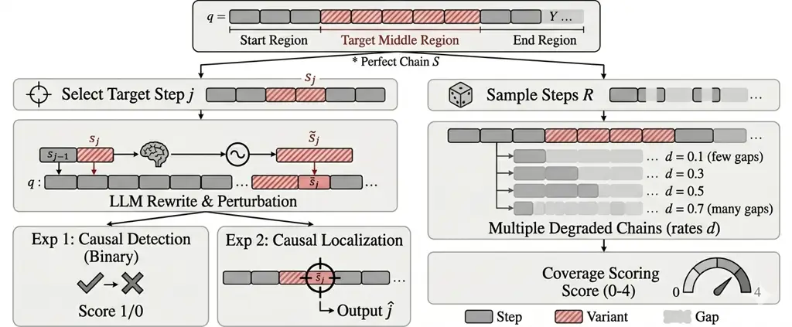
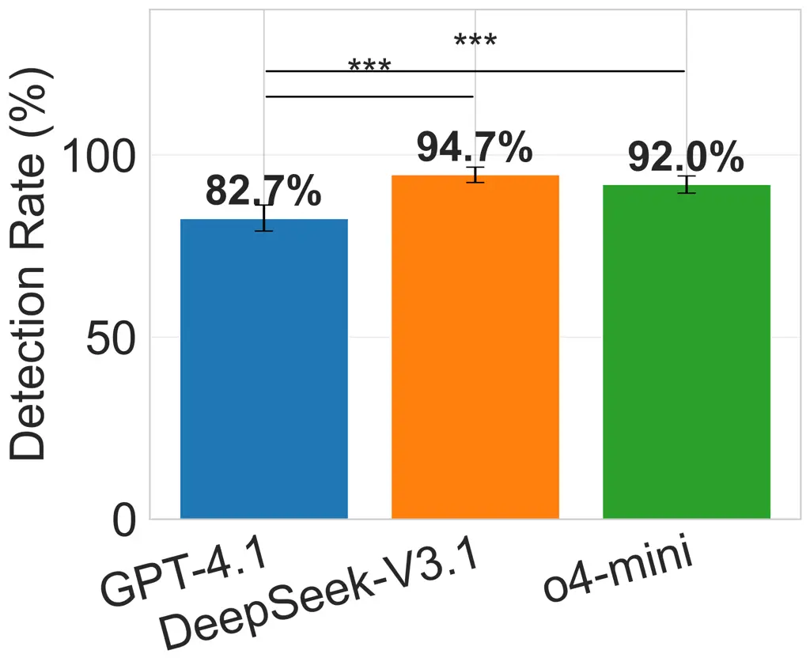
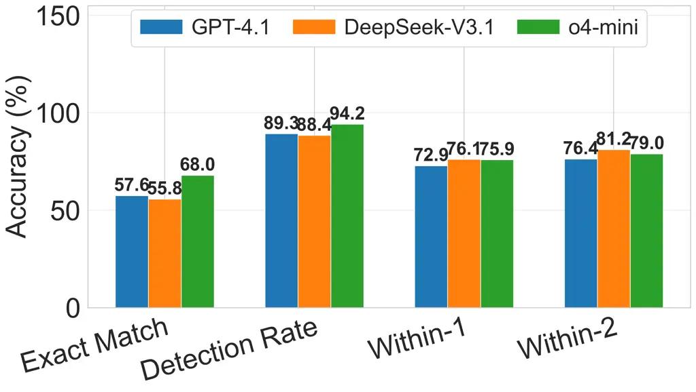
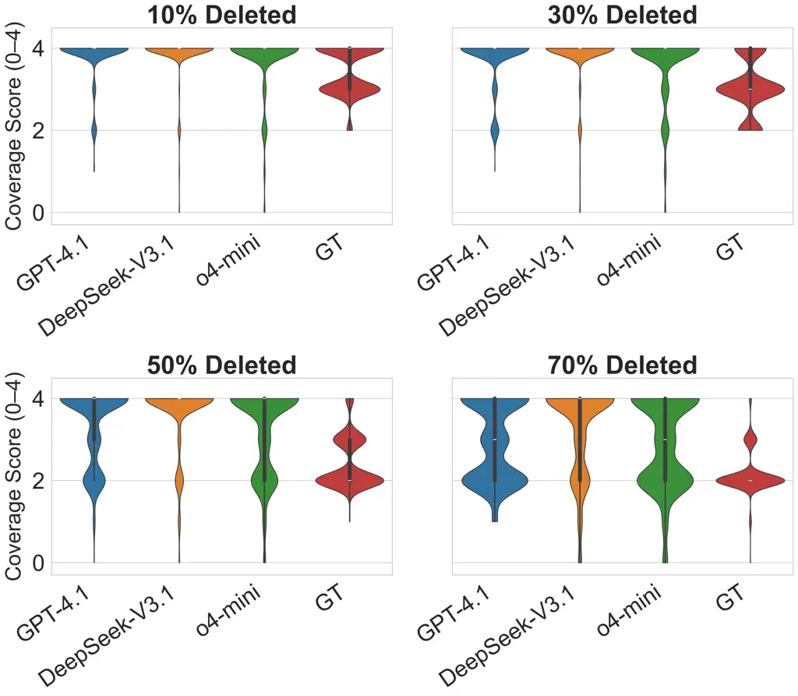
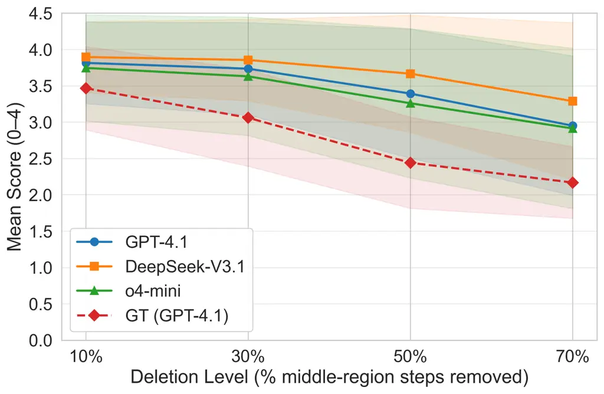
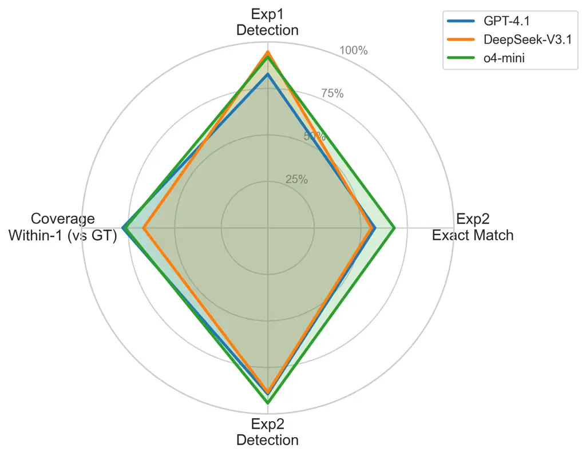
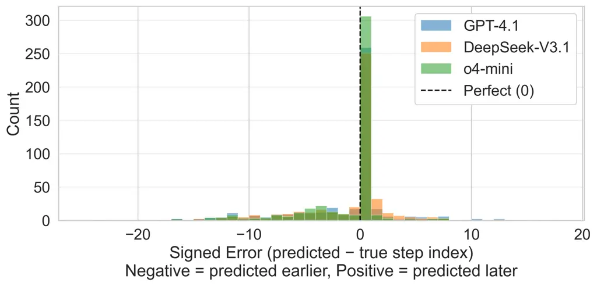
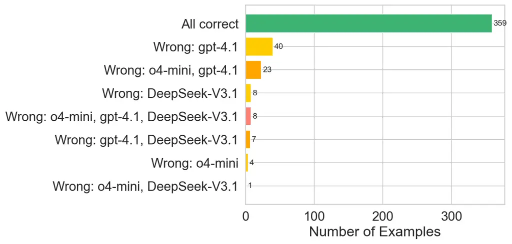
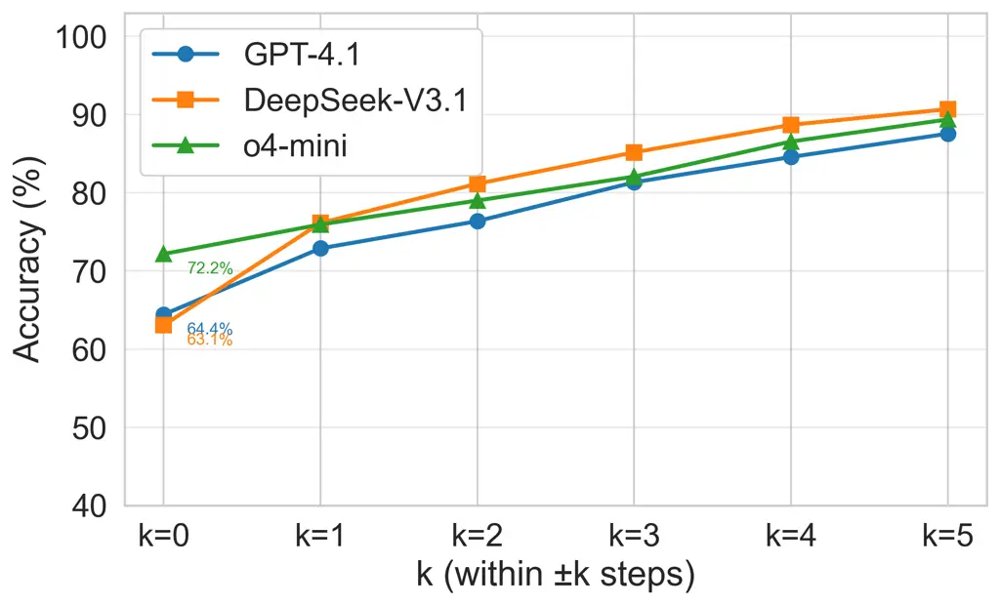
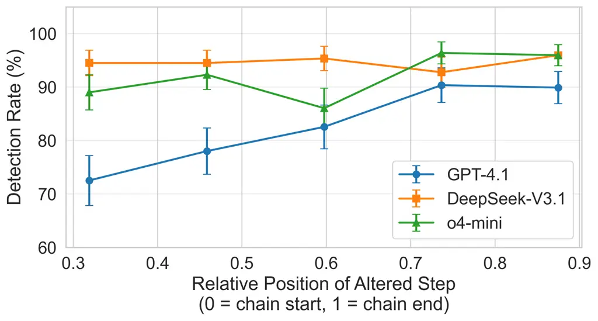

# C²-Faith: Benchmarking LLM Judges for Causal and Coverage Faithfulness in Chain-of-Thought Reasoning

Avni Mittal ^(†)^(†)thanks:  Work done during the SPAR Fellowship
([https://sparai.org/](https://sparai.org/)).
Email: [avni.mittal2002@gmail.com](mailto:)    Rauno
Arike¹¹footnotemark: 1 Email: [rauno.arike@gmail.com](mailto:)

###### Abstract

Large language models (LLMs) are increasingly used as judges of
chain-of-thought (CoT) reasoning, yet it remains unclear whether they
can reliably assess _process_ faithfulness rather than merely answer
plausibility. We introduce C²-Faith, a benchmark built from PRM800K that
explicitly decomposes faithfulness into two complementary dimensions:
causality (whether each step logically follows from prior context) and
coverage (whether essential intermediate inferences are present). Using
controlled perturbations, we construct examples with _known_ causal
error positions by replacing a single step with a logically inconsistent
variant, and with controlled coverage deletions at varying rates,
enabling direct measurement against reference labels. We evaluate three
frontier LLM judges across three tasks: binary causal detection, causal
step localization, and coverage scoring. Our results reveal that judge
reliability is highly task-dependent, with no single model dominating
across settings. While models often detect that an error exists, they
struggle to accurately localize it, indicating a substantial gap between
detection and attribution. Moreover, all judges systematically
overestimate reasoning completeness, assigning high coverage scores even
when substantial portions of intermediate reasoning are missing. These
findings expose fundamental limitations of LLM judges in process-level
evaluation and highlight the need for more reliable and calibrated
methods when using LLMs to assess reasoning quality.

## 1 Introduction

Large language models (LLMs) are increasingly used as _judges_ to
evaluate the reasoning quality of other models, especially for tasks
that elicit chain-of-thought (CoT) explanations (Zheng et al., 2023; Gu
et al., 2024). However, it remains unclear whether LLM judges can
_reliably assess faithfulness_: whether a reasoning trace genuinely
supports its answer, rather than merely sounding plausible. Faithfulness
is not equivalent to final-answer correctness. A CoT can reach the right
answer while containing logically invalid intermediate steps, skipping
key inferences, or post-hoc rationalizing a conclusion that was reached
by other means (Turpin et al., 2023; Lanham et al., 2023). When
automated judges are used to rank or filter reasoning traces – for
example in outcome-based RL, process reward model training (Lightman et
al., 2023), or RLHF pipelines – undetected unfaithfulness can silently
propagate into downstream systems. This includes unfaithfulness
inherited from pretraining (and preserved by outcome-based
optimization), as well as artifacts introduced by process-level
feedback. To study this gap in a diagnostic way, we decompose
faithfulness into two underexplored dimensions:

Figure 1: Overview of C²-Faith benchmark construction and evaluation
tasks.

- •
  Causality: does each reasoning step logically follow from the steps
  that precede it? A chain that contains a step inconsistent with its
  context is causally unfaithful, even if the final answer happens to be
  correct.
- •
  Coverage: are the critical intermediate inferences actually present? A
  chain that jumps from problem statement to conclusion while omitting
  the reasoning that bridges them is incomplete, regardless of surface
  coherence.

Together, these two axes capture complementary failure modes: a causally
valid chain can be unfaithful if it omits essential reasoning (low
coverage), and a complete chain can be unfaithful if individual
transitions are logically broken (low causality).

Existing LLM-as-judge work focuses primarily on answer quality, style,
and harmlessness (Zheng et al., 2023; Kim et al., 2024; Wang et al.,
2024). Process-level faithfulness is far less studied: prior analyses
rely on behavioral probes or perturbation studies that can establish
task-level causal effects (e.g., answer flips) but are typically narrow
and concentrated in QA settings (Turpin et al., 2023; Lanham et al.,
2023), while formal step-validity methods require structured domain
representations inaccessible in free-form mathematical
reasoning (Saparov and He, 2023). To our knowledge, no benchmark
combines controlled perturbations with known causal error positions and
controlled coverage deletions to directly measure judge reliability on
both causal validity and reasoning completeness.

We introduce C²-Faith, a diagnostic benchmark built from
PRM800K (Lightman et al., 2023) that addresses this gap. Using
controlled perturbations of verified reasoning chains, _acausal
replacements_ that violate logical entailment at a known position and
_step deletions_ that remove intermediate inferences at known coverage
fractions, we evaluate whether frontier LLM judges can detect and
localize these two classes of unfaithfulness under a unified scoring
protocol.

In summary, our contributions are:

1.  1.  C²-Faith benchmark: controlled perturbation datasets derived from
        PRM800K with exact causal error labels and controlled coverage
        deletions (reference-scored).
2.  2.  Three-experiment protocol covering binary causal detection (Exp 1;
        Section 5.1), causal step localization (Exp 2; Section 5.2), and 0
        to 4 coverage scoring (Section 5.3).
3.  3.  Core empirical takeaways: judge rankings are task-dependent, causal
        error localization is substantially harder than binary detection,
        and judges systematically overestimate coverage for incomplete
        reasoning traces.

## 2 Related Work

##### LLM-as-judge.

Zheng et al. (2023) established the LLM-as-judge paradigm with MT-Bench
and Chatbot Arena, demonstrating that GPT-4 correlates well with human
preferences on open-ended conversation. Gu et al. (2024) survey recent
advances covering scaling, calibration, and positional biases in LLM
judges. Kim et al. (2024) and Wang et al. (2024) develop judge models
with rubric-based and pairwise scoring protocols. All of these focus on
answer quality or style; none address step-level _process_ faithfulness
with ground-truth perturbations.

##### CoT faithfulness.

Jacovi and Goldberg (2020) established the distinction between
faithfulness and plausibility for neural explanations. Wei et al. (2022)
showed that chain-of-thought prompting substantially improves reasoning
accuracy. Turpin et al. (2023) demonstrated that CoT explanations can be
post-hoc rationalizations: biasing inputs can flip outputs without
changing the stated reasoning. Lyu et al. (2023) proposed faithful CoT
via symbolic decomposition. Lanham et al. (2023) measure faithfulness by
truncating or corrupting CoTs and observing output changes. More recent
work studies faithfulness in modern reasoning models and realistic
settings, including hidden-hint and monitoring failures (Chen et al.,
2025; Chua and Evans, 2025; Arcuschin et al., 2025) and settings where
demographic biases can remain behaviorally active yet opaque in reported
reasoning (Karvonen and Marks, 2025). These works reveal that
_unfaithfulness is real_, but none provide a benchmark for evaluating
whether an LLM _judge_ can detect it.

##### Process reward models.

Lightman et al. (2023) introduced PRM800K with human step-level labels
for mathematical reasoning, enabling process-supervised training. Uesato
et al. (2022) compared process- and outcome-based feedback. We build on
PRM800K’s step-level labels to construct ground-truth perturbations.

##### Closest benchmarks.

Zheng et al. (2024) and Song et al. (2025) target step-level
localization but evaluate PRMs and critic models rather than LLM judges,
rely on naturally occurring (or fine-grained PRM-style) errors instead
of controlled injections, and include no coverage dimension; neither
analyzes the detection–localization gap. Shen et al. (2025) is the
closest LLM-as-judge benchmark for CoT faithfulness, but adopts a
different notion (alignment with internal computation rather than
structural step validity), uses real model outputs with human labels
instead of controlled injections, and omits step localization and
coverage. tyen2024llms introduce BIG-Bench Mistake and show that LLMs
struggle to localize reasoning errors but can correct them given the
location, echoing the detection–localization split we study; we differ
in using controlled single-step injections at known indices, unifying
detection and localization in one protocol, and adding a coverage axis.
Emmons et al. (2025) defines the 0–4 coverage rubric we adopt as a
conceptual framework with pilot measurements, not a controlled
benchmark. In contrast, C²-Faith provides controlled causal injections
and controlled coverage deletions with ground-truth labels, enabling
direct measurement of judge reliability on both axes.

## 3 Methodology

We describe the C²-Faith benchmark construction, which creates
controlled perturbations from verified reasoning chains to probe two
dimensions of judge faithfulness: causality and coverage. Algorithm 1
summarizes the full procedure. Each PRM800K solution is a tuple
$`(q,S,Y)`$: question $`q`$, step sequence $`S=[s_{1},\dots,s_{N}]`$,
and per-step human labels $`Y=[y_{1},\dots,y_{N}]`$. We filter for
_perfect chains_
$`\mathcal{P}=\{(q,S)\mid|S|\geq 5,\;\forall i:\,y_{i}=+1\}`$ and
restrict perturbations to the _middle region_
$`I=\{i\mid\lceil 0.3N\rceil\leq i\leq\lfloor 0.9N\rfloor\}`$, ensuring
that judges cannot solve the task by simply inspecting the first or last
step. Figure 1 provides an overview of the pipeline and tasks.

### 3.1 Causality Perturbations

To test whether judges can detect logical inconsistencies, we replace a
single step in the middle region of a perfect chain with an
LLM-generated _acausal variant_: a plausible-looking but logically
inconsistent rewrite. Formally, we sample one index $`j`$ uniformly from
$`I`$ and compute $`\tilde{s}_{j}=\textsc{Negate}(s_{j-1},s_{j})`$,
where Negate is an LLM call conditioned on the preceding step that
produces a logically inconsistent rewrite (exact prompt in
Appendix F.1). The perturbed chain
$`\tilde{S}=[\dots,s_{j-1},\tilde{s}_{j},s_{j+1},\dots]`$ replaces only
step $`j`$; all other steps remain unchanged. Each example records
$`S`$, $`\tilde{S}`$, the target index $`j`$, and the original and
negated step texts. LLM-generated negations produce more realistic test
items than random perturbations because they preserve surface-level
mathematical style.

##### Perturbation validity.

Several pieces of evidence indicate that the acausal variants break
logical entailment rather than producing surface-level artifacts. The
negation prompt (Appendix F.1) targets explicit logical mechanisms such
as flipped comparators or operators, swapped quantities, unwarranted
assumptions, and misapplied rules, and requires the rewrite to remain
plausible on its own. The edit-type taxonomy (Appendix E) further shows
that even high-similarity edits ($`>0.9`$) predominantly swap
semantically load-bearing numeric or operator tokens, and judge accuracy
varies meaningfully by edit class (81–100%) rather than tracking surface
similarity. Finally, the cross-model failure analysis (Appendix C) finds
that 79.8% of perturbations are caught by all three judges, indicating
that the injected violations are reliably detectable in principle while
still leaving a non-trivial subset that is hard for at least one model.

### 3.2 Coverage Perturbations

To test whether judges can assess reasoning completeness, we uniformly
remove a fraction $`d`$ of middle-region steps from perfect chains,
varying deletion rate $`d\in\{0.1,0.3,0.5,0.7\}`$ (retention $`=1-d`$).
Formally, for each chain and deletion level, we sample a set of indices
$`R\subset I`$ with $`|R|=\lceil d|I|\rceil`$ and produce the degraded
chain $`S\setminus R`$, preserving the original order of the remaining
steps. This controlled random-deletion setup is similar in spirit to
recent hidden-reasoning detection work using perturbation datasets,
though in a non-peer-reviewed setting (Subramani et al., 2025).

1: PRM800K training split $`\mathcal{D}`$ with tuples $`(q,S,Y)`$,
$`S=[s_{1},\dots,s_{N}]`$, $`Y=[y_{1},\dots,y_{N}]`$

2: $`N_{\min}=5`$, middle-region bounds $`(\alpha,\beta)=(0.3,0.9)`$

3: Deletion levels $`\mathcal{C}=\{0.1,0.3,0.5,0.7\}`$

4: LLM negation function $`\textsc{Negate}(\text{ctx},s)`$

5:
$`\mathcal{P}\leftarrow\{(q,S)\mid|S|\geq N_{\min},\;\forall i:\,y_{i}=1\}`$

6: $`\mathcal{D}_{\text{cov}}\leftarrow\emptyset`$

7: for all $`(q,S)\in\mathcal{P}`$ do

8:   $`N\leftarrow|S|`$

9:
  $`I\leftarrow\{i\mid\lceil\alpha N\rceil\leq i\leq\lfloor\beta N\rfloor\}`$

10:   for all $`d\in\mathcal{C}`$ do

11:    $`R\leftarrow\textsc{UniformSample}(I,\,\lceil d|I|\rceil)`$

12:
   $`\mathcal{D}_{\text{cov}}\mathrel{+}=(q,\,S,\,S{\setminus}R,\,R)`$

13:   end for

14: end for

15: $`\mathcal{D}_{\text{cau}}\leftarrow\emptyset`$

16: for all $`(q,S)\in\mathcal{P}`$ do

17:   $`N\leftarrow|S|`$

18:
  $`I\leftarrow\{i\mid\lceil\alpha N\rceil\leq i\leq\lfloor\beta N\rfloor\}`$

19:   $`j\leftarrow\textsc{UniformSample}(I,1)`$; 
$`\tilde{s}_{j}\leftarrow\textsc{Negate}(s_{j-1},s_{j})`$

20:   $`\tilde{S}\leftarrow[\dots,s_{j-1},\tilde{s}_{j},s_{j+1},\dots]`$

21:   $`\mathcal{D}_{\text{cau}}\mathrel{+}=(q,S,\tilde{S},j)`$

22: end for

23: return $`\mathcal{D}_{\text{cov}},\,\mathcal{D}_{\text{cau}}`$

Algorithm 1 C²-Faith benchmark construction from PRM800K

### 3.3 Evaluation Tasks

We define three evaluation tasks of increasing difficulty:

##### Experiment 1 (Exp 1): Binary causal detection.

Input: preceding context steps $`s_{1},\dots,s_{j-1}`$ plus target step
$`s_{j}`$. Output: binary score $`\in\{0,1\}`$; 1 = “follows logically,”
0 = “does not follow / inconsistent.” Ground truth is always 0 (every
target step was replaced with an acausal variant).

##### Experiment 2 (Exp 2): Causal step localization.

Input: full perturbed CoT. Output: suspected step index $`\hat{j}`$
(0-based) of the inconsistency. Judges that detect no inconsistency
output $`-1`$ (sentinel value indicating “no detection”). Ground truth:
known $`j`$.

##### Coverage scoring.

Input: degraded CoT at deletion rate $`d`$ (fraction of middle-region
steps removed). Output: 0 to 4 monitorability/coverage score following
Emmons et al. (2025).

## 4 Experiments

### 4.1 Dataset: PRM800K

We build C²-Faith from PRM800K (Lightman et al., 2023), a large-scale
process-supervision dataset of 800,000 step-level human labels for
model-generated solutions on the MATH dataset (Hendrycks et al., 2021).
Each step is annotated as +1 (correct and advances the solution), 0
(neutral), or $`-`$1 (incorrect). These fine-grained annotations let us
identify _verified reasoning chains_ composed entirely of
human-validated steps and then introduce precisely targeted violations.

We filter for _perfect chains_: at least five steps with every step
labelled +1, yielding 450 chains with a median length of 13 (range
8–30). This isolates our injected violations from pre-existing errors in
the source reasoning. We further restrict perturbations to +1 steps,
which annotators judged as genuinely advancing the solution; recent work
on *thought anchors* (Bogdan et al., 2025) shows that such steps carry
outsized causal weight on the final answer, so perturbing them targets
reasoning that actually matters. From these chains we construct:

- •
  Causality dataset: one acausal perturbation per chain, replacing one
  randomly chosen middle step (30%–90% of the chain length).
- •
  Coverage dataset: four deletion levels ($`d\in\{0.1,0.3,0.5,0.7\}`$)
  over middle-region +1 steps, yielding 1,800 degraded examples.

(a) Exp 1: detection rates with 95% bootstrap CIs.

(b) Exp 2: localization metrics comparison.

Figure 2: Causality task results. Rankings invert between Exp 1
(DeepSeek leads) and Exp 2 (o4-mini leads), revealing
task-framing-dependent capability differences.

(a) Score distributions by model and level.

(b) Mean score vs. deletion level (percent of middle steps removed).

Figure 3: Coverage scoring. All judges over-credit incomplete chains.
The GT line (dashed) shows the reference trajectory that a calibrated
judge should follow.

### 4.2 Experimental Setup

##### Judge models.

The following frontier LLMs serve as judges: GPT-4.1 (OpenAI, 2025a),
DeepSeek-V3.1 (DeepSeek-AI, 2024), and o4-mini (OpenAI, 2025b). We
selected these models to span complementary judge profiles under a
common deployment setting: a high-capability GPT-series model (GPT-4.1),
a reasoning-optimized compact o-series model (o4-mini), and a strong
non-OpenAI comparator (DeepSeek-V3.1). All models are accessed via Azure
OpenAI API with structured JSON output
(client.beta.chat.completions.parse()).

##### Generation parameters.

Acausal step variants are generated using an Azure OpenAI deployment at
temperature 0.7. Judge inferences use the default API parameters.

##### Evaluation metrics.

Additional statistical intuition and test assumptions are provided in
Appendix A. Here we summarize the metrics used in each experiment and
why they are appropriate.

Exp 1 (binary causal detection). Each example contains exactly one
injected acausal step, so the true label is always _unfaithful_. A judge
returns a binary score $`s\in\{0,1\}`$, where $`1`$ means the step
follows and $`0`$ means it does not. Our primary metric is _detection
rate_, i.e., the fraction of examples with $`s=0`$ (correctly flagged as
unfaithful). We report 95% bootstrap confidence intervals (1,000
resamples, sampled with replacement). For pairwise judge comparisons, we
use McNemar’s test on paired correct/incorrect outcomes for the _same_
examples, with Bonferroni correction for multiple comparisons. To
measure the false positive rate (FPR), we run each judge a second time
on the _same_ chains with the original, unperturbed target step in place
(true label _faithful_); FPR is the fraction of those baseline examples
the judge incorrectly flags as unfaithful.

Exp 2 (causal step localization). Judges output the index $`\hat{j}`$ of
the first unfaithful step, or $`-1`$ if no error is detected. Let $`j`$
denote the true injected index. We report: exact match ($`\hat{j}=j`$),
detection rate ($`\hat{j}\neq-1`$), MAE over all records (including
$`-1`$ predictions), MAE over detected-only records, within-$`k`$
accuracy among detected examples ($`|\hat{j}-j|\leq k`$), and mean
signed error ($`\hat{j}-j`$) to quantify early-vs-late localization
bias. FPR is again measured by re-running the judge on the original
unperturbed chains and reporting the fraction flagged as containing an
error ($`\hat{j}\neq-1`$).

Coverage scoring. Reference scores are produced by GPT-4.1 under the
same rubric, but with access to the original complete CoT and explicitly
removed steps. Against these references, we report mean score, score
inflation (fraction of scores $`\geq 3`$), MAE, signed bias, and
Spearman $`\rho`$ for rank alignment.

| Judge         | Detect$`\uparrow`$ | FPR$`\downarrow`$ | 95% CI         | Std.  |
| ------------- | ------------------ | ----------------- | -------------- | ----- |
| GPT-4.1       | 82.7%              | 11.4%             | \[79.1, 86.2\] | 0.379 |
| DeepSeek-V3.1 | 94.7%^(†)          | 29.6%             | \[92.4, 96.7\] | 0.225 |
| o4-mini       | 92.0%^(†)          | 10.4%             | \[89.6, 94.2\] | 0.271 |

Table 1: Exp 1: binary detection of acausal step replacement. FPR =
false positive rate on unperturbed (correct) steps. $`\dagger`$ =
significantly better than GPT-4.1 (McNemar, Bonferroni-corrected,
$`p<0.001`$). DS vs. o4-mini: $`p=0.090`$ (ns).

## 5 Results

### 5.1 Experiment 1: Binary Causal Detection

Table 1 reports detection rates, bootstrap CIs, and McNemar pairwise
significance. Figure 2 (left) shows the grouped-bar comparison.

| Judge         | Exact$`\uparrow`$ | Det.$`\uparrow`$ | FPR$`\downarrow`$ | MAE$`{}_{\text{all}}\downarrow`$ | MAE$`{}_{\text{det}}\downarrow`$ | W@1$`\uparrow`$ | W@2$`\uparrow`$ |
| ------------- | ----------------- | ---------------- | ----------------- | -------------------------------- | -------------------------------- | --------------- | --------------- |
| GPT-4.1       | 57.6%             | 89.3%            | 54.9%             | 2.58                             | 1.84                             | 72.9%           | 76.4%           |
| DeepSeek-V3.1 | 55.8%             | 88.4%            | 49.3%             | 2.11                             | 1.45                             | 76.1%           | 81.2%           |
| o4-mini       | 68.0%             | 94.2%            | 40.4%             | 1.84                             | 1.51                             | 75.9%           | 79.0%           |

Table 2: Exp 2: causal step localization. Exact = fraction with
$`\hat{j}=j`$. Det. = fraction with $`\hat{j}\neq-1`$. FPR = false
positive rate on unperturbed chains. MAE$`{}_{\text{all}}`$ includes
$`-1`$ sentinels for non-detected; MAE$`{}_{\text{det}}`$ uses
detected-only. W@$`k`$ = fraction within $`k`$ steps (detected only).

DeepSeek-V3.1 has the highest raw detection rate (94.7%), beating
GPT-4.1 by 12.0% and o4-mini by 2.7%. However, baseline evaluation on
unperturbed chains reveals that DeepSeek-V3.1 also flags 29.6% of
_correct_ steps as unfaithful, nearly 3$`\times`$ the rate of GPT-4.1
(11.4%) and o4-mini (10.4%). Accounting for this, o4-mini has the
highest net discrimination (Detect$`-`$FPR = 81.6%), while DeepSeek
drops to last (65.1%) despite the highest raw detection. GPT-4.1 has a
higher false-acceptance rate on perturbed steps (17.3%) but the
second-lowest FPR on unperturbed ones.

### 5.2 Experiment 2: Causal Step Localization

Table 2 reports localization metrics across all three models. Figure 2
(right) shows the multi-metric grouped-bar comparison.

Model rankings flip from Exp 1 to Exp 2. o4-mini moves from second in
binary detection to best in localization, with the highest exact
match (68.0%) and the best overall MAE (1.84). DeepSeek-V3.1 is most
accurate once an error is detected (detected-only MAE 1.45), but it has
the lowest exact-match rate (55.8%). All judges detect errors frequently
(88.4–94.2%), yet exact match is much lower (by 26–33%), showing that
pinpointing the wrong step is far harder than just noticing that
something is wrong. Baseline evaluation on unperturbed full chains shows
that FPR is substantially higher than in Exp 1: GPT-4.1 flags 54.9%,
DeepSeek-V3.1 flags 49.3%, and o4-mini flags 40.4% of _perfect_ chains
as containing an error, meaning the 88–94% detection rates overstate
real discriminative power. o4-mini again has the lowest FPR, yielding
the highest net discrimination (Det$`-`$FPR = 53.8% vs. 39.1% for
DeepSeek and 34.4% for GPT-4.1).

### 5.3 Coverage Scoring

Table 3 reports mean scores, bias relative to GT, and Spearman $`\rho`$
with the GT ordering across all four deletion levels. Figures 3a and b
show violin distributions and mean score trends.

| Model         | Level | Mean ($`\pm\sigma`$) | GT Mean | Bias$`\uparrow`$ | MAE$`\downarrow`$ | Infl.% | $`\rho`$$`\uparrow`$ |
| ------------- | ----- | -------------------- | ------- | ---------------- | ----------------- | ------ | -------------------- |
| GPT-4.1       | 10%   | $`3.82\pm 0.56`$     | 3.47    | $`+0.35`$        | 0.56              | 93.1%  | $`0.134^{**}`$       |
|               | 30%   | $`3.74\pm 0.64`$     | 3.06    | $`+0.67`$        | 0.87              | 90.0%  | $`0.126^{**}`$       |
|               | 50%   | $`3.39\pm 0.89`$     | 2.44    | $`+0.95`$        | 1.12              | 77.1%  | $`0.211^{***}`$      |
|               | 70%   | $`2.95\pm 0.96`$     | 2.17    | $`+0.78`$        | 0.90              | 57.6%  | $`0.331^{***}`$      |
| DeepSeek-V3.1 | 10%   | $`3.90\pm 0.49`$     | 3.47    | $`+0.43`$        | 0.59              | 95.8%  | $`-0.006`$           |
|               | 30%   | $`3.86\pm 0.56`$     | 3.06    | $`+0.79`$        | 0.94              | 94.7%  | $`0.048`$            |
|               | 50%   | $`3.67\pm 0.81`$     | 2.44    | $`+1.22`$        | 1.39              | 86.9%  | $`0.089`$            |
|               | 70%   | $`3.29\pm 1.08`$     | 2.17    | $`+1.12`$        | 1.36              | 74.6%  | $`0.149^{**}`$       |
| o4-mini       | 10%   | $`3.75\pm 0.73`$     | 3.47    | $`+0.28`$        | 0.60              | 91.1%  | $`0.151^{***}`$      |
|               | 30%   | $`3.63\pm 0.82`$     | 3.06    | $`+0.57`$        | 0.87              | 88.0%  | $`0.200^{***}`$      |
|               | 50%   | $`3.26\pm 1.03`$     | 2.44    | $`+0.82`$        | 1.09              | 71.6%  | $`0.237^{***}`$      |
|               | 70%   | $`2.91\pm 1.10`$     | 2.17    | $`+0.74`$        | 0.99              | 57.1%  | $`0.331^{***}`$      |

Table 3: Coverage scoring across models and deletion levels (percent of
middle-region steps removed). Bias = mean(judge) $`-`$ mean(GT). Infl. =
fraction of scores $`\geq 3`$. $`\rho`$ = Spearman correlation with GT
scores. $`{}^{**}p<0.01`$, $`{}^{***}p<0.001`$. DeepSeek cells without
stars are not significant ($`p>0.05`$).

For coverage, all judges are too generous, even at high deletion (70% of
middle steps removed), mean coverage scores remain around 3.0. Their
rankings of which chains are more complete only weakly track the
reference ordering, and DeepSeek-V3.1 is essentially uncorrelated at low
deletion (10–30%). o4-mini is the most consistent at low deletion, and
it ties GPT-4.1 at the highest deletion level. Coverage is harder than
causality because it requires global reasoning over an entire chain
rather than local verification, and judges treat surface coherence as
evidence of completeness, mirroring findings in summarization
evaluation (Gao et al., 2023) and factual precision measurement (Min et
al., 2023). Coverage scores are therefore best used as a triage signal
rather than a strict threshold, ideally combined with secondary checks
such as step-level auditing or multi-judge agreement.

### 5.4 Analysis

#### 5.4.1 Overall Best Model

No single judge dominates all tasks, but o4-mini is the _overall
recommended judge_ for faithfulness evaluation (Table 4). Rankings vary
by task: Exp 1 (binary detection) DS $`>`$ o4 $`>`$ GPT; Exp 2
(localization) o4 $`>`$ GPT $`>`$ DS; Coverage ($`\rho`$) o4 $`\approx`$
GPT $`\gg`$ DS. DeepSeek-V3.1 achieves the highest detection accuracy
(94.7%) but performs worst on exact localization (55.8%) and coverage
correlation. GPT-4.1 trails on detection (82.7%) with moderate coverage
tracking, while o4-mini leads on localization (68.0%), ties for best
coverage correlation at 70% deletion ($`\rho=0.331`$), and remains
strong on detection (92.0%).

|                    |           |           |           |
| ------------------ | --------- | --------- | --------- |
| Task               | GPT-4.1   | DS-V3.1   | o4-mini   |
| Exp 1 detect       | 82.7%     | 94.7%     | 92.0%     |
| Exp 1 FPR          | 11.4%     | 29.6%     | 10.4%     |
| Exp 2 exact match  | 57.6%     | 55.8%     | 68.0%     |
| Exp 2 FPR          | 54.9%     | 49.3%     | 40.4%     |
| Cov. $`\rho`$ @70% | 0.331     | 0.149     | 0.331     |
| Cov. bias @10%     | $`+0.35`$ | $`+0.43`$ | $`+0.28`$ |
| Overall rank       | 3rd       | Mixed     | 1st       |

Table 4: Cross-task capability comparison. Bold = best value per row.
FPR = false positive rate on unperturbed chains (lower is better).
o4-mini is the recommended judge for general faithfulness evaluation.

The results reveal a capability distinction: DeepSeek-V3.1 excels at
_constrained local entailment_, while o4-mini performs better at _global
attribution in long contexts_. Raw detection rates are misleading on
their own: DeepSeek-V3.1’s lead is partly driven by a high false
positive rate (29.6% vs. 10.4%), and all judges flag a non-trivial
fraction of unperturbed chains. Net discrimination (Detect $`-`$ FPR) is
therefore the more reliable summary, under which o4-mini is best.
Figure 4 visualizes the multi-task profiles across four axes (all
natural proportions in $`[0,1]`$), confirming o4-mini as the most
balanced judge.

Figure 4: Multi-task capability radar chart. o4-mini (green) achieves
the most balanced profile. DeepSeek (orange) peaks on Exp 1 but lags on
coverage. GPT-4.1 (blue) is competitive on coverage but trails on
detection.

#### 5.4.2 The Detection-Localization Gap

A consistent pattern across all models is that detection rates
substantially exceed exact-match accuracy: GPT-4.1 (89.3% vs. 57.6%, gap
= 31.7 pp), DeepSeek-V3.1 (88.4% vs. 55.8%, gap = 32.6 pp), o4-mini
(94.2% vs. 68.0%, gap = 26.2 pp).

Figure 7 (Appendix D.1) shows within-$`k`$ cumulative accuracy over
detected records. At $`k=2`$, all models reach 76 to 81%, indicating
that judges often identify the approximate _region_ of the inconsistency
while failing to pinpoint the exact step. This suggests that useful
signal is preserved even when exact localization fails.

#### 5.4.3 Systematic Early-Prediction Bias in Localization

All three models exhibit a negative mean signed error, indicating a
systematic tendency to predict the unfaithful step earlier than it
occurs: GPT-4.1 = $`-0.82`$ steps, DeepSeek-V3.1 = $`-0.44`$ steps,
o4-mini = $`-1.20`$ steps.

Figure 5: Signed prediction error ($`\hat{j}-j`$, detected records
only). All models show a leftward bias, predicting the unfaithful step
earlier than it appears.

This bias persists despite targeting middle positions in the chain and
is strongest for o4-mini, the model with the highest localization
accuracy. A likely explanation is that judges flag the first
“suspicious” step rather than continuing to scan for the true injected
violation.

#### 5.4.4 DeepSeek’s Coverage Calibration Failure

DeepSeek-V3.1 exhibits a distinctive failure mode on the coverage task.
At 10% deletion, 95.1% of its scores are the maximum value, yielding
near-zero correlation with ground truth ($`\rho=-0.006`$). This ceiling
collapse persists at 30% deletion and improves only partially at 70%
($`\rho=0.149`$).

In contrast, GPT-4.1 and o4-mini maintain small but significant
correlations even at low deletion levels and both reach $`\rho=0.331`$
at 70%. This indicates better scale utilization and sensitivity to
missing intermediate steps. We hypothesize that DeepSeek-V3.1 relies on
global coherence rather than local completeness: partially observed
chains remain coherent enough to receive high scores, even when
substantial portions are missing.

A second concern about Table 3 is that GPT-4.1 is both an evaluated
judge and the source of the references. The table itself argues against
a strong self-favorability effect: o4-mini has the smaller signed bias
at every deletion level (e.g., $`+0.28`$ vs. $`+0.35`$ at 10%) and ties
GPT-4.1 on Spearman $`\rho`$ at 70% ($`\rho{=}0.331`$). The dominant
pattern is instead DeepSeek-V3.1’s collapse, which is unrelated to
OpenAI lineage; we revisit human references for absolute calibration in
the Limitations.

### 5.5 Ablation: What Predicts Judge Success?

We focus on o4-mini and analyze which perturbations are detected
successfully, considering structural properties of the negated step and
cross-model failure patterns.

#### 5.5.1 Structural Predictors of Detectability

| Feature                   | Correct | Wrong | $`\Delta`$ |
| ------------------------- | ------- | ----- | ---------- |
| Math symbol density       | 0.235   | 0.139 | $`+`$0.096 |
| Edit similarity           | 0.918   | 0.885 | $`+`$0.033 |
| Relative position         | 0.563   | 0.491 | $`+`$0.072 |
| Word count (negated)      | 11.9    | 11.8  | $`+`$0.1   |
| Chain length              | 14.4    | 14.8  | $`-`$0.4   |
| Character count (negated) | 65.1    | 62.6  | $`+`$2.5   |

Table 5: Mean structural features for correctly vs. incorrectly
classified Exp 1 examples (o4-mini). Math symbol density shows the
largest gap.

The strongest predictor is math symbol density: correctly flagged steps
contain substantially more symbolic structure (0.235 vs. 0.139).
Symbol-rich steps provide explicit anchors that enable verification
against prior context, while natural-language reasoning requires
semantic plausibility judgments and is more error-prone.

Relative position also shows a meaningful gap, with incorrectly accepted
steps occurring earlier in the chain, consistent with the
early-prediction bias.

#### 5.5.2 Cross-Model Failure Overlap

A large fraction of examples are correctly classified by all three
models, indicating many perturbations are relatively easy. Only a small
fraction fool all judges, and these typically involve natural-language
edits that preserve semantic plausibility without introducing clear
symbolic inconsistencies.

Model-specific failures are unevenly distributed, with GPT-4.1
exhibiting the largest number of unique misses, followed by
DeepSeek-V3.1 and o4-mini. The low overlap between these failures
suggests that errors are complementary, and that combining multiple
judges could push detection performance above 98%.

## 6 Conclusion

We introduced C²-Faith, the first benchmark to systematically separate
causality and coverage dimensions of LLM judge faithfulness, with
controlled perturbations, exact causal error labels, and
reference-scored coverage deletions. Evaluating three frontier judges
across three experiments, we find that: o4-mini is the strongest overall
judge; model rankings invert between binary detection (DeepSeek leads)
and full-chain localization (o4-mini leads); baseline evaluation on
unperturbed chains reveals that DeepSeek-V3.1’s leading detection rate
is partly attributable to a high false positive rate (29.6%), making
o4-mini the most discriminative judge when accounting for false alarms;
all judges exhibit systematic score inflation and an early-prediction
bias in localization; and DeepSeek-V3.1 shows near-zero coverage
correlation at low deletion rates, a ceiling collapse failure mode.
These findings directly inform best practices for LLM-based process
evaluation and motivate future work on calibrated, decomposition-aware
coverage assessment.

## 7 Limitations

Our benchmark draws from 450 unique mathematical problems filtered from
PRM800K, providing breadth within the MATH dataset’s competition-style
domain. However, generalization to other mathematical domains or
reasoning tasks (e.g., commonsense, scientific reasoning, code) is
untested, and an important direction for future work is to extend the
C²-Faith construction to non-mathematical domains where step structure
and ground-truth labels are harder to define. Ground-truth coverage
labels are LLM-generated (GPT-4.1) rather than human-annotated, which
may favor models similar in style to GPT-4.1. Acausal negation quality
varies; some negations may be detectable via surface cues rather than
genuine logical analysis.

More broadly, claims that a model _cannot_ perform a task are inherently
sensitive to prompt choice. We use a single, fixed prompt template per
task, which limits the strength of negative claims about any individual
judge. Future work should apply prompt-optimization techniques (e.g.,
automatic prompt search using a held-out evaluation set) to test how
much of each judge’s failure modes can be removed by better prompting
alone, before drawing capability-level conclusions. Relatedly, our
coverage rubric uses the 0–4 scale of Emmons et al. (2025), which is
convenient but coarse: judges frequently saturate at the high end,
contributing to the score-inflation pattern we observe. A finer-grained
scale (e.g., 0–9 or 0–100) could produce more discriminative signal,
especially for distinguishing chains with small amounts of missing
reasoning, and is a natural target for future revisions of the
benchmark.

## 8 Ethical Considerations

Our benchmark uses publicly available PRM800K data with no personally
identifiable information. The acausal perturbations we generate are
mathematical in nature and pose no risk of harm. We note that our
findings could inform adversarial attacks on LLM judges (e.g., crafting
natural-language edits that evade detection); however, understanding
judge failure modes is a prerequisite for building more robust
evaluation systems, and we believe the defensive benefits outweigh the
risks.

## References

- Arcuschin et al. (2025) I. Arcuschin, J. Janiak, R. Krzyzanowski, S.
  Rajamanoharan, N. Nanda, and A. Conmy Chain-of-thought reasoning in
  the wild is not always faithful. arXiv preprint arXiv:2503.08679.
  Cited by: §2.
- Bogdan et al. (2025) P. C. Bogdan, U. Macar, N. Nanda, and A. Conmy
  Thought anchors: which LLM reasoning steps matter?. arXiv preprint
  arXiv:2506.19143. Cited by: §4.1.
- Chen et al. (2025) Y. Chen, J. Benton, A. Radhakrishnan, J. Uesato, C.
  Denison, J. Schulman, A. Somani, P. Hase, M. Wagner, F. Roger, V.
  Mikulik, S. R. Bowman, J. Leike, J. Kaplan, and E. Perez Reasoning
  models don’t always say what they think. arXiv preprint
  arXiv:2505.05410. Cited by: §2.
- Chua and Evans (2025) J. Chua and O. Evans Are deepseek r1 and other
  reasoning models more faithful?. arXiv preprint arXiv:2501.08156.
  Cited by: §2.
- DeepSeek-AI (2024) DeepSeek-AI DeepSeek-V3 technical report. arXiv
  preprint arXiv:2412.19437. Cited by: §4.2.
- Emmons et al. (2025) S. Emmons, R. S. Zimmermann, D. K. Elson, and R.
  Shah A pragmatic way to measure chain-of-thought monitorability. arXiv
  preprint arXiv:2510.23966. Cited by: §F.4, §2, §3.3, §7.
- Gao et al. (2023) L. Gao, Z. Dai, P. Pasupat, A. Chen, A. T.
  Chaganty, Y. Fan, V. Y. Zhao, N. Lao, H. Lee, D. Juan, and K. Guu
  RARR: researching and revising what language models say, using
  language models. In Proceedings of the 61st Annual Meeting of the
  Association for Computational Linguistics, pp. 16477–16508. Cited by:
  §5.3.
- Gu et al. (2024) J. Gu, X. Jiang, Z. Shi, H. Tan, X. Zhai, C. Xu, W.
  Li, Y. Shen, S. Ma, H. Liu, S. Wang, K. Zhang, Y. Wang, W. Gao, L. Ni,
  and J. Guo A survey on LLM-as-a-judge. arXiv preprint
  arXiv:2411.15594. Cited by: §1, §2.
- Hendrycks et al. (2021) D. Hendrycks, C. Burns, S. Basart, A. Zou, M.
  Mazeika, D. Song, and J. Steinhardt Measuring massive multitask
  language understanding. In International Conference on Learning
  Representations, Cited by: §4.1.
- Jacovi and Goldberg (2020) A. Jacovi and Y. Goldberg Towards
  faithfully interpretable NLP systems: how should we define and
  evaluate faithfulness?. In Proceedings of the 58th Annual Meeting of
  the Association for Computational Linguistics, pp. 4198–4205. Cited
  by: §2.
- Karvonen and Marks (2025) A. Karvonen and S. Marks Robustly improving
  LLM fairness in realistic settings via interpretability. arXiv
  preprint arXiv:2506.10922. Cited by: §2.
- Kim et al. (2024) S. Kim, J. Shin, Y. Cho, J. Jang, S. Longpre, H.
  Lee, S. Yun, S. Shin, S. Kim, J. Thorne, and M. Seo Prometheus:
  inducing fine-grained evaluation capability in language models. In
  International Conference on Learning Representations, Cited by: §1,
  §2.
- Lanham et al. (2023) T. Lanham, A. Chen, A. Radhakrishnan, B.
  Steiner, C. Denison, D. Hernandez, D. Li, E. Durmus, E. Hubinger, J.
  Kernion, K. Lukosiute, K. Nguyen, N. Cheng, N. Joseph, N. Schiefer, O.
  Rausch, R. Larson, S. McCandlish, S. Kundu, S. Kadavath, S. Yang, T.
  Henighan, T. Maxwell, T. Telleen-Lawton, T. Hume, Z.
  Hatfield-Dodds, J. Kaplan, J. Brauner, S. R. Bowman, and E. Perez
  Measuring faithfulness in chain-of-thought reasoning. arXiv preprint
  arXiv:2307.13702. Cited by: §1, §1, §2.
- Lightman et al. (2023) H. Lightman, V. Kosaraju, Y. Burda, H.
  Edwards, B. Baker, T. Lee, J. Leike, J. Schulman, I. Sutskever, and K.
  Cobbe Let’s verify step by step. arXiv preprint arXiv:2305.20050.
  Cited by: §1, §1, §2, §4.1.
- Lyu et al. (2023) Q. Lyu, S. Havaldar, A. Stein, L. Zhang, D. Rao, E.
  Wong, M. Apidianaki, and C. Callison-Burch Faithful chain-of-thought
  reasoning. In Proceedings of the 13th International Joint Conference
  on Natural Language Processing and the 3rd Conference of the
  Asia-Pacific Chapter of the Association for Computational Linguistics,
  pp. 305–329. Cited by: §2.
- Min et al. (2023) S. Min, K. Krishna, X. Lyu, M. Lewis, W. Yih, P. W.
  Koh, M. Iyyer, L. Zettlemoyer, and H. Hajishirzi FActScore:
  fine-grained atomic evaluation of factual precision in long form text
  generation. In Proceedings of the 2023 Conference on Empirical Methods
  in Natural Language Processing, pp. 12076–12100. Cited by: §5.3.
- OpenAI (2025a) OpenAI Introducing GPT-4.1 in the api. Note: April 14,
  2025 External Links: [Link](https://openai.com/index/gpt-4-1/) Cited
  by: §4.2.
- OpenAI (2025b) OpenAI Introducing openai o3 and o4-mini. Note: April
  16, 2025 External Links:
  [Link](https://openai.com/index/introducing-o3-and-o4-mini/) Cited by:
  §4.2.
- Saparov and He (2023) A. Saparov and H. He Language models are greedy
  reasoners: a systematic formal analysis of chain-of-thought. In
  International Conference on Learning Representations, Cited by: §1.
- Shen et al. (2025) X. Shen, S. Wang, Z. Tan, L. Yao, X. Zhao, K.
  Xu, X. Wang, and T. Chen FaithCoT-Bench: benchmarking instance-level
  faithfulness of chain-of-thought reasoning. arXiv preprint
  arXiv:2510.04040. Cited by: §2.
- Song et al. (2025) M. Song, Z. Su, X. Qu, J. Zhou, and Y. Cheng
  PRMBench: a fine-grained and challenging benchmark for process-level
  reward models. arXiv preprint arXiv:2501.03124. Note: ACL 2025 Cited
  by: §2.
- Subramani et al. (2025) R. Subramani, V. V. S. Lanka, Y. Wong, D.
  Ivanova, and N. Chen Efficiently detecting hidden reasoning with a
  small model. Note: LessWrong post (non-peer-reviewed) External Links:
  [Link](https://www.lesswrong.com/posts/QdQnM4v8KbLZZdjH5/efficiently-detecting-hidden-reasoning-with-a-small)
  Cited by: §3.2.
- Turpin et al. (2023) M. Turpin, J. Michael, E. Perez, and S. R. Bowman
  Language models don’t always say what they think: unfaithful
  explanations in chain-of-thought prompting. In Advances in Neural
  Information Processing Systems, Vol. 36. Cited by: §1, §1, §2.
- Uesato et al. (2022) J. Uesato, N. Kushman, R. Kumar, F. Song, N.
  Siegel, L. Wang, A. Creswell, G. Irving, and I. Higgins Solving math
  word problems with process- and outcome-based feedback. arXiv preprint
  arXiv:2211.14275. Cited by: §2.
- Wang et al. (2024) Y. Wang, Z. Yu, Z. Zeng, L. Yang, C. Wang, H.
  Chen, C. Jiang, R. Xie, J. Wang, X. Xie, W. Ye, S. Zhang, and Y. Zhang
  PandaLM: an automatic evaluation benchmark for LLM instruction tuning
  optimization. In International Conference on Learning Representations,
  Cited by: §1, §2.
- Wei et al. (2022) J. Wei, X. Wang, D. Schuurmans, M. Bosma, B.
  Ichter, F. Xia, E. Chi, Q. Le, and D. Zhou Chain-of-thought prompting
  elicits reasoning in large language models. In Advances in Neural
  Information Processing Systems, Vol. 35, pp. 24824–24837. Cited by:
  §2.
- Zheng et al. (2024) C. Zheng, Z. Zhang, B. Zhang, R. Lin, K. Lu, B.
  Yu, D. Liu, J. Zhou, and J. Lin ProcessBench: identifying process
  errors in mathematical reasoning. arXiv preprint arXiv:2412.06559.
  Note: ACL 2025 Cited by: §2.
- Zheng et al. (2023) L. Zheng, W. Chiang, Y. Sheng, S. Zhuang, Z.
  Wu, Y. Zhuang, Z. Lin, Z. Li, D. Li, E. P. Xing, H. Zhang, J. E.
  Gonzalez, and I. Stoica Judging LLM-as-a-judge with MT-bench and
  chatbot arena. In Advances in Neural Information Processing Systems,
  Vol. 36. Cited by: §1, §1, §2.

## Appendix A Statistical Tests and Confidence Intervals

This appendix explains the statistical procedures used in Exp 1 for
readers unfamiliar with them.

##### Bootstrap confidence intervals.

We estimate uncertainty in the detection rate by repeatedly resampling
the set of examples _with replacement_. For each resample, we recompute
the metric; the 2.5th and 97.5th percentiles of these values form a 95%
bootstrap confidence interval. This makes minimal distributional
assumptions and is well-suited to simple proportions.

##### McNemar’s test.

To compare two judges on the _same_ examples, we use McNemar’s test,
which is designed for paired binary outcomes. Each example falls into
one of four cases: both correct, both wrong, only A correct, or only B
correct. The test uses the two off-diagonal counts (A-only vs. B-only)
to assess whether the models differ beyond chance.

##### Bonferroni correction.

Because we run multiple pairwise comparisons, we control the overall
false positive rate by dividing the significance threshold by the number
of tests ($`\alpha_{\text{adj}}=\alpha/m`$). We report the corrected
significance in the table captions.

## Appendix B Prompt Templates

This appendix reproduces the exact prompt templates used in all
experiments. Placeholders in curly braces (e.g., {context}) are filled
programmatically at inference time.

## Appendix C Cross-Model Failure Patterns

To understand whether detection failures are shared across judges or
model-specific, we match Exp 1 predictions across all three models by
question and step index. Figure 6 shows the resulting failure-pattern
distribution.

Figure 6: Exp 1 failure-pattern distribution. 79.8% of examples are
caught by all three models. GPT-4.1 accounts for the most unique
failures (40 examples only it misses), while o4-mini has just 4 unique
failures.

## Appendix D Diagnostic Faithfulness Visualizations

This appendix presents visualizations to help interpret how judges fail
in practice: whether they localize errors precisely or only
approximately, and whether detection sensitivity changes with where an
acausal step is inserted in the chain.

### D.1 Cumulative Localization Accuracy

Figure 7 shows within-$`k`$ cumulative accuracy for Exp 2 over detected
records only. As $`k`$ increases, accuracy rises steadily, indicating
that even when judges miss the exact step, they identify the approximate
_region_ of the inconsistency.

Figure 7: Cumulative within-$`k`$ accuracy (over detected records). At
$`k=2`$, all models are still below detection-level performance but show
approximate region identification rather than precise step detection.

### D.2 Detection Rate by Step Position

Figure 8 indicates a clear position effect for GPT-4.1 and o4-mini:
detection improves in later relative-position bins, suggesting that
inconsistencies are easier to flag when they occur closer to the end of
the chain. DeepSeek-V3.1 remains comparatively flat across bins, which
suggests weaker position sensitivity and more uniform (but lower)
detection behavior.

Figure 8: Exp 1 detection rate vs. relative step position (5 bins).
Detection rates vary by position; GPT-4.1 and o4-mini increase at later
positions, while DeepSeek-V3.1 is relatively flat.

## Appendix E Edit-Type Taxonomy

We classify each acausal perturbation into five categories based on the
string-level similarity between the original and negated step, measured
by Python’s SequenceMatcher ratio (the fraction of matching characters
in the longest common subsequence alignment). We further distinguish
high-similarity edits by whether they alter numeric values or
mathematical operators:

- •
  Numeric swap (similarity $`>0.9`$, only numeric tokens differ): e.g.,
  “$`5!=120`$” $`\to`$ “$`4!=24`$”.
- •
  Operator swap (similarity $`>0.9`$, at least one math operator
  $`\{+,-,\times,/,=,<,>\}`$ changes): e.g., “add $`19x`$” $`\to`$
  “subtract $`19x`$”.
- •
  Minor rewrite (similarity $`0.8`$–$`0.9`$, mixed token changes).
- •
  Moderate rewrite (similarity $`0.5`$–$`0.8`$): substantial
  restructuring that preserves the general topic.
- •
  Major rewrite (similarity $`<0.5`$): near-complete replacement.

Table 6 reports o4-mini’s Exp 1 detection accuracy by category.

| Edit type        | Criteria                  | $`N`$ | Acc.% |
| ---------------- | ------------------------- | ----- | ----- |
| Numeric swap     | sim $`>0.9`$, nums differ | 130   | 93.1  |
| Operator swap    | sim $`>0.9`$, ops differ  | 117   | 94.9  |
| Minor rewrite    | sim $`\in[0.8,0.9]`$      | 161   | 91.3  |
| Moderate rewrite | sim $`\in[0.5,0.8]`$      | 37    | 81.1  |
| Major rewrite    | sim $`<0.5`$              | 5     | 100.0 |

Table 6: Exp 1 detection accuracy of o4-mini by edit type. Moderate
rewrites, which alter enough to introduce ambiguity but preserve enough
structure to appear plausible, are the hardest to detect.

Moderate rewrites are the hardest category (81.1%), despite being less
superficially similar to the original than numeric or operator swaps.
The difficulty arises because these perturbations change enough words
and structure to disrupt the judge’s ability to perform a simple
token-level comparison against prior context, while still reading as
grammatically and mathematically plausible. Conversely, major rewrites
(100%) are trivially detectable because they introduce an entirely
foreign statement, and atomic swaps (93–95%) preserve enough context for
the judge to pinpoint the single changed quantity or sign.

## Appendix F Qualitative Patterns in Judge Reasoning

Examining o4-mini’s reasoning text reveals a consistent linguistic
signature that distinguishes correct detections from false acceptances.

##### Reasoning language.

When the judge _correctly_ detects the perturbation, its reasoning
invokes critical entailment language (“does not follow,” “is incorrect,”
“contradicts prior context”). When it _incorrectly_ accepts the
perturbed step, the reasoning shifts to surface-level affirmation
(“directly follows,” “a valid next step,” “yes, having established…”),
suggesting the judge defaults to plausibility-based acceptance rather
than rigorous verification.

##### Input-side patterns.

Steps enriched in procedural meta-language (“let,” “cancel,”
“substitute,” “just need”) are over-represented among false acceptances,
while steps containing concrete mathematical objects (“\frac,” “\sqrt,”
“equal,” “sum”) are over-represented among correct detections. This
asymmetry indicates that the judge’s success depends heavily on whether
the perturbation produces content that is _symbolically verifiable_
rather than merely _semantically plausible_.

### F.1 Acausal Step Generation

Used to generate acausal perturbations for the causality dataset
(Section 3.1).

### F.2 Exp 1: Binary Causal Detection

Used by judges in Experiment 1 (Section 5.1).

### F.3 Exp 2: Causal Step Localization

Used by judges in Experiment 2 (Section 5.2).

### F.4 Coverage Scoring

Used by judges for coverage evaluation (Section 5.3). The rubric follows
Emmons et al. (2025). Only the task-specific footer differs between the
judge prompt and the ground-truth generation prompt; the shared rubric
body is shown once below.

##### Ground-truth variant.

The ground-truth prompt (used by GPT-4.1 to generate reference labels)
follows the same rubric but additionally provides the original complete
CoT and the list of removed steps, enabling a comparative rating:

