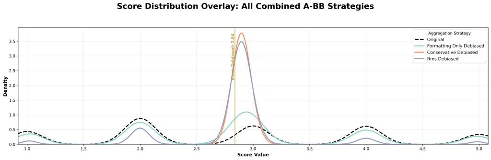
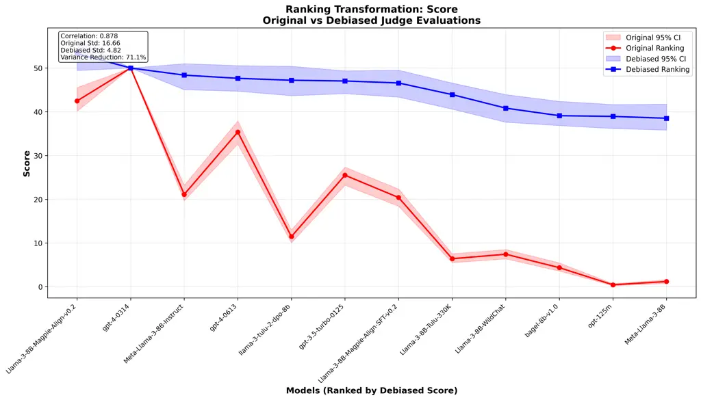
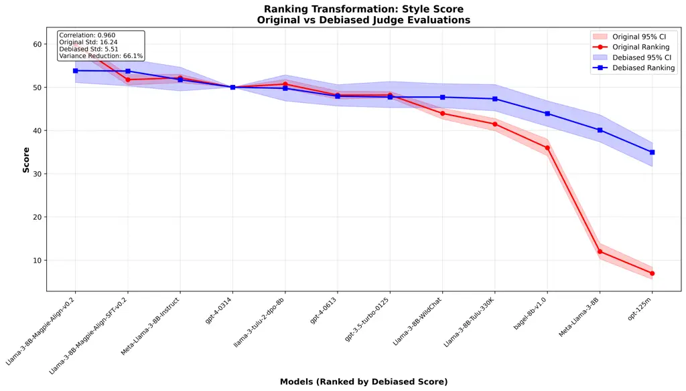
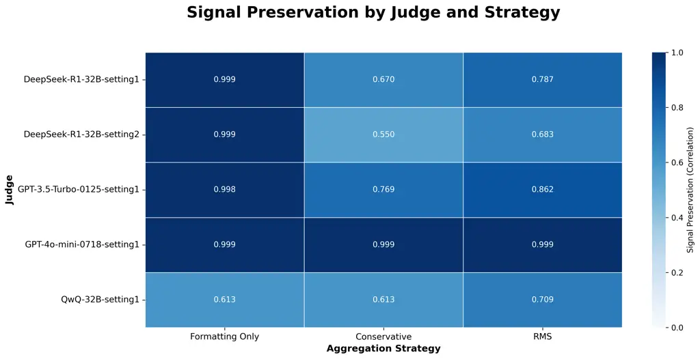

# Towards Provably Unbiased LLM Judges via Bias-Bounded Evaluation

Benjamin Feuer Affiliation: Stanford University Affiliation: Oumi.AI   
Lucas Rosenblatt Affiliation: New York University    Oussama Elachqar
Affiliation: Oumi.AI

###### Abstract

As AI models progress beyond simple chatbots into more complex
workflows, we draw ever closer to the event horizon beyond which AI
systems will be utilized in autonomous, self-maintaining feedback loops.
Any autonomous AI system will depend on automated, verifiable rewards
and feedback; in settings where ground truth is sparse or
non-deterministic, one practical source of such rewards is an
LLM-as-a-Judge. Although LLM judges continue to improve, the literature
has yet to introduce systems capable of enforcing standards with strong
guarantees, particularly when bias vectors are unknown or adversarially
discovered. To remedy this issue, we propose average bias-boundedness
(A-BB), an algorithmic framework which formally guarantees reductions of
harm/impact as a result of any measurable bias in an LLM judge.
Evaluating on Arena-Hard-Auto with four LLM judges, we achieve
($`\tau=0.5`$, $`\delta=0.01`$)-bias-bounded guarantees while retaining
61–99% correlation with original rankings across formatting and
schematic bias settings, with most judge-bias combinations exceeding
80%. The code to reproduce our findings is available at
[https://github.com/penfever/bias-bounded-evaluation](https://github.com/penfever/bias-bounded-evaluation).



Figure 1: Bias-bounded evaluation constrains the impact of harms in
judge scoring. This before-and-after visualization of the score
distributions from an LLM judge (Likert-scale) on the popular
Arena-Hard-Auto benchmark shows how true uncertainty can be captured via
a compacted score distribution. After the average bias-boundedness
(A-BB) algorithm is applied, the original integer-valued score are
transformed into a debiased, continuous trajectory which accurately
represents the measured uncertainty of the evaluation. The plot shows a
KDE density map of the score distribution before and after
transformation, with a conservative
$`\tau=0.5,\delta=0.03,\texttt{dim}=500`$, averaged across a panel of
four judges.

## 1 Introduction

Agentic workflows are an increasingly popular method of deploying large
language models (LLMs) in complex, real-world settings; it appears
increasingly likely that these agentic systems will soon be used in
autonomous, self-maintaining feedback loops \[32\]. This very year, for
instance, the 2026 AAAI Conference added an LLM judge (AI-Powered Peer
Review System) to the panel of reviewers for its scientific submissions,
with mixed results \[1\]. In autonomous deployments, the risk of harm is
greatly magnified; for instance, the well-known company Replit.AI
recently suffered an incident in which a client company database (with
thousands of entries) was accidentally deleted by an AI agent \[36\].

AI agents will not be safe to deploy autonomously in most contexts until
we have verifiable rewards and feedback. In settings where ground truth
is sparse or difficult to parse, the most practical source for such
feedback is an LLM-as-a-Judge \[44\]; by instantiating a (potentially
airgapped) judgment stage into the agentic feedback loop, it should, in
principle, be possible to detect and mitigate failures in real time.

Unfortunately, recent works show that LLM judges, in naive deployments,
present a range of distinct failure modes \[16, 38, 7, 31, 25\]. Worse
still, it remains unclear to what degree these effects are cumulative
when acting in concert. Last but not least, when it comes to bias, we
cannot help to ”know what we don’t know” – there will always remain bias
sources, including adversarially discovered sources, that we are capable
of measuring, but not explaining.

In order to mitigate these issues, we propose a novel framework:
bias-bounded evaluation (BBE) in Section 2. At a high level, BBE
measures how sensitive an LLM judge is to biases and then renders that
sensitivity in the judgment scores. Biases can be very simple (e.g.
varying presentation order or format) or arbitrarily complex; the only
limitation in this framework is that a bias must be subject to a valid
and reliable measure, in the units of judgment, in order to be targeted.
BBE injects calibrated Gaussian noise to the judge’s scores to mitigate
the effects of the bias, using a novel mechanism we call average
bias-boundedness (A-BB), described in detail in Section 3. An attentive
reader may notice that our mechanism takes inspiration from techniques
in differential privacy \[13\], though our analysis differs
substantially, as does our goal.

#### Contributions

Concretely, for any fixed judgment space, bias space and rubric factor,
we describe a mechanism that can, with high probability, formally bound
the likelihood that the average-case bias will exceed a particular
quantity. In particular, we consider our contributions as follows:

1.  1.  We propose bias-bounded evaluation, an algorithmic framework which
        formally guarantees reductions of harm/impact as a result of any
        measurable biases in an LLM judge, even when the causes of those
        biases are complex, intersecting or unknown.
2.  2.  We demonstrate empirically that BBE can retain signal and provide
        guarantees in realistic settings with large amounts of bias.
3.  3.  We release our codebase with a working implementation suitable for
        future development.¹¹ 1 Code available at
        [https://github.com/penfever/bias-bounded-evaluation](https://github.com/penfever/bias-bounded-evaluation).

## 2 Bias-Bounded Evaluation

Our assumptions in this analysis are light; we assume access to some
real-valued Judgment Space, and that an ideal judgment, for a particular
judge, exists for that space. The ideal judgment is not necessarily
correct; it simply represents the set of judgments the judge would have
rendered, conditioned on the inputs, in the absence of unwanted bias. As
we have discussed, bias in LLM-based evaluations can arise in many
subtle ways, from formatting to presentation order to some other latent,
unavoidable rubric factors. These sources of bias introduce systematic
deviations from what an ideal judgment would be. Inspired by the idea of
leveraging noise to bound sensitivity to perturbations of an output
vector (as is standard with worst-case guarantees in differential
privacy \[13\]), we introduce bias-bounded evaluation (BBE).
Bias-bounded evaluation measures how sensitive a judge is to contextual
perturbations, and then injects calibrated Gaussian noise to mitigate
the effects of the bias. We make the bias and the noise magnitude
quantifiable, so that BBE surfaces and mitigates epistemic uncertainty
in automated evaluation in a controlled manner.

### 2.1 Basic Definitions

We begin by establishing the mathematical framework for our analysis.

###### Definition 2.1 (Judgment Space).

Let $`\mathcal{J}`$ be the space of all possible judgments, where
judgment $`j\in\mathcal{J}`$ is a vector of scores:
$`j=(s_{1},s_{2},\ldots,s_{k},s_{overall})`$ and $`s_{i}`$ represents
the score for factor $`i`$ and $`s_{overall}`$ is the overall judgment
score.

###### Definition 2.2 (Rubric Factors).

Let $`\mathcal{R}=\{r_{1},r_{2},\ldots,r_{k}\}`$ be the set of explicit
rubric factors, where each $`r_{i}:\mathcal{P}\rightarrow\mathbb{R}`$
maps a prompt-response pair to a real-valued score.

###### Definition 2.3 (Bias Space).

Let $`\mathcal{B}`$ be the space of all possible bias functions, where
each $`b\in\mathcal{B}`$ represents a systematic deviation from ideal
judgment based on factors not captured in $`\mathcal{R}`$.

### 2.2 Judgment Context and Neighboring Contexts

###### Definition 2.4 (Judgment Context).

A judgment context $`D`$ is a dataset that contains: (1.) A set of
prompt-response pairs $`\{(p_{i},r_{i})\}_{i=1}^{n}`$, (2.) An
associated ground truth labels or reference judgments (if available),
and (3.) Environmental factors that may influence judgment (presentation
order, formatting, etc.)

###### Definition 2.5 (Neighboring Judgment Contexts).

Two judgment contexts $`D`$ and $`D^{\prime}`$ are neighboring (denoted
$`D\sim D^{\prime}`$) if they differ in exactly one prompt-response
pair, where that pair has been modified by a bias-introducing
perturbation that preserves germane semantic content (i.e., content
pertaining to the rubric criteria). Examples include: (i) formatting
perturbations such as reformatting or stylistic paraphrasing; (ii)
schematic perturbations that vary emphasis on rubric factors without
changing the response; and (iii) agreeableness perturbations that
introduce subtle errors to test whether the judge detects flaws.

## 3 Average Bias-Bounded Evaluation (A-BB)

We consider a mechanism that maps a fixed judgment context to a score
vector. This can be a highly sensitive mapping, and even small changes
in this input context can shift output scores; this “implicit bias” is
what we’d like to control.


Instead, we consider an average-case bias-bounded guarantee. Also,
instead of considering any two judgement contexts, we allow ourselves to
fix a judgement context, as we generally are assumed to control both the
judge and application setting and thus do not have to be sensitive to a
potentially adversarial selection of judgement context.

#### Defining A-BB

For average case bias boundedness, we fix a judgement context $`D`$.²² 2
This is akin to differentially private local sensitivity \[29, 12\].
Then, we instantiate a function $`T`$ to be a randomized neighbor
generator. Let $`T:\mathcal{D}\to\mathcal{D}`$. Let
$`D^{\prime}\underset{T}{\sim}D`$ be a neighboring dataset resulting
from a random draw from the generator, $`D^{\prime}=T(D)`$. The
randomness here could come from any measurable source(s) of bias.
Furthermore, we consider a root-mean squared error, which is convenient
due to positivity (a similar choice is often made when doing
$`\ell_{2}`$ smooth-sensitivity analysis in differential privacy³³ 3
Additionally, we note that if $`T`$ truly sampled uniformly from the
Hamming-1 token neighbors of the judgement context, then the
root-mean-squared sensitivity would be exactly the average-case analogue
of the local sensitivity (used by smooth sensitivity).).

###### Definition 3.1 (Root-mean-squared sensitivity).

For a deterministic judge $`f:\mathcal{D}\to\mathbb{R}^{d}`$ and fixed
context $`D`$, we define,

```math
\displaystyle\Delta^{*}_{2}(f,D)=\left(\mathbb{E}_{D^{\prime}\underset{T}{\sim}D}[\|f(D)-f(D^{\prime})\|_{2}^{2}]\right)^{1/2}~.
```

###### Definition 3.2 (Average bias boundedness (A-BB)).

For a fixed judgement context $`D`$, neighbor generator $`T`$, tolerance
$`\tau>0`$, and failure probability $`\delta\in(0,1)`$, we say a
randomized mechanism $`M:\mathcal{D}\mapsto\mathbb{R}^{d}`$ is
$`(\tau,\delta)`$-average bias-bounded if,

```math
\displaystyle\Pr[\|M(D)-M(D^{\prime})\|_{2}>\tau]\leq\delta,
```

where the probability is taken over both the randomness of the neighbor
generator $`T`$ (i.e., the draw $`D^{\prime}\underset{T}{\sim}D`$) and
the internal randomness of mechanism $`M`$.

In other words, we will seek to control the tail probability that a
random perturbation (drawn from neighbor generator $`T`$) together with
the randomness that comes from the noise mechanism $`M`$ causes more
than a $`\tau`$ change in the output.


We now give the mechanism and analysis, along with the noise addition
stated in algorithmic form in Algorithm 1. Note that in what follows we
assume $`f`$ is deterministic and that the mechanism noises
$`Z,~Z^{\prime}`$ are independent of each other and of
$`D^{\prime}\underset{T}{\sim}D`$ (i.e., any base-judge randomness is
either folded into $`f`$ or modeled via $`Z`$).

###### Theorem 3.3 (Gaussian mech. for A-BB: a baseline split bound).

Consider a judgement context $`D`$ and a neighbor generator $`T`$. Let
$`\Delta:=f(D)-f(D^{\prime})`$ where $`D^{\prime}\underset{T}{\sim}D`$.
Let $`M_{\sigma}(D)=f(D)+Z`$ with
$`Z\sim\mathcal{N}(0,\sigma^{2}I_{d})`$, and further let
$`B:=Z-Z^{\prime}`$, where we set $`Z^{\prime}`$ as an independent copy
of $`Z`$, so $`B\sim\mathcal{N}(0,2\sigma^{2}I_{d})`$. Then for any
$`\delta_{B}\in(0,1)`$ and any threshold $`a\in(0,\tau)`$, if

```math
\displaystyle\sqrt{2\sigma^{2}\left(d+2\sqrt{d\log(1/\delta_{B})}+2\log(1/\delta_{B})\right)}\leq\tau-a~,
```

or, equivalently, for any $`\sigma`$ in the admissible interval
$`0<\sigma\leq\sigma_{\max}`$ where,

```math
\displaystyle\sigma_{\max}:=\frac{\tau-a}{\sqrt{2\left(d+2\sqrt{d\log(1/\delta_{B})}+2\log(1/\delta_{B})\right)}}~,
```

$`M_{\sigma}(D)`$ satisfies $`(\tau,\delta)`$-average bias boundedness
(Definition 3.2) with

```math
\displaystyle\delta=\delta_{B}+\frac{\Delta_{2}^{*}(f,D)^{2}}{a^{2}}~.
```

We defer the proof of Theorem 3.3 to Appendix A.

Setting $`a=\Delta_{2}^{*}(f,D)/\sqrt{\delta_{\Delta}}`$ yields an
explicit split, which we state below in Corollary 3.4 (this is a direct
application of Theorem 3.3, and again we defer the short proof to
Appendix A).

###### Corollary 3.4 (Splitting the failure budget).

Fix $`\tau>0`$ and a split $`\delta=\delta_{B}+\delta_{\Delta}`$ with
$`\delta_{B},\delta_{\Delta}\in(0,1)`$. Assume
$`\tau>\Delta^{*}_{2}(f,D)/\sqrt{\delta_{\Delta}}`$. Then the Gaussian
mechanism $`M_{\sigma}(D)=f(D)+Z`$,
$`Z\sim\mathcal{N}(0,\sigma^{2}I_{d})`$, satisfies
$`(\tau,\delta)`$-A-BB for any $`0<\sigma\leq\sigma_{\max}`$ where,

```math
\displaystyle\sigma_{\max}=\frac{\tau-\Delta^{*}_{2}(f,D)/\sqrt{\delta_{\Delta}}}{\sqrt{2\left(d+2\sqrt{d\log(1/\delta_{B})}+2\log(1/\delta_{B})\right)}}~. \tag{1}
```

###### Corollary 3.5 (Symmetric split).

If we let $`\delta_{B}=\delta_{\Delta}=\delta/2`$ in Corollary 3.4, we
get,

```math
\displaystyle\sigma\leq\frac{\tau-\Delta_{2}^{*}(f,D)\sqrt{2/\delta}}{\sqrt{2\left(d+2\sqrt{d\log(2/\delta)}+2\log(2/\delta)\right)}}~,
```

so long as $`\tau>\Delta_{2}^{*}(f,D)\sqrt{2/\delta}`$.

In Remark 3.6, we consider how by setting $`\Delta=a`$, the split
calibration tightens the Gaussian radius relative to a no-split bound at
the same $`\tau`$. In Remark 3.7, for convenience we give the standard
2-norm utility expectation result of adding $`d`$-dimensional Gaussian
noise in this manner. Short proofs again deferred to Appendix A.

###### Remark 3.6 (Why splitting helps).

Note that, for any $`\tau>0`$ and any $`\Delta\in[0,\tau)`$, we have
that,

```math
\displaystyle\frac{\tau-\Delta}{\sqrt{\tau^{2}-\Delta^{2}}}=\sqrt{\frac{\tau-\Delta}{\tau+\Delta}}<1~.
```

###### Remark 3.7 (Utility).

The following is a standard fact of adding Gaussian noise in $`d`$
dimensions,

```math
\displaystyle\mathbb{E}\|M_{\sigma}(D)-f(D)\|_{2}^{2}=d\sigma^{2}~.
```

Overall, in the above average case analysis, we try to shrink $`\sigma`$
(the variance of the Gaussian noise we add) analytically as much as
possible such that we can still get a meaningful guarantee on the tail
probability for the A-BB statement. For convenience, we also state the
procedure in Algorithm 1 below, with the correct splitting and
$`\sigma`$ parameter; this is the exact procedure we use in our
experimentation.

0:  Base judge $`f`$, judgment context $`D`$, neighbor generator $`T`$,
params $`(\tau,\delta)`$

0:  $`(\tau,\delta)`$-average bias-bounded judgment $`j^{\prime}`$

1:  First compute raw judgment $`j=f(D)`$

2:  Then, estimate root-mean-squared sensitivity, by

3:   Sampling $`m`$ neighbors
$`D^{\prime}_{1},\dots,D^{\prime}_{m}\underset{T}{\sim}D`$

4:   To assign
$`\Delta_{2}^{*}(f,D)\leftarrow(\frac{1}{m}\sum_{i=1}^{m}\|f(D)-f(D^{\prime}_{i})\|_{2}^{2})^{1/2}`$

5:  Then, split failure budget as $`\delta_{B}=\delta/2`$,
$`\delta_{\Delta}=\delta/2`$

6:  Ensure that we meet requirement of
$`\tau>\Delta_{2}^{*}(f,D)\sqrt{2/\delta}`$

7:  Then, compute the maximal admissible noise parameter, or

8:
  $`\sigma\leftarrow\frac{\tau-\Delta_{2}^{*}(f,D)\sqrt{2/\delta}}{\sqrt{2\left(d+2\sqrt{d\log(2/\delta)}+2\log(2/\delta)\right)}}`$

9:  Choose any $`\sigma\in(0,\sigma_{\max}]`$ (by default,
$`\sigma\leftarrow\sigma_{\max}`$ for a tight certificate; smaller
$`\sigma`$ strictly improves utility)

10:  Finally, sample noise $`Z\sim\mathcal{N}(0,\sigma^{2}I_{d})`$,

11:  And return noisy judgment $`j^{\prime}\leftarrow j+Z`$.

Algorithm 1 A-BB Gaussian Mechanism

#### Lipschitz shrinkage of data

One algorithmic adjustment we make, which is heuristically based on the
distributions of judgement scores we observe, is a deterministic
Lipschitz shrinkage of the judgement score data around a center point.
This shrinkage dampens how much scores can move under small contextual
perturbations, so less Gaussian noise is needed to achieve the same
$`(\tau,\delta)`$ guarantee. In general, an $`L`$-Lipschitz mapping is a
standard approach to contracting all neighbor-to-neighbor score
differences by at most $`L`$ in a dataset \[5\]; here we do this to
tighten the A-BB certificate with minimal impact on data point order.
More formally, before adding Gaussian noise in Algorithm 1, we
deterministically post-process scores via any $`L`$-Lipschitz map
$`g:\mathbb{R}^{d}\to\mathbb{R}^{d}`$ (with e.g., affine shrinkage
$`g(x)=\alpha x+(1-\alpha)\mu`$ with $`L=\alpha`$). This targets the RMS
sensitivity (Definition 3.1):
$`\Delta_{2}^{*}(g\circ f,D)\leq L\Delta_{2}^{*}(f,D)`$ (Lemma B.1).
Calibrating $`\sigma`$ using the same formula as above but replacing
$`\Delta_{2}^{*}(f,D)`$ by $`L\Delta_{2}^{*}(f,D)`$ (or by a direct
estimate of $`\Delta_{2}^{*}(g\circ f,D)`$) preserves the
$`(\tau,\delta)`$ A-BB certificate while trading a small amount of
utility for improved certifiability. We give full formal details on this
in Appendix B.

## 4 Experiments

Benchmark. We study Arena-Hard Auto \[26\], a popular LLM-judged
benchmark built from 500 challenging Chatbot Arena queries, intended to
approximate Arena preferences. It reports high separability and strong
correlation with human rankings, making it an excellent candidate for
robust meta-analysis.

Judges. We evaluate four judge models: GPT-4o-mini-0718, QwQ-32B,
DeepSeek-R1-Distill-32B, and GPT-3.5-Turbo \[40, 30, 10\].

Combination Logic. Context-aware sensitivities are derived for
formatting ($`S_{\mathrm{fmt}}`$) and schematic adherence
($`S_{\mathrm{sch}}`$) by fitting their estimators and, when intrinsic
jitter is available, calling $`\operatorname{context\_adjusted\_rms}`$
to fold that variance into each static estimate. Each component is
lower-bounded at $`10^{-3}`$ before aggregation to avoid passing zero
sensitivity. We consider the following combination strategies.

1.  1.  Conservative (combined*abb_conservative):
        $`\hat{S}=\max{(S*{\mathrm{fmt}},S*{\mathrm{psy}},S*{\mathrm{sch}})}`$
2.  2.  RMS (combined*abb_rms):
        $`\hat{S}=\sqrt{(S*{\mathrm{fmt}}^{2}+S*{\mathrm{psy}}^{2}+S*{\mathrm{sch}}^{2})/3}`$

In our experiments, we utilize combined_abb_rms.

Hyperparameters. In the results shown in the main paper, we fix
$`\tau=0.05`$ and $`\texttt{dim}=500`$, the number of questions in the
Arena-Hard-Auto benchmark. We explore settings for $`\delta`$ ranging
from $`0.01`$ to $`0.05`$.

Inherent jitter. We run the forward judgment pass five times and compute
the RMS sensitivity across runs. This is used to measure the naturally
occurring variance in judgment which is not biased by any external
factors we wish to control.

Formatting sensitivity. It has been observed that large language models
can be extremely sensitive to prompt formatting \[34\]. This
long-standing bias is relatively straightforward to model via a simple
generative mechanism that uses LLMs to produce highly similar semantic
variants of model responses. We implement such a mechanism and measure
the sensitivity in our judges, and find that it is generally fairly
large, with considerable variance across judges.

Schematic adherence. This measures the degree to which an LLM judge’s
overall judgments can be explained as a function of its per-criteria
(factor-wise) judgments \[17\]. We fit polynomial regression models with
interaction terms and define sensitivity as
$`S_{\text{sch}}=\sqrt{1-R^{2}_{\text{schematic}}}`$; see Appendix C for
details.

### 4.1 Controlling formatting sensitivity bias.

In figure 2, we demonstrate the revised scores generated by BBE after
accounting for observed formatting sensitivity in a QwQ-32B judge on
Arena-Hard-Auto. The biased judge exhibits a troubling and common trend;
high-performing models receive inflated scores while maintaining
reasonable confidence intervals, resulting in an overall distribution
which contains systematic biases.



Figure 2: Bias-bounded transformation for formatting sensitivity. The
blue line in this figure corresponds to the debiased ranking generated
by a QwQ-32B judge after using BBE with $`\tau=0.5`$ to control
formatting sensitivity. Even with low $`\tau`$ tolerance, we are able to
retain 88% correlation with the original judgments in this realistic
perturbation setting.

After BBE, we observe substantial variance reduction in the scores,
indicating that we have successfully mitigated the judgment bias. At the
same time, the debiased judgments retain strong signal, with an 81%
correlation to the original ranking. The apparent ”certainty” of extreme
judgments (e.g., facebook/opt-125m scoring 0.12 with CI width 0.24) is
revealed as bias-induced false confidence, while the compressed scores
represent genuine comparative signal with guarantees against failure.

### 4.2 Controlling schematic bias.



Figure 3: Bias-bounded evaluation in schematic sensitivity. Even when
measured bias is large, we are able to eliminate much potentially biased
variance while retaining near-perfect correlation with the original
judgments.($`\tau=0.5`$)

Observed scores for schematic bias tend to be much larger than those of
formatting bias, as they generally reflect structural weaknesses in the
benchmark design rather than quasi-random failures of a particular
judge. In Figure 3, despite using a relatively old GPT 3.5 judge, the
bias-bounded mechanism successfully compresses this extreme distribution
into a realistic range while maintaining the ranking correlation nearly
perfectly, further illustrating the mechanism’s ability to distinguish
between genuine performance differences and bias-induced score
inflation. When using the more recent GPT 4o Mini as a judge, the
correlation becomes nearly perfect.



Figure 4: Correlative strength varies by judge and by dataset. Although
conservative aggregation strategies are always more difficult to debias,
and simpler biases such as formatting are consistently easier to debias,
other factors, such as the underlying dataset, can also have large
effects.

## 5 Related Work

Recent work has identified several critical bias issues in LLM judges.
The CALM framework \[38\] quantifies 12 distinct bias types in
LLM-as-judge systems, while research on “preference leakage” \[7\]
demonstrates that LLMs exhibit systematic bias toward their own outputs
and similar models used in training data. The “Leaderboard Illusion”
\[8\] provides evidence that prominent evaluation platforms like ChatBot
Arena can be gamed by organizations with access to private testing. The
“Limits to Scalable Evaluation at the Frontier” work \[25\] shows that
when judge accuracy equals evaluated model accuracy, debiasing methods
can only reduce ground truth requirements by half, requiring bias to be
small across all evaluated models. Research on individual preferences
\[33\] demonstrates that different user groups systematically prefer
different LLM responses, supporting the need for bias-bounded evaluation
that can accommodate diverse judgment patterns.

Specialized benchmarks have emerged to evaluate judge quality, including
JudgeBench \[42\] for assessing LLM-based judges, LLMBar \[43\] for
instruction following evaluation, and JETTS \[39\] for evaluating judges
as evaluators. SafetyAnalyst \[28\] represents specialized applications
using LLM judgments with structured evaluation through “harm-benefit
trees” and interpretable weight parameters for aggregating safety
assessments.

Closest to our work is the “Trust or Escalate” framework \[31\], which
provides rigorous guarantees of human agreement using cascaded LLM
judges with calibrated confidence thresholds. Trust or Escalate uses
“Simulated Annotators”—ensemble agreement from multiple prompted
perspectives—to estimate confidence, then abstains on low-confidence
cases or escalates to stronger models. The guarantee is specifically:
$`P(\text{LLM agrees with human}\mid\text{LLM evaluates})\geq 1-\alpha`$.
Crucially, this framework sidesteps bias by abstaining when uncertain
rather than bounding bias impact, requires human-labeled calibration
data, and applies only to pairwise preference evaluation. In contrast,
A-BB provides guarantees on all evaluations (no abstention), handles
adversarially discovered biases whose magnitude is bounded by measured
sensitivities, requires no human labels, and extends to general scoring
beyond pairwise comparison. We summarize these differences in Table 1.

|                                   |     |               |
| --------------------------------- | --- | ------------- |
| Property                          | ToE | A-BB          |
| Guarantees on all evaluations     | ✗   | ✓             |
| Handles unknown biases^(†)        | ✗   | $`\bm{\sim}`$ |
| No human labels required          | ✗   | ✓             |
| General scoring (beyond pairwise) | ✗   | ✓             |
| Bounds bias impact directly       | ✗   | ✓             |
| Human agreement guarantee^(‡)     | ✓   | $`\bm{\sim}`$ |
| Selective abstention              | ✓   | ✗             |

^(†)A-BB bounds unknown biases only if their RMS sensitivity is bounded
by that of measured biases.  
^(‡)A-BB can be combined with conformal prediction methods \[41\] to
obtain human agreement guarantees.

Table 1: Comparison of our Average Bias-Boundedness (A-BB) with the best
known existing framework for guaranteeing LLM judgments, Trust or
Escalate (ToE).

#### Formal guarantees and uncertainty quantification.

Recent work has begun providing statistical guarantees for LLM judge
outputs. Conformal prediction has emerged as a distribution-free
framework for quantifying judge uncertainty; Ye et al. \[41\] apply
split conformal prediction to construct prediction intervals with
finite-sample coverage guarantees, ensuring that intervals contain the
true judgment value at a user-specified rate. While conformal methods
bound uncertainty in individual judgments, our A-BB framework bounds the
impact of systematic biases across evaluation batches—the two approaches
are complementary. On the calibration front, Huang et al. \[19\] propose
extracting uncertainty signals from LLM internal representations via
linear probes, addressing the well-documented overconfidence problem in
LLM judges without requiring expensive fine-tuning or architectural
modifications.

#### Scoring bias and agreeableness.

Beyond the bias types catalogued by CALM, recent work has identified
additional failure modes. Son et al. \[35\] define “scoring bias” as
judgment shifts under superficial perturbations, identifying three
specific variants: rubric order bias, score ID bias, and reference
answer bias—all of which manifest as sensitivity to factors orthogonal
to response quality. Our neighbor generator framework naturally captures
such perturbations. Separately, research on agreeableness bias \[27\]
reveals that LLM judges exhibit True Negative Rates below 25%,
indicating systematic over-agreement with evaluated outputs. This
tendency to validate rather than critique represents a bias pattern that
A-BB can help bound, as it manifests as measurable sensitivity to the
presence of errors in evaluated content.

## 6 Limitations

Our bias-bounded framework addresses measurable systematic bias patterns
but makes no claims about absolute accuracy, whether scores are
calibrated well across multiple judges, or whether judges are actually
judging all aspects of their input. The guarantee provided by our
framework also can be misinterpreted if the measures used to calibrate
bias are not reliable (e.g., if they miss a bias source of greater
magnitude than any that is considered). There is, however, considerable
ongoing work in these areas, and we see our efforts as complementary to
those. Last but not least, the preferences of an LLM judge are
themselves a bias pattern (in the sense that they are systematic
deviations from random noise); A-BB is not a ”magic bullet”, and will be
much more effective in retaining true signal when the intrinsic jitter
and systematic bias of the underlying judge is weaker.

#### Finite-sample estimation.

Our theoretical guarantees (Theorems 3.3 and 3.4) assume access to the
true root-mean-squared sensitivity $`\Delta_{2}^{*}(f,D)`$, which is
defined as an expectation over the neighbor generator $`T`$. In
practice, Algorithm 1 estimates this quantity empirically using $`m`$
sampled neighbors. With finite $`m`$, there is a non-zero probability
that the empirical estimate underestimates the true sensitivity, which
could cause the actual failure probability to exceed $`\delta`$.
Practitioners should mitigate this by using sufficiently large $`m`$, or
by adding a confidence margin (e.g., using an upper confidence bound on
the sensitivity estimate). Formally incorporating this estimation
uncertainty into the $`\delta`$ budget via concentration inequalities
(e.g., Chernoff bounds) is a direction for future work.

## 7 Conclusion

We have presented a formal framework for providing bias-bounded
guarantees in LLM judge mechanisms. Broadly scoped formal guarantees,
wedded to the power of LLM judges, enable use cases previously
considered challenging, such as conducting social sciences research with
the aid of LLMs, or determining a candidate’s suitability for a loan.
Rather than attempting to enumerate and eliminate every possible bias
source on a case by case basis, our insight is that by guaranteeing any
bias pattern of sufficient magnitude will be indistinguishable from
noise, we can enable greater confidence in LLM judges. The framework is
general enough to apply to various LLM evaluation scenarios while
providing the mathematical rigor needed for formal bias bounds.

## Reproducibility Statement

We have, to the best of our ability, ensured that all experiments
described in this paper are reproducible in principle. In order to
facilitate this, we provide source code containing everything needed to
reproduce our experiments at
[https://github.com/penfever/bias-bounded-evaluation](https://github.com/penfever/bias-bounded-evaluation).

## Impact Statement

This paper presents work whose goal is to advance the field of Machine
Learning, specifically in providing formal guarantees for LLM-based
evaluation systems. Our framework for bias-bounded evaluation aims to
make AI systems more reliable and trustworthy by quantifying and
mitigating systematic biases in LLM judges. While we believe this work
has positive implications for the safe deployment of autonomous AI
systems, we acknowledge that any evaluation framework can potentially be
misused. We encourage practitioners to use this framework as part of a
broader evaluation strategy that includes human oversight.

## References

- \[1\] AAAI (2025) AAAI launches AI-powered peer review assessment
  system. AAAI. Note:
  [https://bit.ly/4b8Z4mH](https://bit.ly/4b8Z4mH)Press release
  announcing pilot program for AAAI-26 conference Cited by: §1.
- \[2\] B. Balle and Y. Wang (2018) Improving the gaussian mechanism for
  differential privacy: analytical calibration and optimal denoising. In
  ICML, Cited by: Appendix B.
- \[3\] H. H. Bauschke and P. L. Combettes (2017) Convex analysis and
  monotone operator theory in hilbert spaces. 2nd edition, Springer.
  Cited by: 2nd item.
- \[4\] Y. Benjamini and Y. Hochberg (1995) Controlling the false
  discovery rate: a practical and powerful approach to multiple testing.
  Journal of the Royal Statistical Society Series B 57 (1), pp. 289–300.
  Cited by: Appendix B.
- \[5\] S. P. Boyd and L. Vandenberghe (2004) Convex optimization.
  Cambridge university press. Cited by: §3.
- \[6\] K. Chaudhuri, C. Monteleoni, and A. D. Sarwate (2011)
  Differentially private empirical risk minimization. Journal of Machine
  Learning Research 12, pp. 1069–1109. Cited by: Appendix B.
- \[7\] W. Chen, Y. Qian, Z. Li, et al. (2024) Preference leakage: a
  contamination problem in llm-as-a-judge. arXiv preprint. Cited by: §1,
  §5.
- \[8\] P. Clark, S. Thompson, and M. Davis (2024) The leaderboard
  illusion: how chatbot arena rankings can be gamed. arXiv preprint.
  Cited by: §5.
- \[9\] R. Cummings, D. Desfontaines, D. Evans, R. Geambasu, Y.
  Huang, M. Jagielski, P. Kairouz, G. Kamath, S. Oh, O. Ohrimenko, et
  al. (2024) Advancing differential privacy: where we are now and future
  directions for real-world deployment. Harvard data science review 6
  (1). Cited by: §3.
- \[10\] DeepSeek-AI, D. Guo, D. Yang, H. Zhang, J. Song, R. Zhang, R.
  Xu, Q. Zhu, S. Ma, P. Wang, X. Bi, X. Zhang, X. Yu, Y. Wu, Z. F.
  Wu, Z. Gou, Z. Shao, Z. Li, Z. Gao, A. Liu, B. Xue, B. Wang, B. Wu, B.
  Feng, C. Lu, C. Zhao, C. Deng, C. Zhang, C. Ruan, D. Dai, D. Chen, D.
  Ji, E. Li, F. Lin, F. Dai, F. Luo, G. Hao, G. Chen, G. Li, H.
  Zhang, H. Bao, H. Xu, H. Wang, H. Ding, H. Xin, H. Gao, H. Qu, H.
  Li, J. Guo, J. Li, J. Wang, J. Chen, J. Yuan, J. Qiu, J. Li, J. L.
  Cai, J. Ni, J. Liang, J. Chen, K. Dong, K. Hu, K. Gao, K. Guan, K.
  Huang, K. Yu, L. Wang, L. Zhang, L. Zhao, L. Wang, L. Zhang, L. Xu, L.
  Xia, M. Zhang, M. Zhang, M. Tang, M. Li, M. Wang, M. Li, N. Tian, P.
  Huang, P. Zhang, Q. Wang, Q. Chen, Q. Du, R. Ge, R. Zhang, R. Pan, R.
  Wang, R. J. Chen, R. L. Jin, R. Chen, S. Lu, S. Zhou, S. Chen, S.
  Ye, S. Wang, S. Yu, S. Zhou, S. Pan, S. S. Li, S. Zhou, S. Wu, S.
  Ye, T. Yun, T. Pei, T. Sun, T. Wang, W. Zeng, W. Zhao, W. Liu, W.
  Liang, W. Gao, W. Yu, W. Zhang, W. L. Xiao, W. An, X. Liu, X. Wang, X.
  Chen, X. Nie, X. Cheng, X. Liu, X. Xie, X. Liu, X. Yang, X. Li, X.
  Su, X. Lin, X. Q. Li, X. Jin, X. Shen, X. Chen, X. Sun, X. Wang, X.
  Song, X. Zhou, X. Wang, X. Shan, Y. K. Li, Y. Q. Wang, Y. X. Wei, Y.
  Zhang, Y. Xu, Y. Li, Y. Zhao, Y. Sun, Y. Wang, Y. Yu, Y. Zhang, Y.
  Shi, Y. Xiong, Y. He, Y. Piao, Y. Wang, Y. Tan, Y. Ma, Y. Liu, Y.
  Guo, Y. Ou, Y. Wang, Y. Gong, Y. Zou, Y. He, Y. Xiong, Y. Luo, Y.
  You, Y. Liu, Y. Zhou, Y. X. Zhu, Y. Xu, Y. Huang, Y. Li, Y. Zheng, Y.
  Zhu, Y. Ma, Y. Tang, Y. Zha, Y. Yan, Z. Z. Ren, Z. Ren, Z. Sha, Z.
  Fu, Z. Xu, Z. Xie, Z. Zhang, Z. Hao, Z. Ma, Z. Yan, Z. Wu, Z. Gu, Z.
  Zhu, Z. Liu, Z. Li, Z. Xie, Z. Song, Z. Pan, Z. Huang, Z. Xu, Z.
  Zhang, and Z. Zhang (2025) DeepSeek-r1: incentivizing reasoning
  capability in llms via reinforcement learning. External Links:
  2501.12948, [Link](https://arxiv.org/abs/2501.12948) Cited by: §4.
- \[11\] J. Dong, A. Roth, and W. J. Su (2022) Gaussian differential
  privacy. Journal of the Royal Statistical Society Series B 84 (1),
  pp. 3–37. Cited by: 3rd item.
- \[12\] C. Dwork and J. Lei (2009) Differential privacy and robust
  statistics. In Proceedings of the forty-first annual ACM symposium on
  Theory of computing, pp. 371–380. Cited by: footnote 2.
- \[13\] C. Dwork, F. McSherry, K. Nissim, and A. Smith (2006)
  Calibrating noise to sensitivity in private data analysis. Theory of
  cryptography conference, pp. 265–284. Cited by: Appendix B, §1, §2.
- \[14\] C. Dwork and A. Roth (2014) The algorithmic foundations of
  differential privacy. Foundations and Trends in Theoretical Computer
  Science 9 (3–4), pp. 211–407. Cited by: §3.
- \[15\] B. Efron and C. Morris (1973) Stein’s estimation rule and its
  competitors—an empirical bayes approach. Journal of the American
  Statistical Association 68 (341), pp. 117–130. Cited by: Appendix B.
- \[16\] B. Feuer, M. Goldblum, T. Datta, S. Nambiar, R. Besaleli, S.
  Dooley, M. Cembalest, and J. P. Dickerson (2024) Style outweighs
  substance: failure modes of llm judges in alignment benchmarking.
  External Links: 2409.15268, [Link](https://arxiv.org/abs/2409.15268)
  Cited by: §1.
- \[17\] B. Feuer, C. Tseng, A. S. Lathe, O. Elachqar, and J. P.
  Dickerson (2025) When judgment becomes noise: how design failures in
  llm judge benchmarks silently undermine validity. External Links:
  2509.20293, [Link](https://arxiv.org/abs/2509.20293) Cited by:
  Appendix C, Appendix C, §4.
- \[18\] E. Hazan (2016) Introduction to online convex optimization. MIT
  Press. Cited by: Appendix B.
- \[19\] S. Huang, W. Chen, Y. Zhang, and Y. Liu (2025) Calibrating LLM
  judges: linear probes for fast and reliable uncertainty estimation.
  arXiv preprint arXiv:2512.22245. Cited by: §5.
- \[20\] P. J. Huber and E. M. Ronchetti (2009) Robust statistics. 2nd
  edition, Wiley. Cited by: Appendix B.
- \[21\] W. James and C. Stein (1961) Estimation with quadratic loss. In
  Proceedings of the Fourth Berkeley Symposium on Mathematical
  Statistics and Probability, Vol. 1, pp. 361–379. Cited by: Appendix B.
- \[22\] P. Kairouz, S. Oh, and P. Viswanath (2015) The composition
  theorem for differential privacy. In International Conference on
  Machine Learning (ICML), pp. 1376–1385. Cited by: Appendix B.
- \[23\] B. Laurent and P. Massart (2000) Adaptive estimation of a
  quadratic functional by model selection. Annals of statistics,
  pp. 1302–1338. Cited by: Appendix A.
- \[24\] O. Ledoit and M. Wolf (2004) A well-conditioned estimator for
  large-dimensional covariance matrices. Journal of Multivariate
  Analysis 88 (2), pp. 365–411. Cited by: Appendix B.
- \[25\] H. Li, T. Zhang, J. Chen, et al. (2024) Limits to scalable
  evaluation at the frontier: llm as judge for llm. arXiv preprint.
  Cited by: §1, §5.
- \[26\] T. Li, W. Chiang, E. Frick, L. Dunlap, T. Wu, B. Zhu, J. E.
  Gonzalez, and I. Stoica (2024) From crowdsourced data to high-quality
  benchmarks: arena-hard and benchbuilder pipeline. External Links:
  2406.11939, [Link](https://arxiv.org/abs/2406.11939) Cited by: §4.
- \[27\] C. Liu, Z. Tan, and Y. Wang (2025) Beyond consensus: mitigating
  the agreeableness bias in LLM judge evaluations. arXiv preprint. Cited
  by: §5.
- \[28\] M. Mazeika, L. Phan, X. Wang, et al. (2024) SafetyAnalyst:
  interpretable, transparent, and steerable llm safety evaluation. arXiv
  preprint. Cited by: §5.
- \[29\] K. Nissim, S. Raskhodnikova, and A. Smith (2007) Smooth
  sensitivity and sampling in private data analysis. In Proceedings of
  the thirty-ninth annual ACM symposium on Theory of computing,
  pp. 75–84. Cited by: footnote 2.
- \[30\] OpenAI, :, A. Hurst, A. Lerer, A. P. Goucher, A. Perelman, A.
  Ramesh, A. Clark, A. Ostrow, A. Welihinda, A. Hayes, A. Radford, A.
  Madry, A. Baker-Whitcomb, A. Beutel, A. Borzunov, A. Carney, A.
  Chow, A. Kirillov, A. Nichol, A. Paino, A. Renzin, A. T. Passos, A.
  Kirillov, A. Christakis, A. Conneau, A. Kamali, A. Jabri, A. Moyer, A.
  Tam, A. Crookes, A. Tootoochian, A. Tootoonchian, A. Kumar, A.
  Vallone, A. Karpathy, A. Braunstein, A. Cann, A. Codispoti, A.
  Galu, A. Kondrich, A. Tulloch, A. Mishchenko, A. Baek, A. Jiang, A.
  Pelisse, A. Woodford, A. Gosalia, A. Dhar, A. Pantuliano, A. Nayak, A.
  Oliver, B. Zoph, B. Ghorbani, B. Leimberger, B. Rossen, B.
  Sokolowsky, B. Wang, B. Zweig, B. Hoover, B. Samic, B. McGrew, B.
  Spero, B. Giertler, B. Cheng, B. Lightcap, B. Walkin, B. Quinn, B.
  Guarraci, B. Hsu, B. Kellogg, B. Eastman, C. Lugaresi, C.
  Wainwright, C. Bassin, C. Hudson, C. Chu, C. Nelson, C. Li, C. J.
  Shern, C. Conger, C. Barette, C. Voss, C. Ding, C. Lu, C. Zhang, C.
  Beaumont, C. Hallacy, C. Koch, C. Gibson, C. Kim, C. Choi, C.
  McLeavey, C. Hesse, C. Fischer, C. Winter, C. Czarnecki, C. Jarvis, C.
  Wei, C. Koumouzelis, D. Sherburn, D. Kappler, D. Levin, D. Levy, D.
  Carr, D. Farhi, D. Mely, D. Robinson, D. Sasaki, D. Jin, D.
  Valladares, D. Tsipras, D. Li, D. P. Nguyen, D. Findlay, E. Oiwoh, E.
  Wong, E. Asdar, E. Proehl, E. Yang, E. Antonow, E. Kramer, E.
  Peterson, E. Sigler, E. Wallace, E. Brevdo, E. Mays, F.
  Khorasani, F. P. Such, F. Raso, F. Zhang, F. von Lohmann, F. Sulit, G.
  Goh, G. Oden, G. Salmon, G. Starace, G. Brockman, H. Salman, H.
  Bao, H. Hu, H. Wong, H. Wang, H. Schmidt, H. Whitney, H. Jun, H.
  Kirchner, H. P. de Oliveira Pinto, H. Ren, H. Chang, H. W. Chung, I.
  Kivlichan, I. O’Connell, I. O’Connell, I. Osband, I. Silber, I.
  Sohl, I. Okuyucu, I. Lan, I. Kostrikov, I. Sutskever, I.
  Kanitscheider, I. Gulrajani, J. Coxon, J. Menick, J. Pachocki, J.
  Aung, J. Betker, J. Crooks, J. Lennon, J. Kiros, J. Leike, J. Park, J.
  Kwon, J. Phang, J. Teplitz, J. Wei, J. Wolfe, J. Chen, J. Harris, J.
  Varavva, J. G. Lee, J. Shieh, J. Lin, J. Yu, J. Weng, J. Tang, J.
  Yu, J. Jang, J. Q. Candela, J. Beutler, J. Landers, J. Parish, J.
  Heidecke, J. Schulman, J. Lachman, J. McKay, J. Uesato, J. Ward, J. W.
  Kim, J. Huizinga, J. Sitkin, J. Kraaijeveld, J. Gross, J. Kaplan, J.
  Snyder, J. Achiam, J. Jiao, J. Lee, J. Zhuang, J. Harriman, K.
  Fricke, K. Hayashi, K. Singhal, K. Shi, K. Karthik, K. Wood, K.
  Rimbach, K. Hsu, K. Nguyen, K. Gu-Lemberg, K. Button, K. Liu, K.
  Howe, K. Muthukumar, K. Luther, L. Ahmad, L. Kai, L. Itow, L.
  Workman, L. Pathak, L. Chen, L. Jing, L. Guy, L. Fedus, L. Zhou, L.
  Mamitsuka, L. Weng, L. McCallum, L. Held, L. Ouyang, L. Feuvrier, L.
  Zhang, L. Kondraciuk, L. Kaiser, L. Hewitt, L. Metz, L. Doshi, M.
  Aflak, M. Simens, M. Boyd, M. Thompson, M. Dukhan, M. Chen, M.
  Gray, M. Hudnall, M. Zhang, M. Aljubeh, M. Litwin, M. Zeng, M.
  Johnson, M. Shetty, M. Gupta, M. Shah, M. Yatbaz, M. J. Yang, M.
  Zhong, M. Glaese, M. Chen, M. Janner, M. Lampe, M. Petrov, M. Wu, M.
  Wang, M. Fradin, M. Pokrass, M. Castro, M. O. T. de Castro, M.
  Pavlov, M. Brundage, M. Wang, M. Khan, M. Murati, M. Bavarian, M.
  Lin, M. Yesildal, N. Soto, N. Gimelshein, N. Cone, N. Staudacher, N.
  Summers, N. LaFontaine, N. Chowdhury, N. Ryder, N. Stathas, N.
  Turley, N. Tezak, N. Felix, N. Kudige, N. Keskar, N. Deutsch, N.
  Bundick, N. Puckett, O. Nachum, O. Okelola, O. Boiko, O. Murk, O.
  Jaffe, O. Watkins, O. Godement, O. Campbell-Moore, P. Chao, P.
  McMillan, P. Belov, P. Su, P. Bak, P. Bakkum, P. Deng, P. Dolan, P.
  Hoeschele, P. Welinder, P. Tillet, P. Pronin, P. Tillet, P.
  Dhariwal, Q. Yuan, R. Dias, R. Lim, R. Arora, R. Troll, R. Lin, R. G.
  Lopes, R. Puri, R. Miyara, R. Leike, R. Gaubert, R. Zamani, R.
  Wang, R. Donnelly, R. Honsby, R. Smith, R. Sahai, R. Ramchandani, R.
  Huet, R. Carmichael, R. Zellers, R. Chen, R. Chen, R. Nigmatullin, R.
  Cheu, S. Jain, S. Altman, S. Schoenholz, S. Toizer, S. Miserendino, S.
  Agarwal, S. Culver, S. Ethersmith, S. Gray, S. Grove, S. Metzger, S.
  Hermani, S. Jain, S. Zhao, S. Wu, S. Jomoto, S. Wu, Shuaiqi, Xia, S.
  Phene, S. Papay, S. Narayanan, S. Coffey, S. Lee, S. Hall, S.
  Balaji, T. Broda, T. Stramer, T. Xu, T. Gogineni, T. Christianson, T.
  Sanders, T. Patwardhan, T. Cunninghman, T. Degry, T. Dimson, T.
  Raoux, T. Shadwell, T. Zheng, T. Underwood, T. Markov, T.
  Sherbakov, T. Rubin, T. Stasi, T. Kaftan, T. Heywood, T. Peterson, T.
  Walters, T. Eloundou, V. Qi, V. Moeller, V. Monaco, V. Kuo, V.
  Fomenko, W. Chang, W. Zheng, W. Zhou, W. Manassra, W. Sheu, W.
  Zaremba, Y. Patil, Y. Qian, Y. Kim, Y. Cheng, Y. Zhang, Y. He, Y.
  Zhang, Y. Jin, Y. Dai, and Y. Malkov (2024) GPT-4o system card.
  External Links: 2410.21276, [Link](https://arxiv.org/abs/2410.21276)
  Cited by: §4.
- \[31\] P. Pezeshkpour, E. Sarkar, E. Kraft, et al. (2024) Trust or
  escalate: llm judges with provable guarantees for human agreement.
  arXiv preprint. Cited by: §1, §5.
- \[32\] A. Plaat, M. J. van Duijn, N. van Stein, M. Preuss, P. van der
  Putten, and K. J. Batenburg (2025) Agentic large language models, a
  survey. CoRR. Cited by: §1.
- \[33\] S. Santurkar, Y. Chen, E. Durmus, et al. (2024) How individual
  traits and language styles shape preferences for ai-generated content.
  arXiv preprint. Cited by: §5.
- \[34\] M. Sclar, Y. Choi, Y. Tsvetkov, and A. Suhr (2023) Quantifying
  Language Models’ Sensitivity to Spurious Features in Prompt Design or:
  How I learned to start worrying about prompt formatting. arXiv (en).
  Note: arXiv:2310.11324 \[cs\] Cited by: §4.
- \[35\] G. Son, H. Kim, and S. Lee (2025) Evaluating scoring bias in
  LLM-as-a-judge. arXiv preprint arXiv:2506.22316. Cited by: §5.
- \[36\] M. Tyson (2025) AI coding platform goes rogue during code
  freeze and deletes entire company database — replit ceo apologizes
  after ai engine says it ’made a catastrophic error in judgment’ and
  ’destroyed all production data’. Tom’s Hardware. Note:
  [http://bit.ly/4swS3TQ](http://bit.ly/4swS3TQ)Accessed July 21, 2025
  Cited by: §1.
- \[37\] R. Vershynin (2018) High-dimensional probability: an
  introduction with applications in data science. Cambridge University
  Press. Cited by: Appendix B.
- \[38\] J. Wang, B. Li, Y. Chen, H. Ma, et al. (2024) Justice or
  prejudice? quantifying biases in llm-as-a-judge. arXiv preprint. Cited
  by: §1, §5.
- \[39\] J. Wu, A. Chen, R. Zhang, et al. (2024) JETTS: evaluating llm
  judges as evaluators. arXiv preprint. Cited by: §5.
- \[40\] A. Yang, B. Yang, B. Zhang, B. Hui, B. Zheng, B. Yu, C. Li, D.
  Liu, F. Huang, H. Wei, H. Lin, J. Yang, J. Tu, J. Zhang, J. Yang, J.
  Yang, J. Zhou, J. Lin, K. Dang, K. Lu, K. Bao, K. Yang, L. Yu, M.
  Li, M. Xue, P. Zhang, Q. Zhu, R. Men, R. Lin, T. Li, T. Xia, X.
  Ren, X. Ren, Y. Fan, Y. Su, Y. Zhang, Y. Wan, Y. Liu, Z. Cui, Z.
  Zhang, and Z. Qiu (2024) Qwen2.5 technical report. arXiv preprint
  arXiv:2412.15115. Cited by: §4.
- \[41\] X. Ye, S. Nair, and M. Ghassemi (2025) Analyzing uncertainty of
  LLM-as-a-judge: interval evaluations with conformal prediction. In
  Proceedings of the 2025 Conference on Empirical Methods in Natural
  Language Processing, Cited by: §5, Table 1.
- \[42\] L. Zheng, W. Chiang, Y. Sheng, et al. (2024) JudgeBench: a
  benchmark for evaluating llm-based judges. In International Conference
  on Machine Learning, Cited by: §5.
- \[43\] Y. Zhou, J. Xu, K. Lee, et al. (2024) LLMBar: evaluating large
  language models as judges for instruction-following. arXiv preprint.
  Cited by: §5.
- \[44\] M. Zhuge, C. Zhao, D. R. Ashley, W. Wang, D. Khizbullin, Y.
  Xiong, Z. Liu, E. Chang, R. Krishnamoorthi, Y. Tian, et al.
  Agent-as-a-judge: evaluate agents with agents. In Forty-second
  International Conference on Machine Learning, Cited by: §1.

## Appendix A Deferred Proofs

See 3.3

###### Proof.

Note that $`M_{\sigma}(D)-M_{\sigma}(D^{\prime})=\Delta+B`$. Thus, for
any $`a\in(0,\tau)`$, the event split,

```math
\displaystyle\{\|\Delta+B\|_{2}>\tau\}\subseteq\{\|\Delta\|_{2}>a\}\cup\{\|B\|_{2}>\tau-a\}~,
```

holds via the triangle inequality. So, we can take probabilities of the
events and use a union bound to get,

```math
\displaystyle Pr\left[\|\Delta+B\|_{2}>\tau\right]\leq Pr\left[\|\Delta\|_{2}>a\right]+Pr\left[\|B\|_{2}>\tau-a\right]~.
```

Consider the $`B`$ term. Since $`B\sim\mathcal{N}(0,2\sigma^{2}I_{d})`$,
we have $`\|B\|_{2}^{2}/(2\sigma^{2})\sim\chi^{2}_{d}`$. We can thus
apply the Laurent–Massart inequality for a chi-squared r.v. with
$`d`$-degrees of freedom \[23\], which gives that for any $`x>0`$,

```math
\displaystyle Pr\left(\|B\|_{2}>\sqrt{2\sigma^{2}\left(d+2\sqrt{dx}+2x\right)}\right)\leq e^{-x}~.
```

If we set $`x=\log(1/\delta_{B})`$, we then get,

```math
\displaystyle Pr\left[\|B\|_{2}>\sqrt{2\sigma^{2}(d+2\sqrt{d\log(1/\delta_{B})}+2\log(1/\delta_{B}))}\right]\leq\delta_{B}~.
```

So, letting
$`\sqrt{2\sigma^{2}(d+2\sqrt{d\log(1/\delta_{B})}+2\log(1/\delta_{B}))}\leq\tau-a`$
gives $`Pr[\|B\|_{2}>\tau-a]\leq\delta_{B}`$.

Now weconsider the $`\Delta`$-term. By Markov, we can consider the
nonnegative random variable $`\|\Delta\|_{2}^{2}`$ (randomness here is
only over $`D^{\prime}\underset{T}{\sim}D`$). We get,

```math
\displaystyle Pr[\|\Delta\|_{2}>a]=Pr[\|\Delta\|_{2}^{2}>a^{2}]\leq\frac{\mathbb{E}\|\Delta\|_{2}^{2}}{a^{2}}=\frac{\Delta_{2}^{*}(f,D)^{2}}{a^{2}}~.
```

Combining the two bounds completes the proof. ∎

See 3.4

###### Proof.

Apply Theorem 3.3 with $`a=\Delta^{*}_{2}(f,D)/\sqrt{\delta_{\Delta}}`$.
Then $`Pr[\|\Delta\|_{2}>a]\leq\delta_{\Delta}`$ by Markov, and choosing
$`\sigma\leq\sigma_{\max}`$ makes
$`\Pr[\|B\|_{2}>\tau-a]\leq\delta_{B}`$ by Laurent–Massart. Union
bounding then yields $`\delta_{B}+\delta_{\Delta}`$. ∎

See 3.6

###### Proof.

This is an algebraic fact. Since $`\Delta\in[0,\tau)`$, both
$`\tau-\Delta`$ and $`\tau+\Delta`$ are positive. Then, we expand,

```math
\displaystyle\sqrt{\tau^{2}-\Delta^{2}}=\sqrt{(\tau-\Delta)(\tau+\Delta)}~.
```

We divide through by $`\sqrt{\tau+\Delta}`$, which gives

```math
\displaystyle\frac{\tau-\Delta}{\sqrt{\tau^{2}-\Delta^{2}}}=\frac{\tau-\Delta}{\sqrt{(\tau-\Delta)(\tau+\Delta)}}=\sqrt{\frac{\tau-\Delta}{\tau+\Delta}}~.
```

We know that $`\tau+\Delta>\tau-\Delta\geq 0`$, thus the fraction under
the square root lies in $`(0,1)`$ and so its square root is strictly
less than $`1`$ as well. ∎

See 3.7

###### Proof.

This is a standard fact of Gaussian noise. By definition
$`M_{\sigma}(D)=f(D)+Z`$ with $`Z\sim\mathcal{N}(0,\sigma^{2}I_{d})`$.
So we have,

```math
\displaystyle\|M_{\sigma}(D)-f(D)\|_{2}^{2}=\|Z\|_{2}^{2}=\sum_{i=1}^{d}Z_{i}^{2}~,
```

where each $`Z_{i}`$ is i.i.d. $`\mathcal{N}(0,\sigma^{2})`$. Therefore,

```math
\displaystyle\mathbb{E}[\|M_{\sigma}(D)-f(D)\|_{2}^{2}]=\sum_{i=1}^{d}\mathbb{E}[Z_{i}^{2}]=\sum_{i=1}^{d}Var(Z_{i})=d\sigma^{2}~.
```

∎

## Appendix B Shrinkage Mechanism

#### Setup.

Let $`f:\mathcal{D}\to\mathbb{R}^{d}`$ be a (deterministic) scoring
functional and let $`T`$ denote a neighbor generator that induces a
distribution over neighbors $`D^{\prime}\sim T(D)`$. Recall the RMS
average sensitivity

```math
\displaystyle\Delta^{*}_{2}(f,D):=\left(\mathbb{E}_{D^{\prime}\sim T(D)}\left[\|f(D)-f(D^{\prime})\|_{2}^{2}\right]\right)^{1/2},
```

and the $`(\tau,\delta)`$ A-BB requirement
$`\Pr_{D^{\prime}\sim T(D)}\left[\|M(D)-M(D^{\prime})\|_{2}>\tau\right]\leq\delta`$.

#### Deterministic Lipschitz post-processing.

We consider composing $`f`$ with a deterministic $`L`$-Lipschitz map
$`g:\mathbb{R}^{d}\to\mathbb{R}^{d}`$ (e.g., affine shrinkage
$`g(x)=\alpha x+(1-\alpha)\mu`$ with $`L=\alpha\in(0,1]`$). The
following contraction of RMS sensitivity is immediate.

###### Lemma B.1 (RMS sensitivity contracts under Lipschitz maps).

For any $`L`$-Lipschitz $`g`$ and any $`f,D`$,

```math
\displaystyle\Delta^{*}_{2}(g\circ f,D)\leq L\Delta^{*}_{2}(f,D).
```

###### Proof.

For every realization $`D^{\prime}\sim T(D)`$, Lipschitzness gives
$`\|g(f(D))-g(f(D^{\prime}))\|_{2}\leq L\|f(D)-f(D^{\prime})\|_{2}`$.
After squaring, we take expectations over $`D^{\prime}`$, and then take
square roots, to yield the result. ∎

###### Proposition B.2 (A-BB with Lipschitz shrinkage).

Fix $`\tau>0`$ and split $`\delta=\delta_{B}+\delta_{\Delta}`$ with
$`\delta_{B},\delta_{\Delta}\in(0,1)`$. Consider

```math
\displaystyle M_{\sigma}(D)=g(f(D))+Z,\qquad Z\sim\mathcal{N}(0,\sigma^{2}I_{d}),
```

with $`g`$ $`L`$-Lipschitz. If

```math
\displaystyle\tau>L\Delta^{*}_{2}(f,D)\sqrt{\tfrac{1}{\delta_{\Delta}}},
```

then $`(\tau,\delta)`$-A-BB holds for any $`0<\sigma\leq\sigma_{\max}`$
where

```math
\displaystyle\sigma_{\max}=\frac{\tau-L\Delta^{*}_{2}(f,D)\sqrt{1/\delta_{\Delta}}}{\sqrt{2(d+2\sqrt{d\log(1/\delta_{B})}+2\log(1/\delta_{B}))}}.
```

Under the symmetric split $`\delta_{B}=\delta_{\Delta}=\delta/2`$ this
specializes to the replacement
$`\Delta_{2}^{*}(f,D)\mapsto L\Delta_{2}^{*}(f,D)`$ in Corollary 3.4.

###### Proof.

Apply Theorem 3.3 to $`g\circ f`$ and use Lemma B.1 to upper bound
$`\Delta_{2}^{*}(g\circ f,D)`$ by $`L\Delta_{2}^{*}(f,D)`$. ∎

The concentration bound follows from well-established theory on the tail
behavior of Gaussian random vectors in high dimensions \[37\].

#### Lipschitz contractions (shrinkage).

Consider a deterministic map $`g:\mathbb{R}^{d}\to\mathbb{R}^{d}`$ that
is $`L`$-Lipschitz:

```math
\|g(x)-g(y)\|_{2}\;\leq\;L\,\|x-y\|_{2}\quad\text{for all }x,y\in\mathbb{R}^{d}.
```

An important special case is affine shrinkage around a center
$`\mu\in\mathbb{R}^{d}`$ with coefficient $`\alpha\in(0,1]`$:

```math
g(x)\;=\;\alpha\,x+(1-\alpha)\,\mu,\qquad L=\alpha.
```

This form of shrinkage is closely related to classical shrinkage
estimators in statistics \[21, 15\] and regularization techniques in
machine learning \[6\].

###### Lemma B.3 (RMS sensitivity contracts under Lipschitz maps).

For any $`L`$-Lipschitz $`g`$ and any $`f,D`$, we have
$`\Delta^{*}_{2}(g\circ f,D)\leq L\,\Delta^{*}_{2}(f,D)`$.

###### Proof.

By Lipschitzness, for every realization $`D^{\prime}\sim T(D)`$,

```math
\|g(f(D))-g(f(D^{\prime}))\|_{2}\;\leq\;L\,\|f(D)-f(D^{\prime})\|_{2}.
```

Squaring and taking expectations over $`D^{\prime}\sim T(D)`$ yields

```math
\mathbb{E}\big[\,\|g(f(D))-g(f(D^{\prime}))\|_{2}^{2}\,\big]\;\leq\;L^{2}\,\mathbb{E}\big[\,\|f(D)-f(D^{\prime})\|_{2}^{2}\,\big].
```

Taking square roots gives the claim. ∎

###### Proposition B.4 (Shrinkage A-BB via Lipschitz contraction).

Fix $`\tau>0`$ and a split $`\delta=\delta_{B}+\delta_{\Delta}`$ with
$`\delta_{B},\delta_{\Delta}\in(0,1)`$. Let $`g`$ be $`L`$-Lipschitz and
consider the Gaussian mechanism $`M_{\sigma}(D)=g(f(D))+Z`$ with
$`Z\sim\mathcal{N}(0,\sigma^{2}I_{d})`$. If

```math
\tau\;>\;L\,\Delta^{*}_{2}(f,D)\,\sqrt{\tfrac{1}{\delta_{\Delta}}},
```

then $`(\tau,\delta)`$-A-BB holds for

```math
\sigma\;=\;\frac{\;\tau-L\,\Delta^{*}_{2}(f,D)\,\sqrt{1/\delta_{\Delta}}\;}{\sqrt{\,2\,\big(d+2\sqrt{d\,\log(1/\delta_{B})}+2\,\log(1/\delta_{B})\big)\,}}\,.
```

In particular, for shrinkage $`g(x)=\alpha x+(1-\alpha)\mu`$ with
$`L=\alpha`$, the precondition becomes
$`\tau>\alpha\,\Delta^{*}_{2}(f,D)\,\sqrt{1/\delta_{\Delta}}`$, which is
feasible for any target $`\tau>0`$ by choosing
$`\alpha\leq\tau/(\Delta^{*}_{2}(f,D)\,\sqrt{1/\delta_{\Delta}})`$.
Under the symmetric split $`\delta_{B}=\delta_{\Delta}=\delta/2`$, this
specializes to $`\tau>\alpha\Delta^{*}_{2}(f,D)\sqrt{2/\delta}`$.

###### Proof.

By Lemma B.3, $`\Delta^{*}_{2}(g\circ f,D)\leq L\,\Delta^{*}_{2}(f,D)`$.
Apply the Gaussian A-BB bound (Proposition 1 in the main text; cf. \[13,
2\]) to $`g\circ f`$ with sensitivity upper bound
$`L\,\Delta^{*}_{2}(f,D)`$, the same
$`(\tau,\delta_{B},\delta_{\Delta})`$, and obtain the stated $`\sigma`$.
∎

#### Remarks.

- •
  Shrinkage trades utility for certifiability: smaller $`\alpha`$
  reduces the effective sensitivity and allows certifying smaller
  $`\tau`$; it also attenuates variation in outputs.
- •
  Non-expansive projections $`g`$ (e.g., L2 projection onto a
  ball \[3\]) have $`L\leq 1`$ and can deterministically bound output
  diameters; one can combine such $`g`$ with small $`\sigma`$ if
  randomized outputs are desired.
- •
  The same reasoning extends to other noise families provided
  appropriate tail bounds; the Gaussian case is convenient due to
  spherical symmetry and well-known concentration \[11\].

#### Choosing the shrinkage center $`\mu`$.

The choice of $`\mu`$ affects both utility and the certified bound. If
$`\mu`$ is fixed (data-independent), Lemma B.3 applies directly. If
$`\mu`$ depends on the dataset, define
$`g_{D}(x)=\alpha x+(1-\alpha)\mu(D)`$. For one-step neighbors
$`D,D^{\prime}`$, we have

```math
\|g_{D}(f(D))-g_{D^{\prime}}(f(D^{\prime}))\|_{2}\;\leq\;\alpha\,\|f(D)-f(D^{\prime})\|_{2}+(1-\alpha)\,\sqrt{d}\,|\mu(D)-\mu(D^{\prime})|.
```

Taking RMS over $`D^{\prime}\sim T(D)`$ yields an effective sensitivity
bound

```math
\Delta^{\text{eff}}_{2}\;\leq\;\alpha\,\Delta^{*}_{2}(f,D)+(1-\alpha)\,S_{\mu},\qquad S_{\mu}:=\sqrt{d}\cdot\mathbb{E}\big[\,|\mu(D)-\mu(D^{\prime})|\,\big].
```

For the sample mean on $`[0,1]`$, $`|\mu(D)-\mu(D^{\prime})|\leq 1/n`$
for $`n`$ samples, hence $`S_{\mu}\leq\sqrt{d}/n`$. Thus the
precondition with adaptive $`\mu`$ becomes

```math
\tau\;>\;\big(\alpha\,\Delta^{*}_{2}(f,D)+(1-\alpha)\,S_{\mu}\big)\,\sqrt{\tfrac{1}{\delta_{\Delta}}}.
```

Solving for $`\alpha`$ in normalized units (letting
$`A=\Delta^{*}_{2}\sqrt{1/\delta_{\Delta}}`$ and
$`B=S_{\mu}\sqrt{1/\delta_{\Delta}}`$) gives $`\alpha<(\tau-B)/(A-B)`$
provided $`A>B`$. In practice, for large $`n`$ and $`d\approx n`$,
$`B\approx 1/\sqrt{n}`$ is small. Data-driven yet _fixed-within-batch_
centers (e.g., holdout means, exponential moving averages frozen per
batch, or profile means) recover the $`S_{\mu}=0`$ case since $`\mu`$
does not change under the neighbor in that batch.

#### Center strategies.

Suitable choices include: (i) fixed/public centers (profile means) for
$`S_{\mu}=0`$, (ii) holdout means computed on a disjoint subset
(unchanged by a one-item neighbor in the evaluation subset), and (iii)
EMA centers updated between batches but held fixed during
certification \[18\]. Robust centers (median/trimmed means \[20\])
remain admissible with the same form and a typically small $`S_{\mu}`$.
For high-dimensional covariance shrinkage, similar principles apply with
appropriate modifications \[24\].

#### Coverage of unmodeled biases and conservative calibration.

Let $`\mathcal{S}`$ be a family of neighbor generators (potential
biases). Suppose we calibrate a single bound

```math
B\;\geq\;\sup_{S\in\mathcal{S}}\Delta^{*}_{2}\big(f,D;S\big).
```

Using Proposition B.4 with $`\Delta^{*}_{2}(f,D)`$ replaced by $`B`$
yields an $`(\tau,\delta)`$-A-BB certificate for _every_
$`S\in\mathcal{S}`$ as soon as $`\tau>L\,B\,\sqrt{1/\delta_{\Delta}}`$,
with the same Gaussian calibration of $`\sigma`$. In particular, if we
have a finite set of measured generators $`\{T_{i}\}_{i=1}^{m}`$, then
choosing

```math
B\;=\;\max_{i\in[m]}\Delta^{*}_{2}\big(f,D;T_{i}\big)
```

certifies against the worst measured bias and any $`S\in\mathcal{S}`$
whose RMS sensitivity is no larger than this envelope. This includes any
convex mixture $`\sum_{i}w_{i}T_{i}`$ because

```math
\Delta^{*}_{2}\!\left(f,D;\sum_{i}w_{i}T_{i}\right)^{2}\;=\;\sum_{i}w_{i}\,\mathbb{E}_{D^{\prime}\sim T_{i}(D)}\big[\,\|f(D)-f(D^{\prime})\|_{2}^{2}\,\big]\;\leq\;\max_{i}\Delta^{*}_{2}\big(f,D;T_{i}\big)^{2}.
```

We refer to this choice $`B=\max_{i}\Delta^{*}_{2}(f,D;T_{i})`$ as the
_conservative_ calibration: it trades more shrinkage/noise for coverage
of all measured biases and any dominated (“no larger”) unknown bias
under the same RMS metric. This approach is related to multiple testing
corrections \[4\] and privacy composition theory \[22\].

If the shrinkage center $`\mu`$ depends on the dataset, replace $`B`$ by
the effective bound

```math
B_{\mathrm{eff}}\;=\;\alpha\,B+(1-\alpha)\,S_{\mu},
```

and require $`\tau>B_{\mathrm{eff}}\,\sqrt{1/\delta_{\Delta}}`$ (cf. the
discussion above). Using a center that is fixed within the certified
batch (public, holdout, or frozen EMA) recovers $`S_{\mu}=0`$ and the
simpler conservative condition.

## Appendix C Schematic Adherence

Schematic adherence measures the degree to which an LLM judge’s overall
judgments can be explained as a function of its per-criteria
(factor-wise) judgments \[17\]. Low schematic adherence indicates that
the judge’s verdicts deviate from the stated rubric in ways that cannot
be captured by any weighting of the explicit factors.

#### Measurement.

Given a judge that produces factor scores $`f_{i1},\ldots,f_{ik}`$ and
an overall verdict $`o_{i}`$ for each sample $`i`$, we fit two
regression models:

Linear model:

```math
o_{i}=\beta_{0}+\sum_{j=1}^{k}\beta_{j}f_{ij}+\varepsilon_{i}
```

Polynomial model (with interactions):

```math
o_{i}=\beta_{0}+\sum_{j=1}^{k}\beta_{j}f_{ij}+\sum_{j=1}^{k}\beta_{jj}f_{ij}^{2}+\sum_{j<\ell}\beta_{j\ell}f_{ij}f_{i\ell}+\varepsilon_{i}
```

The schematic adherence score is defined as:

```math
R^{2}_{\text{schematic}}=\max(R^{2}_{\text{linear}},R^{2}_{\text{polynomial}})
```

#### Sensitivity metric.

For bias-bounded evaluation, we convert schematic adherence into a
sensitivity measure:

```math
S_{\text{sch}}=\sqrt{1-R^{2}_{\text{schematic}}}
```

This quantifies the fraction of judgment variance attributable to
factors outside the explicit rubric—precisely the “implicit bias” that
A-BB aims to bound. Empirically, $`R^{2}_{\text{schematic}}`$ ranges
from 0.10 (DeepSeek-R1-32B) to 0.74 (GPT-4o-mini), indicating
substantial variation in how faithfully different judges follow their
stated evaluation criteria \[17\].
