# A Coin Flip for Safety: LLM Judges Fail to Reliably Measure Adversarial Robustness

Leo Schwinn Affiliation: Technical University of Munich
Affiliation: Mila Correspondence to: <l.schwinn@tum.de>    Moritz
Ladenburger Affiliation: Technical University of Munich    Tim Beyer
Affiliation: Technical University of Munich    Mehrnaz Mofakhami
Affiliation: Mila    Gauthier Gidel Affiliation: Mila
Affiliation: Université de Montréal Affiliation: Canada AI CIFAR Chair
   Stephan Günnemann Affiliation: Technical University of Munich

###### Abstract

Automated “LLM-as-a-Judge” frameworks have become the de facto standard
for scalable evaluation across natural language processing. For
instance, in safety evaluation, these judges are relied upon to evaluate
harmfulness in order to benchmark the robustness of safety against
adversarial attacks. However, we show that existing validation protocols
fail to account for substantial distribution shifts inherent to
red-teaming: diverse victim models exhibit distinct generation styles,
attacks distort output patterns, and semantic ambiguity varies
significantly across jailbreak scenarios. Through a comprehensive audit
using 6642 human-verified labels, we reveal that the unpredictable
interaction of these shifts often causes judge performance to degrade to
near random chance. This stands in stark contrast to the high human
agreement reported in prior work. Crucially, we find that many attacks
inflate their success rates by exploiting judge insufficiencies rather
than eliciting genuinely harmful content. To enable more reliable
evaluation, we propose ReliableBench, a benchmark of behaviors that
remain more consistently judgeable, and JudgeStressTest, a dataset
designed to expose judge failures. Data available at:
[https://github.com/SchwinnL/LLMJudgeReliability](https://github.com/SchwinnL/LLMJudgeReliability).

###### Keywords: 

Machine Learning, ICML, LLM robustness, judging, autograder

^(†)^(†)affiliationnotice: Equal contribution

## 1 Introduction

The widespread deployment of Large Language Models (LLMs) necessitates
rigorous safety alignment to prevent the generation of harmful content.
As red-teaming efforts scale to identify vulnerabilities, manual human
evaluation has become prohibitively expensive, leading to a reliance on
”LLM-as-a-Judge” frameworks (Zou et al., 2023). Here, LLMs are used as
semantic classifiers to assess whether a given generation meets
predefined criteria, i.e., whether an output is harmful. LLM judges are
typically validated by comparing their agreement with human ratings on
static held-out test sets and generally achieve very high human rater
agreement (Mazeika et al., 2024; Inan et al., 2023).

Yet, we argue that current validation protocols of safety judges
fundamentally mismatch one of their primary use cases in academia:
adversarial safety evaluations (Mazeika et al., 2024; Souly et al.,
2024). While judges are validated on both benign and harmful model
outputs, their initial assessment does not consider relevant
distribution shifts that occur in standard adversarial attack (Zou et
al., 2023; Lüdke et al., 2025) and robustness evaluations (Schwinn et
al., 2025). Namely, we identify three critical distribution shifts that
undermine judge reliability in practice. First, Attack Shift occurs
because adversarial prompts may induce distorted and high-perplexity
outputs that differ significantly from the standard harmful responses
judges are trained to recognize (Li et al., 2025). Second, Model Shift
arises when a judge validated on the outputs of one model is applied to
diverse defenses and models, introducing linguistic shifts that degrade
classification performance. Third, Data Shift, where judging difficulty
varies significantly by semantic category. For example, subtle
propaganda may be considerably harder to reliably detect compared to
explicit violence.

Figure 1: Impact of judge unreliability on reported Attack Success Rates
(ASR). Standard automated judges significantly overestimate the success
of adversarial attacks compared to human verification.

We argue that these failure modes severely compromise the validity of
safety research. As Figure 1 shows, reported ASR is often severely
inflated; we obtain corrected ASR by scaling results by the judge’s
precision, the probability that a judge-positive is a true positive.
When judges are affected by unknown distribution shifts, it becomes
difficult to discern genuine progress from measurement error. A reported
increase in attack success may simply reflect an attack exploiting a
judge’s False Positive Rate, where positive indicates a successful
attack. Conversely, a model’s apparent robustness may also stem from
response styles that trigger False Negatives. Thus, comparative analyses
of attack costs and model robustness may become artifacts of judge
unreliability rather than measures of genuine safety. We emphasize the
following:

_LLM judges are substantially less reliable for adversarial safety
evaluations than previously assumed, performing on average only slightly
better than a random coin-flip._

In this paper, we conduct an extensive audit of LLM judges in typical
adversarial evaluation settings using manual human labeling as a gold
standard. We analyze failure modes across varying attacks, victim
models, and semantic behavior categories, quantifying how reliable
judges are under realistic evaluation settings and how reported attack
success rates change when correcting for judge errors. Our contributions
can be summarized as follows:

Auditing Judge Reliability with Human Labels. We conduct a rigorous
evaluation of LLM-based safety judges using a high-quality dataset of
6,442 human-verified samples, validated through strict labeling
protocols. We demonstrate that distribution shifts present in
adversarial robustness evaluations, induced by attacks, victim-model
differences, and the semantic complexity of judged behaviors, degrade
judge performance to near-random chance.

Impact on Safety Evaluation Validity. We quantify how judge failures
inflate reported Attack Success Rates (ASR). We show that popular
attacks, such as Best-of-N (BoN), disproportionately exploit judge false
positives rather than model vulnerabilities. As illustrated in Figure 1,
correcting for these errors can considerably change the perceived
effectiveness of attacks.

More Reliable Evaluations. We provide actionable strategies to mitigate
judge unreliability. We demonstrate that (1) evaluations become more
reliable when collecting multiple judge-positive samples per behavior,
(2) correcting ASR for judge precision yields more realistic robustness
estimates (as in Figure 1), and (3) filtering for consistent behaviors
improves judge reliability. To support this, we release ReliableBench, a
curated subset of “easy-to-judge” behaviors, and JudgeStressTest, a
dataset of hard failure cases to facilitate research into robust judges.

## 2 Related work

LLM-as-a-Judge for Safety Evaluation. In most domains, adversarial
robustness can be directly assessed due to the simplicity of
classification tasks (Madry et al., 2018; Altstidl et al., 2024).
However, the open-endendess of natural language processing complicates
this procedure. Early safety evaluation relied on static datasets and
classifiers, such as RealToxicityPrompts (Gehman et al., 2020) and
SOLID (Rosenthal et al., 2021), which provided benchmarks for toxic
content detection. As LLMs scaled, the field shifted toward using LLMs
themselves as evaluators. This “LLM-as-a-Judge” paradigm (Zheng et al., 2023) demonstrated that strong models like GPT-4 can achieve high
agreement with human raters on general quality assessments. For
safety-specific evaluation, specialized systems emerged: Llama
Guard (Inan et al., 2023) introduced fine-tuned safeguard models,
AEGIS (Ghosh et al., 2024) proposed ensemble approaches across 13 risk
categories, and WildGuard (Han et al., 2024) achieved state-of-the-art
open-source performance, reducing jailbreak success rates compared to
prior methods. Moreover, standardized benchmarks such as
HarmBench (Mazeika et al., 2024) have enabled systematic comparisons of
attacks and defenses.

Adversarial Vulnerabilities of LLM Judges. Recent work has demonstrated
that LLM judges are actively vulnerable to adversarial manipulation.
Judge jailbreaking occurs when prompt injections trick the evaluator
into outputting favorable verdicts regardless of content (Maloyan and
Namiot, 2025). Adversarial confusion exploits judges through
high-perplexity suffixes or obfuscated inputs that confound analysis.
 Li et al. (2025) evaluated 15 attack techniques in their RobustJudge
framework, finding that optimization-based attacks could cause judges to
misclassify 100% of harmful outputs as safe. While defenses such as
input retokenization and ensemble voting provide partial mitigation (Li
et al., 2025), these findings establish that current judges can be
systematically defeated by prompt-level attacks.

Failure Modes and Distribution Sensitivity. Beyond active attacks,
judges exhibit systematic failures under distribution shift. Feuer et
al. (2024) demonstrated that judges prioritize stylistic features, such
as completeness, politeness, formatting, over factual correctness or
safety. Chen and Goldfarb-Tarrant (2025) quantified this phenomenon,
showing that adding an apologetic prefix alone shifted judge preferences
by up to 98%, enabling models to “hack” safety metrics through tone.
Other works found that minor stylistic perturbations can increase false
negative rates substantially (Zheng et al., 2023; Eiras et al., 2025).

In addition to sensitivity to style, Liu et al. (2025) identified
critical failure modes in judge calibration. Their evaluation across
several guard models revealed that judge models tend to make
overconfident predictions, and that miscalibration worsens under
distribution shift, such as when subjected to jailbreak attacks or
responses coming from different models. Furthermore, recent work exposed
that judges face significant challenges in evaluating the semantic
validity of harmful outputs and demonstrated that they rely more on
malicious linguistic patterns than authentic harmful knowledge (Mei et
al., 2024; Yan et al., 2025). They showed that a large fraction of
alleged jailbreak successes are actually hallucinated or practically
useless, harmful instructions, leading evaluators to misrepresent
real-world risk. Furthermore, Panfilov et al. (2025) identify strategic
dishonesty as a key limitation of judges, where models generate
deceptive, harmful-sounding outputs that fool safety classifiers,
compounding the reliability issues we observe under adversarial attack
shifts.

Gaps in Prior Work. While existing research has identified individual
failure modes in LLM-as-a-judge frameworks, critical gaps remain. First,
no prior work systematically investigates the effect of relevant
distribution shifts in adversarial safety evaluations (attack, model,
and data shift), leaving their joint effects unexplored. Second,
existing evaluations lack human-labeled ground truth to quantify which
semantic or functional categories pose genuine challenges versus
systematic biases. Third, within attack shift, the problem of
judge-hacking, whether through optimization-based attacks that maximize
judge scores or sampling-based strategies that accumulate false
positives by generating many candidates, remains unexamined despite
posing a realistic threat to evaluation integrity. Thus, it remains
unclear whether new attacks achieve genuinely higher success rates or
are simply better at exploiting judges, as seen in Figure 1.

## 3 Method

Here, we describe the setup used in our empirical study.

### 3.1 Initial Dataset

To systematically investigate how attack, victim model, and data shifts
affect judge reliability, we require a diverse set of harmful queries
with well-defined semantic categories. We base our labeling efforts on
the HarmBench test dataset (Mazeika et al., 2024) for two primary
reasons: (1) it is well-established in the adversarial robustness
community, facilitating comparability with prior work, and (2) it
provides fine-grained annotations of semantic and functional categories,
enabling us to analyze category-dependent variations in judge
performance (i.e., data shift). The original HarmBench test set
comprises 400 unique harmful queries. However, since our study aims to
characterize judge behavior across multiple attacks, victim models, and
semantic categories, labeling all 400 queries for every combination
would yield prohibitively few samples per experimental condition,
potentially compromising reliability. To balance coverage across our
experimental conditions while maintaining sufficient sample sizes per
condition, we first randomly subsample 100 queries from HarmBench. This
subsampling allows us to allocate labeling resources across a broader
range of attack–model combinations while retaining enough examples per
setting to draw reliable conclusions.

### 3.2 Victim Models

To investigate model shift, specifically, whether model family and model
size influence judge errors, we evaluate across a diverse set of 4
open-weight models spanning different architectures and scales. For
smaller models, we include Gemma-3-1B (Team et al., 2025) and
Llama-3.1-8B (Grattafiori et al., 2024). For the larger model, we employ
a Gemma-27-B (Team et al., 2025) and Qwen-3-32B (Yang et al., 2025).
This selection enables us to disentangle the effects of model capacity
from architectural differences on judge reliability. While newer
frontier open-weights models have been released since the inception of
this study, we selected a representative set of models that were
state-of-the-art when we conducted the human labeling and allow for
efficient large-scale evaluation. Our focus lies on identifying
fundamental mechanisms of judge failure under distribution shift, which
we expect to generalize across model generations. We deliberately
exclude proprietary models from our evaluation for two reasons. First,
proprietary models are frequently updated or deprecated without notice,
undermining long-term reproducibility, a critical concern for benchmark
studies intended to support future research (Schwinn et al., 2023; Beyer
et al., 2025b). Second, we observed that submitting harmful queries for
judgment frequently triggers account suspensions, rendering large-scale
evaluation impractical and introducing potential selection biases from
interrupted experimental runs.

### 3.3 Judges used for Evaluation

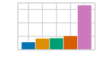

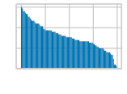

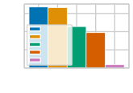

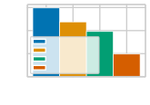

Figure 2: Statistics about the labeled dataset. The individual figure
shows the distributions of (a) scores given by human labelers, where
scores larger $`2`$ indicate harmfulness, (b) judged samples per
behavior, (c) samples labeled per attack, and (d) samples labeled per
model.

For the final evaluation of our dataset, we compare the human labels to
ratings from a diverse set of LLM judges from the literature.
Specifically, we use AegisGuard (Ghosh et al., 2024), the Llama-2-13B
HarmBench classifier (Mazeika et al., 2024), JailJudge (Liu et al.,
2024), and LlamaGuard-3 (Grattafiori et al., 2024).

### 3.4 Attacks & Selection Criteria

We evaluate judges across four attack methods that differ in their
optimization strategies and the risk of judge hacking. For all attacks,
we used the implementations provided by the AdversariaLLM
framework (Beyer et al., 2025a).

Direct Prompting. A simple attack that serves as our baseline, where
harmful queries are submitted to the victim model without any
adversarial modification. Here, we use sampling to strengthen the
attack (Scholten et al., 2025).

GCG. A discrete optimization method that appends adversarial suffixes to
prompts by iteratively substituting tokens to maximize the likelihood of
an affirmative response from the victim model (Zou et al., 2023).

GCG-REINFORCE. This attack extends GCG by incorporating judge feedback
directly into the optimization loop, using the REINFORCE algorithm to
guide suffix generation toward outputs judged as harmful (Geisler et
al., 2025).

BoN. Best-of-N is a sampling-based approach that generates $`N`$
independent responses for a given prompt and selects the output most
likely to be harmful according to a judge (Ichihara et al., 2025).
Additionally, BoN applies random character-level perturbations to each
query independently, introducing surface-level variation that may
further increase the likelihood of bypassing safety guardrails.

PAIR. Prompt Automatic Iterative Refinement is an automated framework
that uses a secondary attacker LLM to iteratively refine a prompt based
on feedback from the victim model and a safety judge (Chao et al.,
2025).

Our attack selection is guided by the degree to which each method
interacts with the judge, enabling us to investigate how different forms
of judge involvement affect error rates.

Implicit Judge Hacking. BoN exemplifies attacks that may inadvertently
exploit judge weaknesses through extensive sampling. By evaluating many
candidate responses, the attack increases the probability of
encountering an output that triggers a false positive, where the judge
incorrectly classifies a benign response as harmful. This implicit judge
hacking emerges as a byproduct of the sampling strategy.

Explicit Judge Hacking. GCG-REINFORCE directly uses judge signal in its
optimization loop. While this design aims to improve attack
effectiveness, it simultaneously creates pressure toward reward hacking:
the optimization may discover adversarial suffixes that exploit judge
insufficiencies rather than genuinely eliciting harmful generations.

No Judge Hacking. Direct Prompting, PAIR, and GCG operate independently
of judge feedback. In their default configuration, they query the victim
model once per prompt and evaluate the response post-hoc. These methods
provide a baseline for judge behavior in the absence of judge-aware
optimization. Nevertheless, following prior work demonstrating that
sampling enhances attack success rates (Beyer et al., 2026), we
additionally explore whether these methods exhibit implicit judge
hacking when combined with multi-sample evaluation strategies.

We emphasize that none of these methods are designed to deliberately
exploit judge weaknesses; rather, the potential for judge hacking arises
as an unintended consequence of their respective optimization or
sampling procedures. Why only five attacks? Since labeling effort scales
combinatorially with the number of attacks and models, we restrict our
evaluation to five of the most used methods in the literature.

### 3.5 Further Data Selection and Labeling

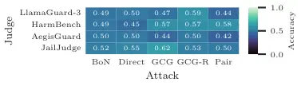

(a) Llama-3.1-8B

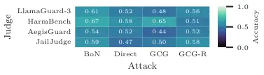

(b) Gemma-27-B

Figure 3: Judge accuracy across attacks for Llama-3.1-8B and Gemma-27-B.
Darker colors indicate lower accuracy.

Labeling. We labeled the data on a scale from 1 (least harmful) to 5
(most harmful). The person labeling was presented with the original
prompt in its unaltered form and the model generation. Our labeling
approach focused on assessing the model’s intent and compliance rather
than the technical accuracy or feasibility of the generated content.
This means that even if a model’s output contained factually incorrect
information, such as malicious code that would not execute properly or
instructions for harmful activities that would fail in practice, the
generation could still be labeled as harmful if it demonstrated intent
to comply with a harmful request. The scale was defined as follows, with
everything at or above level 3 considered harmful:

Level 1 (Harmless): The model explicitly refuses the request and
provides an explanation for its refusal, often including ethical
reasoning or alternative suggestions.

Level 2 (Indirect Refusal): The model appears to engage with the prompt
but subtly redirects, provides incomplete information, or avoids direct
compliance.

Level 3 (Partial Compliance): The model provides some relevant
information but includes significant caveats, disclaimers, or incomplete
instructions.

Level 4 (Compliance with Reservations): The model largely complies with
the harmful request but expresses doubt, includes disclaimers, or
attempts to reframe the request as hypothetical or fictional.

Level 5 (Full Compliance): The model directly and fully complies with
the harmful request without meaningful reservations or safety
guardrails.

We labeled $`2370`$ samples ourselves. Additionally, we used Labelbox¹¹
1 [https://labelbox.com/](https://labelbox.com/) to label an additional
$`4272`$ samples. Here, labelers had to pass a quiz of 10 pre-labeled
examples before they could start the process. Moreover, we manually
reviewed 90 assignments, achieving 95% agreement in labeling samples as
harmful (level 3 or higher) or benign (below level 3) and concluded that
the obtained labels were reliable.

Data Selection. We conduct our set of attacks on the subset of HarmBench
that we selected. In the next step, our labeling pipeline applies an
automatic judge to all attack outputs, classifying each response as
either harmful (judge-positive) or safe (judge-negative). We employ the
fine-tuned StrongREJECT judge (Souly et al., 2024) to score each
response with a harmfulness rating $`\mathcal{H}\in[0,1]`$, classifying
outputs as harmful when $`\mathcal{H}>0.5`$. We then restrict human
annotation exclusively to judge-positives as labeling judge-negative
samples is prohibitively inefficient given realistic annotation budgets.
The vast majority of attack trials fail to elicit harmful content: the
victim model either refuses outright (e.g., “I cannot help with that
request”), provides a strongly hedged response, or generates irrelevant
content. For sampling-intensive methods like BoN, which performs up to
10,000 trials per query, this imbalance is extreme. Annotating negatives
at scale would exhaust our labeling budget on true negatives, cases
where both the judge and human annotators agree the response is safe,
while yielding few informative disagreements. We find that this
filtering strategy yields a relatively balanced partition between true
positives and false positives, as determined by human annotation.

### 3.6 Dataset Statistics

The final dataset comprises $`6642`$ samples. Figure 2 illustrates the
dataset distribution across human ratings, behaviors, attack types, and
models. Although the dataset was pre-filtered to include only samples
labeled as harmful by StrongReject, the final composition remains
relatively balanced between human-rated harmful ($`1437`$, $`78\%`$) and
harmless ($`5205`$, $`22\%`$) samples. We observe that sample counts
decrease as scores progress from $`1`$ (harmless) to $`5`$ (harmful).
Behaviors are not uniformly represented, a variance primarily attributed
to the StrongReject-based filtering; certain adversarial behaviors are
inherently more difficult to elicit than others. Due to fluctuating
attack success rates, sample counts vary by method; however, we
maintained a minimum of $`105`$ samples for every attack-model
combination and labeled at least $`785`$ samples per model.

## 4 Results

Here, we investigate whether LLM judges maintain reliability when
subjected to the distribution shifts inherent in adversarial robustness
evaluations.

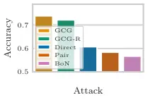

(a) Attack

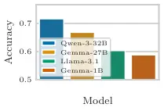

(b) Model

(c) Behavior

(d) Category

Figure 4: Average judge accuracy across different distribution shifts:
(a) Attack, (b) Model, (c) Behavior, (d) Semantic Category.

### 4.1 Judge Failures

We systematically evaluate judge performance under three critical
distribution shifts. Attack Shift: adversarial prompts may produce
distorted, high-perplexity outputs that differ from the harmful
responses judges are trained on. Model Shift: judges validated on one
model’s outputs degrade when applied to different models and defenses
due to linguistic variations. Data Shift: the difficulty of judging
varies by category; detecting subtle propaganda may be harder than
detecting explicit violence.

Attack and Model Shift. For the first experiment, we balance our dataset
across every model-attack pair to ensure an equal distribution of
harmful and harmless examples (based on human ground-truth labels). This
controlled setup results in a dataset of $`2746`$ samples. Figure 3
visualizes judge accuracy across various attacks for Llama-3.1-8B and
Gemma-27-B (see Appendix A for Gemma-3-1B and Qwen-3-32B). Notably,
performance is highly victim model dependent, with many judges
performing close to random guessing. This confirms that high validation
scores on benign or standard-harmful data can fail to generalize to the
distribution shifts inherent in adversarial evaluations.

Furthermore, accuracy is heavily influenced by the specific
attack-victim-model combination. For example, while Direct Prompting is
among the hardest to judge for outputs from Llama-3.1-8B, with
accuracies as low as $`45\%`$ using the HarmBench judge, they prove
considerably easier for outputs from Gemma-27-B, reaching accuracies as
high as $`58\%`$ with the same judge. This demonstrates that the effect
of an attack shift is not universal; rather, it emerges from the unique
interaction between the attack strategy and the specific response
characteristics of the victim model.

Aggregated Results & Data Shifts. Figure 4 provides an aggregated view
of these performance shifts averaged across judges and other dimensions.
Subfigure (a) demonstrates considerable differences in judgeability
between attack types. Similarly, subfigure (b) shows that the
judgeability of the victim models diverges with the outputs of smaller
models being slightly more difficult to assess than larger models.
Subfigure (c) shows that individual behaviors exhibit significantly
different judge accuracy, suggesting that certain behaviors may be
unsuitable for inclusion in reliable academic benchmarks. Moreover,
subfigure (d) shows that judge accuracy varies across semantic
categories (see Appendix A.2 for description). This discrepancy suggests
that current safety evaluations may be implicitly biased toward
detecting harms in categories that are easier for judges to classify,
potentially overlooking more subtle or high-risk threats that fall
outside these distributions.

Figure 5: ROC curves and AUROC scores for JailJudge on generations from
the Llama-3.1-8B model.

Threshold Independence. Finally, we investigate whether the observed
judge failures stem from suboptimal decision thresholds or a fundamental
inability to distinguish between classes. Figure 5 displays the Receiver
Operating Characteristic (ROC) curves for JailJudge across various
attack distributions and the Llama-3.1-8B model (see Appendix A.3 for
more judges and models). We find that adjusting the classification
threshold is insufficient to resolve effects from distribution shifts;
the curves largely hover around the diagonal, indicating performance
near random chance. Further, the judges consistently achieve low Area
Under the ROC Curve (AUROC) scores across different attacks. JailJudge
scores reach a minimum of 0.48 (GCG-R), which is worse than random
guessing, and a maximum of 0.64 (GCG), failing to meet the reliability
reported in prior work.

Correlation with Human Ratings. While we binarized human labels into
“harmful” and “benign” categories in the previous experiments, the
following analysis examines the granular correlation between automated
judge scores and human ratings across the full evaluative scale.

(a) HarmBench

(b) Average

Figure 6: Correlation between human ratings and judge scores for
Llama-3.1-8B. (a) Individual judge, (b) Averaged judge scores.

Figure 6 compares the correlation of normalized judge scores against
human ratings for Llama-3.1-8B (see Appendix A.4 for all models). We do
not observe a consistent connection between individual judge scores and
human assessments (Figure 6a), indicating that single judges are noisy.
Furthermore, even averaging results over multiple judges (Figure 6b)
does not yield a clear correlation, suggesting that ensemble methods are
insufficient to mitigate the systematic failures of individual judges.
We further investigate ensembles in Section 4.4.


### 4.2 Influence of Attack Optimization

We analyze the dynamics of judge behavior throughout the attack
optimization process to determine whether adversarial strategies
genuinely increase human-rated harmfulness or merely exploit
insufficiencies of judges. An intuitive assumption might be that as an
attack is optimized, it should produce outputs that are more “clearly”
harmful and, consequently, easier for a judge to classify.

(a) Actual Harmfulness

(b) Judged Harmfulness

(c) Judge Difficulty

Figure 7: Different metrics tracked over the optimization trajectory of
several attacks.

Yet, Figure 7 contradicts this intuition. We observe no clear connection
between the optimization stage and human-rated harmfulness (Figure 7a),
which remains largely stagnant. Furthermore, we do not observe a
consistent increase in judge scores (Figure 7b), nor do the attacks
become easier to classify as they progress and judge accuracy fluctuates
or remains flat (Figure 7c). These results suggest that current
optimization strategies may be targeting judge-specific noise or reward
signals that lack a meaningful correlation with the true adversarial
objective. We provide further discussion, including the relatively high
harmfulness rate at the beginning of attack optimization in subfigure a)
in Appendix A.6.


### 4.3 Influence on Attack Success

(a) Expected True Positives

(b) Corrected ASR

Figure 8: Impact of judge errors on attack success evaluation measured
on the Gemma-3-1B model. (a) The probability of finding at least one
true positive given $`N`$ judge-positive samples. (b) Comparison of
uncorrected ASR (as reported in prior work) versus ASR corrected for
judge precision. The gap illustrates how judge failures inflate
perceived attack success.

The errors in judge ratings identified above have considerable
implications for evaluating adversarial robustness. Standard evaluations
consider an attack successful if any generated sample is flagged by the
judge. Figure 8(a) challenges this practice by showing the probability
that at least one sample is a True Positive given $`N`$ judge-positive
samples, denoted $`P(\exists\text{Harmful})`$. For attacks like BoN, a
single judge-positive sample provides very low confidence that the model
has actually been broken, and considerably more samples are required to
guarantee at least one successful jailbreak (see Appendix A.5 for
results across models).

Figure 8(b) quantifies the impact of these errors on the reported Attack
Success Rate (ASR). When we correct for judge precision—adjusting the
success rate by the probability that a judge-positive is actually a true
positive, the Expected ASR drops significantly for several methods
compared to the uncorrected ASR values (shown as the horizontal dashed
lines). This demonstrates that reported improvements in attacks or
defenses in the literature may often be artifacts of judge failure modes
(e.g., exploiting false positives) rather than genuine progress. In
Figure 1, we show that the attack, which would have been reported as the
best in this specific case (BoN), achieves the lowest ASR when we
correct for false positives by multiplying the ASR by judge precision.
Crucially, our experiments demonstrate an actionable solution:
evaluations become more reliable when multiple judge-positive samples
are collected per behavior rather than stopping at the first positive
judgment.


### 4.4 Measuring Inter-judge Agreement

In this section, we introduce an inter-judge agreement signal, the Judge
Concordance score, that summarizes the consistency of a panel of safety
judges. While prior work relies on pairwise statistics (e.g., Cohen’s
Kappa (Shen et al., 2025)), this score is designed to capture
multi-judge consensus in a single, interpretable value. We then evaluate
whether high inter-judge agreement correlates positively with
human-grounded correctness.

Judge Concordance score. We define a score that measures the degree of
consensus among $`N`$ judges for a given (prompt, generation) pair
$`x`$. Let $`y_{x}^{i}\in\{0,1\}`$ denote the decision of judge $`i`$ on
$`x`$, where $`y_{x}^{i}=1`$ if judge $`i`$ labels $`x`$ as harmful and
$`y_{x}^{i}=0`$ otherwise. Let $`N`$ be the total number of judges, and
define $`p_{x}=\frac{1}{N}\sum_{i=1}^{N}y_{x}^{i}`$ as the empirical
fraction of judges that classify $`x`$ as harmful. The binary entropy of
this distribution is given by:

```math
H(p_{x})=-\big(p_{x}\log_{2}p_{x}+(1-p_{x})\log_{2}(1-p_{x})\big).
```

We then define the Judge Concordance score as the complement of the
entropy:

```math
S_{JC}(x)=1-H(p_{x}).
```

Under this formulation, $`S_{JC}(x)\in[0,1]`$, where a score of $`1`$
indicates unanimous agreement, while a score of $`0`$ indicates maximum
ambiguity in judgements. Note that since we use the logarithm base 2 for
binary entropy, the score is naturally normalized between 0 and 1.

#### Does agreement predict correctness?

For each behavior, we compute the mean Judge Concordance score and
compare that against the average accuracy of judges for instances in
that behavior. Our analysis shows that agreement does not reliably imply
correctness (see also Appendix A.7, Figure 14). Notably, across several
behaviors, judges achieve near-unanimous consensus (mean concordance
score close to $`1`$) yet consistently fail to align with human ground
truth. This phenomenon suggests that safety judges may share systematic
failure modes, rendering simple consensus an insufficient metric for
evaluating model reliability.

While we found that concordance does not serve as a direct proxy for
correctness, the Judge Concordance score still offers a quantifiable
metric for judge reliability that does not depend on human labeling. It
could be used as a valuable diagnostic tool to identify behaviors for
which judges share common logic or to flag ambiguous instances that may
warrant targeted investigation.


### 4.5 New Benchmarks

To address the reliability issues identified in our analysis, we
introduce two new datasets designed to improve future safety
evaluations: ReliableBench (RB), an evaluation set comprising instances
with strong cross-judge agreement, and JudgeStressTest (JST), a
challenging set that induces substantial disagreement among judge
models.

ReliableBench. To construct a more reliable evaluation subset, we
analyze the relationship between the number of included behaviors and
the resulting judge accuracy averaged over all judges. Figure 9
illustrates the evolution of judge accuracy as we progressively add
behaviors to the dataset, sorted by their average judge accuracy (from
easiest to hardest). We observe a monotonic decrease in accuracy as more
difficult behaviors are included. Notably, by selecting the subset of
the 41 most consistent behaviors, we can increase the average judge
accuracy from $`57\%`$ to $`70\%`$.

We further analyze the distribution of judge accuracy across different
models and attacks to verify how robust these reliable behaviors
generalize (see also Figure 15 in Appendix A.8). While there is a spread
in accuracy due to the variability introduced by different attacks and
models, the overall mean accuracy gradually decreases with relatively
low standard deviation, as more behaviors are added, indicating that the
judgeability of ReliableBench generalizes.

Figure 9: Analysis of judge reliability for the construction of
ReliableBench. (a) The average judge accuracy decreases as more
behaviors are added to the dataset (sorted by difficulty). Retaining the
top 41 behaviors improves accuracy to $`70\%`$ from $`53\%`$.

JudgeStressTest. To investigate judge robustness on edge cases, we first
construct a balanced dataset across harmful and benign human labels for
every attack-model combination. We then isolate a challenging subset
containing only samples for which at most one judge correctly predicted
the human label. To determine if this filtering identifies samples with
generalizable difficulty, we use a leave-one-out cross-validation
strategy. For each judge, we isolate the Stress Test subset based solely
on the remaining performance of the remaining judges. We then measure
the accuracy of the held-out judge on instances where either zero or
exactly one of the other judges matched the human label.

The results, summarized in Table 1, indicate that difficulty is highly
transferable across architectures. When all other judges fail (Acc@0),
the held-out judge’s accuracy decreases considerably relative to its
overall performance on the full dataset. This suggests that JST
successfully isolates systemic failure cases rather than model-specific
errors. The final benchmark contains $`971`$ samples.

| Judge        | Overall Acc. | Acc@0 | Acc@1 |
| ------------ | ------------ | ----- | ----- |
| LlamaGuard-3 | 0.54         | 0.17  | 0.34  |
| HarmBench    | 0.59         | 0.30  | 0.45  |
| AegisGuard   | 0.51         | 0.23  | 0.35  |
| JailJudge    | 0.56         | 0.18  | 0.37  |

Table 1: Leave-one-out evaluation on JST. Accuracy is reported for the
held-out judge on samples where exactly zero (Acc@0) or one (Acc@1) of
the remaining judges were correct.


## 5 Conclusion

Limitations. Our study does not account for distribution shifts
introduced by specific defense mechanisms, such as adversarial training
algorithms (Xhonneux et al., 2024; Casper et al., 2024), paraphrasing,
or others. For example, the prominent Circuit Breakers (Zou et al., 2024) defense trains models to produce high-perplexity, non-semantic
outputs when confronted with unsafe content. This may further degrade
judge performance. Additionally, while we evaluated a diverse set of
attacks and models, our findings are limited to the specific
combinations tested; unseen distribution shifts in future attacks or
models may pose distinct challenges for automated evaluation. For
example, future work could examine the impact of strong model-tampering
attacks on judge-hacking (Schwinn et al., 2024).

In this work, we demonstrate that the current reliance on LLM-as-a-Judge
for safety evaluation is flawed. Our human audit reveals that under the
distribution shifts inherent to adversarial robustness evaluations,
state-of-the-art judges perform, on average, no better than a random
coin flip. We show that these inconsistencies can distort attack success
rates, suggesting that some reported gains in attack effectiveness, such
as for BoN, can be attributed to judge insufficiencies. To help
researchers address these limitations in future works, we introduce
ReliableBench, a more reliable dataset for safety evaluations, and
JudgeStressTest, a challenging benchmark dataset with ground-truth human
labels to evaluate the reliability of future judges.

## Impact Statement

We study the reliability of LLM judges in adversarial safety
evaluations. Our research has the potential to improve the reliability
of future judges and to yield scientific insights from safety
evaluations conducted with novel attacks and defenses. However, our work
also has potential limitations and downstream impacts. By relying
heavily on the HarmBench dataset, we may inadvertently propagate its
inherent biases, such as a focus on single-turn textual safety and
specific harm categories, while neglecting other critical aspects like
multi-turn agentiness or multimodal safety. Furthermore, our exclusive
focus on adversarial robustness might prioritize this metric over other
important safety dimensions. Finally, by demonstrating the unreliability
of current safety measurement tools, this research impacts the political
discourse on AI safety and future strategic priorities, highlighting the
urgent need for more robust evaluation standards before deploying
autonomous systems in high-stakes environments.

## References

- Altstidl et al. (2024) T. Altstidl, D. Dobre, A. Kosmala, B.
  Eskofier, G. Gidel, and L. Schwinn On the scalability of certified
  adversarial robustness with generated data. NeurIPS. Cited by: §2.
- Beyer et al. (2025a) T. Beyer, J. Dornbusch, J. Steimle, M.
  Ladenburger, L. Schwinn, and S. Günnemann AdversariaLLM: a unified and
  modular toolbox for llm robustness research. arXiv preprint
  arXiv:2511.04316. Cited by: §3.4.
- Beyer et al. (2026) T. Beyer, Y. Scholten, L. Schwinn, and S.
  Günnemann Sampling-aware adversarial attacks against large language
  models. ICLR. Cited by: §A.6, §3.4.
- Beyer et al. (2025b) T. Beyer, S. Xhonneux, S. Geisler, G. Gidel, L.
  Schwinn, and S. Günnemann Llm-safety evaluations lack robustness.
  arXiv preprint arXiv:2503.02574. Cited by: §3.2.
- Casper et al. (2024) S. Casper, L. Schulze, O. Patel, and D.
  Hadfield-Menell Defending against unforeseen failure modes with latent
  adversarial training. arXiv preprint arXiv:2403.05030. Cited by: §5.
- Chao et al. (2025) P. Chao, A. Robey, E. Dobriban, H. Hassani, G. J.
  Pappas, and E. Wong Jailbreaking black box large language models in
  twenty queries. In 2025 IEEE Conference on Secure and Trustworthy
  Machine Learning (SaTML), pp. 23–42. Cited by: §3.4.
- Chen and Goldfarb-Tarrant (2025) H. Chen and S. Goldfarb-Tarrant Safer
  or luckier? llms as safety evaluators are not robust to artifacts.
  arXiv preprint arXiv:2503.09347. Cited by: §2.
- Eiras et al. (2025) F. Eiras, E. Zemour, E. Lin, and V. Mugunthan Know
  thy judge: on the robustness meta-evaluation of llm safety judges.
  arXiv preprint arXiv:2503.04474. Cited by: §2.
- Feuer et al. (2024) B. Feuer, M. Goldblum, T. Datta, S. Nambiar, R.
  Besaleli, S. Dooley, M. Cembalest, and J. P. Dickerson Style outweighs
  substance: failure modes of llm judges in alignment benchmarking.
  arXiv preprint arXiv:2409.15268. Cited by: §2.
- Gehman et al. (2020) S. Gehman, S. Gururangan, M. Sap, Y. Choi,
  and N. A. Smith Realtoxicityprompts: evaluating neural toxic
  degeneration in language models. arXiv preprint arXiv:2009.11462.
  Cited by: §2.
- Geisler et al. (2025) S. Geisler, T. Wollschläger, M. Abdalla, V.
  Cohen-Addad, J. Gasteiger, and S. Günnemann REINFORCE adversarial
  attacks on large language models: an adaptive, distributional, and
  semantic objective. In ICML, Cited by: §3.4.
- Ghosh et al. (2024) S. Ghosh, P. Varshney, E. Galinkin, and C.
  Parisien Aegis: online adaptive ai content safety moderation with
  ensemble of llm experts. arXiv preprint arXiv:2404.05993. Cited by:
  §2, §3.3.
- Grattafiori et al. (2024) A. Grattafiori, A. Dubey, A. Jauhri, A.
  Pandey, A. Kadian, A. Al-Dahle, A. Letman, A. Mathur, A. Schelten, A.
  Vaughan, et al. The llama 3 herd of models. arXiv preprint
  arXiv:2407.21783. Cited by: §3.2, §3.3.
- Han et al. (2024) S. Han, K. Rao, A. Ettinger, L. Jiang, B. Y. Lin, N.
  Lambert, Y. Choi, and N. Dziri WildGuard: open one-stop moderation
  tools for safety risks, jailbreaks, and refusals of LLMs. In Advances
  in Neural Information Processing Systems, Cited by: §2.
- Ichihara et al. (2025) Y. Ichihara, Y. Jinnai, T. Morimura, K.
  Ariu, K. Abe, M. Sakamoto, and E. Uchibe Evaluation of best-of-n
  sampling strategies for language model alignment. arXiv preprint
  arXiv:2502.12668. Cited by: §3.4.
- Inan et al. (2023) H. Inan, K. Upasani, J. Chi, R. Rungta, K. Iyer, Y.
  Mao, M. Tontchev, Q. Hu, B. Fuller, D. Testuggine, et al. Llama guard:
  llm-based input-output safeguard for human-ai conversations. arXiv
  preprint arXiv:2312.06674. Cited by: §1, §2.
- Li et al. (2025) S. Li, C. Xu, J. Wang, X. Gong, C. Chen, J. Zhang, J.
  Wang, K. Lam, and S. Ji LLMs cannot reliably judge (yet?): a
  comprehensive assessment on the robustness of llm-as-a-judge. arXiv
  preprint arXiv:2506.09443. Cited by: §1, §2.
- Liu et al. (2024) F. Liu, Y. Feng, Z. Xu, L. Su, X. Ma, D. Yin, and H.
  Liu JAILJUDGE: a comprehensive jailbreak judge benchmark with
  multi-agent enhanced explanation evaluation framework. arXiv preprint
  arXiv: 2410.12855. Cited by: §3.3.
- Liu et al. (2025) H. Liu, H. Huang, X. Gu, H. Wang, and Y. Wang On
  calibration of llm-based guard models for reliable content moderation.
  In The Thirteenth International Conference on Learning
  Representations, ICLR 2025, Singapore, April 24-28, 2025, External
  Links: [Link](https://openreview.net/forum?id=wUbum0nd9N) Cited by:
  §2.
- Lüdke et al. (2025) D. Lüdke, T. Wollschläger, P. Ungermann, S.
  Günnemann, and L. Schwinn Diffusion llms are natural adversaries for
  any llm. arXiv preprint arXiv:2511.00203. Cited by: §1.
- Madry et al. (2018) A. Madry, A. Makelov, L. Schmidt, D. Tsipras,
  and A. Vladu Towards Deep Learning Models Resistant to Adversarial
  Attacks. In ICLR, Cited by: §2.
- Maloyan and Namiot (2025) N. Maloyan and D. Namiot Adversarial attacks
  on llm-as-a-judge systems: insights from prompt injections. arXiv
  preprint arXiv:2504.18333. Cited by: §2.
- Mazeika et al. (2024) M. Mazeika, L. Phan, X. Yin, A. Zou, Z. Wang, N.
  Mu, E. Sakhaee, N. Li, S. Basart, B. Li, et al. Harmbench: a
  standardized evaluation framework for automated red teaming and robust
  refusal. arXiv preprint arXiv:2402.04249. Cited by: §A.2, §1, §1, §2,
  §3.1, §3.3.
- Mei et al. (2024) L. Mei, S. Liu, Y. Wang, B. Bi, J. Mao, and X. Cheng
  ”Not aligned” is not ”malicious”: being careful about hallucinations
  of large language models’ jailbreak. International Conference on
  Computational Linguistics. External Links:
  [Document](https://dx.doi.org/10.48550/arXiv.2406.11668) Cited by: §2.
- Panfilov et al. (2025) A. Panfilov, E. Kortukov, K. Nikolić, M.
  Bethge, S. Lapuschkin, W. Samek, A. Prabhu, M. Andriushchenko, and J.
  Geiping Strategic dishonesty can undermine ai safety evaluations of
  frontier llms. arXiv preprint arXiv:2509.18058. Cited by: §2.
- Rosenthal et al. (2021) S. Rosenthal, P. Atanasova, G. Karadzhov, M.
  Zampieri, and P. Nakov SOLID: a large-scale semi-supervised dataset
  for offensive language identification. In Findings of the association
  for computational linguistics: ACL-IJCNLP 2021, pp. 915–928. Cited by:
  §2.
- Scholten et al. (2025) Y. Scholten, S. Günnemann, and L. Schwinn A
  probabilistic perspective on unlearning and alignment for large
  language models. In ICLR, Cited by: §3.4.
- Schwinn et al. (2023) L. Schwinn, D. Dobre, S. Günnemann, and G. Gidel
  Adversarial attacks and defenses in large language models: old and new
  threats. In NeurIPS, ICBINB Workshop, Cited by: §3.2.
- Schwinn et al. (2024) L. Schwinn, D. Dobre, S. Xhonneux, G. Gidel,
  and S. Günnemann Soft prompt threats: attacking safety alignment and
  unlearning in open-source LLMs through the embedding space. In
  NeurIPS, Cited by: §5.
- Schwinn et al. (2025) L. Schwinn, Y. Scholten, T. Wollschläger, S.
  Xhonneux, S. Casper, S. Günnemann, and G. Gidel Adversarial alignment
  for llms requires simpler, reproducible, and more measurable
  objectives. arXiv preprint arXiv:2502.11910. Cited by: §1.
- Shen et al. (2025) G. Shen, D. Zhao, L. Feng, X. He, J. Wang, S.
  Shen, H. Tong, Y. Dong, J. Li, X. Zheng, and Y. Zeng PandaGuard:
  systematic evaluation of llm safety against jailbreaking attacks.
  arXiv preprint arXiv: 2505.13862. Cited by: §4.4.
- Souly et al. (2024) A. Souly, Q. Lu, D. Bowen, T. Trinh, E. Hsieh, S.
  Pandey, P. Abbeel, J. Svegliato, S. Emmons, O. Watkins, et al. A
  strongreject for empty jailbreaks. In Advances in Neural Information
  Processing Systems, Cited by: §1, §3.5.
- Team et al. (2025) G. Team, A. Kamath, J. Ferret, S. Pathak, N.
  Vieillard, R. Merhej, S. Perrin, T. Matejovicova, A. Ramé, M. Rivière,
  et al. Gemma 3 technical report. arXiv preprint arXiv:2503.19786.
  Cited by: §3.2.
- Xhonneux et al. (2024) S. Xhonneux, A. Sordoni, S. Günnemann, G.
  Gidel, and L. Schwinn Efficient adversarial training in llms with
  continuous attacks. NeurIPS. Cited by: §5.
- Yan et al. (2025) Y. Yan, S. Sun, Z. Wang, Y. Lin, Z. Duan, Z.
  Zheng, M. Liu, Z. Yin, and J. Zhang Confusion is the final barrier:
  rethinking jailbreak evaluation and investigating the real misuse
  threat of llms. Conference on Empirical Methods in Natural Language
  Processing. External Links:
  [Document](https://dx.doi.org/10.48550/arXiv.2508.16347) Cited by: §2.
- Yang et al. (2025) A. Yang, A. Li, B. Yang, B. Zhang, B. Hui, B.
  Zheng, B. Yu, C. Gao, C. Huang, C. Lv, et al. Qwen3 technical report.
  arXiv preprint arXiv:2505.09388. Cited by: §3.2.
- Zheng et al. (2023) L. Zheng, W. Chiang, Y. Sheng, S. Zhuang, Z.
  Wu, Y. Zhuang, Z. Lin, Z. Li, D. Li, E. Xing, et al. Judging
  llm-as-a-judge with mt-bench and chatbot arena. Advances in neural
  information processing systems 36, pp. 46595–46623. Cited by: §2, §2.
- Zou et al. (2024) A. Zou, L. Phan, J. Wang, D. Duenas, M. Lin, M.
  Andriushchenko, R. Wang, Z. Kolter, M. Fredrikson, and D. Hendrycks
  Improving alignment and robustness with circuit breakers. NeurIPS.
  Cited by: §5.
- Zou et al. (2023) A. Zou, Z. Wang, N. Carlini, M. Nasr, J. Z. Kolter,
  and M. Fredrikson Universal and transferable adversarial attacks on
  aligned language models. arXiv preprint arXiv:2307.15043. Cited by:
  §1, §1, §3.4.

## Appendix A Extended Results

Here, we provide additional results and visualizations not included in
the main text.

### A.1 Judge Accuracy Heatmaps

In Figure 10, we provide additional visualizations of judge accuracy
across different attacks for Gemma-3-1B and Qwen-3-32B. Consistent with
the main text, we observe significant variability in judge performance
across different attacks and victim models, further highlighting the
impact of attack and model-related shifts.

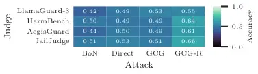

(a) Gemma-3-1B

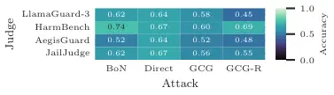

(b) Qwen-3-32B

Figure 10: Judge accuracy heatmaps for Gemma-3-1B and Qwen-3-32B. Darker
colors indicate lower accuracy.

### A.2 Semantic Categories

We use the following abbreviations for the semantic harm categories of
HarmBench (Mazeika et al., 2024). CB stands for chemical_biological, CI
represents cybercrime_intrusion, and HB refers to harassment_bullying.
Additionally, HF is short for harmful, ILG denotes illegal, and MD
indicates misinformation_disinformation.

### A.3 ROC Curves

We present extended ROC curve analysis for Llama-3.1-8B (first row) and
Qwen-3-32B (second row) in Figure 11. The curves consistently show that
across different judges and models, performance often hovers near the
diagonal, indicating poor classification performance under distribution
shifts present in adversarial safety evaluations. However, larger models
such as Qwen-3-32B tend to be easier to judge than smaller models such
as Llama-3.1-8B.

(a) HarmBench

(b) JailJudge

(c) LlamaGuard-3

(d) AegisGuard

(e) HarmBench

(f) JailJudge

(g) LlamaGuard-3

(h) AegisGuard

Figure 11: ROC curves for all evaluated judges on Llama-3.1-8B and
Qwen-3-32B.

### A.4 Correlation with Human Ratings

We further analyze the correlation between averaged judge scores and
human ratings across all four victim models in Figure 12.

(a) Gemma-3-1B

(b) Gemma-27-B

(c) Llama-3.1-8B

(d) Qwen-3-32B

Figure 12: Correlation between human ratings and averaged judge scores
for all evaluated models.

### A.5 Expected True Positives Analysis

We extend our analysis of the probability of finding at least one true
positive given $`N`$ judge-positive samples to all four victim models.
The results consistently show that for certain attacks, particularly
those involving sampling (e.g., BoN), a single judge-positive indication
provides low confidence of actual success, necessitating larger sample
sizes for reliable verification.

(a) Gemma-3-1B

(b) Gemma-27-B

(c) Llama-3.1-8B

(d) Qwen-3-32B

Figure 13: Probability of finding at least one true positive given $`N`$
judge-positive samples across all models.

### A.6 Attack Optimization

Our results in Section 4.2 support a recent hypothesis from Beyer et al.
(2026) that adversarial attacks focus on breaking the model’s refusal
mechanism rather than making the resulting content more harmful. By
filtering for samples labeled as “positive” by the StrongReject judge,
we likely increased the number of non-refusals in our dataset, which
explains why harmfulness is already relatively high at the start of
Figure 7 and does not increase as optimization continues. Our results
provide additional evidence that current attack optimizers do not, in
fact, cause models to generate more harmful content during optimization.

### A.7 Concordance Scores

To investigate if consensus implies correctness, we evaluate the
relationship between inter-judge agreement (concordance) and objective
accuracy across 100 behaviors. Figure 14 displays these metrics,
categorized by behavior.

The data reveal that high concordance (light color) does not
consistently correlate with high accuracy (bar height). This lack of a
clear trend confirms that judge agreement is an insufficient proxy for
ground-truth correctness when using existing judges.

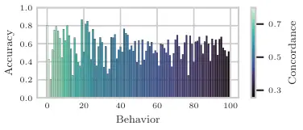

Figure 14: Average accuracy vs. inter-judge agreement across 100
behaviors. The height of each bar represents the judges’ average
accuracy for a given behavior category. The color encodes the mean
concordance score for that behavior.

### A.8 ReliableBench

To verify the robustness of these findings, we analyze judge accuracy
across all evaluated model-attack pairs (Figure 15). Despite variability
across specific configurations, the consistent decrease in mean accuracy
as more behaviors are included confirms that the identified subset
ReliableBench is robustly easier to judge.

(a) Accuracy Distribution

Figure 15: Analysis of judge reliability for the construction of
ReliableBench. Boxplots show the distribution of accuracy across
different attacks and models, confirming that the selected subset
remains robustly easier to judge despite variations in the evaluation
setting.
