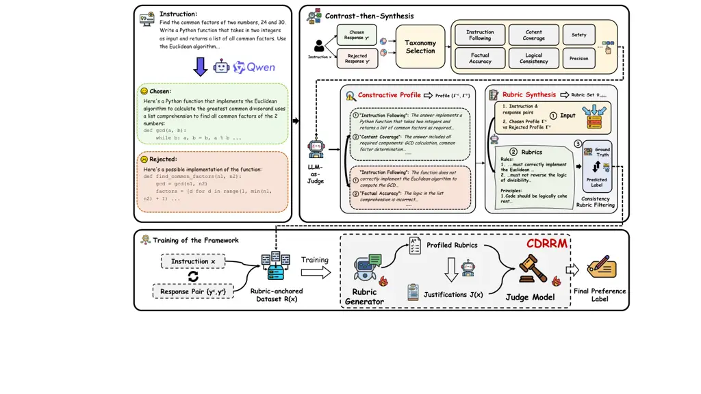

# CDRRM: Contrast-Driven Rubric Generation for Reliable and Interpretable Reward Modeling

Dengcan Liu Note: Both authors contributed equally to this research.
email: <ldc123@mail.ustc.edu.cn> Affiliation: University of Science and
Technology of China, Hefei, China , Fengkai Yang email:
<yangfengkai@stu.pku.edu.cn> Affiliation: Peking University, Beijing,
China , Xiaohan Wang^(†) Affiliation: Meituan, Beijing, China , Shurui
Yan Affiliation: Meituan, Beijing, China , Jiajun Chai
Affiliation: Meituan, Beijing, China , Jiahao Li Affiliation: University
of Science and Technology of China, Hefei, China , Yikun Ban
Affiliation: BeiHang University, Beijing, China , Zhendong Mao^(†)
Affiliation: University of Science and Technology of China, Hefei, China
, Wei Lin Affiliation: Meituan, Beijing, China and Guojun Yin
Affiliation: Meituan, Beijing, China

###### Abstract.

Reward modeling is essential for aligning Large Language Models(LLMs)
with human preferences, yet conventional reward models suffer from poor
interpretability and heavy reliance on costly expert annotations. While
recent rubric-based approaches enhance evaluation transparency, they
lack systematic quality control, yielding noisy and redundant criteria,
failing to mitigate persistent biases (e.g., verbosity, position) in LLM
evaluators, and creating a scalability-reliability trade-off. To address
these limitations, we propose CDRRM (Contrast-Driven Rubric Reward
Model), a framework built on a novel Contrast-then-Synthesis paradigm
for high-quality rubric generation and guided preference judgment. CDRRM
first conducts multi-dimensional contrastive profiling on preference
pairs to identify causal discriminative factors, then synthesizes these
insights into compact, context-aware rubrics to guide preference
judgments. Extensive experiments on three authoritative benchmarks
(RewardBench, RMBench, RMB) demonstrate that CDRRM achieves
state-of-the-art performance across diverse domains and effectively
mitigates aforementioned evaluation biases. Notably, our approach
delivers exceptional data efficiency: training the rubric generator on
only 3k high-quality samples empowers a frozen pre-trained judge model
to outperform fully fine-tuned baselines. This work offers a scalable,
interpretable, and data-efficient path for reward modeling.

###### Keywords: 

Large Language Models; Reward Modeling; Rubric-Based Evaluation

⁰⁰footnotetext: ^(†) Corresponding author²²footnotetext: ^(‡) Code is
available at: https://github.com/ldcan/CDRRM.git

## 1. Introduction

Reward modeling is a cornerstone of post-training for aligning large
language models (LLMs) with human preferences \[38; 33; 42\]. While
traditional scalar reward models have long served as a classic technical
solution for early LLM alignment tasks \[8\], they suffer from two
critical limitations that undermine their utility for advanced alignment
scenarios. First, their inherent opacity leads to a "black box"
evaluation process with no explicit rationale for preference decisions,
exposing such models to the risk of reward hacking \[28; 29\]. Second,
training robust scalar models relies heavily on large-scale high-quality
expert annotations \[27; 3\], which imposes severe scalability and
domain adaptability bottlenecks for large-scale alignment deployments.
To address these limitations—and to meet the growing demand for
interpretable, transparent evaluation in the emerging LLM-as-a-Judge
paradigm—research community has witnessed a rapid shift toward
Generative Reward Models (GenRMs) \[49; 24; 7\]. GenRMs generate
explicit reasoning traces, structured critiques, and judgment
justifications to ground their preference decisions, thereby drastically
enhancing the transparency and interpretability of LLM-as-a-Judge
evaluations.

Within this generative paradigm, rubric-based reward modeling has
attracted considerable attention as a principled approach\[22; 7; 1; 39;
21\]. By decomposing complex judgments into structured, semantic
rubrics, these methods offer greater transparency and precision in
evaluation. However, constructing high-quality rubrics remains a core
bottleneck. Current approaches largely rely on either labor-intensive
manual annotation \[14\] or direct prompting of LLMs \[22; 44\], both of
which have notable shortcomings: manual curation is not scalable, while
direct prompting often yields noisy, redundant rubrics weakly related to
actual discriminative factors. Furthermore, existing methods have not
effectively addressed persistent biases inherent in LLM evaluators(e.g.,
verbosity bias, stylistic preference bias, and position bias)\[31; 39\],
which continue to erode the reliability of the alignment process.


Figure 1. An illustrative example of rubric generation for a Greatest
Common Divisor (GCD) task, contrasting rubrics from direct prompting
(right, redundant and potentially misleading) with those from our
Contrast-then-Synthesis paradigm (left, concise and effective). The
bottom-left panel shows statistics on the number of generated rubrics
with respect to single preferences.A short description for
accessibility.

In this work, we aim to endow rubric generation models with the
capability to yield succinct and highly efficacious rubrics, enabling
more robust guidance for reward modeling and effective mitigation of
inherent biases in LLM evaluators. To this end, we introduce a
structured framework comprising Contrastive Profiling and Rubric
Synthesis. This paradigm moves beyond generic rubric generation by
conducting rigorous contrastive analysis of preference pairs to pinpoint
the exact causal factors for preference decisions, aiming to pinpoint
exactly why a response is chosen or rejected. Specifically, we employ an
LLM-as-a-Judge to perform a task-aligned multi-dimensional contrastive
analysis, explicitly isolating evidence-based causal factors(e.g.,
factual errors, logical gaps) that drive preference judgments. These
differential insights are then synthesized into concise, high-impact
rubrics, filtering out noise and redundancy inherent in raw model
outputs. Building on this high-fidelity rubric dataset, we propose the
Contrast-Driven Rubric Reward Model (CDRRM), which instantiates this
paradigm through two specialized, mutually coupled components: a Rubric
Generator, trained to synthesize context-aware evaluation criteria, and
a Judge Model, fine-tuned to predict preferences strictly conditioned on
these rubrics.

We conduct extensive evaluations on three authoritative benchmarks:
RewardBench \[18\], RMBench \[23\], and RMB \[48\]. Empirical results
demonstrate that CDRRM achieves state-of-the-art performance across
diverse domains and significantly mitigates persistent evaluation biases
such as verbosity and position biases. Most notably, our method exhibits
exceptional data efficiency: training the Rubric Generator on just 3k
high-quality samples enables a frozen base model—guided solely by these
synthesized rubrics—to outperform fully fine-tuned baselines.

Overall, our main contributions are as follows:

- •
  We propose Contrast-then-Synthesis, a novel paradigm that transforms
  opaque preference modeling into an explicit, rubric-guided reasoning
  process. By grounding rubric generation in rigorous contrastive
  profiling of preference pairs, our method systematically isolates
  task-critical discriminative factors, eliminating redundant evaluation
  criteria and mitigating the hallucination of irrelevant assessment
  standards at its root.
- •
  We introduce CDRRM, a concrete instantiation of the
  Contrast-then-Synthesis paradigm that synthesizes precise, concise
  rubrics to guide preference judgments. It enables robust,
  interpretable and generalizable preference evaluation across diverse
  domains, and we will release our two-stage dataset publicly to support
  future research.
- •
  We conduct extensive evaluations across three benchmarks,
  demonstrating that CDRRM establishes a new state-of-the-art in reward
  modeling. Compared to rubric-based baselines, CDRRM improves average
  accuracy by 5.7% across all benchmarks and achieves a remarkable 18%
  gain on RMBench Hard.

## 2. Preliminaries

### 2.1. Rubric Learning

In this paper, we adopt pairwise setting on reward modeling \[32\],
given the preference dataset
$`\mathcal{D}=\left\{x_{i},y_{i}^{c},y_{i}^{r}\right\}_{i=1}^{N}`$,
where $`x`$ denotes an input prompt and $`(y^{c},y^{r})`$ is a response
pair consisting of the chosen and rejected responses, respectively. The
pair-wise training paradigm is built on the Bradley-Terry model \[4\],
the formulation can be modeled as:

```math
\mathbb{P}\!\left(y^{c}\succ y^{r}\mid x\right)=\sigma\!\left(r_{\theta}(x,y^{c})-r_{\theta}(x,y^{r})\right) \tag{1}
```

Its objective is to optimize the opaque, black-box reward function
$`r_{\theta}`$ for reward model training—a paradigm that inherently
predisposes the model to reward hacking. Rubric learning builds a
structured framework of evaluation criteria customized for the given
prompt $`x`$. We formalize the collection of criteria spanning various
dimensions as:

```math
\mathcal{R}\left(x\right)=\{r_{1},r_{2},\ldots,r_{k}\}=\{r_{i}\}_{i=1}^{k} \tag{2}
```

where each criteria $`r_{i}`$ represents an individual rubric item, with
each description precisely delineating a targeted dimension of response
quality to be evaluated. And the reward function can be defined as:

```math
R\left(x,y^{c},y^{r}\right)=r_{\theta}\left(x,y^{c},y^{r},\{r_{i}\}_{i=1}^{k}\right) \tag{3}
```

The rubric-based reward integrates criteria across multiple dimensions,
yielding a transparent and interpretable evaluation. The quality of
generated rubrics is crucial for the rubric learning. However, prior
rubric-generation methods are often overly coarse-grained, resulting in
redundant and overlapping rubrics. This issue is summarized as follows.

### 2.2. Problem Statement

Under the pairwise evaluation paradigm, previous rubric-based methods
rely solely on direct prompting to elicit rubrics. However, by
attempting to generate criteria in a single step without prior
fine-grained analysis, the model lacks intrinsic alignment with
discriminative human standards. This limitation introduces non-trivial
redundancy and spurious noise: the resulting rubrics are plagued by
overlapping semantics and irrelevant details, flaws that can
significantly misguide the reward model’s training.

In this section, we systematically analyze the redundancy inherent in
traditional rubric generation methods\[22\]. Empirical evidence from
existing rubric-based datasets supports our hypothesis: as shown in
Figure 1, the majority of samples contain at least seven rubrics. This
excessive quantity contradicts the finding that preference judgments
typically hinge on a sparse set of salient factors\[12\]. To quantify
this redundancy, we conducted a perturbation study by randomly masking
one to three rubrics (along with their rationales) from the training
data and retraining the Reward Model to observe the impact on
performance.

Table 1 reveals that aggressively pruning these rubrics results in
negligible performance degradation, with a maximum deviation of only
0.42% on the validation set. This finding confirms that a significant
portion of the generated rubrics in current datasets creates non-trivial
redundancy rather than providing informative signals. These observations
underscore the necessity of a more selective generation process,
motivating our proposed Contrast-then-Synthesis strategy, which we
detail in the subsequent section.



Figure 2. The CDRRM framework. (Top) The Contrast-then-Synthesis
paradigm synthesizes evidence-based rubrics via contrastive analysis of
preference pairs. (Bottom) These rubrics, paired with synthesized
rubric-grounded justifications, supervise the training of a Rubric
Generator (to automate context-aware criterion synthesis) and a Judge
Model (to generate rubric-aligned justifications for precise preference
predictions).

## 3. Methodology

In this section, we introduce Contrast-then-Synthesis, a novel framework
tailored for generating high-quality rubrics to guide reward modeling.
As illustrated in Figure 2, our approach contains two synergistic
components: (1) Contrastive Profiling, which conducts multi-dimensional
contrastive analysis on preference pairs to isolate core discriminative
factors that drive judgments; (2) Rubric Synthesis, which summarizes
these diagnostic insights into concise evaluation criteria. Building on
these two steps, we train a dedicated rubric generator that produces
precise, non-redundant rubrics to facilitate reliable preference
discrimination.

| Del            | Baseline | Del 0 | Del 1 | Del 2 |
| -------------- | -------- | ----- | ----- | ----- |
| Acc. (%)       | 95.65    | 95.70 | 95.23 | 95.37 |
| $`\Delta`$ (%) | 0.00     | +0.05 | -0.42 | -0.28 |

Table 1. Impact of Rubric Reduction on Accuracy.A short description of
the table for accessibility.

### 3.1. Contrastive Profiling

Adaptive Evaluation Taxonomy. We initially establish a rigorous taxonomy
set $`\mathcal{T}`$ to comprehensively dissect each response’s quality.
Rather than adopting a static set of evaluative criteria, we employ a
dynamic evaluation strategy that selectively activates only the
dimensions germane to the specific instruction context. Let
$`\mathcal{T}=\{d_{1},\dots,d_{m}\}`$ denote the full spectrum of
analysis dimensions (e.g., Instruction Following, Logical Consistency,
Safety, $`\dots`$). Given an instruction $`x`$ and a response $`y`$, the
model first identifies the active dimension subset
$`\mathcal{T}_{x,y}\subseteq\mathcal{T}`$:

```math
\mathcal{T}_{x,y}=\text{Select}(\mathcal{T}=\{d_{1},\dots,d_{m}\}\mid x,y) \tag{4}
```

This dynamic selection mechanism ensures the analysis focuses on salient
quality factors, effectively minimizing noise in the subsequent
synthesis process. With the selected taxonomy, the LLM-as-a-Judge
generates analysis $`\gamma_{x,y}`$ across these dimensions:

```math
\gamma_{t}=\mathrm{Judge}(x,y,d_{t}),\quad\forall d_{t}\in\mathcal{T}_{x,y} \tag{5}
```

Evidence-Anchored Verification. To further ensure the verifiability of
the analysis, while precluding ambiguity in evaluative criteria and the
hallucination \[19\], we enforce the Evidence-Anchored Constraint.
Instead of generating abstract assessments, for each active dimension
$`d_{t}\in\mathcal{T}_{x,y}`$, the model is mandated to ground its
judgments in original text spans. And we have the evidence-anchored
analysis:

```math
\gamma_{t}^{\prime}\triangleq\bigl(\gamma_{t},\ \hat{s}^{x}_{t},\ \hat{s}^{y}_{t}\bigr) \tag{6}
```

where $`\hat{s}^{x}_{t}`$ is the specific constraint in the instruction
(e.g., "no python code") and $`\hat{s}^{y}_{t}`$ is the corresponding
segment in the response (e.g., a python code block). Aggregating these
evidence triplets, we formalize the profile for each instance and the
resulting dataset as:

```math
\Gamma\triangleq\{\,(d_{t},\gamma_{t}^{\prime})\mid d_{t}\in\mathcal{T}_{x,y}\,\},~~\mathcal{D}_{\mathcal{T}}=\left\{x_{i},\ y_{i}^{c},\ y_{i}^{r},\ \Gamma_{i}^{c},\ \Gamma_{i}^{r}\right\}_{i=1}^{N} \tag{7}
```

This structured profiling strategy mandates that subsequent rubric
generation be anchored to factual observations rather than model priors,
thereby significantly enhancing the interpretability and
discriminability of the synthesized rubrics.

### 3.2. Rubric Synthesis

By decomposing preference judgments into factual, multi-dimensional
evidence, our profiles provide a transparent, fact-based basis for
evaluation. In contrast to direct prompting approaches that rely on
implicit inference, Rubric Synthesis leverages these explicit,
differential insights to generate rubrics directly grounded in the
observed quality gaps between preference pairs. Specifically, we
formulate this process as a conditional generation task, where a
dedicated teacher LLM generates a concise rubric set
$`\mathcal{R}(x_{i})`$ that best explains the discrepancy between the
chosen profile $`\Gamma_{i}^{c}`$ and the rejected profile
$`\Gamma_{i}^{r}`$. Formally, this generation process is expressed as
maximizing the likelihood of the rubric set given the instruction and
contrastive profiles:

```math
\mathcal{R}(x_{i})=\arg\max_{\mathcal{R}}P_{\text{Teacher-LLM}}\left(\mathcal{R}\mid x_{i},\Delta\left(\Gamma_{i}^{c},\Gamma_{i}^{r}\right)\right) \tag{8}
```

where $`\Delta(\Gamma_{i}^{c},\Gamma_{i}^{r})`$ denotes the structured
contrastive concatenation operator that splices the chosen profile
$`\Gamma_{i}^{c}`$ and rejected profile $`\Gamma_{i}^{r}`$ into a
unified text sequence, thus explicitly highlighting the discriminative
factors underlying human preference judgments. This design ensures that
each generated rubric is tightly aligned with the core rationale of
human preference judgments, thereby effectively eliminating redundant
rubrics induced by the model’s inherent priors.

Consistency Filtering and Dataset Construction. To further guarantee the
robustness of the generated rubric sets and eliminate extraneous noisy
rubrics, we enforce a Preference-Consistency Constraint. Specifically,
we prompt the LLM to re-evaluate the preference pair
$`\{y_{i}^{c},y_{i}^{r}\}`$ under the strict condition of the generated
rubric $`\mathcal{R}(x_{i})`$, and only retain rubric sets for which the
predicted preference label $`\hat{l}_{i}`$ matches the ground-truth
preference label $`l_{i}`$. We formalize this validity indicator as:

```math
\mathbb{I}_{\text{valid}}(\mathcal{R}(x_{i}))=\begin{cases}1&\text{if }\text{Judge}\left(x_{i},y_{i}^{c},y_{i}^{r}\mid\mathcal{R}(x_{i})\right)=l_{i}\\
0&\text{otherwise}\end{cases} \tag{9}
```

After filtering out rubric sets that fail this consistency check, we
construct a high-quality, insight-based rubric dataset
$`\mathcal{D}_{\text{rubric}}`$, which serves as supervised data for
training our Rubric Generator. Formally, the dataset is defined as:

```math
\mathcal{D}_{\text{rubric}}=\left\{(x_{i},y_{i}^{c},y_{i}^{r},\mathcal{R}(x_{i}))\mid\mathbb{I}_{\text{valid}}(\mathcal{R}(x_{i}))=1\right\}_{i=1}^{N} \tag{10}
```

|                              |             |         |        |      |         |      |      |         |      |
| ---------------------------- | ----------- | ------- | ------ | ---- | ------- | ---- | ---- | ------- | ---- |
| Models                       | RewardBench | RMBench |        |      |         | RMB  |      |         | Avg. |
|                              | Overall     | Easy    | Medium | Hard | Overall | Help | Harm | Overall |      |
| Scalar RMs                   |             |         |        |      |         |      |      |         |      |
| SteerLM-RM-70B               | 88.8        | 48.3    | 54.9   | 54.3 | 52.5    | 57.4 | 67.3 | 62.4    | 67.9 |
| InternLM2-20B-Reward         | 90.2        | 82.6    | 71.6   | 50.7 | 68.3    | 76.3 | 67.0 | 71.7    | 76.7 |
| ArmoRM-Llama3-8B-v0.1        | 90.4        | 82.2    | 71.0   | 49.8 | 67.7    | 78.7 | 66.3 | 72.5    | 76.9 |
| Skywork-Reward-Llama-3.1-8B  | 92.5        | 89.0    | 74.7   | 46.6 | 70.1    | 78.1 | 75.9 | 77.0    | 79.9 |
| INF-ORM-Llama3.1-70B         | 95.1        | 91.8    | 76.1   | 44.8 | 70.9    | 79.8 | 76.7 | 78.3    | 81.4 |
| GenRMs                       |             |         |        |      |         |      |      |         |      |
| BR-RM-Qwen-8B                | 91.0        | 91.7    | 87.3   | 76.1 | 85.0    | 76.9 | 82.2 | 79.6    | 85.2 |
| DeepSeek-GRM-27B             | 86.0        | 84.6    | 76.5   | 57.0 | 72.7    | 80.5 | 76.1 | 78.3    | 79.0 |
| Skywork-Critic-Llama-3.1-70B | 93.3        | 85.6    | 73.7   | 56.5 | 71.9    | 75.3 | 61.4 | 68.4    | 77.9 |
| Rubric-based RMs             |             |         |        |      |         |      |      |         |      |
| RUBRIC-RM-8B                 | -           | -       | -      | -    | 62.2    | -    | -    | -       | -    |
| RM-R1-Qwen-Instruct-32B      | 91.4        | 86.3    | 80.5   | 70.4 | 79.1    | 79.1 | 80.9 | 80.0    | 83.5 |
| R3-Qwen3-8B                  | 88.8        | 89.0    | 83.4   | 71.9 | 81.4    | -    | -    | -       | -    |
| Ours (CDRRM)                 |             |         |        |      |         |      |      |         |      |
| CDRRM-8B (Base)              | 90.4        | 90.4    | 86.8   | 81.1 | 86.1    | 85.3 | 76.3 | 80.8    | 85.8 |
| CDRRM-8B (SFT)               | 92.0        | 90.0    | 86.3   | 81.0 | 85.8    | 88.1 | 78.4 | 83.2    | 87.0 |
| CDRRM-14B (Base)             | 92.5        | 89.9    | 87.4   | 82.5 | 86.6    | 86.5 | 79.7 | 83.7    | 87.6 |
| CDRRM-14B (SFT)              | 92.8        | 90.9    | 88.6   | 83.4 | 87.6    | 88.6 | 80.3 | 84.4    | 88.3 |

Table 2. Main results on RewardBench, RMBench, and RMB. We report the
accuracy scores for each category. The best results in each column are
highlighted in bold. “Help” and “Harm” denote Helpfulness and
Harmlessness, respectively. The “Average” column represents the mean of
the overall scores across the three benchmarks.

### 3.3. Model Training

With the high-fidelity dataset $`\mathcal{D}_{rubric}`$ constructed via
the Contrast-then-Synthesis paradigm, we move to the training phase of
our framework, which involves two specialized components: a Rubric
Generator for automated criteria synthesis, and a Judge Model for
rubric-guided preference evaluation.

Rubric Generator Training. To distill the teacher model’s rubric
generation capabilities into a more efficient student Rubric Generator,
we train the latter on the validated dataset
$`\mathcal{D}_{\text{rubric}}`$. Conditioned on the input
$`(x_{i},y_{i}^{c},y_{i}^{r})`$, the model autoregressively predicts the
corresponding $`\mathcal{R}(x_{i})`$, with the training objective
defined as minimizing the negative log-likelihood:

```math
\mathcal{L}_{\text{gen}}(\phi)=-\mathbb{E}_{\mathcal{D}_{\text{rubric}}}\left[\sum_{t=1}^{|\mathcal{R}|}\log q_{\phi}\!\left(\mathcal{R}_{t}\mid x,y_{i}^{c},y_{i}^{r},\;\mathcal{R}_{<t}\right)\right] \tag{11}
```

where $`\phi`$ denotes the parameters of the Rubric Generator. This loss
trains the generator to produce fine-grained, context-aware rubrics that
convert implicit evaluation requirements into explicit criteria for
subsequent preference judgment.

Judge Model Training. To enhance the discriminative power of rubrics for
preference ranking, we build on the pre-trained Rubric Generator to
construct a specialized dataset for the Judge Model and fine-tune the
model accordingly. Specifically, we first leverage the teacher model to
generate justifications for preference pairs, which are conditioned on
the rubrics generated by the Rubric Generator, this process is formally
denoted as:

```math
\mathcal{J}(x_{i})=\text{Judge}\left(x_{i},\ y_{i}^{c},\ y_{i}^{r}\mid\mathcal{R}(x_{i})\right) \tag{12}
```

We integrate these rubric-guided justifications into the original rubric
dataset $`\mathcal{D}_{\text{rubric}}`$ to construct the training
dataset for the Judge Model:

```math
\mathcal{D}_{\text{judge}}=\{(x_{i},y_{i}^{c},y_{i}^{r},\mathcal{R}(x_{i}),\mathcal{J}(x_{i}))\}_{i=1}^{N} \tag{13}
```

We then fine-tune the Judge Model (parameterized by $`\theta`$) to first
generate such justifications autoregressively before making the final
preference decision, ensuring its judgments are explicitly grounded in
the provided rubrics. The corresponding training objective is formulated
as minimizing the negative log-likelihood:

```math
\mathcal{L}_{\text{judge}}(\theta)=-\mathbb{E}_{\mathcal{D}_{\text{judge}}}\left[\sum_{t=1}^{|\mathcal{J}|}\log q_{\theta}\!\left(\mathcal{J}_{t}\,\middle|\,x,y^{c},y^{r},\mathcal{R},\mathcal{J}_{<t}\right)\right] \tag{14}
```

## 4. Experiments

### 4.1. Datasets and Experiment Settings

Data Sources. We leverage the OpenRubrics dataset \[22\] as the
foundation for our experiments. This comprehensive corpus comprises
35.6k samples derived from a diverse integration of public preference
and instruction-tuning datasets. It spans both general conversational
domains—sourced from UltraFeedback \[9\], Tulu 2.5 \[16\], and
HelpSteer3 \[37\]—and specialized scientific fields, including physics
and medicine from MegaScience \[11\] and diagnostic reasoning from
Medical01 \[6\]. This broad coverage ensures that our models are trained
on a robust distribution of instruction types.

Training Data Construction. We construct our training data in two
distinct phases, adhering to the Contrast-then-Synthesis paradigm.

- •
  Rubric Generator Data: We first sample a subset of 3,000 instructions
  with their corresponding response pairs. Utilizing
  Qwen3-235B-A22B-Instruct \[41\] as the teacher model, we synthesize
  high-fidelity discriminative rubrics via the Contrastive Profiling
  process described in Section 3. These rubrics serve as the
  ground-truth targets for training the Rubric Generator.
- •
  Judge Model Data: To train the judge model, we sample another subset
  of 3,000 instances. For each instance, we employ the trained Rubric
  Generator to produce instruction-specific rubrics. We then prompt the
  teacher model (Qwen3-235B) to generate detailed justifications and
  preference labels conditioned on these rubrics, creating a
  rubric-grounded judgment dataset.

The impact of data scaling on model performance is systematically
analyzed in Section 5.3.

Model Backbones. In our primary experiments, we employ Qwen3-8B as the
foundational backbone for both the Rubric Generator and the Judge Model.
To explore the scalability of our framework, we further extend our
evaluation to larger model, specifically Qwen3-14B. Unless explicitly
stated otherwise, all results reported in subsequent sections are
derived from the Qwen3-8B variant. We use Swift\[46\] for training CDRRM
(via SFT). For evaluation, we use the benchmarks’ official scripts where
available. To facilitate reproducibility, we release our training and
inference configuration in Appendix A. Prompts, including rubric
templates, are provided in Appendix C.

Baselines and Evaluation Benchmarks. We evaluate CDRRM via comprehensive
benchmarking against a broad range of state-of-the-art reward models,
clustered into three well-defined paradigmatic categories::

- •
  Scalar RMs: Representing traditional score-based approaches, we select
  top-performing models including SteerLM-RM-70B \[36\],
  InternLM2-20B-Reward \[5\], Skywork-Reward-Llama-3.1-8B \[20\],
  INF-ORM-Llama3.1-70B, and ArmoRM-Llama3-8B-v0.1 \[34\].
- •
  Generative RMs (GenRMs): We compare against models that output natural
  language critiques or reasoning traces, specifically
  Skywork-Critic-Llama-3.1-70B \[20\], BR-RM \[17\], and
  DeepSeek-GRM-27B-RFT \[24\].
- •
  Rubric-based RMs: To highlight the advantages of our
  Contrast-then-Synthesis strategy, we compare against existing
  rubric-guided methods, including RM-R1\[7\], R3 \[1\], and RUBRIC-RM
  \[22\].

We conduct a comprehensive evaluation across three widely adopted
benchmarks RewardBench\[18\], RM-Bench \[23\], RMB\[48\] each targeting
different aspects of reward modeling. All experiments adopt accuracy
(Acc.) as the core evaluation metric, which is defined as the proportion
of preference pairs where the model correctly identifies the chosen
response over the rejected one. Further details on the benchmarks are
provided in Appendix A.

### 4.2. Main Results

Table 2 presents the comparative results of our proposed CDRRM against
state-of-the-art baselines on three diverse benchmarks. For CDRRM, its
Rubric Generator is trained on a 3K-sample dataset; for the Judge Model,
the notation Base denotes the untuned model, while SFT refers to the
model fine-tuned using the 3K synthesized judge dataset.

Superior Performance with Minimal Data. Our CDRRM method consistently
outperforms state-of-the-art baselines across all benchmarks. Notably,
CDRRM-14B (SFT) achieves the highest average score of 88.3-a 5.7%
improvement over the top-performing rubric-based baseline
(RM-R1-Qwen-Instruct-32B) and a 3.6% gain over the best generative RM
(BR-RM-Qwen-8B). Even the smaller CDRRM-8B (SFT, 87.0) surpasses strong
generative RMs (Skywork-Critic-Llama-3.1-70B, 77.9) and rubric-based
models (RM-R1-Qwen-32B, 83.5) by 11.7% and 4.2% in average accuracy,
respectively. This achievement is particularly impressive given the
minimal data requirements: CDRRM utilizes only 3k samples each for
training the Rubric Generator and the Judge Model, validating the
efficacy of our Contrast-then-Synthesis strategy.

Effectiveness of Generated Rubrics on Base Models. A notable observation
is the outstanding performance of CDRRM-8B (Base, 85.8), which requires
no fine-tuning of the Judge Model — only prompting with rubrics from our
Rubric Generator. This score outperforms fully fine-tuned BR-RM-Qwen-8B
(85.2) and RM-R1-Qwen-Instruct-32B (83.5). On RMBench Overall, CDRRM-8B
(Base) achieves 86.1 accuracy, exceeding RM-R1 (79.1) by 8.8% and
R3-Qwen3-8B (81.4) by 5.8%. These numerical results underscore that the
core performance gain of CDRRM stems from high-quality rubrics: they
unlock the base model’s inherent capabilities and enable strong
zero-shot performance on evaluation tasks.

Robustness against Biases. RM-Bench is a rigorous benchmark designed to
evaluate the core capabilities of reward models, with a specific focus
on three critical dimensions: sensitivity to subtle content
discrepancies, resistance to verbosity biases, and robustness against
position biases. Traditional baselines show limited performance on the
RMBench Hard subcategory, which directly measures these bias-resistance
capabilities: Scalar RMs peak at 54.3 (SteerLM-RM-70B), GenRMs at 76.1
(BR-RM-Qwen-8B), and rubric-based RMs at 71.9 (R3-Qwen3-8B). In
contrast, CDRRM models achieve significantly higher accuracy on this
challenging subcategory: 81.1 for CDRRM-8B (Base) and 83.4 for CDRRM-14B
(SFT).

While traditional reward models struggle to distinguish nuanced content
and are prone to falling into "verbosity traps" or position preferences,
CDRRM mitigates these inherent biases by explicitly conditioning
judgments on structured criteria. By adhering to generated rubrics, the
model shifts its focus from superficial cues to fine-grained quality
distinctions. Consequently, CDRRM-8B (Base) establishes a strong
baseline in bias resistance, while the SFT variant further refines this
capability, delivering state-of-the-art robustness specifically where
traditional models fail—on the complex and subtle cases represented by
the RM-Bench Hard set.

## 5. Analysis

In this section, we conduct empirical analyses to validate the
effectiveness of our proposed approach. We investigate the impact of
data scale on model performance, perform ablation studies on the core
components of the rubric mechanism, and present a qualitative case study
to complement the quantitative results.

### 5.1. Ablation Study

To verify the necessity of our Contrast-then-Synthesis design, we
compare our proposed CDRRM against two variants — both built on the
Qwen3-8B backbone with identical training configurations (i.e., dataset,
optimizer, training epochs) — to ensure a fair comparison:

- •
  Direct Judge (No Rubric): This variant directly predicts the
  preference between two responses without generating or referencing any
  rubrics.
- •
  One-step Rubric Judge: This variant omits the contrastive profiling
  stage. Its rubric generator is trained on rubrics synthesized directly
  by the teacher model, rather than being synthesized from fine-grained
  contrastive profiles.

| Method                | RewardBench | RMBench | RMB  | Average |
| --------------------- | ----------- | ------- | ---- | ------- |
| Direct Judge          | 79.7        | 74.7    | 74.9 | 76.4    |
| One-step Rubric Judge | 86.0        | 75.0    | 75.9 | 79.0    |
| CDRRM-8B(Base)        | 90.4        | 86.1    | 80.8 | 85.8    |

Table 3. Ablation study on different judging strategies. We compare
CDRRM against Direct Judge and One-step Rubric Judge. All models are
based on the Qwen3-8B backbone.

As illustrated in Table 3, the Direct Judge significantly underperforms
the two rubric-based approaches, confirming that explicit evaluation
criteria are indispensable for accurate reward modeling. More
importantly, our CDRRM consistently outperforms the One-step Rubric
Judge. This significant performance gap underscores the indispensable
role of our Contrast-then-Synthesis strategy. While the One-step Rubric
Judge variant yields explicit evaluation criteria, its rubrics are often
drawn from the model’s generic priors and misaligned with the specific
characteristics of the target response pair. In contrast, our approach
first performs fine-grained contrastive profiling across task-critical
dimensions — ensuring the synthesized rubrics are grounded in concrete
evidence and tailored to the nuanced disparities between the paired
responses — thus yielding a more accurate and robust reward signal for
preference ranking modeling.

### 5.2. Scaling Analysis

Figure 3. Impact of training data size on model performance. Subplots
(a) and (b) illustrate the scaling trends for the Rubric Generator and
the Judge Model, respectively, demonstrating that performance stabilizes
with minimal training data.

[TABLE]

Table 4. Case Study on Robustness. The Direct Judge falls into the
“verbosity trap,” preferring the lengthy Response B despite it being cut
off. In contrast, CDRRM generates specific hard rules targeting
completeness and conciseness, correctly penalizing the truncation.

We further explore the data efficiency and scaling laws of our approach
by independently varying the training data size for the Rubric Generator
and the Judge Model.

Scaling the Rubric Generator. We train the Rubric Generator on datasets
of varying sizes (1k to 12k samples) to investigate its data scaling
behavior. To directly isolate and quantify the impact of this scaling,
we perform evaluations using the vanilla (untuned) Qwen3-8B model. As
shown in Figure 3(a), model performance saturates rapidly: the model
achieves an average score of 85.6 with only 1k samples, and scaling the
dataset to 12k results in a mere marginal performance gain (86.0). This
early performance plateau demonstrates that the rubric generation task
is highly learnable and data-efficient. Our Contrast-then-Synthesis
strategy thus effectively captures task-critical evaluation criteria
with minimal supervision, significantly reducing reliance on large-scale
manual annotations.

Scaling the Judge Model. As illustrated in Figure 3(b), the Judge Model
delivers a marked performance improvement as training data scales from
1k to 3k samples. Beyond 3k samples, the model enters a clear
performance plateau—even with scaling to 20k samples. We attribute this
scaling trend to the explicit discriminative rubrics that drastically
simplify the Judge Model’s learning objective. By providing structured,
evidence-based rubrics for preference prediction, the model can grasp
the core evaluation logic with minimal supervision, obviating the need
for the massive preference datasets typically required by traditional
reward modeling methods.

### 5.3. Case Study

To empirically validate the interpretability and robustness of CDRRM, we
present a representative case of verbosity bias from RM-Bench in Table 4. More case studies across diverse bias types are provided in the
Appendix D. The instruction requests an executive summary for
LottaDigital.com: Response A is a concise, complete paragraph aligned
with the instruction’s intent, while Response B mimics a detailed report
with extensive formatting yet has a critical flaw—truncation
mid-sentence at the end ("- Client").

As shown in the table, the Direct Judge (Qwen3-8B without rubrics)
incorrectly selects the flawed Response B as superior. Its reasoning
overrelies on superficial heuristics, praising B as "comprehensive and
well-structured" and criticizing A for "lacking depth," a classic
failure mode where reward models conflate length/formatting with actual
quality and overlook severe truncation errors.

In contrast, CDRRM leverages the Rubric Generator to synthesize
context-aware evaluation criteria prior to judgment, producing two
decisive Hard Rules: mandating complete, non-truncated content and
prohibiting unrequested structural elements inconsistent with a concise
summary. Guided by these explicit rubrics, the Judge Model identifies
Response B’s truncation as a clear rule violation and penalizes its
excessive formatting. This demonstrates that explicit rubrics safeguard
against black-box biases, shifting evaluation focus from stylistic
features to substantive content and ensuring robustness against critical
response errors.

## 6. Related Works

### 6.1. Reward Modeling

Reward modeling has evolved significantly as the cornerstone of aligning
LLMs with human values. Traditional approaches, rooted in the
Bradley-Terry framework \[4; 26\], quantify preferences as scalar
scores. While effective for ranking, these discriminative models suffer
from inherent opacity and a lack of explicit reasoning \[40\]. To
address this, the field has shifted towards Generative Reward Models
(GenRMs), which integrate Chain-of-Thought (CoT) or critique generation
to render evaluations interpretable \[45; 25\]. Recent advancements have
further augmented these models using techniques like reinforcement
learning \[15\] and multi-task fine-tuning \[43\] to improve logical
coherence. Within this paradigm, rubric-based methods have emerged to
structure these reasoning processes. However, the evolution of these
methods reveals a persistent gap between rubric generation and effective
optimization. Early approaches relied on static, expert-authored rubrics
\[2\], which proved fundamentally unscalable. While recent works have
automated extraction using CoT \[7\] or preference data \[22\], these
methods often yield a disorganized corpus of unrefined, redundant, or
even conflicting rules \[30\], failing to isolate the specific
discriminative factors driving human preferences. In this work, we
bridge this gap with a Contrast-then-Synthesis paradigm, which leverages
Contrastive Profiling to help sythesis concise, high-impact rubrics
directly pertinent to the decision boundary.

### 6.2. LLM-as-a-Judge

The paradigm of using LLMs as automatic evaluators, or LLM-as-a-Judge,
has emerged as a scalable and cost-effective proxy for human evaluation
\[47; 35\]. Benchmarks such as MT-Bench and Chatbot Arena \[47\]
established its utility for assessing instruction-following
capabilities, demonstrating a high correlation with human preferences.
Beyond general chat, this paradigm has been extended to specialized
domains, including reasoning \[10\] and safety alignment \[49\]. Despite
its widespread adoption, the reliability of LLM-as-a-Judge remains a
critical bottleneck. Studies have revealed systematic biases, such as
sensitivity to response position and verbosity \[47\], as well as
inconsistency across repeated assessments \[13\]. Consequently, while
LLM-as-a-Judge provides a powerful and scalable evaluation mechanism,
its inherent instability, susceptibility to biases, and prompt
dependency necessitate more robust, interpretable grounding
structures—such as explicit evaluation rubrics—to constrain and guide
the judgment process, ensuring consistent, fair, and human-aligned
evaluation outcomes.

## 7. Conclusion

In this paper, we propose CDRRM, a rubric-guided reward modeling
framework that mitigates the opacity of traditional reward modeling via
a novel Contrast-then-Synthesis paradigm. Our approach constructs
task-aligned, reliable rubrics that anchor preference decisions to
explicit, well-defined criteria. Extensive empirical results show that
CDRRM achieves state-of-the-art performance with strong data efficiency:
frozen base models with our framework can outperform fully fine-tuned
SOTA baselines even with limited training samples. Moreover, rigorous
qualitative analyses and case studies confirm that CDRRM effectively
alleviates prevalent biases in reward modeling, particularly verbosity
bias. For future work, we plan to integrate fine-grained rubric-derived
signals directly into policy alignment, aiming to narrow the gap between
preference discrimination and generation quality in LLMs.

## References

- \[1\] D. Anugraha, Z. Tang, L. J. V. Miranda, H. Zhao, M. R.
  Farhansyah, G. Kuwanto, D. Wijaya, and G. I. Winata (2025) R3: robust
  rubric-agnostic reward models. CoRR abs/2505.13388. External Links:
  [Link](https://doi.org/10.48550/arXiv.2505.13388),
  [Document](https://dx.doi.org/10.48550/ARXIV.2505.13388), 2505.13388
  Cited by: §1, 3rd item.
- \[2\] R. K. Arora, J. Wei, R. S. Hicks, P. Bowman, J. Q. Candela, F.
  Tsimpourlas, M. Sharman, M. Shah, A. Vallone, A. Beutel, J. Heidecke,
  and K. Singhal (2025) HealthBench: evaluating large language models
  towards improved human health. CoRR abs/2505.08775. External Links:
  [Link](https://doi.org/10.48550/arXiv.2505.08775),
  [Document](https://dx.doi.org/10.48550/ARXIV.2505.08775), 2505.08775
  Cited by: §6.1.
- \[3\] Y. Bai, A. Jones, K. Ndousse, A. Askell, A. Chen, N.
  DasSarma, D. Drain, S. Fort, D. Ganguli, T. Henighan, et al. (2022)
  Training a helpful and harmless assistant with reinforcement learning
  from human feedback. CoRR abs/2204.05862. External Links:
  [Link](https://doi.org/10.48550/arXiv.2204.05862),
  [Document](https://dx.doi.org/10.48550/ARXIV.2204.05862), 2204.05862
  Cited by: §1.
- \[4\] R. A. Bradley and M. E. Terry (1952) Rank analysis of incomplete
  block designs: i. the method of paired comparisons. Biometrika 39
  (3/4), pp. 324–345. Cited by: §2.1, §6.1.
- \[5\] Z. Cai, M. Cao, H. Chen, K. Chen, K. Chen, X. Chen, X. Chen, Z.
  Chen, Z. Chen, P. Chu, X. Dong, H. Duan, Q. Fan, Z. Fei, Y. Gao, J.
  Ge, C. Gu, Y. Gu, T. Gui, A. Guo, Q. Guo, C. He, Y. Hu, T. Huang, T.
  Jiang, P. Jiao, Z. Jin, Z. Lei, J. Li, J. Li, L. Li, S. Li, W. Li, Y.
  Li, H. Liu, J. Liu, J. Hong, K. Liu, K. Liu, X. Liu, C. Lv, H. Lv, K.
  Lv, L. Ma, R. Ma, Z. Ma, W. Ning, L. Ouyang, J. Qiu, Y. Qu, F.
  Shang, Y. Shao, D. Song, Z. Song, Z. Sui, P. Sun, Y. Sun, H. Tang, B.
  Wang, G. Wang, J. Wang, J. Wang, R. Wang, Y. Wang, Z. Wang, X. Wei, Q.
  Weng, F. Wu, Y. Xiong, X. Zhao, and et al. (2024) InternLM2 technical
  report. CoRR abs/2403.17297. External Links:
  [Link](https://doi.org/10.48550/arXiv.2403.17297),
  [Document](https://dx.doi.org/10.48550/ARXIV.2403.17297), 2403.17297
  Cited by: 1st item.
- \[6\] J. Chen, Z. Cai, K. Ji, X. Wang, W. Liu, R. Wang, J. Hou, and B.
  Wang (2024) HuatuoGPT-o1, towards medical complex reasoning with llms.
  CoRR abs/2412.18925. External Links:
  [Link](https://doi.org/10.48550/arXiv.2412.18925),
  [Document](https://dx.doi.org/10.48550/ARXIV.2412.18925), 2412.18925
  Cited by: §4.1.
- \[7\] X. Chen, G. Li, Z. Wang, B. Jin, C. Qian, Y. Wang, H. Wang, Y.
  Zhang, D. Zhang, T. Zhang, H. Tong, and H. Ji (2025) RM-R1: reward
  modeling as reasoning. CoRR abs/2505.02387. External Links:
  [Link](https://doi.org/10.48550/arXiv.2505.02387),
  [Document](https://dx.doi.org/10.48550/ARXIV.2505.02387), 2505.02387
  Cited by: §1, §1, 3rd item, §6.1.
- \[8\] P. F. Christiano, J. Leike, T. B. Brown, M. Martic, S. Legg,
  and D. Amodei (2017) Deep reinforcement learning from human
  preferences. In Advances in Neural Information Processing Systems 30:
  Annual Conference on Neural Information Processing Systems 2017,
  December 4-9, 2017, Long Beach, CA, USA, I. Guyon, U. von Luxburg, S.
  Bengio, H. M. Wallach, R. Fergus, S. V. N. Vishwanathan, and R.
  Garnett (Eds.), pp. 4299–4307. External Links:
  [Link](https://proceedings.neurips.cc/paper/2017/hash/d5e2c0adad503c91f91df240d0cd4e49-Abstract.html)
  Cited by: §1.
- \[9\] G. Cui, L. Yuan, N. Ding, G. Yao, B. He, W. Zhu, Y. Ni, G.
  Xie, R. Xie, Y. Lin, Z. Liu, and M. Sun (2024) ULTRAFEEDBACK: boosting
  language models with scaled AI feedback. In Forty-first International
  Conference on Machine Learning, ICML 2024, Vienna, Austria, July
  21-27, 2024, External Links:
  [Link](https://openreview.net/forum?id=BOorDpKHiJ) Cited by: §4.1.
- \[10\] Y. Dubois, B. Galambosi, P. Liang, and T. B. Hashimoto (2024)
  Length-controlled alpacaeval: A simple way to debias automatic
  evaluators. CoRR abs/2404.04475. External Links:
  [Link](https://doi.org/10.48550/arXiv.2404.04475),
  [Document](https://dx.doi.org/10.48550/ARXIV.2404.04475), 2404.04475
  Cited by: §6.2.
- \[11\] R. Fan, Z. Wang, and P. Liu (2025) MegaScience: pushing the
  frontiers of post-training datasets for science reasoning. CoRR
  abs/2507.16812. External Links:
  [Link](https://doi.org/10.48550/arXiv.2507.16812),
  [Document](https://dx.doi.org/10.48550/ARXIV.2507.16812), 2507.16812
  Cited by: §4.1.
- \[12\] G. Gigerenzer and R. Selten (2002) Bounded rationality: the
  adaptive toolbox. MIT press. Cited by: §2.2.
- \[13\] R. Haldar and J. Hockenmaier (2025) Rating roulette:
  self-inconsistency in llm-as-a-judge frameworks. CoRR abs/2510.27106.
  External Links: [Link](https://doi.org/10.48550/arXiv.2510.27106),
  [Document](https://dx.doi.org/10.48550/ARXIV.2510.27106), 2510.27106
  Cited by: §6.2.
- \[14\] Y. He, W. Li, H. Zhang, S. Li, K. Mandyam, S. Khosla, Y.
  Xiong, N. Wang, X. Peng, B. Li, S. Bi, S. G. Patil, Q. Qi, S. Feng, J.
  Katz-Samuels, R. Y. Pang, S. Gonugondla, H. Lang, Y. Yu, Y. Qian, M.
  Fazel-Zarandi, L. Yu, A. Benhalloum, H. Awadalla, and M.
  Faruqui (2025) AdvancedIF: rubric-based benchmarking and reinforcement
  learning for advancing LLM instruction following. CoRR abs/2511.10507.
  External Links: [Link](https://doi.org/10.48550/arXiv.2511.10507),
  [Document](https://dx.doi.org/10.48550/ARXIV.2511.10507), 2511.10507
  Cited by: §1.
- \[15\] H. Hong, Y. Yan, X. Wu, G. Hou, W. Zhang, W. Lu, Y. Shen,
  and J. Xiao (2025) Cooper: co-optimizing policy and reward models in
  reinforcement learning for large language models. CoRR abs/2508.05613.
  External Links: [Link](https://doi.org/10.48550/arXiv.2508.05613),
  [Document](https://dx.doi.org/10.48550/ARXIV.2508.05613), 2508.05613
  Cited by: §6.1.
- \[16\] H. Ivison, Y. Wang, J. Liu, Z. Wu, V. Pyatkin, N.
  Lambert, N. A. Smith, Y. Choi, and H. Hajishirzi (2024) Unpacking DPO
  and PPO: disentangling best practices for learning from preference
  feedback. In Advances in Neural Information Processing Systems 38:
  Annual Conference on Neural Information Processing Systems 2024,
  NeurIPS 2024, Vancouver, BC, Canada, December 10 - 15, 2024, A.
  Globersons, L. Mackey, D. Belgrave, A. Fan, U. Paquet, J. M. Tomczak,
  and C. Zhang (Eds.), External Links:
  [Link](http://papers.nips.cc/paper%5C_files/paper/2024/hash/404df2480b6eef0486a1679e371894b0-Abstract-Conference.html)
  Cited by: §4.1.
- \[17\] Y. Jiao, J. Zeng, J. V. Vialard, O. Kuchaiev, J. Han, and O.
  Delalleau (2025) Think twice: branch-and-rethink reasoning reward
  model. CoRR abs/2510.23596. External Links:
  [Link](https://doi.org/10.48550/arXiv.2510.23596),
  [Document](https://dx.doi.org/10.48550/ARXIV.2510.23596), 2510.23596
  Cited by: 2nd item.
- \[18\] N. Lambert, V. Pyatkin, J. Morrison, L. J. V. Miranda, B. Y.
  Lin, K. R. Chandu, N. Dziri, S. Kumar, T. Zick, Y. Choi, N. A. Smith,
  and H. Hajishirzi (2025) RewardBench: evaluating reward models for
  language modeling. In Findings of the Association for Computational
  Linguistics: NAACL 2025, Albuquerque, New Mexico, USA, April 29 - May
  4, 2025, L. Chiruzzo, A. Ritter, and L. Wang (Eds.), Findings of ACL,
  Vol. NAACL 2025, pp. 1755–1797. External Links:
  [Link](https://doi.org/10.18653/v1/2025.findings-naacl.96),
  [Document](https://dx.doi.org/10.18653/V1/2025.FINDINGS-NAACL.96)
  Cited by: 1st item, §1, §4.1.
- \[19\] H. Li, Q. Dong, J. Chen, H. Su, Y. Zhou, Q. Ai, Z. Ye, and Y.
  Liu (2024) LLMs-as-judges: A comprehensive survey on llm-based
  evaluation methods. CoRR abs/2412.05579. External Links:
  [Link](https://doi.org/10.48550/arXiv.2412.05579),
  [Document](https://dx.doi.org/10.48550/ARXIV.2412.05579), 2412.05579
  Cited by: §3.1.
- \[20\] C. Y. Liu, L. Zeng, J. Liu, R. Yan, J. He, C. Wang, S. Yan, Y.
  Liu, and Y. Zhou (2024) Skywork-reward: bag of tricks for reward
  modeling in llms. CoRR abs/2410.18451. External Links:
  [Link](https://doi.org/10.48550/arXiv.2410.18451),
  [Document](https://dx.doi.org/10.48550/ARXIV.2410.18451), 2410.18451
  Cited by: 1st item, 2nd item.
- \[21\] D. Liu, J. Li, Z. Fu, Y. Tu, J. Li, Z. Mao, and Y. Zhang (2025)
  SparseRM: A lightweight preference modeling with sparse autoencoder.
  CoRR abs/2511.07896. External Links:
  [Link](https://doi.org/10.48550/arXiv.2511.07896),
  [Document](https://dx.doi.org/10.48550/ARXIV.2511.07896), 2511.07896
  Cited by: §1.
- \[22\] T. Liu, R. Xu, T. Yu, I. Hong, C. Yang, T. Zhao, and H.
  Wang (2025) OpenRubrics: towards scalable synthetic rubric generation
  for reward modeling and LLM alignment. CoRR abs/2510.07743. External
  Links: [Link](https://doi.org/10.48550/arXiv.2510.07743),
  [Document](https://dx.doi.org/10.48550/ARXIV.2510.07743), 2510.07743
  Cited by: §1, §2.2, 3rd item, §4.1, §6.1.
- \[23\] Y. Liu, Z. Yao, R. Min, Y. Cao, L. Hou, and J. Li (2025)
  RM-bench: benchmarking reward models of language models with subtlety
  and style. In The Thirteenth International Conference on Learning
  Representations, ICLR 2025, Singapore, April 24-28, 2025, External
  Links: [Link](https://openreview.net/forum?id=QEHrmQPBdd) Cited by:
  2nd item, §1, §4.1.
- \[24\] Z. Liu, P. Wang, R. Xu, S. Ma, C. Ruan, P. Li, Y. Liu, and Y.
  Wu (2025) Inference-time scaling for generalist reward modeling. CoRR
  abs/2504.02495. External Links:
  [Link](https://doi.org/10.48550/arXiv.2504.02495),
  [Document](https://dx.doi.org/10.48550/ARXIV.2504.02495), 2504.02495
  Cited by: §1, 2nd item.
- \[25\] D. Mahan, D. Van Phung, R. Rafailov, C. Blagden, N. Lile, L.
  Castricato, J. Fränken, C. Finn, and A. Albalak (2024) Generative
  reward models. arXiv preprint arXiv:2410.12832. Cited by: §6.1.
- \[26\] L. Ouyang, J. Wu, X. Jiang, D. Almeida, C. L. Wainwright, P.
  Mishkin, C. Zhang, S. Agarwal, K. Slama, A. Ray, J. Schulman, J.
  Hilton, F. Kelton, L. Miller, M. Simens, A. Askell, P. Welinder, P. F.
  Christiano, J. Leike, and R. Lowe (2022) Training language models to
  follow instructions with human feedback. In Advances in Neural
  Information Processing Systems 35: Annual Conference on Neural
  Information Processing Systems 2022, NeurIPS 2022, New Orleans, LA,
  USA, November 28 - December 9, 2022, S. Koyejo, S. Mohamed, A.
  Agarwal, D. Belgrave, K. Cho, and A. Oh (Eds.), External Links:
  [Link](http://papers.nips.cc/paper%5C_files/paper/2022/hash/b1efde53be364a73914f58805a001731-Abstract-Conference.html)
  Cited by: §6.1.
- \[27\] L. Ouyang, J. Wu, X. Jiang, et al. (2022) Training language
  models to follow instructions with human feedback. In Advances in
  Neural Information Processing Systems 35: Annual Conference on Neural
  Information Processing Systems 2022, NeurIPS 2022, New Orleans, LA,
  USA, November 28 - December 9, 2022, S. Koyejo, S. Mohamed, A.
  Agarwal, D. Belgrave, K. Cho, and A. Oh (Eds.), External Links:
  [Link](http://papers.nips.cc/paper%5C_files/paper/2022/hash/b1efde53be364a73914f58805a001731-Abstract-Conference.html)
  Cited by: §1.
- \[28\] A. Pan, K. Bhatia, and J. Steinhardt (2022) The effects of
  reward misspecification: mapping and mitigating misaligned models. In
  The Tenth International Conference on Learning Representations, ICLR
  2022, Virtual Event, April 25-29, 2022, External Links:
  [Link](https://openreview.net/forum?id=JYtwGwIL7ye) Cited by: §1.
- \[29\] D. Reber, S. M. Richardson, T. Nief, C. Garbacea, and V.
  Veitch (2025) RATE: causal explainability of reward models with
  imperfect counterfactuals. In Forty-second International Conference on
  Machine Learning, ICML 2025, Vancouver, BC, Canada, July 13-19, 2025,
  External Links: [Link](https://openreview.net/forum?id=rL3uxe5a0c)
  Cited by: §1.
- \[30\] J. Rytilahti, E. Kaila, and E. Lokkila EXPLORING the use of
  artificial intelligence in rubric production and detection of
  reviewer’s bias. Cited by: §6.1.
- \[31\] K. Saito, A. Wachi, K. Wataoka, and Y. Akimoto (2023) Verbosity
  bias in preference labeling by large language models. CoRR
  abs/2310.10076. External Links:
  [Link](https://doi.org/10.48550/arXiv.2310.10076),
  [Document](https://dx.doi.org/10.48550/ARXIV.2310.10076), 2310.10076
  Cited by: §1.
- \[32\] H. Sun, Y. Shen, and J. Ton (2025) Rethinking reward modeling
  in preference-based large language model alignment. In The Thirteenth
  International Conference on Learning Representations, ICLR 2025,
  Singapore, April 24-28, 2025, External Links:
  [Link](https://openreview.net/forum?id=rfdblE10qm) Cited by: §2.1.
- \[33\] B. Wang, R. Zheng, L. Chen, Y. Liu, S. Dou, C. Huang, W.
  Shen, S. Jin, E. Zhou, C. Shi, S. Gao, N. Xu, Y. Zhou, X. Fan, Z.
  Xi, J. Zhao, X. Wang, T. Ji, H. Yan, L. Shen, Z. Chen, T. Gui, Q.
  Zhang, X. Qiu, X. Huang, Z. Wu, and Y. Jiang (2024) Secrets of RLHF in
  large language models part II: reward modeling. CoRR abs/2401.06080.
  External Links: [Link](https://doi.org/10.48550/arXiv.2401.06080),
  [Document](https://dx.doi.org/10.48550/ARXIV.2401.06080), 2401.06080
  Cited by: §1.
- \[34\] H. Wang, W. Xiong, T. Xie, H. Zhao, and T. Zhang (2024)
  Interpretable preferences via multi-objective reward modeling and
  mixture-of-experts. In Findings of the Association for Computational
  Linguistics: EMNLP 2024, Miami, Florida, USA, November 12-16, 2024, Y.
  Al-Onaizan, M. Bansal, and Y. Chen (Eds.), Findings of ACL, Vol. EMNLP
  2024, pp. 10582–10592. External Links:
  [Link](https://doi.org/10.18653/v1/2024.findings-emnlp.620),
  [Document](https://dx.doi.org/10.18653/V1/2024.FINDINGS-EMNLP.620)
  Cited by: 1st item.
- \[35\] P. Wang, L. Li, L. Chen, Z. Cai, D. Zhu, B. Lin, Y. Cao, L.
  Kong, Q. Liu, T. Liu, and Z. Sui (2024) Large language models are not
  fair evaluators. In Proceedings of the 62nd Annual Meeting of the
  Association for Computational Linguistics (Volume 1: Long Papers), ACL
  2024, Bangkok, Thailand, August 11-16, 2024, L. Ku, A. Martins, and V.
  Srikumar (Eds.), pp. 9440–9450. External Links:
  [Link](https://doi.org/10.18653/v1/2024.acl-long.511),
  [Document](https://dx.doi.org/10.18653/V1/2024.ACL-LONG.511) Cited by:
  §6.2.
- \[36\] Z. Wang, Y. Dong, J. Zeng, V. Adams, M. N. Sreedhar, D.
  Egert, O. Delalleau, J. P. Scowcroft, N. Kant, A. Swope, and O.
  Kuchaiev (2024) HelpSteer: multi-attribute helpfulness dataset for
  steerlm. In Proceedings of the 2024 Conference of the North American
  Chapter of the Association for Computational Linguistics: Human
  Language Technologies (Volume 1: Long Papers), NAACL 2024, Mexico
  City, Mexico, June 16-21, 2024, K. Duh, H. Gómez-Adorno, and S.
  Bethard (Eds.), pp. 3371–3384. External Links:
  [Link](https://doi.org/10.18653/v1/2024.naacl-long.185),
  [Document](https://dx.doi.org/10.18653/V1/2024.NAACL-LONG.185) Cited
  by: 1st item.
- \[37\] Z. Wang, J. Zeng, O. Delalleau, H. Shin, F. Soares, A.
  Bukharin, E. Evans, Y. Dong, and O. Kuchaiev (2025)
  HelpSteer3-preference: open human-annotated preference data across
  diverse tasks and languages. CoRR abs/2505.11475. External Links:
  [Link](https://doi.org/10.48550/arXiv.2505.11475),
  [Document](https://dx.doi.org/10.48550/ARXIV.2505.11475), 2505.11475
  Cited by: §4.1.
- \[38\] J. Xiao, Z. Li, X. Xie, E. J. Getzen, C. Fang, Q. Long,
  and W. J. Su (2024) On the algorithmic bias of aligning large language
  models with RLHF: preference collapse and matching regularization.
  CoRR abs/2405.16455. External Links:
  [Link](https://doi.org/10.48550/arXiv.2405.16455),
  [Document](https://dx.doi.org/10.48550/ARXIV.2405.16455), 2405.16455
  Cited by: §1.
- \[39\] L. Xie, S. Huang, Z. Zhang, A. Zou, Y. Zhai, D. Ren, K.
  Zhang, H. Hu, B. Liu, H. Chen, et al. (2025) Auto-rubric: learning to
  extract generalizable criteria for reward modeling. arXiv preprint
  arXiv:2510.17314. Cited by: §1.
- \[40\] A. X. Yang, M. Robeyns, T. Coste, J. Wang, H. Bou-Ammar, and L.
  Aitchison (2024) Bayesian reward models for LLM alignment. CoRR
  abs/2402.13210. External Links:
  [Link](https://doi.org/10.48550/arXiv.2402.13210),
  [Document](https://dx.doi.org/10.48550/ARXIV.2402.13210), 2402.13210
  Cited by: §6.1.
- \[41\] A. Yang, A. Li, B. Yang, B. Zhang, B. Hui, B. Zheng, B. Yu, C.
  Gao, C. Huang, C. Lv, C. Zheng, D. Liu, F. Zhou, F. Huang, F. Hu, H.
  Ge, H. Wei, H. Lin, J. Tang, J. Yang, J. Tu, J. Zhang, J. Yang, J.
  Yang, J. Zhou, J. Lin, K. Dang, K. Bao, K. Yang, L. Yu, L. Deng, M.
  Li, M. Xue, M. Li, P. Zhang, P. Wang, Q. Zhu, R. Men, R. Gao, S.
  Liu, S. Luo, T. Li, T. Tang, W. Yin, X. Ren, X. Wang, X. Zhang, X.
  Ren, Y. Fan, Y. Su, Y. Zhang, Y. Zhang, Y. Wan, Y. Liu, Z. Wang, Z.
  Cui, Z. Zhang, Z. Zhou, and Z. Qiu (2025) Qwen3 technical report. CoRR
  abs/2505.09388. External Links:
  [Link](https://doi.org/10.48550/arXiv.2505.09388),
  [Document](https://dx.doi.org/10.48550/ARXIV.2505.09388), 2505.09388
  Cited by: 1st item.
- \[42\] F. Yang, Z. Chen, X. Wang, X. Lu, J. Chai, G. Yin, W. Lin, S.
  Ma, F. Zhuang, D. Wang, Y. Yang, J. Li, and Y. Ban (2026) Your
  group-relative advantage is biased. CoRR abs/2601.08521. External
  Links: [Link](https://doi.org/10.48550/arXiv.2601.08521),
  [Document](https://dx.doi.org/10.48550/ARXIV.2601.08521), 2601.08521
  Cited by: §1.
- \[43\] Y. Yu, Z. Chen, A. Zhang, L. Tan, C. Zhu, R. Y. Pang, Y.
  Qian, X. Wang, S. Gururangan, C. Zhang, M. Kambadur, D. Mahajan,
  and R. Hou (2025) Self-generated critiques boost reward modeling for
  language models. In Proceedings of the 2025 Conference of the Nations
  of the Americas Chapter of the Association for Computational
  Linguistics: Human Language Technologies, NAACL 2025 - Volume 1: Long
  Papers, Albuquerque, New Mexico, USA, April 29 - May 4, 2025, L.
  Chiruzzo, A. Ritter, and L. Wang (Eds.), pp. 11499–11514. External
  Links: [Link](https://doi.org/10.18653/v1/2025.naacl-long.573),
  [Document](https://dx.doi.org/10.18653/V1/2025.NAACL-LONG.573) Cited
  by: §6.1.
- \[44\] D. Zhang, M. Cai, J. Light, Z. Hu, Y. Yue, and J. Tang (2025)
  TDRM: smooth reward models with temporal difference for LLM RL and
  inference. CoRR abs/2509.15110. External Links:
  [Link](https://doi.org/10.48550/arXiv.2509.15110),
  [Document](https://dx.doi.org/10.48550/ARXIV.2509.15110), 2509.15110
  Cited by: §1.
- \[45\] L. Zhang, A. Hosseini, H. Bansal, M. Kazemi, A. Kumar, and R.
  Agarwal (2025) Generative verifiers: reward modeling as next-token
  prediction. In The Thirteenth International Conference on Learning
  Representations, ICLR 2025, Singapore, April 24-28, 2025, External
  Links: [Link](https://openreview.net/forum?id=Ccwp4tFEtE) Cited by:
  §6.1.
- \[46\] Y. Zhao, J. Huang, J. Hu, X. Wang, Y. Mao, D. Zhang, Z.
  Jiang, Z. Wu, B. Ai, A. Wang, W. Zhou, and Y. Chen (2025) SWIFT: A
  scalable lightweight infrastructure for fine-tuning. In AAAI-25,
  Sponsored by the Association for the Advancement of Artificial
  Intelligence, February 25 - March 4, 2025, Philadelphia, PA, USA, T.
  Walsh, J. Shah, and Z. Kolter (Eds.), pp. 29733–29735. External Links:
  [Link](https://doi.org/10.1609/aaai.v39i28.35383),
  [Document](https://dx.doi.org/10.1609/AAAI.V39I28.35383) Cited by:
  Appendix A, §4.1.
- \[47\] L. Zheng, W. Chiang, Y. Sheng, S. Zhuang, Z. Wu, Y. Zhuang, Z.
  Lin, Z. Li, D. Li, E. P. Xing, H. Zhang, J. E. Gonzalez, and I.
  Stoica (2023) Judging llm-as-a-judge with mt-bench and chatbot arena.
  In Advances in Neural Information Processing Systems 36: Annual
  Conference on Neural Information Processing Systems 2023, NeurIPS
  2023, New Orleans, LA, USA, December 10 - 16, 2023, A. Oh, T.
  Naumann, A. Globerson, K. Saenko, M. Hardt, and S. Levine (Eds.),
  External Links:
  [Link](http://papers.nips.cc/paper%5C_files/paper/2023/hash/91f18a1287b398d378ef22505bf41832-Abstract-Datasets%5C_and%5C_Benchmarks.html)
  Cited by: §6.2.
- \[48\] E. Zhou, G. Zheng, B. Wang, Z. Xi, S. Dou, R. Bao, W. Shen, L.
  Xiong, J. Fan, Y. Mou, R. Zheng, T. Gui, Q. Zhang, and X. Huang (2025)
  RMB: comprehensively benchmarking reward models in LLM alignment. In
  The Thirteenth International Conference on Learning Representations,
  ICLR 2025, Singapore, April 24-28, 2025, External Links:
  [Link](https://openreview.net/forum?id=kmgrlG9TR0) Cited by: 3rd item,
  §1, §4.1.
- \[49\] L. Zhu, X. Wang, and X. Wang (2025) JudgeLM: fine-tuned large
  language models are scalable judges. In The Thirteenth International
  Conference on Learning Representations, ICLR 2025, Singapore, April
  24-28, 2025, External Links:
  [Link](https://openreview.net/forum?id=xsELpEPn4A) Cited by: §1, §6.2.

## Appendix A Experiment Setups

Benchmarks.We conduct experimental evaluations on three widely adopted
benchmarks for reward model assessment, with detailed specifications of
each benchmark as follows:

- •
  RewardBench\[18\]: RewardBench is a foundational benchmark for
  evaluating reward models using prompt-chosen-rejected trios, covering
  four task categories: chat, chat-hard, reasoning, and safety. The
  sample sizes for each category are 358, 456, 740, and 1431,
  respectively.
- •
  RM-Bench\[23\]: RM-Bench is an extended benchmark built on
  RewardBench, with a specific focus on evaluating two core capabilities
  of reward models: sensitivity to subtle content discrepancies and
  robustness against style-related biases. It includes four task
  categories (Chat, Safety, Math, Code) with 129, 441, 529, and 228
  samples respectively, where each sample is associated with three
  prompts of varying difficulty levels. As a reasoning-intensive
  benchmark, it poses higher demands on the fine-grained judgment
  ability of reward models.
- •
  RMB\[48\]: RMB is a comprehensive benchmark for assessing the
  helpfulness and harmlessness of reward models, which is more extensive
  in scenario coverage compared with RewardBench and RM-Bench. It
  contains over 49 real-world scenarios, supports both pairwise and
  Best-of-N (BoN) evaluation formats, and consists of a total of 25,845
  instances. Specifically, the benchmark includes 37 scenarios for the
  helpfulness alignment objective and 12 scenarios for the harmlessness
  alignment objective.

Implementation Details. All experiments for CDRRM were conducted based
on Swift\[46\], an open-source and efficient training framework for
large language models (LLMs), which provides streamlined support for
fine-tuning, evaluation, and deployment of LLMs. Table 5 summarizes the
key hyperparameters used in training the Rubric Generator and Judge
Model components of CDRRM, including training epochs, maximum sequence
length, batch size, optimizer configuration, learning rate, and warmup
ratio. All experiments were conducted on 8 NVIDIA A100 80GB GPUs.

| Component        | Parameter     | Value |
| ---------------- | ------------- | ----- |
| Rubric Generator | Epochs        | 1     |
|                  | Max Length    | 25000 |
|                  | Batch Size    | 128   |
|                  | Optimizer     | AdamW |
|                  | Learning Rate | 5e-5  |
|                  | Warmup Ratio  | 0.05  |
| Judge Model      | Epochs        | 2     |
|                  | Max Length    | 25000 |
|                  | Batch Size    | 64    |
|                  | Optimizer     | AdamW |
|                  | Learning Rate | 5e-5  |
|                  | Warmup Ratio  | 0.05  |

Table 5. Hyperparameter Settings for CDRRM Components

|                              |      |           |        |           |         |
| ---------------------------- | ---- | --------- | ------ | --------- | ------- |
| Models                       | Chat | Chat-Hard | Safety | Reasoning | Overall |
| Scalar RMs                   |      |           |        |           |         |
| SteerLM-RM-70B               | 91.3 | 80.3      | 92.8   | 90.6      | 88.8    |
| InternLM2-20B-Reward         | 98.9 | 76.5      | 89.5   | 95.8      | 90.2    |
| ArmoRM-Llama3-8B-v0.1        | 96.9 | 76.8      | 90.5   | 97.3      | 90.4    |
| Skywork-Reward-Llama-3.1-8B  | 95.8 | 87.3      | 90.8   | 96.2      | 92.5    |
| INF-ORM-Llama3.1-70B         | 96.6 | 91.0      | 93.6   | 99.1      | 95.1    |
| GenRMs                       |      |           |        |           |         |
| BR-RM-Qwen-8B                | 95.8 | 80.1      | 90.4   | 97.5      | 91.0    |
| DeepSeek-GRM-27B             | 94.1 | 78.3      | 88.0   | 83.8      | 86.0    |
| Skywork-Critic-Llama-3.1-70B | 96.6 | 87.9      | 93.1   | 95.5      | 93.3    |
| Rubric-based RMs             |      |           |        |           |         |
| RUBRIC-RM-8B                 | 87.3 | 73.0      | -      | -         | -       |
| RM-R1-Qwen-Instruct-32B      | 95.3 | 83.1      | 91.9   | 95.2      | 91.4    |
| R3-Qwen3-8B                  | 93.8 | 78.6      | 86.3   | 96.7      | 88.8    |
| Ours (CDRRM)                 |      |           |        |           |         |
| CDRRM-8B (Base)              | 93.9 | 86.5      | 90.9   | 90.3      | 90.4    |
| CDRRM-8B (SFT)               | 95.8 | 89.3      | 90.4   | 92.3      | 92.0    |
| CDRRM-14B (Base)             | 94.6 | 90.6      | 89.2   | 95.5      | 92.5    |
| CDRRM-14B (SFT)              | 95.8 | 90.9      | 89.1   | 95.2      | 92.8    |

Table 6. Performance comparison on RewardBench. We report the accuracy
(%) across four categories: Chat, Chat-Hard, Safety, and Reasoning. The
best results in each column are highlighted in bold.

## Appendix B Full Experiment Results

This section provides the complete experimental results of our work and
a more comprehensive comparison with existing baselines, as a supplement
to the key findings in the main text. Full results on RewardBench are
shown in Table 6.

## Appendix C Prompts

This section presents the complete prompt templates utilized in the core
steps and model training pipelines of the CDRRM framework. Specifically,
we provide the system prompt templates for the Contrastive Profiling
step and the Rubric Synthesis step—two key components of the
Contrast-then-Synthesis paradigm. Additionally, we include the prompt
templates employed for training the Rubric Generator and Judge Model,
which are the two core modules of CDRRM. All prompts are tailored to the
functional requirements of each step/module, ensuring the consistency
and effectiveness of preference pair analysis and rubric-guided reward
model training.

## Appendix D Case Study

As a supplement to the verbosity bias case in the main text and our
quantitative findings, this appendix presents a qualitative case study
on subtle content error identification and mathematical/reasoning task
judgment—two challenging scenarios in reward modeling where baseline
methods frequently underperform. We select representative samples from
RM-Bench for these scenarios, and compare CDRRM’s rubric-guided judgment
results with those of direct LLM judgment and one-step rubric-based
judgment. We analyze how CDRRM’s task-specific, evidence-grounded
rubrics enable the Judge Model to capture fine-grained content
discrepancies and adhere to rigorous reasoning rules, which further
validates CDRRM’s fine-grained discriminative ability and the
universality of our Contrast-then-Synthesis paradigm in addressing
diverse reward modeling evaluation challenges.

[TABLE]

Table 7. Case Study on Verbosity Bias Mitigation. Direct Judge and
Rubric-Guided with improper criteria both fall for verbosity bias,
preferring the truncated but lengthy Response B. Our CDRRM generates
optimized hard rules targeting completeness and structural integrity,
correctly penalizing Response B’s critical flaws and selecting the
concise, complete Response A.

[TABLE]

Table 8. Case Study on Subtle Naming Error Identification (Code
Scenario). Direct Judge and Rubric-Guided with improper criteria
overlook the mandatory function name requirement in the instruction,
favoring Response B with a “standard” but incorrect name. Our CDRRM
generates rubrics targeting instruction-aligned naming rules, correctly
identifying Response A’s compliance and Response B’s critical naming
flaw.

[TABLE]

Table 9. Case Study on Subtle Geometric Modeling Error Identification
(Math Reasoning Scenario). Direct Judge and Rubric-Guided with improper
criteria fail to capture the core geometric flaw of Response B, while
our CDRRM generates task-aligned rubrics targeting valid geometric
modeling and answer-configuration consistency, accurately identifying
the correct solution in Response A.

You are a professional answer quality diagnosis expert. Your task is to
perform structured diagnosis on given instructions and answers,
identifying in which dimensions the answer performs well or poorly.

\## Core Principles

1. \*\*Verifiability\*\*: All diagnoses must be based on verifiable
   facts, not subjective assumptions

2. \*\*Evidence Support\*\*: Each finding must cite specific fragments
   from the answer as evidence

3. \*\*Instruction Anchoring\*\*: Diagnoses must be directly related to
   instruction requirements, and cannot introduce new requirements

4. \*\*Objectivity\*\*: Avoid vague evaluations like "more in-depth" or
   "more professional" unless the instruction explicitly requires them

\## Diagnosis Dimensions (Criteria Candidates)

You can evaluate answers from the following dimensions:

\- \*\*Instruction Following\*\*: Whether the answer accurately
understands and follows all instruction requirements

\- \*\*Content Coverage\*\*: Whether the answer covers all key points
required by the instruction

\- \*\*Factual Accuracy\*\*: Whether the information provided is
accurate and non-misleading

\- \*\*Format Compliance\*\*: Whether the answer conforms to the format
and structure required by the instruction

\- \*\*Logical Consistency\*\*: Whether the content is logically clear
and consistent

\- \*\*Safety\*\*: Whether the answer contains harmful, biased, or
inappropriate content

\- \*\*Conciseness\*\*: Whether the answer remains concise while meeting
requirements (if the instruction requires it)

\- \*\*Completeness\*\*: Whether the answer completely addresses all
questions in the instruction

\## Output Format Requirements

Please strictly output in JSON format, without adding any other text.
The output format is as follows:

“‘json

{{

"criteria_candidates": \["dimension1", "dimension2", …\],

"findings": \[

{{

"criterion": "dimension name",

"status": "pass \| fail \| partial \| not_applicable",

"severity": 0-3 (only meaningful when status is fail or partial, 0=mild,
3=severe),

"claim": "describe in one sentence what is good/bad (must be
verifiable)",

"evidence": "specific fragment or location description cited from the
answer",

"instruction_anchor": "point to which requirement in the instruction or
cite instruction text"

}},

…

\],

}}

“‘

\## Key Constraints

1. \*\*When status is fail or partial, evidence must be provided\*\*,
   otherwise the finding is invalid

2. \*\*claim must be verifiable\*\*: Cannot be vague descriptions like
   "better quality", must be verifiable statements like "missing X" or
   "contains Y"

3. \*\*instruction_anchor must exist\*\*: Each finding must be traceable
   to a specific requirement in the instruction

4. \*\*No new requirements allowed\*\*: Diagnoses must be based on the
   instruction or instruction_keypoints, cannot add new evaluation criteria

\## Example

\*\*Input Example\*\*:

\- Instruction: Write a brief introduction about Python (no more than
100 characters)

\- Answer: Python is a high-level programming language created by Guido
van Rossum in 1991. It emphasizes code readability and simplicity, using
indentation to define code blocks. Python supports multiple programming
paradigms, including object-oriented, imperative, functional, and
procedural programming. It has a large standard library, known as the
"batteries included" philosophy. Python is widely used in web
development, data science, artificial intelligence, automation scripts,
and other fields.

\*\*Output Example\*\*:

“‘json

{{

"criteria_candidates": \["Instruction Following", "Content Coverage",
"Conciseness"\],

"findings": \[

{{

"criterion": "Conciseness",

"status": "fail",

"severity": 3,

"claim": "The answer exceeds 100 characters, violating the length limit
requirement in the instruction",

"evidence": "The entire answer text (approximately 150 characters)",

"instruction_anchor": "Instruction requirement: no more than 100
characters"

}},

{{

"criterion": "Content Coverage",

"status": "pass",

"severity": 0,

"claim": "The answer covers key information about Python: creator,
characteristics, application areas",

"evidence": "Created by Guido van Rossum in 1991… widely used in web
development, data science…",

"instruction_anchor": "Instruction requirement: introduction about
Python"

}}

\]

}}

“‘

You are an expert at generating structured evaluation rubrics for
instructions.

Your task is to generate a comprehensive rubric that can be used to
evaluate responses to a given instruction.

The rubric should include:

1. \*\*Hard Rules\*\*: Specific, verifiable rules that responses must
   follow (type: "must") or must avoid (type: "forbid")

2. \*\*Principles\*\*: General guidelines for subjective evaluation

Each rule must have:

\- rule_id: Unique identifier

\- type: "must" or "forbid"

\- criterion: Clear description of what to check

\- test: Verifiable test condition

\- rationale: Why this rule matters

Output format: JSON with "hard_rules" and "principles" arrays."""

Instruction:

{instruction}

Response A:

{response_a}

Response B:

{response_b}

Generate a comprehensive evaluation rubric for this instruction. The
rubric should help distinguish between different responses.

Output your response as a JSON object with the following structure:

{{

"hard_rules": \[

{{

"rule_id": "rule_1",

"type": "must",

"criterion": "Clear description of what to check",

"test": "Verifiable test condition",

"rationale": "Why this rule matters"

}}

\],

"principles": \[

{{

"principle_id": "principle_1",

"description": "General guideline for evaluation",

"rationale": "Why this principle is needed"

}}

\]

}}

You are a professional evaluation criteria (Rubric) generation expert.
Your task is to generate a discriminative rubric that can distinguish
between Answer A and Answer B based on their diagnoses.

\## Core Principles

1. \*\*Discriminative\*\*: Each hard rule must be able to distinguish
   between Answer A and Answer B

2. \*\*Atomic\*\*: Each rule must be independently verifiable
   (pass/fail), cannot be a compound condition

3. \*\*Generalizable\*\*: Rules cannot contain answer-specific details
   (such as names, numbers, specific sentences) unless the instruction
   explicitly requires these entities

4. \*\*Minimal\*\*: Use fewer rules to distinguish when possible, avoid
   piling up irrelevant rules

5. \*\*Executable\*\*: Each rule must be able to evaluate a single
   answer

\## Hard Rules vs Principles

\- \*\*Hard Rules\*\*: Must-satisfy, objectively verifiable rules

- Each rule must be able to make pass/fail judgment on a single answer

- Must come from high-severity fails in one answer or key passes in the
  other answer

\- \*\*Principles\*\*: Subjective criteria used only when hard rules
cannot fully distinguish

- Used for handling edge cases or subjective quality differences

\## Output Format Requirements

Please strictly output in JSON format, without adding any other text.
The output format is as follows:

“‘json

{{

"instruction_id": "instruction ID",

"hard_rules": \[

{{

"rule_id": "rule_1",

"type": "must \| forbid",

"criterion": "atomic verifiable description (must be able to make
pass/fail judgment on a single answer)",

"rationale": "explain why this rule can distinguish Answer A vs Answer B
(cite finding from diagnosis or brief description)",

"derived_from": {{

"answer_a_findings": \["finding_id or description"\],

"answer_b_findings": \["finding_id or description"\]

}},

"test": "brief description of how to verify (e.g., must contain X, must
not appear Y, must cover A/B/C)"

}},

…

\],

"principles": \[

{{

"principle_id": "principle_1",

"description": "subjective quality standard description",

"rationale": "why this principle is needed"

}},

…

\],

"pair_consistency_check": {{

"expected_winner": "A",

"rubric_predicts": "A \| B \| tie",

"notes": "if rubric_predicts does not match expected_winner, explain the
reason"

}}

}}

“‘

\## Key Constraints

1. \*\*No answer-specific details\*\*: Rules cannot contain specific
   names, numbers, sentence repetitions, etc., unless the instruction
   explicitly requires them

2. \*\*Each hard rule must be verifiable\*\*: Must be able to
   independently make pass/fail judgment on a single answer

3. \*\*Minimal principle\*\*: Distinguish with fewer rules when
   possible, avoid rule redundancy

4. \*\*Self-consistency check\*\*: The generated rubric should be
   self-consistent when predicting the winner between A and B.

\## IMPORTANT ANTI-BIAS RULE

You MUST NOT assume which answer is better based on any label. Only use
the provided diagnoses (findings + evidence + instruction anchors)."""

You are a rubric-based judge using a provided rubric.

\## Definitions

\- Hard Rules: explicit, objective, verifiable requirements from the
instruction.

\- Principles: optional subjective criteria, ONLY if needed to
distinguish this specific pair.

\## Process (MUST FOLLOW)

1. Read Instruction, Response A, Response B, and the provided Rubric.

2. Judge A vs B using the provided Hard Rules + (optional) Principles.

3. Output a Winner.

\## Output Format Requirements (MUST MATCH EXACTLY)

— Analysis —

\*\*Response A:\*\*

\- \[Hard Rule/Principle\]: Justification: …

…

\*\*Response B:\*\*

\- \[Hard Rule/Principle\]: Justification: …

…

— Final Judgment —

Justification: \[Concise but complete\]

Winner: \[Response A / Response B\]

CRITICAL:

\- Winner MUST be exactly "Response A" or "Response B".

\- You MUST use the provided Rubric to guide your judgment.

Task: Rubric (Provided) -\> Judge

\## Instruction

{instruction}

\## Response A

{response_a}

\## Response B

{response_b}

\## Provided Rubric

{rubric}

/no_think
