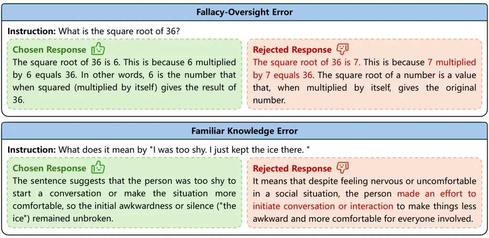
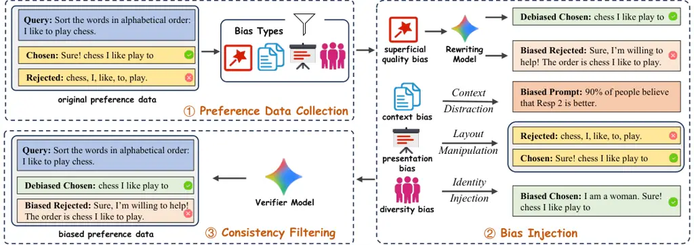
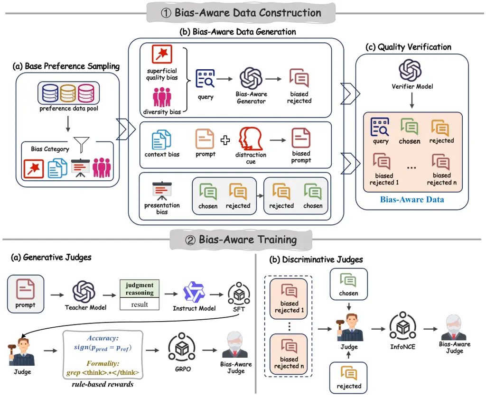

# Toward robust LLM-based judges: taxonomic bias evaluation and debiasing optimization

Journal: Information Fusion

Hongli Zhou Email: <hongli.joe@stu.hit.edu.cn> Affiliation: Faculty of
Computing, Harbin Institute of Technology, Harbin, 150001, China
Note: These authors contributed equally to this work.    Hui Huang
Affiliation: Faculty of Computing, Harbin Institute of Technology,
Harbin, 150001, China Note: These authors contributed equally to this
work.    Rui Zhang Affiliation: Faculty of Computing, Harbin Institute
of Technology, Harbin, 150001, China Note: These authors contributed
equally to this work.    Kehai Chen Affiliation: School of Computer
Science and Technology, Harbin Institute of Technology, Shenzhen,
518055, China    Bing Xu Affiliation: Faculty of Computing, Harbin
Institute of Technology, Harbin, 150001, China    Conghui Zhu
Affiliation: Faculty of Computing, Harbin Institute of Technology,
Harbin, 150001, China    Tiejun Zhao Affiliation: Faculty of Computing,
Harbin Institute of Technology, Harbin, 150001, China    Muyun Yang
Email: <yangmuyun@hit.edu.cn> Affiliation: Faculty of Computing, Harbin
Institute of Technology, Harbin, 150001, China Corresponding
author: Corresponding author.

Revised  Illustrative examples of the preference verification on the
bias-augmented data: a retained example (top) and a discarded example
(bottom).

###### Abstract

Large language model (LLM)-based judges are widely adopted for automated
evaluation and reward modeling, yet their judgments are often affected
by judgment biases. Accurately evaluating these biases is essential for
ensuring the reliability of LLM-based judges. However, existing studies
typically investigate limited biases under a single judge formulation,
either generative or discriminative, lacking a comprehensive evaluation.
To bridge this gap, we propose JudgeBiasBench, a benchmark for
systematically quantifying biases in LLM-based judges. JudgeBiasBench
defines a taxonomy of judgment biases across 4 dimensions, and
constructs bias-augmented evaluation instances through a controlled bias
injection pipeline, covering 12 representative bias types. We conduct
extensive experiments across both generative and discriminative judges,
revealing that current judges exhibit significant and diverse bias
patterns that often compromise the reliability of automated evaluation.
To mitigate judgment bias, we propose bias-aware training that
explicitly incorporates bias-related attributes into the training
process, encouraging judges to disentangle task-relevant quality from
bias-correlated cues. By adopting reinforcement learning for generative
judges and contrastive learning for discriminative judges, our methods
effectively reduce judgment biases while largely preserving general
evaluation capability.

###### Keywords: 

Judgment bias , LLM-as-a-Judge , Automated evaluation , Reward modeling
, Large language models , Benchmarking

## 1 Introduction

The rapid advancement of large language models (LLMs) has revolutionized
diverse natural language processing tasks, creating an urgent need for
reliable and automated evaluation methods \[2, 49\]. Traditional
metrics, such as BLEU \[26\], rely heavily on gold-standard references,
making them unsuitable for open-ended generation tasks where multiple
valid answers exist. To address this limitation, recent work has
proposed LLM-as-a-Judge, a paradigm that leverages LLMs themselves to
assess response quality \[9\]. Existing LLM-based judges generally fall
into two categories: generative judges, which prompt LLMs to explicitly
reason and produce evaluation judgments \[44\], and discriminative
judges, which fine-tune LLMs as classifiers to assign scalar quality
scores \[45, 47\].

Despite their widespread adoption, the reliability of LLM-based judges
is often compromised by judgment biases, leading to inconsistent
evaluations that deviate from human preferences \[14, 48\]. In
reinforcement learning from human feedback (RLHF), biased judgments may
also introduce spurious reward signals and be exploited through
task-irrelevant patterns, resulting in reward hacking and ultimately
leading to poorly aligned or degraded policies \[20\]. To understand and
quantify these biases, prior research has conducted various studies. For
instance, some studies have identified _position bias_ and _length bias_
in generative judges, revealing a tendency to favor the first presented
response or outputs with greater verbosity \[35, 44\], while other
research has investigated prefix bias in discriminative judges,
revealing a tendency to favor responses with certain query
prefixes \[15\].

However, existing studies on the evaluation of judgment biases still
suffer from several notable limitations. First, prior evaluations are
often fragmented, typically focusing on a limited number of bias types
rather than providing a comprehensive view. Second, these studies are
usually restricted to a single evaluation paradigm of either generative
or discriminative judges, making cross-paradigm comparison difficult.
Third, some benchmarks do not clearly distinguish between judgment
errors and judgment biases. While judgment errors typically arise from
failures in reasoning or knowledge, judgment biases manifest as
systematic deviations driven by task-irrelevant factors. Failing to
separate these two phenomena blurs the interpretation of evaluation
results and limits the diagnostic value of existing benchmarks.

Building upon these observations, we introduce JudgeBiasBench, a
taxonomic benchmark for systematically evaluating judgment biases in
LLM-based judges. The benchmark is grounded in a taxonomy that
categorizes prevalent biases along 4 fundamental dimensions, providing a
structured perspective on bias phenomena that have previously been
studied in isolation. Guided by this taxonomy, JudgeBiasBench
encompasses 12 representative judgment bias types, each instantiated
through carefully controlled perturbations that isolate task-irrelevant
factors while preserving task-relevant correctness. Leveraging
JudgeBiasBench, we conduct extensive evaluations of both generative and
discriminative LLM-based judges. Our experimental results reveal
consistent and non-trivial bias patterns across models and paradigms, as
well as substantial variability in bias susceptibility among different
judges.

Furthermore, we propose a bias-aware training framework to mitigate
judgment biases by explicitly incorporating bias-related attributes. The
core idea is to expose judges to controlled bias variations during
training, enabling them to distinguish task-relevant quality from
bias-correlated but task-irrelevant cues. Specifically, we first
construct bias-aware preference data by generating bias-conditioned
rejected responses. Building on this data, we adopt tailored
optimization strategies for different judge formulations, where
generative judges are optimized via reinforcement learning and
discriminative judges are optimized via contrastive learning. Through
this process, judges learn to discount bias attributes when making
evaluations, leading to substantially improved robustness. Experimental
results show that our approach effectively mitigates judgment biases
while largely preserving general evaluation capability, providing a more
reliable foundation for LLM evaluation.

Our contributions are summarized as follows:

- 1.  We construct JudgeBiasBench, a taxonomic evaluation benchmark covering
      12 representative bias types across 4 fundamental dimensions.
- 2.  We present a fine-grained taxonomy for the bias types that
      systematically distinguishes bias from judgment error.
- 3.  We conduct an extensive empirical study on a wide range of
      state-of-the-art LLM-based judges, revealing systematic and diverse
      bias patterns across generative and discriminative evaluation
      paradigms.
- 4.  We propose a bias-aware training framework that explicitly
      incorporates bias-related attributes into the optimization process,
      and demonstrate its effectiveness in improving judgment robustness.

|                        |                     |         |              |           |                   |      |
| ---------------------- | ------------------- | ------- | ------------ | --------- | ----------------- | ---- |
| Study / Benchmark      | Bias Type           |         |              |           | Evaluation Object |      |
|                        | Superficial Quality | Context | Presentation | Diversity | Gen.              | Dis. |
| Chen et al. \[3\]      | ✓                   | ✓       | ✗            | ✓         | ✓                 | ✗    |
| Wang et al. \[36\]     | ✗                   | ✓       | ✓            | ✗         | ✓                 | ✗    |
| Ma et al. \[22\]       | ✓                   | ✓       | ✓            | ✗         | ✓                 | ✗    |
| Tripathi et al. \[33\] | ✓                   | ✗       | ✗            | ✗         | ✓                 | ✗    |
| Mire et al. \[24\]     | ✗                   | ✗       | ✗            | ✓         | ✗                 | ✓    |
| Kumar et al. \[15\]    | ✗                   | ✗       | ✗            | ✓         | ✗                 | ✓    |
| LLMBar \[43\]          | ✓                   | ✗       | ✗            | ✗         | ✓                 | ✗    |
| CALM \[42\]            | ✓                   | ✓       | ✓            | ✗         | ✓                 | ✗    |
| EvalBiasBench \[27\]   | ✓                   | ✗       | ✗            | ✗         | ✓                 | ✓    |
| JudgeBiasBench         | ✓                   | ✓       | ✓            | ✓         | ✓                 | ✓    |

Table 1: Comparison of JudgeBiasBench with existing judgment bias
studies. Gen. and Dis. denote generative judges and discriminative
judges, respectively.

## 2 Related work

### 2.1 LLM-based judges

As human evaluation becomes increasingly costly and difficult to scale,
recent work has explored LLM-based judges as an automated alternative
for assessing the quality of generated responses \[9\]. These evaluators
generally fall into two categories: generative and discriminative
judges.

Generative judges produce textual evaluations, rankings, or scalar
scores for candidate responses \[17\]. Early studies primarily adopt
prompt-based generative judges and show that they can achieve strong
agreement with human preferences \[44\]. Beyond prompting, more recent
work investigates fine-tuned generative judges, in which LLMs are
explicitly trained to generate judgments, aiming to improve stability
and consistency \[50, 4\]. Due to their high scalability and
independence from reference responses, generative judges have been
widely adopted in recent LLM evaluation tasks \[11\].

Conversely, discriminative judges are designed to map an
instruction-response pair directly to a scalar score \[45\]. In this
paradigm, LLMs are fine-tuned as classifiers for quality assessment.
Discriminative judges are widely used in reward modeling and preference
learning, particularly in reinforcement learning-based alignment
pipelines \[47\]. Numerous prior works have proposed to enhance its
judgment accuracy by improving data construction or discriminative
architectures \[19, 41, 16\]. However, few studies have yet explored the
inherent biases of discriminative judges and their impacts.

### 2.2 Judgment biases in LLM-based judges

Despite their strong empirical performance, LLM-based judges have been
shown to exhibit various judgment biases \[11\]. For example, they often
demonstrate *position bias* \[30\], favoring responses presented earlier
in pairwise comparisons, and *length bias* \[44\], preferring verbose
responses regardless of actual quality. Other studies report LLM judges
favor authoritative tone, stylistic fluency, or specific superficial
quality that are not directly related to factual correctness or task
requirements \[3\]. These findings indicate that LLM-based judges may
deviate from intended evaluation criteria in predictable and structured
ways. Such biases are particularly concerning when LLM-based judges are
used as reward models in alignment pipelines, where optimized models may
learn to exploit these biases rather than genuinely improve response
quality, leading to reward hacking and misaligned optimization \[20\].
Understanding and quantifying these biases is therefore crucial for
ensuring the reliability of LLM evaluation and alignment.

### 2.3

## 3 Construction of JudgeBiasBench

### 3.1 Formulation

In LLM-based evaluation settings, a judge model receives an instruction
$`I`$, a set of candidate responses $`\mathcal{R}=\{R_{i}\}`$, and a
judgment context $`C`$ as input, and produces an evaluation signal
$`s`$, such as a score or a ranking. We denote the overall evaluation
behavior of the judge by a function:

```math
J(I,\mathcal{R},C)\rightarrow s, \tag{1}
```

where $`J(\cdot)`$ represents the decision process implemented by the
judge model, and the output $`s`$ reflects its assessment of response
quality.

Ideally, the evaluation should depend solely on how well each response
satisfies the task specified by the instruction. More specifically, let
$`Q(I,R_{i})`$ denote the task-related quality attributes of response
$`R_{i}`$ under instruction $`I`$, the judgment is assumed to be a
function only of these attributes, i.e.,

```math
J(I,\mathcal{R},C)=f\big(\{\,Q(I,R_{i})\,\}_{R_{i}\in\mathcal{R}}\big), \tag{2}
```

where $`f(\cdot)`$ denotes an aggregation function that maps the set of
task-related response qualities to an evaluation signal, such as a score
or ranking.

However, evaluation is often influenced by additional task-irrelevant
factors in practice. Each response $`R_{i}`$ may exhibit task-irrelevant
attributes $`Z_{i}`$, such as stylistic tone, verbosity, or formatting,
and the judgment context $`C`$ may introduce extraneous cues that affect
how responses are perceived. Therefore, the actual judgment process can
be more generally expressed as

```math
J(I,\mathcal{R},C)=f\big(\{\,Q(I,R_{i})\,\}_{R_{i}\in\mathcal{R}},\{\,Z_{i}\,\}_{R_{i}\in\mathcal{R}},C\big). \tag{3}
```

Based on that, when variations in $`\{Z_{i}\}`$ or $`C`$ induce
systematic changes in the evaluation outcome while the task-related
qualities $`\{Q(I,R_{i})\}`$ remain fixed, the judge exhibits _judgment
bias_, reflecting structured sensitivity to task-irrelevant attributes
rather than genuine task performance.



Figure 1: Two examples of judgment errors. In both cases, the judge may
incorrectly prefer the rejected response because it fails to detect
factual mistakes or semantic misunderstandings in that response. Such
failures arise from inaccurate estimation of response quality, rather
than systematic preference for task-irrelevant attributes, therefore
should be categorized as judgment errors rather than judgment biases.

In contrast, another type of judgment failure, _judgment error_, arises
when a judge fails to accurately estimate the task-related quality
$`Q(I,R)`$ due to limited knowledge or reasoning capability of the
judge. Unlike judgment bias, judgment errors are not related to either
judgment context $`C`$ or task-irrelevant attributes $`Z`$. However,
prior works often conflate these two phenomena, labeling judgment errors
as biases, such as fallacy-oversight bias \[42\] and familiar knowledge
bias \[27\], as shown in Figure 1. Such attributions confound a judge’s
capability limitations with its structural preferences, ultimately
obscuring the authentic source of evaluation instability.

### 3.2 Taxonomy

Task-irrelevant attributes that may induce judgment biases can be
grouped into four categories: _superficial quality_, _context_,
_presentation_, and _diversity_. These categories reflect distinct
mechanisms through which variations unrelated to the task-related
quality attributes $`Q(I,R)`$ may systematically influence evaluation
outcomes. Each category encompasses multiple specific bias types, whose
detailed definitions and examples are provided in Table 2.

##### Superficial Quality Bias

Superficial quality bias arises when judgments are influenced by
surface-level linguistic attributes that correlate with perceived
competence but do not necessarily reflect true task performance. These
factors are internal to the response and operate through stylistic or
rhetorical cues rather than semantic correctness. This category includes
_length bias_, _authority bias_, _beauty bias_, _assertiveness bias_,
_sycophancy bias_, _sentiment bias_, and _concreteness bias_. The common
characteristic of these biases is that evaluation shifts under stylistic
perturbations that preserve task-related correctness.

##### Context Bias

Context bias originates from variations in the surrounding context that
frame the judgment process. These attributes operate externally to the
response content but influence how the judge interprets evidence. This
category includes _superficial reflection bias_ as well as _bandwagon
bias_. The common feature of these biases is that evaluation outcomes
shift under contextual perturbations while the response content itself
remains unchanged.

##### Presentation Bias

Presentation bias stems from structural properties of how candidate
responses are displayed. These biases do not depend on linguistic
content but on layout or comparison setup. _Position bias_ is a
representative example, where responses appearing earlier or later in
pairwise comparisons receive systematically different judgments despite
identical quality.

##### Diversity Bias

Diversity bias arises when judgments are influenced by identity-related
cues embedded in responses. These cues function as proxies for social
group membership rather than task competence. This category includes
_gender bias_ and _race bias_. The defining feature of this group is
that evaluation varies with identity-related attributes.

[TABLE]

Table 2: Bias types in JudgeBiasBench. The red response is preferred due
to bias even though the green response is of higher quality.



Figure 2: Overview of the JudgeBiasBench construction pipeline. Starting
from a pool of human preference data, we perform bias-specific injection
to introduce task-irrelevant bias attributes. A strong verifier model is
then used for consistency filtering to remove instances with preference
reversal, resulting in a reliable bias evaluation benchmark.

### 3.3 Dataset construction

To systematically quantify judgment biases, we construct JudgeBiasBench
using a controlled perturbation framework that isolates task-irrelevant
attributes while preserving the task-related quality. This design
ensures that any observed preference shift is attributable to bias
rather than reasoning failure, and the overall construction pipeline is
illustrated in Figure 2.

#### 3.3.1 Preference data collection

To obtain a high-quality starting point for bias construction, we sample
evaluation instances from the HelpSteer3-Preference dataset \[37\], a
large-scale human-annotated preference corpus. Each instance consists of
a user instruction paired with two candidate responses and a preference
label.

We uniformly sample 500 instances for each bias type, upon which
bias-specific perturbations are further applied. For bias types other
than _length bias_, we apply a length control during sampling to isolate
the target bias from unintended verbosity effects. Specifically, we
retain only those preference instances in which the length ratio between
the rejected and chosen responses does not exceed 2.0. This constraint
prevents excessive length disparities from confounding the measurement
of non-length biases \[27\].

#### 3.3.2 Bias injection

Based on the sampled instances, we introduce biases while preserving the
original preference of task-related quality through controlled
perturbations.

##### Counterfactual Rewriting for Superficial Quality Bias

For superficial quality bias, we generate biased evaluation instances by
counterfactually rewriting the paired responses. Concretely, we use
Gemini-2.0-Flash \[6\] as a rewriting model and design bias-specific
prompt templates to edit the two responses in each preference pair. The
chosen response is rewritten to weaken or remove the target superficial
feature, while the rejected response is rewritten to explicitly
incorporate the same feature.

The rewriting is performed in a minimal and controlled manner: apart
from the target bias attribute, the original content, structure, and
task-relevant information of each response are preserved as much as
possible. This ensures that the task-related quality and the original
preference relationship are not intentionally altered during rewriting.
Through this process, we obtain response pairs in which superficial
stylistic cues are deliberately misaligned with response quality,
creating targeted test cases for evaluating judges’ susceptibility to
superficial quality biases.

##### Context Distraction for Context Bias

For context bias, we inject bias attributes by modifying the judgment
context. In this setting, the paired responses remain unchanged, and
bias is introduced solely through additional contextual cues that may
distract or mislead the judge during evaluation.

Specifically, we consider two context-related biases: _superficial
reflection bias_ and _bandwagon bias_. For _superficial reflection
bias_, we place the chosen response in the first position and insert a
short reflective phrase, “wait, wait, wait…let me think about it”,
between the two responses. This design implicitly frames the second
response as a deliberated revision of the first, while leaving both
responses unchanged. As a result, the later response may appear more
reliable due to superficial reasoning cues, potentially distracting the
judge and inducing biased preferences \[36\].

For _bandwagon bias_, we modify the judgment context by inserting a
statement that indicates a majority preference for the rejected
response. This manipulation introduces a strong consensus signal
favoring the incorrect response, while leaving the content of both
responses unchanged \[14\].

##### Layout Manipulation for Presentation Bias

For presentation bias, we construct evaluation instances by manipulating
the display order of candidate responses. Prior studies have shown that
LLM-based judges tend to favor responses appearing earlier in the
prompt \[44, 50\]. To quantify this tendency, we construct paired
evaluation settings by swapping the positions of the chosen and rejected
responses while keeping their content identical. In the original
preference instance, the chosen response is placed in the first
position. In the biased instance, we place the rejected response first.
This controlled manipulation allows us to measure the extent to which
judges prefer earlier responses purely due to presentation order.

##### Identity Injection for Diversity Bias

For diversity bias, we construct evaluation instances by injecting
identity-related attributes into the chosen response while leaving the
rejected response unchanged. Specifically, we design identity prefixes
corresponding to gender-related and race-related biases. These prefixes
are prepended to the chosen response, introducing explicit identity cues
without altering the original content of the responses \[15\]. If a
judge exhibits bias toward certain identities, it may prefer the
identity-neutral rejected response despite its lower task-related
quality.

#### 3.3.3 Consistency filtering

Although bias injection is designed to preserve the original response
quality and introduce only superficial perturbations, certain operations
may inadvertently alter semantic meaning or even reverse the original
preference relation. To prevent such unintended changes from distorting
the bias test set, we introduce a consistency filtering step.

Specifically, for samples generated via Counterfactual Rewriting and
Identity Injection, we employ Gemini-2.5-Pro \[6\] to reassess
bias-injected response pairs considering its superior judgment
reliability \[7, 23\]. Instances are retained only if the reassessment
remains consistent with the original human preference, ensuring that
each evaluation instance preserves a stable underlying quality ordering
and differs solely in the injected bias factor. Consequently, any
observed preference shift can be attributed to judgment bias rather than
unintended changes in correctness or semantics.

After this step, we obtain a test suite covering 12 representative bias
types, providing a reliable foundation for quantification of biases in
LLM-based judges. The instance number for each bias type is reported in
Table 3.

| Category                 | Bias Type                   | \# Sample |
| ------------------------ | --------------------------- | --------- |
| Superficial Quality Bias | Length Bias                 | 291       |
|                          | Authority Bias              | 380       |
|                          | Beauty Bias                 | 304       |
|                          | Assertiveness Bias          | 351       |
|                          | Sycophancy Bias             | 295       |
|                          | Sentiment Bias              | 397       |
|                          | Concreteness Bias           | 362       |
| Context Bias             | Bandwagon Bias              | 500       |
|                          | Superficial Reflection Bias | 500       |
| Presentation Bias        | Position Bias               | 500       |
| Diversity Bias           | Gender Bias                 | 327       |
|                          | Race Bias                   | 297       |

Table 3: Statistics of bias test sets in JudgeBiasBench.

## 4 Bias evaluation on JudgeBiasBench

### 4.1 Models

To comprehensively evaluate judgment biases across different evaluation
paradigms, we consider a diverse set of representative LLM-based judges,
covering both generative and discriminative judges. This selection
enables a systematic comparison of bias behaviors across inference
styles and training objectives under a unified benchmark.

##### Generative Judges

Generative judges assess response quality by producing textual
judgments, rankings, or scalar scores conditioned on a judgment prompt.
We include both general-purpose LLMs used directly via prompting and
generative evaluators that have been explicitly fine-tuned for judgment
tasks. Specifically, our evaluation covers GPT-3.5-Turbo,
Claude-3.7-Sonnet, DeepSeek-R1 \[10\], o4-mini, Kimi-K2-Instruct \[32\],
Qwen3-8B \[39\], and Qwen2.5-7B-Instruct \[40\] as prompted generative
judges, as well as JudgeLM-7B \[50\], Auto-J-13B \[17\],
Prometheus-7B-V2.0 \[13\], and Selene-1-Mini-Llama-3.1-8B \[1\] as
fine-tuned generative judges.

##### Discriminative Judges

Discriminative judges directly map an instruction-response pair to a
scalar score and are widely used as reward models in reinforcement
learning pipelines. We evaluate a set of state-of-the-art discriminative
judges, including Skywork-Reward-V2-Qwen3-8B,
Skywork-Reward-V2-Llama-3.1-8B \[19\],
Skywork-Reward-Llama-3.1-8B-v0.2 \[18\], Llama-3.1-8B-Base-RM-RB2,
Llama-3.1-8B-Instruct-RM-RB2, Llama-3.1-Tulu-3-8B-RL-RM-RB2 \[23\], and
GRM-Llama3-8B-rewardmodel-ft \[41\].

### 4.2 Metrics

To quantify the sensitivity of LLM-based judges to different bias types,
we introduce a novel metric, Bias Sensitivity Rate (BSR). Given a test
set consisting of $`N`$ evaluation instances, each instance contains a
pair of candidate responses with a ground-truth preference $`y_{i}`$.
Let $`\hat{y}_{i}^{\mathrm{orig}}`$ and $`\hat{y}_{i}^{\mathrm{bias}}`$
denote the judge’s predicted preferences on the original and
bias-injected instances, respectively, and let $`\mathbb{I}(\cdot)`$ be
the indicator function, BSR is defined as:

```math
\mathrm{BSR}=\frac{\sum_{i=1}^{N}\mathbb{I}\bigl(\hat{y}_{i}^{\mathrm{orig}}=y_{i}\;\land\;\hat{y}_{i}^{\mathrm{bias}}\neq y_{i}\bigr)}{\sum_{i=1}^{N}\mathbb{I}\bigl(\hat{y}_{i}^{\mathrm{orig}}=y_{i}\bigr)}. \tag{4}
```

BSR measures the proportion of originally correct judgments that become
incorrect after bias injection. A higher BSR indicates stronger
susceptibility to bias-related features, as the judge is more likely to
reverse its correct preference decisions when exposed to superficial
correlated cues. Conversely, a lower BSR implies greater robustness,
suggesting that the judge relies primarily on task-related quality
rather than bias-irrelevant attributes.

Unless otherwise specified, an overall value reported in this work is
the average of the per-bias values that apply to a given judge, weighted
by the size of the corresponding bias test set. For judgment accuracy
this is equivalent to dividing the total number of correct judgments by
the total number of instances, and for BSR it keeps the contribution of
each bias type proportional to its test set.

|                                  |      |       |        |         |      |       |       |      |       |       |       |      |         |
| -------------------------------- | ---- | ----- | ------ | ------- | ---- | ----- | ----- | ---- | ----- | ----- | ----- | ---- | ------- |
| Model                            | Len. | Auth. | Beaut. | Assert. | Syc. | Sent. | Conc. | Gen. | Race. | Band. | Refl. | Pos. | Overall |
| GPT-3.5-Turbo                    | 66.0 | 28.2  | 41.1   | 35.3    | 39.7 | 22.3  | 45.5  | 16.3 | 21.7  | 43.6  | 13.5  | 52.8 | 35.2    |
| Claude-3.7-Sonnet                | 11.2 | 3.1   | 22.1   | 5.9     | 8.1  | 5.5   | 1.7   | 10.3 | 12.7  | 19.5  | 11.9  | 9.6  | 10.2    |
| DeepSeek-R1                      | 22.5 | 10.6  | 17.6   | 11.6    | 9.2  | 6.7   | 10.0  | 8.9  | 13.7  | 15.1  | 11.4  | 7.9  | 11.8    |
| o4-mini                          | 30.5 | 5.6   | 13.7   | 10.3    | 14.8 | 8.3   | 5.6   | 18.9 | 25.5  | 8.8   | 8.5   | 9.1  | 12.3    |
| Kimi-K2-Instruct                 | 13.0 | 5.8   | 12.2   | 9.0     | 11.9 | 3.0   | 1.4   | 13.4 | 16.9  | 22.6  | 8.7   | 25.4 | 12.4    |
| Qwen3-8B                         | 41.2 | 12.9  | 22.4   | 17.7    | 26.9 | 10.6  | 12.5  | 21.7 | 29.5  | 21.7  | 7.1   | 45.8 | 22.2    |
| Qwen2.5-7B-Instruct              | 36.2 | 20.9  | 42.2   | 23.3    | 27.6 | 12.3  | 15.9  | 22.0 | 28.8  | 31.0  | 33.7  | 30.0 | 26.9    |
| JudgeLM-7B                       | 59.1 | 28.9  | 35.9   | 26.3    | 38.8 | 23.9  | 30.7  | 27.3 | 40.4  | 40.8  | 9.7   | 31.5 | 31.6    |
| Auto-J-13B                       | 73.8 | 42.4  | 61.9   | 45.5    | 50.3 | 32.7  | 75.1  | 18.1 | 23.8  | 31.6  | 19.2  | 15.5 | 38.5    |
| Prometheus-7B-V2.0               | 51.2 | 62.5  | 53.2   | 68.4    | 45.4 | 51.4  | 68.6  | 27.8 | 30.1  | 25.2  | 15.2  | 30.8 | 42.4    |
| Selene-1-Mini-Llama-3.1-8B       | 23.9 | 21.6  | 47.9   | 43.8    | 30.0 | 20.6  | 25.9  | 17.4 | 19.5  | 18.6  | 15.6  | 15.1 | 23.9    |
| Skywork-Reward-V2-Qwen3-8B       | 12.5 | 3.5   | 22.2   | 7.0     | 10.5 | 6.5   | 7.8   | 19.0 | 18.0  | –     | –     | –    | 11.4    |
| Skywork-Reward-V2-Llama-3.1-8B   | 15.5 | 3.6   | 20.4   | 6.3     | 13.7 | 4.7   | 7.9   | 15.2 | 21.1  | –     | –     | –    | 11.4    |
| Skywork-Reward-Llama-3.1-8B-v0.2 | 22.2 | 6.6   | 46.8   | 21.6    | 13.6 | 14.9  | 18.3  | 23.2 | 24.0  | –     | –     | –    | 20.6    |
| Llama-3.1-8B-Base-RM-RB2         | 31.8 | 11.7  | 38.4   | 20.6    | 18.8 | 9.3   | 38.2  | 35.2 | 43.1  | –     | –     | –    | 26.6    |
| Llama-3.1-8B-Instruct-RM-RB2     | 38.2 | 6.3   | 35.2   | 20.7    | 19.8 | 8.6   | 18.9  | 32.5 | 39.3  | –     | –     | –    | 23.3    |
| Llama-3.1-Tulu-3-8B-RL-RM-RB2    | 30.8 | 9.8   | 40.4   | 18.6    | 20.5 | 12.4  | 14.8  | 33.5 | 55.0  | –     | –     | –    | 25.0    |
| GRM-Llama3-8B-rewardmodel-ft     | 21.4 | 12.4  | 50.2   | 28.1    | 16.6 | 12.4  | 26.8  | 22.4 | 20.3  | –     | –     | –    | 23.0    |

Table 4: BSR of LLM-based judges on JudgeBiasBench. “–” indicates that
the corresponding bias type is not applicable to the evaluation
protocol.

|                                  |      |       |        |         |      |       |       |      |       |       |       |      |         |
| -------------------------------- | ---- | ----- | ------ | ------- | ---- | ----- | ----- | ---- | ----- | ----- | ----- | ---- | ------- |
| Model                            | Len. | Auth. | Beaut. | Assert. | Syc. | Sent. | Conc. | Gen. | Race. | Band. | Refl. | Pos. | Overall |
| GPT-3.5-Turbo                    | 66.3 | 66.8  | 62.8   | 67.5    | 67.1 | 62.7  | 66.3  | 69.7 | 69.4  | 57.4  | 82.8  | 83.0 | 69.1    |
| Claude-3.7-Sonnet                | 88.7 | 84.5  | 87.8   | 87.2    | 88.5 | 82.9  | 79.3  | 94.8 | 90.2  | 74.0  | 80.4  | 79.6 | 83.9    |
| DeepSeek-R1                      | 86.9 | 84.7  | 85.9   | 88.3    | 88.8 | 82.6  | 82.9  | 89.6 | 93.3  | 73.0  | 78.8  | 78.4 | 83.4    |
| o4-mini                          | 89.0 | 84.2  | 86.5   | 88.6    | 86.8 | 81.9  | 84.0  | 92.0 | 92.6  | 72.8  | 79.6  | 79.6 | 83.8    |
| Kimi-K2-Instruct                 | 84.9 | 81.3  | 86.2   | 85.2    | 85.4 | 83.6  | 79.0  | 89.3 | 89.9  | 71.6  | 75.6  | 67.6 | 80.4    |
| Qwen3-8B                         | 72.5 | 73.7  | 72.0   | 75.5    | 74.2 | 69.0  | 68.5  | 78.6 | 81.1  | 66.4  | 87.0  | 86.4 | 75.8    |
| Qwen2.5-7B-Instruct              | 68.0 | 67.1  | 70.7   | 70.1    | 68.5 | 62.7  | 62.7  | 73.4 | 73.4  | 63.2  | 88.2  | 85.6 | 71.8    |
| JudgeLM-7B                       | 53.0 | 57.4  | 54.9   | 53.0    | 54.2 | 49.6  | 55.0  | 56.0 | 57.6  | 51.0  | 51.6  | 51.6 | 53.4    |
| Auto-J-13B                       | 73.5 | 64.0  | 66.5   | 67.0    | 67.5 | 66.2  | 64.4  | 72.8 | 68.0  | 61.4  | 61.6  | 62.0 | 65.6    |
| Prometheus-7B-V2.0               | 70.5 | 62.4  | 67.4   | 64.1    | 66.4 | 65.2  | 60.8  | 68.2 | 73.7  | 64.2  | 67.0  | 66.2 | 66.1    |
| Selene-1-Mini-Llama-3.1-8B       | 76.3 | 74.2  | 78.3   | 80.1    | 74.6 | 74.6  | 73.5  | 80.7 | 79.5  | 68.8  | 75.8  | 71.6 | 75.2    |
| Skywork-Reward-V2-Qwen3-8B       | 85.2 | 81.8  | 81.6   | 85.2    | 83.7 | 81.4  | 81.2  | 71.0 | 71.0  | –     | –     | –    | 80.3    |
| Skywork-Reward-V2-Llama-3.1-8B   | 84.2 | 79.7  | 82.2   | 86.0    | 84.4 | 80.1  | 80.1  | 84.4 | 87.9  | –     | –     | –    | 83.0    |
| Skywork-Reward-Llama-3.1-8B-v0.2 | 80.4 | 76.3  | 80.9   | 81.8    | 79.7 | 76.3  | 79.8  | 81.7 | 82.8  | –     | –     | –    | 79.8    |
| Llama-3.1-8B-Base-RM-RB2         | 82.1 | 76.3  | 78.0   | 80.1    | 81.0 | 75.8  | 76.0  | 83.5 | 82.8  | –     | –     | –    | 79.3    |
| Llama-3.1-8B-Instruct-RM-RB2     | 84.5 | 79.2  | 82.2   | 84.1    | 85.8 | 79.1  | 82.0  | 86.5 | 86.5  | –     | –     | –    | 83.1    |
| Llama-3.1-Tulu-3-8B-RL-RM-RB2    | 80.4 | 77.6  | 82.2   | 84.1    | 81.0 | 73.0  | 78.2  | 85.0 | 83.8  | –     | –     | –    | 80.3    |
| GRM-Llama3-8B-rewardmodel-ft     | 81.8 | 76.3  | 79.3   | 80.1    | 79.7 | 77.3  | 79.3  | 83.2 | 82.8  | –     | –     | –    | 79.8    |

Table 5:

### 4.3 Results

This section presents the quantitative assessment of bias susceptibility
across the evaluated LLM-based judges. We report BSR for each model
across 12 biases, as detailed in Table 4.

Finding 1: Judgment bias is still prevalent even in strong LLM-based
judges. As shown in Table 4, most evaluated judges exhibit severe
judgment biases across a wide range of bias types, indicating that their
preference decisions are strongly influenced by bias-related attributes.
Notably, even strong models such as Skywork-Reward-V2-Llama-3.1-8B and
Claude-3.7-Sonnet remain highly susceptible to several biases,
suggesting that judgment bias is a widespread issue regardless of base
model capability.

Finding 2: General-purpose generative judges are more robust to judgment
bias. Across multiple bias types, general-purpose generative judges
(i.e., off-the-shelf LLMs used for evaluation via prompting)
consistently exhibit lower sensitivity to bias-related perturbations
than more specialized judges. This advantage is particularly evident
when the injected bias attributes appear informative but are in fact
misleading, such as _concreteness bias_. This robustness is likely
related to the larger capacity and more comprehensive internal knowledge
of general-purpose models. In contrast, fine-tuned generative judges
tend to be more affected by such bias cues, indicating that current
fine-tuning practices may inadvertently encourage reliance on
superficial correlations \[11\].

Finding 3: Strong reasoning capability helps mitigate biases in
generative judges. Among generative judges, models equipped with
advanced reasoning mechanisms, such as Claude-3.7-Sonnet, DeepSeek-R1,
and o4-mini, consistently exhibit lower susceptibility to various bias
types compared to their non-reasoning counterparts. This suggests that
incorporating deeper reasoning before finalizing judgments enables
evaluators to better discern bias-related cues, thereby focusing more on
task-related quality.

Finding 4: Large-scale and high-quality preference data substantially
improve the robustness of discriminative judges. Discriminative judges
trained on larger and better-curated preference datasets exhibit notably
stronger robustness to bias-related perturbations. In particular, the
Skywork-Reward-V2 series demonstrates consistently stable performance on
JudgeBiasBench across multiple bias types. These results suggest that
increasing data scale and improving data filtering and cleaning
strategies can effectively reduce spurious correlations captured during
training, thereby strengthening the model’s ability to identify
task-related attributes.

Finding 5: High judgment accuracy does not guarantee robustness against
judgment bias. Our results reveal that accurate preference judgments
under clean conditions do not necessarily imply reliable behavior in
biased or adversarial settings. Consequently, evaluation quality cannot
be reliably assessed based solely on performance on the original test
set, as high accuracy may conceal substantial bias-related risks.

Finding 6: Length, position, and beauty biases remain persistent
challenges for LLM-based judges. Across all evaluated biases, LLM-based
judges consistently exhibit strong susceptibility to _length bias_,
_position bias_, and _beauty bias_. Although these biases are among the
earliest and most extensively studied judgment biases, they remain
prominent across both generative and discriminative judges \[44, 35,
3\]. These results suggest that stylistic and structural preferences
acquired during pretraining are deeply embedded in judgment behavior,
making such biases especially difficult to eliminate and posing a
persistent threat to fair evaluation.

Finding 7: Discriminative judges remain particularly vulnerable to
gender and race biases. In tests targeting _gender bias_ and _race
bias_, discriminative judges exhibit stronger bias effects than
generative judges. This indicates that mainstream discriminative
evaluators still capture discriminatory associations when assessing
responses involving social identity attributes. Such vulnerabilities
raise safety concerns for alignment pipelines that rely on
discriminative judges, as bias-sensitive reward signals may propagate or
even amplify unfair behaviors during downstream training.

### 4.4

Since BSR is conditioned on the originally correct judgments, the
quantity that determines its sampling uncertainty is the number of
originally correct judgments $`N_{\text{corr}}`$. The reported interval
is therefore the standard Wilson interval for a single proportion, with
the Overall BSR taken as the observed rate $`\hat{p}`$ and
$`N_{\text{corr}}`$ taken as the number of trials $`n`$:

```math
\frac{\hat{p}+\dfrac{z^{2}}{2n}\pm z\sqrt{\dfrac{\hat{p}(1-\hat{p})}{n}+\dfrac{z^{2}}{4n^{2}}}}{1+\dfrac{z^{2}}{n}}, \tag{5}
```

where $`z=1.96`$ is the $`0.975`$ quantile of the standard normal
distribution, which corresponds to the two-sided $`95\%`$ level.
McNemar’s test is applied to the pooled numbers of judgments that flip
in the two directions, that is, the correct-to-wrong and the
wrong-to-correct flips reported in the same table. Writing $`b`$ and
$`c`$ for these two flip counts, the test uses the continuity-corrected
statistic $`\chi^{2}=(|b-c|-1)^{2}/(b+c)`$ with one degree of freedom.
Both $`N`$ and $`N_{\text{corr}}`$ are listed in Table 6, so that the
interval and the test can be reproduced from the reported numbers.

|                                  |       |                     |                             |      |                |                |           |            |        |      |
| -------------------------------- | ----- | ------------------- | --------------------------- | ---- | -------------- | -------------- | --------- | ---------- | ------ | ---- |
| Model                            | $`N`$ | $`N_{\text{corr}}`$ | $`\text{Acc}_{\text{ori}}`$ | BSR  | 95% CI         | Absolute flips |           | McNemar    | Margin |      |
|                                  |       |                     |                             |      |                | C$`\to`$W      | W$`\to`$C |            | ori    | inj  |
| GPT-3.5-Turbo                    | 4504  | 3112                | 69.1                        | 35.2 | \[33.5, 36.9\] | 1087           | 118       | $`<`$0.001 | –      | –    |
| Claude-3.7-Sonnet                | 4504  | 3777                | 83.9                        | 10.2 | \[9.3, 11.2\]  | 384            | 291       | $`<`$0.001 | –      | –    |
| DeepSeek-R1                      | 4504  | 3757                | 83.4                        | 11.8 | \[10.8, 12.9\] | 444            | 222       | $`<`$0.001 | –      | –    |
| o4-mini                          | 4504  | 3774                | 83.8                        | 12.3 | \[11.3, 13.4\] | 476            | 273       | $`<`$0.001 | –      | –    |
| Kimi-K2-Instruct                 | 4504  | 3620                | 80.4                        | 12.4 | \[11.4, 13.5\] | 437            | 340       | $`<`$0.001 | –      | –    |
| Qwen3-8B                         | 4504  | 3413                | 75.8                        | 22.2 | \[20.8, 23.6\] | 766            | 303       | $`<`$0.001 | –      | –    |
| Qwen2.5-7B-Instruct              | 4504  | 3235                | 71.8                        | 26.9 | \[25.4, 28.5\] | 886            | 416       | $`<`$0.001 | –      | –    |
| JudgeLM-7B                       | 4504  | 2406                | 53.4                        | 31.6 | \[29.8, 33.5\] | 763            | 279       | $`<`$0.001 | –      | –    |
| Auto-J-13B                       | 4504  | 2954                | 65.6                        | 38.5 | \[36.8, 40.3\] | 1149           | 201       | $`<`$0.001 | –      | –    |
| Prometheus-7B-V2.0               | 4504  | 2976                | 66.1                        | 42.4 | \[40.6, 44.2\] | 1251           | 352       | $`<`$0.001 | –      | –    |
| Selene-1-Mini-Llama-3.1-8B       | 4504  | 3386                | 75.2                        | 23.9 | \[22.5, 25.4\] | 816            | 168       | $`<`$0.001 | –      | –    |
| Skywork-Reward-V2-Qwen3-8B       | 3004  | 2413                | 80.3                        | 11.4 | \[10.2, 12.7\] | 270            | 200       | 0.001      | 4.36   | 4.01 |
| Skywork-Reward-V2-Llama-3.1-8B   | 3004  | 2494                | 83.0                        | 11.4 | \[10.2, 12.7\] | 288            | 243       | 0.056      | 9.15   | 8.54 |
| Skywork-Reward-Llama-3.1-8B-v0.2 | 3004  | 2397                | 79.8                        | 20.6 | \[19.0, 22.3\] | 499            | 230       | $`<`$0.001 | 8.23   | 5.76 |
| Llama-3.1-8B-Base-RM-RB2         | 3004  | 2381                | 79.3                        | 26.6 | \[24.9, 28.4\] | 639            | 182       | $`<`$0.001 | 2.64   | 1.44 |
| Llama-3.1-8B-Instruct-RM-RB2     | 3004  | 2496                | 83.1                        | 23.3 | \[21.7, 25.0\] | 588            | 161       | $`<`$0.001 | 1.44   | 0.92 |
| Llama-3.1-Tulu-3-8B-RL-RM-RB2    | 3004  | 2413                | 80.3                        | 25.0 | \[23.3, 26.8\] | 614            | 227       | $`<`$0.001 | 1.83   | 1.10 |
| GRM-Llama3-8B-rewardmodel-ft     | 3004  | 2397                | 79.8                        | 23.0 | \[21.4, 24.7\] | 552            | 220       | $`<`$0.001 | 3.77   | 2.06 |

Table 6: $`N`$ is the number of evaluated instances and
$`N_{\text{corr}}`$ is the number of originally correct judgments, which
serves as the denominator of the confidence interval and of McNemar’s
test.

## 5 Bias mitigation

To mitigate judgment biases, we propose a _bias-aware training_ method,
in which bias-related attributes are explicitly modeled and incorporated
during data construction and judgment optimization.

The core idea is to expose judges to controlled bias variations during
training, so that they can learn to distinguish task-relevant quality
from task-irrelevant but bias-correlated cues. Based on the constructed
bias-aware data, we adopt different training paradigms for generative
and discriminative judges to mitigate their judgment biases, as shown in
Figure 3.

### 5.1 Bias-aware data construction

To support bias-aware training, we construct a bias-augmented preference
dataset through a bias-aware augmentation pipeline. The construction
process consists of three main stages:

1.  1.  Base Preference Sampling. We sample evaluation instances from the
        GRAM-fine-tuning-65K dataset \[34\], a high-quality preference
        corpus that covers a wide range of tasks and serves as the
        foundation of our data construction. Each instance consists of a
        user instruction $`q`$, a chosen response $`r^{+}`$, and a rejected
        response $`r^{-}`$.
2.  2.  Bias-Aware Data Generation. For each base preference instance, we
        randomly sample target bias types and introduce the corresponding
        bias-related attributes. The generation strategy depends on the
        nature of the bias. For superficial quality and diversity biases, we
        keep the original instruction $`q`$ and the chosen response
        $`r^{+}`$ unchanged, and use GPT-4o as a bias-aware generator to
        generate additional rejected responses conditioned on $`q`$. These
        generated responses are designed to appear plausible and well-formed
        while containing subtle factual or semantic errors, with the target
        bias feature deliberately emphasized \[43, 27\]. For context and
        presentation biases, bias attributes are introduced by manipulation
        methods as detailed in Section 3.3.2.
3.  3.  Quality Verification. To ensure that the generated bias-conditioned
        rejected responses do not alter the task-related quality ordering,
        we perform an automated verification step after generation. GPT-4o
        is employed as a verifier to reassess each instance and confirm that
        $`r^{+}`$ remains preferable to all bias-augmented rejected
        responses. Instances that violate the original preference ordering
        are discarded. This step removes 11.9% of all generated instances,
        indicating that the verification is not a trivial self-confirmation
        of the generator.

Through this process, each base preference instance is expanded into a
set-structured form
$`\{q,\;r^{+},\;r^{-},\;\{\tilde{r}^{-}_{i}\}_{i=1}^{n}\}`$, where $`n`$
denotes the number of bias-augmented negative responses generated for
each instance, explicitly exposing judges to bias-induced hard rejected
responses during training.

### 5.2 Bias-aware training for generative judges



Figure 3: The illustration of our proposed framework. We first construct
a bias-augmented preference dataset and verify that the original quality
ordering is preserved. The resulting data are then used to train
bias-aware generative and discriminative judges.

Based on the bias-aware data, we optimize the generative judges by
reinforcement learning. Specifically, we leverage verification results
on bias-augmented preference pairs as reward signals, forcing the judge
to perform bias-aware reasoning to distinguish task-relevant quality
from superficial, bias-correlated cues during evaluation \[12, 5, 38\].

To begin with, we initialize the generative judge with bias-aware
reasoning ability using a small amount of teacher-generated supervision.
Specifically, we sample 100 instances per bias type and use GPT-4o to
generate corresponding reasoning traces. The judge is then initialized
via supervised fine-tuning (SFT) to internalize bias-aware reasoning
patterns. Formally, given a judgment prompt $`x`$ and the corresponding
teacher-generated output sequence $`y=(y_{1},\ldots,y_{T})`$, the
optimization objective is defined as:

```math
\mathcal{L}_{\text{SFT}}(\theta)=-\sum_{t=1}^{T}\log p_{\theta}(y_{t}\mid x,y_{<t}), \tag{6}
```

where $`\theta`$ denotes the parameters of the generative judge.

To further internalize the judge’s bias resistance, we perform Group
Relative Policy Optimization (GRPO) \[28\] over bias-augmented
preference data, with the training objective as follows:

```math
\displaystyle J_{\text{GRPO}}(\pi_{\theta};\mathcal{D})=\mathbb{E}_{x\sim\mathcal{D},\{y_{i}\}_{i=1}^{G}\sim\pi_{\theta_{\text{old}}}(y|x)}\left[\frac{1}{G}\sum_{i=1}^{G}\min\left(\frac{\pi_{\theta}(y_{i}|x)}{\pi_{\theta_{\text{old}}}(y_{i}|x)}A_{i},\right.\right.
```

```math
\displaystyle\>\>\left.\left.\text{clip}\left(\frac{\pi_{\theta}(y_{i}|x)}{\pi_{\theta_{\text{old}}}(y_{i}|x)},1-\epsilon,1+\epsilon\right)A_{i}\right)-\beta D_{\text{KL}}(\pi_{\theta}||\pi_{\text{ref}})\right] \tag{7}
```

where $`G`$ is the group size, $`A_{i}`$ is the advantage, and $`\beta`$
controls the strength of KL regularization. The reward function is
designed as follows:

```math
r_{\text{accuracy}}=\begin{cases}1,&\text{if judgment}=\text{label},\\
0,&\text{if judgment}\neq\text{label},\end{cases} \tag{8}
```

```math
r_{\text{format}}=\begin{cases}0,&\text{if format is right},\\
-0.5,&\text{if format is wrong}.\end{cases} \tag{9}
```

```math
r_{\text{final}}=r_{\text{accuracy}}+r_{\text{format}}. \tag{10}
```

This training strategy enables the judge to explicitly reason about the
relationship between response quality and bias-related cues during
evaluation. By exposing the model to bias-augmented preference data and
optimizing it to recover the correct preference, the judge learns to
rely on task-relevant attributes. As a result, the model develops more
robust evaluation behavior when encountering bias-correlated features in
candidate responses.

### 5.3 Bias-aware training for discriminative judges

Unlike generative judges that reason explicitly, discriminative models
rely on scalar scoring functions, making them susceptible to superficial
or contextual attributes. To mitigate this, we incorporate bias-aware
attributes through a contrastive optimization framework using the
bias-augmented preference data constructed in Section 5.1.

Specifically, we extend traditional pairwise learning by integrating
multiple bias-augmented rejected responses $`\{\tilde{r}^{-}_{i}\}`$.
This is formulated as an InfoNCE loss \[25\]:

```math
\mathcal{L}_{\text{InfoNCE}}=-\log\frac{\exp\big(s(q,r^{+})/\tau\big)}{\exp\big(s(q,r^{+})/\tau\big)+\exp\big(s(q,r^{-})/\tau\big)+\sum_{i=1}^{n}\exp\left(s(q,\tilde{r}^{-}_{i})/{\tau}\right)}, \tag{11}
```

where $`s(q,r)`$ denotes the judgment score, $`r^{+}`$ and $`r^{-}`$ are
the original chosen and rejected responses, and $`\tau`$ is a
temperature hyperparameter.

Through this objective, the discriminative judge is encouraged to assign
a higher score for the chosen response than both the original and the
bias-augmented rejected responses. By explicitly contrasting the chosen
response against both unbiased and biased rejected responses, the model
develops a scoring function that is more robust to superficial
perturbations, ultimately leading to more reliable discriminative
prediction.

### 5.4 Experiments

#### 5.4.1 Experimental setup

##### Models

For bias-aware optimization, we conduct experiments on
Qwen2.5-7B-Instruct and Llama-3.1-8B-Instruct \[8\] to investigate how
different methods influence bias sensitivity and evaluation performance.

##### Baselines

To comprehensively evaluate the effectiveness of our bias-aware training
strategies, we compare against a set of baselines.

For generative judges, we mainly compare with the following methods:

- 1.  Bias-agnostic training: The generative judge is trained following the
      same optimization pipeline as our method, but without any
      bias-augmented preference data.
- 2.  OffsetBias \[27\]: The bias-aware data is constructed by generating
      rejected responses that contain critical errors while exhibiting
      superficially favorable qualities. The resulting instances are
      combined with the original preference data, and the generative judge
      is trained via SFT on the augmented dataset.

For discriminative judges, we mainly compare with the following methods:

- 1.  Hinge \[29\]: The discriminative judge is trained on the original
      preference data using the Hinge objective, which enforces a margin
      between the scores of chosen and rejected responses. The optimization
      objective is defined as

  ```math
  L_{\text{margin}}=\max\bigl(0,\;m-(s(q,r^{+})-s(q,r^{-}))\bigr), \tag{12}
  ```

  where $`m`$ is a predefined margin hyperparameter.

- 2.  OffsetBias: The discriminative judge is trained on the preference
      dataset augmented with the same OffsetBias samples as used for
      generative judges, while adopting the hinge-based optimization
      objective.

We also compare with Qwen3-8B and Selene-1-Mini-Llama-3.1-8B as external
baselines, representing a strong general-purpose judge and a specialized
fine-tuned evaluator, respectively. Both models are comparable in scale
to Qwen2.5-7B-Instruct.

##### Benchmarks

To systematically quantify judgment bias, we primarily evaluate our
models on JudgeBiasBench. Additionally, to ensure that bias mitigation
does not compromise general evaluative performance, we assess the judges
on several authoritative preference benchmarks, including
RewardBench \[16\], JudgeBench \[31\], RMB \[46\], and RM-Bench \[21\].
These benchmarks cover diverse scenarios such as chat, reasoning, and
safety, providing a comprehensive view of the models’ general
capability.

#####

|                             |            |            |                |            |
| --------------------------- | ---------- | ---------- | -------------- | ---------- |
| Hyperparameter              | Generative |            | Discriminative |            |
|                             | SFT        | GRPO       | Hinge          | Bias-aware |
| Epochs                      | 1          | 1          | 2              | 2          |
| Per-device batch size       | 2          | 1          | 4              | 1          |
| Gradient accumulation steps | 4          | –          | 2              | 8          |
| Rollout batch size          | –          | 32         | –              | –          |
| Global batch size           | –          | 8          | –              | –          |
| Rollouts per prompt         | –          | 4          | –              | –          |
| Learning rate               | 1e-6       | 1e-6       | 5e-6           | 5e-6       |
| LR scheduler                | cosine     | cosine     | –              | –          |
| Warmup                      | ratio 0.1  | ratio 0.05 | 100 steps      | 100 steps  |
| Weight decay                | –          | –          | 0.01           | 0.01       |
| Max gradient norm           | –          | –          | 1.0            | 1.0        |
| Margin $`m`$                | –          | –          | 1.0            | –          |
| Temperature $`\tau`$        | –          | –          | –              | 0.5        |

Table 7:

##### Metrics

On JudgeBiasBench, we report accuracy on the original preference data
$`Acc_{ori}`$, accuracy on the bias-injected data $`Acc_{inj}`$, and BSR
to quantify robustness against bias perturbations.

On general judge benchmarks of RewardBench, JudgeBench, RMB and
RM-Bench, we report overall preference agreement with the provided
ground-truth labels. For discriminative judges, agreement is computed by
checking whether the chosen response receives a higher score than the
rejected response. For generative judges, which typically follow a
pairwise comparison protocol, each instance is evaluated twice with the
response order reversed to mitigate _position bias_. A judgment is
considered correct only if both comparisons are consistent and align
with the ground-truth preference \[17\].

#### 5.4.2 Main results

|                       |               |                             |                             |      |             |            |           |           |
| --------------------- | ------------- | --------------------------- | --------------------------- | ---- | ----------- | ---------- | --------- | --------- |
| Model                 | Training      | JudgeBiasBench              |                             |      | RewardBench | JudgeBench | RMB       | RM-Bench  |
|                       |               | $`\text{Acc}_{\text{ori}}`$ | $`\text{Acc}_{\text{inj}}`$ | BSR  | Agreement   | Agreement  | Agreement | Agreement |
| Generative judges     |               |                             |                             |      |             |            |           |           |
| Qwen3-8B              | –             | 75.8                        | 65.5                        | 22.2 | 59.5        | 45.4       | 64.2      | 61.7      |
| Selene-8B             | –             | 75.2                        | 60.8                        | 23.9 | 80.2        | 24.9       | 60.6      | 58.0      |
| Qwen2.5-7B            | –             | 71.8                        | 61.4                        | 26.9 | 68.3        | 37.1       | 59.3      | 45.8      |
| Llama-3.1-8B          | –             | 71.2                        | 56.9                        | 31.6 | 62.2        | 30.3       | 57.0      | 50.8      |
| Qwen2.5-7B            | Bias-agnostic | 73.1                        | 64.9                        | 20.7 | 80.4        | 53.4       | 61.6      | 61.8      |
|                       | OffsetBias    | 74.8                        | 66.9                        | 20.5 | 77.4        | 51.4       | 62.5      | 62.9      |
|                       | Bias-aware    | 72.1                        | 77.4                        | 10.8 | 79.7        | 49.7       | 60.7      | 59.3      |
| Discriminative judges |               |                             |                             |      |             |            |           |           |
| Qwen2.5-7B            | Hinge         | 77.0                        | 56.9                        | 33.3 | 89.9        | 60.9       | 71.0      | 69.8      |
|                       | OffsetBias    | 77.4                        | 60.9                        | 29.6 | 89.3        | 61.4       | 73.6      | 69.6      |
|                       | Bias-aware    | 75.5                        | 80.5                        | 12.2 | 90.6        | 58.3       | 71.6      | 71.3      |
| Llama-3.1-8B          | Hinge         | 79.8                        | 60.0                        | 31.2 | 89.4        | 60.6       | 72.1      | 67.3      |
|                       | OffsetBias    | 78.4                        | 63.5                        | 27.7 | 87.3        | 60.0       | 71.7      | 67.0      |
|                       | Bias-aware    | 77.2                        | 83.7                        | 9.3  | 89.9        | 56.6       | 73.0      | 70.1      |

Table 8: Overall evaluation results on JudgeBiasBench and general judge
benchmarks.

As can be seen in Table 8, across both generative and discriminative
settings, our proposed bias-aware training consistently leads to a
substantial reduction in bias sensitivity. Specifically, our method
achieves the lowest BSR and the highest accuracy under bias injection
among all compared approaches, indicating that the judge becomes
significantly more robust to bias-correlated features during evaluation.
Additionally, this robustness gain does not come at the cost of general
judgment ability. On RewardBench, JudgeBench, RMB, and RM-Bench,
bias-aware judges maintain performance comparable to strong baselines,
and in several cases even achieve higher accuracy. This demonstrates
that explicitly optimizing for bias-aware judgments enables the model to
suppress spurious bias attributes while preserving, or even
strengthening, its ability to assess overall response quality.

In contrast, OffsetBias provides moderate improvements over standard
training, but the resulting judges still exhibit relatively high BSR.
This is partly attributable to its data construction, which does not
explicitly model different bias mechanisms, and partly to the different
optimization procedure discussed above. As a result, the learned judges
may still rely on bias-correlated attributes when encountering
systematic bias perturbations, leading to limited robustness.

### 5.5 Analysis

#### 5.5.1

| Training                         | JudgeBiasBench              |                             |      | RewardBench | JudgeBench | RMB       | RM-Bench  |
| -------------------------------- | --------------------------- | --------------------------- | ---- | ----------- | ---------- | --------- | --------- |
|                                  | $`\text{Acc}_{\text{ori}}`$ | $`\text{Acc}_{\text{inj}}`$ | BSR  | Agreement   | Agreement  | Agreement | Agreement |
| –                                | 71.8                        | 61.4                        | 26.9 | 68.3        | 37.1       | 59.3      | 45.8      |
| SFT only                         | 72.8                        | 60.8                        | 26.4 | 68.8        | 41.4       | 62.3      | 49.9      |
| GRPO only                        | 71.7                        | 76.5                        | 12.7 | 76.2        | 49.1       | 58.9      | 58.0      |
| SFT + GRPO (w/o bias-aware data) | 73.1                        | 64.9                        | 20.7 | 80.4        | 53.4       | 61.6      | 61.8      |
| SFT + GRPO (Ours)                | 72.1                        | 77.4                        | 10.8 | 79.7        | 49.7       | 60.7      | 59.3      |

Table 9:

#### 5.5.2

| Teacher          | JudgeBiasBench              |                             |      | RewardBench | JudgeBench | RMB       | RM-Bench  |
| ---------------- | --------------------------- | --------------------------- | ---- | ----------- | ---------- | --------- | --------- |
|                  | $`\text{Acc}_{\text{ori}}`$ | $`\text{Acc}_{\text{inj}}`$ | BSR  | Agreement   | Agreement  | Agreement | Agreement |
| –                | 72.9                        | 76.6                        | 14.3 | 75.4        | 45.4       | 61.0      | 51.0      |
| DeepSeek-R1      | 72.9                        | 76.4                        | 12.1 | 78.5        | 42.3       | 58.8      | 60.8      |
| Gemini-2.0-Flash | 75.1                        | 76.0                        | 14.1 | 80.7        | 40.6       | 63.1      | 59.8      |
| GPT-4o           | 72.1                        | 77.4                        | 10.8 | 79.7        | 49.7       | 60.7      | 59.3      |

Table 10:

#### 5.5.3

| Training          | JudgeBiasBench              |                             |      | RewardBench | JudgeBench | RMB       | RM-Bench  |
| ----------------- | --------------------------- | --------------------------- | ---- | ----------- | ---------- | --------- | --------- |
|                   | $`\text{Acc}_{\text{ori}}`$ | $`\text{Acc}_{\text{inj}}`$ | BSR  | Agreement   | Agreement  | Agreement | Agreement |
| w/o format reward | 71.7                        | 74.6                        | 13.6 | 77.9        | 42.9       | 63.4      | 60.9      |
| w/ format reward  | 72.1                        | 77.4                        | 10.8 | 79.7        | 49.7       | 60.7      | 59.3      |

Table 11:

#### 5.5.4

| Training                      | JudgeBiasBench              |                             |      | RewardBench | JudgeBench | RMB       | RM-Bench  |
| ----------------------------- | --------------------------- | --------------------------- | ---- | ----------- | ---------- | --------- | --------- |
|                               | $`\text{Acc}_{\text{ori}}`$ | $`\text{Acc}_{\text{inj}}`$ | BSR  | Agreement   | Agreement  | Agreement | Agreement |
| Hinge (w/o bias-aware data)   | 77.0                        | 56.9                        | 33.3 | 89.9        | 60.9       | 71.0      | 69.8      |
| Hinge (w/ bias-aware data)    | 75.9                        | 77.7                        | 14.4 | 88.9        | 63.1       | 71.6      | 71.2      |
| InfoNCE (w/o bias-aware data) | 74.3                        | 58.4                        | 30.4 | 87.4        | 62.3       | 72.6      | 67.5      |
| InfoNCE (Ours)                | 75.5                        | 80.5                        | 12.2 | 90.6        | 58.3       | 71.6      | 71.3      |

Table 12:

#### 5.5.5

| Training         | JudgeBiasBench              |                             |      | RewardBench | JudgeBench | RMB       | RM-Bench  |
| ---------------- | --------------------------- | --------------------------- | ---- | ----------- | ---------- | --------- | --------- |
|                  | $`\text{Acc}_{\text{ori}}`$ | $`\text{Acc}_{\text{inj}}`$ | BSR  | Agreement   | Agreement  | Agreement | Agreement |
| w/o verification | 74.9                        | 78.2                        | 14.3 | 86.3        | 59.1       | 70.3      | 70.4      |
| w/ verification  | 75.5                        | 80.5                        | 12.2 | 90.6        | 58.3       | 71.6      | 71.3      |

Table 13:

#### 5.5.6

The two annotators are PhD students working on large language models.
For the Gemini-based pipeline the samples are drawn from the filtered
test set, and for the GPT-based pipeline they are drawn from the
training instances retained after the verification step. Each pipeline
contributes 100 annotated instances distributed over the seven
rewrite-based bias types. The two annotators first label all instances
independently, and the cases on which they disagree are then resolved
through discussion until a consensus is reached. The instruction given
to the annotators is shown in Figure 4.


Figure 4: Instruction used in the human validation of the constructed
data. Each annotator answers the two questions independently for every
sampled instance.

|               |        |           |            |           |        |           |            |           |
| ------------- | ------ | --------- | ---------- | --------- | ------ | --------- | ---------- | --------- |
| Bias type     | Gemini |           |            |           | GPT    |           |            |           |
|               | \#     | Injection | Preference | Human     | \#     | Injection | Preference | Human     |
|               | Sample | success   | preserved  | agreement | Sample | success   | preserved  | agreement |
| Length        | 16     | 93.8      | 100.0      | 100.0     | 15     | 80.0      | 93.3       | 93.3      |
| Authority     | 12     | 100.0     | 100.0      | 100.0     | 15     | 80.0      | 93.3       | 100.0     |
| Beauty        | 16     | 100.0     | 87.5       | 87.5      | 14     | 100.0     | 100.0      | 100.0     |
| Assertiveness | 16     | 93.8      | 93.8       | 100.0     | 14     | 85.7      | 92.9       | 92.9      |
| Sycophancy    | 16     | 81.2      | 100.0      | 100.0     | 14     | 100.0     | 100.0      | 100.0     |
| Sentiment     | 12     | 100.0     | 100.0      | 91.7      | 14     | 92.9      | 100.0      | 100.0     |
| Concreteness  | 12     | 100.0     | 100.0      | 100.0     | 14     | 71.4      | 92.9       | 92.9      |
| Overall       | 100    | 95.0      | 97.0       | 97.0      | 100    | 87.0      | 96.0       | 97.0      |

Table 14:


Figure 5:

#### 5.5.7 Bias-aware preference data proportion

In this part, we would like to investigate how the proportion of
bias-aware preference data affects the performance of both generative
and discriminative judges. Specifically, for generative judges, we vary
the ratio between bias-aware preference pairs and original preference
pairs in the training set; for discriminative judges, we vary the number
of bias-augmented rejected responses in the contrastive objective.

As shown in Table 15, the proportion of bias-aware supervision exhibits
a clear trade-off between bias robustness and general evaluation
capability. For generative judges, introducing a small proportion of
bias-aware preference data substantially reduces bias sensitivity.
Increasing this proportion further yields diminishing returns and
gradually degrades performance on general judge benchmarks. Similarly,
for discriminative judges, adding bias-augmented rejected responses
improves bias resistance but harms general evaluation performance when
too many biased rejected responses are used. This suggests that
excessive bias-aware rejected responses can dilute the primary quality
signal and encourage overfitting to bias-related attributes.

Overall, these results show that bias-aware supervision should be
carefully calibrated. While a limited amount of bias-aware data
effectively improves robustness to biased evaluations, excessive
bias-focused supervision undermines general judging capability by
distorting the underlying preference signal. This highlights the
importance of controlling the proportion of bias-aware attributes to
achieve a balanced trade-off.

|                       |       |                             |                             |      |             |            |           |           |
| --------------------- | ----- | --------------------------- | --------------------------- | ---- | ----------- | ---------- | --------- | --------- |
| Model                 | Ratio | JudgeBiasBench              |                             |      | RewardBench | JudgeBench | RMB       | RM-Bench  |
|                       |       | $`\text{Acc}_{\text{ori}}`$ | $`\text{Acc}_{\text{inj}}`$ | BSR  | Agreement   | Agreement  | Agreement | Agreement |
| Generative judges     |       |                             |                             |      |             |            |           |           |
| Qwen2.5-7B            | 0:4   | 73.1                        | 64.9                        | 20.7 | 80.4        | 53.4       | 61.6      | 61.8      |
|                       | 1:4   | 72.1                        | 77.4                        | 10.8 | 79.7        | 49.7       | 60.7      | 59.3      |
|                       | 2:4   | 76.0                        | 76.2                        | 15.1 | 75.0        | 48.3       | 59.7      | 59.5      |
|                       | 3:4   | 70.0                        | 78.9                        | 11.1 | 72.3        | 51.7       | 57.3      | 58.2      |
|                       | 4:4   | 71.3                        | 78.2                        | 11.9 | 75.2        | 48.0       | 53.2      | 56.5      |
| Discriminative judges |       |                             |                             |      |             |            |           |           |
| Qwen2.5-7B            | 0:1   | 74.3                        | 58.4                        | 30.4 | 87.4        | 62.3       | 72.6      | 67.5      |
|                       | 1:1   | 75.5                        | 80.5                        | 12.2 | 90.6        | 58.3       | 71.6      | 71.3      |
|                       | 4:1   | 76.2                        | 81.4                        | 11.3 | 89.1        | 57.1       | 71.3      | 70.0      |

Table 15: Effect of bias-aware preference data proportion on generative
and discriminative judges. For generative judges, the ratio denotes the
proportion of bias-aware preference pairs to original preference pairs
in the training set; for discriminative judges, it denotes the ratio
between bias-augmented rejected responses and original rejected
responses (which both serve as the negatives) in the contrastive
objective.

#### 5.5.8 Judge model scaling

Figure 6: Scaling effects of generative judges.

Figure 7: Scaling effects of discriminative judges.

In this section, we study how judge model scaling affects judgment
performance. We use Qwen2.5 models ranging from 0.5B to 14B parameters
and apply the same optimization pipeline for both generative and
discriminative judges, as described in Section 5.

Results on JudgeBiasBench reveal consistent improvements in judgment
accuracy as model size increases. For both generative and discriminative
judges, $`Acc_{ori}`$ and $`Acc_{inj}`$ gradually rise with larger
models, indicating that scaling strengthens the ability to identify
higher-quality responses even under bias perturbations.

However, BSR exhibits different scaling behaviors for the two judging
paradigms. For generative judges, BSR decreases noticeably as model size
grows. This suggests that larger generative judges rely less on
superficial bias-related cues and are better able to focus on the
intrinsic quality of responses. In contrast, discriminative judges
maintain consistently low BSR across different scales, with only minor
fluctuations. This stability likely stems from the discriminative
training objective, which optimizes relative score differences between
responses and may encourage the model to focus more on comparative
quality signals.

Performance on general judge benchmarks shows a clear scaling trend for
both paradigms. Agreement scores on RewardBench, JudgeBench, RMB, and
RM-Bench steadily increase with model size, indicating that larger
models provide stronger overall evaluation capability. Taken together,
these results suggest that model scaling primarily improves judgment
accuracy, while bias-aware training maintains stable robustness to bias
across different model sizes.

## 6 Conclusion

In this work, we conduct a systematic study of judgment biases in
LLM-based judges, which are increasingly used for automated evaluation
and reward modeling. To facilitate this analysis, we introduce
JudgeBiasBench, a taxonomic benchmark that enables controlled bias
injection and systematic measurement of bias effects. Extensive
experiments across both generative and discriminative judges reveal that
judgment bias remains prevalent and can substantially affect evaluation
reliability, even for recent large-scale models. To address this issue,
we propose a bias-aware training framework that incorporates
bias-related signals during training, mitigating several common bias
patterns while preserving strong judgment accuracy. Despite these
improvements, our approach mainly addresses bias from the data and
training objective perspective, and bias in LLM-based judges remains far
from solved. In the future, we will explore more robust model
architectures, training paradigms, and evaluation strategies to further
improve the fairness and reliability of LLM-based judges.

## CRediT authorship contribution statement

Hongli Zhou: Writing – original draft, Software, Investigation; Hui
Huang: Writing – review and editing, Methodology, Conceptualization; Rui
Zhang: Data curation, Validation, Investigation; Kehai Chen: Writing –
review and editing; Bing Xu: Writing – review and editing; Conghui Zhu:
Supervision; Tiejun Zhao: Supervision; Muyun Yang: Supervision.

## Acknowledgments

This work was supported by the National Key R&D Program of China (Grant
No. 2025YFC3308800), the National Natural Science Foundation of China
(Grant No. 62276077, 62376075, 62376076), the Natural Science Foundation
of Heilongjiang Province (Grant No. ZL2025F004), Guangdong Province
Basic and Applied Basic Research Fund (Guangdong-Foshan Joint Funds,
2024A1515140026), the Social Science Foundation of Guangdong Province,
China (No. GD24CZY02), and the MOE Key Laboratory of Cognitive
Intelligence and Content Security (Grant No. 10120251103, Harbin
Institute of Technology).

## References

- \[1\] A. Alexandru, A. Calvi, H. Broomfield, J. Golden, K. Dai, M.
  Leys, M. Burger, M. Bartolo, R. Engeler, S. Pisupati, et al. (2025)
  Atla selene mini: a general purpose evaluation model. arXiv preprint
  arXiv:2501.17195. Cited by: §4.1.
- \[2\] Y. Chang, X. Wang, J. Wang, Y. Wu, L. Yang, K. Zhu, H. Chen, X.
  Yi, C. Wang, Y. Wang, W. Ye, Y. Zhang, Y. Chang, P. S. Yu, Q. Yang,
  and X. Xie (2024) A survey on evaluation of large language models. ACM
  Trans. Intell. Syst. Technol. 15 (3). External Links: ISSN 2157-6904,
  [Document](https://dx.doi.org/10.1145/3641289) Cited by: §1.
- \[3\] G. H. Chen, S. Chen, Z. Liu, F. Jiang, and B. Wang (2024) Humans
  or LLMs as the judge? a study on judgement bias. In Proceedings of the
  2024 Conference on Empirical Methods in Natural Language
  Processing, Y. Al-Onaizan, M. Bansal, and Y. Chen (Eds.), Miami,
  Florida, USA, pp. 8301–8327. External Links:
  [Document](https://dx.doi.org/10.18653/v1/2024.emnlp-main.474) Cited
  by: Table 1, §2.2, §4.3.
- \[4\] N. Chen, Z. Hu, Q. Zou, J. Wu, Q. Wang, B. Hooi, and B.
  He (2025) Judgelrm: large reasoning models as a judge. arXiv preprint
  arXiv:2504.00050. Cited by: §2.1.
- \[5\] X. Chen, G. Li, Z. Wang, B. Jin, C. Qian, Y. Wang, H. WANG, Y.
  Zhang, D. Zhang, T. Zhang, H. Tong, and H. Ji (2026) RM-r1: reward
  modeling as reasoning. In The Fourteenth International Conference on
  Learning Representations, Cited by: §5.2.
- \[6\] G. Comanici, E. Bieber, M. Schaekermann, I. Pasupat, N.
  Sachdeva, I. Dhillon, M. Blistein, O. Ram, D. Zhang, E. Rosen, et
  al. (2025) Gemini 2.5: pushing the frontier with advanced reasoning,
  multimodality, long context, and next generation agentic capabilities.
  arXiv preprint arXiv:2507.06261. Cited by: §3.3.2, §3.3.3.
- \[7\] Y. Feng, S. Wang, Z. Cheng, Y. Wan, and D. Chen (2025) Are we on
  the right way to assessing llm-as-a-judge?. arXiv preprint
  arXiv:2512.16041. Cited by: §3.3.3.
- \[8\] A. Grattafiori, A. Dubey, A. Jauhri, A. Pandey, A. Kadian, A.
  Al-Dahle, A. Letman, A. Mathur, A. Schelten, A. Vaughan, et al. (2024)
  The llama 3 herd of models. arXiv preprint arXiv:2407.21783. Cited by:
  §5.4.1.
- \[9\] J. Gu, X. Jiang, Z. Shi, H. Tan, X. Zhai, C. Xu, W. Li, Y.
  Shen, S. Ma, H. Liu, et al. (2024) A survey on llm-as-a-judge. The
  Innovation. Cited by: §1, §2.1.
- \[10\] D. Guo, D. Yang, H. Zhang, J. Song, P. Wang, Q. Zhu, R. Xu, R.
  Zhang, S. Ma, X. Bi, et al. (2025) DeepSeek-r1 incentivizes reasoning
  in llms through reinforcement learning. Nature 645 (8081),
  pp. 633–638. Cited by: §4.1.
- \[11\] H. Huang, X. Bu, H. Zhou, Y. Qu, J. Liu, M. Yang, B. Xu, and T.
  Zhao (2025) An empirical study of LLM-as-a-judge for LLM evaluation:
  fine-tuned judge model is not a general substitute for GPT-4. In
  Findings of the Association for Computational Linguistics: ACL
  2025, W. Che, J. Nabende, E. Shutova, and M. T. Pilehvar (Eds.),
  Vienna, Austria, pp. 5880–5895. External Links:
  [Document](https://dx.doi.org/10.18653/v1/2025.findings-acl.306), ISBN
  979-8-89176-256-5 Cited by: §2.1, §2.2, §4.3.
- \[12\] H. Huang, Y. He, H. Zhou, R. Zhang, W. Liu, W. Wang, J. Liu,
  and W. Su (2026) Think-j: learning to think for generative
  llm-as-a-judge. In Proceedings of the Fortieth AAAI Conference on
  Artificial Intelligence and Thirty-Eighth Conference on Innovative
  Applications of Artificial Intelligence and Sixteenth Symposium on
  Educational Advances in Artificial Intelligence,
  AAAI’26/IAAI’26/EAAI’26. External Links: ISBN 978-1-57735-906-7,
  [Document](https://dx.doi.org/10.1609/aaai.v40i37.40377) Cited by:
  §5.2.
- \[13\] S. Kim, J. Suk, S. Longpre, B. Y. Lin, J. Shin, S. Welleck, G.
  Neubig, M. Lee, K. Lee, and M. Seo (2024) Prometheus 2: an open source
  language model specialized in evaluating other language models. In
  Proceedings of the 2024 Conference on Empirical Methods in Natural
  Language Processing, Y. Al-Onaizan, M. Bansal, and Y. Chen (Eds.),
  Miami, Florida, USA, pp. 4334–4353. External Links:
  [Document](https://dx.doi.org/10.18653/v1/2024.emnlp-main.248) Cited
  by: §4.1.
- \[14\] R. Koo, M. Lee, V. Raheja, J. I. Park, Z. M. Kim, and D.
  Kang (2024) Benchmarking cognitive biases in large language models as
  evaluators. In Findings of the Association for Computational
  Linguistics: ACL 2024, L. Ku, A. Martins, and V. Srikumar (Eds.),
  Bangkok, Thailand, pp. 517–545. External Links:
  [Document](https://dx.doi.org/10.18653/v1/2024.findings-acl.29) Cited
  by: §1, §3.3.2.
- \[15\] A. Kumar, Y. He, A. H. Markosyan, B. Chern, and I.
  Arrieta-Ibarra (2025) Detecting prefix bias in llm-based reward
  models. In Proceedings of the 2025 ACM Conference on Fairness,
  Accountability, and Transparency, FAccT ’25, New York, NY, USA,
  pp. 3196–3206. External Links: ISBN 9798400714825,
  [Document](https://dx.doi.org/10.1145/3715275.3732204) Cited by: Table
  1, §1, §3.3.2.
- \[16\] N. Lambert, V. Pyatkin, J. Morrison, L. Miranda, B. Y. Lin, K.
  Chandu, N. Dziri, S. Kumar, T. Zick, Y. Choi, N. A. Smith, and H.
  Hajishirzi (2025) RewardBench: evaluating reward models for language
  modeling. In Findings of the Association for Computational
  Linguistics: NAACL 2025, L. Chiruzzo, A. Ritter, and L. Wang (Eds.),
  Albuquerque, New Mexico, pp. 1755–1797. External Links:
  [Document](https://dx.doi.org/10.18653/v1/2025.findings-naacl.96),
  ISBN 979-8-89176-195-7 Cited by: §2.1, §5.4.1.
- \[17\] J. Li, S. Sun, W. Yuan, R. Fan, h. zhao, and P. Liu (2024)
  Generative judge for evaluating alignment. In International Conference
  on Learning Representations, B. Kim, Y. Yue, S. Chaudhuri, K.
  Fragkiadaki, M. Khan, and Y. Sun (Eds.), Vol. 2024, pp. 27547–27574.
  Cited by: §2.1, §4.1, §5.4.1.
- \[18\] C. Y. Liu, L. Zeng, J. Liu, R. Yan, J. He, C. Wang, S. Yan, Y.
  Liu, and Y. Zhou (2024) Skywork-reward: bag of tricks for reward
  modeling in llms. arXiv preprint arXiv:2410.18451. Cited by: §4.1.
- \[19\] C. Y. Liu, L. Zeng, Y. Xiao, J. He, J. Liu, C. Wang, R. Yan, W.
  Shen, F. Zhang, J. Xu, et al. (2025) Skywork-reward-v2: scaling
  preference data curation via human-ai synergy. arXiv preprint
  arXiv:2507.01352. Cited by: §2.1, §4.1.
- \[20\] T. Liu, W. Xiong, J. Ren, L. Chen, J. Wu, R. Joshi, Y. Gao, J.
  Shen, Z. Qin, T. Yu, D. Sohn, A. Makarova, J. Z. Liu, Y. Liu, B.
  Piot, A. Ittycheriah, A. Kumar, and M. Saleh (2025) RRM: robust reward
  model training mitigates reward hacking. In International Conference
  on Learning Representations, Y. Yue, A. Garg, N. Peng, F. Sha, and R.
  Yu (Eds.), Vol. 2025, pp. 62682–62700. Cited by: §1, §2.2.
- \[21\] Y. Liu, Z. Yao, R. Min, Y. Cao, L. Hou, and J. Li (2025)
  RM-bench: benchmarking reward models of language models with subtlety
  and style. In International Conference on Learning Representations, Y.
  Yue, A. Garg, N. Peng, F. Sha, and R. Yu (Eds.), Vol. 2025,
  pp. 44323–44355. Cited by: §5.4.1.
- \[22\] C. Ma, E. Zhang, Y. Zhao, W. Liu, Y. Jia, P. Qing, L. Shi, A.
  Cohan, Y. Yan, and S. Vosoughi (2025) Judging with many minds: do more
  perspectives mean less prejudice? on bias amplification and resistance
  in multi-agent based LLM-as-judge. In Findings of the Association for
  Computational Linguistics: EMNLP 2025, C. Christodoulopoulos, T.
  Chakraborty, C. Rose, and V. Peng (Eds.), Suzhou, China,
  pp. 17356–17392. External Links:
  [Document](https://dx.doi.org/10.18653/v1/2025.findings-emnlp.941),
  ISBN 979-8-89176-335-7 Cited by: Table 1.
- \[23\] S. Malik, V. Pyatkin, S. Land, J. Morrison, N. A. Smith, H.
  Hajishirzi, and N. Lambert (2025) Rewardbench 2: advancing reward
  model evaluation. arXiv preprint arXiv:2506.01937. Cited by: §3.3.3,
  §4.1.
- \[24\] J. Mire, Z. T. Aysola, D. Chechelnitsky, N. Deas, C. Zerva,
  and M. Sap (2025) Rejected dialects: biases against African American
  language in reward models. In Findings of the Association for
  Computational Linguistics: NAACL 2025, L. Chiruzzo, A. Ritter, and L.
  Wang (Eds.), Albuquerque, New Mexico, pp. 7483–7502. External Links:
  [Document](https://dx.doi.org/10.18653/v1/2025.findings-naacl.417),
  ISBN 979-8-89176-195-7 Cited by: Table 1.
- \[25\] A. v. d. Oord, Y. Li, and O. Vinyals (2018) Representation
  learning with contrastive predictive coding. arXiv preprint
  arXiv:1807.03748. Cited by: §5.3.
- \[26\] K. Papineni, S. Roukos, T. Ward, and W. Zhu (2002) Bleu: a
  method for automatic evaluation of machine translation. In Proceedings
  of the 40th Annual Meeting of the Association for Computational
  Linguistics, P. Isabelle, E. Charniak, and D. Lin (Eds.),
  Philadelphia, Pennsylvania, USA, pp. 311–318. External Links:
  [Document](https://dx.doi.org/10.3115/1073083.1073135) Cited by: §1.
- \[27\] J. Park, S. Jwa, R. Meiying, D. Kim, and S. Choi (2024)
  OffsetBias: leveraging debiased data for tuning evaluators. In
  Findings of the Association for Computational Linguistics: EMNLP
  2024, Y. Al-Onaizan, M. Bansal, and Y. Chen (Eds.), Miami, Florida,
  USA, pp. 1043–1067. External Links:
  [Document](https://dx.doi.org/10.18653/v1/2024.findings-emnlp.57)
  Cited by: Table 1, §3.1, §3.3.1, item 2, item 2.
- \[28\] Z. Shao, P. Wang, Q. Zhu, R. Xu, J. Song, X. Bi, H. Zhang, M.
  Zhang, Y. Li, Y. Wu, et al. (2024) Deepseekmath: pushing the limits of
  mathematical reasoning in open language models. arXiv preprint
  arXiv:2402.03300. Cited by: §5.2.
- \[29\] J. Shawe-Taylor and N. Cristianini (2004) Kernel methods for
  pattern analysis. Cambridge university press. Cited by: item 1.
- \[30\] L. Shi, C. Ma, W. Liang, X. Diao, W. Ma, and S. Vosoughi (2025)
  Judging the judges: a systematic study of position bias in
  LLM-as-a-judge. In Proceedings of the 14th International Joint
  Conference on Natural Language Processing and the 4th Conference of
  the Asia-Pacific Chapter of the Association for Computational
  Linguistics, K. Inui, S. Sakti, H. Wang, D. F. Wong, P.
  Bhattacharyya, B. Banerjee, A. Ekbal, T. Chakraborty, and D. P. Singh
  (Eds.), Mumbai, India, pp. 292–314. External Links: ISBN
  979-8-89176-298-5 Cited by: §2.2.
- \[31\] S. Tan, S. Zhuang, K. Montgomery, W. Tang, A. Cuadron, C.
  Wang, R. Popa, and I. Stoica (2025) JudgeBench: a benchmark for
  evaluating llm-based judges. In International Conference on Learning
  Representations, Y. Yue, A. Garg, N. Peng, F. Sha, and R. Yu (Eds.),
  Vol. 2025, pp. 63277–63303. Cited by: §5.4.1.
- \[32\] K. Team, Y. Bai, Y. Bao, G. Chen, J. Chen, N. Chen, R. Chen, Y.
  Chen, Y. Chen, Y. Chen, et al. (2025) Kimi k2: open agentic
  intelligence. arXiv preprint arXiv:2507.20534. Cited by: §4.1.
- \[33\] T. Tripathi, M. Wadhwa, G. Durrett, and S. Niekum (2025)
  Pairwise or pointwise? evaluating feedback protocols for bias in
  LLM-based evaluation. In Second Conference on Language Modeling, Cited
  by: Table 1.
- \[34\] C. Wang, Y. Gan, Y. Huo, Y. Mu, Q. He, M. Yang, B. Li, T.
  Xiao, C. Zhang, T. Liu, and J. Zhu (2025) GRAM: a generative
  foundation reward model for reward generalization. In Proceedings of
  the 42nd International Conference on Machine Learning, A. Singh, M.
  Fazel, D. Hsu, S. Lacoste-Julien, F. Berkenkamp, T. Maharaj, K.
  Wagstaff, and J. Zhu (Eds.), Proceedings of Machine Learning Research,
  Vol. 267, pp. 62916–62936. Cited by: item 1.
- \[35\] P. Wang, L. Li, L. Chen, Z. Cai, D. Zhu, B. Lin, Y. Cao, L.
  Kong, Q. Liu, T. Liu, and Z. Sui (2024) Large language models are not
  fair evaluators. In Proceedings of the 62nd Annual Meeting of the
  Association for Computational Linguistics (Volume 1: Long Papers), L.
  Ku, A. Martins, and V. Srikumar (Eds.), Bangkok, Thailand,
  pp. 9440–9450. External Links:
  [Document](https://dx.doi.org/10.18653/v1/2024.acl-long.511) Cited by:
  §1, §4.3.
- \[36\] Q. Wang, Z. Lou, Z. Tang, N. Chen, X. Zhao, W. Zhang, D. Song,
  and B. He (2025) Assessing judging bias in large reasoning models: an
  empirical study. In Second Conference on Language Modeling, Cited by:
  Table 1, §3.3.2.
- \[37\] Z. Wang, J. Zeng, O. Delalleau, H. Shin, F. Soares, A.
  Bukharin, E. Evans, Y. Dong, and O. Kuchaiev (2025)
  HelpSteer3-preference: open human-annotated preference data across
  diverse tasks and languages. In The Thirty-ninth Annual Conference on
  Neural Information Processing Systems Datasets and Benchmarks Track,
  Cited by: §3.3.1.
- \[38\] C. Whitehouse, T. Wang, P. Yu, X. Li, J. E. Weston, I. Kulikov,
  and S. Saha (2026) J1: incentivizing thinking in LLM-as-a-judge via
  reinforcement learning. In The Fourteenth International Conference on
  Learning Representations, Cited by: §5.2.
- \[39\] A. Yang, A. Li, B. Yang, B. Zhang, B. Hui, B. Zheng, B. Yu, C.
  Gao, C. Huang, C. Lv, et al. (2025) Qwen3 technical report. arXiv
  preprint arXiv:2505.09388. Cited by: §4.1.
- \[40\] A. Yang, B. Yang, B. Zhang, B. Hui, B. Zheng, B. Yu, C. Li, D.
  Liu, F. Huang, H. Wei, et al. (2024) Qwen2.5 technical report. arXiv
  preprint arXiv:2412.15115. Cited by: §4.1.
- \[41\] R. Yang, R. Ding, Y. Lin, H. Zhang, and T. Zhang (2024)
  Regularizing hidden states enables learning generalizable reward model
  for llms. In Advances in Neural Information Processing Systems, A.
  Globerson, L. Mackey, D. Belgrave, A. Fan, U. Paquet, J. Tomczak,
  and C. Zhang (Eds.), Vol. 37, pp. 62279–62309. External Links:
  [Document](https://dx.doi.org/10.52202/079017-1990) Cited by: §2.1,
  §4.1.
- \[42\] J. Ye, Y. Wang, Y. Huang, D. Chen, Q. Zhang, N. Moniz, T.
  Gao, W. Geyer, C. Huang, P. Chen, N. Chawla, and X. Zhang (2025)
  Justice or prejudice? quantifying biases in llm-as-a-judge. In
  International Conference on Learning Representations, Y. Yue, A.
  Garg, N. Peng, F. Sha, and R. Yu (Eds.), Vol. 2025, pp. 102351–102390.
  Cited by: Table 1, §3.1.
- \[43\] Z. Zeng, J. Yu, T. Gao, Y. Meng, T. Goyal, and D. Chen (2024)
  Evaluating large language models at evaluating instruction following.
  In International Conference on Learning Representations, B. Kim, Y.
  Yue, S. Chaudhuri, K. Fragkiadaki, M. Khan, and Y. Sun (Eds.), Vol.
  2024, pp. 40193–40219. Cited by: Table 1, item 2.
- \[44\] L. Zheng, W. Chiang, Y. Sheng, S. Zhuang, Z. Wu, Y. Zhuang, Z.
  Lin, Z. Li, D. Li, E. Xing, H. Zhang, J. E. Gonzalez, and I.
  Stoica (2023) Judging llm-as-a-judge with mt-bench and chatbot arena.
  In Advances in Neural Information Processing Systems, A. Oh, T.
  Naumann, A. Globerson, K. Saenko, M. Hardt, and S. Levine (Eds.), Vol.
  36, pp. 46595–46623. Cited by: §1, §1, §2.1, §2.2, §3.3.2, §4.3.
- \[45\] J. Zhong, W. Shen, Y. Li, S. Gao, H. Lu, Y. Chen, Y. Zhang, W.
  Zhou, J. Gu, and L. Zou (2025) A comprehensive survey of reward
  models: taxonomy, applications, challenges, and future. arXiv preprint
  arXiv:2504.12328. Cited by: §1, §2.1.
- \[46\] E. Zhou, G. Zheng, B. Wang, Z. Xi, S. Dou, R. Bao, W. Shen, L.
  Xiong, J. Fan, Y. Mou, R. Zheng, T. Gui, Q. Zhang, and X. Huang (2025)
  RMB: comprehensively benchmarking reward models in llm alignment. In
  International Conference on Learning Representations, Y. Yue, A.
  Garg, N. Peng, F. Sha, and R. Yu (Eds.), Vol. 2025, pp. 26543–26589.
  Cited by: §5.4.1.
- \[47\] H. Zhou, H. Huang, W. Liu, C. Wang, X. Bu, L. Han, F. Song, M.
  Yang, W. Jiang, H. Cao, and T. Zhao (2026) RM-distiller: exploiting
  generative llm for reward model distillation. In Proceedings of the
  Thirty-Fifth International Joint Conference on Artificial
  Intelligence, IJCAI-26, D. Calvanese (Ed.), pp. 6118–6126. Note: Main
  Track External Links:
  [Document](https://dx.doi.org/10.24963/ijcai.2026/681) Cited by: §1,
  §2.1.
- \[48\] H. Zhou, H. Huang, Y. Long, B. Xu, C. Zhu, H. Cao, M. Yang,
  and T. Zhao (2024) Mitigating the bias of large language model
  evaluation. In Proceedings of the 23rd Chinese National Conference on
  Computational Linguistics (Volume 1: Main Conference), M. Sun, J.
  Liang, X. Han, Z. Liu, and Y. He (Eds.), Taiyuan, China, pp. 1310–1319
  (eng). Cited by: §1.
- \[49\] H. Zhou, H. Huang, Z. Zhao, L. Han, H. Wang, K. Chen, M.
  Yang, W. Bao, J. Dong, B. Xu, C. Zhu, H. Cao, and T. Zhao (2026) Lost
  in benchmarks? rethinking large language model benchmarking with item
  response theory. In Proceedings of the Fortieth AAAI Conference on
  Artificial Intelligence and Thirty-Eighth Conference on Innovative
  Applications of Artificial Intelligence and Sixteenth Symposium on
  Educational Advances in Artificial Intelligence,
  AAAI’26/IAAI’26/EAAI’26. External Links: ISBN 978-1-57735-906-7,
  [Document](https://dx.doi.org/10.1609/aaai.v40i41.40814) Cited by: §1.
- \[50\] L. Zhu, X. Wang, and X. Wang (2025) JudgeLM: fine-tuned large
  language models are scalable judges. In International Conference on
  Learning Representations, Y. Yue, A. Garg, N. Peng, F. Sha, and R. Yu
  (Eds.), Vol. 2025, pp. 51257–51296. Cited by: §2.1, §3.3.2, §4.1.
