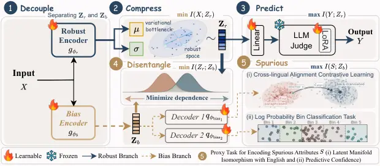
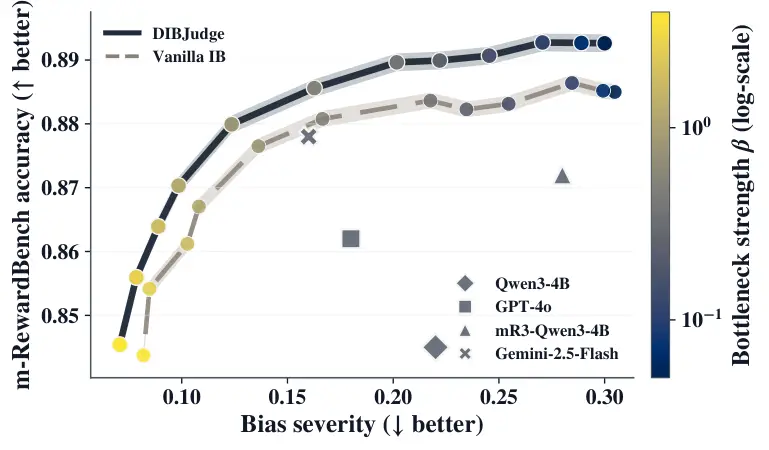
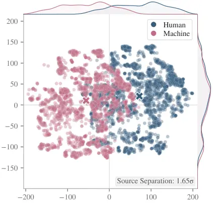
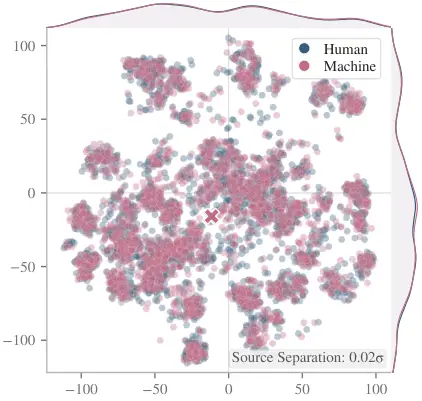

# Mitigating Translationese Bias in Multilingual LLM-as-a-Judge via Disentangled Information Bottleneck

Hongbin Zhang Affiliation: Institute of Computing and Intelligence,
Harbin Institute of Technology, Shenzhen, China Affiliation: Pengcheng
Laboratory, Shenzhen, China    Kehai Chen Affiliation: Institute of
Computing and Intelligence, Harbin Institute of Technology, Shenzhen,
China Affiliation: Pengcheng Laboratory, Shenzhen, China Correspondence
to: <chenkehai@hit.edu.cn>    Xuefeng Bai Affiliation: Institute of
Computing and Intelligence, Harbin Institute of Technology, Shenzhen,
China    Youcheng Pan Affiliation: Pengcheng Laboratory, Shenzhen, China
   Yang Xiang Affiliation: Pengcheng Laboratory, Shenzhen, China   
Jinpeng Wang Affiliation: Keeta AI, Meituan, Beijing, China    Min Zhang
Affiliation: Institute of Computing and Intelligence, Harbin Institute
of Technology, Shenzhen, China Affiliation: Pengcheng Laboratory,
Shenzhen, China

###### Abstract

Large language models (LLMs) have become a standard for multilingual
evaluation, yet they exhibit a severe systematic “_translationese
bias_”. In this paper, “translationese bias” is characterized as LLMs
systematically favoring machine-translated text over human-authored
references, particularly in low-resource languages. We attribute this
bias to spurious correlations with (i) latent manifold alignment with
English and (ii) cross-lingual predictability. To mitigate this bias, we
propose DIBJudge, a robust fine-tuning framework that learns a minimally
sufficient, judgment-critical representation via variational information
compression, while explicitly isolating spurious factors into the
dedicated bias branch. Furthermore, we incorporate a cross-covariance
penalty that explicitly suppresses statistical dependence between robust
and bias representations, thereby encouraging effective disentanglement.
Extensive evaluations on multilingual reward modeling benchmarks and a
dedicated translationese bias evaluation suite demonstrate that the
proposed DIBJudge consistently outperforms strong baselines and
substantially mitigates translationese bias.

###### Keywords: 

Machine Learning, ICML

## 1 Introduction

The emergence of Large Language Models (LLMs) has revolutionized
evaluation paradigms (Gu et al., 2024; Li et al., 2025), establishing
“LLM-as-a-Judge” as a standard framework for multilingual
assessment (Son et al., 2024; Pombal et al., 2025; Anugraha et al.,
2025; Hada et al., 2024; Fu and Liu, 2025; Doddapaneni et al., 2025).
Consequently, ensuring the accuracy and robustness of these automated
judges across diverse languages has become a critical necessity (Padarha
et al., 2025; Bogavelli et al., 2026).

Figure 1: Translationese Bias Severity of GPT-4o across languages.
Languages are sorted by resource availability from low (top) to high
(bottom). The trend line illustrates the inverse relationship between
resource availability and translationese bias.

However, the reliability of LLM judges is frequently undermined by
systematic biases (Wang et al., 2025a; Ye et al., 2025; Gao et al.,
2025), such as position (Shi et al., 2025; Wang et al., 2024b) and
verbosity bias (Saito et al., 2023). While these limitations are
well-studied in English contexts (Chen et al., 2024; Zheng et al.,
2023), specific failure modes within multilingual settings remain
underexplored.

In this paper, we characterize a distinct bias of LLM-as-a-Judge in
multilingual contexts, termed _translationese bias_, in which LLMs favor
machine-translated content over human-authored reference, even when the
former is semantically flawed. To investigate this bias, we first
conduct a comprehensive evaluation across a diverse spectrum of
languages. As shown in Figure 1, this bias is not only pervasive but is
significantly exacerbated in low-resource languages. Crucially, our
further attribution analysis suggests that LLM judges may conflate
generation quality with two potential spurious factors: (a) latent
manifold alignment with English, and (b) cross-lingual predictability.
While recent advancements in multilingual LLM judges have yielded
promising results (Pombal et al., 2025; Anugraha et al., 2025; Zhang et
al., 2025), most existing methods remain grounded in standard Supervised
Fine-Tuning (SFT). However, SFT is susceptible to exploiting spurious
correlations (Shuieh et al., 2025; Gui and Ji, 2025; Chen et al.,
2025c), thereby limiting its efficacy in mitigating translationese bias.

To this end, we propose the Disentangled Information Bottleneck Judge
(DIBJudge), a robust fine-tuning framework that explicitly decouples the
latent representation into two components: a robust representation that
preserves judgment-critical semantic information, and a bias
representation that isolates the spurious factors identified above
(i.e., latent manifold alignment with English and cross-lingual
predictability). We leverage variational information compression to
learn a robust, minimally sufficient representation that preserves only
information essential for accurate judgment. To further encourage
disentanglement between robust and bias representation, we penalize
their mutual dependence during training. Extensive experiments on
multilingual reward modeling benchmarks, including M-RewardBench (Gureja
et al., 2025) and MM-Eval (Son et al., 2024), demonstrate that DIBJudge
consistently outperforms strong baselines, yielding improved
multilingual reward modeling performance. Moreover, evaluations on a
dedicated translationese bias suite confirm that DIBJudge substantially
mitigates the severity of translationese bias.

In summary, we make three key claims: (i) we characterize
_translationese bias_ in multilingual LLM judges and identify two
related spurious factors—latent manifold alignment with English and
cross-lingual predictability, (ii) we propose DIBJudge, a robust
fine-tuning framework that disentangles judgment-critical semantics from
spurious factors, and (iii) we show that DIBJudge consistently
outperforms strong baselines on multilingual reward modeling benchmarks
while effectively mitigating translationese bias.¹¹ 1 [Our anonymous
code repo is here.](https://anonymous.4open.science/r/dibjudge-E341)

## 2 Preliminary Analysis of Translationese Bias

To systematically study translationese bias, we structure our
preliminary analysis around two research questions: (i) RQ1: How does
translationese bias vary across languages with different levels of
resource availability? (ii) RQ2: What kinds of spurious factors are
associated with this bias?

Bias Evaluation Protocol. We construct a controlled translationese bias
benchmark derived from BELEBELE (Bandarkar et al., 2024), a multilingual
reading comprehension dataset spanning 122 languages. Following the
language-resource taxonomy of Joshi et al. (2020), we stratify languages
into high-, medium-, and low-resource tiers and sample 10 representative
languages per tier. For each language, we evaluate on 200 instances,
yielding a balanced benchmark across resource levels. The full list of
selected languages is provided in Appendix A.1. We formulate
translationese bias evaluation as a pairwise preference task, where an
LLM judge compares two candidate responses for the same query: (i) a
_human-authored reference_ $`x_{H}`$, and (ii) a _machine-generated
variant_ $`x_{M}`$ obtained via back-translation to induce
translationese artifacts. To avoid position bias, each instance $`i`$ is
evaluated under both forwarding and reverse ordering. Details are
available in Appendix A.2.

Bias Metric Definition. Let $`y_{i}\in\{0,1\}`$ indicate whether the
judge prefers $`x_{M}`$ in the forward order, and let
$`\bar{y}_{i}\in\{0,1\}`$ denote the corresponding preference in the
reverse order. We define bias severity $`\mathcal{S}_{\mathrm{bias}}`$
as the fraction of consistent judgments that favor the machine-generated
output:

```math
\mathcal{S}_{\mathrm{bias}}=\frac{\sum_{i=1}^{N}\mathbb{I}\left[y_{i}=1\land\bar{y}_{i}=1\right]}{\sum_{i=1}^{N}\mathbb{I}\left[y_{i}=\bar{y}_{i}\right]}. \tag{1}
```

(a) Machine Win Rate vs. CAD

(b) SSR Density (Human vs. Machine Win)

(c) ROC Analysis of CAD and SSR

Figure 2: Correlation analysis of judge preference with confounding
factors. (a) Machine win rate decreases monotonically as CAD increases,
indicating that judge preference spuriously tracks latent manifold
isomorphism with English. (b) SSR distributions exhibit a clear drift
between human-win and machine-win cases, showing that the judge
systematically favors higher-likelihood outputs. (c) ROC curves confirm
that both CAD and SSR reliably predict judge outcomes, reinforcing the
attribution that translationese bias is mediated by latent manifold
isomorphism with English and high predicative confidence.

### 2.1 Quantifying Bias across Resource Levels (RQ1)

Figure 1 illustrates the translationese bias severity of GPT-4o across
varying language resource levels. We observe two salient patterns:
first, translationese bias is pervasive across the entire linguistic
spectrum; second, there is a distinct inverse correlation between
resource availability and the magnitude of bias. Specifically, while
high-resource languages exhibit minimal bias, low-resource languages
demonstrate significantly elevated severity. These findings expose
translationese bias as a severe yet previously neglected failure mode in
multilingual LLM judges, which critically undermines evaluation
reliability and disproportionately compromises under-resourced
languages.

### 2.2 Attribution Analysis of Translationese Bias (RQ2)

Due to the scarcity of high-quality native resources (Qin et al., 2025;
Huang et al., 2024), multilingual LLMs are typically pre-trained on
English-dominated corpora (Kreutzer et al., 2022; Weber et al., 2024)
and subsequently adapted using translated or synthetic data (Muennighoff
et al., 2023; Zhang et al., 2020a). Accordingly, we hypothesize that
translationese bias stems from spurious correlations induced across
these two stages: (i) latent manifold alignment with English, where
non-English representations are implicitly aligned to an English-centric
latent space during pre-training; and (ii) cross-lingual predictability,
where the judge over-relies on probability heuristics that favor the
statistical patterns of machine-translated text, potentially amplified
by exposure to translated or synthetic data during fine-tuning. However,
causally attributing this bias to particular data mixtures remains
non-trivial given the opacity and heterogeneity of LLM training
pipelines (Lai et al., 2025).

To address this, we introduce two measurable latent metrics that serve
as quantitative proxies for these two factors: (i) _Language Alignment
Score (LAS)_, defined as the degree to which a representation is
geometrically aligned with an English latent manifold:
$`\mathrm{LAS}(x)=\frac{1}{L}\sum_{l=1}^{L}\cos\big(\mathbf{h}_{l}(x),\mathbf{c}_{\mathrm{en},l}\big),`$
where $`x`$ is input sequence, $`\mathbf{h}_{l}(x)`$ is the layer-$`l`$
hidden representation of $`x`$, $`\mathbf{c}_{\mathrm{en},l}`$ is the
English centroid at layer $`l`$, and $`L`$ is the total number of
layers. (ii) _Cross-lingual Sequence Surprisal (CSS)_, defined as the
length-normalized negative log-likelihood of a target sequence $`x`$ of
$`T`$ tokens, conditioned on its English translated context
$`x_{\mathrm{en}}`$:
$`\mathrm{CSS}(x)=-\frac{1}{T}\sum_{t=1}^{T}\log P(x_{t}\mid x_{\mathrm{en}},x_{<t}).`$
To answer RQ2, we then investigate the extent to which the
distributional divergence of these metrics between $`x_{H}`$ and
$`x_{M}`$ correlates with machine win rate: (i) _Cross-lingual Alignment
Discrepancy (CAD)_, $`\text{CAD}=\text{LAS}(x_{H})-\text{LAS}(x_{M}),`$
where $`\text{CAD}<0`$ implies that $`x_{M}`$ exhibits closer alignment
to the English latent space than $`x_{H}`$ does. (ii) _Sequence
Surprisal Ratio (SSR)_:
$`\text{SSR}=\frac{\text{CSS}(x_{M})}{\text{CSS}(x_{H})},`$ where
$`\text{SSR}<1`$ indicates that $`x_{M}`$ is more cross-lingual
predictable by the model relative to $`x_{H}`$.

As shown in Figure 2, LLM judges exhibit strong correlations with the
introduced latent metrics. Specifically, Figure 2(a) reveals a negative
association between CAD and the machine win rate, suggesting that the
judge favors outputs that align closely with the English manifold.
Meanwhile, Figure 2(b) demonstrates a pronounced distributional shift in
SSR: machine-generated outputs preferred by the judge cluster
significantly at lower SSR. This pattern indicates a bias toward
sequences with high statistical cross-lingual predictability. The
robustness of the observed correlations is further corroborated by the
ROC analysis in Figure 2(c), demonstrating meaningful discriminative
power of these features. Collectively, these results ascribe the
observed _translationese bias_ to two confounding factors: latent
manifold alignment with English and cross-lingual predictability.



Figure 3: Overview of our DIBJudge, which grounded in Equation 3. (1)
employs a robust encoder $`g_{\phi_{r}}`$ and a bias encoder
$`g_{\phi_{b}}`$ to separate the input $`X`$ into robust representations
$`\mathbf{Z}_{r}`$ and bias representations $`\mathbf{Z}_{b}`$. (2)
introduces a variational bottleneck to minimize the mutual information
$`I(X;Z_{r})`$. (3) leverages the compressed $`\mathbf{Z}_{r}`$ through
LLM Judge optimized using LoRA (Hu et al., 2022) to generate the final
output $`Y`$ by maximizing $`I(Y;Z_{r})`$. (4) ensures feature
independence by minimizing the dependence $`I(Z_{r};Z_{b})`$ between the
robust and bias branches. (5) explicitly captures spurious attributes
$`S`$ within $`\mathbf{Z}_{b}`$ by maximizing $`I(S;Z_{b})`$ through two
proxy tasks: (i) cross-lingual alignment contrastive learning and (ii)
predictive confidence estimation via log-probability bin classification.

## 3 Disentangled Information Bottleneck Judge

To mitigate the spurious correlations identified in § 2.2, we propose
the Disentangled Information Bottleneck Judge (DibJudge), as illustrated
in Figure 3. By explicitly disentangling these spurious factors,
DibJudge learns a compressed representation that retains sufficient,
robust features essential for accurate quality assessment.

### 3.1 Preliminaries

Mutual Information. Mutual Information (MI) quantifies the statistical
dependence between two random variables, $`A`$ and $`B`$. Given the
joint distribution $`p(a,b)`$ and marginals $`p(a),p(b)`$, MI is
formally defined as :

```math
I(A;B)\triangleq\mathbb{E}_{p(a,b)}\left[\log\frac{p(a,b)}{p(a)p(b)}\right]. \tag{2}
```

Information Bottleneck Principle. The Information Bottleneck (IB)
principle (Tishby et al., 2000; Alemi et al., 2017) seeks a compressed
representation $`Z`$ that is sufficient for a target task $`Y`$ while
remaining minimal with respect to the input $`X`$. This is formalised by
minimizing the Lagrangian:
$`\mathcal{L}_{\text{IB}}=-I(Y;Z)+\beta I(X;Z),`$ where $`\beta\geq 0`$
governs the trade-off between prediction and compression. However,
compression may discard robust semantic features in favor of simpler
spurious correlations (Liu et al., 2022; Zhang et al., 2024). Thus,
relying solely on information compactness cannot guarantee the
robustness.

### 3.2 Disentangled Information Bottleneck Objective

To prevent LLM judges from exploiting spurious shortcuts solely through
information compression, we are inspired by the idea of disentangled
representation learning (Wang et al., 2024d) to refine vanilla IB. Let
$`S`$ be a spurious variable, $`Z_{r}`$ be a _relevant_ variable
encoding features necessary for predicting the target $`Y`$, and
$`Z_{b}`$ be a _bias_ variable serving as a dedicated “sink” to absorb
$`S`$. We formalize the Disentangled Information Bottleneck Objective
as:

```math
\displaystyle\mathcal{L}_{\mathrm{DIB}} \displaystyle=\underbrace{-I(Y;Z_{r})}_{\text{Prediction}}+\underbrace{\beta\,I(X;Z_{r})}_{\text{Compression}} \tag{3}
```

```math
\displaystyle-\underbrace{\gamma\,I(S;Z_{b})}_{\text{Bias Capture}}+\underbrace{\lambda\,I(Z_{r};Z_{b})}_{\text{Disentanglement}}.
```

The first two terms apply a vanilla IB constraint restricted to the
robust channel $`Z_{r}`$; the third term makes $`Z_{b}`$ informative
about spurious attributes $`S`$; and the final term penalizes dependence
between $`(Z_{r},Z_{b})`$, encouraging $`Z_{r}`$ to exclude spurious
correlations that are explicitly routed into $`Z_{b}`$. Directly
optimizing this objective is computationally intractable due to the
difficulty of estimating mutual information in high-dimensional
spaces (Liu et al., 2024b). To address this, we derive tractable
variational surrogate objectives as follows:

Decouple Robust and Bias Representation. Using separate encoders
$`g_{\phi_{r}}`$ and $`g_{\phi_{b}}`$, we decompose the input $`X`$ into
a robust representation
$`\mathbf{Z}_{r}=g_{\phi_{r}}(X)\in\mathbb{R}^{T\times d}`$ and a bias
representation
$`\mathbf{Z}_{b}=g_{\phi_{b}}(X)\in\mathbb{R}^{T\times d},`$ where $`T`$
denotes the sequence length and $`d`$ the feature dimension. We leverage
$`\mathbf{Z}_{r}`$ for task prediction while using $`\mathbf{Z}_{b}`$
only during training.

Compression via Variational Information Constraints. To facilitate
compression, we leverage the Variational Information Bottleneck (Alemi
et al., 2017), which imposes an upper bound on $`I(X;Z_{r})`$ via
variational inference.

###### Proposition 3.1.

Let $`Z_{r}`$ be a continuous random variable, with variational
posterior $`q_{\phi}(Z_{r}|X)`$ and fixed prior $`p(Z_{r})`$. Then
$`I(X;Z_{r})\leq\mathbb{E}_{x\sim p(X)}\left[D_{\mathrm{KL}}(q_{\phi}(Z_{r}|x)\|p(Z_{r}))\right].`$

Guided by Proposition 3.1 (proved in Appendix. B.1), we can constrain
$`I(X;Z_{r})`$ via penalizing the KL divergence between the variational
posterior and fixed prior. Accordlingly, we adopt a standard Gaussian
prior $`p(Z_{r})=\mathcal{N}(\mathbf{0},\mathbf{I})`$ and parameterize
the variational posterior $`q_{\phi}(\mathbf{z}_{r,t}|x)`$ at each time
step $`t`$ as a multivariate Gaussian
$`\mathcal{N}(\bm{\mu}_{t},\bm{\sigma}^{2}_{t})`$. The resulting
compression objective, defined as the average KL divergence over the
sequence length $`T`$ and feature dimension $`d`$, is derived as follows
(details in Appendix. B.2):

```math
\displaystyle\mathcal{L}_{\mathrm{compress}} \displaystyle=\frac{1}{T}\sum_{t=1}^{T}D_{\mathrm{KL}}\!\left(\mathcal{N}\!\left(\bm{\mu}_{t},\bm{\sigma}^{2}_{t}\right)\,\big\|\,\mathcal{N}\!\left(\mathbf{0},\mathbf{I}\right)\right) \tag{4}
```

```math
\displaystyle=-\frac{1}{2T}\sum_{t=1}^{T}\sum_{j=1}^{d}\Bigl(1+\log\sigma^{2}_{t,j}-\mu^{2}_{t,j}-\sigma^{2}_{t,j}\Bigr).
```

To allow for backpropagation, we sample the latent representation
$`\mathbf{z}_{r,t}`$ using the reparameterization trick (Kingma et al.,
2015):
$`\mathbf{z}_{r,t}=\bm{\mu}_{t}+\bm{\sigma}_{t}\odot\bm{\epsilon}`$,
where $`\bm{\epsilon}\sim\mathcal{N}(\mathbf{0},\mathbf{I}).`$

Variational Mutual Information Maximization. The objective (Eq. 3)
necessitates maximizing mutual information along two disentangled
pathways: the task-predictive term $`I(Y;Z_{r})`$ and the bias-capturing
term $`I(S;Z_{b})`$. We then maximize a variational lower bound on the
mutual information guided by Proposition 3.2 (proved in Appendix B.3).

###### Proposition 3.2.

Let $`U`$ and $`V`$ be random variables with joint distribution
$`p(U,V)`$. For any variational conditional distribution
$`q_{\theta}(U\mid V)`$, the mutual information satisfies
$`I(U;V)\geq\mathbb{E}_{(U,V)\sim p(U,V)}\!\left[\log q_{\theta}(U\mid V)\right]+H(U),`$
where $`H(U)`$ denotes the marginal entropy of $`U`$.

For the robust pathway, we treat the LLM judge $`f_{\text{judge}}`$ as
the variational decoder $`q_{\theta}`$. We condition the generation on a
sequence formed by concatenating the instruction embeddings
$`\mathbf{E}_{\text{inst}}`$ with the sampled robust representation
$`\mathbf{Z}_{r}`$. The task loss is defined as:

```math
\mathcal{L}_{\text{task}}=\E_{X,Y}\left[-\sum_{t=1}^{|Y|}\log f_{\text{judge}}(Y_{t}\mid[\mathbf{E}_{\text{inst}};\mathbf{Z}_{r}],Y_{<t})\right]. \tag{5}
```

We employ lightweight MLP decoders $`q_{\psi_{\text{bias}}}`$ and
minimize the negative log-likelihood of the spurious attribute $`{S}`$
given the bias representation $`\mathbf{Z}_{b}`$ to facilitate the
encoding of spurious information into the bias pathway:

```math
\mathcal{L}_{\text{bias}}=\E_{X,S}\left[-\log q_{\psi_{\text{bias}}}(S\mid\mathbf{Z}_{b})\right]. \tag{6}
```

We operationalize the identified spurious factors through two designed
proxy tasks. First, we address latent-manifold alignment with English
using a cross-lingual contrastive learning objective. Second, we
estimate cross-lingual predictability via a log-probability bin
classification task.

Disentanglement via Cross-Covariance Penalty. Directly minimizing the
mutual information $`I(Z_{r};Z_{b})`$ is generally intractable. However,
in high-dimensional regimes typical of LLMs, representation
distributions are often well-approximated by Gaussian statistics (Lee et
al., 2018; Hron et al., 2020). Under this Gaussian assumption,
minimizing mutual information reduces to minimizing the cross-covariance
between latent variables (Cover, 1999; Hyvärinen and Oja, 2000). We
formalize this relationship in Proposition 3.3 (proof provided in
Appendix B.4).

###### Proposition 3.3.

Let $`Z_{r}`$ and $`Z_{b}`$ be jointly Gaussian random vectors with
marginal covariance matrices $`\Sigma_{r}`$ and $`\Sigma_{b}`$, and
cross-covariance $`\Sigma_{rb}`$. Define the normalized cross-covariance
matrix as $`C=\Sigma_{r}^{-1/2}\Sigma_{rb}\Sigma_{b}^{-1/2}`$. Provided
the spectral norm $`\|C\|_{2}`$ is sufficiently small, the mutual
information admits the following second-order expansion:

```math
I(Z_{r};Z_{b})=\frac{1}{2}\|C\|_{F}^{2}+o\left(\|C\|_{F}^{2}\right),\quad\text{as }\|C\|_{2}\to 0.
```

Accordingly, we adopt the cross-covariance penalty as a computationally
efficient surrogate for disengtanglement term in Eq. 3. Given centered
mini-batch representations
$`\bar{\mathbf{Z}}_{r},\bar{\mathbf{Z}}_{b}\in\mathbb{R}^{N\times d}`$,
we compute the empirical cross-covariance matrix
$`\hat{\Sigma}_{rb}=\frac{1}{N-1}\bar{\mathbf{Z}}_{r}^{\top}\bar{\mathbf{Z}}_{b}`$.
We then minimize the squared Frobenius norm of $`\hat{\Sigma}_{rb}`$ to
suppress correlations:

```math
\mathcal{L}_{\text{disc}}=\|\hat{\Sigma}_{rb}\|_{F}^{2}=\sum_{i=1}^{d}\sum_{j=1}^{d}(\hat{\Sigma}_{rb})_{ij}^{2}. \tag{7}
```

In practice, feature-wise normalization ensures that $`\mathbf{Z}_{r}`$
and $`\mathbf{Z}_{b}`$ have approximately unit variance along each
dimension (Ba et al., 2016). This objective penalizes second-order
dependencies, thereby encouraging statistical independence in the
learned representations (Zbontar et al., 2021).

Overall Learning Objective. We optimize DibJudge end-to-end by
minimizing a weighted sum of tractable objectives derived above.
Concretely, the final training objective is

```math
\mathcal{L}=\mathcal{L}_{\mathrm{task}}+\beta\,\mathcal{L}_{\mathrm{compress}}+\gamma\,\mathcal{L}_{\mathrm{bias}}+\lambda\,\mathcal{L}_{\mathrm{disc}}, \tag{8}
```

where the weights $`\beta,\gamma,\lambda`$ control the
accuracy–compression–bias-capture–independence trade-off.

|                                          |                          |                          |                        |
| ---------------------------------------- | ------------------------ | ------------------------ | ---------------------- |
|                                          | m-RewardBench            | RewardBench              | MM-Eval                |
| Model                                    | (Avg. 23 langs)          | (English)                | (Avg. 18 lang)         |
| Proprietary Models                       |                          |                          |                        |
| GPT-4o (Hurst et al., 2024)              | $`85.75\pm\pm 0.42`$     | $`85.96\pm\pm 0.35`$     | $`71.85\pm\pm 0.81`$   |
| Gemini-2.5-Flash (Comanici et al., 2025) | $`88.06\pm\pm 0.49`$     | $`88.83\pm\pm 0.47`$     | $`77.47\pm\pm 0.76`$   |
| General Open Models                      |                          |                          |                        |
| Qwen2.5-3B-Instruct (Qwen et al., 2025)  | $`66.97\pm\pm 1.12`$     | $`68.99\pm\pm 1.05`$     | $`57.99\pm\pm 1.20`$   |
| Qwen2.5-7B-Instruct (Qwen et al., 2025)  | $`77.89\pm\pm 0.89`$     | $`78.59\pm\pm 0.91`$     | $`65.64\pm\pm 0.95`$   |
| Qwen3-4B (Yang et al., 2025)             | $`85.06\pm\pm 0.65`$     | $`87.54\pm\pm 0.55`$     | $`80.85\pm\pm 0.68`$   |
| Qwen3-8B (Yang et al., 2025)             | $`86.12\pm\pm 0.52`$     | $`88.81\pm\pm 0.48`$     | $`82.20\pm\pm 0.60`$   |
| Multilingual Open Reward Models          |                          |                          |                        |
| Nemotron-Multi-49B (Wang et al., 2025b)  | 88.83 $`\pm`$ 0.35       | $`89.71\pm\pm 0.31`$     | $`76.31\pm\pm 0.55`$   |
| M-Prometheus 3B (Pombal et al., 2025)    | $`68.45\pm\pm 0.98`$     | $`69.79\pm\pm 0.92`$     | $`64.17\pm\pm 1.10`$   |
| M-Prometheus 7B (Pombal et al., 2025)    | $`78.03\pm\pm 0.85`$     | $`76.69\pm\pm 0.78`$     | $`69.38\pm\pm 0.88`$   |
| mR3-Qwen3-4B (Anugraha et al., 2025)     | $`87.21\pm\pm 0.45`$     | $`89.75\pm\pm 0.38`$     | $`82.55\pm\pm 0.52`$   |
| mR3-Qwen3-8B (Anugraha et al., 2025)     | $`88.58\pm\pm 0.41`$     | 90.10 $`\pm`$ 0.40       | 85.29 $`\pm`$ 0.45     |
| Think-as-Locals 7B (Zhang et al., 2025)  | $`84.51\pm\pm 0.60`$     | $`88.79\pm\pm 0.52`$     | $`72.95\pm\pm 0.70`$   |
| Ours                                     |                          |                          |                        |
| DIBJudge-Qwen3-4B                        | $`89.84\pm\pm 0.28`$^(†) | 90.32 $`\pm`$ 0.25       | $`85.16\pm\pm 0.33`$   |
| DIBJudge-Qwen3-8B                        | 91.37 $`\pm`$ 0.22^(‡)   | $`91.01\pm\pm 0.20`$^(†) | 87.53 $`\pm`$ 0.28^(‡) |

Table 1: Performance evaluation on multilingual reward benchmarks. Bold
indicates the best performance, and underlined indicates the
second-best. Statistical significance compared to the best baseline is
denoted by ^(†) ($`p<0.05`$) and ^(‡) ($`p<0.01`$).

## 4 Experiments

Evaluation Benchmarks. To evaluate the effectiveness of LLM judges
across multilingual contexts, we utilize three primary reward modeling
benchmarks (Lambert et al., 2024; Son et al., 2024; Gureja et al., 2025)
selected to ensure a balanced consideration of the following aspects: a)
reasoning and safety alignment across diverse conversational contexts,
b) performance across 23 distinct languages, c) the distinction between
translated content and native-speaker data. Our primary evaluation
metric is accuracy, reported as the category average and the mean of
language-specific micro-averages. More details are provided in
Appendix C.1.

Training settings. We adopt the same training corpus as mR3 (Anugraha et
al., 2025) and fine-tune using LoRA (Hu et al., 2022). All experiments
are optimized with the Adam optimizer (Kingma, 2014) using a learning
rate of $`1\times 10^{-4}`$ and a maximum sequence length of $`16384`$.
Further implementation details are provided in Appendix C.2.

Baselines. We evaluate DIBJudge against proprietary general-purpose
models (GPT-4o (Hurst et al., 2024), Gemini-2.5-Flash (Comanici et al.,
2025)) and open-source general-purpose LLMs (Qwen2.5/3 (Qwen et al.,
2025; Yang et al., 2025)). Since Qwen3 is our backbone, these
comparisons isolate gains from our training recipe beyond base model
capacity. We additionally benchmark multilingual reward models/judges,
including Nemotron-Multilingual-49B (Wang et al., 2025b), M-Prometheus
(3B/7B) (Pombal et al., 2025), mR3 (Anugraha et al., 2025), and
Think-as-Locals (7B) (Zhang et al., 2025).

#### Main Results.

Table 1 reports the mean accuracy and standard deviation across
benchmarks over three independent runs, with statistical significance
assessed using pairwise $`t`$-tests. On m-RewardBench, DIBJudge-Qwen3-8B
establishes a new SOTA among open-weight models, significantly
outperforming both its backbone-matched counterpart and a substantially
larger multilingual baseline. These results confirm the effectiveness of
the proposed approach. In terms of generalization, DIBJudge-Qwen3-8B
achieves superior performance on the English-centric RewardBench,
statistically surpassing prior leading methods. This indicates that the
proposed method improves multilingual reward modeling without degrading
performance on monolingual benchmarks. Detailed results are provided in
Appendix D.

## 5 Analysis

To substantiate the theoretical claims proposed in this work, we conduct
a series of targeted experiments designed to rigorously validate the
efficacy and internal mechanics of DIBJudge. Our analysis focuses on
verifying that the proposed information disentanglement objective
translates into tangible performance gains and interpretable latent
structures. We organize this empirical investigation around five core
research questions: (i) RQ1 (Bias Mitigation): To what extent does
DIBJudge effectively mitigate translationese bias across languages with
varying resource availability? (ii) RQ2 (Utility Trade-off): How does
the information bottleneck constraint shape the Pareto Frontier between
bias mitigation and downstream task utility? (iii) RQ3
(Disentanglement): Do the learned latent representations geometrically
disentangle semantic content from translationese artifacts, as
theoretically hypothesized? (iv) RQ4 (Generalization): Does the model
exhibit robustness against unseen bias types (e.g., length bias) that
were not explicitly included in the spurious proxy task? (v) RQ5
(Ablation Study): How do the distinct components of the DIB objective
(Eq. 3) and spurious proxy task contribute to bias mitigation and reward
modeling utility? Additional analyses are deferred to the appendix,
including studies of proxy-task design (Appx. F.1), sensitivity to CAD
and SSR (Appx. F.2, F.3), comparisons with alternative compression and
disentanglement mechanisms (Appx. F.4, F.5), and linear probing to
assess information leakage (Appx. F.6).

RQ1: Efficacy in Translationese Bias Mitigation. We extend the
preliminary bias evaluation (§ 2) to a broader suite of domains and
datasets. We evaluate performance on three diverse benchmarks: Belebele
(machine reading comprehension) (Bandarkar et al., 2024), Aya (Singh et
al., 2024) (open-ended instruction following), and XL-Sum (Hasan et al., 2021) (summarization). This selection allows us to assess translationese
bias across constrained formats and realistic, open-ended interactions.
Human-authored references are used as ground-truth targets, while
negative samples (rejected responses) are generated via back-translation
as described in § 2. To investigate the impact of data scarcity, we
stratify languages into High-, Mid-, and Low-Resource tiers ($`n=10`$
languages per tier). We benchmark DIBJudge against three baselines: the
Base model, Vanilla SFT, and a Vanilla IB variant. We quantify efficacy
using the Bias Severity metric ($`\mathcal{S}_{\text{bias}}`$) defined
in Equation 1. More details in Appendix. A.2

Figure 4: Bias severity across resource tiers.
$`\mathcal{S}_{\text{bias}}`$ (lower is better) on Belebele, Aya, and
XL-Sum. DIBJudge reduces bias across all tiers, with average reductions
of $`80\%`$, $`56\%`$, and $`75\%`$, and the strongest improvements in
Low-Resource settings. Error bars show std over 3 runs; Avg $`\Delta`$
is relative to Vanilla SFT.

Figure 4 demonstrates the efficacy of DIBJudge in mitigating
translationese bias across diverse language resource levels. On the
benchmark Belebele, DIBJudge achieves a drastic reduction in bias
severity, approaching near-zero levels across the mid- and high-resource
tiers. This trend extends to generative tasks such as Aya and XL-Sum,
where we observe consistent bias suppression. Crucially, DIBJudge
significantly reduces disparity across resource tiers; whereas vanilla
SFT retains marked bias in low-resource settings, our approach
effectively dampens these spurious correlations. These findings confirm
that DIBJudge targets the bias amplification that disproportionately
affects underrepresented languages, rather than merely enhancing general
instruction-following capabilities.



Figure 5: Bias–utility Pareto Frontier. Trade-off between Bias Severity
($`\downarrow`$; x-axis) and m-RewardBench accuracy ($`\uparrow`$;
y-axis). Each point corresponds to a bottleneck strength $`\beta`$
(log-scaled, color-coded). The resulting Pareto frontiers are traced by
DIBJudge (solid) and the Vanilla IB baseline (dashed). DIBJudge
consistently achieves higher accuracy at comparable bias levels across
$`\beta`$, yielding a uniformly superior bias–utility trade-off. Markers
indicate representative SOTA models, which DIBJudge outperforms in terms
of lower bias and higher accuracy.

RQ2: The Robustness-Utility Trade-off. We investigate the tension
between robustness and utility by modulating the coefficient $`\beta`$
of the compression term in Equation 3. Specifically, we aim to
characterize the Pareto Frontier of this trade-off. Figure 5 illustrates
this dynamic by plotting bias severity ($`\mathcal{S}_{\text{bias}}`$)
against m-RewardBench accuracy. DIBJudge achieves a consistently better
Pareto frontier than the Vanilla IB baseline, indicating that it learns
a more compact and robust representation without discarding key semantic
features. Furthermore, DIBJudge strictly dominates its base model and
strong proprietary baselines (e.g., GPT-4o, Gemini-2.5-Flash),
consistently achieving higher accuracy across all fixed levels of bias
severity. These findings confirm that the proposed method mitigates
translationese bias without substantial utility degradation.

RQ3: Disentanglement of Latent Representations. We visualize the
geometry of the learned representations using t-SNE (van der Maaten and
Hinton, 2008), extracting bias ($`\mathbf{Z}_{b}`$) and robust
($`\mathbf{Z}_{r}`$) features from a held-out evaluation set comprising
human and machine-translated texts. As shown in Figure 6, the latent
spaces exhibit divergent topologies. The bias space (Fig. 6(a)) forms
distinct clusters based on text origin, confirming that
$`\mathbf{Z}_{b}`$ encodes translationese artifacts. Conversely, the
robust space (Fig. 6(b)) demonstrates substantial domain overlap. This
phenomenon demonstrates that $`\mathbf{Z}_{r}`$ achieves invariance to
translationese artifacts, effectively disentangling them from the
underlying semantic content.



(a) Bias Representations ($`\mathbf{Z}_{b}`$)



(b) Robust Representations ($`\mathbf{Z}_{r}`$)

Figure 6: Visualization of Latent Representation Disentanglement. t-SNE
projections of embeddings for Human (Blue) vs. Machine (Red) text. (a)
$`\mathbf{Z}_{b}`$ clearly separates domains. (b) $`\mathbf{Z}_{r}`$
shows a mixed distribution, corroborating domain invariance.

RQ4: Zero-Shot Generalization to Unseen Biases. We evaluate the
generalization capability of DIBJudge against biases not encountered
during training—specifically length (Saito et al., 2023) and
self-preference (Wataoka et al., 2024)—using a held-out subset of
Skywork-Reward-Preference-80K (Liu et al., 2024a). Length bias is
quantified via the Spearman rank correlation ($`\rho`$) between response
length and predicted ratings, while self-preference is evaluated using
bias severity ($`\mathcal{S_{\text{bias}}}`$) as defined in Eq. 1,
specifically favoring the model’s own generations. As detailed in
Table 2, DIBJudge demonstrates superior robustness compared to vanilla
SFT and IB baselines. Our method significantly reduces the correlation
between response length and response bias and minimizes self-preference
bias. These results suggest that DIBJudge successfully learns to filter
superficial heuristics (e.g., verbosity) rather than merely memorizing
specific artifacts such as translationese.

|             | ID                                                  | OOD (Unseen Biases)            |                                                         |
| ----------- | --------------------------------------------------- | ------------------------------ | ------------------------------------------------------- |
| Method      | Trans. $`\mathcal{S}_{\text{bias}}`$ $`\downarrow`$ | Length $`\rho`$ $`\downarrow`$ | Self-Pref. $`\mathcal{S}_{\text{bias}}`$ $`\downarrow`$ |
| Vanilla SFT | 0.247                                               | 0.553                          | 0.314                                                   |
| Vanilla IB  | 0.168                                               | 0.482                          | 0.276                                                   |
| DIBJudge    | 0.083                                               | 0.314                          | 0.219                                                   |

Table 2: Zero-Shot Generalization to Unseen Biases. We evaluate
performance on a held-out subset containing biases not encountered
during training (Out-of-Distribution). DIBJudge achieves the lowest bias
scores across both in-distribution (Translationese) and unseen
heuristics (Length, Self-Preference).

RQ5: Impact of DIB Objective Components and Spurious Proxy Tasks. To
assess the individual contributions of the components in the DIB
objective (Eq. 3), we evaluate various combinations of the compression,
bias-capture, and disentanglement objectives. As shown in Table 3,
isolated objectives yield suboptimal results. While the disentanglement
term is particularly effective at reducing the bias score relative to
the baseline, it remains insufficient to maximize predictive accuracy.
The highest performance across both metrics is achieved by integrating
all three terms, suggesting that the synergy between
information-bottleneck-driven compression and latent-space
disentanglement is critical for balancing fairness and model utility.
Furthermore, we investigate the impact of the proposed spurious proxy
tasks: Cross-Lingual Alignment (CLA) and Log-Probability Bin
Classification (LPBC). Table 4 illustrates that omitting these tasks
leads to a significant degradation in bias mitigation. The substantial
improvement in $`\mathcal{S}_{\text{bias}}`$ when both tasks are
employed confirms their effectiveness in capturing spurious correlations
related to translationese. Detailed proxy task ablation studies are
presented in Appendix F.1.

|             |      |             |                                           |                     |
| ----------- | ---- | ----------- | ----------------------------------------- | ------------------- |
| Objectives  |      |             | Metrics                                   |                     |
| Compression | Bias | Disentangle | $`\mathcal{S}_{\text{bias}}(\downarrow)`$ | Acc. ($`\uparrow`$) |
| ✓           |      |             | 0.124                                     | 85.25               |
|             | ✓    |             | 0.150                                     | 86.60               |
|             |      | ✓           | 0.053                                     | 85.85               |
| ✓           | ✓    |             | 0.091                                     | 88.20               |
| ✓           |      | ✓           | 0.039                                     | 88.55               |
|             | ✓    | ✓           | 0.035                                     | 89.10               |
| ✓           | ✓    | ✓           | 0.031                                     | 89.85               |

Table 3: Ablation study of the DIB objectives. We report the bias score
($`\mathcal{S}_{\text{bias}}`$, lower is better) and Accuracy (higher is
better). The combination of all terms achieves the best trade-off.

| Configuration                             | None  | CLA   | LPBC  | CLA + LPBC |
| ----------------------------------------- | ----- | ----- | ----- | ---------- |
| $`\mathcal{S}_{\text{bias}}(\downarrow)`$ | 0.421 | 0.312 | 0.279 | 0.147      |
| Acc. ($`\uparrow`$)                       | 87.12 | 87.86 | 88.43 | 89.18      |

Table 4: Ablation study of proxy tasks. CLA indicates the cross-lingual
alignment proxy task, and LPBC stands for log-probability bin
classification proxy task.

## 6 Related Work

LLM-as-a-Judge. The LLM-as-a-Judge paradigm marks a fundamental shift
from traditional $`n`$-gram (e.g., BLEU (Papineni et al., 2002),
ROUGE (Lin, 2004)) and embedding-based metrics (e.g., BERTScore (Zhang
et al., 2020b; Rei et al., 2020)) toward generative evaluation (Gu et
al., 2024; Li et al., 2025). While early adoption relied on proprietary
models like GPT-4 due to their high correlation with human judgment (Liu
et al., 2023; Zheng et al., 2023), concerns regarding cost and
transparency have catalyzed a transition to open-weight evaluators (Wang
et al., 2024e; Wang et al., 2024c; Wang et al., 2024a; Kim et al.,
2024a; Kim et al., 2024b). Recently, this paradigm has further evolved
from direct generative to incorporating explicit reasoning steps to
enhance reliability (Chen et al., 2025a; Guo et al., 2025; Chen et al.,
2025b). However, despite these advancements, LLM judges remain
susceptible to systematic biases (Ye et al., 2025; Wang et al., 2024b;
Zheng et al., 2024), such as position bias (Shi et al., 2025; Ko et al.,
2020), verbosity bias (Saito et al., 2023), and self- preference
bias (Wang et al., 2024c). In contrast to prior work that primarily
studies bias in English-centric settings, we investigate _translationese
bias_ in multilingual contexts and analyze the spurious correlations
underlying it.

Multilingual Judges. Compared to the English context, multilingual
LLM-as-a-Judge remains significantly underexplored. Initial efforts to
bridge this gap, such as Hercule (Doddapaneni et al., 2025) and
M-Prometheus (Pombal et al., 2025), rely heavily on fine-tuning with
translated or synthetic instruction sets. More recently, approaches like
mR3 (Anugraha et al., 2025) and Think-as-Locals (Zhang et al., 2025)
have advanced the field by integrating reasoning capabilities, employing
Chain-of-Thought (CoT) (Wei et al., 2022) distillation and reinforcement
learning to enhance multilingual reward modeling. However, despite these
achieving promising results, the robustness of these evaluators remains
unexamined. Crucially, existing frameworks fail to account for the
systematic artifacts introduced by translation-based training data. To
address this reliability gap, our work provides the first dedicated
mitigation of translationese bias, resolving specific failures in
cross-lingual evaluation that prior methodologies overlook.

Information Bottleneck in LLMs. Originally formulated to extract minimal
sufficient statistics (Tishby et al., 2000), the Information Bottleneck
(IB) principle has recently emerged as a vital framework for analyzing
and optimizing LLMs, spanning diverse objectives including enhancing
interpretability by mapping hidden states to human-readable
concepts (Sun et al., 2025; Li et al., 2023), optimizing CoT reasoning
paths to be invariant to prompt nuances (Lei et al., 2025), and
compressing contexts in Retrieval-Augmented Generation to filter
noise (Zhu et al., 2024). In safety domains, methods such as
IBProtector (Liu et al., 2024b) leverage IB to strip adversarial
triggers. Diverging from these approaches, we present the first
application of a disentangled IB designed to debias LLM judges.

## 7 Conclusion

In this study, we systematically investigated translationese bias in
multilingual LLM-as-a-Judge frameworks and identified key spurious
factors that undermine reliable evaluation, particularly in low-resource
languages. Guided by these insights, we proposed DIBJUDGE, a
disentangled information bottleneck–based fine-tuning framework that
separates judgment-critical semantics from spurious translationese
attributes. Extensive experiments across multilingual reward modeling
benchmarks and dedicated bias evaluations demonstrate that DIBJUDGE
substantially mitigates translationese bias while maintaining strong
utility.

## Impact Statement

This paper presents work whose goal is to advance the field of machine
learning, with a focus on improving the robustness of multilingual
evaluation using large language models. The methods proposed in this
work are intended for model evaluation and benchmarking rather than
direct user-facing applications. While improved evaluation may have
downstream benefits for the development of more reliable and inclusive
multilingual systems, we do not foresee significant or immediate
negative societal impacts arising from this work.

## References

- Alain and Bengio (2016) G. Alain and Y. Bengio Understanding
  intermediate layers using linear classifier probes. arXiv preprint
  arXiv:1610.01644. Cited by: §F.6.
- Alemi et al. (2017) A. A. Alemi, I. Fischer, J. V. Dillon, and K.
  Murphy Deep variational information bottleneck. In International
  Conference on Learning Representations, Cited by: §3.1, §3.2.
- Anugraha et al. (2025) D. Anugraha, S. Hung, Z. Tang, A. E. Lee, D. T.
  Wijaya, and G. I. Winata MR3: multilingual rubric-agnostic reward
  reasoning models. arXiv preprint arXiv:2510.01146. Cited by: §1, §1,
  Table 1, Table 1, §4, §4, §6.
- Ba et al. (2016) J. L. Ba, J. R. Kiros, and G. E. Hinton Layer
  normalization. arXiv preprint arXiv:1607.06450. Cited by: §3.2.
- Bandarkar et al. (2024) L. Bandarkar, D. Liang, B. Muller, M.
  Artetxe, S. N. Shukla, D. Husa, N. Goyal, A. Krishnan, L. Zettlemoyer,
  and M. Khabsa The belebele benchmark: a parallel reading comprehension
  dataset in 122 language variants. In Proceedings of the 62nd Annual
  Meeting of the Association for Computational Linguistics (Volume 1:
  Long Papers), L. Ku, A. Martins, and V. Srikumar (Eds.), Bangkok,
  Thailand, pp. 749–775. External Links:
  [Document](https://dx.doi.org/10.18653/v1/2024.acl-long.44) Cited by:
  §A.1, Table 15, Table 15, Appendix E, §2, §5.
- Belghazi et al. (2018) M. I. Belghazi, A. Baratin, S. Rajeshwar, S.
  Ozair, Y. Bengio, A. Courville, and D. Hjelm Mutual information neural
  estimation. In International conference on machine learning,
  pp. 531–540. Cited by: 2nd item, Table 20.
- Bogavelli et al. (2026) T. Bogavelli, O. Bamgbose, G. G. Melançon, F.
  Riols, and R. Sharma Evaluating robustness of large language models in
  enterprise applications: benchmarks for perturbation consistency
  across formats and languages. arXiv preprint arXiv:2601.06341. Cited
  by: §1.
- Chen et al. (2024) G. H. Chen, S. Chen, Z. Liu, F. Jiang, and B. Wang
  Humans or LLMs as the judge? a study on judgement bias. In Proceedings
  of the 2024 Conference on Empirical Methods in Natural Language
  Processing, Y. Al-Onaizan, M. Bansal, and Y. Chen (Eds.), Miami,
  Florida, USA, pp. 8301–8327. External Links:
  [Document](https://dx.doi.org/10.18653/v1/2024.emnlp-main.474) Cited
  by: §1.
- Chen et al. (2025a) N. Chen, Z. Hu, Q. Zou, J. Wu, Q. Wang, B. Hooi,
  and B. He Judgelrm: large reasoning models as a judge. arXiv preprint
  arXiv:2504.00050. Cited by: §6.
- Chen et al. (2025b) X. Chen, G. Li, Z. Wang, B. Jin, C. Qian, Y.
  Wang, H. Wang, Y. Zhang, D. Zhang, T. Zhang, et al. Rm-r1: reward
  modeling as reasoning. arXiv preprint arXiv:2505.02387. Cited by: §6.
- Chen et al. (2025c) Y. Chen, Y. Yao, Y. Zhang, B. Shen, G. Liu, and S.
  Liu Safety mirage: how spurious correlations undermine vlm safety
  fine-tuning. arXiv preprint arXiv:2503.11832. Cited by: §1.
- Cheng et al. (2020) P. Cheng, W. Hao, S. Dai, J. Liu, Z. Gan, and L.
  Carin Club: a contrastive log-ratio upper bound of mutual information.
  In International conference on machine learning, pp. 1779–1788. Cited
  by: 2nd item, Table 20.
- Comanici et al. (2025) G. Comanici, E. Bieber, M. Schaekermann, I.
  Pasupat, N. Sachdeva, I. Dhillon, M. Blistein, O. Ram, D. Zhang, E.
  Rosen, et al. Gemini 2.5: pushing the frontier with advanced
  reasoning, multimodality, long context, and next generation agentic
  capabilities. arXiv preprint arXiv:2507.06261. Cited by: Table 17,
  Table 1, §4.
- Costa-Jussà et al. (2022) M. R. Costa-Jussà, J. Cross, O. Çelebi, M.
  Elbayad, K. Heafield, K. Heffernan, E. Kalbassi, J. Lam, D. Licht, J.
  Maillard, et al. No language left behind: scaling human-centered
  machine translation. arXiv preprint arXiv:2207.04672. Cited by: §A.2,
  Table 17.
- Cover (1999) T. M. Cover Elements of information theory. John Wiley &
  Sons. Cited by: §3.2.
- Dao (2024) T. Dao FlashAttention-2: faster attention with better
  parallelism and work partitioning. In International Conference on
  Learning Representations (ICLR), Cited by: §C.2.
- Doddapaneni et al. (2025) S. Doddapaneni, M. S. U. R. Khan, D.
  Venkatesh, R. Dabre, A. Kunchukuttan, and M. M. Khapra Cross-lingual
  auto evaluation for assessing multilingual LLMs. In Proceedings of the
  63rd Annual Meeting of the Association for Computational Linguistics
  (Volume 1: Long Papers), W. Che, J. Nabende, E. Shutova, and M. T.
  Pilehvar (Eds.), Vienna, Austria, pp. 29297–29329. External Links:
  [Document](https://dx.doi.org/10.18653/v1/2025.acl-long.1419), ISBN
  979-8-89176-251-0 Cited by: §1, §6.
- Fu and Liu (2025) X. Fu and W. Liu How reliable is multilingual
  llm-as-a-judge?. arXiv preprint arXiv:2505.12201. Cited by: §1.
- Gao et al. (2025) J. Gao, C. Chen, Y. Jia, X. Gong, K. Lam, and Q.
  Wang Evaluating and mitigating llm-as-a-judge bias in communication
  systems. arXiv preprint arXiv:2510.12462. Cited by: §1.
- Grattafiori et al. (2024) A. Grattafiori, A. Dubey, A. Jauhri, A.
  Pandey, A. Kadian, A. Al-Dahle, A. Letman, A. Mathur, A. Schelten, A.
  Vaughan, et al. The llama 3 herd of models. arXiv preprint
  arXiv:2407.21783. Cited by: Table 17.
- Gretton et al. (2005) A. Gretton, R. Herbrich, A. Smola, O. Bousquet,
  and B. Schölkopf Kernel methods for measuring independence. J. Mach.
  Learn. Res. 6, pp. 2075–2129. External Links: ISSN 1532-4435 Cited by:
  1st item, Table 20.
- Gu et al. (2024) J. Gu, X. Jiang, Z. Shi, H. Tan, X. Zhai, C. Xu, W.
  Li, Y. Shen, S. Ma, H. Liu, et al. A survey on llm-as-a-judge. The
  Innovation. Cited by: §1, §6.
- Gui and Ji (2025) S. Gui and S. Ji Mitigating spurious correlations in
  llms via causality-aware post-training. arXiv preprint
  arXiv:2506.09433. Cited by: §1.
- Guo et al. (2025) J. Guo, Z. Chi, L. Dong, Q. Dong, X. Wu, S. Huang,
  and F. Wei Reward reasoning models. In The Thirty-ninth Annual
  Conference on Neural Information Processing Systems, Cited by: §6.
- Gureja et al. (2025) S. Gureja, L. J. V. Miranda, S. B. Islam, R.
  Maheshwary, D. Sharma, G. T. Winata, N. Lambert, S. Ruder, S. Hooker,
  and M. Fadaee M-RewardBench: evaluating reward models in multilingual
  settings. In Proceedings of the 63rd Annual Meeting of the Association
  for Computational Linguistics (Volume 1: Long Papers), W. Che, J.
  Nabende, E. Shutova, and M. T. Pilehvar (Eds.), Vienna, Austria,
  pp. 43–58. External Links:
  [Document](https://dx.doi.org/10.18653/v1/2025.acl-long.3), ISBN
  979-8-89176-251-0 Cited by: 1st item, Appendix D, §1, §4.
- Hada et al. (2024) R. Hada, V. Gumma, A. de Wynter, H. Diddee, M.
  Ahmed, M. Choudhury, K. Bali, and S. Sitaram Are large language
  model-based evaluators the solution to scaling up multilingual
  evaluation?. In Findings of the Association for Computational
  Linguistics: EACL 2024, Y. Graham and M. Purver (Eds.), St. Julian’s,
  Malta, pp. 1051–1070. Cited by: §1.
- Hasan et al. (2021) T. Hasan, A. Bhattacharjee, Md. S. Islam, K.
  Mubasshir, Y. Li, Y. Kang, M. S. Rahman, and R. Shahriyar XL-sum:
  large-scale multilingual abstractive summarization for 44 languages.
  In Findings of the Association for Computational Linguistics:
  ACL-IJCNLP 2021, C. Zong, F. Xia, W. Li, and R. Navigli (Eds.),
  Online, pp. 4693–4703. External Links:
  [Document](https://dx.doi.org/10.18653/v1/2021.findings-acl.413) Cited
  by: §A.1, Table 16, Table 16, Appendix E, §5.
- Hron et al. (2020) J. Hron, Y. Bahri, J. Sohl-Dickstein, and R. Novak
  Infinite attention: nngp and ntk for deep attention networks. In
  International Conference on Machine Learning, pp. 4376–4386. Cited by:
  §3.2.
- Hu et al. (2022) E. J. Hu, Y. Shen, P. Wallis, Z. Allen-Zhu, Y. Li, S.
  Wang, L. Wang, W. Chen, et al. Lora: low-rank adaptation of large
  language models.. ICLR 1 (2), pp. 3. Cited by: §C.2, Figure 3, Figure
  3, §4.
- Huang et al. (2024) K. Huang, F. Mo, X. Zhang, H. Li, Y. Li, Y.
  Zhang, W. Yi, Y. Mao, J. Liu, Y. Xu, et al. A survey on large language
  models with multilingualism: recent advances and new frontiers. arXiv
  preprint arXiv:2405.10936. Cited by: §2.2.
- Hurst et al. (2024) A. Hurst, A. Lerer, A. P. Goucher, A. Perelman, A.
  Ramesh, A. Clark, A. Ostrow, A. Welihinda, A. Hayes, A. Radford, et
  al. Gpt-4o system card. arXiv preprint arXiv:2410.21276. Cited by:
  Table 17, Table 1, §4.
- Hyvärinen and Oja (2000) A. Hyvärinen and E. Oja Independent component
  analysis: algorithms and applications. Neural Networks 13 (4),
  pp. 411–430. External Links: ISSN 0893-6080,
  [Document](https://dx.doi.org/https%3A//doi.org/10.1016/S0893-6080%2800%2900026-5)
  Cited by: §3.2.
- Joshi et al. (2020) P. Joshi, S. Santy, A. Budhiraja, K. Bali, and M.
  Choudhury The state and fate of linguistic diversity and inclusion in
  the NLP world. In Proceedings of the 58th Annual Meeting of the
  Association for Computational Linguistics, D. Jurafsky, J. Chai, N.
  Schluter, and J. Tetreault (Eds.), Online, pp. 6282–6293. External
  Links: [Document](https://dx.doi.org/10.18653/v1/2020.acl-main.560)
  Cited by: §A.1, Table 5, §2.
- Kim et al. (2024a) S. Kim, J. Shin, Y. Cho, J. Jang, S. Longpre, H.
  Lee, S. Yun, S. Shin, S. Kim, J. Thorne, and M. Seo Prometheus:
  inducing fine-grained evaluation capability in language models. In The
  Twelfth International Conference on Learning Representations, Cited
  by: §6.
- Kim et al. (2024b) S. Kim, J. Suk, S. Longpre, B. Y. Lin, J. Shin, S.
  Welleck, G. Neubig, M. Lee, K. Lee, and M. Seo Prometheus 2: an open
  source language model specialized in evaluating other language models.
  In Proceedings of the 2024 Conference on Empirical Methods in Natural
  Language Processing, Y. Al-Onaizan, M. Bansal, and Y. Chen (Eds.),
  Miami, Florida, USA, pp. 4334–4353. External Links:
  [Document](https://dx.doi.org/10.18653/v1/2024.emnlp-main.248) Cited
  by: §6.
- Kingma (2014) D. P. Kingma Adam: a method for stochastic optimization.
  arXiv preprint arXiv:1412.6980. Cited by: §C.2, §4.
- Kingma et al. (2015) D. P. Kingma, T. Salimans, and M. Welling
  Variational dropout and the local reparameterization trick. In
  Advances in Neural Information Processing Systems, C. Cortes, N.
  Lawrence, D. Lee, M. Sugiyama, and R. Garnett (Eds.), Vol. 28, pp. .
  Cited by: §3.2.
- Ko et al. (2020) M. Ko, J. Lee, H. Kim, G. Kim, and J. Kang Look at
  the first sentence: position bias in question answering. In
  Proceedings of the 2020 Conference on Empirical Methods in Natural
  Language Processing (EMNLP), B. Webber, T. Cohn, Y. He, and Y. Liu
  (Eds.), Online, pp. 1109–1121. External Links:
  [Document](https://dx.doi.org/10.18653/v1/2020.emnlp-main.84) Cited
  by: §6.
- Kreutzer et al. (2022) J. Kreutzer, I. Caswell, L. Wang, A. Wahab, D.
  Van Esch, N. Ulzii-Orshikh, A. Tapo, N. Subramani, A. Sokolov, C.
  Sikasote, et al. Quality at a glance: an audit of web-crawled
  multilingual datasets. Transactions of the Association for
  Computational Linguistics 10, pp. 50–72. Cited by: §2.2.
- Lai et al. (2025) H. Lai, X. Liu, J. Gao, J. Cheng, Z. Qi, Y. Xu, S.
  Yao, D. Zhang, J. Du, Z. Hou, X. Lv, M. Huang, Y. Dong, and J. Tang A
  survey of post-training scaling in large language models. In
  Proceedings of the 63rd Annual Meeting of the Association for
  Computational Linguistics (Volume 1: Long Papers), W. Che, J.
  Nabende, E. Shutova, and M. T. Pilehvar (Eds.), Vienna, Austria,
  pp. 2771–2791. External Links:
  [Document](https://dx.doi.org/10.18653/v1/2025.acl-long.140), ISBN
  979-8-89176-251-0 Cited by: §2.2.
- Lambert et al. (2024) N. Lambert, V. Pyatkin, J. Morrison, L.
  Miranda, B. Y. Lin, K. Chandu, N. Dziri, S. Kumar, T. Zick, Y.
  Choi, N. A. Smith, and H. Hajishirzi RewardBench: evaluating reward
  models for language modeling. External Links: 2403.13787 Cited by:
  §C.1, Appendix D, §4.
- Lee et al. (2018) J. Lee, Y. Bahri, R. Novak, S. S. Schoenholz, J.
  Pennington, and J. Sohl-Dickstein Deep neural networks as gaussian
  processes. In International Conference on Learning Representations,
  Cited by: §3.2.
- Lei et al. (2025) S. Lei, Z. Cheng, K. Jia, and D. Tao Revisiting llm
  reasoning via information bottleneck. arXiv preprint arXiv:2507.18391.
  Cited by: §6.
- Li et al. (2025) D. Li, B. Jiang, L. Huang, A. Beigi, C. Zhao, Z.
  Tan, A. Bhattacharjee, Y. Jiang, C. Chen, T. Wu, K. Shu, L. Cheng,
  and H. Liu From generation to judgment: opportunities and challenges
  of LLM-as-a-judge. In Proceedings of the 2025 Conference on Empirical
  Methods in Natural Language Processing, C. Christodoulopoulos, T.
  Chakraborty, C. Rose, and V. Peng (Eds.), Suzhou, China,
  pp. 2757–2791. External Links:
  [Document](https://dx.doi.org/10.18653/v1/2025.emnlp-main.138), ISBN
  979-8-89176-332-6 Cited by: §1, §6.
- Li et al. (2023) Q. Li, Z. Wu, L. Kong, and W. Bi Explanation
  regeneration via information bottleneck. In Findings of the
  Association for Computational Linguistics: ACL 2023, A. Rogers, J.
  Boyd-Graber, and N. Okazaki (Eds.), Toronto, Canada, pp. 12081–12102.
  External Links:
  [Document](https://dx.doi.org/10.18653/v1/2023.findings-acl.765) Cited
  by: §6.
- Lin (2004) C. Lin ROUGE: a package for automatic evaluation of
  summaries. In Text Summarization Branches Out, Barcelona, Spain,
  pp. 74–81. Cited by: §6.
- Liu et al. (2024a) C. Y. Liu, L. Zeng, J. Liu, R. Yan, J. He, C.
  Wang, S. Yan, Y. Liu, and Y. Zhou Skywork-reward: bag of tricks for
  reward modeling in llms. External Links: 2410.18451 Cited by: §5.
- Liu et al. (2022) X. Liu, P. Sanchez, S. Thermos, A. Q. O’Neil,
  and S. A. Tsaftaris Learning disentangled representations in the
  imaging domain. Medical Image Analysis 80, pp. 102516. Cited by: §3.1.
- Liu et al. (2023) Y. Liu, D. Iter, Y. Xu, S. Wang, R. Xu, and C. Zhu
  G-eval: NLG evaluation using gpt-4 with better human alignment. In
  Proceedings of the 2023 Conference on Empirical Methods in Natural
  Language Processing, H. Bouamor, J. Pino, and K. Bali (Eds.),
  Singapore, pp. 2511–2522. External Links:
  [Document](https://dx.doi.org/10.18653/v1/2023.emnlp-main.153) Cited
  by: §6.
- Liu et al. (2024b) Z. Liu, Z. Wang, L. Xu, J. Wang, L. Song, T.
  Wang, C. Chen, W. Cheng, and J. Bian Protecting your LLMs with
  information bottleneck. In The Thirty-eighth Annual Conference on
  Neural Information Processing Systems, Cited by: §3.2, §6.
- Muennighoff et al. (2023) N. Muennighoff, T. Wang, L. Sutawika, A.
  Roberts, S. Biderman, T. Le Scao, M. S. Bari, S. Shen, Z. X. Yong, H.
  Schoelkopf, X. Tang, D. Radev, A. F. Aji, K. Almubarak, S. Albanie, Z.
  Alyafeai, A. Webson, E. Raff, and C. Raffel Crosslingual
  generalization through multitask finetuning. In Proceedings of the
  61st Annual Meeting of the Association for Computational Linguistics
  (Volume 1: Long Papers), A. Rogers, J. Boyd-Graber, and N. Okazaki
  (Eds.), Toronto, Canada, pp. 15991–16111. External Links:
  [Document](https://dx.doi.org/10.18653/v1/2023.acl-long.891) Cited by:
  §2.2.
- Padarha et al. (2025) S. Padarha, S. A. Hale, A. Mahdi, E. Semenova,
  and B. Vidgen Evaluating LLM-as-a-judge under multilingual, multimodal
  and multi-domain constraints. In NeurIPS 2025 Workshop on Evaluating
  the Evolving LLM Lifecycle: Benchmarks, Emergent Abilities, and
  Scaling, Cited by: §1.
- Papineni et al. (2002) K. Papineni, S. Roukos, T. Ward, and W. Zhu
  Bleu: a method for automatic evaluation of machine translation. In
  Proceedings of the 40th Annual Meeting of the Association for
  Computational Linguistics, P. Isabelle, E. Charniak, and D. Lin
  (Eds.), Philadelphia, Pennsylvania, USA, pp. 311–318. External Links:
  [Document](https://dx.doi.org/10.3115/1073083.1073135) Cited by: §6.
- Pombal et al. (2025) J. Pombal, D. Yoon, P. Fernandes, I. Wu, S.
  Kim, R. Rei, G. Neubig, and A. Martins M-prometheus: a suite of open
  multilingual LLM judges. In Second Conference on Language Modeling,
  Cited by: §1, §1, Table 1, Table 1, §4, §6.
- Qin et al. (2025) L. Qin, Q. Chen, Y. Zhou, Z. Chen, Y. Li, L.
  Liao, M. Li, W. Che, and P. S. Yu A survey of multilingual large
  language models. Patterns 6 (1), pp. 101118. External Links: ISSN
  2666-3899,
  [Document](https://dx.doi.org/https%3A//doi.org/10.1016/j.patter.2024.101118)
  Cited by: §2.2.
- Qwen et al. (2025) Qwen, :, A. Yang, B. Yang, B. Zhang, B. Hui, B.
  Zheng, B. Yu, C. Li, D. Liu, F. Huang, H. Wei, H. Lin, J. Yang, J.
  Tu, J. Zhang, J. Yang, J. Yang, J. Zhou, J. Lin, K. Dang, K. Lu, K.
  Bao, K. Yang, L. Yu, M. Li, M. Xue, P. Zhang, Q. Zhu, R. Men, R.
  Lin, T. Li, T. Tang, T. Xia, X. Ren, X. Ren, Y. Fan, Y. Su, Y.
  Zhang, Y. Wan, Y. Liu, Z. Cui, Z. Zhang, and Z. Qiu Qwen2.5 technical
  report. External Links: 2412.15115 Cited by: Table 1, Table 1, §4.
- Rasley et al. (2020) J. Rasley, S. Rajbhandari, O. Ruwase, and Y. He
  DeepSpeed: system optimizations enable training deep learning models
  with over 100 billion parameters. Proceedings of the 26th ACM SIGKDD
  International Conference on Knowledge Discovery & Data Mining. Cited
  by: §C.2.
- Rei et al. (2020) R. Rei, C. Stewart, A. C. Farinha, and A. Lavie
  COMET: a neural framework for MT evaluation. In Proceedings of the
  2020 Conference on Empirical Methods in Natural Language Processing
  (EMNLP), B. Webber, T. Cohn, Y. He, and Y. Liu (Eds.), Online,
  pp. 2685–2702. External Links:
  [Document](https://dx.doi.org/10.18653/v1/2020.emnlp-main.213) Cited
  by: §6.
- Saito et al. (2023) K. Saito, A. Wachi, K. Wataoka, and Y. Akimoto
  Verbosity bias in preference labeling by large language models. In
  NeurIPS 2023 Workshop on Instruction Tuning and Instruction Following,
  Cited by: §1, §5, §6.
- Shi et al. (2025) L. Shi, C. Ma, W. Liang, X. Diao, W. Ma, and S.
  Vosoughi Judging the judges: a systematic study of position bias in
  LLM-as-a-judge. In Proceedings of the 14th International Joint
  Conference on Natural Language Processing and the 4th Conference of
  the Asia-Pacific Chapter of the Association for Computational
  Linguistics, K. Inui, S. Sakti, H. Wang, D. F. Wong, P.
  Bhattacharyya, B. Banerjee, A. Ekbal, T. Chakraborty, and D. P. Singh
  (Eds.), Mumbai, India, pp. 292–314. External Links: ISBN
  979-8-89176-298-5 Cited by: §1, §6.
- Shuieh et al. (2025) J. Shuieh, P. Singhal, A. Shanker, J. Heyer, G.
  Pu, and S. M. Denton ASSESSING ROBUSTNESS TO SPURIOUS CORRELATIONS IN
  POST-TRAINING LANGUAGE MODELS. In Workshop on Spurious Correlation and
  Shortcut Learning: Foundations and Solutions, Cited by: §1.
- Singh et al. (2024) S. Singh, F. Vargus, D. D’souza, B. F.
  Karlsson, A. Mahendiran, W. Ko, H. Shandilya, J. Patel, D.
  Mataciunas, L. O’Mahony, M. Zhang, R. Hettiarachchi, J. Wilson, M.
  Machado, L. Moura, D. Krzemiński, H. Fadaei, I. Ergun, I. Okoh, A.
  Alaagib, O. Mudannayake, Z. Alyafeai, V. Chien, S. Ruder, S.
  Guthikonda, E. Alghamdi, S. Gehrmann, N. Muennighoff, M. Bartolo, J.
  Kreutzer, A. Üstün, M. Fadaee, and S. Hooker Aya dataset: an
  open-access collection for multilingual instruction tuning. In
  Proceedings of the 62nd Annual Meeting of the Association for
  Computational Linguistics (Volume 1: Long Papers), L. Ku, A. Martins,
  and V. Srikumar (Eds.), Bangkok, Thailand, pp. 11521–11567. External
  Links: [Document](https://dx.doi.org/10.18653/v1/2024.acl-long.620)
  Cited by: §A.1, Table 14, Table 14, Appendix E, §5.
- Son et al. (2024) G. Son, D. Yoon, J. Suk, J. Aula-Blasco, M.
  Aslan, V. T. Kim, S. B. Islam, J. Prats-Cristià, L. Tormo-Bañuelos,
  and S. Kim MM-eval: a multilingual meta-evaluation benchmark for
  llm-as-a-judge and reward models. arXiv preprint arXiv:2410.17578.
  Cited by: 2nd item, Appendix D, §1, §1, §4.
- Sun et al. (2025) C. Sun, T. Oikarinen, B. Ustun, and T. Weng Concept
  bottleneck large language models. In The Thirteenth International
  Conference on Learning Representations, Cited by: §6.
- Team et al. (2025) G. Team, A. Kamath, J. Ferret, S. Pathak, N.
  Vieillard, R. Merhej, S. Perrin, T. Matejovicova, A. Ramé, M. Rivière,
  et al. Gemma 3 technical report. arXiv preprint arXiv:2503.19786.
  Cited by: Table 17.
- Tishby et al. (2000) N. Tishby, F. C. Pereira, and W. Bialek The
  information bottleneck method. arXiv preprint physics/0004057. Cited
  by: §3.1, §6.
- Van Den Oord et al. (2017) A. Van Den Oord O. Vinyals et al. Neural
  discrete representation learning. Advances in neural information
  processing systems 30. Cited by: 1st item.
- van der Maaten and Hinton (2008) L. van der Maaten and G. Hinton
  Visualizing data using t-sne. Journal of Machine Learning Research 9
  (86), pp. 2579–2605. Cited by: §5.
- Wang et al. (2024a) H. Wang, W. Xiong, T. Xie, H. Zhao, and T. Zhang
  Interpretable preferences via multi-objective reward modeling and
  mixture-of-experts. In Findings of the Association for Computational
  Linguistics: EMNLP 2024, Y. Al-Onaizan, M. Bansal, and Y. Chen (Eds.),
  Miami, Florida, USA, pp. 10582–10592. External Links:
  [Document](https://dx.doi.org/10.18653/v1/2024.findings-emnlp.620)
  Cited by: §6.
- Wang et al. (2024b) P. Wang, L. Li, L. Chen, Z. Cai, D. Zhu, B.
  Lin, Y. Cao, L. Kong, Q. Liu, T. Liu, and Z. Sui Large language models
  are not fair evaluators. In Proceedings of the 62nd Annual Meeting of
  the Association for Computational Linguistics (Volume 1: Long
  Papers), L. Ku, A. Martins, and V. Srikumar (Eds.), Bangkok, Thailand,
  pp. 9440–9450. External Links:
  [Document](https://dx.doi.org/10.18653/v1/2024.acl-long.511) Cited by:
  §1, §6.
- Wang et al. (2025a) Q. Wang, Z. Lou, Z. Tang, N. Chen, X. Zhao, W.
  Zhang, D. Song, and B. He Assessing judging bias in large reasoning
  models: an empirical study. arXiv preprint arXiv:2504.09946. Cited by:
  §1.
- Wang et al. (2024c) T. Wang, I. Kulikov, O. Golovneva, P. Yu, W.
  Yuan, J. Dwivedi-Yu, R. Y. Pang, M. Fazel-Zarandi, J. Weston, and X.
  Li Self-taught evaluators. arXiv preprint arXiv:2408.02666. Cited by:
  §6.
- Wang et al. (2024d) X. Wang, H. Chen, S. Tang, Z. Wu, and W. Zhu
  Disentangled representation learning. IEEE Transactions on Pattern
  Analysis and Machine Intelligence 46 (12), pp. 9677–9696. Cited by:
  §3.2.
- Wang et al. (2024e) Y. Wang, Z. Yu, W. Yao, Z. Zeng, L. Yang, C.
  Wang, H. Chen, C. Jiang, R. Xie, J. Wang, X. Xie, W. Ye, S. Zhang,
  and Y. Zhang PandaLM: an automatic evaluation benchmark for LLM
  instruction tuning optimization. In The Twelfth International
  Conference on Learning Representations, Cited by: §6.
- Wang et al. (2025b) Z. Wang, J. Zeng, O. Delalleau, D. Egert, E.
  Evans, H. Shin, F. Soares, Y. Dong, and O. Kuchaiev HelpSteer3:
  human-annotated feedback and edit data to empower inference-time
  scaling in open-ended general-domain tasks. In Proceedings of the 63rd
  Annual Meeting of the Association for Computational Linguistics
  (Volume 1: Long Papers), W. Che, J. Nabende, E. Shutova, and M. T.
  Pilehvar (Eds.), Vienna, Austria, pp. 25640–25662. External Links:
  [Document](https://dx.doi.org/10.18653/v1/2025.acl-long.1246), ISBN
  979-8-89176-251-0 Cited by: Table 1, §4.
- Wataoka et al. (2024) K. Wataoka, T. Takahashi, and R. Ri
  Self-preference bias in LLM-as-a-judge. In Neurips Safe Generative AI
  Workshop 2024, Cited by: §5.
- Weber et al. (2024) M. Weber, D. Y. Fu, Q. Anthony, Y. Oren, S.
  Adams, A. Alexandrov, X. Lyu, H. Nguyen, X. Yao, V. Adams, B.
  Athiwaratkun, R. Chalamala, K. Chen, M. Ryabinin, T. Dao, P. Liang, C.
  Ré, I. Rish, and C. Zhang RedPajama: an open dataset for training
  large language models. NeurIPS Datasets and Benchmarks Track. Cited
  by: §2.2.
- Wei et al. (2022) J. Wei, X. Wang, D. Schuurmans, M. Bosma, F. Xia, E.
  Chi, Q. V. Le, D. Zhou, et al. Chain-of-thought prompting elicits
  reasoning in large language models. Advances in neural information
  processing systems 35, pp. 24824–24837. Cited by: §6.
- Yang et al. (2025) A. Yang, A. Li, B. Yang, B. Zhang, B. Hui, B.
  Zheng, B. Yu, C. Gao, C. Huang, C. Lv, et al. Qwen3 technical report.
  arXiv preprint arXiv:2505.09388. Cited by: §C.2, Table 6, Table 17,
  Table 1, Table 1, §4.
- Ye et al. (2025) J. Ye, Y. Wang, Y. Huang, D. Chen, Q. Zhang, N.
  Moniz, T. Gao, W. Geyer, C. Huang, P. Chen, N. V. Chawla, and X. Zhang
  Justice or prejudice? quantifying biases in LLM-as-a-judge. In The
  Thirteenth International Conference on Learning Representations, Cited
  by: §1, §6.
- Zbontar et al. (2021) J. Zbontar, L. Jing, I. Misra, Y. LeCun, and S.
  Deny Barlow twins: self-supervised learning via redundancy reduction.
  In International conference on machine learning, pp. 12310–12320.
  Cited by: §3.2.
- Zhang et al. (2020a) B. Zhang, P. Williams, I. Titov, and R. Sennrich
  Improving massively multilingual neural machine translation and
  zero-shot translation. In Proceedings of the 58th Annual Meeting of
  the Association for Computational Linguistics, D. Jurafsky, J.
  Chai, N. Schluter, and J. Tetreault (Eds.), Online, pp. 1628–1639.
  External Links:
  [Document](https://dx.doi.org/10.18653/v1/2020.acl-main.148) Cited by:
  §2.2.
- Zhang et al. (2024) B. Zhang, H. Xie, Z. Gao, and Y. Wang Choose what
  you need: disentangled representation learning for scene text
  recognition removal and editing. In Proceedings of the IEEE/CVF
  conference on computer vision and pattern recognition,
  pp. 28358–28368. Cited by: §3.1.
- Zhang et al. (2025) H. Zhang, K. Chen, X. Bai, Y. Xiang, and M. Zhang
  Evaluating and improving cultural awareness of reward models for llm
  alignment. arXiv preprint arXiv:2509.21798. Cited by: §1, Table 1, §4,
  §6.
- Zhang et al. (2020b) T. Zhang, V. Kishore, F. Wu, K. Q. Weinberger,
  and Y. Artzi BERTScore: evaluating text generation with bert. In
  International Conference on Learning Representations, Cited by: §6.
- Zheng et al. (2024) C. Zheng, H. Zhou, F. Meng, J. Zhou, and M. Huang
  Large language models are not robust multiple choice selectors. In The
  Twelfth International Conference on Learning Representations, Cited
  by: §6.
- Zheng et al. (2023) L. Zheng, W. Chiang, Y. Sheng, S. Zhuang, Z.
  Wu, Y. Zhuang, Z. Lin, Z. Li, D. Li, E. Xing, H. Zhang, J. E.
  Gonzalez, and I. Stoica Judging LLM-as-a-judge with MT-bench and
  chatbot arena. In Thirty-seventh Conference on Neural Information
  Processing Systems Datasets and Benchmarks Track, Cited by: §1, §6.
- Zhu et al. (2024) K. Zhu, X. Feng, X. Du, Y. Gu, W. Yu, H. Wang, Q.
  Chen, Z. Chu, J. Chen, and B. Qin An information bottleneck
  perspective for effective noise filtering on retrieval-augmented
  generation. In Proceedings of the 62nd Annual Meeting of the
  Association for Computational Linguistics (Volume 1: Long Papers), L.
  Ku, A. Martins, and V. Srikumar (Eds.), Bangkok, Thailand,
  pp. 1044–1069. External Links:
  [Document](https://dx.doi.org/10.18653/v1/2024.acl-long.59) Cited by:
  §6.

## Appendix Contents

| Section    | Contents                                                                                                                                                                              |
| ---------- | ------------------------------------------------------------------------------------------------------------------------------------------------------------------------------------- |
| Appendix A | Translationese Bias Evaluation Suite. Language taxonomy, dataset construction, and qualitative examples.                                                                              |
| Appendix B | Theoretical Analysis. Information bottleneck bounds, derivation of compression loss function, identifiability discussion, and disentanglement proofs.                                 |
| Appendix C | Experimental Details. Benchmarks, evaluation metrics, model configurations, and training protocols.                                                                                   |
| Appendix D | Comprehensive Multilingual Results. Full results on RewardBench, M-RewardBench, and MM-Eval.                                                                                          |
| Appendix E | Translationese Bias Results. Detailed quantitative translationese bias evaluation results across language pairs.                                                                      |
| Appendix F | Additional Experiments and Ablations. Spurious proxy task analysis, sensitivity analysis, method robustness checks, and information leakage validation of disentangle representation. |

## Appendix A Bias Evaluation Suite

### A.1 Language Selection and Taxonomy

We adopt the language taxonomy proposed by Joshi et al. (2020) to
categorize languages based on their resource availability. Specifically,
we partition the selected languages into three distinct tiers based on
their assigned resource classes: High-resource (Classes 4 and 5),
Mid-resource (Class 3), and Low-resource (Classes 0, 1, and 2).

Our evaluation spans three primary datasets: Aya (Singh et al., 2024),
Belebele (Bandarkar et al., 2024), and XL-Sum (Hasan et al., 2021). The
complete distribution of evaluated languages across these resource tiers
is summarized in Table 5.

| Dataset  | High-Resource                                                                                     | Mid-Resource                                                                            | Low-Resource                                                                       |
| -------- | ------------------------------------------------------------------------------------------------- | --------------------------------------------------------------------------------------- | ---------------------------------------------------------------------------------- |
| Aya      | Basque, English, Finnish, Hindi, Japanese, Portuguese, Simp. Chinese, Spanish, Arabic, Vietnamese | Bengali, Cebuano, Filipino, Indonesian, Lithuanian, Malay, Tamil, Thai, Ukrainian, Urdu | Amharic, Irish, Kyrgyz, Nepali, Malagasy, Sinhala, S. Pashto, Telugu, Yoruba, Zulu |
| Belebele | Arabic, English, Finnish, Hindi, Japanese, Korean, Russian, Turkish, Vietnamese, Simp. Chinese    | Bengali, Greek, Hebrew, Georgian, Kazakh, Tamil, Thai, Ukrainian, Urdu, Malay           | Amharic, Tibetan, Guarani, Kannada, Khmer, Kyrgyz, Burmese, Punjabi, Pashto, Zulu  |
| XL-Sum   | Arabic, Simp. Chinese, English, French, Hindi, Japanese, Korean, Russian, Turkish, Vietnamese     | Azerbaijani, Bengali, Indonesian, Tamil, Thai, Ukrainian, Urdu, Uzbek                   | Amharic, Burmese, Hausa, Kyrgyz, Marathi, Nepali, Pashto, Sinhala, Telugu, Welsh   |

Table 5: Classification of evaluated languages across datasets based on
Joshi et al. (2020) taxonomy.

### A.2 Test Set Construction

We formulate a pairwise preference task where an LLM evaluator compares
two candidate responses for a given query: (i) Chosen ($`x_{H}`$): The
original human-authored or high-quality translated reference; and (ii)
Rejected ($`x_{M}`$): A machine-generated counterpart produced via
back-translation using NLLB-200-3.3B (Costa-Jussà et al., 2022)²² 2
[https://huggingface.co/facebook/nllb-200-3.3B](https://huggingface.co/facebook/nllb-200-3.3B)
to inject subtle translationese artifacts.

To isolate translationese as the primary variable and mitigate
length-based confounding, we enforce a length constraint where the token
count differential between $`x_{H}`$ and $`x_{M}`$ is within
$`\pm 5\%`$. We further ensure evaluation robustness through a
position-swapping protocol, retaining only _consistent judgments_ where
the model’s preference remains invariant to the presentation order.

Beyond the baseline comparison, we introduce two distinct experimental
configurations (summarized with examples in the following
subsection A.3):

- •
  Parallel: Both candidates are semantically equivalent and factually
  correct. This isolates the model’s stylistic preference for human vs.
  machine-translated syntax.
- •
  Perturbed: We introduce minor, controlled edits to the
  machine-generated candidate ($`x_{M}`$) to alter its factual
  correctness or logical coherence, testing whether the judge
  prioritizes correctness over stylistic fluency.

### A.3 Detailed Dataset Examples

In this section, we provide the full text for the construction of our
test sets across the three primary datasets: Aya, Belebele, and XL-Sum.
For each dataset, we present both the Parallel setting (testing
stylistic preference/bias) and the Perturbed setting (testing
sensitivity to factual correctness).

#### Example: Aya Dataset

User Question:  
问题：油的营养价值如何？   Setting 1: Parallel (Stylistic Variation)  
Both answers are factually correct; B uses back-translated
”translationese.”  
\[Assistant A (Chosen $`x_{H}`$)\]  
回答：油是脂肪的重要来源，提供能量和必需脂肪酸，但摄入应适量控制，避免摄入过多的脂肪。  
\[Assistant B (Rejected $`x_{M}`$)\]  
回答：油脂乃脂肪主来源，供应热能与必备脂肪酸，然食量宜适当限制，防止摄取过多的脂质。
  Setting 2: Perturbed (Factual Error)  
Assistant B is modified to suggest an incorrect health outcome.  
\[Assistant A (Chosen $`x_{H}`$)\]  
回答：油是脂肪的重要来源，提供能量和必需脂肪酸，但摄入应适量控制，避免摄入过多的脂肪。  
\[Assistant B (Rejected $`x_{M}`$)\]  
回答：油是脂肪的重要来源，提供能量和必需脂肪酸，但摄入应适量控制，以促进脂肪摄入。

#### Example: Belebele Dataset

User Question (System Prompt):  
Create an example of multiple-choice reading test in Chinese
(Simplified). You may choose any topic you want… Output only the test
(passage, questions, answer choices, and correct answer).   Setting 1:
Parallel  
\[Assistant A (Chosen $`x_{H}`$)\]  
\### Passage: 乘坐头等舱或商务舱最明显的方式是…
航空公司非常清楚，有一些核心乘客愿花高价…  
\### Question: 根据这段文字，预订某些票价舱位时，搜索什么是浪费时间？  
\### Answer Choices: (1) 直达航班 (2) 商务舱 (3) 折扣 (4) 头等舱  
\### Correct Answer: (3) 折扣  
\[Assistant B (Rejected $`x_{M}`$)\]  
\### Passage: 想体验头等或商务舱最直接的途径…
航司深知，部分核心客户乐意支付高昂费用…  
\### Question: 依照本文内容，在订特定票价舱位时，查找何事乃浪费光阴？  
\### Answer Choices: (1) 不停航程 (2) 公务舱 (3) 优惠 (4) 首等舱  
\### Correct Answer: (3) 优惠   Setting 2: Perturbed  
Assistant B’s ”Correct Answer” index is modified to be factually
wrong.  
\[Assistant B (Rejected $`x_{M}`$)\]  
… \### Answer Choices: (1) 不停航程 (2) 公务舱 (3) 优惠 (4) 首等舱  
\### Correct Answer: (4) 首等舱

#### Example: XL-Sum Dataset

User Question (Summarization Task):  
Generate a concise, coherent abstractive summary in Chinese*Simplified…
Do not include information not present in the source text.  
Source Text: \[Long article regarding the Brazilian ”Operation Weak
Flesh” meat scandal involving President Michel Temer, JBS, and BRF…\]  
Setting 1: Parallel (Stylistic Variation)  
Both summaries accurately reflect that countries suspended imports for
several years.  
\[Assistant A (Chosen $`x*{H}`$)\]  
近期巴西”问题肉”丑闻揭露巴西的一些公司已经数年销售不安全肉类产品。包括中国在内的一些国家和组织已经叫停巴西的进口肉。  
\[Assistant B (Rejected $`x*{M}`$)\]  
最近巴西“劣质肉”风波披露，部分巴西公司长达数年贩卖问题肉品。中国等许多国家与机构，均已暂停来自巴西的肉类进口。
  Setting 2: Perturbed (Factual Hallucination)  
Assistant B is modified to falsely state that restrictions were
”relaxed” (放宽限制) and that the scandal ”just started” (刚开始).  
\[Assistant A (Chosen $`x*{H}`$)\]  
近期巴西”问题肉”丑闻揭露巴西的一些公司已经数年销售不安全肉类产品。包括中国在内的一些国家和组织已经叫停巴西的进口肉。  
\[Assistant B (Rejected $`x\_{M}`$)\]  
近期巴西”问题肉”丑闻揭露巴西的一些公司刚开始销售不安全肉类产品。包括中国在内的一些国家和组织已经放宽限制巴西的进口肉。

## Appendix B Theory Supplementary

### B.1 Proof of The Upper Boundary of $`I(X;Z_{r})`$

###### Proof.

By definition, the mutual information $`I(X;Z_{r})`$ is the KL
divergence between the joint distribution
$`q_{\phi}(X,Z_{r})=p(x)q_{\phi}(z_{r}|x)`$ and the product of the
marginals $`p(x)q_{\phi}(z_{r})`$, where
$`q_{\phi}(z_{r})=\int q_{\phi}(z_{r}|x)p(x)\,dx`$ is the aggregate
posterior (marginal) distribution. This is expressed as:

```math
I(X;Z_{r})=\mathbb{E}_{x\sim p(x)}\left[\int q_{\phi}(z_{r}|x)\log\frac{q_{\phi}(z_{r}|x)}{q_{\phi}(z_{r})}\,dz_{r}\right]. \tag{9}
```

To derive the upper bound, we introduce an arbitrary fixed prior
$`p(z_{r})`$. We multiply and divide the argument of the logarithm by
this prior $`p(z_{r})`$:

```math
\displaystyle I(X;Z_{r}) \displaystyle=\mathbb{E}_{x\sim p(x)}\left[\int q_{\phi}(z_{r}|x)\log\left(\frac{q_{\phi}(z_{r}|x)}{q_{\phi}(z_{r})}\cdot\frac{p(z_{r})}{p(z_{r})}\right)\,dz_{r}\right] \tag{10}
```

```math
\displaystyle=\mathbb{E}_{x\sim p(x)}\left[\int q_{\phi}(z_{r}|x)\left(\log\frac{q_{\phi}(z_{r}|x)}{p(z_{r})}-\log\frac{q_{\phi}(z_{r})}{p(z_{r})}\right)\,dz_{r}\right].
```

Using the linearity of the expectation, we separate the integral into
two terms:

```math
\displaystyle I(X;Z_{r}) \displaystyle=\mathbb{E}_{x\sim p(x)}\left[\int q_{\phi}(z_{r}|x)\log\frac{q_{\phi}(z_{r}|x)}{p(z_{r})}\,dz_{r}\right]-\mathbb{E}_{x\sim p(x)}\left[\int q_{\phi}(z_{r}|x)\log\frac{q_{\phi}(z_{r})}{p(z_{r})}\,dz_{r}\right]. \tag{11}
```

The first term is exactly the expected KL divergence between the
posterior and the prior. For the second term, we observe that
$`\log\frac{q_{\phi}(z_{r})}{p(z_{r})}`$ does not depend on $`x`$
directly, other than through the integration of the joint density. We
can simplify the expectation over $`x`$:

```math
\displaystyle\mathbb{E}_{x\sim p(x)}\left[\int q_{\phi}(z_{r}|x)\log\frac{q_{\phi}(z_{r})}{p(z_{r})}\,dz_{r}\right] \displaystyle=\int\left(\int p(x)q_{\phi}(z_{r}|x)\,dx\right)\log\frac{q_{\phi}(z_{r})}{p(z_{r})}\,dz_{r} \tag{12}
```

```math
\displaystyle=\int q_{\phi}(z_{r})\log\frac{q_{\phi}(z_{r})}{p(z_{r})}\,dz_{r}
```

```math
\displaystyle=D_{\mathrm{KL}}(q_{\phi}(Z_{r})\|p(Z_{r})).
```

Substituting this back into the expression for mutual information yields
the following decomposition:

```math
I(X;Z_{r})=\mathbb{E}_{x\sim p(x)}\left[D_{\mathrm{KL}}(q_{\phi}(Z_{r}|x)\|p(Z_{r}))\right]-D_{\mathrm{KL}}(q_{\phi}(Z_{r})\|p(Z_{r})). \tag{13}
```

Since the KL divergence is non-negative (Gibbs’ inequality), i.e.,
$`D_{\mathrm{KL}}(q_{\phi}(Z_{r})\|p(Z_{r}))\geq 0`$, it follows that:

```math
I(X;Z_{r})\leq\mathbb{E}_{x\sim p(x)}\left[D_{\mathrm{KL}}(q_{\phi}(Z_{r}|x)\|p(Z_{r}))\right]. \tag{14}
```

This completes the proof. ∎

### B.2 Detailed Derivation of $`\mathcal{L}_{\text{compress}}`$

We derive the analytic form of the compression regularizer used in
Eq. (4). At each time step $`t\in\{1,\dots,T\}`$, we assume a
diagonal-covariance Gaussian variational posterior

```math
q_{\phi}(\mathbf{z}_{r,t}\mid x)=\mathcal{N}(\bm{\mu}_{t},\mathrm{diag}(\bm{\sigma}_{t}^{2})), \tag{15}
```

and a standard Gaussian prior

```math
p(\mathbf{z}_{r,t})=\mathcal{N}(\mathbf{0},\mathbf{I}), \tag{16}
```

where $`\bm{\mu}_{t}\in\mathbb{R}^{d}`$ and
$`\bm{\sigma}_{t}^{2}\in\mathbb{R}^{d}_{>0}`$.

We regularize the information capacity by minimizing the average KL
divergence across the sequence:

```math
\mathcal{L}_{\mathrm{compress}}=\frac{1}{T}\sum_{t=1}^{T}D_{\mathrm{KL}}\!\left(q_{\phi}(\mathbf{z}_{r,t}\mid x)\,\|\,p(\mathbf{z}_{r,t})\right). \tag{17}
```

Thus, it suffices to derive a closed form for
$`D_{\mathrm{KL}}\!\left(\mathcal{N}(\bm{\mu}_{t},\mathrm{diag}(\bm{\sigma}_{t}^{2}))\,\|\,\mathcal{N}(\mathbf{0},\mathbf{I})\right)`$.

For $`q=\mathcal{N}(\bm{\mu}_{q},\bm{\Sigma}_{q})`$ and
$`p=\mathcal{N}(\bm{\mu}_{p},\bm{\Sigma}_{p})`$ in $`\mathbb{R}^{d}`$,
the KL divergence admits the well-known closed form:

```math
D_{\mathrm{KL}}(q\|p)=\frac{1}{2}\left(\log\frac{|\bm{\Sigma}_{p}|}{|\bm{\Sigma}_{q}|}-d+\mathrm{tr}\!\left(\bm{\Sigma}_{p}^{-1}\bm{\Sigma}_{q}\right)+(\bm{\mu}_{p}-\bm{\mu}_{q})^{\top}\bm{\Sigma}_{p}^{-1}(\bm{\mu}_{p}-\bm{\mu}_{q})\right). \tag{18}
```

In our case, $`\bm{\mu}_{q}=\bm{\mu}_{t}`$,
$`\bm{\Sigma}_{q}=\mathrm{diag}(\bm{\sigma}_{t}^{2})`$,
$`\bm{\mu}_{p}=\mathbf{0}`$, and $`\bm{\Sigma}_{p}=\mathbf{I}`$.

Since $`\bm{\Sigma}_{p}=\mathbf{I}`$, we have $`|\bm{\Sigma}_{p}|=1`$
and $`\bm{\Sigma}_{p}^{-1}=\mathbf{I}`$. Plugging into Eq. (18) yields

```math
D_{\mathrm{KL}}(q\|p)=\frac{1}{2}\left(\log\frac{1}{|\bm{\Sigma}_{q}|}-d+\mathrm{tr}(\bm{\Sigma}_{q})+\bm{\mu}_{t}^{\top}\bm{\mu}_{t}\right). \tag{19}
```

Because $`\bm{\Sigma}_{q}=\mathrm{diag}(\bm{\sigma}_{t}^{2})`$ is
diagonal,

```math
\displaystyle|\bm{\Sigma}_{q}| \displaystyle=\prod_{j=1}^{d}\sigma_{t,j}^{2}, \tag{20}
```

```math
\displaystyle\log|\bm{\Sigma}_{q}| \displaystyle=\sum_{j=1}^{d}\log\sigma_{t,j}^{2}, \tag{21}
```

```math
\displaystyle\mathrm{tr}(\bm{\Sigma}_{q}) \displaystyle=\sum_{j=1}^{d}\sigma_{t,j}^{2}, \tag{22}
```

```math
\displaystyle\bm{\mu}_{t}^{\top}\bm{\mu}_{t} \displaystyle=\sum_{j=1}^{d}\mu_{t,j}^{2}. \tag{23}
```

Substituting these into Eq. (19), we obtain

```math
D_{\mathrm{KL}}\!\left(\mathcal{N}(\bm{\mu}_{t},\mathrm{diag}(\bm{\sigma}_{t}^{2}))\,\big\|\,\mathcal{N}(\mathbf{0},\mathbf{I})\right)=\frac{1}{2}\sum_{j=1}^{d}\left(\sigma_{t,j}^{2}+\mu_{t,j}^{2}-1-\log\sigma_{t,j}^{2}\right). \tag{24}
```

Rearranging Eq. (24) gives the equivalent expression

```math
D_{\mathrm{KL}}=-\frac{1}{2}\sum_{j=1}^{d}\left(1+\log\sigma_{t,j}^{2}-\mu_{t,j}^{2}-\sigma_{t,j}^{2}\right). \tag{25}
```

Finally, averaging the KL divergence across the sequence as defined in
Eq. (17), we obtain

```math
\displaystyle\mathcal{L}_{\mathrm{compress}} \displaystyle=\frac{1}{T}\sum_{t=1}^{T}D_{\mathrm{KL}}\!\left(\mathcal{N}(\bm{\mu}_{t},\mathrm{diag}(\bm{\sigma}_{t}^{2}))\,\big\|\,\mathcal{N}(\mathbf{0},\mathbf{I})\right) \tag{26}
```

```math
\displaystyle=\frac{1}{2T}\sum_{t=1}^{T}\sum_{j=1}^{d}\left(\sigma_{t,j}^{2}+\mu_{t,j}^{2}-1-\log\sigma_{t,j}^{2}\right) \tag{27}
```

```math
\displaystyle=-\frac{1}{2T}\sum_{t=1}^{T}\sum_{j=1}^{d}\left(1+\log\sigma_{t,j}^{2}-\mu_{t,j}^{2}-\sigma_{t,j}^{2}\right), \tag{28}
```

which matches Eq. (4).

### B.3 Proof of the Variational Lower Bound on $`I(U;V)`$

###### Proof.

By definition, the mutual information $`I(U;V)`$ can be expressed as the
difference between the marginal entropy of $`U`$ and the conditional
entropy of $`U`$ given $`V`$:

```math
I(U;V)=H(U)-H(U|V). \tag{29}
```

The conditional entropy is defined as the expectation of the negative
log-probability of the true conditional distribution $`p(u|v)`$:

```math
H(U|V)=\mathbb{E}_{u,v\sim p(u,v)}[-\log p(u|v)]. \tag{30}
```

Substituting this back into the expression for mutual information
yields:

```math
I(U;V)=H(U)+\mathbb{E}_{u,v\sim p(u,v)}[\log p(u|v)]. \tag{31}
```

Since the true conditional distribution $`p(u|v)`$ is often unknown or
intractable, we introduce a variational approximation
$`q_{\theta}(u|v)`$. We consider the expected Kullback-Leibler (KL)
divergence between the true conditional distribution and the variational
approximation:

```math
\mathbb{E}_{v\sim p(v)}\left[D_{\mathrm{KL}}(p(U|v)\|q_{\theta}(U|v))\right]=\mathbb{E}_{u,v\sim p(u,v)}\left[\log\frac{p(u|v)}{q_{\theta}(u|v)}\right]. \tag{32}
```

By the non-negativity of the KL divergence, we have:

```math
\mathbb{E}_{u,v\sim p(u,v)}[\log p(u|v)-\log q_{\theta}(u|v)]\geq 0, \tag{33}
```

which implies:

```math
\mathbb{E}_{u,v\sim p(u,v)}[\log p(u|v)]\geq\mathbb{E}_{u,v\sim p(u,v)}[\log q_{\theta}(u|v)]. \tag{34}
```

Finally, substituting the inequality (34) into (31), we obtain the lower
bound:

```math
\displaystyle I(U;V) \displaystyle=H(U)+\mathbb{E}_{u,v\sim p(u,v)}[\log p(u|v)] \tag{35}
```

```math
\displaystyle\geq H(U)+\mathbb{E}_{u,v\sim p(u,v)}[\log q_{\theta}(u|v)].
```

Consequently, maximizing the expected log-likelihood of the variational
distribution $`q_{\theta}(u|v)`$ maximizes the lower bound of the mutual
information $`I(U;V)`$. ∎

### B.4 Relationship Between Mutual Information and Cross-Covariance

###### Proof.

Let $`(Z_{r},Z_{b})`$ be jointly Gaussian with mean $`0`$ (without loss
of generality, since mutual information is invariant under translations)
and block covariance

```math
\Sigma=\begin{pmatrix}\Sigma_{r}&\Sigma_{rb}\\
\Sigma_{br}&\Sigma_{b}\end{pmatrix},\qquad\Sigma_{br}=\Sigma_{rb}^{\top},
```

where $`\Sigma_{r}\succ 0`$ and $`\Sigma_{b}\succ 0`$ so that
$`\Sigma_{r}^{-1/2}`$ and $`\Sigma_{b}^{-1/2}`$ are well-defined. Define

```math
C:=\Sigma_{r}^{-1/2}\Sigma_{rb}\Sigma_{b}^{-1/2}.
```

#### Step 1: Mutual information for Gaussians from the definition.

By definition,

```math
I(Z_{r};Z_{b})=\mathbb{E}\left[\log\frac{p_{Z_{r},Z_{b}}(Z_{r},Z_{b})}{p_{Z_{r}}(Z_{r})\,p_{Z_{b}}(Z_{b})}\right].
```

For a centered $`d`$-dimensional Gaussian
$`X\sim\mathcal{N}(0,\Sigma_{X})`$ with $`\Sigma_{X}\succ 0`$, its
density is

```math
p_{X}(x)=(2\pi)^{-d/2}(\det\Sigma_{X})^{-1/2}\exp\!\left(-\tfrac{1}{2}x^{\top}\Sigma_{X}^{-1}x\right).
```

Applying this to $`(Z_{r},Z_{b})`$ and to the marginals $`Z_{r}`$ and
$`Z_{b}`$, we obtain

```math
\displaystyle\log\frac{p_{Z_{r},Z_{b}}(z_{r},z_{b})}{p_{Z_{r}}(z_{r})p_{Z_{b}}(z_{b})} \displaystyle=-\frac{1}{2}\log\det\Sigma+\frac{1}{2}\log\det\Sigma_{r}+\frac{1}{2}\log\det\Sigma_{b}
```

```math
\displaystyle\quad-\frac{1}{2}\begin{pmatrix}z_{r}\\
z_{b}\end{pmatrix}^{\!\top}\Sigma^{-1}\begin{pmatrix}z_{r}\\
z_{b}\end{pmatrix}+\frac{1}{2}z_{r}^{\top}\Sigma_{r}^{-1}z_{r}+\frac{1}{2}z_{b}^{\top}\Sigma_{b}^{-1}z_{b}.
```

Taking expectation under the joint law of $`(Z_{r},Z_{b})`$ yields

```math
\displaystyle I(Z_{r};Z_{b}) \displaystyle=-\frac{1}{2}\log\det\Sigma+\frac{1}{2}\log\det\Sigma_{r}+\frac{1}{2}\log\det\Sigma_{b}
```

```math
\displaystyle\quad-\frac{1}{2}\mathbb{E}\!\left[\begin{pmatrix}Z_{r}\\
Z_{b}\end{pmatrix}^{\!\top}\Sigma^{-1}\begin{pmatrix}Z_{r}\\
Z_{b}\end{pmatrix}\right]+\frac{1}{2}\mathbb{E}[Z_{r}^{\top}\Sigma_{r}^{-1}Z_{r}]+\frac{1}{2}\mathbb{E}[Z_{b}^{\top}\Sigma_{b}^{-1}Z_{b}].
```

Using the identity
$`\mathbb{E}[X^{\top}AX]=\mathrm{tr}(A\,\mathrm{Cov}(X))`$ for any
centered random vector $`X`$ with finite second moment and any matrix
$`A`$ of compatible size, we get

```math
\mathbb{E}\!\left[\begin{pmatrix}Z_{r}\\
Z_{b}\end{pmatrix}^{\!\top}\Sigma^{-1}\begin{pmatrix}Z_{r}\\
Z_{b}\end{pmatrix}\right]=\mathrm{tr}(\Sigma^{-1}\Sigma)=\mathrm{tr}(I)=d_{r}+d_{b},
```

```math
\mathbb{E}[Z_{r}^{\top}\Sigma_{r}^{-1}Z_{r}]=\mathrm{tr}(\Sigma_{r}^{-1}\Sigma_{r})=d_{r},\qquad\mathbb{E}[Z_{b}^{\top}\Sigma_{b}^{-1}Z_{b}]=\mathrm{tr}(\Sigma_{b}^{-1}\Sigma_{b})=d_{b},
```

so the quadratic terms cancel. Hence

```math
I(Z_{r};Z_{b})=\frac{1}{2}\log\frac{\det\Sigma_{r}\,\det\Sigma_{b}}{\det\Sigma}. \tag{36}
```

#### Step 2: Expressing $`\det\Sigma`$ in terms of $`C`$.

By the block determinant (Schur complement) formula with
$`\Sigma_{b}\succ 0`$,

```math
\det\Sigma=\det(\Sigma_{b})\,\det(\Sigma_{r}-\Sigma_{rb}\Sigma_{b}^{-1}\Sigma_{br}).
```

Next,

```math
\displaystyle\Sigma_{r}-\Sigma_{rb}\Sigma_{b}^{-1}\Sigma_{br} \displaystyle=\Sigma_{r}^{1/2}\Bigl(I-\Sigma_{r}^{-1/2}\Sigma_{rb}\Sigma_{b}^{-1}\Sigma_{br}\Sigma_{r}^{-1/2}\Bigr)\Sigma_{r}^{1/2}
```

```math
\displaystyle=\Sigma_{r}^{1/2}\Bigl(I-\Sigma_{r}^{-1/2}\Sigma_{rb}\Sigma_{b}^{-1/2}\,\Sigma_{b}^{-1/2}\Sigma_{br}\Sigma_{r}^{-1/2}\Bigr)\Sigma_{r}^{1/2}
```

```math
\displaystyle=\Sigma_{r}^{1/2}\bigl(I-CC^{\top}\bigr)\Sigma_{r}^{1/2}.
```

Therefore,

```math
\det(\Sigma_{r}-\Sigma_{rb}\Sigma_{b}^{-1}\Sigma_{br})=\det(\Sigma_{r})\,\det(I-CC^{\top}),
```

and thus

```math
\det\Sigma=\det(\Sigma_{r})\det(\Sigma_{b})\det(I-CC^{\top}).
```

Substituting into (36) gives

```math
I(Z_{r};Z_{b})=-\frac{1}{2}\log\det(I-CC^{\top}). \tag{37}
```

#### Step 3: Second-order expansion for small $`\|C\|_{2}`$.

Let $`A:=CC^{\top}`$. Then $`A\succeq 0`$ and
$`\|A\|_{2}=\|CC^{\top}\|_{2}=\|C\|_{2}^{2}`$. Assume $`\|C\|_{2}`$ is
sufficiently small so that $`\|A\|_{2}<1`$. In this regime, the matrix
power series for the principal logarithm holds:

```math
\log(I-A)=-\sum_{k=1}^{\infty}\frac{A^{k}}{k},\qquad\text{(convergent in operator norm since $\|A\|_{2}<1$)}.
```

Taking traces and using (37) together with
$`\log\det(I-A)=\mathrm{tr}(\log(I-A))`$ yields

```math
I(Z_{r};Z_{b})=\frac{1}{2}\sum_{k=1}^{\infty}\frac{\mathrm{tr}(A^{k})}{k}. \tag{38}
```

The leading term is

```math
\frac{1}{2}\,\mathrm{tr}(A)=\frac{1}{2}\,\mathrm{tr}(CC^{\top})=\frac{1}{2}\|C\|_{F}^{2}.
```

It remains to show that the remainder is $`o(\|C\|_{F}^{2})`$ as
$`\|C\|_{2}\to 0`$. Since $`A\succeq 0`$ has eigenvalues
$`\{\lambda_{i}\}_{i=1}^{m}`$ (with $`m=\mathrm{rank}(A)`$) in
$`[0,\|A\|_{2}]`$, we have for every $`k\geq 2`$,

```math
\mathrm{tr}(A^{k})=\sum_{i=1}^{m}\lambda_{i}^{k}\leq\left(\max_{i}\lambda_{i}\right)^{k-1}\sum_{i=1}^{m}\lambda_{i}=\|A\|_{2}^{\,k-1}\,\mathrm{tr}(A).
```

Therefore, the tail of (38) satisfies

```math
\displaystyle 0\leq\sum_{k=2}^{\infty}\frac{\mathrm{tr}(A^{k})}{k} \displaystyle\leq\mathrm{tr}(A)\sum_{k=2}^{\infty}\frac{\|A\|_{2}^{\,k-1}}{k}\leq\mathrm{tr}(A)\sum_{k=2}^{\infty}\|A\|_{2}^{\,k-1}=\mathrm{tr}(A)\,\frac{\|A\|_{2}}{1-\|A\|_{2}}.
```

Since $`\|A\|_{2}=\|C\|_{2}^{2}\to 0`$, we have
$`\frac{\|A\|_{2}}{1-\|A\|_{2}}\to 0`$, and hence

```math
\sum_{k=2}^{\infty}\frac{\mathrm{tr}(A^{k})}{k}=o\bigl(\mathrm{tr}(A)\bigr)=o\bigl(\|C\|_{F}^{2}\bigr)\quad\text{as }\|C\|_{2}\to 0.
```

Combining this with (38) yields

```math
I(Z_{r};Z_{b})=\frac{1}{2}\|C\|_{F}^{2}+o\!\left(\|C\|_{F}^{2}\right),\qquad\text{as }\|C\|_{2}\to 0,
```

which is the desired second-order expansion. ∎

## Appendix C Detailed Experimental Settings

### C.1 Evaluation Benchmarks

To evaluate the efficacy of LLM-as-a-judge frameworks and monitor the
preservation of core English language capabilities, we utilize
RewardBench (Lambert et al., 2024). This benchmark comprises
approximately 3,000 pairwise comparisons across four primary dimensions:
Chat, Chat Hard, Reasoning, and Safety. For the assessment of
multilingual performance, we incorporate the following benchmarks:

- •
  M-RewardBench (Gureja et al., 2025): A multilingual adaptation of
  RewardBench covering 23 languages through expert-verified
  translations.
- •
  MM-Eval (Son et al., 2024): A diverse suite encompassing 18 languages.
  Unlike translated benchmarks, MM-Eval prioritizes native-speaker data
  and includes specialized subsets such as Linguistics (e.g., homophone
  disambiguation) and Language Hallucination (e.g., evaluating
  unintended code-switching).

#### Metrics.

Accuracy serves as our primary evaluation metric. For RewardBench, we
report the arithmetic mean across the four category scores. For
multilingual benchmarks, we compute the micro-average accuracy per
language and subsequently report the macro-average across all supported
languages.

### C.2 Training Settings

#### Implementation Details.

All experiments were conducted on a single node equipped with
$`8\times`$ NVIDIA H20 (96GB) GPUs. To ensure training stability and
memory efficiency, we utilized DeepSpeed (Rasley et al., 2020) ZeRO
Stage 3 with CPU offloading and leveraged FlashAttention-2 (Dao, 2024)
for accelerated computation. Optimization was performed using the Adam
optimizer (Kingma, 2014).

#### Model Architecture.

We employed Supervised Fine-Tuning (SFT) combined with Low-Rank
Adaptation (LoRA) (Hu et al., 2022), specifically targeting the
attention linear projections. To generate robust and bias-aware
representations, we utilized the Qwen3-0.6B-Embedding model (Yang et
al., 2025) as an encoder. This encoder shares the same architecture as
the LLM judge and processes features via separate one-layer MLP heads.
The proxy task decoder is implemented using a linear projection layer.

#### Training Procedure.

We adopted a two-stage training strategy to accommodate the variational
framework. In the first stage, we froze the LLM judge parameters and
trained only the projection layer to align the feature space. In the
second stage, we jointly fine-tuned the projection layer and the LoRA
modules to enhance compression. Additionally, we implemented dynamic
loss scheduling to facilitate effective multi-task learning.

#### Hyperparameters.

We set the maximum sequence length to 16,384. All models were trained
for 3 epochs using a cosine learning rate scheduler with a warmup ratio
of 0.1. The global learning rate was set to $`1\times 10^{-4}`$ for the
LoRA modules, bias heads, and the proxy task decoder. We used a
per-device training batch size of 1 with 8 gradient accumulation steps.
These settings are summarized in Table 6.

|                             |                                  |
| --------------------------- | -------------------------------- |
| Hyperparameter              | Value                            |
| Base Model                  | Qwen3 Family (Yang et al., 2025) |
| Optimizer                   | Adam                             |
| Learning Rate               | $`1\times 10^{-4}`$              |
| LR Scheduler                | Cosine                           |
| Warmup Ratio                | 0.1                              |
| Max Sequence Length         | 16,384                           |
| Batch Size (per GPU)        | 1                                |
| Gradient Accumulation Steps | 8                                |
| Epochs                      | 3                                |
| Hardware                    | $`8\times`$ NVIDIA H20 (96GB)    |

Table 6: Hyperparameter settings for the training experiments.

## Appendix D Comprehensive Results of Reward Modeling Benchmarks

We present the fine-grained performance analysis across all evaluated
benchmarks in the following sections. Detailed results for the five core
subsets of MM-Eval (Son et al., 2024) are summarized in Table 7, while
the language-specific performance breakdowns are distributed across
Tables 8 and 9.

For M-RewardBench (Gureja et al., 2025), comprehensive category-wise
metrics are provided in Table 10, with language-level results detailed
in Tables 11 and 12.

Finally, the per-category accuracy for the original RewardBench (Lambert
et al., 2024) is reported in Table 13.

|                                 |            |              |             |            |            |                        |
| ------------------------------- | ---------- | ------------ | ----------- | ---------- | ---------- | ---------------------- |
|                                 | Chat       | Lang. Hallu. | Linguistics | Reasoning  | Safety     | Avg.                   |
| Model                           | (Accuracy) | (Accuracy)   | (Accuracy)  | (Accuracy) | (Accuracy) | (Avg. 18 lang)         |
| Proprietary Models              |            |              |             |            |            |                        |
| GPT-4o                          | $`84.20`$  | $`65.40`$    | $`79.15`$   | $`55.30`$  | $`75.20`$  | $`71.85\pm\pm 0.81`$   |
| Gemini-2.5-Flash                | $`88.50`$  | $`70.10`$    | $`82.45`$   | $`63.80`$  | $`82.50`$  | $`77.47\pm\pm 0.76`$   |
| General Open Models             |            |              |             |            |            |                        |
| Qwen2.5-3B-Instruct             | $`66.50`$  | $`52.30`$    | $`58.15`$   | $`40.80`$  | $`72.20`$  | $`57.99\pm\pm 1.20`$   |
| Qwen2.5-7B-Instruct             | $`76.20`$  | $`60.50`$    | $`68.40`$   | $`48.90`$  | $`74.20`$  | $`65.64\pm\pm 0.95`$   |
| Qwen3-4B                        | $`90.46`$  | $`67.34`$    | $`84.00`$   | $`84.35`$  | $`76.56`$  | $`80.85\pm\pm 0.68`$   |
| Qwen3-8B                        | $`91.17`$  | $`67.79`$    | $`83.78`$   | $`80.31`$  | $`85.87`$  | $`82.20\pm\pm 0.60`$   |
| Multilingual Open Reward Models |            |              |             |            |            |                        |
| Nemotron-Multi-49B              | $`91.47`$  | $`68.92`$    | $`87.56`$   | $`38.29`$  | 95.59      | $`76.31\pm\pm 0.55`$   |
| M-Prometheus 3B                 | $`68.20`$  | $`58.40`$    | $`62.10`$   | $`50.85`$  | $`81.30`$  | $`64.17\pm\pm 1.10`$   |
| M-Prometheus 7B                 | $`62.61`$  | $`61.55`$    | $`61.33`$   | $`63.50`$  | $`91.37`$  | $`69.38\pm\pm 0.88`$   |
| mR3-Qwen3-4B                    | $`90.05`$  | $`69.14`$    | $`83.56`$   | $`81.62`$  | $`90.69`$  | $`82.55\pm\pm 0.52`$   |
| mR3-Qwen3-8B                    | 92.28      | $`67.34`$    | $`84.89`$   | $`87.20`$  | $`92.52`$  | 85.29 $`\pm`$ 0.45     |
| Think-as-Locals 7B              | $`88.98`$  | $`65.54`$    | $`80.67`$   | $`58.53`$  | $`70.49`$  | $`72.95\pm\pm 0.70`$   |
| Ours                            |            |              |             |            |            |                        |
| DIBJudge-Qwen3-4B               | $`91.05`$  | 72.50        | 88.10       | 89.45      | $`84.70`$  | $`85.16\pm\pm 0.33`$   |
| DIBJudge-Qwen3-8B               | 92.80      | 74.20        | 90.50       | 91.20      | 93.50      | 87.53 $`\pm`$ 0.28^(‡) |

Table 7: Full detailed results by category of MM-Eval. Bold indicates
the best performance, and underlined indicates the second-best.

|                                 |           |           |           |           |           |           |           |           |           |
| ------------------------------- | --------- | --------- | --------- | --------- | --------- | --------- | --------- | --------- | --------- |
| Model                           | Ar        | Bn        | Ca        | De        | En        | Es        | Eu        | Fr        | Gl        |
| Proprietary Models              |           |           |           |           |           |           |           |           |           |
| GPT-4o                          | $`70.50`$ | $`62.10`$ | $`73.50`$ | $`75.20`$ | $`78.50`$ | $`76.80`$ | $`65.40`$ | $`75.90`$ | $`71.20`$ |
| Gemini-2.5-Flash                | $`76.20`$ | $`70.50`$ | $`79.10`$ | $`81.50`$ | $`82.80`$ | $`81.20`$ | $`72.50`$ | $`80.40`$ | $`76.80`$ |
| General Open Models             |           |           |           |           |           |           |           |           |           |
| Qwen2.5-3B-Instruct             | $`55.40`$ | $`42.10`$ | $`60.50`$ | $`63.80`$ | $`68.50`$ | $`64.20`$ | $`48.50`$ | $`62.10`$ | $`56.80`$ |
| Qwen2.5-7B-Instruct             | $`62.80`$ | $`54.50`$ | $`68.20`$ | $`71.50`$ | $`74.80`$ | $`72.10`$ | $`58.40`$ | $`70.50`$ | $`65.20`$ |
| Qwen3-4B                        | $`78.50`$ | $`74.20`$ | $`82.10`$ | $`83.50`$ | $`85.20`$ | $`84.10`$ | $`76.50`$ | $`83.80`$ | $`80.50`$ |
| Qwen3-8B                        | $`80.20`$ | $`75.80`$ | $`83.50`$ | $`84.80`$ | $`86.50`$ | $`85.40`$ | $`78.10`$ | $`84.90`$ | $`81.80`$ |
| Multilingual Open Reward Models |           |           |           |           |           |           |           |           |           |
| Nemotron-Multi-49B              | $`74.50`$ | $`68.20`$ | $`78.50`$ | $`80.20`$ | $`82.50`$ | $`80.80`$ | $`70.50`$ | $`79.40`$ | $`75.10`$ |
| M-Prometheus 3B                 | $`61.20`$ | $`52.50`$ | $`66.80`$ | $`69.50`$ | $`72.40`$ | $`70.10`$ | $`56.80`$ | $`68.50`$ | $`63.20`$ |
| M-Prometheus 7B                 | $`66.50`$ | $`59.80`$ | $`71.50`$ | $`74.20`$ | $`76.80`$ | $`74.50`$ | $`62.50`$ | $`73.10`$ | $`68.40`$ |
| mR3-Qwen3-4B                    | $`81.50`$ | $`76.50`$ | $`83.80`$ | $`85.50`$ | $`87.20`$ | $`86.10`$ | $`78.50`$ | $`85.80`$ | $`82.20`$ |
| mR3-Qwen3-8B                    | 84.20     | 79.50     | 86.50     | 88.10     | $`89.50`$ | 88.80     | $`81.20`$ | 87.50     | 85.10     |
| Think-as-Locals-7B              | $`71.50`$ | $`64.80`$ | $`75.20`$ | $`77.50`$ | $`80.10`$ | $`78.40`$ | $`66.50`$ | $`76.80`$ | $`72.50`$ |
| Ours                            |           |           |           |           |           |           |           |           |           |
| DIBJudge-Qwen3-4B               | $`83.80`$ | $`79.20`$ | $`86.10`$ | $`87.80`$ | 89.80     | $`88.50`$ | 81.50     | $`87.20`$ | $`84.80`$ |
| DIBJudge-Qwen3-8B               | 86.50     | 82.10     | 88.50     | 90.20     | 91.50     | 90.80     | 84.20     | 89.50     | 87.10     |

Table 8: Detailed results for MM-Eval for each language (Part 1). Bold
indicates the best performance, and underlined indicates the
second-best.

|                                 |           |           |           |           |           |           |           |           |           |
| ------------------------------- | --------- | --------- | --------- | --------- | --------- | --------- | --------- | --------- | --------- |
| Model                           | It        | Ja        | Ko        | Ru        | Sw        | Te        | Th        | Vn        | Zh        |
| Proprietary Models              |           |           |           |           |           |           |           |           |           |
| GPT-4o                          | $`75.80`$ | $`74.50`$ | $`73.20`$ | $`72.50`$ | $`60.50`$ | $`58.20`$ | $`68.50`$ | $`70.80`$ | $`77.50`$ |
| Gemini-2.5-Flash                | $`80.50`$ | $`79.80`$ | $`78.50`$ | $`78.10`$ | $`68.50`$ | $`66.20`$ | $`75.40`$ | $`76.80`$ | $`82.50`$ |
| General Open Models             |           |           |           |           |           |           |           |           |           |
| Qwen2.5-3B-Instruct             | $`63.50`$ | $`58.20`$ | $`56.50`$ | $`55.80`$ | $`40.50`$ | $`38.20`$ | $`52.10`$ | $`54.50`$ | $`67.80`$ |
| Qwen2.5-7B-Instruct             | $`71.20`$ | $`66.50`$ | $`64.80`$ | $`63.50`$ | $`52.80`$ | $`49.50`$ | $`60.20`$ | $`62.80`$ | $`74.50`$ |
| Qwen3-4B                        | $`84.50`$ | $`81.20`$ | $`80.50`$ | $`79.80`$ | $`72.50`$ | $`70.20`$ | $`77.80`$ | $`79.50`$ | $`84.80`$ |
| Qwen3-8B                        | $`85.80`$ | $`82.50`$ | $`81.80`$ | $`81.20`$ | $`74.20`$ | $`71.80`$ | $`79.10`$ | $`80.80`$ | $`86.20`$ |
| Multilingual Open Reward Models |           |           |           |           |           |           |           |           |           |
| Nemotron-Multi-49B              | $`79.50`$ | $`76.20`$ | $`75.50`$ | $`77.80`$ | $`66.20`$ | $`64.50`$ | $`73.80`$ | $`75.20`$ | $`81.50`$ |
| M-Prometheus 3B                 | $`69.20`$ | $`64.50`$ | $`62.80`$ | $`62.10`$ | $`50.50`$ | $`48.20`$ | $`58.50`$ | $`61.20`$ | $`71.50`$ |
| M-Prometheus 7B                 | $`74.50`$ | $`70.20`$ | $`68.50`$ | $`67.80`$ | $`56.20`$ | $`54.50`$ | $`64.80`$ | $`66.50`$ | $`76.20`$ |
| mR3-Qwen3-4B                    | $`86.20`$ | $`83.50`$ | $`82.10`$ | $`81.50`$ | $`74.80`$ | $`72.50`$ | $`79.50`$ | $`81.20`$ | $`86.50`$ |
| mR3-Qwen3-8B                    | $`87.80`$ | 86.10     | 84.50     | 84.20     | $`77.50`$ | 75.80     | 82.10     | 83.50     | 88.80     |
| Think-as-Locals-7B              | $`77.20`$ | $`72.50`$ | $`71.80`$ | $`73.50`$ | $`62.80`$ | $`60.50`$ | $`69.20`$ | $`71.50`$ | $`79.80`$ |
| Ours                            |           |           |           |           |           |           |           |           |           |
| DIBJudge-Qwen3-4B               | 88.50     | $`85.80`$ | $`84.20`$ | $`83.50`$ | 78.20     | $`75.50`$ | $`81.50`$ | $`83.20`$ | $`88.50`$ |
| DIBJudge-Qwen3-8B               | 90.20     | 88.50     | 87.20     | 86.80     | 81.50     | 79.20     | 84.50     | 86.20     | 90.50     |

Table 9: Detailed results for MM-Eval for each language (Part 2). Bold
indicates the best performance, and underlined indicates the
second-best.

|                                 |            |            |            |            |                          |
| ------------------------------- | ---------- | ---------- | ---------- | ---------- | ------------------------ |
|                                 | Chat       | Chat Hard  | Safety     | Reasoning  | Average                  |
| Model                           | (Accuracy) | (Accuracy) | (Accuracy) | (Accuracy) | (Avg. 23 lang)           |
| Proprietary Models              |            |            |            |            |                          |
| GPT-4o                          | $`90.10`$  | $`75.50`$  | $`88.20`$  | $`89.20`$  | $`85.75\pm\pm 0.42`$     |
| Gemini-2.5-Flash                | $`93.40`$  | $`80.25`$  | $`87.80`$  | $`90.80`$  | $`88.06\pm\pm 0.49`$     |
| General Open Models             |            |            |            |            |                          |
| Qwen2.5-3B-Instruct             | $`76.50`$  | $`48.20`$  | $`70.10`$  | $`73.10`$  | $`66.97\pm\pm 1.12`$     |
| Qwen2.5-7B-Instruct             | $`86.10`$  | $`61.50`$  | $`78.80`$  | $`85.15`$  | $`77.89\pm\pm 0.89`$     |
| Qwen3-4B                        | $`89.10`$  | $`72.64`$  | $`85.20`$  | $`93.30`$  | $`85.06\pm\pm 0.65`$     |
| Qwen3-8B                        | $`91.00`$  | $`73.50`$  | $`86.00`$  | $`93.98`$  | $`86.12\pm\pm 0.52`$     |
| Multilingual Open Reward Models |            |            |            |            |                          |
| Nemotron-Multi-49B              | $`92.80`$  | $`79.50`$  | $`87.20`$  | $`95.80`$  | 88.83 $`\pm`$ 0.35       |
| M-Prometheus 3B                 | $`73.40`$  | $`51.20`$  | $`76.80`$  | $`72.40`$  | $`68.45\pm\pm 0.98`$     |
| M-Prometheus 7B                 | $`90.50`$  | $`60.50`$  | $`83.00`$  | $`78.12`$  | $`78.03\pm\pm 0.85`$     |
| mR3-Qwen3-4B                    | $`86.55`$  | $`78.00`$  | $`88.50`$  | $`95.80`$  | $`87.21\pm\pm 0.45`$     |
| mR3-Qwen3-8B                    | $`87.95`$  | $`80.19`$  | 89.50      | 96.68      | $`88.58\pm\pm 0.41`$     |
| Think-as-Locals 7B              | $`91.80`$  | $`69.50`$  | $`83.85`$  | $`92.90`$  | $`84.51\pm\pm 0.60`$     |
| Ours                            |            |            |            |            |                          |
| DIBJudge-Qwen3-4B               | 93.50      | 82.50      | $`88.20`$  | $`95.15`$  | $`89.84\pm\pm 0.28`$^(†) |
| DIBJudge-Qwen3-8B               | 94.60      | 84.80      | 90.10      | 96.00      | 91.37 $`\pm`$ 0.22^(‡)   |

Table 10: Full detailed results by category of m-RewardBench. Bold
indicates the best performance, and underlined indicates the
second-best.

|                                 |           |           |           |           |           |           |           |           |           |           |           |           |
| ------------------------------- | --------- | --------- | --------- | --------- | --------- | --------- | --------- | --------- | --------- | --------- | --------- | --------- |
| Model                           | Ar        | Cs        | De        | El        | Es        | Fa        | Fr        | He        | Hi        | Id        | It        | Ja        |
| Proprietary Models              |           |           |           |           |           |           |           |           |           |           |           |           |
| GPT-4o                          | $`84.50`$ | $`85.20`$ | $`87.10`$ | $`83.50`$ | $`88.00`$ | $`82.00`$ | $`87.50`$ | $`83.00`$ | $`84.00`$ | $`86.50`$ | $`87.80`$ | $`86.50`$ |
| Gemini-2.5-Flash                | $`87.20`$ | $`87.90`$ | $`89.50`$ | $`86.10`$ | $`89.80`$ | $`85.50`$ | $`89.20`$ | $`86.40`$ | $`87.10`$ | $`88.50`$ | $`89.40`$ | $`88.80`$ |
| General Open Models             |           |           |           |           |           |           |           |           |           |           |           |           |
| Qwen2.5-3B-Instruct             | $`64.20`$ | $`66.50`$ | $`69.80`$ | $`60.50`$ | $`70.20`$ | $`61.10`$ | $`69.50`$ | $`60.80`$ | $`65.40`$ | $`68.10`$ | $`69.20`$ | $`67.50`$ |
| Qwen2.5-7B-Instruct             | $`76.80`$ | $`78.10`$ | $`80.50`$ | $`74.20`$ | $`81.20`$ | $`73.50`$ | $`80.80`$ | $`74.90`$ | $`77.40`$ | $`79.50`$ | $`80.10`$ | $`79.20`$ |
| Qwen3-4B                        | $`83.84`$ | $`84.67`$ | $`86.75`$ | $`83.07`$ | $`86.49`$ | $`81.51`$ | $`85.21`$ | $`82.07`$ | $`82.42`$ | $`84.64`$ | $`86.48`$ | $`84.37`$ |
| Qwen3-8B                        | $`85.33`$ | $`87.43`$ | $`88.01`$ | $`84.85`$ | $`87.39`$ | $`85.06`$ | $`87.57`$ | $`84.40`$ | $`85.64`$ | $`86.95`$ | $`87.25`$ | $`85.60`$ |
| Multilingual Open Reward Models |           |           |           |           |           |           |           |           |           |           |           |           |
| Nemotron-Multi-49B              | 88.72     | $`89.30`$ | $`89.68`$ | 89.35     | $`89.97`$ | $`88.26`$ | $`90.09`$ | $`88.06`$ | $`88.25`$ | $`89.23`$ | $`89.19`$ | $`89.41`$ |
| M-Prometheus 3B                 | $`66.50`$ | $`68.20`$ | $`71.40`$ | $`64.10`$ | $`72.50`$ | $`63.80`$ | $`71.10`$ | $`65.20`$ | $`67.50`$ | $`70.20`$ | $`71.80`$ | $`69.50`$ |
| M-Prometheus 7B                 | $`74.85`$ | $`74.22`$ | $`76.53`$ | $`72.64`$ | $`77.60`$ | $`74.22`$ | $`71.78`$ | $`75.25`$ | $`77.01`$ | $`76.44`$ | $`73.30`$ | $`75.68`$ |
| mR3-Qwen3-4B                    | $`87.61`$ | $`87.37`$ | $`87.79`$ | $`86.15`$ | $`88.58`$ | $`85.25`$ | $`88.54`$ | $`86.42`$ | $`86.43`$ | $`87.43`$ | $`87.90`$ | $`86.78`$ |
| mR3-Qwen3-8B                    | $`88.31`$ | $`88.78`$ | $`89.46`$ | $`88.00`$ | $`88.88`$ | $`86.59`$ | $`88.84`$ | $`88.17`$ | $`87.60`$ | $`87.94`$ | $`89.99`$ | $`88.81`$ |
| Think-as-Locals-7B              | $`86.15`$ | $`83.29`$ | $`86.31`$ | $`82.26`$ | $`87.37`$ | $`81.31`$ | $`86.91`$ | $`84.17`$ | $`81.33`$ | $`86.60`$ | $`86.63`$ | $`85.03`$ |
| Ours                            |           |           |           |           |           |           |           |           |           |           |           |           |
| DIBJudge-Qwen3-4B               | $`88.50`$ | 90.15     | 91.20     | $`88.05`$ | 91.50     | 88.45     | 91.80     | 88.50     | 89.10     | 90.50     | 91.50     | 90.20     |
| DIBJudge-Qwen3-8B               | 90.50     | 91.80     | 92.80     | 89.80     | 93.10     | 89.90     | 93.50     | 90.10     | 90.80     | 92.20     | 93.00     | 92.00     |

Table 11: Detailed results for m-RewardBench for each language (Part 1).
Bold indicates the best performance, and underlined indicates the
second-best.

|                                 |           |           |           |           |           |           |           |           |           |           |           |
| ------------------------------- | --------- | --------- | --------- | --------- | --------- | --------- | --------- | --------- | --------- | --------- | --------- |
| Model                           | Ko        | Nl        | Pl        | Pt        | Ro        | Ru        | Tr        | Uk        | Vi        | Zh        | Zh-TW     |
| Proprietary Models              |           |           |           |           |           |           |           |           |           |           |           |
| GPT-4o                          | $`85.50`$ | $`87.50`$ | $`85.00`$ | $`87.80`$ | $`84.50`$ | $`85.50`$ | $`84.20`$ | $`84.00`$ | $`85.00`$ | $`86.50`$ | $`86.00`$ |
| Gemini-2.5-Flash                | $`88.20`$ | $`89.80`$ | $`87.40`$ | $`89.60`$ | $`87.10`$ | $`87.80`$ | $`86.90`$ | $`87.20`$ | $`88.50`$ | $`89.50`$ | $`88.90`$ |
| General Open Models             |           |           |           |           |           |           |           |           |           |           |           |
| Qwen2.5-3B-Instruct             | $`66.80`$ | $`70.50`$ | $`66.20`$ | $`69.80`$ | $`65.50`$ | $`67.20`$ | $`64.80`$ | $`65.10`$ | $`68.50`$ | $`74.20`$ | $`73.50`$ |
| Qwen2.5-7B-Instruct             | $`78.50`$ | $`81.20`$ | $`78.40`$ | $`80.80`$ | $`77.50`$ | $`78.90`$ | $`76.20`$ | $`77.10`$ | $`79.50`$ | $`82.50`$ | $`81.80`$ |
| Qwen3-4B                        | $`82.77`$ | $`85.89`$ | $`84.58`$ | $`87.39`$ | $`85.29`$ | $`86.06`$ | $`83.83`$ | $`83.80`$ | $`84.76`$ | $`84.82`$ | $`84.88`$ |
| Qwen3-8B                        | $`83.77`$ | $`87.54`$ | $`86.78`$ | $`87.10`$ | $`87.47`$ | $`87.77`$ | $`85.42`$ | $`86.20`$ | $`86.90`$ | $`87.20`$ | $`86.76`$ |
| Multilingual Open Reward Models |           |           |           |           |           |           |           |           |           |           |           |
| Nemotron-Multi-49B              | $`88.05`$ | $`90.83`$ | 89.99     | $`89.33`$ | 89.89     | 90.19     | $`88.09`$ | 88.91     | $`89.32`$ | $`88.86`$ | $`86.29`$ |
| M-Prometheus 3B                 | $`67.80`$ | $`71.50`$ | $`68.20`$ | $`72.10`$ | $`66.80`$ | $`68.50`$ | $`65.90`$ | $`66.50`$ | $`69.50`$ | $`72.40`$ | $`71.80`$ |
| M-Prometheus 7B                 | $`71.96`$ | $`75.48`$ | $`77.59`$ | $`74.00`$ | $`77.21`$ | $`70.17`$ | $`71.57`$ | $`74.91`$ | $`76.45`$ | $`71.16`$ | $`75.99`$ |
| mR3-Qwen3-4B                    | $`85.66`$ | $`88.42`$ | $`86.77`$ | $`88.05`$ | $`87.62`$ | $`88.22`$ | $`87.17`$ | $`88.01`$ | $`88.08`$ | $`87.38`$ | $`86.28`$ |
| mR3-Qwen3-8B                    | $`88.47`$ | $`88.99`$ | $`87.33`$ | 90.56     | $`89.30`$ | $`88.84`$ | $`88.77`$ | $`88.16`$ | $`88.89`$ | $`88.36`$ | $`87.95`$ |
| Think-as-Locals-7B              | $`83.49`$ | $`86.04`$ | $`85.67`$ | $`86.21`$ | $`84.61`$ | $`85.31`$ | $`83.31`$ | $`83.50`$ | $`86.67`$ | $`85.90`$ | $`85.42`$ |
| Ours                            |           |           |           |           |           |           |           |           |           |           |           |
| DIBJudge-Qwen3-4B               | 89.80     | 91.50     | $`89.90`$ | $`90.20`$ | $`89.80`$ | $`90.10`$ | 89.20     | $`88.80`$ | 90.00     | 90.80     | 90.50     |
| DIBJudge-Qwen3-8B               | 91.50     | 93.20     | 91.80     | 93.50     | 91.50     | 92.00     | 90.80     | 91.20     | 91.80     | 92.50     | 92.00     |

Table 12: Detailed results for m-RewardBench for each language (Part 2).
Bold indicates the best performance, and underlined indicates the
second-best.

|                                 |            |            |            |            |                          |
| ------------------------------- | ---------- | ---------- | ---------- | ---------- | ------------------------ |
|                                 | Chat       | Chat Hard  | Safety     | Reasoning  | Average                  |
| Model                           | (Accuracy) | (Accuracy) | (Accuracy) | (Accuracy) | (English)                |
| Proprietary Models              |            |            |            |            |                          |
| GPT-4o                          | $`90.50`$  | $`75.10`$  | $`88.50`$  | $`89.74`$  | $`85.96\pm\pm 0.35`$     |
| Gemini-2.5-Flash                | $`93.80`$  | $`81.20`$  | $`89.10`$  | $`91.22`$  | $`88.83\pm\pm 0.47`$     |
| General Open Models             |            |            |            |            |                          |
| Qwen2.5-3B-Instruct             | $`82.50`$  | $`41.50`$  | $`74.50`$  | $`77.46`$  | $`68.99\pm\pm 1.05`$     |
| Qwen2.5-7B-Instruct             | $`89.10`$  | $`58.20`$  | $`82.40`$  | $`84.66`$  | $`78.59\pm\pm 0.91`$     |
| Qwen3-4B                        | $`92.50`$  | $`76.50`$  | $`86.50`$  | $`94.66`$  | $`87.54\pm\pm 0.55`$     |
| Qwen3-8B                        | $`92.00`$  | $`82.70`$  | $`87.05`$  | $`93.49`$  | $`88.81\pm\pm 0.48`$     |
| Multilingual Open Reward Models |            |            |            |            |                          |
| Nemotron-Multi-49B              | $`93.50`$  | $`85.80`$  | $`90.00`$  | $`89.54`$  | $`89.71\pm\pm 0.31`$     |
| M-Prometheus 3B                 | $`80.50`$  | $`42.10`$  | $`80.50`$  | $`76.06`$  | $`69.79\pm\pm 0.92`$     |
| M-Prometheus 7B                 | $`90.00`$  | $`53.00`$  | $`84.00`$  | $`79.76`$  | $`76.69\pm\pm 0.78`$     |
| mR3-Qwen3-4B                    | $`88.90`$  | $`84.10`$  | $`89.50`$  | 96.50      | $`89.75\pm\pm 0.38`$     |
| mR3-Qwen3-8B                    | $`88.00`$  | $`84.47`$  | 90.41      | 97.52      | 90.10 $`\pm`$ 0.40       |
| Think-as-Locals 7B              | $`91.20`$  | $`79.00`$  | $`89.50`$  | $`95.46`$  | $`88.79\pm\pm 0.52`$     |
| Ours                            |            |            |            |            |                          |
| DIBJudge-Qwen3-4B               | 94.20      | 86.50      | $`89.80`$  | $`90.78`$  | 90.32 $`\pm`$ 0.25       |
| DIBJudge-Qwen3-8B               | 95.50      | 88.10      | 90.80      | $`89.64`$  | $`91.01\pm\pm 0.20`$^(†) |

Table 13: Full detailed results by category of RewardBench (English).
Bold indicates the best performance, and underlined indicates the
second-best.

## Appendix E Comprehensive Results of Translationese Evaluation Suites

Detailed translationese bias evaluation performance metrics under
perturbed settings—adapted from the Aya (Singh et al., 2024), Belebele
(Bandarkar et al., 2024), and XL-Sum (Hasan et al., 2021) datasets—are
provided in Tables 14, 15, and 16, respectively.

|                    |                     |                     |                     |                     |
| ------------------ | ------------------- | ------------------- | ------------------- | ------------------- |
| Language           | Base                | Vanilla SFT         | Vanilla IB          | DIBJudge            |
| High-Resource      |                     |                     |                     |                     |
| Basque             | 0.081 $`\pm`$ 0.008 | 0.088 $`\pm`$ 0.043 | 0.056 $`\pm`$ 0.011 | 0.042 $`\pm`$ 0.009 |
| English            | 0.045 $`\pm`$ 0.008 | 0.058 $`\pm`$ 0.010 | 0.041 $`\pm`$ 0.008 | 0.031 $`\pm`$ 0.005 |
| Finnish            | 0.125 $`\pm`$ 0.010 | 0.165 $`\pm`$ 0.028 | 0.079 $`\pm`$ 0.015 | 0.058 $`\pm`$ 0.005 |
| Hindi              | 0.089 $`\pm`$ 0.008 | 0.076 $`\pm`$ 0.010 | 0.048 $`\pm`$ 0.007 | 0.036 $`\pm`$ 0.012 |
| Japanese           | 0.049 $`\pm`$ 0.011 | 0.048 $`\pm`$ 0.010 | 0.034 $`\pm`$ 0.014 | 0.026 $`\pm`$ 0.015 |
| Portuguese         | 0.089 $`\pm`$ 0.011 | 0.084 $`\pm`$ 0.013 | 0.056 $`\pm`$ 0.011 | 0.042 $`\pm`$ 0.006 |
| Simplified Chinese | 0.072 $`\pm`$ 0.015 | 0.086 $`\pm`$ 0.013 | 0.048 $`\pm`$ 0.007 | 0.035 $`\pm`$ 0.008 |
| Spanish            | 0.099 $`\pm`$ 0.012 | 0.128 $`\pm`$ 0.012 | 0.064 $`\pm`$ 0.013 | 0.046 $`\pm`$ 0.007 |
| Vietnamese         | 0.173 $`\pm`$ 0.022 | 0.192 $`\pm`$ 0.038 | 0.099 $`\pm`$ 0.007 | 0.071 $`\pm`$ 0.006 |
| Avg (High)         | 0.091 $`\pm`$ 0.015 | 0.103 $`\pm`$ 0.022 | 0.058 $`\pm`$ 0.020 | 0.043 $`\pm`$ 0.014 |
| Mid-Resource       |                     |                     |                     |                     |
| Bengali            | 0.084 $`\pm`$ 0.014 | 0.140 $`\pm`$ 0.028 | 0.096 $`\pm`$ 0.026 | 0.043 $`\pm`$ 0.016 |
| Cebuano            | 0.108 $`\pm`$ 0.008 | 0.113 $`\pm`$ 0.027 | 0.120 $`\pm`$ 0.013 | 0.052 $`\pm`$ 0.008 |
| Filipino           | 0.118 $`\pm`$ 0.018 | 0.122 $`\pm`$ 0.020 | 0.132 $`\pm`$ 0.015 | 0.057 $`\pm`$ 0.010 |
| Indonesian         | 0.064 $`\pm`$ 0.004 | 0.059 $`\pm`$ 0.015 | 0.071 $`\pm`$ 0.024 | 0.032 $`\pm`$ 0.016 |
| Lithuanian         | 0.166 $`\pm`$ 0.004 | 0.202 $`\pm`$ 0.019 | 0.182 $`\pm`$ 0.029 | 0.082 $`\pm`$ 0.015 |
| Malay              | 0.086 $`\pm`$ 0.007 | 0.113 $`\pm`$ 0.027 | 0.095 $`\pm`$ 0.012 | 0.044 $`\pm`$ 0.011 |
| Tamil              | 0.157 $`\pm`$ 0.034 | 0.192 $`\pm`$ 0.051 | 0.170 $`\pm`$ 0.021 | 0.077 $`\pm`$ 0.015 |
| Thai               | 0.082 $`\pm`$ 0.018 | 0.112 $`\pm`$ 0.024 | 0.090 $`\pm`$ 0.023 | 0.041 $`\pm`$ 0.017 |
| Ukrainian          | 0.106 $`\pm`$ 0.018 | 0.133 $`\pm`$ 0.004 | 0.118 $`\pm`$ 0.013 | 0.052 $`\pm`$ 0.012 |
| Urdu               | 0.139 $`\pm`$ 0.023 | 0.189 $`\pm`$ 0.025 | 0.155 $`\pm`$ 0.020 | 0.069 $`\pm`$ 0.018 |
| Avg (Mid)          | 0.111 $`\pm`$ 0.016 | 0.138 $`\pm`$ 0.024 | 0.123 $`\pm`$ 0.037 | 0.055 $`\pm`$ 0.016 |
| Low-Resource       |                     |                     |                     |                     |
| Amharic            | 0.376 $`\pm`$ 0.056 | 0.201 $`\pm`$ 0.021 | 0.300 $`\pm`$ 0.036 | 0.225 $`\pm`$ 0.042 |
| Irish              | 0.350 $`\pm`$ 0.034 | 0.348 $`\pm`$ 0.013 | 0.276 $`\pm`$ 0.049 | 0.208 $`\pm`$ 0.031 |
| Kyrgyz             | 0.174 $`\pm`$ 0.024 | 0.227 $`\pm`$ 0.024 | 0.138 $`\pm`$ 0.043 | 0.107 $`\pm`$ 0.036 |
| Nepali             | 0.111 $`\pm`$ 0.004 | 0.101 $`\pm`$ 0.015 | 0.089 $`\pm`$ 0.069 | 0.070 $`\pm`$ 0.034 |
| Malagasy           | 0.262 $`\pm`$ 0.024 | 0.178 $`\pm`$ 0.131 | 0.210 $`\pm`$ 0.049 | 0.160 $`\pm`$ 0.030 |
| Sinhala            | 0.254 $`\pm`$ 0.032 | 0.310 $`\pm`$ 0.101 | 0.202 $`\pm`$ 0.050 | 0.154 $`\pm`$ 0.018 |
| Pashto             | 0.244 $`\pm`$ 0.011 | 0.235 $`\pm`$ 0.079 | 0.195 $`\pm`$ 0.029 | 0.149 $`\pm`$ 0.053 |
| Telugu             | 0.138 $`\pm`$ 0.022 | 0.148 $`\pm`$ 0.012 | 0.111 $`\pm`$ 0.058 | 0.085 $`\pm`$ 0.037 |
| Yoruba             | 0.472 $`\pm`$ 0.026 | 0.453 $`\pm`$ 0.066 | 0.372 $`\pm`$ 0.029 | 0.283 $`\pm`$ 0.048 |
| Zulu               | 0.338 $`\pm`$ 0.016 | 0.464 $`\pm`$ 0.021 | 0.266 $`\pm`$ 0.056 | 0.201 $`\pm`$ 0.044 |
| Avg (Low)          | 0.272 $`\pm`$ 0.028 | 0.266 $`\pm`$ 0.048 | 0.216 $`\pm`$ 0.089 | 0.164 $`\pm`$ 0.067 |

Table 14: Bias severity by language on Aya dataset (Singh et al., 2024)
under perturbed setting

|               |                     |                     |                     |                     |
| ------------- | ------------------- | ------------------- | ------------------- | ------------------- |
| Language      | Base                | Vanilla SFT         | Vanilla IB          | DIBJudge            |
| High-Resource |                     |                     |                     |                     |
| Arabic        | 0.100 $`\pm`$ 0.029 | 0.095 $`\pm`$ 0.016 | 0.058 $`\pm`$ 0.010 | 0.014 $`\pm`$ 0.006 |
| English       | 0.072 $`\pm`$ 0.005 | 0.063 $`\pm`$ 0.004 | 0.043 $`\pm`$ 0.014 | 0.011 $`\pm`$ 0.005 |
| Finnish       | 0.086 $`\pm`$ 0.015 | 0.067 $`\pm`$ 0.017 | 0.049 $`\pm`$ 0.023 | 0.012 $`\pm`$ 0.010 |
| Hindi         | 0.091 $`\pm`$ 0.011 | 0.089 $`\pm`$ 0.011 | 0.052 $`\pm`$ 0.012 | 0.013 $`\pm`$ 0.011 |
| Japanese      | 0.074 $`\pm`$ 0.009 | 0.069 $`\pm`$ 0.012 | 0.047 $`\pm`$ 0.008 | 0.012 $`\pm`$ 0.006 |
| Korean        | 0.084 $`\pm`$ 0.013 | 0.078 $`\pm`$ 0.018 | 0.050 $`\pm`$ 0.011 | 0.013 $`\pm`$ 0.004 |
| Russian       | 0.065 $`\pm`$ 0.010 | 0.058 $`\pm`$ 0.010 | 0.041 $`\pm`$ 0.021 | 0.010 $`\pm`$ 0.009 |
| Turkish       | 0.072 $`\pm`$ 0.012 | 0.070 $`\pm`$ 0.010 | 0.045 $`\pm`$ 0.017 | 0.011 $`\pm`$ 0.009 |
| Vietnamese    | 0.081 $`\pm`$ 0.006 | 0.080 $`\pm`$ 0.008 | 0.048 $`\pm`$ 0.013 | 0.012 $`\pm`$ 0.009 |
| Avg (High)    | 0.081 $`\pm`$ 0.012 | 0.074 $`\pm`$ 0.011 | 0.048 $`\pm`$ 0.005 | 0.012 $`\pm`$ 0.001 |
| Mid-Resource  |                     |                     |                     |                     |
| Bengali       | 0.094 $`\pm`$ 0.014 | 0.091 $`\pm`$ 0.015 | 0.066 $`\pm`$ 0.021 | 0.014 $`\pm`$ 0.005 |
| Greek         | 0.083 $`\pm`$ 0.016 | 0.075 $`\pm`$ 0.019 | 0.060 $`\pm`$ 0.013 | 0.012 $`\pm`$ 0.009 |
| Hebrew        | 0.088 $`\pm`$ 0.021 | 0.079 $`\pm`$ 0.019 | 0.062 $`\pm`$ 0.012 | 0.013 $`\pm`$ 0.006 |
| Georgian      | 0.091 $`\pm`$ 0.016 | 0.085 $`\pm`$ 0.018 | 0.063 $`\pm`$ 0.019 | 0.013 $`\pm`$ 0.006 |
| Kazakh        | 0.088 $`\pm`$ 0.012 | 0.081 $`\pm`$ 0.014 | 0.062 $`\pm`$ 0.014 | 0.013 $`\pm`$ 0.010 |
| Tamil         | 0.102 $`\pm`$ 0.018 | 0.095 $`\pm`$ 0.022 | 0.072 $`\pm`$ 0.030 | 0.015 $`\pm`$ 0.014 |
| Thai          | 0.080 $`\pm`$ 0.012 | 0.074 $`\pm`$ 0.014 | 0.057 $`\pm`$ 0.028 | 0.012 $`\pm`$ 0.006 |
| Ukrainian     | 0.093 $`\pm`$ 0.018 | 0.089 $`\pm`$ 0.019 | 0.068 $`\pm`$ 0.027 | 0.014 $`\pm`$ 0.009 |
| Urdu          | 0.099 $`\pm`$ 0.020 | 0.093 $`\pm`$ 0.019 | 0.073 $`\pm`$ 0.019 | 0.015 $`\pm`$ 0.009 |
| Malay         | 0.090 $`\pm`$ 0.014 | 0.084 $`\pm`$ 0.016 | 0.062 $`\pm`$ 0.019 | 0.013 $`\pm`$ 0.013 |
| Avg (Mid)     | 0.091 $`\pm`$ 0.016 | 0.085 $`\pm`$ 0.017 | 0.065 $`\pm`$ 0.005 | 0.013 $`\pm`$ 0.001 |
| Low-Resource  |                     |                     |                     |                     |
| Amharic       | 0.122 $`\pm`$ 0.025 | 0.111 $`\pm`$ 0.023 | 0.185 $`\pm`$ 0.049 | 0.093 $`\pm`$ 0.041 |
| Burmese       | 0.136 $`\pm`$ 0.029 | 0.119 $`\pm`$ 0.028 | 0.205 $`\pm`$ 0.055 | 0.103 $`\pm`$ 0.031 |
| Guarani       | 0.098 $`\pm`$ 0.021 | 0.091 $`\pm`$ 0.019 | 0.147 $`\pm`$ 0.029 | 0.074 $`\pm`$ 0.024 |
| Kannada       | 0.142 $`\pm`$ 0.029 | 0.132 $`\pm`$ 0.027 | 0.218 $`\pm`$ 0.051 | 0.109 $`\pm`$ 0.019 |
| Khmer         | 0.129 $`\pm`$ 0.026 | 0.117 $`\pm`$ 0.024 | 0.197 $`\pm`$ 0.053 | 0.099 $`\pm`$ 0.034 |
| Kyrgyz        | 0.111 $`\pm`$ 0.022 | 0.104 $`\pm`$ 0.020 | 0.170 $`\pm`$ 0.054 | 0.085 $`\pm`$ 0.035 |
| Punjabi       | 0.115 $`\pm`$ 0.023 | 0.109 $`\pm`$ 0.021 | 0.179 $`\pm`$ 0.040 | 0.089 $`\pm`$ 0.023 |
| Pashto        | 0.168 $`\pm`$ 0.031 | 0.156 $`\pm`$ 0.029 | 0.255 $`\pm`$ 0.058 | 0.129 $`\pm`$ 0.025 |
| Zulu          | 0.123 $`\pm`$ 0.024 | 0.114 $`\pm`$ 0.022 | 0.188 $`\pm`$ 0.044 | 0.094 $`\pm`$ 0.034 |
| Avg (Low)     | 0.126 $`\pm`$ 0.026 | 0.117 $`\pm`$ 0.025 | 0.194 $`\pm`$ 0.031 | 0.097 $`\pm`$ 0.016 |

Table 15: Bias severity by language on Belebele (Bandarkar et al., 2024)
under perturbed etting

|               |                     |                     |                     |                     |
| ------------- | ------------------- | ------------------- | ------------------- | ------------------- |
| Language      | Base                | Vanilla SFT         | Vanilla IB          | DIBJudge            |
| High-Resource |                     |                     |                     |                     |
| Arabic        | 0.079 $`\pm`$ 0.031 | 0.100 $`\pm`$ 0.030 | 0.084 $`\pm`$ 0.029 | 0.025 $`\pm`$ 0.008 |
| English       | 0.060 $`\pm`$ 0.006 | 0.076 $`\pm`$ 0.008 | 0.063 $`\pm`$ 0.022 | 0.019 $`\pm`$ 0.005 |
| French        | 0.054 $`\pm`$ 0.010 | 0.095 $`\pm`$ 0.019 | 0.069 $`\pm`$ 0.009 | 0.021 $`\pm`$ 0.005 |
| Hindi         | 0.101 $`\pm`$ 0.010 | 0.126 $`\pm`$ 0.006 | 0.083 $`\pm`$ 0.029 | 0.024 $`\pm`$ 0.006 |
| Japanese      | 0.067 $`\pm`$ 0.009 | 0.066 $`\pm`$ 0.026 | 0.064 $`\pm`$ 0.025 | 0.020 $`\pm`$ 0.008 |
| Korean        | 0.081 $`\pm`$ 0.009 | 0.096 $`\pm`$ 0.037 | 0.075 $`\pm`$ 0.022 | 0.022 $`\pm`$ 0.012 |
| Russian       | 0.077 $`\pm`$ 0.013 | 0.072 $`\pm`$ 0.012 | 0.067 $`\pm`$ 0.017 | 0.021 $`\pm`$ 0.004 |
| Turkish       | 0.060 $`\pm`$ 0.016 | 0.065 $`\pm`$ 0.010 | 0.062 $`\pm`$ 0.020 | 0.019 $`\pm`$ 0.012 |
| Vietnamese    | 0.069 $`\pm`$ 0.005 | 0.081 $`\pm`$ 0.029 | 0.081 $`\pm`$ 0.016 | 0.026 $`\pm`$ 0.006 |
| Avg (High)    | 0.071 $`\pm`$ 0.014 | 0.086 $`\pm`$ 0.020 | 0.072 $`\pm`$ 0.009 | 0.022 $`\pm`$ 0.003 |
| Mid-Resource  |                     |                     |                     |                     |
| Azerbaijani   | 0.116 $`\pm`$ 0.024 | 0.145 $`\pm`$ 0.037 | 0.046 $`\pm`$ 0.012 | 0.012 $`\pm`$ 0.010 |
| Bengali       | 0.080 $`\pm`$ 0.011 | 0.075 $`\pm`$ 0.015 | 0.040 $`\pm`$ 0.012 | 0.011 $`\pm`$ 0.008 |
| Indonesian    | 0.058 $`\pm`$ 0.012 | 0.078 $`\pm`$ 0.009 | 0.036 $`\pm`$ 0.023 | 0.010 $`\pm`$ 0.005 |
| Tamil         | 0.109 $`\pm`$ 0.006 | 0.123 $`\pm`$ 0.030 | 0.045 $`\pm`$ 0.022 | 0.012 $`\pm`$ 0.012 |
| Thai          | 0.074 $`\pm`$ 0.007 | 0.083 $`\pm`$ 0.025 | 0.041 $`\pm`$ 0.029 | 0.011 $`\pm`$ 0.010 |
| Ukrainian     | 0.092 $`\pm`$ 0.015 | 0.100 $`\pm`$ 0.022 | 0.043 $`\pm`$ 0.020 | 0.011 $`\pm`$ 0.013 |
| Urdu          | 0.091 $`\pm`$ 0.020 | 0.117 $`\pm`$ 0.014 | 0.047 $`\pm`$ 0.029 | 0.012 $`\pm`$ 0.012 |
| Uzbek         | 0.141 $`\pm`$ 0.012 | 0.159 $`\pm`$ 0.009 | 0.052 $`\pm`$ 0.012 | 0.013 $`\pm`$ 0.005 |
| Avg (Mid)     | 0.095 $`\pm`$ 0.016 | 0.123 $`\pm`$ 0.022 | 0.044 $`\pm`$ 0.005 | 0.012 $`\pm`$ 0.001 |
| Low-Resource  |                     |                     |                     |                     |
| Amharic       | 0.303 $`\pm`$ 0.022 | 0.271 $`\pm`$ 0.036 | 0.110 $`\pm`$ 0.042 | 0.088 $`\pm`$ 0.020 |
| Burmese       | 0.157 $`\pm`$ 0.028 | 0.081 $`\pm`$ 0.028 | 0.087 $`\pm`$ 0.025 | 0.067 $`\pm`$ 0.019 |
| Hausa         | 0.215 $`\pm`$ 0.022 | 0.207 $`\pm`$ 0.015 | 0.098 $`\pm`$ 0.052 | 0.076 $`\pm`$ 0.040 |
| Kyrgyz        | 0.160 $`\pm`$ 0.021 | 0.165 $`\pm`$ 0.035 | 0.081 $`\pm`$ 0.060 | 0.063 $`\pm`$ 0.016 |
| Marathi       | 0.115 $`\pm`$ 0.016 | 0.124 $`\pm`$ 0.018 | 0.079 $`\pm`$ 0.044 | 0.061 $`\pm`$ 0.031 |
| Nepali        | 0.084 $`\pm`$ 0.021 | 0.068 $`\pm`$ 0.018 | 0.070 $`\pm`$ 0.027 | 0.054 $`\pm`$ 0.040 |
| Pashto        | 0.176 $`\pm`$ 0.034 | 0.170 $`\pm`$ 0.060 | 0.091 $`\pm`$ 0.063 | 0.071 $`\pm`$ 0.052 |
| Sinhala       | 0.246 $`\pm`$ 0.042 | 0.248 $`\pm`$ 0.022 | 0.105 $`\pm`$ 0.021 | 0.082 $`\pm`$ 0.055 |
| Telugu        | 0.095 $`\pm`$ 0.013 | 0.121 $`\pm`$ 0.001 | 0.076 $`\pm`$ 0.027 | 0.059 $`\pm`$ 0.056 |
| Welsh         | 0.163 $`\pm`$ 0.026 | 0.225 $`\pm`$ 0.028 | 0.084 $`\pm`$ 0.025 | 0.066 $`\pm`$ 0.038 |
| Avg (Low)     | 0.172 $`\pm`$ 0.024 | 0.168 $`\pm`$ 0.026 | 0.088 $`\pm`$ 0.013 | 0.069 $`\pm`$ 0.011 |

Table 16: Bias severity by language on XL-Sum (Hasan et al., 2021) under
perturbed setting

## Appendix F Additional Experiments

### F.1 Ablation Studies on Spurious Proxy Tasks

In § 2, we identified spurious factors contributing to the systematic
bias towards translationese. To mitigate this, we proposed two proxy
tasks in § 3: (i) Cross-Lingual Alignment (CLA), utilizing InfoNCE to
align learned representations with a back-translation manifold; and (ii)
Log-Probability Bin Classification (LPBC), which encodes predictive
confidence by classifying representations into discrete log-probability
bins.

In this section, we conduct a comprehensive ablation study to validate
the effectiveness of these components. We examine the contribution of
each proxy task to bias mitigation, analyze the impact of the
back-translation system on the CLA task, and evaluate the robustness of
different heuristic signals for the LPBC task.

#### Effectiveness of Proxy Task Combination

We first evaluate the individual and combined contributions of the CLA
and LPBC tasks. Table 4 summarizes the bias severity scores across
different configurations. We observe that while both tasks individually
reduce bias compared to the baseline, the combination of both yields the
most significant reduction. This suggests that the two tasks capture
complementary aspects of the spurious features—latent manifold
isomorphism and predictive confidence—thereby providing a more robust
signal for bias mitigation.

#### Impact of Back-Translation Systems

The CLA task relies on back-translated data to approximate the
”translationese” manifold. A critical question is whether the choice of
translation system influences the bias mitigation capabilities. We
compared our default system (NLLB-200-3.3B) against a suite of varying
architectures, including Gemma-3-4B, Llama-3.1-8B-Instruct, Qwen3-4B,
GPT-4o, Gemini 2.5 Flash, and Google Translate.

As shown in Table 17, while stronger systems (e.g., GPT-4o, Google
Translate) achieve higher BLEU scores ($`>50`$), higher translation
quality does not necessarily correlate with lower bias severity in the
downstream task. This indicates that the CLA task is robust to the
generator’s quality, provided the generator produces sufficient
translationese artifacts to serve as a negative contrastive pivot.

| Translation System                                 | BLEU $`\uparrow`$ | Bias Severity $`\downarrow`$ |
| -------------------------------------------------- | ----------------- | ---------------------------- |
| NLLB-200-3.3B (Costa-Jussà et al., 2022) (Default) | 52.4              | 0.15                         |
| Qwen3-4B (Yang et al., 2025)                       | 54.1              | 0.16                         |
| Gemma-3-4B (Team et al., 2025)                     | 55.8              | 0.14                         |
| Llama-3.1-8B-Instruct (Grattafiori et al., 2024)   | 56.2              | 0.18                         |
| Gemini-2.5-Flash (Comanici et al., 2025)           | 57.9              | 0.15                         |
| GPT-4o (Hurst et al., 2024)                        | 58.5              | 0.17                         |
| Google Translate                                   | 59.1              | 0.14                         |

Table 17: Impact of Back-Translation Systems. We report BLEU scores of
the generated back-translations and the resulting Bias Severity.

#### Heuristic Signals for Bin Classification

Finally, we ablate the heuristic metric used to partition samples for
the LPBC task. While our method uses Negative Log-Likelihood (NLL), we
compare this against Type-Token Ratio (TTR) and Perplexity (PPL).

Table 18 demonstrates that while NLL yields the best performance
marginally, the differences are negligible. All three metrics
effectively capture the confidence disparity required for the auxiliary
task, demonstrating that our method is agnostic to the specific
heuristic used to approximate predictive confidence.

| Metric                        | Bias Severity $`\downarrow`$ |
| ----------------------------- | ---------------------------- |
| Type-Token Ratio (TTR)        | 0.17                         |
| Perplexity (PPL)              | 0.16                         |
| Negative Log-Likelihood (NLL) | 0.15                         |

Table 18: Comparison of Heuristic Metrics. Ablation of the metric used
for Bin Classification. NLL performs slightly better, but all metrics
provide similar bias mitigation.

### F.2 Sensitivity to Cross-Lingual Alignment Discrepancy (CAD)

To test the hypothesis that conventional automatic judges exhibit an
_English-anchoring bias_—i.e., a preference for translations that
closely mirror the syntactic structure of the English source—we analyze
model performance as a function of Cross-Lingual Alignment Discrepancy
(CAD). As introduced in §2, CAD measures the degree of structural
divergence between a candidate translation and its source sentence.

We partition the held-out evaluation set into disjoint CAD bins (e.g.,
$`[0.0,0.1),[0.1,0.2),\ldots`$) and compute the win rate of
Translationese outputs within each interval. Figure 7 summarizes the
resulting trends. Baseline judges exhibit a pronounced positive
correlation between CAD and win rate, indicating that their preferences
are increasingly influenced by surface-level alignment artifacts rather
than semantic adequacy. In contrast, DIBJudge demonstrates substantially
reduced sensitivity to CAD, as evidenced by a near-flat win-rate profile
across bins. This invariance suggests that DIBJudge successfully
decouples evaluation quality from structural isomorphism, mitigating
spurious biases that confound existing evaluation approaches.

Figure 7: Sensitivity of Win Rate to Cross-Lingual Alignment Discrepancy
(CAD). Win rates of Translationese outputs are plotted against binned
CAD values. Baseline judges (dashed lines) display a strong positive
dependence on CAD, reflecting an English-anchoring bias toward
structurally aligned translations. In contrast, DIBJudge (solid line)
maintains a near-constant win rate across CAD regimes, including
high-CAD regions, indicating robustness to cross-lingual structural
divergence.

### F.3 Analysis of Distributional Shortcuts

To assess whether our approach mitigates reliance on superficial
statistical artifacts, we analyze the _bias spectrum shift_ induced by
different judges using the Sequence Surprisal Ratio (SSR). SSR measures
the relative predictability of machine-generated responses compared to
human-written ones, thereby capturing spurious correlations arising from
differences in predictive confidence (e.g., perplexity). Values of SSR
close to $`1`$ indicate distributional parity, where model preferences
are not driven by confidence-related artifacts, whereas lower values
reflect an over-reliance on highly predictable, low-entropy text.

We focus on evaluation instances for which the judge selects the
machine-generated translation (denoted as _Machine Wins_) and examine
the empirical distribution of their SSR scores. Figure 8 presents a
kernel density estimate (KDE) of these scores, revealing how different
judges respond to distributional discrepancies associated with
predictive confidence.

As shown in Figure 8, the baseline judge exhibits a pronounced leftward
shift in SSR, with probability mass concentrated at low values. This
behavior indicates a _distributional shortcut_, wherein outputs with
artificially high predictive confidence are systematically favored,
independent of semantic quality. In contrast, DIBJudge induces a clear
re-centering of the SSR distribution toward $`1`$. This shift indicates
that DIBJudge substantially reduces spurious correlations between model
preference and predictive confidence, promoting judgments that are
invariant to low-perplexity artifacts and more reflective of semantic
utility.

Figure 8: Bias Spectrum Shift via Sequence Surprisal Ratio (SSR). Kernel
density estimates of SSR for instances where the judge selects the
machine-generated output (_Machine Wins_). Lower SSR values correspond
to spurious correlations with high predictive confidence (i.e., low
perplexity), indicating a preference for distributionally simple text.
Values near $`1`$ reflect invariance to confidence-related artifacts.
While the baseline judge concentrates mass at low SSR values, DIBJudge
shifts the spectrum toward $`1`$, demonstrating reduced reliance on
predictive-confidence shortcuts.

### F.4 Ablation Study: Efficacy of Information Bottlenecks

A central hypothesis of our work is that a variational information
constraint provides a superior trade-off between semantic preservation
and artifact suppression compared to discrete or deterministic
alternatives. To evaluate this, we compare our framework against three
representative bottleneck mechanisms, assessing their impact on the
robustness-utility Pareto frontier:

- •
  Vector Quantization (VQ): We replace the continuous variational
  information constraint with a discrete codebook constraint (Van Den
  Oord et al., 2017), mapping latent representations to the nearest
  centroid. This imposes a rigid structural bottleneck.
- •
  Low-Rank Projection (Low-Rank): We utilize a deterministic linear
  projection to a lower-dimensional subspace. This variant relies solely
  on capacity reduction without stochastic regularization.
- •
  Stochastic Noise (Noise): We apply isotropic Gaussian noise injection,
  $`\mathbf{z}=\mathbf{h}+\epsilon`$, as a baseline stochastic
  regularization technique, notably lacking a prior distribution
  constraint.

| Method   | Constraint Type           | m-RB Acc. $`\uparrow`$ | Bias Sev. $`\downarrow`$ |
| -------- | ------------------------- | ---------------------- | ------------------------ |
| Low-Rank | Deterministic (Capacity)  | 88.2                   | 0.185                    |
| Noise    | Stochastic (Additive)     | 85.5                   | 0.182                    |
| VQ       | Discrete (Structural)     | 84.9                   | 0.082                    |
| Ours     | Variational (Information) | 89.3                   | 0.091                    |

Table 19: Comparison of Bottleneck Mechanisms. Effect of different
latent constraints on _utility_ (m-RewardBench accuracy) and _bias
mitigation_ (Bias Severity). Lower Bias Severity is better.

#### Analysis.

Table 19 demonstrates that while the Low-Rank variant preserves
accuracy, it fails to filter translationese artifacts, suggesting that
dimensionality reduction alone cannot achieve effective disentanglement.
Conversely, VQ achieves the lowest bias severity but suffers from
utility collapse, where the rigid discrete constraint discards the
nuanced semantic features necessary for reward modeling.

Our variational information constraint method bridges this gap by
explicitly optimizing the $`I(Z;X)`$ vs. $`I(Z;Y)`$ trade-off. By
penalizing $`I(Z;X)`$ via the KL divergence to a prior, VIB selectively
purges nuisance factors—such as translationese artifacts—while retaining
task-relevant style features. Consequently, VIB dominates the noise and
low-rank baselines in robustness while maintaining competitive utility.

### F.5 Ablation Study: Disentanglement Mechanisms

We evaluate the efficacy of our proposed cross-covariance penalty
against other methods. Our primary hypothesis is that a
cross-covariance-based constraint provides a computationally efficient
proxy for independence, effectively minimizing mutual information
without the overhead of complex density estimators.

#### Alternative Disentanglement Objectives.

We compare our cross-covariance approach, $`\mathcal{L}_{\text{cov}}`$,
against three established baseline objectives:

- •
  Hilbert-Schmidt Independence Criterion (HSIC) (Gretton et al., 2005):
  A kernel-based measure of dependence. While theoretically robust, its
  $`O(n^{2})`$ complexity per batch is prohibitive for long-context LLM
  fine-tuning.
- •
  Mutual Information Estimators (CLUB (Cheng et al.,
  2020)/MINE (Belghazi et al., 2018)): Variational upper bounds on
  Mutual Information (MI). These require auxiliary neural networks,
  increasing the parameter search space and training time.
- •
  Orthogonality Constraint ($`\mathcal{L}_{\text{orth}}`$): A
  first-order geometric constraint minimizing absolute cosine
  similarity:

  ```math
  \mathcal{L}_{\text{orth}}=\mathbb{E}\left[\frac{|\mathbf{z}_{r}^{\top}\mathbf{z}_{b}|}{\|\mathbf{z}_{r}\|_{2}\|\mathbf{z}_{b}\|_{2}}\right]. \tag{39}
  ```

#### Quantitative Analysis of Efficiency vs. Robustness.

The trade-off between disentanglement strength and computational
overhead is summarized in Table 20. Our analysis reveals that while
variational estimators (CLUB, MINE) and kernel-based methods (HSIC)
theoretically offer tighter bounds on independence, their integration
into LLM architectures is bottlenecked by the high-dimensional nature of
the hidden states. Specifically, the auxiliary network in CLUB
introduces a $`112\%`$ increase in training latency due to the
additional forward-backward passes required for the critic update.

In contrast, our cross-covariance approach,
$`\mathcal{L}_{\text{cov}}`$, achieves a Bias Severity score of
$`14.2`$, which is competitive with the $`13.8`$ achieved by HSIC, but
at a fraction of the computational cost ($`1.2\times`$ vs $`2.8\times`$
latency). We observe that simple orthogonality
($`\mathcal{L}_{\text{orth}}`$) suffers from significant ”information
leakage,” as evidenced by its high Bias Severity ($`21.5`$); this
confirms that first-order geometric constraints are insufficient to
capture the complex, non-linear correlations inherent in LLM
representations. By minimizing the cross-covariance, we achieve a
second-order alignment that serves as a ”practical optimum”—sufficiently
decorrelating the robust and biased subspaces without the prohibitive
$`O(n^{2})`$ complexity or training instability of higher-order
estimators.

| Method                                        | Computational Cost      | Latency $`\uparrow`$ | Bias Severity $`\downarrow`$ |
| --------------------------------------------- | ----------------------- | -------------------- | ---------------------------- |
| Baseline (No disentanglement)                 | –                       | $`1.00\times`$       | 0.284                        |
| $`\mathcal{L}_{\text{orth}}`$ (Orthogonality) | $`O(d)`$                | 1.05$`\times`$       | 0.215                        |
| MINE (Belghazi et al., 2018)                  | $`O(\text{aux.\ net})`$ | 2.42$`\times`$       | 0.145                        |
| CLUB (Cheng et al., 2020)                     | $`O(\text{aux.\ net})`$ | 2.12$`\times`$       | 0.141                        |
| HSIC (Gretton et al., 2005)                   | $`O(n^{2})`$            | 2.78$`\times`$       | 0.138                        |
| $`\mathcal{L}_{\text{cov}}`$ (Ours)           | $`O(d^{2})`$            | 1.18$`\times`$       | 0.142                        |

Table 20: Efficiency–bias trade-off of disentanglement mechanisms on
Llama-3-8B. Training latency is normalized to standard fine-tuning
($`1.0\times`$). Bias Severity is defined in § 2, where lower is better.

### F.6 Quantitative Analysis: Linear Probing for Information Leakage

To quantify the degree of disentanglement achieved by DIBJudge, we
employ linear probing (Alain and Bengio, 2016). Our hypothesis is that a
truly disentangled robust representation, $`\mathbf{z}_{r}`$, should be
invariant to the text origin (Human vs. Machine-translated). Conversely,
the bias representation, $`\mathbf{z}_{b}`$, should explicitly encode
these “translationese” artifacts.

#### Experimental Setup.

We freeze the DIBJudge encoder and train a linear classifier (the probe)
on the extracted representations. The probe is optimized to distinguish
the two domains via binary classification. We report probing accuracy on
a held-out test set; an accuracy of $`50\%`$ (random chance) signifies
perfect invariance, whereas higher accuracy indicates significant
information leakage.

#### Results.

As shown in Table 21, the probe trained on the bias representation
$`\mathbf{z}_{b}`$ achieves near-perfect accuracy ($`96.1\%`$),
confirming that DIBJudge successfully isolates translation artifacts.
More importantly, the probe trained on the robust representation
$`\mathbf{z}_{r}`$ yields an accuracy of approximately $`50\%`$,
demonstrating that predictive features are effectively sanitized of
domain-specific signals. In contrast, standard embeddings from the
baseline SFT model exhibit substantial leakage ($`82.4\%`$),
highlighting that standard fine-tuning fails to decouple semantic
content from stylistic artifacts.

| Model           | Probed Representation                    | Accuracy (%) |
| --------------- | ---------------------------------------- | ------------ |
| Baseline (SFT)  | Standard embedding $`\mathbf{h}`$        | 82.4         |
| DIBJudge (Ours) | Bias representation $`\mathbf{z}_{b}`$   | 96.1         |
|                 | Robust representation $`\mathbf{z}_{r}`$ | 50.3         |

Table 21: Linear probing for domain classification. Higher accuracy
indicates stronger domain information. Effective disentanglement yields
_high_ accuracy for bias representations and _low_ accuracy for robust
representations.
