# LLM-as-a-judge validity is strongly task-dependent across physics assessment formats

Will Yeadon Affiliation: Department of Physics, Durham University,
Durham DH1 3LE, UK    Tom Hardy Affiliation: Department of Physics,
Durham University, Durham DH1 3LE, UK    Paul Mackay
Affiliation: Department of Physics, Durham University, Durham DH1 3LE,
UK    Elise Agra Affiliation: Department of Physics, Durham University,
Durham DH1 3LE, UK

September 26, 2026

###### Abstract

As large language models (LLMs) are increasingly considered for
automated assessment and feedback, understanding when LLM marking is
valid is essential. We evaluate LLM-as-a-judge marking across four
settings spanning three assessment formats - structured questions,
written essays, and scientific plots - comparing GPT-5.2, Grok 4.1,
Claude Opus 4.5, DeepSeek-V3.2, Gemini 3 Pro, and committee aggregations
against human markers under blind, solution-provided, false-solution,
and anchored conditions. We distinguish absolute accuracy from
rank-order agreement, since a marking system can match the distribution
of human marks while failing to order responses by quality. Across task
types, performance is sharply task-dependent. For blind university exam
questions ($`n=771`$) and secondary and university structured questions
($`n=1151`$), models show robust rank-order agreement with human markers
(Spearman $`\rho>0.6`$), with official solutions reducing error and
strengthening agreement. False solutions degrade absolute accuracy,
showing that models defer to provided references, but leave
rank-ordering intact. Essay marking behaves fundamentally differently.
Across $`n=55`$ scripts, each containing five essays ($`n=275`$ essays
total), blind AI marking is harsher and more variable than human marking
and adding marking guidance does not improve rank-order agreement.
Anchored exemplars shift the AI mean close to the human mean and
compress variance below the human standard deviation, but rank-order
agreement remains near-zero. For code-based plot elements ($`n=1400`$),
models achieve high rank-order agreement ($`\rho>0.83`$) with
near-linear calibration. LLM marking validity depended strongly on the
assessment task, and this held for every contemporary model tested. The
results also show that the reliability of the human benchmark constrains
the claims that can be made about AI-human agreement.

## I Introduction

As large language models (LLMs) become increasingly capable of solving
physics problems, attention naturally turns to whether these models can
also validly assess student work. Early evaluations showed GPT-3.5 could
not reliably pass an introductory physics course \[20\], but recent
models now surpass human participants on structured Physics Olympiad
problems \[42\], and multimodal systems outperform average
post-instruction undergraduates on standard concept inventories \[17\].
Thus, if generating correct answers is now straightforward for modern
LLMs, the question becomes whether LLMs can also be used for marking and
feedback. Using LLMs to evaluate answers is typically referred to as
“LLM-as-a-judge” \[11\]. This work considers whether LLM-as-a-judge
systems could be used in physics education as a fast and scalable
assessment tool.

There is a growing push to use AI for improved feedback \[41\], but the
practical applicability is strictly constrained by governance. In
England, Ofqual has explicitly stressed that using AI as the sole
mechanism for awarding marks is not compliant with current
regulations \[34\]. Similarly, the European Union’s AI Act treats AI
systems intended to evaluate learning outcomes as a “high-risk” use
category \[7\]. If AI is to be used as an assistant or auditor, the core
danger is not merely average marking error, but undetected systematic
bias that would undermine fairness and trust.

Early work on LLM grading of physics problems has demonstrated
feasibility at the level of introductory courses \[21\], and subsequent
psychometric analysis has investigated when agreement with human markers
can be trusted \[19\]. Subsequent work on a real 252-student
thermodynamics exam found that fine-grained rubrics can paradoxically
reduce AI grading accuracy \[18\], while comparisons of conventional
machine learning and LLMs for classifying student concept use in physics
show that LLMs offer competitive performance with far less task-specific
engineering \[14\]. Partial-credit grading of physics explanations has
shown that LLMs can approach human-level accuracy on structured items,
but that confidence varies substantially across question types \[4\]. In
higher education more broadly, comparisons between human and LLM grading
of written exams find that aggregate-level agreement can mask
significant item-level discrepancies \[8\], while validity and
reliability analyses of automated essay scoring reveal that apparent
distributional agreement with human marks does not guarantee stable or
valid scoring \[35\]. These findings converge on a concern already
well-established in the general LLM-as-a-judge literature: aggregate
metrics such as mean absolute error or correlation can be misleading
because LLM judges may exhibit systematic prompt-conditioned biases,
including anchoring to supplied references \[58, 11, 28\].

A critical but underexplored question in the physics education context
is whether these failure modes are task-specific or general. Physics
degree programmes require student output across qualitatively different
modalities - structured mathematical derivations, scientific writing,
and computational or visual artefacts - and it is plausible that AI
marking reliability varies substantially across these formats. Reference
materials and exemplars can dramatically reshape AI marking behaviour,
and a model may become an anchored distributor (distributing marks
around a specific numerical anchor) when faced with open-ended prose.
Further, this anchoring could potentially be influenced by showing the
LLM a range of different examples of work receiving specific marks. When
adding marking support converts an LLM from a genuine evaluator into a
distribution-matcher, low mean absolute error (MAE) is not only
insufficient as a validity criterion \[30\] but can be actively
misleading \[40\]. More broadly, recent work has emphasised that a
correct final answer should not be conflated with the quality of the
reasoning used to reach it \[55\].

In this work, we evaluate LLM-as-a-judge marking across four settings
spanning three assessment formats drawn from a single undergraduate
physics programme, each representing a major category of student output.
This design reduces variation in disciplinary context while allowing
assessment formats to be compared within physics. This work contributes
to a growing body of PER scholarship applying NLP and machine-learning
methods to physics assessment and qualitative analysis \[49, 43, 33,
9\].

We address two research questions:

1.  1.  How do LLM marking errors and rank-order agreement with human
        markers compare across structured questions, essays, and scientific
        plots? By rank-order agreement we mean the degree to which the
        marking system places responses in the same quality order as human
        markers - the property required whenever marks are used to rank,
        grade, or determine progression.
2.  2.  Within each task type, how does the informational structure of the
        marking prompt - the presence or absence of a model solution, a
        false solution, or anchored exemplars - alter both absolute accuracy
        and rank-order agreement?

The first setting comprises 771 exam questions from Durham University
(2018–2022) across ten modules ranging from foundational physics to
advanced condensed matter and theoretical astrophysics. Under
institutional constraints, solutions are not distributed alongside this
data, forcing any automated system to operate blind. This mirrors the
likely deployment setting in many departments where question security
prevents releasing schemes, making “blind” automated marking the
realistic baseline rather than an artificial handicap. Prior work in
physics education research also shows that human graders often evaluate
solutions based on visible reasoning and domain knowledge rather than
strict rubric matching, especially across different instructional
contexts \[29\].

The second setting uses datasets where an answer key is available: OCR
GCSE and A-Level Physics (2017–2021) and standard university textbook
questions. These datasets allow us to test both blind and
solution-informed marking, quantifying the marginal value of giving
models access to official reference solutions. We also include false
solutions to isolate whether models independently verify the physics or
simply match text patterns against the provided standard. For the
structured-question datasets, the marked responses are AI-generated
rather than authentic student submissions, so these results should be
interpreted as evidence about marking validity on a controlled response
pool, not as a direct estimate of classroom deployment performance.

The third and fourth settings comprise $`n=275`$ physics essays combined
into 55 scripts and $`n=1400`$ individual scientific plots, representing
the written and computational output modalities of undergraduate
physics. The four settings and conditions are shown in FIG. 1. All
settings use digitally generated artefacts rather than handwritten text,
handwritten working, or hand-drawn diagrams. The conclusions of this
study are therefore conditional on student work being available either
natively in digital form or as a losslessly converted digital artefact.

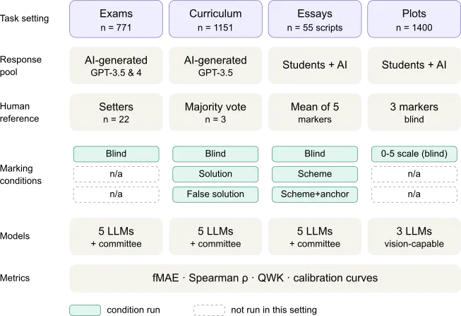

Figure 1: Study design overview showing the four task settings and
marking conditions used. fMAE denotes fractional mean absolute error and
QWK quadratic weighted kappa.

## II Theoretical Background

### II.1 Physics assessment task types

In a modern Physics degree programme there are many diverse assessment
types used to evaluate student understanding, including invigilated
examinations, take-home assignments, laboratory reports, essays, viva
examinations, and computational notebook projects. These formats vary
significantly in structural constraints ranging from mathematical
derivations with a unique target solution to open-ended writing
requiring holistic qualitative evaluation \[6\]. Psychometric
investigations into physics grading cultures reveal that human
inter-rater reliability is strongly dependent on this task format \[29,
19\].

### II.2 Automated scoring

Automated Short-Answer Grading (ASAG) in science and mathematics
historically relied on rule-based NLP systems and supervised machine
learning pipelines featuring manual feature extraction \[10, 49\].
Within physics education research, these classical machine learning
classifiers and text embeddings have been extensively applied to
classify student concept use and analyse qualitative data at scale \[14,
33\]. Whilst more interpretable than LLMs, traditional machine learning
implementations require large task-specific labelled datasets for
training and generally fail to generalize to novel open-response prompts
or complex multi-step physics derivations without extensive engineering
\[10, 49\]. This task-specific engineering burden is precisely the cost
that LLM-as-a-judge evaluation promises to remove.

### II.3 LLM-as-a-judge

The deployment of large language models (LLMs) as evaluators offers a
scalable alternative to traditional automated scoring pipelines \[11,
45\]. Recent evaluations confirm that contemporary models can automate
the grading of complex physics calculations using advanced prompt
structures such as Chain-of-Thought \[48\]. In physics education,
providing fine-grained rubrics or solutions can paradoxically distort
grading accuracy, as models frequently defer to provided text patterns
rather than independently verifying the underlying physical logic \[18,
28\]. Furthermore, the efficacy of LLM assessment varies drastically by
response modality. While LLMs excel at categorical classification and
structured text evaluation, traditional supervised machine learning
pipelines or human consensus panels frequently outperform zero-shot LLM
prompts when assessing continuous, holistic writing quality, such as in
academic essays \[16, 35\]. This difference necessitates evaluating
automated marking systems on both absolute error profiles and validity
across distinct structural tasks \[30, 40\]. Because model capabilities
shift rapidly between releases, findings tied to a particular model
generation may not transfer directly to later ones. We therefore
evaluate several contemporary models and report cross-model as well as
committee performance rather than treating any single model as
representative of LLM-as-a-judge behaviour.

### II.4 Validity, reliability, and rank-order agreement

Reliability and validity are related but distinct. _Reliability_
concerns whether the same work receives the same mark across markers or
repeated gradings. In this study, _validity_ is evaluated in the bounded
sense of evidence that LLM-generated marks agree with the human
assessment reference, both in absolute score and in rank ordering. These
analyses therefore provide evidence relative to the human benchmark;
they do not independently establish the construct validity of either the
human or AI-generated marks \[30\]. A marking process can be highly
consistent yet systematically disagree with the reference, while a noisy
human reference places a ceiling on the strength of any validity claim
that can be made from AI-human agreement.

For marks used in ranking, progression, or grading, the property that
matters is _rank-order agreement_ - whether a system places responses in
the same quality order as the reference. This differs from
_distributional agreement_, which concerns only whether the overall
spread of marks matches. A system can satisfy the second while failing
the first entirely. If five essays have reference marks
$`\{12,14,16,18,20\}`$, a marker who returns those same values but in
reverse order reproduces the reference distribution exactly (identical
mean and variance) yet achieves a Spearman correlation of $`-1`$,
distributionally indistinguishable from the reference, but ordering the
work backwards. Mean absolute error and calibration can be satisfied by
distribution matching alone; only rank-order metrics test whether a
system discriminates quality. Agreement with a human reference is
therefore incomplete evidence of valid marking unless rank-order
agreement is also established, and a reference that is itself unreliable
cannot support strong claims about ranking at all.

## III Methods

### III.1 Overview

This study evaluates contemporary large language models (LLMs) as
automated marking tools across multiple physics assessment formats:
structured exam questions, GCSE and A-Level problems with official
reference solutions, university textbook questions, short-form physics
essays, and scientific coding plots. The aim is not to benchmark
answer-generation performance per se, but to assess the reliability,
calibration, and validity of LLM-as-a-judge marking relative to human
reference marks.

The datasets used here build directly on prior work exploring AI
performance on physics examinations \[54\], blinded human-AI comparisons
in essay assessment \[53\] and blinded human-AI comparisons in
scientific plots \[56\]. Rather than focusing on answer generation
quality, the present study treats LLMs explicitly as evaluators. The use
of LLM committees as aggregated evaluators follows recent evidence that
a diverse panel of models reduces intra-model bias and outperforms
single-model judges across multiple settings \[44\]. Across all
datasets, previously human-marked responses were re-evaluated via API
calls to multiple LLMs under controlled prompting conditions. Within
each task family, the same underlying response pool was marked across
all models and experimental conditions, and prompts were held constant
across providers apart from provider-specific formatting required by the
API.

### III.2 Evaluation metrics

Our two research questions both distinguish _absolute accuracy_ (how
close the marks are to the human reference marks) from _rank-order
agreement_ (whether responses are placed in the same quality order as
human markers). These are separate properties as a system can match the
distribution of human marks while failing to order responses by
quality \[30, 40\]. We therefore report metrics of both kinds
throughout. Absolute accuracy is reported using Mean Absolute Error
(MAE) and fractional MAE (MAE divided by available marks). Dividing by
available marks places items with different mark totals on a common
scale. These metrics measure the _errors_ part of RQ1 and the _absolute
accuracy_ part of RQ2. Rank-order agreement is assessed independently of
absolute accuracy using Spearman rank correlation ($`\rho`$), which
measures whether the model orders responses by quality as humans do. We
also report Quadratic Weighted Kappa (QWK) \[5\], which measures
agreement on an ordered mark scale while correcting for chance agreement
and penalising large mark disagreements more heavily than near misses.
We report both because $`\rho`$ rewards correct ordering even under
systematic harshness or leniency, whereas QWK is more sensitive to
whether model and human marks land close together on the scoring scale.
Agreement between these metrics guards against metric-dependent
conclusions. These metrics address the rank-order and ordinal-agreement
components of RQ1 and RQ2.

Where human marking reliability is reported, we use pairwise human-human
MAE to quantify absolute disagreement between markers, and intraclass
correlation coefficients (ICC2) to quantify the consistency of human
marks across markers. These human-baseline metrics are important because
agreement with a noisy human reference cannot be interpreted in the same
way as agreement with a stable benchmark. For rank correlations on the
essay dataset ($`n=55`$ scripts), the effective sample size is small
enough that $`\rho`$ values carry substantial uncertainty. Confidence
intervals for Spearman $`\rho`$ are estimated by Fisher
$`z`$-transformation:
$`z=\tfrac{1}{2}\ln\!\left(\tfrac{1+\rho}{1-\rho}\right)`$, with a 95%
CI constructed as $`z\pm 1.96/\sqrt{n-3}`$ and then back-transformed.
Because essay marks are awarded in 5-point increments, ties are common,
which makes fine-grained rank separation harder and should be considered
when interpreting small differences in $`\rho`$.

We use calibration curves \[12\] to assess score-scale alignment across
the mark range. Their purpose is to distinguish systematic harshness or
leniency across the score scale from failures of rank ordering: MAE
averages over these effects, while Spearman $`\rho`$ is insensitive to a
uniform score shift. These curves compare mean predicted fractional
marks to mean human fractional marks within equal-width bins. Points
close to the diagonal indicate that predicted and human marks are
aligned on average within that region of the mark scale; systematic
harshness or leniency appears as deviations below or above the diagonal.
The committee mark is computed as the mean of the individual model
marks. We treat the committee as an additional marking system, included
to test whether aggregation across models recovers validity that
individual models lack \[44\]. Reporting both absolute-accuracy and
rank-order metrics is essential because an LLM-as-a-judge system could
achieve low MAE while still failing to distinguish good from poor work.

### III.3 Question Datasets

For the structured physics questions, two datasets were used. Firstly, a
set of university exam questions ($`n=771`$) drawn from Durham
University examinations (2018–2022), spanning advanced condensed matter
physics, foundations modules, mathematical methods, astrophysics,
cosmology, and atomic/optical physics. The solutions to these questions
are not made public, hence they serve as a “blinded” dataset. Secondly,
a set of curriculum questions was sourced from UK GCSE ($`n=350`$),
A-Level ($`n=370`$), and university textbook questions ($`n=431`$),
giving $`n=1151`$ structured questions in total. These questions and
reference solutions are publicly available, hence they can be used to
probe how access to a worked solution affects LLM marking. A full
breakdown is shown in Table 1.

|          |                                                 |           |         |
| -------- | ----------------------------------------------- | --------- | ------- |
| Level    | Source                                          | Years     | $`n`$   |
| Exam     | Advanced Condensed Matter Physics               | 2018–2022 | $`154`$ |
| Exam     | Foundations of Physics 1 (paper 1)              | 2020–2022 | $`26`$  |
| Exam     | Foundations of Physics 2A                       | 2018–2022 | $`112`$ |
| Exam     | Foundations of Physics 3A                       | 2018–2022 | $`110`$ |
| Exam     | Mathematical Methods in Physics                 | 2018–2022 | $`107`$ |
| Exam     | Modern Atomic and Optical Physics 3             | 2020–2022 | $`34`$  |
| Exam     | Planets and Cosmology 3                         | 2019–2022 | $`61`$  |
| Exam     | Theoretical Astrophysics                        | 2021–2022 | $`19`$  |
| Exam     | Theoretical Physics 2                           | 2018–2022 | $`109`$ |
| Exam     | Theoretical Physics 3                           | 2020–2022 | $`39`$  |
| Textbook | Physics for Scientists and Engineers            | –         | $`179`$ |
| Textbook | Physics: Principles with Applications (7th ed.) | –         | $`141`$ |
| Textbook | College Physics 2e                              | –         | $`111`$ |
| A Level  | OCR A-Level Physics A (papers 1, 2)             | 2017–2020 | $`243`$ |
| A Level  | OCR A-Level Physics B (Advancing Physics)       | 2020–2021 | $`127`$ |
| GCSE     | OCR GCSE Physics A (Gateway, papers 1–4)        | 2018–2020 | $`260`$ |
| GCSE     | OCR GCSE Physics B (21st Century, papers 1, 3)  | 2017–2022 | $`90`$  |
| Total    |                                                 | 2017–2022 | 1922    |

Table 1: Question sources by dataset level. The curriculum subset (GCSE,
A-Level, and textbook questions) contains $`n=1151`$ items and the exam
subset contains $`n=771`$ items.

The original question pools were manually inspected. Poorly formatted,
ambiguous, or incomplete items (primarily from extracted exam .tex
files) were removed to improve dataset integrity and ensure
comparability across marking conditions. The exam questions were marked
by their respective question setters ($`n=22`$), which serve as the
reference marks. The curriculum questions were marked by $`n=3`$ human
markers from Durham University taking a majority vote as the reference.
These human markers were given the question and reference answer only,
rather than the official marking schemes, to match the information that
the LLMs were subsequently given.

Markers agreed unanimously on 76.7% of items (883/1151) and a two-thirds
majority was available for a further 20.5% (236/1151). On the remaining
2.8% (32/1151) all three markers assigned different marks; for these
items, with no majority available, the reference was taken as the
rounded mean of the three marks. Because curriculum items carry low mark
totals (predominantly 1–2 marks), majority disagreements span a narrow
range, and resolving the 32 no-majority items by rounded mean rather
than by any single marker leaves all committee-level statistics
unchanged to the precision reported. All responses were reused from a
previous study comparing GPT-3.5 and GPT-4 \[54\], providing an existing
human-marked response pool; the identity of the answering model is not a
variable of interest here, as the present study concerns the behaviour
of the LLM markers. The curriculum responses ($`n=1151`$) were all
generated by GPT-3.5, and the exam responses ($`n=771`$) comprise 355
from GPT-3.5 and 416 from GPT-4.

These AI-generated responses achieved moderate overall scores against
human marking providing a pool of both correct and incorrect responses.
The mean per-question fractional score was $`52.0\%`$ for the exam
dataset (marked by question setters) and $`61.6\%`$ for the curriculum
dataset (majority vote of three markers), with $`56.6\%`$ of curriculum
questions receiving full marks under the majority vote reference. A
breakdown of the marks available per question is shown in FIG. 2:
curriculum questions are heavily concentrated at 1–2 marks per item
(reflecting the short-answer format of GCSE and A-Level papers), whereas
exam questions are more broadly distributed between 3 and 6 marks,
reflecting the multi-step derivation style of university assessments.
The higher mark allocations associated with university questions reflect
a more complex rubric structure: multi-step derivations require the
marker to assess representation, strategy, application, and logical
progression jointly \[6\], a structure that a model marking without a
scheme must infer from context alone.

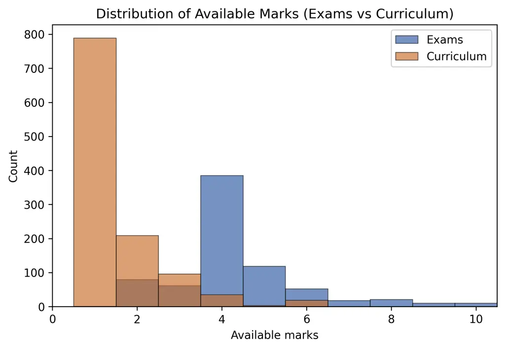

Figure 2: Distribution of marks available per question for the exams and
curriculum datasets. Values above 10 marks (13/771 exam questions; 0
curriculum questions) are omitted for clarity.

A key pedagogical question for educators is how access to a reference
solution influences LLM evaluations. Within individual institutions
marking culture can vary widely \[29\]; hence we used three marking
regimes for the structured questions:

1.  1.  Blinded marking. The model was instructed to assess scientific
        correctness without access to a reference solution.
2.  2.  With solution. The model was instructed to compare the student
        response explicitly to the supplied solution and award marks
        strictly.
3.  3.  With false solution. To test for anchoring bias, models evaluated
        responses against a deliberately corrupted reference solution. This
        isolates whether the model independently verifies the physics or
        merely matches text patterns against the provided standard. False
        solutions were generated by requesting DeepSeek-V3.2 to apply one of
        five mechanical perturbations to the original answer: a factor-of-10
        error, a sign flip, substitution of zero with a non-zero value, a
        multiple-choice swap, or doubling the main numerical value. The
        perturbation was required to produce an output visibly and
        unambiguously different from the correct answer while preserving
        surface formatting.

A methodological caveat is warranted regarding the use of AI-generated
responses as the student answer pool for the structured-question
datasets. Because the Durham exam solutions are not distributed and
cannot be reconstructed from student scripts under institutional data
constraints, authentic student responses are unavailable for this
setting. Further, the curriculum questions are from online sources and
are not directly taught at Durham University meaning there isn’t a pool
of student answers to compare to. AI-generated answers were therefore
used as a practical necessity rather than by design. These responses may
exhibit systematically different error profiles compared with genuine
student work. For example, AI answers may not approach problems using
the methods taught on the course(s) which could plausibly inflate
marking agreement by presenting models with responses closer to their
own distributional expectations. The validity conclusions drawn from the
structured-question datasets should therefore be interpreted as an upper
bound on likely real-world performance. Where authorship effects can be
tested directly (essays, scientific plots), we examine them in
Section IV.4.

### III.4 Essay Dataset

The essay dataset covered topics such as the Kuhn–Popper debate,
interpretations of Quantum Mechanics and the historical development of
scientific understanding of electricity. We initially used $`n=60`$
scripts each containing five short-form essays ($`{\sim}300`$ words
each) graded holistically out of 100 in 5-point increments under
standard UK classification bands. Because the five essays within each
script were authored, submitted, and marked as a single submission, we
chose a sample size of $`n=60`$ rather than $`n=300`$. To create a
series of exemplars, we took five submissions from the 5th, 25th, 50th,
75th, and 95th percentile of aggregated human marks leaving a final
dataset size of $`n=55`$ scripts and $`n=275`$ individual essays.

Element-level scores are reported for distributional description but all
inferential statistics (rank correlations, confidence intervals) are
computed at the script level. Evaluations were conducted by five
independent markers with prior experience in the module who were blinded
to the authorship of the work. The dataset includes both human-authored
and AI-authored essays to increase the range of quality represented;
authorship is treated as a data-collection covariate and is not a
variable of interest in the present study, which concerns the behaviour
of the AI markers rather than the AI authors.

To establish a baseline for human marking variability, we calculated
pairwise inter-rater reliability across the five independent markers.
The average human–human MAE was $`6.84`$ marks. Rank-order agreement
between human markers was very limited, with an average pairwise
Spearman correlation of just $`\rho=0.054`$ and a single-rater
Intraclass Correlation Coefficient (ICC2) of $`0.035`$ (95% CI:
$`[-0.01,0.11]`$). Such low reliability is not unusual in short-form
holistic marking, but it implies that fine-grained rank-ordering should
be interpreted cautiously. This demonstrates that open-ended physics
essay marking is an inherently noisy, highly subjective task where even
expert human markers fail to reach consensus on rank-ordering - a
baseline essential for interpreting all AI essay marking results that
follow. This noisy baseline is not a methodological flaw, but an
authentic representation of the reality of holistic grading in higher
education. Apparent agreement with an aggregated human score can in
principle be achieved by matching the distribution of a weakly reliable
benchmark rather than by validly discriminating essay quality. For
essay-level comparisons against a single human reference, we use the
unrounded mean of the five human markers for each script as the
aggregated human score. Three marking conditions were employed for the
essays:

1.  1.  Blind. The model was instructed to assess scientific correctness
        without access to a mark scheme.
2.  2.  With scheme. The model was instructed to assess scientific
        correctness with use of the guidance scheme, which contains general
        content taught in the course and potential ideas to include. This is
        the method that the human markers used.
3.  3.  With scheme and anchor. The model was instructed to use the guidance
        scheme and a set of five exemplars drawn from the dataset at the
        5th, 25th, 50th, 75th, and 95th percentile of average marks awarded
        by the human markers, each appended to the system prompt along with
        their scores. These 25 exemplar essays were removed from the
        evaluation set, leaving $`n=275`$ anchored-condition scores.

### III.5 Qualitative disagreement analysis

To address RQ2 beyond aggregate error metrics, we also examine cases in
which the LLM markers unanimously disagree with the human reference.
These cases are selected after quantitative marking using the criteria
defined in Section V, and are inspected to identify recurring mechanisms
behind the disagreement, such as deference to a supplied reference or
alternative but scientifically valid reasoning. The qualitative analysis
is therefore used to interpret the mechanisms underlying the
quantitative error patterns rather than as an independent sample of
responses.

### III.6 Scientific Plot Dataset

We use $`n=1400`$ graded scientific plots derived from 100 student and
AI-generated submissions for the ‘Laboratory Skills and Electronics’
module at Durham University, evaluated blindly by three independent
markers. The dataset includes 14 distinct plot types per submission,
covering physics topics such as numerical integration, Monte Carlo
methods, and the Newton-Raphson method. The AI-generated plots were
created with and without prompt engineering as covered in detail
in \[56\]. Examples of plots produced by GPT-3.5 and GPT-4 are shown in
Appendix A. As the plots were submitted separately by the students we
use $`n=1400`$ as the sample size. Each plot was manually scored out of
5 based on its quality and accuracy in elucidating the underlying
physics.

For this module there is no specific mark scheme for the plots. Human
markers assessed the plots using a 0–5 scale of general plot quality: a
score of 5 indicates a scientifically correct and clear plot with
sensible axes, units, labels, and scale, while 0 indicates a blank,
irrelevant, or unreadable plot. The LLMs were given the same 0–5 scoring
guidance as the human markers. Importantly, this is not a test of
unconstrained visual physics reasoning. Each plot occurred at the end of
a Jupyter notebook task, and the model was shown the completed notebook
content up to the point where the plotting code would begin, together
with the final plot image. Human markers assessed the plots as presented
in compiled PDF submissions, whereas the LLMs additionally received the
preceding notebook context. This difference in available context should
be considered when interpreting the human–LLM comparison.

### III.7 AI Models and Marking Conditions

To capture the current state of the art, we use five models from leading
labs: GPT-5.2 (OpenAI), Claude Opus 4.5 (Anthropic), Gemini 3 Pro
(Google DeepMind), DeepSeek-V3.2 (DeepSeek), and Grok 4.1 (xAI). The
core instruction prompt for structured questions is shown in FIG. 3.
This instruction decomposes the evaluation into four explicit steps.
Such structured prompting has been shown to improve zero-shot scoring
accuracy in educational assessment settings \[23\], and evaluation
frameworks that incorporate intermediate reasoning (e.g. G-Eval) achieve
stronger agreement with human graders than direct scoring
approaches \[27\]. In principle Chain of Thought prompting \[47\] or
elsewise reasoning tokens can be used when generating responses, however
given the different API structures the amount of reasoning used between
models is difficult to keep constant.

Pilot work on the curriculum dataset (Appendix B) indicates that
explicit Chain of Thought prompting can reduce fractional MAE for the
same model (DeepSeek-V3.2) across blind and solution conditions, while
the DeepSeek-Reasoner model that generates native reasoning tokens prior
to the final output does not yield comparable improvements and in some
conditions performs worse than the baseline. Because different providers
implement intermediate reasoning in architecturally distinct ways -
explicit Chain of Thought in the prompt or reasoning tokens within the
API calls - and because the volume of intermediate reasoning cannot be
held constant across APIs, the main experiments use direct JSON-output
prompting throughout to ensure a controlled cross-model comparison. The
absolute error values reported in the main text should therefore be
interpreted as conservative estimates for structured questions under
direct-output prompting.

Figure 3: Core marking prompt used for structured questions (solution
condition).

For the solution and false solution conditions, the system message was
replaced with an audit-marker instruction directing the model to mark by
comparing the student response to the provided model solution and to be
strict about what earns credit. The question block was extended to
include a MODEL SOLUTION field alongside the student response and
available marks. Temperature was set to 0 to reduce stochastic variation
across repeated calls; pilot work, detailed in Appendix C, suggested
temperature changes did not affect the marks produced by the models. For
essays, models were instructed to act as expert university markers using
the same grading scale (0–100 in 5-point increments). For plots, models
were instructed to act as expert markers using the same 0–5 scale; at
the time of writing Grok 4.1 and DeepSeek-V3.2 did not accept image
input, so only the remaining three models were used. Committee scores
were computed as the mean of all individual model scores for each
question - a transparent consensus estimator that preserves partial
disagreement between models without introducing an additional fitted
aggregation layer.

All marking was performed on the same response sets within each task
family. Batch processing was used where supported by the provider API
and elsewise requests were looped with standard exponential-backoff
retries. All prompts used in this study are shown in Appendix D. In all
settings, no post-processing was required to cap marks, as no model
output exceeded the available maximum over all responses.

## IV Quantitative analysis of marking errors

### IV.1 Structured Question Marking

#### IV.1.1 Exams

Across the 771 Durham exam questions under blind marking, fractional MAE
is tightly clustered across models (GPT-5.2: $`0.226`$, Claude:
$`0.202`$, Gemini: $`0.218`$, DeepSeek: $`0.250`$, Grok: $`0.226`$,
committee: $`0.216`$), with only modest separation between the
best-performing model (Claude, $`0.202`$) and the weakest (DeepSeek,
$`0.250`$) (FIG. 4). The committee aggregation ($`0.216`$) lies close to
the model average, indicating that ensemble averaging provides limited
additional benefit over the best individual model. These results are
broadly consistent with prior feasibility work on LLM grading in
introductory physics \[21\], while extending that work to a multi-model
comparison across introductory-to-advanced undergraduate content under
strictly blinded conditions. The rank-order agreement observed here is
also consistent with prior findings that the structure and complexity of
the assessment construct strongly influence the accuracy of automated
scoring systems \[57\].

Beyond absolute error, the models demonstrate robust rank-order
agreement under blinded conditions (Table 2). Rank correlations against
human marks remain strong (e.g., Claude: Spearman $`\rho=0.690`$, QWK
$`=0.659`$; GPT-5.2: $`\rho=0.646`$, QWK $`=0.608`$), indicating that
models successfully rank student responses by physics quality even
without reference solutions.

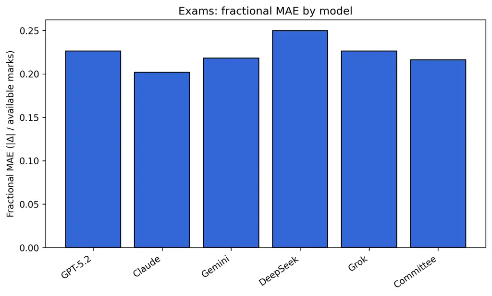

Figure 4: Exams (Durham, blinded; $`n=771`$): fractional MAE by model.
GPT-5.2: $`0.226`$; Claude: $`0.202`$; Gemini: $`0.218`$; DeepSeek:
$`0.250`$; Grok: $`0.226`$; Committee: $`0.216`$.

Across all conditions, absolute error shows a modest positive
association with available marks (regression $`R^{2}`$: exams $`0.199`$,
curriculum blind $`0.205`$, curriculum solution $`0.210`$), consistent
with the idea that multi-step derivations require the marker to assess
several co-dependent reasoning components simultaneously \[6\]. Blinded
automated marking may therefore be somewhat less reliable for
longer-form, higher-mark questions, although available marks explain
only a limited fraction of the total error variance.

#### IV.1.2 Curriculum questions

For GCSE, A-Level, and textbook questions (where reference solutions are
available), providing the official solution consistently reduces
fractional MAE across all models (GPT-5.2: $`0.131\rightarrow 0.083`$;
Claude: $`0.120\rightarrow 0.065`$; Gemini: $`0.092\rightarrow 0.070`$;
DeepSeek: $`0.185\rightarrow 0.112`$; Grok: $`0.112\rightarrow 0.101`$;
committee: $`0.127\rightarrow 0.083`$) (FIG. 5).

All of these values sit above the dashed reference line in FIG. 5 at
$`0.051`$, which shows the human inter-rater fractional MAE: the mean
fractional absolute error of each human marker relative to the
majority-vote reference across the curriculum questions. The non-zero
value provides a human baseline for disagreement on this dataset.

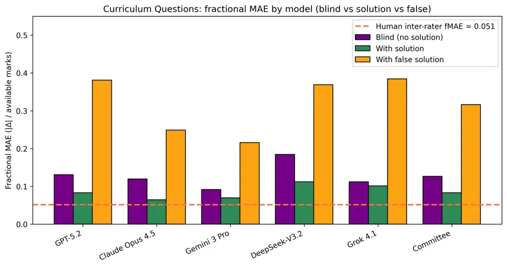

Figure 5: Curriculum questions: fractional MAE by model (blind vs.
solution vs. false solution) across GCSE ($`n=350`$), A-Level
($`n=370`$), and university textbooks ($`n=431`$). The human inter-rater
fMAE ($`n=3`$) is also shown.

Providing a false solution dramatically degrades absolute performance
for all models, with fractional MAE rising to approximately
$`0.22`$–$`0.38`$ (GPT-5.2: $`0.381`$; Claude: $`0.249`$; Gemini:
$`0.216`$; DeepSeek: $`0.369`$; Grok: $`0.384`$; committee: $`0.316`$).
This substantially exceeds the blind MAE for every model, confirming
that the models attend to and defer to the provided reference rather
than independently evaluating student responses on physical grounds.
This deference to reference material mirrors experimental findings that
LLMs exhibit statistically significant anchoring across providers \[28,
32, 58\].

While the false solution significantly degrades absolute accuracy, it
does not destroy rank-order agreement. Under blind and correct-solution
conditions, models show strong alignment with human rankings (e.g.,
Gemini blind $`\rho=0.845`$, QWK $`=0.860`$; Claude solution
$`\rho=0.885`$, QWK $`=0.907`$). When exposed to the false solution,
these correlations dip but remain robust (e.g., Gemini false
$`\rho=0.744`$; Claude false $`\rho=0.719`$; Table 2). For structured
mathematical physics, models retain the ability to rank good answers
above bad answers while shifting their absolute scoring penalty to align
with the incorrect reference.

| Dataset    | Model           | Condition      | $`\rho`$ | 95% CI ($`\rho`$) | QWK   |
| ---------- | --------------- | -------------- | -------- | ----------------- | ----- |
| Exams      | GPT-5.2         | Blind          | 0.646    | $`[0.603,0.686]`$ | 0.608 |
|            | Claude Opus 4.5 | Blind          | 0.690    | $`[0.651,0.725]`$ | 0.659 |
|            | Gemini 3 Pro    | Blind          | 0.634    | $`[0.590,0.675]`$ | 0.627 |
|            | DeepSeek-V3.2   | Blind          | 0.606    | $`[0.559,0.649]`$ | 0.548 |
|            | Grok 4.1        | Blind          | 0.640    | $`[0.596,0.680]`$ | 0.637 |
|            | Committee       | Blind          | 0.696    | $`[0.658,0.731]`$ | 0.650 |
| Curriculum | GPT-5.2         | Blind          | 0.803    | $`[0.781,0.823]`$ | 0.846 |
|            | Claude Opus 4.5 | Blind          | 0.820    | $`[0.800,0.838]`$ | 0.865 |
|            | Gemini 3 Pro    | Blind          | 0.845    | $`[0.828,0.861]`$ | 0.860 |
|            | DeepSeek-V3.2   | Blind          | 0.724    | $`[0.696,0.751]`$ | 0.778 |
|            | Grok 4.1        | Blind          | 0.821    | $`[0.801,0.839]`$ | 0.852 |
|            | Committee       | Blind          | 0.849    | $`[0.832,0.865]`$ | 0.867 |
|            | GPT-5.2         | Solution       | 0.863    | $`[0.847,0.877]`$ | 0.887 |
|            | Claude Opus 4.5 | Solution       | 0.885    | $`[0.872,0.897]`$ | 0.907 |
|            | Gemini 3 Pro    | Solution       | 0.873    | $`[0.859,0.886]`$ | 0.877 |
|            | DeepSeek-V3.2   | Solution       | 0.817    | $`[0.797,0.836]`$ | 0.849 |
|            | Grok 4.1        | Solution       | 0.828    | $`[0.809,0.846]`$ | 0.858 |
|            | Committee       | Solution       | 0.885    | $`[0.872,0.897]`$ | 0.898 |
|            | GPT-5.2         | False solution | 0.640    | $`[0.605,0.673]`$ | 0.735 |
|            | Claude Opus 4.5 | False solution | 0.719    | $`[0.690,0.746]`$ | 0.804 |
|            | Gemini 3 Pro    | False solution | 0.744    | $`[0.717,0.769]`$ | 0.817 |
|            | DeepSeek-V3.2   | False solution | 0.589    | $`[0.550,0.626]`$ | 0.672 |
|            | Grok 4.1        | False solution | 0.619    | $`[0.582,0.653]`$ | 0.721 |
|            | Committee       | False solution | 0.772    | $`[0.748,0.794]`$ | 0.758 |

Table 2: Rank-order agreement (Spearman $`\rho`$ and QWK) for structured
questions across conditions. 95% CIs for $`\rho`$ by Fisher
$`z`$-transformation.

The full distribution of committee absolute errors shifts left when the
correct solution is provided, indicating systematic improvement rather
than isolated correction of outliers (FIG. 6). Under the false solution
condition the distribution shifts markedly right, with a pronounced
secondary peak at fractional errors of $`0.8`$–$`1.0`$, corresponding to
cases where the model awarded near-zero marks because the student’s
correct answer differed substantially from the deliberately incorrect
reference.

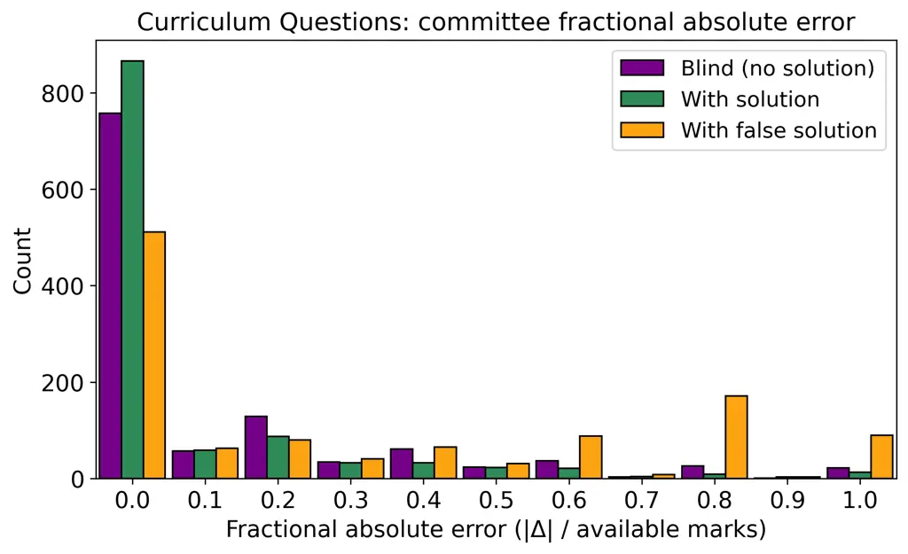

Figure 6: Curriculum questions: distribution of committee fractional
absolute error (blind vs. solution vs. false solution) across GCSE,
A-Level, and textbook questions ($`n=1151`$ total).

To probe whether the effect of solution quality is concentrated on the
hardest questions or is more uniform, FIG. 7 shows the conditional
fractional MAE restricted to the $`n=652`$ questions on which the human
marker awarded full marks. In this subset, blind and solution-provided
performance are broadly comparable (committee: $`0.079`$ blind,
$`0.084`$ solution), indicating that for questions with unambiguously
correct student responses, models are already close to ceiling under
blind conditions. Under the false solution condition, however,
conditional MAE rises sharply (committee: $`0.474`$), confirming that
the effect is driven by active misdirection from the incorrect
reference. Notably, the best-performing individual models under blind
and solution conditions (Claude blind: $`0.041`$; Claude solution:
$`0.041`$) outperform the human inter-rater conditional baseline on the
full-marks subset, while the committee ($`0.079`$ blind; $`0.084`$
solution) sits modestly above it. The false solution condition exceeds
the human baseline by a large margin for all models.

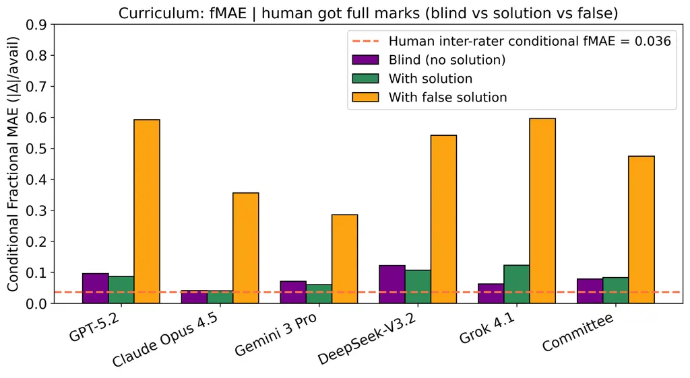

Figure 7: Curriculum questions: conditional fractional MAE for questions
on which the human awarded full marks ($`n=652`$). All models maintain
low MAE under blind and solution conditions ($`{\sim}0.04`$–$`0.12`$)
but suffer large errors under the false solution
($`{\sim}0.29`$–$`0.60`$).

Calibration curves across exams and curriculum questions lie close to
the diagonal for the blind and solution cases with modest deviations in
mid-to-high mark bins under blind conditions that are reduced when
solutions are provided (FIG. 8). Providing a false solution causes large
deviations from the diagonal.

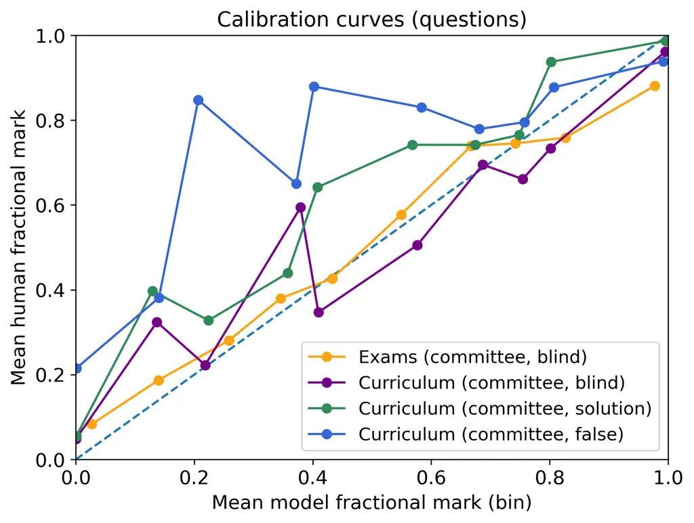

Figure 8: Calibration curves for structured questions (fractional marks)
across exams and curriculum conditions. The dashed diagonal represents
perfect score-scale alignment.

### IV.2 Essay Marking

#### IV.2.1 Mark distributions

FIG. 9 shows stacked distributions of human marks ($`n=300`$
marker-level scores, mean $`66.3`$, $`\sigma=6.1`$), AI blind pooled
(mean $`52.4`$, $`\sigma=11.0`$), AI scheme pooled (mean $`53.6`$,
$`\sigma=9.8`$), and AI scheme+anchor pooled ($`n=275`$, mean $`64.0`$,
$`\sigma=4.3`$). The reduced $`n`$ in the anchored condition reflects
the deliberate removal of the five exemplar scripts used for anchoring
calibration, which were selected at the 5th, 25th, 50th, 75th, and 95th
percentiles of the human mark distribution. All per-script inferential
statistics (Spearman $`\rho`$, QWK, MAE, and calibration curves) are
computed over the matched $`n=55`$ scripts throughout, ensuring
like-for-like comparisons across conditions; the $`n=300`$ pooled
distributions are shown for illustrative purposes only.

The human distribution is approximately unimodal, centred around
$`65`$–$`70`$, with limited spread. Blind and scheme-only AI
distributions are both shifted approximately 14 marks below the human
mean and display considerably inflated variance. Adding the scheme alone
provides negligible improvement: the scheme-only mean ($`53.6`$) is only
1.2 marks above the blind mean ($`52.4`$), and the variance reduction is
modest (from $`\sigma=11.0`$ to $`\sigma=9.8`$). By contrast, the
scheme+anchor condition qualitatively transforms the distribution: the
mean rises to $`64.0`$ (within 2.3 marks of the human mean) and variance
is compressed to $`\sigma=4.3`$, below even the human standard deviation
of $`6.1`$.

This distributional shift should not be read straightforwardly as
improved essay evaluation. Because the human benchmark itself has very
low inter-rater reliability, close matching of its overall mean and
variance can in principle be achieved by learning the expected score
distribution without learning to discriminate essay quality.
Distributional agreement can occur in a low-reliability task.

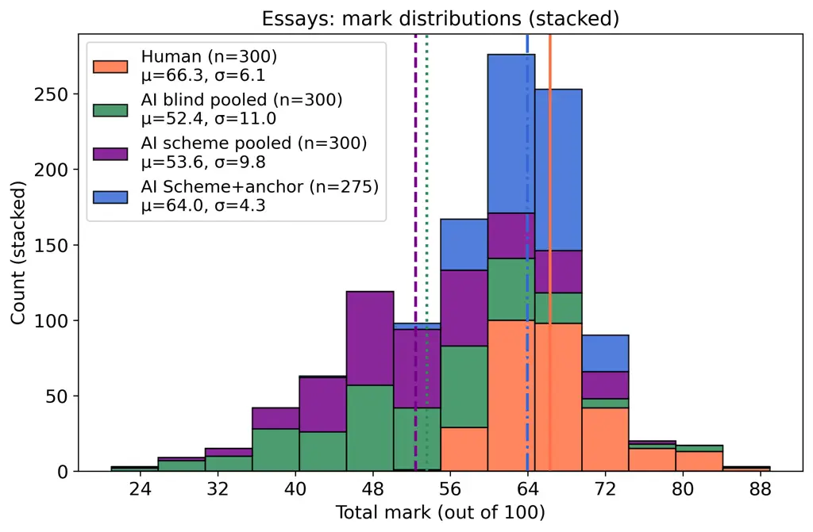

Figure 9: Essay mark distributions (stacked; $`n=300`$ per condition
except scheme+anchor where $`n=275`$): humans ($`\mu=66.3`$,
$`\sigma=6.1`$), AI blind pooled ($`\mu=52.4`$, $`\sigma=11.0`$), AI
scheme pooled ($`\mu=53.6`$, $`\sigma=9.8`$), AI scheme+anchor pooled
($`\mu=64.0`$, $`\sigma=4.3`$). Vertical lines indicate pooled means for
each condition.

#### IV.2.2 Essay MAE by model

Model-level MAE (marks out of 100) across blind, scheme, and
scheme+anchor conditions is shown in FIG. 10. Under blind conditions,
MAE ranges from $`9.6`$ (Grok) to $`25.1`$ (Gemini) - a factor of more
than $`2.5`$ across models - indicating substantial model-to-model
variation in default scoring leniency. Adding the scheme reduces MAE for
GPT-5.2 ($`11.0\rightarrow 8.7`$) and Claude ($`13.9\rightarrow 12.6`$)
but actually increases it for Grok ($`9.6\rightarrow 14.5`$) and
DeepSeek ($`12.9\rightarrow 13.7`$), suggesting that a content-based
scheme without distributional anchoring can shift some models toward
different systematic biases. The scheme+anchor condition, by contrast,
produces consistent and dramatic improvements across all models: MAE
falls to $`4.2`$ (GPT-5.2), $`5.9`$ (Claude), $`3.4`$ (Gemini), $`3.0`$
(DeepSeek), $`3.9`$ (Grok), and $`3.2`$ for the committee, representing
reductions of roughly $`3`$–$`8\times`$ relative to blind marking. This
wide inter-model variation is consistent with automated essay scoring
findings showing that default LLM scoring behaviour reflects substantial
leniency and variance shifts across model and task framing \[35, 8\]. A
broader reflection on the automated essay scoring field argues that
benchmark-focused evaluation has systematically neglected construct
validity and generalisation \[25\], while rubric-based LLM essay grading
can achieve high reliability when rubrics are sufficiently
granular \[52\].

These MAE values must be interpreted against the human baseline. The
average human–human MAE of $`6.84`$ marks means that the blind and
scheme-only AI conditions (committee MAE $`\approx 13.4`$) are roughly
double the average disagreement between expert human markers.
Conversely, the anchored condition’s committee MAE of $`3.16`$ marks is
tighter than human markers are capable of achieving against each other.
Rather than being evidence of superior marking, this indicates that
anchored prompts can reduce error against a noisy aggregated benchmark
by pulling model scores toward the centre of the observed human
distribution.

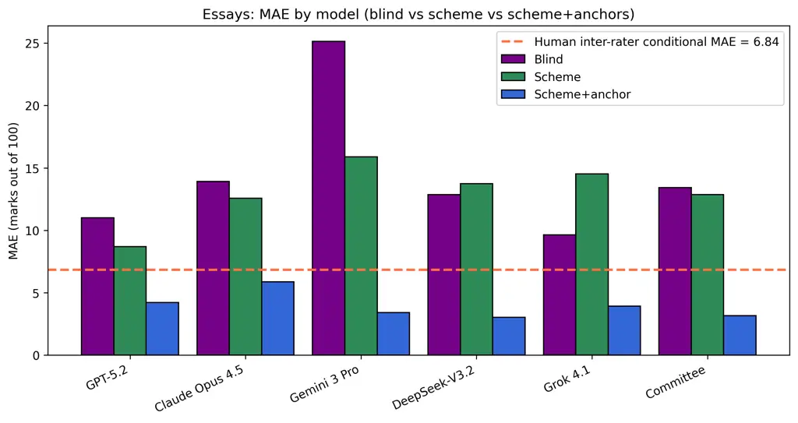

Figure 10: Essays: MAE by model. Committee MAE falls from 13.42 (blind)
and 12.86 (scheme) to 3.16 with anchoring. The dashed line indicates the
average human–human MAE of 6.84.

Calibration curves confirm that blind and scheme-only marking are
systematically harsh relative to human markers (FIG. 11): points fall
substantially below the diagonal, indicating that when a model assigns a
given fractional mark, the corresponding human fractional mark is
consistently higher. As with the MAE results, however, improved
score-scale alignment should not be equated with improved validity
unless the system also preserves the ability to distinguish stronger
from weaker essays.

#### IV.2.3 Rank-order agreement and anchoring bias

While anchored exemplars dramatically improve distributional alignment
and MAE, rank-order agreement remains absent throughout. We computed
Spearman rank correlation ($`\rho`$) and QWK against the aggregated
human scores (Table 3).

|                 |               |            |                   |            |
| --------------- | ------------- | ---------- | ----------------- | ---------- |
| Model           | Condition     | $`\rho`$   | 95% CI ($`\rho`$) | QWK        |
| Human avg.      | \-            | 0.054      | $`[-0.21,0.31]`$  | \-         |
| GPT-5.2         | Blind         | 0.109      | $`[-0.15,0.35]`$  | 0.029      |
| GPT-5.2         | Scheme        | 0.006      | $`[-0.25,0.26]`$  | 0.020      |
| GPT-5.2         | Scheme+anchor | $`-0.021`$ | $`[-0.27,0.23]`$  | 0.023      |
| Claude Opus 4.5 | Blind         | 0.154      | $`[-0.10,0.39]`$  | 0.020      |
| Claude Opus 4.5 | Scheme        | 0.049      | $`[-0.21,0.30]`$  | 0.008      |
| Claude Opus 4.5 | Scheme+anchor | $`-0.016`$ | $`[-0.27,0.24]`$  | 0.012      |
| Gemini 3 Pro    | Blind         | $`-0.013`$ | $`[-0.27,0.25]`$  | 0.003      |
| Gemini 3 Pro    | Scheme        | $`-0.103`$ | $`[-0.35,0.16]`$  | $`-0.011`$ |
| Gemini 3 Pro    | Scheme+anchor | 0.112      | $`[-0.15,0.36]`$  | 0.091      |
| DeepSeek-V3.2   | Blind         | 0.091      | $`[-0.17,0.34]`$  | 0.023      |
| DeepSeek-V3.2   | Scheme        | $`-0.049`$ | $`[-0.30,0.21]`$  | 0.002      |
| DeepSeek-V3.2   | Scheme+anchor | 0.016      | $`[-0.25,0.28]`$  | 0.045      |
| Grok 4.1        | Blind         | 0.090      | $`[-0.17,0.34]`$  | 0.048      |
| Grok 4.1        | Scheme        | $`-0.024`$ | $`[-0.28,0.23]`$  | 0.002      |
| Grok 4.1        | Scheme+anchor | 0.034      | $`[-0.22,0.28]`$  | 0.052      |
| Committee       | Blind         | 0.088      | $`[-0.17,0.34]`$  | 0.019      |
| Committee       | Scheme        | $`-0.044`$ | $`[-0.29,0.21]`$  | 0.002      |
| Committee       | Scheme+anchor | 0.034      | $`[-0.22,0.28]`$  | 0.066      |

Table 3: Essay rank-order agreement (Spearman $`\rho`$ and QWK) by model
and condition ($`n=55`$ scripts). 95% CIs for $`\rho`$ by Fisher
$`z`$-transformation. Human–human average $`\rho=0.054`$ (95% CI
$`[-0.21,0.31]`$) and ICC2 $`=0.035`$ (95% CI $`[-0.01,0.11]`$).

Even without anchoring, LLM essay rank-order agreement is already poor.
Under blind conditions, rank correlations are weak and near-zero (e.g.,
Claude Opus 4.5 blind: $`\rho=0.154`$, 95% CI $`[-0.10,0.39]`$; GPT-5.2
blind: $`\rho=0.109`$; Committee blind: $`\rho=0.088`$). A correlation
of $`\rho\approx 0.1`$ is insufficient for a marking system intended to
distinguish student performance: the model is only marginally better
than chance at ordering essays by quality relative to the aggregated
human benchmark. Adding the scheme does not improve rank-order
agreement: all scheme-condition $`\rho`$ values remain near-zero and
statistically indistinguishable from the blind values given the width of
the confidence intervals (e.g., GPT-5.2 scheme: $`\rho=0.006`$, 95% CI
$`[-0.25,0.26]`$; committee scheme: $`\rho=-0.044`$, 95% CI
$`[-0.29,0.21]`$). The anchoring condition shows a similar pattern:
committee $`\rho`$ sits at $`0.034`$ (95% CI $`[-0.22,0.28]`$), with
individual models GPT-5.2 ($`\rho=-0.021`$) and Claude ($`\rho=-0.016`$)
likewise consistent with zero. Across all three conditions, no model or
committee achieves a $`\rho`$ value whose confidence interval excludes
zero, and the between-condition differences are far smaller than the
within-condition uncertainty.

These metrics reveal a more subtle failure mode than simply “AI is bad
at essays.” The human benchmark itself exhibits extremely weak rank
reliability, so this essay format is already a poor instrument for
stable single-rater ordering. Anchored exemplars allow the models to
move much closer to the aggregated human score distribution while
rank-order agreement remains absent throughout. Anchoring reduces error
against a noisy consensus-derived reference without solving the
underlying validity problem; the models behave less like independent
evaluators and more like systems inferring where marks are expected to
lie on average.

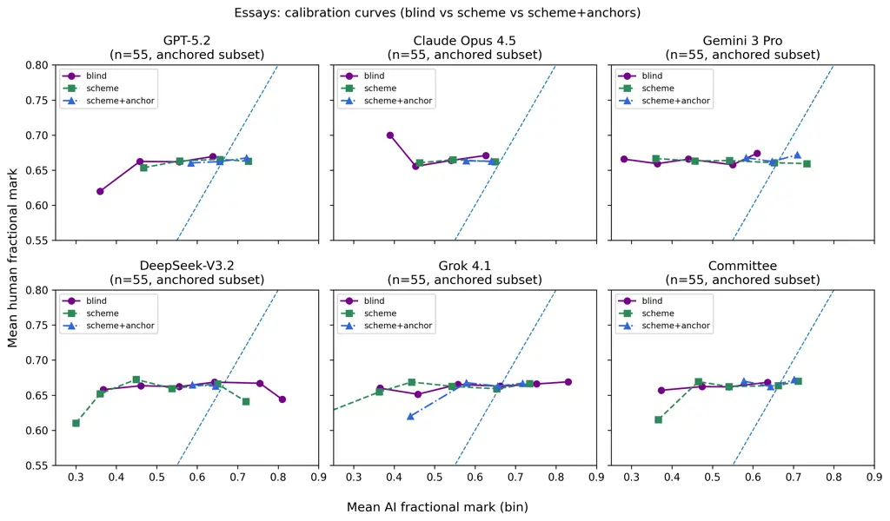

Figure 11: Essays: calibration curves by model and condition (blind vs.
scheme vs. scheme+anchor; scheme+anchor uses $`n=275`$). The dashed
diagonal represents perfect score-scale alignment. Blind and scheme-only
conditions show systematic under-marking relative to human scores;
anchoring improves score-scale alignment without recovering rank-order
agreement.

### IV.3 Code Plot Marking

For structured code-based plotting assignments (total out of 70 marks,
aggregated across 14 plots per script), MAE values differ meaningfully
across models: Gemini is the strongest performer ($`4.2`$ marks),
followed by Claude ($`6.6`$) and GPT-5.2 ($`7.1`$) (FIG. 12).
Human–human inter-rater MAE ranges from $`2.42`$ (markers 1 vs. 3) to
$`5.15`$ (markers 2 vs. 3). Gemini’s MAE therefore falls within the
range of human–human disagreement - a threshold psychometric approaches
to AI-assisted grading identify as meaningful for conditional
deployment \[19\].

A detailed characterisation of the qualitative features that distinguish
AI-generated from student-authored plots in this dataset including
systematic differences in colour scheme, axis alignment, and layout is
provided in prior work \[56\], where the same submissions were evaluated
for authorship detectability. The present results extend that analysis
by showing that these surface differences do not substantially impair AI
marking validity: despite the stylistic differences between student and
AI-generated code, rank-order agreement remains high ($`\rho>0.83`$
across all models), suggesting the models are responding to features of
plot quality described by the scoring scale rather than
authorship-correlated stylistic cues.

Rank-order agreement on scientific plots is exceptionally strong - and
contrasts sharply with the essay results. Rank correlations indicate
tight alignment with human ranking preferences (Gemini: $`\rho=0.881`$,
QWK $`=0.926`$; Claude: $`\rho=0.909`$, QWK $`=0.802`$; GPT-5.2:
$`\rho=0.838`$, QWK $`=0.725`$). These values are several times higher
than those observed in essay marking under any condition, confirming
that the models genuinely differentiate between good and poor visual
data representation rather than merely matching a central score
tendency. Calibration curves show close adherence to the diagonal for
all three models across the central fractional range (FIG. 13), with
some overestimation in the lowest-score bin and near-perfect agreement
in the upper range.

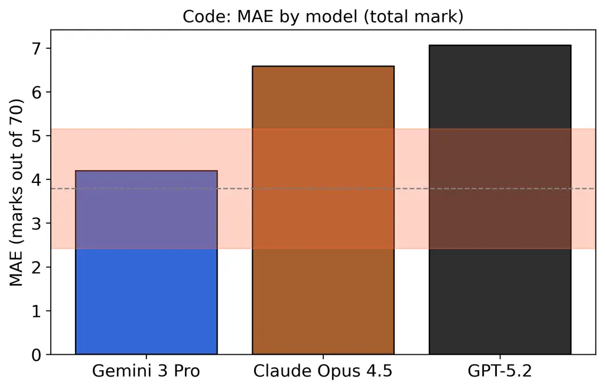

Figure 12: Scientific plots: MAE by model (total mark out of 70) across
$`n=1400`$ plot elements (100 scripts). Human–human inter-rater MAE
ranges from $`2.42`$ to $`5.15`$, providing a reference scale.

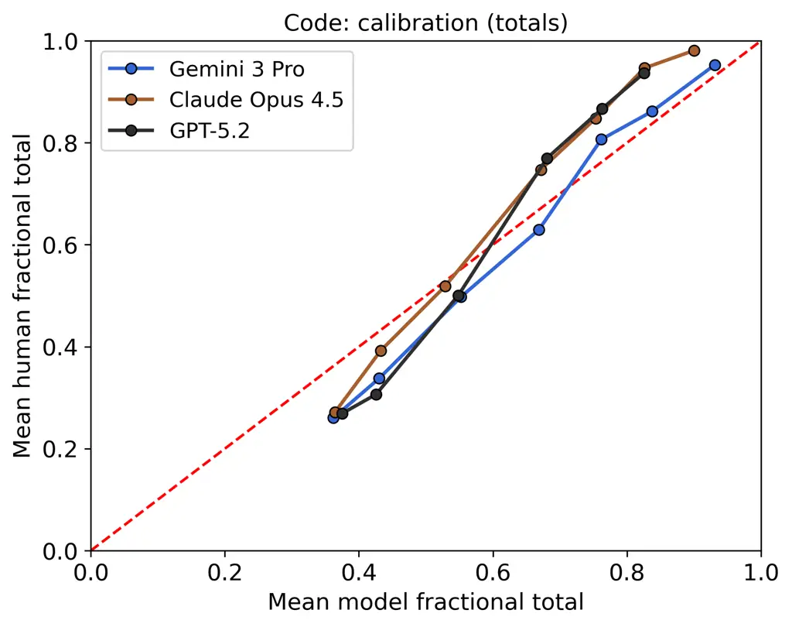

Figure 13: Scientific plots: calibration (total fractional mark) across
$`n=1400`$ plot elements (100 scripts). The dashed diagonal represents
perfect score-scale alignment.

This strong performance should still be interpreted narrowly. The task
here is not arbitrary graph interpretation or deep multimodal scientific
reasoning, but contextualised judgement of plot quality within a
constrained Jupyter notebook-based workflow. The result supports LLM/VLM
use for scale-guided evaluation of scientific plots in this specific
setting, not a broader claim that visual physics assessment is generally
solved. GPT-4V has separately been shown to score student-drawn
scientific models with moderate accuracy using structured
prompting \[24\], and benchmarking on scientific plot comprehension
confirms that current multimodal LLMs achieve meaningful but imperfect
understanding of standard matplotlib-style outputs \[50\]. The strong
performance observed here is therefore best understood as reflecting the
constrained nature of the task rather than general visual physics
reasoning.

The pooled histogram (FIG. 14) shows that human pooled scores (mean
$`76.8\%`$, $`\sigma=21.8`$) span a broader range than AI pooled scores
(mean $`72.2\%`$, $`\sigma=15.0`$). The AI distribution is more
concentrated around the $`75`$–$`85\%`$ band, consistent with a
systematic tendency toward conservative central marking. The AI mean
(72.2%) is 4.6 percentage points lower than the human mean (76.8%).
Human markers differ by 2.42–5.15 marks on average ($`\approx`$3.5–7.4%
of the total score), indicating that the AI–human difference lies within
the range of typical human grading disagreement.

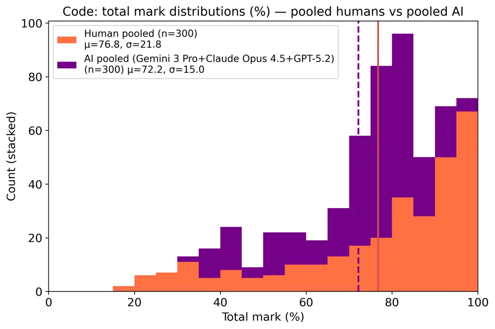

Figure 14: Scientific plots: total mark distributions (%) - pooled
humans ($`\mu=76.8\%`$, $`\sigma=21.8`$; $`n=300`$) vs. pooled AI
($`\mu=72.2\%`$, $`\sigma=15.0`$; $`n=300`$). AI marking is slightly
more conservative and exhibits reduced variance relative to human
markers.

### IV.4 Authorship effects

The structured-question responses evaluated in this study are
AI-generated rather than human-authored. For the exam questions, this is
due to assessment integrity and for the curriculum questions this is a
result of the question content not being directly taught at the
institution the research took place at: Durham University. To assess
whether this affects the reliability of our validity conclusions, we
examined authorship effects in the datasets where student answers were
available: the essay and code datasets. In the essay dataset - where
human markers assigned near-identical mean scores to human- and
AI-authored work ($`\mu=66.2`$ vs. $`66.4`$; Mann–Whitney $`p=0.31`$) -
AI models consistently exhibited higher MAE on AI-authored essays than
on human-authored ones across all blind and scheme conditions (e.g.,
committee blind: $`+5.4`$ marks). The AI models also assigned
systematically lower raw scores to AI-authored text across nearly all
conditions ($`p<0.05`$), a differential not observed in the human
marking. This is the exact opposite of what a self-leniency or
stylistic-familiarity bias would predict \[36\]. In the code dataset, AI
models showed lower MAE on AI-generated code relative to student code,
but AI-generated code also received genuinely lower human scores (mean
$`40.7`$ vs. $`64.3`$ out of 70), making it difficult to disentangle
marking accuracy from score-range compression. Taken together, the
available evidence does not support the view that AI marking of
AI-generated responses inflates validity estimates; if any authorship
bias operates, it runs in the conservative direction.

## V Qualitative analysis of marking errors

This section addresses RQ2 by examining the mechanisms behind
disagreements between human and AI markers. To better understand the
specific mechanisms driving disagreements between human and AI markers,
we qualitatively analysed the curriculum dataset, where blind, solution,
and false solution conditions could be compared for the exact same
items. Given that the exams lacked comparative conditions, the human
essay baseline was too noisy for reliable error characterisation, and
the scientific plots were already highly calibrated, our qualitative
analysis focuses exclusively on the curriculum questions. We defined
five distinct types of marking disagreement by isolating cases where all
five AI models reached a unanimous verdict that contradicted the human
reference mark:

1.  1.  Blind over-crediting: all models award full marks, human awards zero
        ($`n=13`$).
2.  2.  Blind under-crediting: all models award zero, human awards full
        marks ($`n=9`$).
3.  3.  Over-crediting with solution: all models award full marks despite a
        provided solution, human awards zero ($`n=2`$).
4.  4.  Under-crediting with solution: all models award zero despite a
        provided solution, human awards full marks ($`n=12`$).
5.  5.  False solution anchoring: all models award zero under the false
        solution condition for a question the human marked as fully correct
        ($`n=5`$).

Under blind conditions, 13 questions elicited unanimous full marks from
the AI ensemble while the human reference awarded zero. Inspection of
these cases reveals a consistent pattern. The GPT-3.5 responses
typically contain numerically plausible answers with physically
reasonable formatting, yet they are quantitatively incorrect - often due
to an order-of-magnitude error, a missing unit conversion, or a
misapplied physical assumption. Representative examples are shown in
FIG. 15. Questions are lightly paraphrased from standard textbook
sources due to copyright. For brevity, the full GPT-3.5 answers are not
shown, but are available for all curriculum questions in the
supplementary material. The copyrighted questions are not shared. These
instances are exclusively short-answer numerical problems worth a single
mark, where the GPT-3.5 response correctly adopts scientific notation
and appropriate units. Rather than independently verifying the
underlying calculation, all five models accepted the mathematically
flawed answers at face value. This behaviour aligns with the broader
finding that LLMs heavily weight surface-level structural plausibility
when no explicit reference solution is available.

Figure 15: Representative paraphrased questions where all five AI models
awarded full marks under blind conditions, but the human marker awarded
zero. The GPT-3.5 responses contain plausible but quantitatively
incorrect final values (e.g., calculating the gauge force of 4,198,320 N
rather than the absolute force target of
$`2.8\times 10^{7}\;\mathrm{N}`$ for Q1, and 2.76 kg instead of 2.59 kg
for Q2).

When the models were provided with the correct official solutions,
instances of over-crediting dropped sharply from 13 to 2, a reduction of
85%. Unlike the resolved cases, these two persistent errors highlight
limitations in how LLMs utilize reference solutions (FIG. 16). The first
involves the lenient crediting of flawed physics. For instance, in Q3,
the AI awards full marks to a mathematically structured but physically
incorrect derivation (calculating the extra force on the entire base of
the jug rather than just the cork) even though the final numerical value
($`\approx 5882\;\mathrm{N}`$) fails to match the reference solution
($`5.76\times 10^{3}\;\mathrm{N}`$). The second involves qualitative
explanations. Here, the official solution provides a sample valid
response but does not explicitly define the threshold for how rigorously
the physics must be articulated. Consequently, the AI models leniently
accept vague responses that the human markers did not credit.

Figure 16: Representative paraphrased questions where all five AI models
awarded full marks despite being provided with the correct solution,
contradicting the human score of zero. In these cases, the models
leniently accept flawed physical derivations despite mismatched final
numbers (Q3) or reward vague qualitative phrasing (Q4), which the human
markers did not credit.

Conversely, 9 questions produced unanimous AI zeros against a human
verdict of full marks under blind conditions. Representative examples
are shown in FIG. 17. These under-crediting errors cluster into three
distinct categories. The first involves Fermi estimation, where
questions require order-of-magnitude estimates (e.g., the number of
books in a library or annual gasoline consumption). While the human
marker accepts the GPT-3.5 answer as falling within a reasonable
physical range, the models reject it, struggling to evaluate answers
that lack a single, verifiable target. The second category comprises
tolerance-dependent numerical answers. Here, GPT-3.5’s answer differs
from the textbook value by an amount within normal rounding or
unit-conversion tolerances, but the models rigidly apply an exact-match
criterion. Finally, under-crediting occurs in conceptual multi-step
items requiring the explanation of a physical process. If GPT-3.5’s
phrasing is physically sound but structurally diverges from the model’s
internal formulation, the AI frequently penalises the response.

Figure 17: Representative paraphrased questions where all five AI models
awarded zero, while the human marker awarded full marks. These instances
highlight model rigidity regarding rounding tolerances (e.g., rejecting
an exact calculation of $`9.361`$ yards for Q5) and equivalent
phrasings. Questions are lightly paraphrased from standard textbook
sources.

Interestingly, whilst providing the correct solution reduced
over-crediting errors it actually increased under-crediting errors, with
the count rising from $`n=9`$ to $`n=12`$. This asymmetry - where
solutions resolve 85% of over-crediting but actually increase
under-crediting - has a straightforward explanation. Over-crediting
errors typically involve a model accepting a wrong answer because it
looks structurally plausible; providing the correct answer gives the
model a concrete numerical target that exposes the GPT-3.5 response’s
flaw. Under-crediting errors, however, involve a model rejecting a
correct answer because it does not match a narrow, expected format.
Providing the reference answer does not help in these cases because the
GPT-3.5 response’s physics is already correct. The model’s failure stems
not from an ignorance of the correct physics, but from an inability to
recognise equivalent, approximately equal, or alternatively phrased
responses. Indeed, providing the solution appears to introduce
additional under-crediting cases, possibly because the explicit
reference gives the model a stricter template against which to reject
otherwise valid phrasings.

This asymmetry suggests that when a solution specifies an exact
unambiguous target, providing it resolves most over-crediting
disagreements. However, when the acceptable answer space is broad such
as in Fermi estimates, rounding tolerance bands, or multiple valid
phrasings of a physical concept the solution alone fails to supply the
structural logic required to map diverse responses onto the marking
criteria.

Finally, the strength of the anchoring effect was acutely demonstrated
by five multi-mark questions that produced unanimous AI zeros under the
false solution condition, despite the human awarding full marks. These
items included multi-step calculations, derivations, and data
interpretation questions. In each case, the false solution was generated
via a minor mechanical perturbation of the correct answer (as detailed
in Section III). All five models subsequently marked the perfectly
correct GPT-3.5 response as wrong solely because it failed to match the
false solution. While this represents a small subset of the broader
false solution degradation reported in Section IV.1, the unanimity
across all five state-of-the-art models on multi-step derivations
underscores a critical vulnerability that even when GPT-3.5’s working is
physically transparent and internally consistent, LLMs will reliably
defer to a flawed reference solution rather than independently
evaluating the physics.

## VI Discussion

Overall, the results across the three task types present a coherent
picture. For structured questions, models achieve moderate absolute
accuracy and robust rank-order agreement under blind conditions, with
both improving when a correct solution is supplied and degrading when a
false solution is supplied. For essays, absolute accuracy is poor under
blind conditions and improves superficially with anchoring, but
rank-order agreement is indistinguishable from zero under all conditions
($`\rho\approx 0.1`$ blind, $`\rho\approx 0`$ scheme and anchored; all
confidence intervals include zero). For scientific plots, both absolute
accuracy and rank-order agreement are strong without any reference
material. LLM marking is strongly task-dependent across the models
tested, with the strongest agreement occurring where the assessment task
provides observable features that both humans and models can map onto a
relatively stable grading judgement.

### VI.1 Task-dependent marking behaviour

The pattern across the three task families is best read in terms of how
explicitly each task defines a correct response. Structured questions
are the clearest case. Even without an official mark scheme there is a
well-defined target such as a correct numerical answer, a valid
derivation, or a recognisable set of physically valid intermediate steps
that can be checked against. This is why the models retain substantial
rank-order agreement under blind marking and why supplying a correct
solution improves absolute accuracy further. The observation is
consistent with science-education research showing that
assessment-construct features such as complexity, diversity, and
structural transparency strongly influence automated-scoring
accuracy \[57\].

The code-plot task is not reducible to a single short answer but is
similarly constrained in practice as a scientifically sound plot has
identifiable properties such as sensible axes, labels, units, and
scales, and consistency with the notebook context. Given the model
judged a contextualised output embedded in a constrained workflow rather
than an arbitrary graph in isolation the setting was structured enough
for reliable relative judgements. Essays lie at the opposite end where
the marker must balance content, relevance, argument structure, style,
and coherence - judgements that are not illegitimate but are less
transparent and less easily stabilised across raters. Once a task no
longer supplies an explicit target, both human and AI marking become
vulnerable to distributional heuristics and central-tendency effects.
This is consistent with a strong task dependence in LLM marking
behaviour across the models tested.

### VI.2 Committee aggregation

Across all three task types, the committee (mean of all individual
models) provides modest but consistent benefits for absolute accuracy
without substantially altering rank-order agreement. For structured
questions and scientific plots, the committee tracks or marginally
improves upon the best individual model (see Table 2 and Section IV.3).
The gains from aggregation are therefore incremental rather than
transformative in settings where individual models already perform well,
consistent with the general finding that ensemble averaging reduces
idiosyncratic model errors but cannot compensate for systematic
task-level limitations \[44\].

The essay results illustrate the limits of committee aggregation more
starkly. Under the anchored condition, the committee achieves the lowest
MAE (3.16) of any configuration, yet its rank-order agreement
($`\rho=0.034`$) remains indistinguishable from zero. Averaging over
models that individually lack rank-ordering ability does not recover
discriminative signal. This suggests that committee aggregation is most
useful as a variance reduction tool that is most effective when human
marking is also consistent. We note that more sophisticated aggregation
strategies - such as weighting by per-model reliability or using median
rather than mean scoring - might yield different results, but given that
the committee’s primary limitation tracks the task-level validity
ceiling rather than aggregation noise, such refinements are unlikely to
alter the central conclusions.

### VI.3 Interpretation of the essay results

The essay findings should not be interpreted as evidence that LLMs are
inherently poor at essay evaluation. A more precise interpretation is
that this short-form holistic essay task provides a weak instrument for
stable rank-ordering. Human markers exhibited almost no pairwise rank
agreement ($`\rho=0.054`$ on average; ICC2 $`=0.035`$), indicating that
the benchmark against which models are evaluated is already highly noisy
at the single-rater level. In such conditions, reductions in MAE
relative to the aggregated human score do not necessarily indicate that
the model has learned to evaluate essay quality more validly; they may
instead reflect alignment with the central tendency of the human score
distribution. This behaviour is most clearly visible under the anchored
condition. Providing exemplars compresses the AI score distribution and
shifts its mean toward the aggregated human mean, but this occurs
without any accompanying improvement in rank-order agreement, which
remains indistinguishable from zero. In other words, the models better
reproduce the distribution of human scores without improving their
ability to distinguish between essays.

The human benchmark therefore forms part of the empirical result rather
than serving solely as an external reference. For tasks involving
substantial subjective judgement, the relevant question is not only
whether AI scores agree with human scores, but also whether the human
marking process itself supports meaningful ranking. If that condition is
not met, apparent agreement with the human benchmark does not constitute
evidence of valid assessment. This observation aligns with concerns
raised in the automated essay scoring literature that distributional
agreement with human benchmarks can be achieved without construct-valid
discrimination \[25, 35\].

### VI.4 Implications for educators and assessment design

These findings suggest a practical diagnostic for educators considering
AI-assisted marking. Before asking whether LLM-as-a-judge can be used to
mark a task, one should first establish whether human markers themselves
assign stable and discriminative judgements for the task. If human
raters cannot achieve acceptable rank agreement, an LLM is unlikely to
recover valid ordering merely by being given more examples or guidance.
In such cases, AI may still be useful for feedback, idea extraction, or
preliminary moderation, but should not be treated as a dependable
scoring instrument. AI-generated feedback on physics conceptual
questions has been found to require only minor or no human modification
in roughly 70% of cases \[46\], suggesting that even when AI scoring
reliability is insufficient for summative grading, AI-assisted formative
feedback may still be a defensible near-term application.

Conversely, where the task is tightly linked to identifiable criteria -
as in structured questions and the Jupyter notebook-based plot task - AI
marking appears much more defensible as an assistive tool. Even here,
however, task complexity matters: error increases with available marks,
implying that multi-step derivations remain harder to evaluate reliably
than short, highly constrained responses. This points toward a layered
deployment model, in which AI support is most appropriate for lower-mark
tasks or tasks with clearly identifiable scoring criteria, with human
oversight reserved for longer, more interpretive, or higher-stakes
judgements.

A further practical implication concerns the use of exemplars. In human
marking cultures, exemplar scripts are often employed to improve
standardisation. The present results show that for LLM-as-a-judge
exemplars can have qualitatively different effects depending on the
task. In open-ended essay marking they may improve superficial agreement
while undermining genuine discrimination. Educators should not assume
that giving an LLM more marking support automatically improves validity.
Polverini and Gregorčič provide practical guidance on how understanding
LLM functioning can inform pedagogical deployment \[38\], and Wulff
reviews how AI can enhance language-related research and instruction in
physics more broadly \[51\].

### VI.5 Reference dependence and authorship effects

The clearest LLM-as-a-judge failure mode tested directly in this study
is anchoring to supplied reference material. Providing a false solution
degrades absolute accuracy for every model in the structured questions
(Section IV.1), and in the most extreme cases all five models award zero
to a fully correct response solely because it diverges from the false
reference (Section V). The authorship analysis in Section IV.4 provides
a separate check on whether AI-authored work is systematically favoured
by AI markers. We do not observe such an effect: AI-authored work is
marked no more leniently than human-authored work, and in this dataset
is marked slightly more harshly. We do not directly test other LLM-judge
biases such as verbosity or positional bias, and make no claims about
them here.

### VI.6 Governance and deployment

These results reinforce the governance concerns raised in the
Introduction. A system that produces low average error while failing to
distinguish stronger from weaker work is not a valid assessor, even if
its output appears well calibrated on aggregate. This is especially
important in educational settings, where marks are not only summaries of
performance but mechanisms for ranking, progression, and access to
opportunity. Holmes et al. propose a widely cited ethical framework for
AI in education covering fairness, accountability, and
transparency \[13\], and recent work on synthetic data generation in PER
highlights both the promise of LLM-based methods and the methodological
care required when AI systems interact with educational data \[15\].

Recent discussions within the science education research community
similarly emphasise that questions of validity, reliability, and ethical
oversight must be addressed jointly when integrating AI into educational
practice \[22\]. Within this framework, the present findings are more
consistent with an assistive or auditing role for AI than with
autonomous grading. LLMs may be useful for preliminary marking, second
marking, anomaly detection, or feedback generation. In tasks where human
inter-rater reliability is poor AI outputs should be treated as
descriptive aids rather than authoritative judgements. The key
governance question is therefore not “does the AI look roughly right on
average?”, but “does this task admit a sufficiently valid and reliable
marking process for AI outputs to be trusted in the first place?”

A practical consequence for deployment is that committee disagreement
can be tested as a triage signal for human review. FIG. 18 asks whether
the items on which models disagree most are also the items containing
the largest committee marking errors. Because the committee mark is the
mean of the individual model scores, this disagreement signal is
available at no additional inference cost and can be used to elevate
only the highest-disagreement items to a human marker. For the
curriculum questions this is highly effective. Committee disagreement is
strongly rank-correlated with committee error ($`\rho=0.85`$,
$`n=1151`$), so escalating the 20% of items with the widest model spread
refers the items containing $`59\%`$ of all committee marking error to a
human, and the fractional mean absolute error on the work still marked
automatically falls from $`0.127`$ to $`0.065`$ (FIG. 18). One-fifth of
the human effort therefore removes more than half of the residual error,
and even a $`5\%`$ budget captures $`19\%`$. A department unwilling to
release mark schemes could adopt blind committee marking as a first pass
and reserve human attention for the high-disagreement tail.

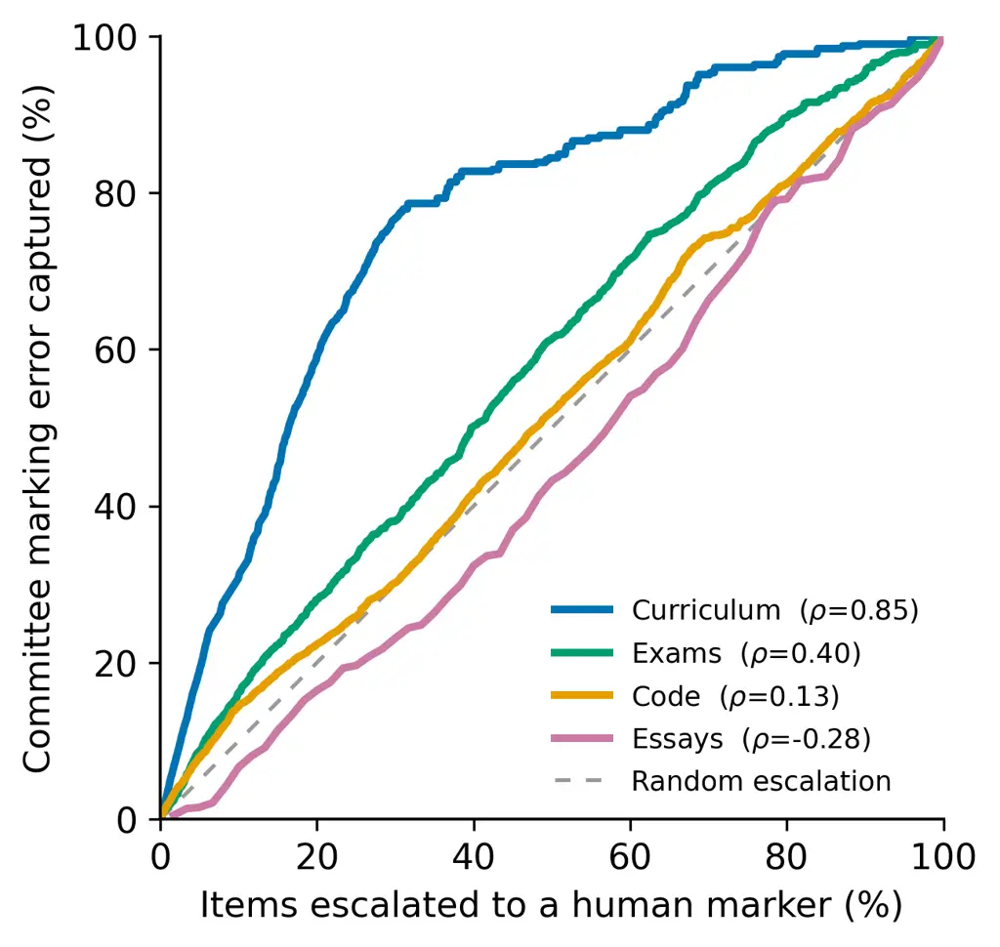

Figure 18: Disagreement-triggered escalation. For each task family,
items are ranked by committee disagreement (standard deviation of the
individual model marks as a fraction of available marks) and escalated
from most- to least-disagreed; the curve shows the fraction of total
committee absolute error contained in the escalated items, assuming
those items are then marked correctly by the human. The diagonal is the
expectation under random escalation, and $`\rho`$ is the Spearman
correlation between committee disagreement and committee error.
Curriculum and exam references are per question; the code reference is
per sub-assignment (three image-capable models, human majority vote of
three markers); essays use the aggregated human total. The exam
reference is a single marker, which attenuates the achievable
correlation.

This safeguard is not uniform across task types (FIG. 18). Its
effectiveness tracks whether disagreement implies error (rather than how
reliably a task can be marked) which holds only where an item has a
unique verifiable target. When models disagree on a curriculum question
scored against a single correct answer, at least one of them is simply
wrong. As marking becomes graded or holistic the link weakens - exams
$`\rho=0.40`$, code $`\rho=0.13`$, essays $`\rho=-0.28`$ - until
disagreement carries essentially no information about error. The code
plotting task is the clearest illustration as it is the most reliably
marked task in this study (human-human $`\rho\approx 0.8`$ at the
sub-item level, committee fractional MAE $`0.16`$ per individual plot),
yet escalation by disagreement performs no better than random, because
its residual errors are small band-level differences rather than the
items on which the models happen to diverge. For essays the curve falls
below the random baseline, since with no stable reference model spread
reflects diffuse central-tendency scoring rather than any recoverable
error. Disagreement-triggered escalation is thus a cheap and effective
human-in-the-loop mechanism for unique-target structured marking, but
for graded or holistic tasks a fixed escalation budget gains little over
random sampling, and human oversight must instead take the form of full
marking or post-hoc moderation.

Finally, the practical deployment of LLM-as-a-judge marking requires
consideration of inference costs, which vary considerably across
providers. In the context of automated marking, a model typically
generates only a few output tokens (a numerical score in a JSON object),
meaning that the financial cost of the task is overwhelmingly driven by
the input token volume. At the time of this study, API pricing for
flagship models was roughly an order of magnitude higher per million
input tokens than for alternative models, with input costs for Claude
Opus 4.5 (\$5.00), GPT-5.2 (\$2.50), and Gemini 3 Pro (\$2.00)
significantly outpacing those of DeepSeek-V3.2 (\$0.28) and Grok 4.1
(\$0.20). Given that the technical integration and inference speeds are
broadly comparable across these platforms, institutions considering
large-scale deployment must weigh these substantial cost differentials
against performance and reliability, alongside relevant data security
and privacy constraints.

### VI.7 OCR and multimodal constraints

While our evaluation provides a robust baseline for digital inputs,
authentic physics assessments predominantly comprise handwritten
derivations and spatial diagrams. Existing approaches - whether
pipelined OCR-to-LaTeX or end-to-end vision-language models - show
persistent performance gaps on handwritten mathematical input relative
to digital text \[21, 26, 31, 2\], and the broader role of multimodal
LLMs in science education remains under active development \[3\].

Our finding that LLMs achieve high rank-order agreement ($`\rho>0.83`$)
on scientific plots must therefore be interpreted alongside the broader
literature on multimodal physics reasoning. Evaluating the structural
and presentational quality of a generated plot on a fixed 0–5 descriptor
scale - with access to the notebook context preceding the plot - is a
relatively constrained task; direct semantic interpretation of complex
visual physics data is not. Polverini and Gregorčič demonstrate that
large multimodal models frequently fail to extract accurate information
from kinematics graphs, and further evaluations on electromagnetism
assessments reveal persistent difficulties with spatial reasoning \[37,
39\]. This distinction between reliable contextual scale-based judgement
and unreliable perceptual inference delineates where current models can
and cannot yet be trusted. Until the visual encoders of multimodal
models achieve greater perceptual robustness, deployment of AI grading
for handwritten and visually complex physics submissions requires
psychometrically calibrated, human-in-the-loop frameworks in which
low-confidence interpretations automatically trigger human
review \[19\].

### VI.8 Limitations and future work

Several limitations should be noted. The structured-question datasets
and the essay/plot datasets differ not only in task format but also in
authorship composition and marking context, so the paper identifies
robust cross-task contrasts without claiming that task format is the
sole determinant of performance. The scientific plot results should be
interpreted narrowly; they concern contextualised Jupyter notebook-based
plot evaluation, not handwriting, arbitrary diagram interpretation, or
general multimodal physics reasoning. And the essay dataset itself
demonstrates that some assessment formats may be too psychometrically
noisy to support strong claims about fine-grained ranking, whether by
humans or by AI.

All main experiments were performed at temperature 0 to minimise
stochastic variation and isolate systematic differences between tasks
and prompting conditions. It remains possible that modest increases in
temperature would alter score variance or anchoring behaviour for
particular models, however preliminary work in Appendix C suggests
altering temperature does not significantly affect model behaviour.
Further, given the scale of the differences observed between task types
and prompt conditions, decoding settings are unlikely to overturn the
central conclusion that LLM-as-a-judge marking is strongly
task-dependent across the settings studied.

## VII Conclusion

This study evaluated LLM-as-a-judge marking validity across three
qualitatively different physics assessment formats: structured
questions, short-form essays, and scientific plots. The results show
that automated marking performance is strongly task-dependent. For
structured questions and scale-guided plot evaluation, models achieve
moderate absolute accuracy and strong rank-order agreement, often
approaching the range of human–human disagreement. In contrast, essay
marking exhibits fundamentally different behaviour: while anchored
exemplars can improve distributional alignment and reduce mean absolute
error, rank-order agreement remains indistinguishable from zero across
all conditions, including under strong anchoring.

Across all three task types, LLM-as-a-judge validity is strongly
task-dependent across the models tested. Where grading criteria can be
explicitly linked to observable features of a response, LLMs can
reproduce human-like ranking behaviour even under blinded conditions.
Where assessment depends on holistic judgement and human raters
themselves exhibit low reliability, agreement with human score
distributions can be manufactured without meaningful discrimination
between stronger and weaker work.

For educational practice, this implies that the key question is not
simply whether LLM outputs appear reasonable on average, but whether the
underlying assessment task admits a stable and interpretable marking
process.

In low-mark tasks with clearly identifiable scoring criteria, LLMs may
plausibly support assistive roles such as preliminary marking,
moderation, anomaly detection, or feedback generation. However, when
human markers themselves fail to agree, automated scores should be
interpreted cautiously and treated as descriptive aids rather than
authoritative judgements. Future work should extend these findings to
handwritten physics solutions and more complex multimodal assessments,
where OCR errors and visual reasoning limitations may further constrain
the reliability of automated marking systems.

## VIII Acknowledgement

This project received ethical approval from the Durham University
physics ethics committee ref: EDU-2023-03-14T14_02_18-hvxg44.

## References

- \[1\] 081 (Ed.) (1) 1. External Links:
  [Document](https://dx.doi.org/1) Cited by: Appendix D.
- \[2\] S. Baral, L. Lucy, R. Knight, A. Ng, L. Soldaini, N. Heffernan,
  and K. Lo (2025) DrawEduMath: evaluating vision language models with
  expert-annotated students’ hand-drawn math images. In Proceedings of
  the 2025 Conference of the Nations of the Americas Chapter of the
  Association for Computational Linguistics: Human Language Technologies
  (Volume 1: Long Papers), Albuquerque, New Mexico, pp. 6902–6920.
  External Links:
  [Document](https://dx.doi.org/10.18653/v1/2025.naacl-long.352) Cited
  by: §VI.7.
- \[3\] A. Bewersdorff, C. Hartmann, M. Hornberger, K. Seßler, M.
  Bannert, E. Kasneci, and C. Nerdel (2025) Taking the next step with
  generative artificial intelligence: the transformative role of
  multimodal large language models in science education. Learning and
  Individual Differences 118, pp. 102601. External Links:
  [Document](https://dx.doi.org/10.1016/j.lindif.2024.102601) Cited by:
  §VI.7.
- \[4\] Z. Chen and T. Wan (2024) Using large language models to assign
  partial credit to students’ explanations of problem-solving process:
  grade at human level accuracy with grading confidence index and
  personalized student-facing feedback. External Links: 2412.06910,
  [Link](https://arxiv.org/abs/2412.06910) Cited by: §I.
- \[5\] J. Cohen (1968) Weighted kappa: nominal scale agreement with
  provision for scaled disagreement or partial credit. Psychological
  Bulletin 70 (4), pp. 213–220. External Links:
  [Document](https://dx.doi.org/10.1037/h0026256) Cited by: §III.2.
- \[6\] J. L. Docktor, J. Dornfeld, E. Frodermann, K. Heller, L.
  Hsu, K. A. Jackson, A. Mason, Q. X. Ryan, and J. Yang (2016) Assessing
  student written problem solutions: a problem-solving rubric with
  application to introductory physics. Physical Review Physics Education
  Research 12 (1), pp. 010130. External Links:
  [Document](https://dx.doi.org/10.1103/PhysRevPhysEducRes.12.010130)
  Cited by: §II.1, §III.3, §IV.1.1.
- \[7\] European Union (2024) Regulation (EU) 2024/1689 of the european
  parliament and of the council of 13 june 2024 laying down harmonised
  rules on artificial intelligence (artificial intelligence act).
  External Links:
  [Link](https://eur-lex.europa.eu/legal-content/EN/TXT/?uri=CELEX:32024R1689)
  Cited by: §I.
- \[8\] J. Flodén (2025) Grading exams using large language models: a
  comparison between human and AI grading of exams in higher education
  using ChatGPT. British Educational Research Journal 51 (1),
  pp. 201–224. External Links:
  [Document](https://dx.doi.org/10.1002/berj.4069) Cited by: §I,
  §IV.2.2.
- \[9\] R. K. Fussell, E. M. Stump, and N. G. Holmes (2024) Drawing
  trustworthy claims from machine coding of qualitative data. Physical
  Review Physics Education Research 20, pp. 010113. External Links:
  [Document](https://dx.doi.org/10.1103/PhysRevPhysEducRes.20.010113)
  Cited by: §I.
- \[10\] M. Á. González Maestre, J. Cubero Juánez, A. de la Hoz Serrano,
  and L. Melo (2026) An interpretable and reproducibility-focused
  evaluation pipeline for automatic short-answer grading in low-resource
  mathematics and science educational datasets. Computers 15 (5),
  pp. 320. External Links:
  [Document](https://dx.doi.org/10.3390/computers15050320) Cited by:
  §II.2.
- \[11\] J. Gu, X. Jiang, Z. Shi, H. Tan, X. Zhai, C. Xu, W. Li, Y.
  Shen, S. Ma, H. Liu, S. Wang, K. Zhang, Z. Lin, B. Zhang, L. Ni, W.
  Gao, Y. Wang, and J. Guo (2026) A survey on llm-as-a-judge. The
  Innovation, pp. 101253. External Links: ISSN 2666-6758,
  [Document](https://dx.doi.org/10.1016/j.xinn.2025.101253) Cited by:
  §I, §I, §II.3.
- \[12\] C. Guo, G. Pleiss, Y. Sun, and K. Q. Weinberger (2017) On
  calibration of modern neural networks. In Proceedings of the 34th
  International Conference on Machine Learning (ICML), Proceedings of
  Machine Learning Research, Vol. 70. External Links:
  [Link](https://proceedings.mlr.press/v70/guo17a.html) Cited by:
  §III.2.
- \[13\] W. Holmes, K. Porayska-Pomsta, K. Holstein, E. Sutherland, T.
  Baker, S. Buckingham Shum, O. C. Santos, M. T. Rodrigo, M.
  Cukurova, I. I. Bittencourt, and K. R. Koedinger (2022) Ethics of AI
  in education: towards a community-wide framework. International
  Journal of Artificial Intelligence in Education 32 (3), pp. 504–526.
  External Links:
  [Document](https://dx.doi.org/10.1007/s40593-021-00239-1) Cited by:
  §VI.6.
- \[14\] F. Kieser, P. Tschisgale, S. Rauh, X. Bai, H. Maus, S.
  Petersen, M. Stede, K. Neumann, and P. Wulff (2024) David vs. Goliath:
  comparing conventional machine learning and a large language model for
  assessing students’ concept use in a physics problem. Frontiers in
  Artificial Intelligence 7, pp. 1408817. External Links:
  [Document](https://dx.doi.org/10.3389/frai.2024.1408817) Cited by: §I,
  §II.2.
- \[15\] F. Kieser, P. Wulff, J. Kuhn, and S. Küchemann (2023)
  Educational data augmentation in physics education research using
  ChatGPT. Physical Review Physics Education Research 19 (2),
  pp. 020150. External Links:
  [Document](https://dx.doi.org/10.1103/PhysRevPhysEducRes.19.020150)
  Cited by: §VI.6.
- \[16\] Y. Kim, R. Mozer, M. Aladeimi, and L. Miratrix (2025) ChatGPT
  vs. machine learning: assessing the efficacy and accuracy of large
  language models for automated essay scoring. Technical report
  Technical Report 25-1335, Annenberg Institute at Brown University
  (EdWorkingPapers). External Links:
  [Link](https://edworkingpapers.com/ai25-1335) Cited by: §II.3.
- \[17\] G. Kortemeyer, M. Babayeva, G. Polverini, R. Widenhorn, and B.
  Gregorcic (2025) Multilingual performance of a multimodal artificial
  intelligence system on multisubject physics concept inventories.
  Physical Review Physics Education Research 21 (2), pp. 020101.
  External Links:
  [Document](https://dx.doi.org/10.1103/PhysRevPhysEducRes.21.020101)
  Cited by: §I.
- \[18\] G. Kortemeyer, J. Nöhl, and D. Onishchuk (2024) Grading
  assistance for a handwritten thermodynamics exam using artificial
  intelligence: an exploratory study. Physical Review Physics Education
  Research 20 (2), pp. 020144. External Links:
  [Document](https://dx.doi.org/10.1103/PhysRevPhysEducRes.20.020144)
  Cited by: §I, §II.3.
- \[19\] G. Kortemeyer and J. Nöhl (2024) Assessing confidence in
  AI-assisted grading of physics exams through psychometrics: an
  exploratory study. External Links: 2410.19409,
  [Link](https://arxiv.org/abs/2410.19409) Cited by: §I, §II.1, §IV.3,
  §VI.7.
- \[20\] G. Kortemeyer (2023) Could an artificial-intelligence agent
  pass an introductory physics course?. Physical Review Physics
  Education Research 19 (1), pp. 010132. External Links:
  [Document](https://dx.doi.org/10.1103/PhysRevPhysEducRes.19.010132)
  Cited by: §I.
- \[21\] G. Kortemeyer (2023) Toward AI grading of student problem
  solutions in introductory physics: a feasibility study. Physical
  Review Physics Education Research 19 (2), pp. 020163. External Links:
  [Document](https://dx.doi.org/10.1103/PhysRevPhysEducRes.19.020163)
  Cited by: §I, §IV.1.1, §VI.7.
- \[22\] M. Kubsch, M. Kastaun, P. Wulff, N. Graulich, M. Ariely, B.
  Gregorcic, et al. (2025) Report on the scoping workshop on AI in
  science education research 2025. External Links: 2511.14318 Cited by:
  §VI.6.
- \[23\] G. Lee, E. Latif, X. Wu, N. Liu, and X. Zhai (2024) Applying
  large language models and chain-of-thought for automatic scoring.
  Computers and Education: Artificial Intelligence 6, pp. 100213.
  External Links:
  [Document](https://dx.doi.org/10.1016/j.caeai.2024.100213) Cited by:
  §III.7.
- \[24\] G. Lee and X. Zhai (2026) NERIF: GPT-4V for automatic scoring
  of drawn models. Journal of Science Education and Technology 35,
  pp. 497–514. External Links:
  [Document](https://dx.doi.org/10.1007/s10956-025-10262-9) Cited by:
  §IV.3.
- \[25\] S. Li and V. Ng (2024) Automated essay scoring: a reflection on
  the state of the art. In Proceedings of the 2024 Conference on
  Empirical Methods in Natural Language Processing (EMNLP),
  pp. 17876–17888. External Links:
  [Document](https://dx.doi.org/10.18653/v1/2024.emnlp-main.991) Cited
  by: §IV.2.2, §VI.3.
- \[26\] T. Liu, J. Chatain, L. Kobel-Keller, G. Kortemeyer, T.
  Willwacher, and M. Sachan (2024) AI-assisted automated short answer
  grading of handwritten university level mathematics exams. External
  Links: 2408.11728 Cited by: §VI.7.
- \[27\] Y. Liu, D. Iter, Y. Xu, S. Wang, R. Xu, and C. Zhu (2023)
  G-Eval: NLG evaluation using GPT-4 with better human alignment. In
  Proceedings of the 2023 Conference on Empirical Methods in Natural
  Language Processing (EMNLP), pp. 2511–2522. External Links:
  [Document](https://dx.doi.org/10.18653/v1/2023.emnlp-main.153) Cited
  by: §III.7.
- \[28\] J. Lou and Y. Sun (2026) Anchoring bias in large language
  models: an experimental study. Journal of Computational Social Science
  9 (1), pp. 11. External Links:
  [Document](https://dx.doi.org/10.1007/s42001-025-00435-2) Cited by:
  §I, §II.3, §IV.1.2.
- \[29\] E. Marshman and C. Singh (2017) Contrasting grading approaches
  in introductory physics and quantum mechanics: the case of graduate
  teaching assistants. Physical Review Physics Education Research 13
  (1), pp. 010120. External Links:
  [Document](https://dx.doi.org/10.1103/PhysRevPhysEducRes.13.010120)
  Cited by: §I, §II.1, §III.3.
- \[30\] S. Messick (1995) Validity of psychological assessment:
  validation of inferences from persons’ responses and performances as
  scientific inquiry into score meaning. American Psychologist 50 (9),
  pp. 741–749. External Links:
  [Document](https://dx.doi.org/10.1037/0003-066X.50.9.741) Cited by:
  §I, §II.3, §II.4, §III.2.
- \[31\] O. Nath, H. Bathina, M. S. U. R. Khan, and M. M. Khapra (2025)
  Can vision-language models evaluate handwritten math?. In Proceedings
  of the 63rd Annual Meeting of the Association for Computational
  Linguistics (Volume 1: Long Papers), Vienna, Austria, pp. 14784–14814.
  External Links:
  [Document](https://dx.doi.org/10.18653/v1/2025.acl-long.720) Cited by:
  §VI.7.
- \[32\] J. K. Nguyen (2024) Human bias in AI models? anchoring effects
  and mitigation strategies in large language models. Journal of
  Behavioral and Experimental Finance 43, pp. 100971. External Links:
  [Document](https://dx.doi.org/10.1016/j.jbef.2024.100971) Cited by:
  §IV.1.2.
- \[33\] T. O. B. Odden, H. Tyseng, J. T. Mjaaland, M. F. Kreutzer,
  and A. Malthe-Sørenssen (2024) Using text embeddings for deductive
  qualitative research at scale in physics education. Physical Review
  Physics Education Research 20 (2), pp. 020151. External Links:
  [Document](https://dx.doi.org/10.1103/PhysRevPhysEducRes.20.020151)
  Cited by: §I, §II.2.
- \[34\] Ofqual (2024) Principles for the use of artificial intelligence
  in marking. External Links:
  [Link](https://www.gov.uk/government/publications/principles-for-the-use-of-artificial-intelligence-in-marking)
  Cited by: §I.
- \[35\] A. Pack, A. Barrett, and J. Escalante (2024) Large language
  models and automated essay scoring of english language learner
  writing: insights into validity and reliability. Computers and
  Education: Artificial Intelligence 6, pp. 100234. External Links:
  [Document](https://dx.doi.org/10.1016/j.caeai.2024.100234) Cited by:
  §I, §II.3, §IV.2.2, §VI.3.
- \[36\] A. Panickssery, S. R. Bowman, and S. Feng (2024) LLM evaluators
  recognize and favor their own generations. External Links: 2404.13076
  Cited by: §IV.4.
- \[37\] G. Polverini and B. Gregorcic (2024) Evaluating vision-capable
  chatbots in interpreting kinematics graphs: a comparative study of
  free and subscription-based models. Frontiers in Education 9,
  pp. 1452414. External Links:
  [Document](https://dx.doi.org/10.3389/feduc.2024.1452414) Cited by:
  §VI.7.
- \[38\] G. Polverini and B. Gregorcic (2024) How understanding large
  language models can inform the use of ChatGPT in physics education.
  European Journal of Physics 45 (2), pp. 025701. External Links:
  [Document](https://dx.doi.org/10.1088/1361-6404/ad1420) Cited by:
  §VI.4.
- \[39\] G. Polverini, J. Melin, E. Önerud, and B. Gregorcic (2025)
  Performance of chatgpt on tasks involving physics visual
  representations: the case of the brief electricity and magnetism
  assessment. Physical Review Physics Education Research 21, pp. 010100.
  External Links:
  [Document](https://dx.doi.org/10.1103/PhysRevPhysEducRes.21.010154)
  Cited by: §VI.7.
- \[40\] S. Shankar, J.D. Zamfirescu-Pereira, B. Hartmann, A. G.
  Parameswaran, and I. Arawjo (2024) Who validates the validators?
  aligning LLM-assisted evaluation of LLM outputs with human
  preferences. External Links: 2404.12272,
  [Link](https://arxiv.org/abs/2404.12272) Cited by: §I, §II.3, §III.2.
- \[41\] N. Thakkar, M. Yuksekgonul, J. Silberg, A. Garg, N. Peng, F.
  Sha, R. Yu, C. Vondrick, and J. Zou (2026) A large-scale randomized
  study of large language model feedback in peer review. Nature Machine
  Intelligence 8, pp. 326–336. External Links:
  [Document](https://dx.doi.org/10.1038/s42256-026-01188-x) Cited by:
  §I.
- \[42\] P. Tschisgale, H. Maus, F. Kieser, B. Kroehs, S. Petersen,
  and P. Wulff (2025) Evaluating GPT- and reasoning-based large language
  models on Physics Olympiad problems: surpassing human performance and
  implications for educational assessment. Physical Review Physics
  Education Research 21 (2), pp. 020115. External Links:
  [Document](https://dx.doi.org/10.1103/6fmx-bsnl) Cited by: §I.
- \[43\] P. Tschisgale, P. Wulff, and M. Kubsch (2023) Integrating
  artificial intelligence-based methods into qualitative research in
  physics education research: a case for computational grounded theory.
  Physical Review Physics Education Research 19 (2), pp. 020123.
  External Links:
  [Document](https://dx.doi.org/10.1103/PhysRevPhysEducRes.19.020123)
  Cited by: §I.
- \[44\] P. Verga, S. Hofstatter, S. Althammer, Y. Su, A. Piktus, A.
  Arkhangorodsky, M. Xu, N. White, and P. Lewis (2024) Replacing judges
  with juries: evaluating LLM generations with a panel of diverse
  models. External Links: 2404.18796 Cited by: §III.1, §III.2, §VI.2.
- \[45\] C. Walsh, S. Suresh, and R. Ivan (2026) Best of both worlds:
  combining LLMs and traditional ML for automated scoring of an
  open-response situational judgment test. Frontiers in Education 11,
  pp. 1756673. External Links:
  [Document](https://dx.doi.org/10.3389/feduc.2026.1756673) Cited by:
  §II.3.
- \[46\] T. Wan and Z. Chen (2024) Exploring generative AI assisted
  feedback writing for students’ written responses to a physics
  conceptual question with prompt engineering and few-shot learning.
  Physical Review Physics Education Research 20, pp. 010152. External
  Links:
  [Document](https://dx.doi.org/10.1103/PhysRevPhysEducRes.20.010152)
  Cited by: §VI.4.
- \[47\] J. Wei, X. Wang, D. Schuurmans, M. Bosma, F. Xia, E. Chi, Q. V.
  Le, D. Zhou, et al. (2022) Chain-of-thought prompting elicits
  reasoning in large language models. In Advances in neural information
  processing systems, Vol. 35, pp. 24824–24837. External Links:
  [Document](https://dx.doi.org/10.48550/arXiv.2201.11903) Cited by:
  §III.7.
- \[48\] Y. Wei, R. Zhang, J. Zhang, D. Qi, and W. Cui (2025) Research
  on intelligent grading of physics problems based on large language
  models. Education Sciences 15 (2), pp. 116. External Links:
  [Document](https://dx.doi.org/10.3390/educsci15020116) Cited by:
  §II.3.
- \[49\] J. Wilson, B. Pollard, J. M. Aiken, M. D. Caballero, and H. J.
  Lewandowski (2022) Classification of open-ended responses to a
  research-based assessment using natural language processing. Physical
  Review Physics Education Research 18, pp. 010141. External Links:
  [Document](https://dx.doi.org/10.1103/PhysRevPhysEducRes.18.010141)
  Cited by: §I, §II.2.
- \[50\] C. Wu, Y. Ge, Q. Guo, J. Wang, Z. Liang, Z. Lu, Y. Shan, and P.
  Luo (2025) Plot2Code: a comprehensive benchmark for evaluating
  multi-modal large language models in code generation from scientific
  plots. In Findings of the Association for Computational Linguistics:
  NAACL 2025, pp. 3006–3028. External Links:
  [Document](https://dx.doi.org/10.18653/v1/2025.findings-naacl.164)
  Cited by: §IV.3.
- \[51\] P. Wulff (2024) Physics language and language use in
  physics—what do we know and how AI might enhance language-related
  research and instruction. European Journal of Physics 45 (2),
  pp. 023001. External Links:
  [Document](https://dx.doi.org/10.1088/1361-6404/ad0f9c) Cited by:
  §VI.4.
- \[52\] F. Yavuz et al. (2025) Utilizing large language models for EFL
  essay grading: an examination of reliability and validity in
  rubric-based assessments. British Journal of Educational Technology 56
  (1), pp. 150–166. External Links:
  [Document](https://dx.doi.org/10.1111/bjet.13494) Cited by: §IV.2.2.
- \[53\] W. Yeadon, E. Agra, O. Inyang, P. Mackay, and A. Mizouri (2024)
  Evaluating ai and human authorship quality in academic writing through
  physics essays. European Journal of Physics 45 (5), pp. 055703.
  External Links:
  [Document](https://dx.doi.org/10.1088/1361-6404/ad669d) Cited by:
  §III.1.
- \[54\] W. Yeadon and T. Hardy (2024) The impact of ai in physics
  education: a comprehensive review from gcse to university levels.
  Physics Education 59 (2), pp. 025010. External Links:
  [Document](https://dx.doi.org/10.1088/1361-6552/ad1fa2) Cited by:
  §III.1, §III.3.
- \[55\] W. Yeadon, S. Juárez, P. Mackay, T. Dowling, E. Agra, O.
  Inyang, A. Mizouri, and C. P. Testrow (2026) The answer is not the
  argument. arXiv preprint arXiv:2609.00264. External Links:
  [Link](https://arxiv.org/abs/2609.00264) Cited by: §I.
- \[56\] W. Yeadon, A. Peach, and C. Testrow (2024) A comparison of
  human, gpt-3.5, and gpt-4 performance in a university-level coding
  course. Scientific Reports 14 (1), pp. 23285. External Links:
  [Document](https://dx.doi.org/10.6084/m9.figshare.25673799) Cited by:
  Appendix A, §III.1, §III.6, §IV.3.
- \[57\] X. Zhai, P. He, and J. Krajcik (2022) Applying machine learning
  to automatically assess scientific models. Journal of Research in
  Science Teaching 59 (10), pp. 1765–1794. External Links:
  [Document](https://dx.doi.org/10.1002/tea.21773) Cited by: §IV.1.1,
  §VI.1.
- \[58\] L. Zheng, W. Chiang, Y. Sheng, S. Zhuang, Z. Wu, Y. Zhuang, Z.
  Lin, Z. Li, D. Li, E. P. Xing, H. Zhang, J. E. Gonzalez, and I.
  Stoica (2023) Judging LLM-as-a-judge with MT-bench and chatbot arena.
  External Links: 2306.05685,
  [Document](https://dx.doi.org/10.48550/arXiv.2306.05685),
  [Link](https://arxiv.org/abs/2306.05685) Cited by: §I, §IV.1.2.

## Appendix A Examples of AI scientific plots

Examples of scientific plots produced by GPT-4 with prompt engineering,
the highest average AI scoring group (FIG. 19) and GPT-3.5 without
prompt engineering, the lowest average AI scoring group (FIG. 20) are
shown below. These plots were produced for a laboratory task requiring
the student to visually demonstrate the independence of integration
error scaling from dimension versus the number of points used for Monte
Carlo integration of an $`n`$-dimensional unit ball. Further details
regarding the plotting tasks and generative methodologies are given
in \[56\].

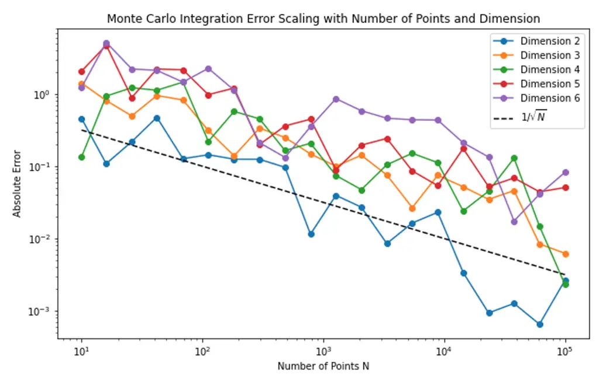

Figure 19: Plot produced by GPT-4 with prompt engineering, demonstrating
the error scaling for Monte Carlo integration of an $`n`$-dimensional
unit ball.

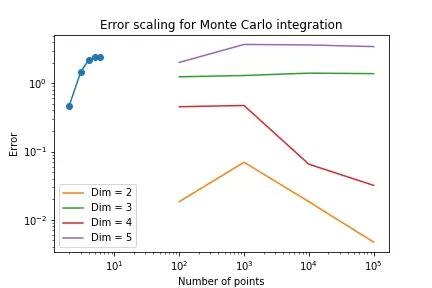

Figure 20: Plot produced by GPT-3.5 without prompt engineering,
attempting to demonstrate the error scaling for Monte Carlo integration
of an $`n`$-dimensional unit ball.

## Appendix B Sensitivity to reasoning and Chain of Thought

To assess whether the marking conclusions depend on the use of
intermediate reasoning, we ran the DeepSeek-V3.2 marking pipeline under
two additional configurations on the curriculum dataset ($`n=1151`$)
across all three structured-question conditions:

1.  1.  Explicit Chain of Thought. DeepSeek-V3.2 was instructed to reason
        step by step before returning its JSON mark, at temperature $`0`$.
2.  2.  Native reasoner. The DeepSeek-Reasoner model, which generates
        internal reasoning tokens prior to the final output, was given the
        same direct-output prompts as the baseline (no explicit Chain of
        Thought instruction). The reasoner model does not accept a
        temperature parameter.

As shown in FIG. 21, explicit Chain of Thought prompting reduced fMAE
relative to the direct-output baseline across all three conditions
(blind: $`0.185\to 0.108`$; solution: $`0.112\to 0.066`$; false
solution: $`0.369\to 0.253`$). The improvement is largest in the blind
condition ($`\approx 42\%`$ reduction), consistent with the
interpretation that step-by-step reasoning helps the model catch
numerical errors it would otherwise overlook under direct-output
prompting.

The DeepSeek-Reasoner model presents a contrasting pattern. Under blind
marking it slightly outperforms the Chain of Thought result (fMAE
$`=0.103`$ vs. $`0.108`$), but under the solution condition it performs
worse than the direct-output baseline ($`0.125`$ vs. $`0.112`$), and
under the false solution condition it produces the highest fMAE of any
configuration ($`0.391`$ vs. $`0.369`$ baseline). One possible
interpretation is that the reasoner’s extended internal reasoning causes
it to engage more deeply with the provided reference material,
amplifying rather than mitigating the anchoring effect. Where explicit
Chain of Thought operates as a pre-output verification step that can
surface discrepancies between the inputted answer-attempt and the
model’s own physics knowledge, the reasoner’s native reasoning tokens
may instead elaborate on the comparison to the supplied solution,
reinforcing deference to the reference regardless of its correctness.
This reading is consistent with the main-text finding that supplying a
reference shifts the model from independent evaluation toward deference,
and suggests that more reasoning does not by itself protect against that
shift.

Critically, both configurations preserve the ordering of conditions
established in the main text: providing a correct solution improves
absolute accuracy relative to blind marking, and providing a false
solution degrades it. The reasoner shows no clear overall benefit over
the baseline. We therefore conclude that the central finding - that
marking behaviour differs substantially by assessment task and by the
quality of the supplied reference material - is robust to the prompting
strategies tested here.

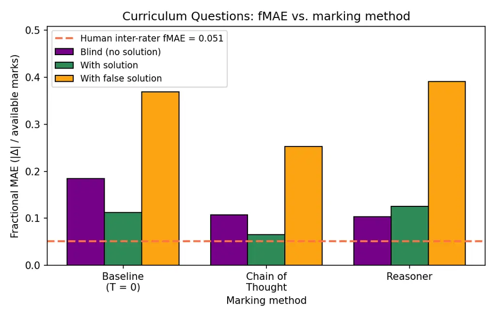

Figure 21: Fractional MAE for blind, solution-informed, and false
solution marking conditions across three marking methods: baseline
($`T=0`$), explicit Chain of Thought prompting, and the
DeepSeek-Reasoner model. The dashed line shows human inter-rater fMAE
($`0.051`$) for reference.

## Appendix C Decoding temperature and marking reliability

The main analysis uses temperature $`T=0`$ throughout. Because hosted
models are not guaranteed to be deterministic at $`T=0`$ as batched
inference and mixture-of-experts routing can introduce run-to-run
variation we measured marking reliability directly rather than assuming
it. We thus separate two questions: whether sampling temperature adds
variance and whether marking is reproducible at fixed $`T=0`$ across
repeated runs using the curriculum and essay settings with the
DeepSeek-V3.2 model.

### C.1 Sensitivity to sampling temperature

We ran the DeepSeek-V3.2 marking pipeline at $`T=0.4`$ and $`T=0.8`$
with five repeated runs each, comparing mean fMAE against the $`T=0`$
baseline used in Section IV.1 across all three structured-question
conditions on the curriculum dataset ($`n=1151`$). As shown in FIG. 22,
fMAE was stable across temperatures in all conditions: blind marking
ranged from $`0.185`$ to $`0.197`$, solution-informed marking from
$`0.110`$ to $`0.112`$, and false-solution marking from $`0.358`$ to
$`0.369`$. Sampling temperature is therefore not a meaningful source of
variance for structured-question marking.

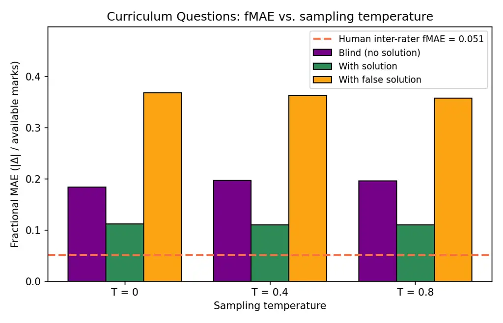

Figure 22: Curriculum questions: fractional MAE for blind,
solution-informed, and false-solution marking was stable across sampling
temperatures $`T=0`$, $`0.4`$, and $`0.8`$. Blind marking ranged from
0.185 to 0.197, solution-informed marking from 0.110 to 0.112, and
false-solution marking from 0.358 to 0.369. The dashed line shows human
inter-rater fMAE ($`0.051`$) for reference. Results are means over five
runs for $`T>0`$.

### C.2 Reproducibility at fixed $`T=0`$

Temperature stability does not by itself establish that repeated $`T=0`$
runs are identical as the exact decoding setup from a hosted model can
change between providers. We therefore examined run-to-run agreement
directly with five repeated $`T=0`$ runs on the curriculum questions
($`n=1151`$). Marking is near-deterministic but not perfectly so:
$`89.4\%`$ (blind), $`93.4\%`$ (solution), and $`89.5\%`$ (false
solution) of items received an identical mark on every one of the five
runs. Crucially, the residual variation is small and structured rather
than random: among non-identical items the mark differed by a single
point in the large majority of cases (e.g. $`100/123`$ non-identical
blind items), and the rare larger deviations concentrate on higher-mark,
multi-step questions (items varying by $`\geq 2`$ marks carry $`2.7`$
available marks on average, versus $`1.5`$ across all items), where
partial-credit allocation is itself a finer-grained judgement. The
single-mark, multi-step locus of the residual variance is consistent
with the five-run data at $`T=0.4`$ and $`T=0.8`$, where $`91`$–$`97\%`$
of items were likewise identical across runs (mean per-item standard
deviation $`0.015`$–$`0.052`$ marks).

Essay marking behaves very differently. Repeating the $`T=0`$ essay
pipeline showed that script-level marks are _not_ reproducible: across
six $`T=0`$ runs, no script ($`0/60`$) received an identical total on
every run, with a mean script-total standard deviation of $`\approx 3`$
marks out of $`100`$ (blind $`3.4`$, scheme $`3.0`$) and individual
scripts varying by up to $`15`$ marks. At the level of individual essays
($`/20`$), only $`\approx 10\%`$ of marks were identical across runs.

This run-to-run instability is intrinsic to the model rather than an
artefact of the serving provider. When repeating the runs three times
across two independent inference providers, the two providers ranked
essays near-identically (Spearman $`\rho=0.93`$) and differed in mean
mark by only $`\approx 2`$ marks, so the $`\approx 3`$-mark
within-script variation cannot be attributed to provider switching. This
shows that DeepSeek-V3.2 is far more self-consistent than it is aligned
with the human essay ranking. Across runs, the model reproduces its own
essay ranking at $`\rho\approx 0.85`$ while agreeing with the human
ranking at only $`\rho\approx 0.1`$ (Table 4). The instability therefore
does not explain the absence of rank-order validity - the model
reproduces a stable ordering that simply does not match the human one.
Further, reproducibility itself tracks the structure of the task as
marking is near-deterministic in the curriculum set ($`89`$–$`94\%`$ of
marks identical across runs, with residual disagreements almost entirely
of a single mark on multi-step items) and strongly non-deterministic in
essays ($`0\%`$ of scripts identical, mean script-total standard
deviation $`\approx 3`$ marks). The rank-order conclusions in the main
text are unaffected, as essay $`\rho`$ remains near zero on every
individual run (range $`[-0.07,0.26]`$ across all six runs; Table 4);
but the result shows that the assumption of $`T=0`$ determinism, while
safe for structured questions, does not hold for holistic marking.

| Condition | $`\rho`$ vs. human (range) | mean $`\rho`$ vs. human | self-consistency $`\rho`$ |
| --------- | -------------------------- | ----------------------- | ------------------------- |
| Blind     | $`[0.07,\ 0.26]`$          | $`0.15`$                | $`0.82`$                  |
| Scheme    | $`[-0.07,\ 0.06]`$         | $`-0.03`$               | $`0.85`$                  |

Table 4: Essay marking reliability and validity across six repeated
$`T=0`$ runs (DeepSeek-V3.2, $`n=60`$ scripts; runs 1–3 and 4–6 served
by two independent inference providers). Rank-order agreement with the
human reference (Spearman $`\rho`$) stays near zero on every run, while
the model reproduces its own ranking across runs (self-consistency) far
more strongly – the marking is internally stable but shows weak
agreement with the human ranking.

## Appendix D Prompts used

Figure 23: Prompt template used for structured-question blind marking.

Figure 24: Prompt template used for structured-question marking with a
supplied solution used for both the correct solution and the false
solution cases.

Figure 25: Prompt template used for blind essay marking.

Figure 26: Prompt template used for essay marking with the
scheme/guidance text.

Figure 27: Prompt template used for essay marking with scheme plus
anchored calibration exemplars.

Figure 28: Prompt template used for marking of scientific plots on the
0–5 descriptor scale.

1
