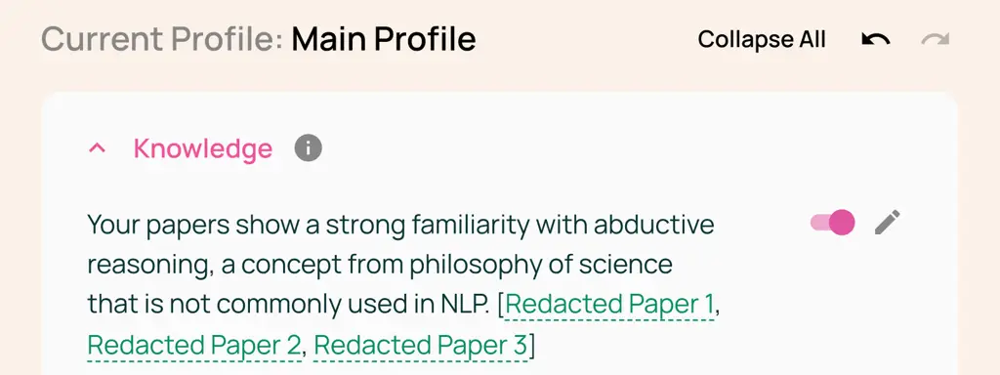
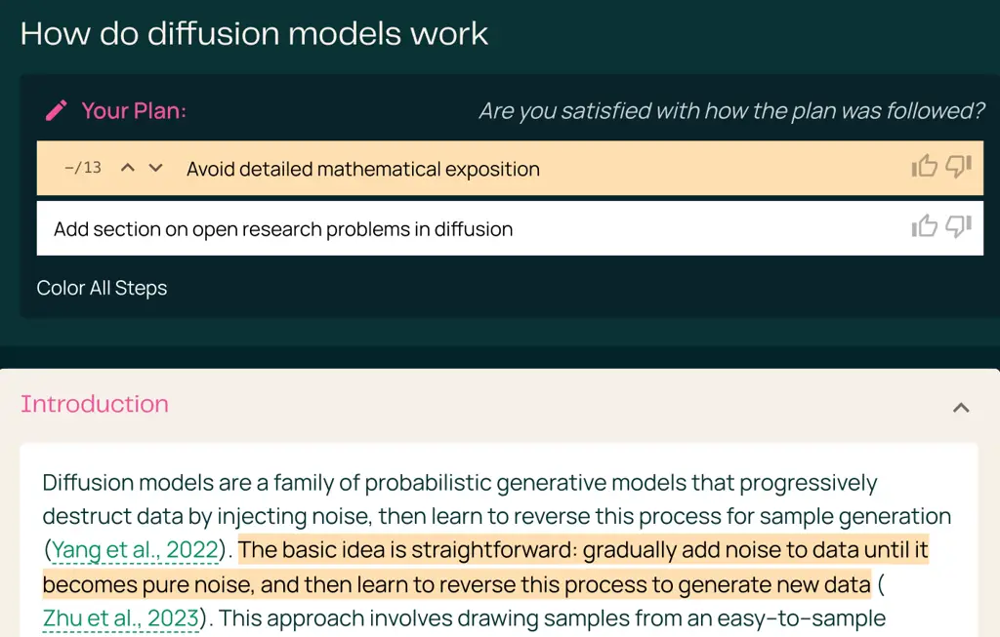
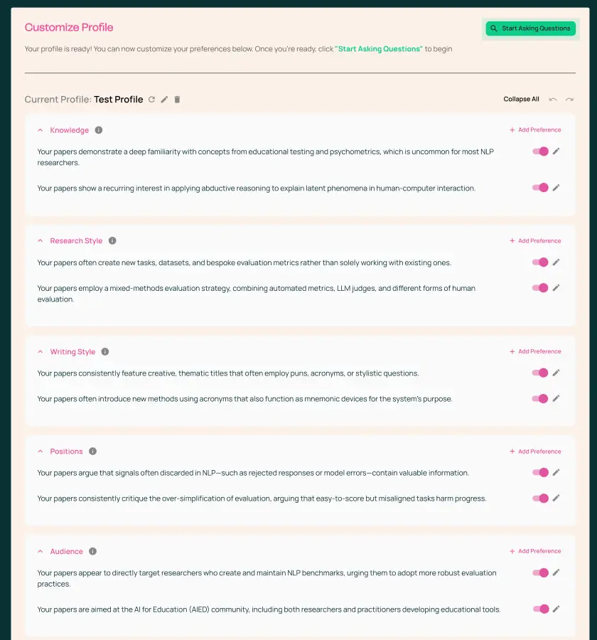
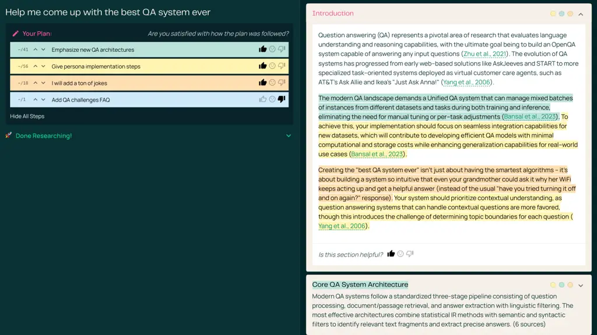
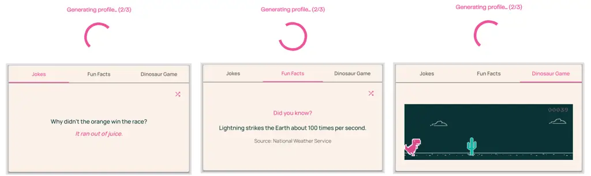

# Language Models Don’t Know What You Want: Evaluating Personalization in Deep Research Needs Real Users

Nishant Balepur Affiliation: University of Maryland Affiliation: Allen
Institute for Artificial Intelligence Email: [nbalepur@umd.edu](mailto:)
   Malachi Hamada Affiliation: Allen Institute for Artificial
Intelligence    Varsha Kishore Affiliation: Allen Institute for
Artificial Intelligence    Sergey Feldman Affiliation: Allen Institute
for Artificial Intelligence    Amanpreet Singh Affiliation: Allen
Institute for Artificial Intelligence    Pao Siangliulue
Affiliation: Allen Institute for Artificial Intelligence    Joseph Chee
Chang Affiliation: Allen Institute for Artificial Intelligence    Eunsol
Choi Affiliation: New York University    Jordan Boyd-Graber
Affiliation: University of Maryland    Aakanksha Naik
Email: [aakankshan@allenai.org![[Uncaptioned
image]](arxiv-2603-16120v2--889a453d2f95.figures/figure-1.webp)MyScholarQA:](mailto:)[https://personalized-scholarqa.apps.allenai.org/](https://personalized-scholarqa.apps.allenai.org/)
Affiliation: Allen Institute for Artificial Intelligence

###### Abstract

Deep Research (DR) systems help researchers cope with ballooning
publishing counts. Such tools synthesize scientific papers to answer
research queries, but lack understanding of their users. We address this
with MyScholarQA (MySQA), a personalized DR agent that: 1) infers a
profile with a user’s research interests; 2) proposes personalized
actions for a user’s input query; and 3) writes a multi-section report
for the query that follows user-approved actions. We first test MySQA
with NLP’s standard protocol: we build a benchmark with synthetic users
and LLM judges, where MySQA beats baselines in citation metrics and
personalized action-following. However, we suspect this process does not
cover all aspects of personalized DR users value, so we
interview users in an online version of MySQA to unmask them. We reveal
nine nuanced errors of personalized DR undetectable by our LLM judges,
and we study qualitative feedback to form lessons for future DR design.
In all, we argue for a pillar of personalization that easy-to-use LLM
judges can lead NLP to overlook: real progress in personalization is
only possible with real users.¹¹ 1 We release code and data at:
[https://github.com/allenai/personalized-scholarqa-eval](https://github.com/allenai/personalized-scholarqa-eval)

¹¹footnotetext: Work primarily completed during internship at Ai2.

## 1 When Deep Research Gets to Know You

Scholars increasingly turn to LLMs to support their scientific research
Liao et al. (2024), such as to learn new concepts August et al. (2023)
or brainstorm ideas Pu et al. (2025). With publishing rates skyrocketing
and literature becoming daunting to track Parolo et al. (2015), a new
use case of LLMs emerges: Deep Research (DR) tools that answer
researchers’ queries by retrieving, organizing, and synthesizing
papers into multi-section, attributed reports Asai et al. (2024); Huang
et al. (2025).

DR has advanced in giving well-cited reports for queries Bragg et al.
(2026), but few capture the individual needs of who asks them, lacking
personalization. By knowing a researcher’s background, DR could create
more helpful reports: focusing on papers in certain domains, framing
explanations in familiar terms, or showing how to use new ideas in
users’ ongoing work. While decades of search engine research motivates
personalization’s benefits in AI search tools Teevan et al. (2005); Dou
et al. (2007), work on personalized DR remains sparse.

Figure 1: Overview of MySQA: our three-step personalized Deep Research
system. (1) Researchers upload papers from Semantic Scholar, from which
an LLM infers a profile that captures their interests. (2) When the
researcher asks a query, MySQA proposes a list of actions that could
alter the report, tailored to the researcher’s profile. (3) The system
generates a report that answers the query and executes these actions
through a multi-stage retrieval and LLM generation pipeline. To improve
transparency and control, users can edit profiles, adjust actions, and
view highlights in the report where MySQA personalizes content.

We introduce MyScholarQA (MySQA): the first open-source personalized DR
tool that: 1) infers _user profiles_ via papers users pick to capture
their interests (Fig 1, left); 2) suggests tool _actions_ tailored to
the user’s profile and query (Fig 1, center); and 3) writes a report to
answer the query and execute actions via a multi-LLM system (Figure 1,
right). For transparency and control, our users can edit profiles in (1)
so MySQA best captures them, adjust the actions that it executes in (2),
and review highlights where it personalizes content in (3).

A formative study showed MySQA’s promise but that the system was
imperfect (section 2.4), leading us to ask: how should we evaluate MySQA
to reveal common failures and track improvements? In surveying recent
NLP work on personalization, offline benchmarks dominate Voorhees and
others (1999): for 31 ACL’25 works on personalization, all evaluate
offline (18 with synthetic user datasets and 17 with LLM judges), but
only two run user studies with real end users (Appendix B). However,
excelling in offline evaluation does not ensure the system is
helpful Mozannar et al. (2025), as offline metrics can neglect what
users value Venkit et al. (2025b).

To test what offline personalization evaluations miss, we first build a
synthetic dataset pairing DR queries with paper sets simulating users
(section 3.1), and 16 offline metrics (section 3.2). Here, MySQA excels:
profiles accurately cite papers for inferred user interests,
personalized actions more closely match user profiles versus generic
ones, and our reports have higher quality and adherence to actions
versus open-source and commercial DR systems (section 3.4). To contrast
this with online evaluations, we draw on human-computer interaction and
use MySQA as a probe Hutchinson et al. (2003) to unveil real users’
needs in personalized DR. In 90-minute interviews, 21 DR users build
profiles, pick query actions, and rate reports via a MySQA-backed
interface (section 4.1).

Participants perceive MySQA as helpful—73% of its profiles, actions, and
reports are satisfactory—but uncover nine personalization flaws our
offline metrics miss: e.g., profiles overstating user expertise and
tailored actions drifting from query intent (section 4.2). To test if we
could have flagged these flaws offline, we use LLM judges to predict
user satisfaction ratings (section 4.3) with validation sets derived
from interviews: they never beat majority class baselines, failing to
capture user needs. Beyond finding metrics to advance, user feedback
also yields lessons to inform personalized DR design: make control easy,
let users digest personalization, use content beyond papers, and
evaluate via mixed study designs (section 5).

We aim to reinforce a pillar of personalization research: developing
personalized tools needs feedback from real users. Synthetic data is an
alluring crutch and LLM judges seem reliable Jiang et al. (2025a), but
these evaluations can miss what users actually value. Thus, we urge
their adoption as necessary but insufficient checks and instead advocate
for user-centered evaluations to inform the design of personalized NLP
systems.

Our contributions are:

1.  1.  MyScholarQA, the first personalized Deep Research (DR) system with
        an online demo.²² 2 https://personalized-scholarqa.apps.allenai.org/
2.  2.  A synthetic benchmark and LLM judge metrics as offline evaluations
        of personalized DR.
3.  3.  Discovery that LLM judges fail to predict nine failure modes of
        personalized DR, advocating for user-centered personalization
        evaluations.
4.  4.  The first formative and usability studies of personalized DR with 26
        active DR users to inform future work on personalization design
        choices.

## 2 MySQA: Personalized Deep Research

Drawing on Brusilovsky (1996)’s adaptive hypermedia, personalized Deep
Research tools build a persistent user model of the researcher, then
apply this model to adapt reports for user queries. Our design goals
are: 1) build a user model to capture research interests; and 2) let
users interpret and control how the system personalizes Liu et al.
(2024a), helping us learn the best ways to adapt outputs.

We realize this in MyScholarQA (MySQA), a DR tool (Fig 1) that infers
profiles of users’ interests via papers (section 2.1), plans actions for
user queries tailored to their profile (section 2.2), and executes
actions to adapt reports (section 2.3). We now describe each step and
evaluate its design in a formative study (section 2.4).

### 2.1 Inferring Researcher Profiles

MySQA first infers a profile $`\mathcal{P}`$ from a user’s papers
$`\mathcal{D}`$ (Fig 2)—forming a persistent user model Brusilovsky
(1996); we use papers, since Lin et al. (2024) show they capture
research interests. Profiles can be biographies Gao et al. (2024) or
keywords Mysore et al. (2023), but we use sentence-level inferences
$`\mathcal{P}=\{\mathcal{I}_{1},\dots,\mathcal{I}_{n_{1}}\}`$ about the
user (e.g. “Your papers argue evaluations should move beyond metrics to
online studies.”), similar to prior research in computer agents and
writing assistance Shaikh et al. (2025); Garbacea and Tan (2025).

$`\mathcal{P}`$ has $`n_{1}`$ inferences evenly split over five aspects
inspired by Tang et al. (2024): knowledge (what they know), research
style (how they do research), writing style (how they write), audience
(whom they impact), and positions (what they believe). Users find this
structure organized (section 2.4). $`\mathcal{P}`$ transparently cites
snippets from the user’s papers $`\mathcal{D}`$ for each inference
$`\mathcal{I}`$ with an explanation. We prompt LLMs to create
$`\mathcal{P}`$ from $`\mathcal{D}`$ (Appendix A.11). Users can
edit/disable any $`\mathcal{I}`$ to form a better profile
$`\mathcal{P}^{*}`$.

### 2.2 Proposing Actions to Take

Equipped with a profile $`\mathcal{P}^{*}`$, users can ask a query $`q`$
to get a report $`\mathcal{R}`$ adapted to
$`\mathcal{P}^{*}`$ Brusilovsky (1996). Directly producing
$`\mathcal{R}`$ limits customization; instead, we draw on query
clarification Zhang et al. (2025) and first return a list of actions
$`\mathcal{A}=\{a_{1},\dots,a_{n_{2}}\}`$ (Fig 3) that MySQA could take
when answering $`q`$, such as “find trivia QA papers” or “add section on
metrics” (Srikanth et al., 2026). Exposing $`\mathcal{A}`$ lets
users steer execution and tell us how to adapt $`\mathcal{R}`$—validated
in a formative study (section 2.4).

$`\mathcal{A}`$ has $`n_{2}`$ actions split over four categories, based
on how they will adapt $`\mathcal{R}`$: content (what $`\mathcal{R}`$
covers), style (how $`\mathcal{R}`$ explains), specificity (how
$`\mathcal{R}`$ interprets $`q`$), and research ideas ($`\mathcal{R}`$’s
proposed ideas the user can incorporate). Actions can be personalized
$`\mathcal{A}_{\text{person}}`$ (conditioned on $`q`$ and
$`\mathcal{P}^{*})`$ or generic $`\mathcal{A}_{\text{gen}}`$
(conditioned on $`q`$); $`\mathcal{A}_{\text{gen}}`$ ensures $`a`$
is useful when $`\mathcal{P}^{*}`$ is unlike $`q`$ (e.g. if users ask
about a new field).

We prompt LLMs to create $`\mathcal{A}_{\text{gen}}`$ and
$`\mathcal{A}_{\text{person}}`$ separately, merging them to form
$`\mathcal{A}`$ (Appendix A.11); we add ways the LLM can adapt to
$`\mathcal{P}^{*}`$ for $`\mathcal{A}_{\text{person}}`$’s prompt (e.g.,
skip basic terms for experts) but no strict rules, as we want to learn
how to personalize reports from users (section 4). Users can
edit/disable any action $`a\in\mathcal{A}`$ to form custom actions
$`\mathcal{A}^{*}\subseteq\mathcal{A}`$.

### 2.3 Synthesizing a Personalized Report

After the user submits actions $`\mathcal{A}^{*}`$, MySQA writes a
multi-section report
$`\mathcal{R}=\{\mathcal{S}_{1},\dots,\mathcal{S}_{n_{3}}\}`$ to answer
query $`q`$ while executing each $`a\in\mathcal{A}^{*}`$, personalizing
the report via actions which were shaped by the profile. We build on
ScholarQA (Singh et al., 2025, SQA)—a DR system with high-quality
reports. SQA chains LLMs to retrieve papers from Semantic Scholar,³³ 3
https://www.semanticscholar.org/product/api cluster them into sections,
and iteratively generate well-cited sections to form $`R`$.

Figure 2: After a user selects research papers, MySQA infers an editable
profile with inferences about the user, capturing their interests for
personalizing reports.

Figure 3: Before answering a user’s query, MySQA proposes actions that
change how the report could be created, which users can adjust to
customize their report.

Figure 4: Reports in MySQA highlight personalized content, helping users
navigate each action they select.

To equip MySQA to use $`\mathcal{A}^{*}`$, we tweak prompts in SQA’s
execution to also use $`\mathcal{A}^{*}`$ as input. For example, the
first step is a prompt converting $`q`$ to search terms for Semantic
Scholar (i.e. “convert $`q`$ to search terms”); we minimally modify it
with instructions on how to also use $`\mathcal{A}`$ to create search
terms (i.e. “convert $`q`$ to search terms while following these
actions: $`\mathcal{A}^{*}`$”). Most notably, we change: 1) the prompt
for search terms—generating multiple search terms based on $`q`$ and
$`\mathcal{A}^{*}`$, while SQA originally generates just one; and 2) the
report generation prompt—instructing the LLM to execute all
$`a\in\mathcal{A}^{*}`$ and highlight parts of the text that relate to
any action—one color per action (Fig 4). (1) tailors retrieval to
$`\mathcal{A}^{*}`$, while (2) helps users see where MySQA personalizes
$`\mathcal{R}`$ (Kim et al., 2025b, section 5). Claude-4 Sonnet backs
MySQA,⁴⁴ 4 https://www.anthropic.com/news/claude-4 matching SQA.

### 2.4 A Formative Study with MySQA

To ensure our method matches users’ expectations before investing in
large-scale studies, we run a formative study Nielsen (1993) via an
early version of MySQA as a technology probe Hutchinson et al. (2003).⁵⁵
5 Here, we use Gemini-2.5 Pro for MySQA profiles/plans. Five DR users/CS
students bring papers of their interest and two queries they asked DR
before. We first discuss their DR usage/personalization needs (˜$`15`$
min). Then they use MySQA—creating and editing profiles/actions to get
personalized reports (\$35/hr; ˜$`45`$ min); later over email, they rate
reports for their queries (detailed in A.7).

Participants found using papers to infer personalized profiles/actions
intuitive for personalized DR; out of all potential user context, P1
noted “papers matter most”. They also found our profile/action
categories useful and comprehensive (section 2.1, section 2.2). Many
desired transparency, wanting it “as transparent as possible” (P4) and
to “know how they made inferences about me” (P3).

Participants then rated their profiles, actions, and reports from MySQA.
Profiles had surprising nuance and detail—“It captures exactly what I
have in mind but haven’t expressed” (P2)—but were incomplete: “a really
good starting point to review and refine” (P5). Personalized actions
were promising; some felt like “speaking with a colleague who knew my
work” (P2). Still, participants liked generic/personalized ones
similarly (˜$`60\%`$), so we do not yet know when personalized DR helps.
Highlighting where reports tailored to actions made it “much easier to
see custom parts at a glance” (P3) but such text could be “a bit
general” (P5). Lastly, they compared generic SQA reports to personalized
MySQA reports for their queries; all favored the latter, showing
personalized DR’s utility. In all, our study confirms MySQA is a
solid basis for finding more aspects of personalized DR users value.

Post-study, we use participant feedback to refine MySQA. We tweak
prompts to try and fix common errors (e.g. “make profiles specific”,
section 2.1) and host a UI for further online use, with a: 1) profile
page to find papers and toggle/edit LLM inferences (Fig 2); 2) home page
to ask queries and toggle/edit LLM actions (Fig 3); and 3) report page
with highlights showing where each action was executed (Fig 4). After
adding these updates, we continue to larger-scale offline (section 3)
and online (section 4) evaluations.

## 3 Offline Evaluation

Our formative study showed MySQA’s promise (section 2.4) but did not
thoroughly evaluate DR output quality. As a next step, we adopt NLP
practices and test MySQA offline via simulated users (section 3.1) and
LLM judges (section 3.2). These analyses are cheap and popular Jiang et
al. (2025a), but may not capture users’ personalization needs Venkit et
al. (2025b), so we use them as necessary but insufficient checks to
inform online, user-centered evaluations (section 3.4).

### 3.1 Dataset Collection

No personalized DR datasets exist of user queries $`q`$ and papers
$`\mathcal{D}`$, so we make a synthetic one. We collect $`q`$ from
ScholarQA-CS2 Bragg et al. (2026)—a research agent benchmark with 200 DR
$`q`$ (100 dev/100 test). We attach synthetic users to each $`q`$ with
low, medium, and high expertise for $`q`$. We simulate synthetic users
based on papers in CS-PaperSum Liu et al. (2025b): CS conference papers
grouped by first author (with three or more papers). We
compute expertise via cosine similarity⁶⁶ 6 $`[0,0.2]`$ (low),
$`(0.2,0.35]`$ (medium), and $`(0.35,1.0]`$ (high); dropping ranges if
no $`\mathcal{D}`$ matches between GRIT-LM embeddings Muennighoff et al.
(2024) of $`q`$ and user papers $`\mathcal{D}`$. We get 281 and 291
$`(q,\mathcal{D})`$ pairs for dev and test splits, respectively.

### 3.2 Metric Implementation

On our dataset (section 3.1), we now study MySQA profiles, actions, and
reports with objective metrics for clearly undesired errors, deferring a
study of subjective metrics (section 4.3). Gemini-2.5 Flash Comanici and
others (2025) is our LLM judge Zheng et al. (2023) for metrics (human
agreement in Appendix A.2).

For each profile inference $`\mathcal{I}`$, we evaluate: 1) category
accuracy, if $`\mathcal{I}`$ is in the correct category (e.g.
knowledge); 2) inference accuracy, if $`\mathcal{I}`$ contradicts cited
papers, like summary faithfulness Kryscinski et al. (2019); 3) citation
relevance, the proportion of cited papers that support any part of
$`\mathcal{I}`$ to penalize overciting; and 4) specificity, a 1–5 score
for how much $`\mathcal{I}`$ differs among researchers. As confounders,
we show mean cited paper count and words in $`\mathcal{I}`$.

We compare personalized and generic actions with: 1) win rate,
how often a judge picks $`\mathcal{A}_{\text{person}}`$
vs $`\mathcal{A}_{\text{gen}}`$ given $`\mathcal{P}`$, a consistency
check from Balepur et al. (2025a); 2) coherence, how often each
$`a\in\mathcal{A}`$ does not contradict $`q`$ (e.g. $`q=`$“what is QA”,
$`a=`$“focus on NLI” is a conflict); and 3) uniqueness, the proportion
of $`a\in\mathcal{A}`$ that a system without $`\mathcal{A}`$ would not
already follow. We check (3) via how often SQA prompted with just $`q`$
executes $`a\in\mathcal{A}`$ in $`\mathcal{R}`$, via the “action
adherence” report metric below.

In reports, we assess how well
$`\mathcal{R}`$ uses $`q`$ and $`\mathcal{A}`$. We use four report
quality metrics from ScholarQA-CS2 Bragg et al. (2026): 1) answer
coverage, how many elements a correct answer for $`q`$ must include are
covered in $`\mathcal{R}`$; 2) answer precision, how directly
$`\mathcal{R}`$ answers $`q`$; 3) citation precision, $`\mathcal{R}`$’s
citation accuracy; and 4) citation recall, how often
$`\mathcal{R}`$’s claims are cited. We add action adherence—how
often $`\mathcal{R}`$ follows actions in $`\mathcal{A}`$ at any point
Qin et al. (2024).

### 3.3 Baselines

For profiles/actions, we assess LLMs to pick one for MySQA. Profiles
infer over long contexts Kuratov et al. (2024) only once, so we evaluate
reasoning LLMs: Claude-4 Sonnet+think, o3 ⁷⁷ 7
https://openai.com/index/introducing-o3-and-o4-mini/, Gemini-2.5 Pro
Comanici and others (2025), and DeepSeek-r1 DeepSeek-AI et al. (2025).
Actions are per-query, so we test fast LLMs: Gemini-2.5 Flash, GPT-4.1,
Claude-4 Sonnet, and DeepSeek-V3 DeepSeek-AI et al. (2024). In reports,
we compare MySQA to open-source/commercial DR that take concatenations
of $`\langle q\cdot\mathcal{A}\rangle`$ as prompts: ScholarQA Singh et
al. (2025), OpenScholar Asai et al. (2024), STORM Shao et al. (2024),
Perplexity’s Sonar⁸⁸ 8 https://sonar.perplexity.ai/ and OpenAI o3 DR⁹⁹ 9
https://openai.com/index/introducing-deep-research/ (details
in Appendix A.3).

|        |          |           |           |       |         |          |
| ------ | -------- | --------- | --------- | ----- | ------- | -------- |
| Model  | Inf. Acc | Cit. Rel. | Cat. Acc. | Spec. | \# Cite | \# Words |
| G-Pro  | 97.1     | 97.4      | 99.4      | 3.73  | 2.45    | 23.2     |
| Sonnet | 92.5     | 97.4      | 99.1      | 4.12  | 1.91    | 21.6     |
| OAI-o3 | 88.6     | 91.8      | 99.8      | 4.20  | 2.03    | 18.9     |
| DS-r1  | 77.8     | 80.7      | 97.2      | 3.56  | 1.89    | 9.9      |

Table 1: Profile ($`n_{1}=25`$) inference accuracy, relevance, and
specificity across LLMs. Highest scores are bold. Reasoning LLMs infer
accurate, relevant user profiles.

|         |      |                         |                            |                          |                             |
| ------- | ---- | ----------------------- | -------------------------- | ------------------------ | --------------------------- |
| Model   | W.R. | $`p_{\text{gen}}`$ Coh. | $`p_{\text{person}}`$ Coh. | $`p_{\text{gen}}`$ Uniq. | $`p_{\text{person}}`$ Uniq. |
| G-Flash | 91.3 | 93.2                    | 84.0                       | 42.9                     | 60.7                        |
| Sonnet  | 93.5 | 91.8                    | 82.0                       | 50.4                     | 68.2                        |
| GPT-4.1 | 94.7 | 93.5                    | 84.1                       | 49.1                     | 66.3                        |
| DS-V3   | 94.3 | 89.2                    | 72.3                       | 54.5                     | 72.2                        |

Table 2: Personalized/generic action ($`n_{2}=16`$) win rate, coherence,
and uniqueness. The highest score is bold. LLM judges that condition on
synthetic users’ papers are more likely to select personalized actions,
indicating that they can personalize actions based on user profiles.

|          |          |           |            |           |                      |
| -------- | -------- | --------- | ---------- | --------- | -------------------- |
| Model    | An. Cov. | An. Prec. | Cit. Prec. | Cit. Rec. | $`\mathcal{A}`$ Adh. |
| MySQA    | 91.4     | 89.9      | 91.8       | 81.4      | 83.2                 |
| SQA      | 88.9     | 89.1      | 90.5       | 76.9      | 81.3                 |
| OpenSc.  | 77.2     | 97.4      | 82.5       | 60.4      | 82.5                 |
| STORM    | 72.0     | 92.2      | 73.3       | 64.7      | 74.4                 |
| Sonar DR | 81.0     | 82.9      | 64.3       | 46.3      | 75.0                 |
| o3 DR    | 89.1     | 90.2      | 79.2       | 56.7      | 93.8                 |

Table 3: DR report quality and action adherence scores for query $`q`$
and eight actions in
$`\mathcal{A}_{\text{gen}}\cup\mathcal{A}_{\text{person}}`$. The best
score is bold. MySQA surpasses every DR baseline in three out of five
metrics. We only evaluate o3 DR using ten examples due to latency and
cost limitations.

### 3.4 Offline Results

With our dataset (section 3.1), metrics (section 3.2), and baselines
(section 3.3) set, we now test each step in MySQA. In profiles, all
models but DS-r1 create accurately cited inferences (Table 1) and
all accurately categorize inferences. More citations reduces
specificity—a common personalization/generalization tradeoff Han et al.
(2022). For MySQA’s profiles, we use Gemini-Pro, scoring the highest in
three metrics.

All models give personalized actions with higher win rates and
uniqueness over generic ones, indicating such actions are tailored to
profiles (Table 2). Yet, personalized ones conflict queries more;
Appendix A.4 shows tension between tailored actions and answering
queries, often for papers with low query similarity (section 3.1),
so personalization may not always help Zhang et al. (2013). Actions
generally had modest adoption rates in our formative (section 2.4), so
we rotate all 4 models in MySQA for diversity.

In reports, MySQA has the best or second-best scores 4/5 times—the most
of any DR system (Table 10). It also always beats its base system SQA:
our modifications (section 2.3) improve its report quality.

Having shown MySQA’s output quality offline, we can now deploy the tool
online to find flaws and insights our simulation-based data may
miss (section 4).

|         |            |                                                                                          |       |
| ------- | ---------- | ---------------------------------------------------------------------------------------- | ----- |
| Output  | Aspect     | Description                                                                              | Freq. |
| Profile | DOMAIN     | Uses terms, definitions, or details that do not capture the user’s domain of research.   | 27.6% |
|         | OVERCLAIM  | Claims something applies to the user broadly, but only applies to some/parts of papers.  | 17.9% |
|         | CONVENTION | Infers a generic convention of the user’s field (e.g. "You enumerate contributions").    | 12.8% |
|         | CONTRAST   | Has a contrast that misrepresents the user (e.g. "You are X, not Y", but the user is Y). | 12.2% |
| Action  | NARROW     | The action is too specific and would overly constrain the information coverage.          | 43.8% |
|         | OFFTOPIC   | The action deviates too far from the query, distracting from the user’s goal/intent.     | 23.6% |
| Report  | UNINFORM   | The content is too vague/high-level to be informative; the user wanted more details.     | 38.0% |
|         | PRESENT    | The user wanted the content presented in a different style/format (e.g. bullet points).  | 25.3% |
|         | IGNORE     | One or more implicit/explicit requirements in the action was ignored.                    | 22.8% |

Table 4: The nine most common personalization errors in MySQA’s outputs
discovered from our interviews, missed in our offline evaluations. All
twenty metrics we discover are in Table 9.

## 4 Moving MySQA Offline to Online

MySQA excels on synthetic datasets (section 3), but this may not mirror
real user needs Saxon et al. (2024) and even 10+ metrics might not cover
all aspects of personalized DR users value Venkit et al. (2025a).

We thus run a user study (section 4.1) to answer open questions:
RQ1—What personalization errors do offline metrics
neglect? (section 4.2) and can off-the-shelf LLM judges evaluate
them? (section 4.3). RQ2—What lessons can guide future personalized
DR? (section 5)

### 4.1 Interviewing Active Deep Research Users

We interview¹⁰¹⁰ 10 Our internal review board approved our study
(section 9). 21 active DR users (CS researchers on Upwork, \$30-40/hr)
for 90 minutes who show DR familiarity in a pilot survey; 19 use OpenAI
DR (Appendix A.9). Each bring: 1) five papers of interest;¹¹¹¹ 11 Papers
they have written, wish they had written, inspire them, or are relevant
to a current project. and 2) three queries to ask DR. While using MySQA,
they screen-record and “think out loud” Danks et al. (1984). We
transcribe recordings for open thematic analysis Boyatzis (1998).

In MySQA’s UI (section 2.4), participants review their profiles (˜$`45`$
min.) and disable/edit poor inferences. Next, they review every query’s
proposed actions (˜$`5`$ min.), picking or editing which ones MySQA
should follow. They submit actions to tailor reports, rating its quality
and ability to follow actions while verbalizing reasoning for their
ratings (˜$`15`$ min.).

Figure 5: User satisfaction on MySQA profiles, actions, and reports.
Users are satisfied with $`73\%`$ of them.¹³¹³ 13 U10 spent the
interview just viewing the profile ($`n=20`$).

Figure 6: LLM judge accuracy for predicting users’ satisfaction of
personalized profiles, actions, and reports. No model ever beats a
majority class baseline (Dror et al., 2018, $`\alpha=0.05`$ Binomial
test with Bonferroni correction).

### 4.2 RQ1: What our Offline Evaluation Missed

Participants liked $`73\%`$ of profiles, actions, and action executions
in reports (Fig 13), so MySQA was useful. We now analyze the remaining
$`27\%`$ to uncover issues, guiding future evaluation: an author
reviewed all 1044 judgments and qualitatively labeled where participants
were dissatisfied; another verified themes on $`60`$ rows (with
90% agreement).

We find nine common issues (Table 4). Most often, profiles mistake
technical terms (DOMAIN), actions are restrictive (NARROW), and
reports lack detail (UNINFORM). Many are open NLP problems:
factuality (Wang et al., 2024b, DOMAIN), style (Jin et al., 2022,
PRESENT), or expertise calibration (Joshi et al., 2025, OVERCLAIM,
CONVENTION). Some issues in the full list (Table 9) seem untraceable
offline—e.g., accurate but unimportant profile inferences (UNIMPORT) and
rejected actions due to mistrust in MySQA’s ability (TRUST)—only
detectable with online feedback.

Crucially, every issue is invisible to our offline metrics
(section 3.4)—despite covering 10+ reasonable aspects of
personalization—so synthetic datasets can overlook what users value in
personalization.

### 4.3 LLMs Don’t Know What DR Users Want

Having found personalized DR aspects we missed offline (section 4.2), we
now see if we could have evaluated them via LLM judges. We answer
this with a classifier: given an aspect, were users satisfied by
profiles, actions, and action executions in reports for that aspect. For
each aspect, we label outputs users dislike as $`l=1`$ paired with two
negatives ($`l=0`$): a random liked output and a “hard” negative (the
most stylistically-similar liked output)—both from the user. LLMs access
the same context (e.g. papers, actions, highlights) as users,
six few-shot examples, and definitions of each aspect¹⁴¹⁴ 14 e.g., for
DOMAIN, we prompt “Would the user be satisfied with the technical
terminology in this profile inference?” to predict $`\hat{l}`$: would
the user like or dislike the output?

Our four LLM judges predict user satisfaction no better than
majority-class baselines (Figure 6), so strong, off-the-shelf
judges struggle to capture these issues (section 3.4). As offline
evaluations can miss what users value—metrics that LLM judges may not
predict sans extensive engineering effort—we advocate shifting away from
just simulation-based evaluations towards user feedback Du et al.
(2018).

## 5 RQ2: Lessons for Personalized DR

Beyond surfacing limitations in offline evaluations (section 4.3), we
now show how online user feedback also offers richer insights for DR. We
distill these into four lessons to help NLP and HCI researchers design
improved personalized DR tools for users.

### Lesson 1: Balance User Control and Effort

Adding control to interactive tools helps, but such effort can exceed
what users want to invest Shneiderman (1983); Jin et al. (2017). DR
interactions are different: as reports take minutes to write, our pilot
survey (Appendix A.9) reveals users are willing to dedicate more effort
up front to avoid subpar outputs. Most DR tools add this control via
clarification or follow-up questions Jiang et al. (2024), but surveyed
users disliked this feature: they must rearticulate their personal needs
for every query.

Instead, MySQA creates a persistent profile for all queries—matching
users who often “want \[the\] system to know about me once then act
accordingly” (U21)—and has users pick among actions—easier than
answering follow-up queries (Appendix A.9). Actions still had ample
control; U1 noted actions “are not complex but also very granular which
I really like” and U4 felt they let them “do what I cannot express in a
perfect way.” U6 felt actions transparently showed how the system
answered queries while U17 felt it kept them more actively engaged than
existing tools—helping them “brainstorm to get what I want”. Many
believed this process could save time, for U18, “on the order of days”,
since it avoids the frustration of re-prompting/re-answering generic
systems that “keep missing the point” (U3).

MySQA has more control than most DR tools, which made users realize they
wanted more, even at the cost of more effort. Some wanted to see more
actions per query (U13, U19), add new actions (U3, U16), or “emphasize”
certain actions (U4). Others wanted to also steer DR via paper filters
(U2, U11), multi-turn dialogue (U5, U6), and monitoring the tool as it
learned their preferences over time (U15)—updating its memory of the
user Yuan et al. (2025).

While more personalized DR control seems helpful, it could risk
reinforcing filter bubbles Zhang et al. (2024a)—keeping users away from
new ideas. Control also may not benefit all query types Dou et al.
(2007): U7 desired a toggle to control when MySQA proposes actions.
Future work must study not just ways to control personalized DR, but
when it should be controllable and to what extent.

### Lesson 2: Make Personalization Easy to Digest

DR inputs and outputs can be hard to navigate, but MySQA’s structure
made content easy to digest. In most DR tools, users must engineer long
queries to express personalized needs (U2, U12): a difficult process for
DR users to manage alone Zamfirescu-Pereira et al. (2023). Instead,
MySQA decomposes tailored query writing via two structured
phases—profiles and actions—which helped users efficiently organize
their needs (U1, U5, U15); U3 noted: “I have used 3-4 AI tools and none
of them have such steps exactly like that in such a structured way.”

While commercial DR masks if and how personalization occurs (6.1), our
report highlights kept personalization visible/easy to skim: they
“helped focus on text” (U12) and were “easy to cognitively process”
(U5). Still, highlights were tough to get right. Preferences on
highlight frequency varied—some wanted full sections (U6), others only
“key numbers” (U5) or “evidence” (U21)—and for more personalized reports
with more actions, highlights were overwhelming (U6, U12). We also saw
signs of over-trust Lee and See (2004); when no content was highlighted
for an action, some assumed the content did not exist, rather than an
error from our system. DR tools must offer trustworthy sensemaking aids
Zhang et al. (2008), simplifying personalization without overwhelming or
misleading users.

### Lesson 3: Dream Bigger than Just Papers

While MySQA infers interests just from chosen papers, participants were
surprised by profiles’ detail and nuance, often noting “very important
positions \[they\] would claim” (U3) and “digging stuff \[they\] didn’t
think it can detect” (U16). This spurred users to ideate further signals
for personalizing profiles, like active project materials and prior
queries (Appendix A.9) and new personalization use cases, like
collaborator search (U9), biography writing (U3), paper reading (U11),
and programming (U12).

Participants also wanted modalities beyond text and citations in
reports, pointing to a wide variety based on their personal needs, like
code snippets for frequent coders (U1, U4) and LaTeX formulas for
theory-focused researchers (U2, U4), while others generally desired
tables/figures (U5, U7) and interactive visualizations (Mondal et al.,
2024, U20). By capturing content preferences, participants felt reports
would give a “better view in a shorter time” (U12) or a “holistic view
of entire papers” (U17).

Going beyond papers in personalized DR is a clear win, but has
challenges: reasoning over arbitrary user inputs to construct profiles
Zhao et al. (2025a); Shaikh et al. (2025) and routing to the best
modality to convey content tailored to a user’s background Chen et al.
(2025b). Future work should study not just how to implement these
accurately, but to make them helpful for individual researchers.

### Lesson 4: Evaluation Isn’t One-Size-Fits-All

While we show offline metrics miss aspects of personalized DR
(section 4.2, section 4.3), we caveat online studies are not perfect,
final fixes Hosking et al. (2024); for example, edits on action evince
not just what users want DR to do but also what they think it can do—U6
skipped complex actions until they felt it “understood the basics.”
Similarly, users need to predict utility Levy (1992). For instance,
participants noted MySQA “can be a great timesaver” (U17) and found
points they “miss while writing research papers” (U7), but such
benefits are hard to predict (Balepur et al., 2024; Balepur et al.,
2025c). Two directions can bolster personalized DR evaluation:
longitudinal studies to account for learning effects Jahani et al.
(2024), and richer signals to evaluate downstream helpfulness (e.g.,
time taken, citations clicked).

We thus advocate for mixed evaluations in personalized DR. For MySQA,
formative studies confirmed the workflow met user needs (section 2.4) in
early stages, while offline metrics formed a scalable way to check
baseline report quality, like citation accuracy and action following
(section 3.4). Online evaluation then found what we missed
offline—issues to fix in metrics (section 4.3) and how to make DR more
useful (section 5). Overall, evaluations support distinct parts and
stages of personalized system design, showing the need for NLP research
in personalization to move beyond offline metrics towards real user
feedback Saxon et al. (2024); Balepur et al. (2025b).

## 6 Related Work

Given our paper’s focus on personalized Deep Research (DR), we review
personalization generally in NLP (6.1) and the advent of DR tools (6.2).

### 6.1 Personalization in NLP

Personalization tailors models to user-specific context Zhang et al.
(2024b); Sorensen et al. (2024), which can aid engagement Kumar et al.
(2019), satisfaction Liang et al. (2006), and learning Leong et al.
(2024)—making its usefulness in DR clear.

Most personalized methods (Zhang et al., 2025): 1) gather data to form
user models; and 2) adapt outputs to (1). User models have used
demographics Kirk et al. (2024), preferences Ryan et al. (2025), and
user history Salemi et al. (2023), while adaptation has retrieved user
contexts Sun et al. (2025), prompted via personas Lee et al. (2023), and
tuned parameters or reward models Tan et al. (2024); Chen et al.
(2025a). MySQA infers user models from papers and adapts reports through
prompting.

Our survey of 31 ACL’25 papers (Appendix B) shows NLP stays offline to
test methods; 14 see if models match outputs from real users Salemi et
al. (2023), but this assumes LLMs cannot create outputs better than
users. 17 works instead tailor models to simulated user chats Liu et al.
(2025a) scored by LLMs, but only ten check judges for reliability. Even
when reliable, the “user” does not exist Kim et al. (2025a), so such
judges may not reflect true user needs. We thus assess personalization
online with real users—which only two ACL’25 papers do Flicke et al.
(2025)—revealing aspects of personalized DR LLM judges struggle to
capture.

### 6.2 Deep Research Systems

Scientific Deep Research (DR) systems synthesize long-form reports via
documents to aid scientific research Java et al. (2025). Such systems
can create Wikipedia articles Sauper and Barzilay (2009); Liu et al.
(2018), expository text Balepur et al. (2023); Jiang et al. (2025b), and
surveys Hu et al. (2024); Yan et al. (2025). DR often employs a mix of
retrieval Lewis et al. (2020) and AI agents Yao et al. (2023), chaining
these models to find, organize, and condense scientific papers Wang et
al. (2024a).

As users find DR useful Shen et al. (2023), work has started deploying
them online to aid researchers and crowdsource user feedback Zhao et al.
(2025b). Open-source UIs/systems include STORM Shao et al. (2024),
ScholarQA Singh et al. (2025), and OpenScholar Asai et al. (2024), but
as our survey reveals (Appendix A.9), most exposure to DR is commercial
(e.g. OpenAI DR, Perplexity).

Few DR tools are personalized. Exceptions are Co-STORM Jiang et al.
(2024) and products like OpenAI/Gemini’s DR which ask users follow-up
queries, but it is unclear if they tailor to persistent user models.
Concurrently, Liang et al. (2025) construct a personalized DR benchmark
with synthetic data and LLM judges like us (section 3.1), but do
not release a new system or run online studies. Instead, MySQA is an
open-source personalized DR tool based on adaptive hypermedia design
Brusilovsky (1996): building a model of the user from their papers and
using it to tailor actions for input queries.

## 7 Conclusion

Synthetic evaluations rule personalization in NLP, but our paper on
personalized Deep Research (DR) shows how online studies with real users
help: they reveal errors that LLM judges miss (section 4.3) and guiding
lessons for future systems (section 5). Earlier search engine research
used real users to push personalization Joachims (2002), but NLP has
recently stopped at easy-to-use LLM judges Zheng et al. (2023) claimed
to simulate users Binz et al. (2024), rarely adopting online studies. We
urge readers to fight the temptation: simulated benchmarks are
preliminary tests, but real progress in personalization requires real
users (Seshadri et al., 2026).

As evidence, our online study points to new open questions in
personalized DR, as MySQA is imperfect. These include NLP modeling
efforts in factuality (section 4.2) and multi-modality (section 5), and
HCI studies for effortless control (section 5) and digestible
personalization (section 5). Tackling these will be cyclical: new
methods/evaluations will decide when DR meets basic needs, while online
studies will reveal what lacks in features/design to truly help users.

## Acknowledgments

We would like to thank the Allen Institute for Artificial Intelligence
(Ai2) and the CLIP lab at the University of Maryland. In particular, we
thank Connor Baumler and Paiheng Xu for reviewing earlier versions of
our interface and study design. We appreciate discussions with Doug
Downey, Dan Weld, Tal August, Rachel Rudinger, Shi Feng, Matt Latzke,
Jonathan Bragg, and Jay DeYoung on earlier versions of our prototype and
paper. We thank Dang Nguyen, Navita Goyal, Joy Wongkamjan, Connor
Baumler, Paiheng Xu, Yapei Chang, Atrey Desai, and Hyojung Han for
voting on candidate titles. Nishant is especially grateful to Yapei
Chang, Hita Kambhamettu, Federica Bologna, Peiling Jiang, Xinran Zhao,
Michael Noukhovitch, Anej Svete, Alexis Ross, Akhila Yerukola, and
Amanda Bertsch for making the summer in Seattle memorable.

This material is based upon work supported by the National Science
Foundation under Grant No. DGE-2236417 (Balepur) and IIS-2403436
(Boyd-Graber). Any opinions, findings, and conclusions or
recommendations expressed in this material are those of the author(s)
and do not necessarily reflect the views of the National Science
Foundation.

## 8 Limitations

Due to resource constraints, we could only deploy our MySQA system
online, so our findings on personalization are most directly tied to our
setting of Deep Research and execution in MySQA. However, many of our
insights may apply generally; our uncovered issues in MySQA’s outputs
(section 4, e.g., do not over-claim what applies to a user) and
suggestions for future work (section 5, e.g., extend modalities) apply
in general personalization settings. Further, we are not asserting that
these are the only issues to focus on when building personalized
systems; as argued in the paper, it is useful to study feedback from end
users of your system Saxon et al. (2024).

We also note that our LLM judge experiments cannot cover all parameter
configurations (section 4.3); although we follow best practices in
prompt engineering Schulhoff et al. (2024)—such as adding few-shot
examples and giving clear definitions for each metric—perhaps there is
another prompt and LLM judge that leads to higher accuracy. In
Appendix A.6, we show that changing the number of few-shot examples does
not largely improve LLM prediction accuracy, meaning that it may escape
off-the-self models, but could be attainable by training reward models
on more data Liu et al. (2024b).

MySQA can be slow—generating profiles takes $`3`$ minutes and reports
take $`5`$ minutes—which can harm user experience Shneiderman (1984).
While faster than some commercial DR tools (e.g., OpenAI DR took 8 hours
for 10 queries), improving efficiency would make MySQA more useful. To
manage delays, we let users view jokes, fun facts, a Chrome Dino
Game,¹⁵¹⁵ 15 https://nbalepur.github.io/ai2-trex-runner/ and execution
progress in our interface (Appendix A.10), which many users enjoyed.
Future work can focus on reducing latency with smaller, efficient models
Gou et al. (2020) or better using other waiting time, like pre-computing
reports while users spend time customizing actions.

## 9 Ethical Considerations

While the MySQA framework poses no risks in theory, we found that in the
profile inference stage, even aligned LLMs Bai et al. (2022) can
generate potentially offensive or insensitive inferences. This did not
happen with users, but while annotating profiles on our benchmark for
agreement, we viewed one such inference: “Your papers sometimes contain
slightly awkward phrasing or non-standard terminology, suggesting a
potential non-native English writing background or direct translation of
concepts”. This shows that even strong LLMs are susceptible to harmful
stereotyping in personalization Kantharuban et al. (2024), motivating
the need for future safeguards to defend against these issues.

We attended each interview with participants to mitigate any risks with
our system. Further, our entire formative and interview study designs
were approved by our organization’s internal review board. We collect
and release no PII in our data and ensure participants were fairly
compensated between \$30–\$40/hr, well above our region’s minimum wage.
In Appendix A.8, we detail our recruitment protocol.

We use GenAI for UI design, revisions, and analysis; we detail this in
Appendix C for transparency.

## References

- Asai et al. (2024) A. Asai, J. He, R. Shao, W. Shi, A. Singh, J. C.
  Chang, K. Lo, L. Soldaini, S. Feldman, M. D’Arcy, D. Wadden, M.
  Latzke, M. Tian, P. Ji, S. Liu, H. Tong, B. Wu, Y. Xiong, L. S.
  Zettlemoyer, G. Neubig, D. Weld, D. Downey, W. Yih, P. W. Koh, and H.
  Hajishirzi OpenScholar: synthesizing scientific literature with
  retrieval-augmented lms. ArXiv abs/2411.14199. External Links:
  [Link](https://api.semanticscholar.org/CorpusID:274166189) Cited by:
  §A.3, §1, §3.3, §6.2.
- August et al. (2023) T. August, L. L. Wang, J. Bragg, M. A. Hearst, A.
  Head, and K. Lo Paper plain: making medical research papers
  approachable to healthcare consumers with natural language processing.
  ACM Transactions on Computer-Human Interaction 30 (5), pp. 1–38. Cited
  by: §1.
- Bai et al. (2022) Y. Bai, A. Jones, K. Ndousse, A. Askell, A. Chen, N.
  Dassarma, D. Drain, S. Fort, D. Ganguli, T. J. Henighan, N. Joseph, S.
  Kadavath, J. Kernion, T. Conerly, S. El-Showk, N. Elhage, Z.
  Hatfield-Dodds, D. Hernandez, T. Hume, S. Johnston, S. Kravec, L.
  Lovitt, N. Nanda, C. Olsson, D. Amodei, T. B. Brown, J. Clark, S.
  McCandlish, C. Olah, B. Mann, and J. Kaplan Training a helpful and
  harmless assistant with reinforcement learning from human feedback.
  ArXiv abs/2204.05862. External Links:
  [Link](https://api.semanticscholar.org/CorpusID:248118878) Cited by:
  §9.
- Balepur et al. (2023) N. Balepur, J. Huang, and K. Chang Expository
  text generation: imitate, retrieve, paraphrase. In Proceedings of the
  2023 Conference on Empirical Methods in Natural Language
  Processing, H. Bouamor, J. Pino, and K. Bali (Eds.), Singapore,
  pp. 11896–11919. External Links:
  [Link](https://aclanthology.org/2023.emnlp-main.729/),
  [Document](https://dx.doi.org/10.18653/v1/2023.emnlp-main.729) Cited
  by: §6.2.
- Balepur et al. (2025a) N. Balepur, V. Padmakumar, F. Yang, S. Feng, R.
  Rudinger, and J. L. Boyd-Graber Whose boat does it float? improving
  personalization in preference tuning via inferred user personas. In
  Proceedings of the 63rd Annual Meeting of the Association for
  Computational Linguistics (Volume 1: Long Papers), W. Che, J.
  Nabende, E. Shutova, and M. T. Pilehvar (Eds.), Vienna, Austria,
  pp. 3371–3393. External Links:
  [Link](https://aclanthology.org/2025.acl-long.168/),
  [Document](https://dx.doi.org/10.18653/v1/2025.acl-long.168), ISBN
  979-8-89176-251-0 Cited by: Appendix B, §3.2.
- Balepur et al. (2025b) N. Balepur, R. Rudinger, and J. L. Boyd-Graber
  Which of these best describes multiple choice evaluation with llms? a)
  forced b) flawed c) fixable d) all of the above. In Proceedings of the
  63rd Annual Meeting of the Association for Computational Linguistics
  (Volume 1: Long Papers), pp. 3394–3418. Cited by: §5.
- Balepur et al. (2024) N. Balepur, M. Shu, A. Hoyle, A. Robey, S.
  Feng, S. Goldfarb-Tarrant, and J. L. Boyd-Graber A SMART mnemonic
  sounds like “glue tonic”: mixing LLMs with student feedback to make
  mnemonic learning stick. In Proceedings of the 2024 Conference on
  Empirical Methods in Natural Language Processing, Y. Al-Onaizan, M.
  Bansal, and Y. Chen (Eds.), Miami, Florida, USA, pp. 14202–14225.
  External Links: [Link](https://aclanthology.org/2024.emnlp-main.786/),
  [Document](https://dx.doi.org/10.18653/v1/2024.emnlp-main.786) Cited
  by: §5.
- Balepur et al. (2025c) N. Balepur, M. Shu, Y. Y. Sung, S.
  Goldfarb-Tarrant, S. Feng, F. Yang, R. Rudinger, and J. L. Boyd-Graber
  A good plan is hard to find: aligning models with preferences is
  misaligned with what helps users. In Proceedings of the 2025
  Conference on Empirical Methods in Natural Language Processing, C.
  Christodoulopoulos, T. Chakraborty, C. Rose, and V. Peng (Eds.),
  Suzhou, China, pp. 11568–11595. External Links:
  [Link](https://aclanthology.org/2025.emnlp-main.585/),
  [Document](https://dx.doi.org/10.18653/v1/2025.emnlp-main.585), ISBN
  979-8-89176-332-6 Cited by: §5.
- Binz et al. (2024) M. Binz, E. Akata, M. Bethge, F. Brandle, F.
  Callaway, J. Coda-Forno, P. Dayan, C. Demircan, M. K. Eckstein, N.
  ’EltetHo, T. L. Griffiths, S. Haridi, A. K. Jagadish, J. Li, A.
  Kipnis, S. Kumar, T. Ludwig, M. Mathony, M. G. Mattar, A.
  Modirshanechi, S. S. Nath, J. C. Peterson, M. Rmuš, E. M. Russek, T.
  Saanum, N. Scharfenberg, J. A. Schubert, L. M. S. Buschoff, N.
  Singhi, X. Sui, M. Thalmann, F. J. Theis, V. Truong, V. Udandarao, K.
  Voudouris, R. C. Wilson, K. Witte, S. Wu, D. Wulff, H. Xiong, and E.
  Schulz Centaur: a foundation model of human cognition. ArXiv
  abs/2410.20268. External Links:
  [Link](https://api.semanticscholar.org/CorpusID:273654604) Cited by:
  §7.
- Boyatzis (1998) R. E. Boyatzis Transforming qualitative information:
  thematic analysis and code development. Cited by: §4.1.
- Bragg et al. (2026) J. Bragg, M. D’Arcy, N. Balepur, D. Bareket, B. D.
  Mishra, S. Feldman, D. Haddad, J. D. Hwang, P. Jansen, V.
  Kishore, B. P. Majumder, A. Naik, S. Rahamimov, K. Richardson, A.
  Singh, H. Surana, A. Tiktinsky, R. Vasu, G. Wiener, C.
  Anastasiades, S. Candra, J. Dunkelberger, D. Emery, R. Evans, M.
  Hamada, R. Huff, R. Kinney, M. Latzke, J. Lochner, R.
  Lozano-Aguilera, N. Nguyen, S. Rao, A. Tanaka, B. Vlahos, P. Clark, D.
  Downey, Y. Goldberg, A. Sabharwal, and D. S. Weld AstaBench: rigorous
  benchmarking of AI agents with a scientific research suite. In The
  Fourteenth International Conference on Learning Representations,
  External Links: [Link](https://openreview.net/forum?id=M7TNf5J26u)
  Cited by: §A.1, §A.2, §A.3, §1, §3.1, §3.2.
- Brusilovsky (1996) P. Brusilovsky Methods and techniques of adaptive
  hypermedia. User Modeling and User-Adapted Interaction 6, pp. 87–129.
  External Links:
  [Link](https://api.semanticscholar.org/CorpusID:16808655) Cited by:
  §2.1, §2.2, §2, §6.2.
- W. Che, J. Nabende, E. Shutova, and M. T. Pilehvar (Eds.) (2025) W.
  Che, J. Nabende, E. Shutova, and M. T. Pilehvar (Eds.) Proceedings of
  the 63rd annual meeting of the association for computational
  linguistics (volume 1: long papers). Association for Computational
  Linguistics, Vienna, Austria. External Links:
  [Link](https://aclanthology.org/2025.acl-long.0/),
  [Document](https://dx.doi.org/10.18653/v1/2025.acl-long.0), ISBN
  979-8-89176-251-0 Cited by: Appendix B.
- Chen et al. (2025a) D. Chen, Y. Chen, A. Rege, Z. Wang, and R. K.
  Vinayak PAL: sample-efficient personalized reward modeling for
  pluralistic alignment. In The Thirteenth International Conference on
  Learning Representations, External Links:
  [Link](https://openreview.net/forum?id=1kFDrYCuSu) Cited by: §6.1.
- Chen et al. (2025b) J. Chen, Y. Zhang, Y. Zhang, Y. Shao, and D. Yang
  Generative interfaces for language models. External Links:
  [Link](https://api.semanticscholar.org/CorpusID:280869842) Cited by:
  §5.
- Comanici et al. (2025) G. Comanici et al. Gemini 2.5: pushing the
  frontier with advanced reasoning, multimodality, long context, and
  next generation agentic capabilities. ArXiv abs/2507.06261. External
  Links: [Link](https://api.semanticscholar.org/CorpusID:280151524)
  Cited by: §3.2, §3.3.
- Danks et al. (1984) J. H. Danks, K. A. Ericsson, and H. A. Simon
  Protocol analysis: verbal reports as data. External Links:
  [Link](https://api.semanticscholar.org/CorpusID:59628641) Cited by:
  §4.1.
- DeepSeek-AI et al. (2025) DeepSeek-AI, D. Guo, D. Yang, H. Zhang, J.
  Song, R. Zhang, R. Xu, Q. Zhu, S. Ma, P. Wang, X. Bi, X. Zhang, X.
  Yu, Y. Wu, Z. F. Wu, Z. Gou, Z. Shao, Z. Li, Z. Gao, A. Liu, B.
  Xue, B. Wang, B. Wu, B. Feng, C. Lu, C. Zhao, C. Deng, C. Zhang, C.
  Ruan, D. Dai, D. Chen, D. Ji, E. Li, F. Lin, F. Dai, F. Luo, G.
  Hao, G. Chen, G. Li, H. Zhang, H. Bao, H. Xu, H. Wang, H. Ding, H.
  Xin, H. Gao, H. Qu, H. Li, J. Guo, J. Li, J. Wang, J. Chen, J.
  Yuan, J. Qiu, J. Li, J. Cai, J. Ni, J. Liang, J. Chen, K. Dong, K.
  Hu, K. Gao, K. Guan, K. Huang, K. Yu, L. Wang, L. Zhang, L. Zhao, L.
  Wang, L. Zhang, L. Xu, L. Xia, M. Zhang, M. Zhang, M. Tang, M. Li, M.
  Wang, M. Li, N. Tian, P. Huang, P. Zhang, Q. Wang, Q. Chen, Q. Du, R.
  Ge, R. Zhang, R. Pan, R. Wang, R. J. Chen, R. Jin, R. Chen, S. Lu, S.
  Zhou, S. Chen, S. Ye, S. Wang, S. Yu, S. Zhou, S. Pan, S. S. Li, S.
  Zhou, S. Wu, T. Yun, T. Pei, T. Sun, T. Wang, W. Zeng, W. Zhao, W.
  Liu, W. Liang, W. Gao, W. Yu, W. Zhang, W. Xiao, W. An, X. Liu, X.
  Wang, X. Chen, X. Nie, X. Cheng, X. Liu, X. Xie, X. Liu, X. Yang, X.
  Li, X. Su, X. Lin, X. Q. Li, X. Jin, X. Shen, X. Chen, X. Sun, X.
  Wang, X. Song, X. Zhou, X. Wang, X. Shan, Y. K. Li, Y. Q. Wang, Y. X.
  Wei, Y. Zhang, Y. Xu, Y. Li, Y. Zhao, Y. Sun, Y. Wang, Y. Yu, Y.
  Zhang, Y. Shi, Y. Xiong, Y. He, Y. Piao, Y. Wang, Y. Tan, Y. Ma, Y.
  Liu, Y. Guo, Y. Ou, Y. Wang, Y. Gong, Y. Zou, Y. He, Y. Xiong, Y.
  Luo, Y. You, Y. Liu, Y. Zhou, Y. X. Zhu, Y. Huang, Y. Li, Y. Zheng, Y.
  Zhu, Y. Ma, Y. Tang, Y. Zha, Y. Yan, Z. Ren, Z. Ren, Z. Sha, Z. Fu, Z.
  Xu, Z. Xie, Z. Zhang, Z. Hao, Z. Ma, Z. Yan, Z. Wu, Z. Gu, Z. Zhu, Z.
  Liu, Z. Li, Z. Xie, Z. Song, Z. Pan, Z. Huang, Z. Xu, Z. Zhang, and Z.
  Zhang DeepSeek-r1: incentivizing reasoning capability in llms via
  reinforcement learning. ArXiv abs/2501.12948. External Links:
  [Link](https://api.semanticscholar.org/CorpusID:275789950) Cited by:
  §3.3.
- DeepSeek-AI et al. (2024) DeepSeek-AI, A. Liu, B. Feng, B. Xue, B.
  Wang, B. Wu, C. Lu, C. Zhao, C. Deng, C. Zhang, C. Ruan, D. Dai, D.
  Guo, D. Yang, D. Chen, D. Ji, E. Li, F. Lin, F. Dai, F. Luo, G.
  Hao, G. Chen, G. Li, H. Zhang, H. Bao, H. Xu, H. Wang, H. Zhang, H.
  Ding, H. Xin, H. Gao, H. Li, H. Qu, J. L. Cai, J. Liang, J. Guo, J.
  Ni, J. Li, J. Wang, J. Chen, J. Chen, J. Yuan, J. Qiu, J. Li, J.
  Song, K. Dong, K. Hu, K. Gao, K. Guan, K. Huang, K. Yu, L. Wang, L.
  Zhang, L. Xu, L. Xia, L. Zhao, L. Wang, L. Zhang, M. Li, M. Wang, M.
  Zhang, M. Zhang, M. Tang, M. Li, N. Tian, P. Huang, P. Wang, P.
  Zhang, Q. Wang, Q. Zhu, Q. Chen, Q. Du, R. J. Chen, R. Jin, R. Ge, R.
  Zhang, R. Pan, R. Wang, R. Xu, R. Zhang, R. Chen, S. S. Li, S. Lu, S.
  Zhou, S. Chen, S. Wu, S. Ye, S. Ma, S. Wang, S. Zhou, S. Yu, S.
  Zhou, S. Pan, T. Wang, T. Yun, T. Pei, T. Sun, W. Xiao, W. Zeng, W.
  Zhao, W. An, W. Liu, W. Liang, W. Gao, W. Yu, W. Zhang, X. Q. Li, X.
  Jin, X. Wang, X. Bi, X. Liu, X. Wang, X. Shen, X. Chen, X. Zhang, X.
  Chen, X. Nie, X. Sun, X. Wang, X. Cheng, X. Liu, X. Xie, X. Liu, X.
  Yu, X. Song, X. Shan, X. Zhou, X. Yang, X. Li, X. Su, X. Lin, Y. K.
  Li, Y. Q. Wang, Y. X. Wei, Y. X. Zhu, Y. Zhang, Y. Xu, Y. Huang, Y.
  Li, Y. Zhao, Y. Sun, Y. Li, Y. Wang, Y. Yu, Y. Zheng, Y. Zhang, Y.
  Shi, Y. Xiong, Y. He, Y. Tang, Y. Piao, Y. Wang, Y. Tan, Y. Ma, Y.
  Liu, Y. Guo, Y. Wu, Y. Ou, Y. Zhu, Y. Wang, Y. Gong, Y. Zou, Y. He, Y.
  Zha, Y. Xiong, Y. Ma, Y. Yan, Y. Luo, Y. You, Y. Liu, Y. Zhou, Z. F.
  Wu, Z. Ren, Z. Ren, Z. Sha, Z. Fu, Z. Xu, Z. Huang, Z. Zhang, Z.
  Xie, Z. Zhang, Z. Hao, Z. Gou, Z. Ma, Z. Yan, Z. Shao, Z. Xu, Z.
  Wu, Z. Zhang, Z. Li, Z. Gu, Z. Zhu, Z. Liu, Z. Li, Z. Xie, Z. Song, Z.
  Gao, and Z. Pan DeepSeek-v3 technical report. ArXiv abs/2412.19437.
  External Links:
  [Link](https://api.semanticscholar.org/CorpusID:275118643) Cited by:
  §3.3.
- Dou et al. (2007) Z. Dou, R. Song, and J. Wen A large-scale evaluation
  and analysis of personalized search strategies. In The Web Conference,
  External Links:
  [Link](https://api.semanticscholar.org/CorpusID:1257668) Cited by: §1,
  §5.
- Dror et al. (2018) R. Dror, G. Baumer, S. Shlomov, and R. Reichart The
  hitchhiker’s guide to testing statistical significance in natural
  language processing. In Proceedings of the 56th Annual Meeting of the
  Association for Computational Linguistics (Volume 1: Long Papers), I.
  Gurevych and Y. Miyao (Eds.), Melbourne, Australia, pp. 1383–1392.
  External Links: [Link](https://aclanthology.org/P18-1128/),
  [Document](https://dx.doi.org/10.18653/v1/P18-1128) Cited by: Figure 6.
- Du et al. (2018) F. Du, S. Malik, G. Theocharous, and E. Koh
  Personalizable and interactive sequence recommender system. In
  Extended Abstracts of the 2018 CHI Conference on Human Factors in
  Computing Systems, CHI EA ’18, New York, NY, USA, pp. 1–6. External
  Links: ISBN 9781450356213,
  [Link](https://doi.org/10.1145/3170427.3188506),
  [Document](https://dx.doi.org/10.1145/3170427.3188506) Cited by: §4.3.
- Flicke et al. (2025) M. Flicke, G. Angrabeit, M. Iyengar, V.
  Protsenko, I. Shakun, J. Cicvaric, B. Kargi, H. He, L. Schuler, L.
  Scholz, et al. Scholar inbox: personalized paper recommendations for
  scientists. arXiv preprint arXiv:2504.08385. Cited by: Appendix B,
  §6.1.
- Gao et al. (2024) Z. Gao, J. Zhou, Y. Dai, and T. Joachims End-to-end
  training for recommendation with language-based user profiles. ArXiv
  abs/2410.18870. External Links:
  [Link](https://api.semanticscholar.org/CorpusID:273549728) Cited by:
  §2.1.
- Garbacea and Tan (2025) C. Garbacea and C. Tan HyPerAlign:
  interpretable personalized llm alignment via hypothesis generation.
  ArXiv abs/2505.00038. External Links:
  [Link](https://api.semanticscholar.org/CorpusID:278769706) Cited by:
  §2.1.
- Gou et al. (2020) J. Gou, B. Yu, S. J. Maybank, and D. Tao Knowledge
  distillation: a survey. International Journal of Computer Vision 129,
  pp. 1789 – 1819. External Links:
  [Link](https://api.semanticscholar.org/CorpusID:219559263) Cited by:
  §8.
- Han et al. (2022) D. Han, D. Kim, M. Choi, C. G. Brinton, and J. Moon
  SplitGP: achieving both generalization and personalization in
  federated learning. IEEE INFOCOM 2023 - IEEE Conference on Computer
  Communications, pp. 1–10. External Links:
  [Link](https://api.semanticscholar.org/CorpusID:254823183) Cited by:
  §3.4.
- Hosking et al. (2024) T. Hosking, P. Blunsom, and M. Bartolo Human
  feedback is not gold standard. In The Twelfth International Conference
  on Learning Representations, External Links:
  [Link](https://openreview.net/forum?id=7W3GLNImfS) Cited by: §5.
- Hu et al. (2024) Y. Hu, Z. Li, Z. Zhang, C. Ling, R. Kanjiani, B.
  Zhao, and L. Zhao Taxonomy tree generation from citation graph. arXiv
  preprint arXiv:2410.03761. Cited by: §6.2.
- Huang et al. (2025) Y. Huang, Y. Chen, H. Zhang, K. Li, M. Fang, L.
  Yang, X. Li, L. Shang, S. Xu, J. Hao, et al. Deep research agents: a
  systematic examination and roadmap. arXiv preprint arXiv:2506.18096.
  Cited by: §1.
- Hutchinson et al. (2003) H. B. Hutchinson, W. E. Mackay, B.
  Westerlund, B. B. Bederson, A. Druin, C. Plaisant, M.
  Beaudouin-Lafon, S. Conversy, H. Evans, H. Hansen, N. Roussel, and B.
  Eiderbäck Technology probes: inspiring design for and with families.
  In International Conference on Human Factors in Computing Systems,
  External Links:
  [Link](https://api.semanticscholar.org/CorpusID:1356747) Cited by: §1,
  §2.4.
- Jahani et al. (2024) E. Jahani, B. Manning, J. Zhang, H. Y. Tu Ye, M.
  Alsobay, C. Nicolaides, S. Suri, and D. Holtz As generative models
  improve, people adapt their prompts. People Adapt Their Prompts\*(July
  18, 2024). Cited by: §5.
- Java et al. (2025) A. Java, A. Khandelwal, S. P. Midigeshi, A.
  Halfaker, A. Deshpande, N. Goyal, A. Gupta, N. Natarajan, and A.
  Sharma Characterizing deep research: a benchmark and formal
  definition. ArXiv abs/2508.04183. External Links:
  [Link](https://api.semanticscholar.org/CorpusID:280536600) Cited by:
  §6.2.
- Jiang et al. (2025a) B. Jiang, Z. Hao, Y. Cho, B. Li, Y. Yuan, S.
  Chen, L. Ungar, C. J. Taylor, and D. Roth Know me, respond to me:
  benchmarking llms for dynamic user profiling and personalized
  responses at scale. ArXiv abs/2504.14225. External Links:
  [Link](https://api.semanticscholar.org/CorpusID:277955197) Cited by:
  §1, §3.
- Jiang et al. (2025b) J. Jiang, H. Wu, Y. Zhang, S. Guo, B. Liu, C. C.
  Cao, R. Shao, C. Guan, P. Xu, and L. Chen ArchiDocGen: multi-agent
  framework for expository document generation in the architectural
  industry. In Proceedings of the 63rd Annual Meeting of the Association
  for Computational Linguistics (Volume 6: Industry Track), pp. 605–618.
  Cited by: §6.2.
- Jiang et al. (2024) Y. Jiang, Y. Shao, D. Ma, S. J. Semnani, and M. S.
  Lam Into the unknown unknowns: engaged human learning through
  participation in language model agent conversations. arXiv preprint
  arXiv:2408.15232. Cited by: §5, §6.2.
- Jin et al. (2022) D. Jin, Z. Jin, Z. Hu, O. Vechtomova, and R.
  Mihalcea Deep learning for text style transfer: a survey.
  Computational Linguistics 48 (1), pp. 155–205. Cited by: §4.2.
- Jin et al. (2017) Y. Jin, B. Cardoso, and K. Verbert How do different
  levels of user control affect cognitive load and acceptance of
  recommendations?. In Jin, Y., Cardoso, B. and Verbert, K., 2017,
  August. How do different levels of user control affect cognitive load
  and acceptance of recommendations?. In Proceedings of the 4th Joint
  Workshop on Interfaces and Human Decision Making for Recommender
  Systems co-located with ACM Conference on Recommender Systems (RecSys
  2017), Vol. 1884, pp. 35–42. Cited by: §5.
- Joachims (2002) T. Joachims Optimizing search engines using
  clickthrough data. In Proceedings of the eighth ACM SIGKDD
  international conference on Knowledge discovery and data mining,
  pp. 133–142. Cited by: §7.
- Joshi et al. (2025) B. Joshi, K. He, S. Ramnath, S. Sabouri, K.
  Zhou, S. Chattopadhyay, S. Swayamdipta, and X. Ren ELI-why: evaluating
  the pedagogical utility of language model explanations. In Annual
  Meeting of the Association for Computational Linguistics, External
  Links: [Link](https://api.semanticscholar.org/CorpusID:279410747)
  Cited by: §4.2.
- Kantharuban et al. (2024) A. Kantharuban, J. Milbauer, E. Strubell,
  and G. Neubig Stereotype or personalization? user identity biases
  chatbot recommendations. ArXiv abs/2410.05613. External Links:
  [Link](https://api.semanticscholar.org/CorpusID:273228304) Cited by:
  §9.
- Kim et al. (2025a) T. S. Kim, Y. Lee, Y. Park, J. Kim, Y. Kim, and J.
  Kim CUPID: evaluating personalized and contextualized alignment of
  llms from interactions. arXiv preprint arXiv:2508.01674. Cited by:
  §6.1.
- Kim et al. (2025b) Y. Kim, B. Chin, K. Son, S. Kim, and J. Kim
  IntentFlow: interactive support for communicating intent with llms in
  writing tasks. ArXiv abs/2507.22134. External Links:
  [Link](https://api.semanticscholar.org/CorpusID:280391826) Cited by:
  §2.3.
- Kirk et al. (2024) H. R. Kirk, A. Whitefield, P. Rottger, A. M.
  Bean, K. Margatina, R. Mosquera-Gomez, J. Ciro, M. Bartolo, A.
  Williams, H. He, et al. The prism alignment dataset: what
  participatory, representative and individualised human feedback
  reveals about the subjective and multicultural alignment of large
  language models. Advances in Neural Information Processing Systems 37,
  pp. 105236–105344. Cited by: §6.1.
- Kryscinski et al. (2019) W. Kryscinski, B. McCann, C. Xiong, and R.
  Socher Evaluating the factual consistency of abstractive text
  summarization. In Conference on Empirical Methods in Natural Language
  Processing, External Links:
  [Link](https://api.semanticscholar.org/CorpusID:204976362) Cited by:
  §3.2.
- Kumar et al. (2019) V. Kumar, B. Rajan, R. Venkatesan, and J. Lecinski
  Understanding the role of artificial intelligence in personalized
  engagement marketing. California management review 61 (4),
  pp. 135–155. Cited by: §6.1.
- Kuratov et al. (2024) Y. Kuratov, A. Bulatov, P. Anokhin, I.
  Rodkin, D. Sorokin, A. Y. Sorokin, and M. Burtsev BABILong: testing
  the limits of llms with long context reasoning-in-a-haystack. ArXiv
  abs/2406.10149. External Links:
  [Link](https://api.semanticscholar.org/CorpusID:270521583) Cited by:
  §3.3.
- Lambert et al. (2025) N. Lambert, V. Pyatkin, J. Morrison, L.
  Miranda, B. Y. Lin, K. Chandu, N. Dziri, S. Kumar, T. Zick, Y.
  Choi, N. A. Smith, and H. Hajishirzi RewardBench: evaluating reward
  models for language modeling. In Findings of the Association for
  Computational Linguistics: NAACL 2025, L. Chiruzzo, A. Ritter, and L.
  Wang (Eds.), Albuquerque, New Mexico, pp. 1755–1797. External Links:
  [Link](https://aclanthology.org/2025.findings-naacl.96/),
  [Document](https://dx.doi.org/10.18653/v1/2025.findings-naacl.96),
  ISBN 979-8-89176-195-7 Cited by: §A.6.
- Lee and See (2004) J. D. Lee and K. A. See Trust in automation:
  designing for appropriate reliance. Human Factors: The Journal of
  Human Factors and Ergonomics Society 46, pp. 50 – 80. External Links:
  [Link](https://api.semanticscholar.org/CorpusID:5210390) Cited by: §5.
- Lee et al. (2023) J. Lee, M. Oh, and D. Lee P5: plug-and-play persona
  prompting for personalized response selection. In Proceedings of the
  2023 Conference on Empirical Methods in Natural Language
  Processing, H. Bouamor, J. Pino, and K. Bali (Eds.), Singapore,
  pp. 16571–16582. External Links:
  [Link](https://aclanthology.org/2023.emnlp-main.1031/),
  [Document](https://dx.doi.org/10.18653/v1/2023.emnlp-main.1031) Cited
  by: §6.1.
- Leong et al. (2024) J. Leong, P. Pataranutaporn, V. Danry, F.
  Perteneder, Y. Mao, and P. Maes Putting things into context:
  generative ai-enabled context personalization for vocabulary learning
  improves learning motivation. Proceedings of the 2024 CHI Conference
  on Human Factors in Computing Systems. External Links:
  [Link](https://api.semanticscholar.org/CorpusID:269750914) Cited by:
  §6.1.
- Levy (1992) J. S. Levy An introduction to prospect theory. Political
  psychology, pp. 171–186. Cited by: §5.
- Lewis et al. (2020) P. Lewis, E. Perez, A. Piktus, F. Petroni, V.
  Karpukhin, N. Goyal, H. Kuttler, M. Lewis, W. Yih, T. Rocktäschel, S.
  Riedel, and D. Kiela Retrieval-augmented generation for
  knowledge-intensive nlp tasks. ArXiv abs/2005.11401. External Links:
  [Link](https://api.semanticscholar.org/CorpusID:218869575) Cited by:
  §6.2.
- Lewis et al. (2011) S. Lewis, M. Dontcheva, and E. Gerber Affective
  computational priming and creativity. In Proceedings of the SIGCHI
  Conference on Human Factors in Computing Systems, pp. 735–744. Cited
  by: Figure 14.
- Liang et al. (2006) T. Liang, H. Lai, and Y. Ku Personalized content
  recommendation and user satisfaction: theoretical synthesis and
  empirical findings. Journal of Management Information Systems 23 (3),
  pp. 45–70. Cited by: §6.1.
- Liang et al. (2025) Y. Liang, J. Li, Y. Wang, P. Wang, M. Tian, P.
  Liu, S. Qiao, R. Fang, H. Zhu, G. Zhang, et al. Towards personalized
  deep research: benchmarks and evaluations. arXiv preprint
  arXiv:2509.25106. Cited by: §6.2.
- Liao et al. (2024) Z. Liao, M. Antoniak, I. Cheong, E. Y. Cheng, A.
  Lee, K. Lo, J. C. Chang, and A. X. Zhang LLMs as research tools: a
  large scale survey of researchers’ usage and perceptions. arXiv
  preprint arXiv:2411.05025. Cited by: §1.
- Lin et al. (2024) G. Lin, T. Feng, P. Han, G. Liu, and J. You Paper
  copilot: a self-evolving and efficient llm system for personalized
  academic assistance. ArXiv abs/2409.04593. External Links:
  [Link](https://api.semanticscholar.org/CorpusID:272524265) Cited by:
  §2.1.
- Liu et al. (2025a) D. Liu, Z. Wu, D. Song, and H. Huang A
  persona-aware LLM-enhanced framework for multi-session personalized
  dialogue generation. In Findings of the Association for Computational
  Linguistics: ACL 2025, W. Che, J. Nabende, E. Shutova, and M. T.
  Pilehvar (Eds.), Vienna, Austria, pp. 103–123. External Links:
  [Link](https://aclanthology.org/2025.findings-acl.5/),
  [Document](https://dx.doi.org/10.18653/v1/2025.findings-acl.5), ISBN
  979-8-89176-256-5 Cited by: §6.1.
- Liu et al. (2025b) J. Liu, A. Vats, and Z. He CS-papersum: a
  large-scale dataset of ai-generated summaries for scientific papers.
  ArXiv abs/2502.20582. External Links:
  [Link](https://api.semanticscholar.org/CorpusID:276724947) Cited by:
  §A.1, §3.1.
- Liu et al. (2024a) J. Liu, Y. Shao, P. Zhang, D. Li, H. Gu, C.
  Chen, L. Du, T. Lu, and N. Gu Filtering discomforting recommendations
  with large language models. Proceedings of the ACM on Web Conference 2025. External Links:
  [Link](https://api.semanticscholar.org/CorpusID:273228188) Cited by:
  §2.
- Liu et al. (2018) P. J. Liu, M. Saleh, E. Pot, B. Goodrich, R.
  Sepassi, L. Kaiser, and N. Shazeer Generating wikipedia by summarizing
  long sequences. arXiv preprint arXiv:1801.10198. Cited by: §6.2.
- Liu et al. (2024b) Y. Liu, Z. Yao, R. Min, Y. Cao, L. Hou, and J. Li
  RM-bench: benchmarking reward models of language models with subtlety
  and style. ArXiv abs/2410.16184. External Links:
  [Link](https://api.semanticscholar.org/CorpusID:273507377) Cited by:
  §8.
- Mondal et al. (2024) I. Mondal, S. S, A. Natarajan, A. Garimella, S.
  Bandyopadhyay, and J. Boyd-Graber Presentations by the humans and for
  the humans: harnessing LLMs for generating persona-aware slides from
  documents. In Proceedings of the 18th Conference of the European
  Chapter of the Association for Computational Linguistics (Volume 1:
  Long Papers), Y. Graham and M. Purver (Eds.), St. Julian’s, Malta,
  pp. 2664–2684. External Links:
  [Link](https://aclanthology.org/2024.eacl-long.163/),
  [Document](https://dx.doi.org/10.18653/v1/2024.eacl-long.163) Cited
  by: §5.
- Mozannar et al. (2025) H. Mozannar, V. Chen, M. Alsobay, S. Das, S.
  Zhao, D. Wei, M. Nagireddy, P. Sattigeri, A. Talwalkar, and D. Sontag
  The realhumaneval: evaluating large language models’ abilities to
  support programmers. Transactions on Machine Learning Research. Note:
  Expert Certification External Links: ISSN 2835-8856,
  [Link](https://openreview.net/forum?id=hGaWq5Buj7) Cited by: §1.
- Muennighoff et al. (2024) N. Muennighoff, H. Su, L. Wang, N. Yang, F.
  Wei, T. Yu, A. Singh, and D. Kiela Generative representational
  instruction tuning. ArXiv abs/2402.09906. External Links:
  [Link](https://api.semanticscholar.org/CorpusID:267681873) Cited by:
  §3.1.
- Mysore et al. (2023) S. Mysore, M. Jasim, A. Mccallum, and H. Zamani
  Editable user profiles for controllable text recommendations. In
  Proceedings of the 46th International ACM SIGIR Conference on Research
  and Development in Information Retrieval, SIGIR ’23, New York, NY,
  USA, pp. 993–1003. External Links: ISBN 9781450394086,
  [Link](https://doi.org/10.1145/3539618.3591677),
  [Document](https://dx.doi.org/10.1145/3539618.3591677) Cited by: §2.1.
- Nielsen (1993) J. Nielsen Usability engineering. In The Computer
  Science and Engineering Handbook, External Links:
  [Link](https://api.semanticscholar.org/CorpusID:260423343) Cited by:
  §2.4.
- Parolo et al. (2015) P. D. B. Parolo, R. K. Pan, R. Ghosh, B. A.
  Huberman, K. Kaski, and S. Fortunato Attention decay in science.
  Journal of Informetrics 9 (4), pp. 734–745. Cited by: §1.
- Pu et al. (2025) K. Pu, K. K. Feng, T. Grossman, T. Hope, B. Dalvi
  Mishra, M. Latzke, J. Bragg, J. C. Chang, and P. Siangliulue
  Ideasynth: iterative research idea development through evolving and
  composing idea facets with literature-grounded feedback. In
  Proceedings of the 2025 CHI Conference on Human Factors in Computing
  Systems, pp. 1–31. Cited by: §1.
- Qin et al. (2024) Y. Qin, K. Song, Y. Hu, W. Yao, S. Cho, X. Wang, X.
  Wu, F. Liu, P. Liu, and D. Yu InFoBench: evaluating instruction
  following ability in large language models. ArXiv abs/2401.03601.
  External Links:
  [Link](https://api.semanticscholar.org/CorpusID:266844311) Cited by:
  §3.2.
- Ryan et al. (2025) M. J. Ryan, O. Shaikh, A. Bhagirath, D. Frees, W.
  Held, and D. Yang SynthesizeMe! inducing persona-guided prompts for
  personalized reward models in llms. arXiv preprint arXiv:2506.05598.
  Cited by: §6.1.
- Salemi et al. (2023) A. Salemi, S. Mysore, M. Bendersky, and H. Zamani
  LaMP: when large language models meet personalization. ArXiv
  abs/2304.11406. External Links:
  [Link](https://api.semanticscholar.org/CorpusID:258298303) Cited by:
  Appendix B, §6.1, §6.1.
- Salemi and Zamani (2025) A. Salemi and H. Zamani LaMP-qa: a benchmark
  for personalized long-form question answering. ArXiv abs/2506.00137.
  External Links:
  [Link](https://api.semanticscholar.org/CorpusID:279075447) Cited by:
  Appendix B.
- Sauper and Barzilay (2009) C. Sauper and R. Barzilay Automatically
  generating wikipedia articles: a structure-aware approach. In
  Proceedings of the Joint Conference of the 47th Annual Meeting of the
  ACL and the 4th International Joint Conference on Natural Language
  Processing of the AFNLP, pp. 208–216. Cited by: §6.2.
- Saxon et al. (2024) M. S. Saxon, A. Holtzman, P. West, W. Y. Wang,
  and N. Saphra Benchmarks as microscopes: a call for model metrology.
  ArXiv abs/2407.16711. External Links:
  [Link](https://api.semanticscholar.org/CorpusID:271404269) Cited by:
  §4, §5, §8.
- Schulhoff et al. (2024) S. Schulhoff, M. Ilie, N. Balepur, K.
  Kahadze, A. Liu, C. Si, Y. Li, A. Gupta, H. Han, S. Schulhoff, P. S.
  Dulepet, S. Vidyadhara, D. Ki, S. Agrawal, C. M. Pham, G. C. Kroiz, F.
  Li, H. Tao, A. Srivastava, H. D. Costa, S. Gupta, M. L. Rogers, I.
  Goncearenco, G. Sarli, I. Galynker, D. Peskoff, M. Carpuat, J.
  White, S. Anadkat, A. M. Hoyle, and P. Resnik The prompt report: a
  systematic survey of prompting techniques. ArXiv abs/2406.06608.
  External Links:
  [Link](https://api.semanticscholar.org/CorpusID:270380093) Cited by:
  §8.
- Seshadri et al. (2026) P. Seshadri, S. Cahyawijaya, A. Odumakinde, S.
  Singh, and S. Goldfarb-Tarrant Lost in simulation: LLM-simulated users
  are unreliable proxies for human users in agentic evaluations. In
  Algorithmic Fairness Across Alignment Procedures and Agentic Systems,
  External Links: [Link](https://openreview.net/forum?id=m57vJLBHxA)
  Cited by: §7.
- Shaikh et al. (2025) O. Shaikh, S. Sapkota, S. Rizvi, E.
  Horvitz, J. S. Park, D. Yang, and M. S. Bernstein Creating general
  user models from computer use. ArXiv abs/2505.10831. External Links:
  [Link](https://api.semanticscholar.org/CorpusID:278715109) Cited by:
  §2.1, §5.
- Shao et al. (2024) Y. Shao, Y. Jiang, T. A. Kanell, P. Xu, O. Khattab,
  and M. S. Lam Assisting in writing wikipedia-like articles from
  scratch with large language models. In North American Chapter of the
  Association for Computational Linguistics, External Links:
  [Link](https://api.semanticscholar.org/CorpusID:267782917) Cited by:
  §A.3, §3.3, §6.2.
- Shen et al. (2023) Z. Shen, T. August, P. Siangliulue, K. Lo, J.
  Bragg, J. Hammerbacher, D. Downey, J. C. Chang, and D. Sontag Beyond
  summarization: designing ai support for real-world expository writing
  tasks. arXiv preprint arXiv:2304.02623. Cited by: §6.2.
- Shneiderman (1983) B. Shneiderman Direct manipulation: a step beyond
  programming languages. Computer 16, pp. 57–69. External Links:
  [Link](https://api.semanticscholar.org/CorpusID:14942172) Cited by:
  §5.
- Shneiderman (1984) B. Shneiderman Response time and display rate in
  human performance with computers. ACM Comput. Surv. 16, pp. 265–285.
  External Links:
  [Link](https://api.semanticscholar.org/CorpusID:445900) Cited by: §8.
- Singh et al. (2025) A. Singh, J. C. Chang, D. Haddad, A. Naik, J. D.
  Hwang, R. Kinney, D. S. Weld, D. Downey, and S. Feldman Ai2 scholar
  QA: organized literature synthesis with attribution. In Proceedings of
  the 63rd Annual Meeting of the Association for Computational
  Linguistics (Volume 3: System Demonstrations), P. Mishra, S. Muresan,
  and T. Yu (Eds.), Vienna, Austria, pp. 513–523. External Links:
  [Link](https://aclanthology.org/2025.acl-demo.49/),
  [Document](https://dx.doi.org/10.18653/v1/2025.acl-demo.49), ISBN
  979-8-89176-253-4 Cited by: §A.11, §A.3, §A.5, Table 7, §2.3, §3.3,
  §6.2.
- Sorensen et al. (2024) T. Sorensen, J. Moore, J. R. Fisher, M.
  Gordon, N. Mireshghallah, C. Rytting, A. Ye, L. Jiang, X. Lu, N.
  Dziri, T. Althoff, and Y. Choi A roadmap to pluralistic alignment.
  ArXiv abs/2402.05070. External Links:
  [Link](https://api.semanticscholar.org/CorpusID:267523348) Cited by:
  §6.1.
- Srikanth et al. (2026) N. Srikanth, J. Boyd-Graber, and R. Rudinger
  DiscoTrace: representing and comparing answering strategies of humans
  and llms in information-seeking question answering. External Links:
  2604.15140, [Link](https://arxiv.org/abs/2604.15140) Cited by: §2.2.
- Sun et al. (2025) C. Sun, K. Yang, R. Gangi Reddy, Y. Fung, H. P.
  Chan, K. Small, C. Zhai, and H. Ji Persona-DB: efficient large
  language model personalization for response prediction with
  collaborative data refinement. In Proceedings of the 31st
  International Conference on Computational Linguistics, O. Rambow, L.
  Wanner, M. Apidianaki, H. Al-Khalifa, B. D. Eugenio, and S. Schockaert
  (Eds.), Abu Dhabi, UAE, pp. 281–296. External Links:
  [Link](https://aclanthology.org/2025.coling-main.20/) Cited by: §6.1.
- Tan et al. (2024) Z. Tan, Q. Zeng, Y. Tian, Z. Liu, B. Yin, and M.
  Jiang Democratizing large language models via personalized
  parameter-efficient fine-tuning. In Proceedings of the 2024 Conference
  on Empirical Methods in Natural Language Processing, Y. Al-Onaizan, M.
  Bansal, and Y. Chen (Eds.), Miami, Florida, USA, pp. 6476–6491.
  External Links: [Link](https://aclanthology.org/2024.emnlp-main.372/),
  [Document](https://dx.doi.org/10.18653/v1/2024.emnlp-main.372) Cited
  by: §6.1.
- Tang et al. (2024) X. Tang, X. Zhang, Y. Shao, J. Wu, Y. Zhao, A.
  Cohan, M. Gong, D. Zhang, and M. Gerstein Step-back profiling:
  distilling user history for personalized scientific writing. ArXiv
  abs/2406.14275. External Links:
  [Link](https://api.semanticscholar.org/CorpusID:270619816) Cited by:
  §2.1.
- Teevan et al. (2005) J. Teevan, S. T. Dumais, and E. Horvitz
  Personalizing search via automated analysis of interests and
  activities. In Annual International ACM SIGIR Conference on Research
  and Development in Information Retrieval, External Links:
  [Link](https://api.semanticscholar.org/CorpusID:316030) Cited by: §1.
- Venkit et al. (2025a) P. N. Venkit, P. Laban, Y. Zhou, K. Huang, Y.
  Mao, and C. Wu DeepTRACE: auditing deep research ai systems for
  tracking reliability across citations and evidence. External Links:
  [Link](https://api.semanticscholar.org/CorpusID:281194921) Cited by:
  §4.
- Venkit et al. (2025b) P. N. Venkit, P. Laban, Y. Zhou, Y. Mao, and C.
  Wu Search engines in the ai era: a qualitative understanding to the
  false promise of factual and verifiable source-cited responses in
  llm-based search. Proceedings of the 2025 ACM Conference on Fairness,
  Accountability, and Transparency. External Links:
  [Link](https://api.semanticscholar.org/CorpusID:279469433) Cited by:
  §1, §3.
- Voorhees et al. (1999) E. M. Voorhees et al. The trec-8 question
  answering track report.. In Trec, Vol. 99, pp. 77–82. Cited by: §1.
- Wang et al. (2024a) Y. Wang, Q. Guo, W. Yao, H. Zhang, X. Zhang, Z.
  Wu, M. Zhang, X. Dai, Q. Wen, W. Ye, et al. Autosurvey: large language
  models can automatically write surveys. Advances in neural information
  processing systems 37, pp. 115119–115145. Cited by: §6.2.
- Wang et al. (2024b) Y. Wang, M. Wang, M. A. Manzoor, F. Liu, G. N.
  Georgiev, R. J. Das, and P. Nakov Factuality of large language models:
  a survey. In Conference on Empirical Methods in Natural Language
  Processing, External Links:
  [Link](https://api.semanticscholar.org/CorpusID:267412450) Cited by:
  §4.2.
- Yan et al. (2025) X. Yan, S. Feng, J. Yuan, R. Xia, B. Wang, B. Zhang,
  and L. Bai Surveyforge: on the outline heuristics, memory-driven
  generation, and multi-dimensional evaluation for automated survey
  writing. arXiv preprint arXiv:2503.04629. Cited by: §6.2.
- Yao et al. (2023) S. Yao, J. Zhao, D. Yu, N. Du, I. Shafran, K.
  Narasimhan, and Y. Cao React: synergizing reasoning and acting in
  language models. In International Conference on Learning
  Representations (ICLR), Cited by: §6.2.
- Yuan et al. (2025) R. Yuan, S. Sun, Y. Li, Z. Wang, Z. Cao, and W. Li
  Personalized large language model assistant with evolving conditional
  memory. In Proceedings of the 31st International Conference on
  Computational Linguistics, O. Rambow, L. Wanner, M. Apidianaki, H.
  Al-Khalifa, B. D. Eugenio, and S. Schockaert (Eds.), Abu Dhabi, UAE,
  pp. 3764–3777. External Links:
  [Link](https://aclanthology.org/2025.coling-main.254/) Cited by: §5.
- Zamfirescu-Pereira et al. (2023) J. D. Zamfirescu-Pereira, R. Y.
  Wong, B. Hartmann, and Q. Yang Why johnny can’t prompt: how non-ai
  experts try (and fail) to design llm prompts. In Proceedings of the
  2023 CHI conference on human factors in computing systems, pp. 1–21.
  Cited by: §5.
- Zhang et al. (2025) M. J. Zhang, W. B. Knox, and E. Choi Modeling
  future conversation turns to teach LLMs to ask clarifying questions.
  In The Thirteenth International Conference on Learning
  Representations, External Links:
  [Link](https://openreview.net/forum?id=cwuSAR7EKd) Cited by: §2.2,
  §6.1.
- Zhang et al. (2013) W. Zhang, J. Wang, B. Chen, and X. Zhao To
  personalize or not: a risk management perspective. Proceedings of the
  7th ACM conference on Recommender systems. External Links:
  [Link](https://api.semanticscholar.org/CorpusID:571694) Cited by:
  §3.4.
- Zhang et al. (2008) X. Zhang, Y. Qu, C. L. Giles, and P. Song
  CiteSense: supporting sensemaking of research literature. In
  Proceedings of the SIGCHI Conference on Human Factors in Computing
  Systems, CHI ’08, New York, NY, USA, pp. 677–680. External Links: ISBN
  9781605580111, [Link](https://doi.org/10.1145/1357054.1357161),
  [Document](https://dx.doi.org/10.1145/1357054.1357161) Cited by: §5.
- Zhang et al. (2024a) Y. Zhang, J. Sun, L. Feng, C. Yao, M. Fan, L.
  Zhang, Q. Wang, X. Geng, and Y. Rui See widely, think wisely: toward
  designing a generative multi-agent system to burst filter bubbles.
  Proceedings of the 2024 CHI Conference on Human Factors in Computing
  Systems. External Links:
  [Link](https://api.semanticscholar.org/CorpusID:269746858) Cited by:
  §5.
- Zhang et al. (2024b) Z. Zhang, R. A. Rossi, B. Kveton, Y. Shao, D.
  Yang, H. Zamani, F. Dernoncourt, J. Barrow, T. Yu, S. Kim, R.
  Zhang, J. Gu, T. Derr, H. Chen, J. Wu, X. Chen, Z. Wang, S. Mitra, N.
  Lipka, N. K. Ahmed, and Y. Wang Personalization of large language
  models: a survey. ArXiv abs/2411.00027. External Links:
  [Link](https://api.semanticscholar.org/CorpusID:273798244) Cited by:
  §6.1.
- Zhao et al. (2025a) D. Zhao, D. Yang, and M. S. Bernstein Knoll:
  creating a knowledge ecosystem for large language models. ArXiv
  abs/2505.19335. External Links:
  [Link](https://api.semanticscholar.org/CorpusID:278904985) Cited by:
  §5.
- Zhao et al. (2025b) Y. Zhao, K. Zhang, T. Hu, S. Wu, R. L. Bras, T.
  Anderson, J. Bragg, J. C. Chang, J. Dodge, M. Latzke, et al. SciArena:
  an open evaluation platform for foundation models in scientific
  literature tasks. arXiv preprint arXiv:2507.01001. Cited by: §6.2.
- Zheng et al. (2023) L. Zheng, W. Chiang, Y. Sheng, S. Zhuang, Z.
  Wu, Y. Zhuang, Z. Lin, Z. Li, D. Li, E. P. Xing, H. Zhang, J. E.
  Gonzalez, and I. Stoica Judging llm-as-a-judge with mt-bench and
  chatbot arena. ArXiv abs/2306.05685. External Links:
  [Link](https://api.semanticscholar.org/CorpusID:259129398) Cited by:
  Appendix B, §3.2, §7.

## Appendix A Appendix

### A.1 Offline Dataset Details

The AstaBench, ScholarQA-CS2 Bragg et al. (2026) and CS-PaperSum Liu et
al. (2025b) datasets we build off of on are publicly accessible and used
within their intended use. To retrieve the full text of papers for
offline experiments, we use an internal database to our organization
that already collected them; in our interface to handle new papers, we
use the Semantic Scholar Snippets API¹⁶¹⁶ 16
https://www.semanticscholar.org/product/api. Our dataset is in English
and has no PII that is not already publicly accessible (i.e. information
present in a research paper). We summarize our dataset in Table 5.

### A.2 Offline Metric Human Agreement

To develop offline metrics (section 3.2) we created an initial version
of our metrics and ran it on a subset of our dev set; one author then
blindly gave ratings on 30–50 examples—half where the model predicted
$`1`$ and half where the model predicted $`0`$—for agreement. For
specificity, which uses a 1–5 Likert rating, we sample $`10`$ examples
over each predicted rating. If the metric had agreement $`<0.7`$, we
modify our prompts based on model errors, and repeat the process until
we reach substantial agreement; this process typically took two rounds
per metric.

For profiles, our agreements are: $`88.3\%`$ for inference accuracy,
$`88.8\%`$ for relevance, $`96.7\%`$ for category accuracy, and $`0.66`$
Person’s correlation for specificity. For actions, our agreements are:
$`93.3\%`$ for personalization win rate and $`82.0\%`$ for relevance.
For reports, our agreement is: $`86\%`$ for action adherence; the other
report metrics were already tested by Bragg et al. (2026). Appendix A.11
contains the prompts used for metrics.

### A.3 Offline Experiment Setup Details

To create profiles and actions, we use $`1.0`$ temperature and a max
token length of $`40960`$. All commercial LLMs are accessed via their
original providers; we access DeepSeek models from TogetherAI.¹⁷¹⁷ 17
https://www.together.ai/

For generating reports, we use the original hyperparemeters for each
model; MySQA uses ScholarQA’s hyperparameters Singh et al. (2025). For a
fairer comparison, we let OpenScholar Asai et al. (2024) use Claude over
its trained model, just like MySQA, and let STORM Shao et al. (2024) use
Semantic Scholar as its retriever versus Google. Perplexity and OpenAI
do not directly provide snippets of the sources in the web pages that
they use, so we prompt these models to extract them from the web pages;
these may be fabricated,¹⁸¹⁸ 18 A manual spot check showed models were
pulling quotes from real web pages. but we take them in good faith so
models have the best possible chance. Report evaluation uses
InspectAI¹⁹¹⁹ 19 https://github.com/UKGovernmentBEIS/inspect_ai from
AstaBench which needs a specific JSON format. We prompt Gemini to parse
OpenAI’s/Perplexity’ reports into said format, like Bragg et al. (2026).

We allocate $`72`$ CPU hours for each experiment run. All results are
from a single run.

### A.4 Queries versus Personalized Actions

In section 3.4, we show personalized actions are less relevant to the
query than generic ones. To learn why, we run the metric segmented by
the similarity of the author to the query (i.e. low, medium, high). We
consistently find personalized actions have more conflicts for low
author similarities; for example, DeepSeek’s relevance is $`0.765`$,
$`0.72`$, $`0.69`$ for high, medium, and low similarity authors,
respectively. We believe such tension in queries and personalization is
natural; for example, an author working on reasoning LLMs may see less
benefit from personalization when asking about NLP+education.

Overall, as query conflicts are infrequent and our main goal was to see
if this was truly a problem via online evaluations (section 4), we
proceeded anyway.

### A.5 Model Ablations

We now ablate our design choices in MySQA. We first consider the best
place to show MySQA the actions $`\mathcal{A}`$ in the execution prompts
(Table 6): at all execution prompts, just the individual actions that
are relevant (e.g. “Search for papers” actions only get shown in
retrieval), the individual actions that are relevant and all prior
actions, or ignoring multi-step execution entirely and generating the
report in a single prompt; the former achieves the highest report
quality and action adherence.

We then test LLM to power MySQA (Table 7): Claude-4 Sonnet, Gemini 2.5
Flash, and GPT-4.1; all have similar scores, so we use Claude-4 to match
Singh et al. (2025) in ScholarQA. Finally, we test how many actions
MySQA can use (Table 8); on 4–30 steps, MySQA maintains report quality
with only minor drops in action adherence scores.

### A.6 Simulation Prompt Variations

To further study how LLM judges predict user satisfaction, we test
several prompt variations. We first decrease the number of few-shot
examples from six (Figure 6) to three (Figure 7) and zero (Figure 8).
LLM judges are still unreliable and adding exemplars does not boost
accuracy, suggesting off-the-shelf LLM judges struggle with this task
regardless of the number of few-shot examples; we suggest future work to
train custom reward models for user satisfaction with real user data if
they want to better simulate this offline Lambert et al. (2025).

Lastly, we test if our metric definitions distract LLM judges (e.g.
“Would the user be satisfied by the terms in this profile inference?”)
and would be much more accurate if they directly predict
user satisfaction (i.e. “Would the user be satisfied with this profile
inference?”). Figure 9 shows removing metric definitions does not boost
LLM judge accuracy. Appendix A.11 has prompts used in the experiment.

### A.7 Formative Study Details

We reach out to candidates for our formative study via email from an
internal mailing list of DR users (more de-anonymized details will be
released post-acceptance). We confirm they are active DR users over
email. Three participants were M.S. students and two were Ph.D. students
in North America, Europe, and Asia. Each interview was conducted in
English and all participants had fluency in English. In Figure 10, we
provide all questions we ask participants in the formative study
(section 2.4).

### A.8 Interview Recruitment Protocol

This section provides more details on the protocol for our 90-minute
usability studies, including annotator instructions (Appendix A.8.1),
Recruitment (Appendix A.8.2), Consent (Appendix A.8.3), and Demographics
(Appendix A.8.4).

#### A.8.1 Annotator Instructions

We first asked each participant to fill out a Google Form to gain
insights on their knowledge and proficiency with deep research systems
(A.9). After reviewing their responses, we scheduled a 90 minute meeting
with each participant to walk them through example annotations and
understand their thought process. We asked participants to provide the
following in advance of the meeting:

1.  1.  A set of 5 research papers on semantic scholar (the paper URLs) that
        you feel best represent your research interests. These are likely
        papers you have written, wish you had written, are relevant to a
        project you are working on, or have been highly influential to you
        as a researcher. Please make sure these are open-access PDFs! (i.e.
        the semantic scholar link will have the button "\[PDF\] Semantic
        Scholar" if it’s valid). The should be in the form
        "url/paper/title/id" on Semantic Scholar
2.  2.  Three research queries that you would be interested in asking our
        Deep Research System. These do not have to be about the papers you
        have selected.
3.  3.  Create a new Gmail account with the following credentials: a)
        Username: \[provided email\], b) Password: \[ anything \], c) Name:
        \[ anything but your own name\]. You do not need to use this email
        to join the Google Meet, but you will need it to log into our
        interface. You will use this account for both the pilot and any
        future tasks, and this will ensure no personally identifiable
        information is shared. You do not need to share your password, but
        please ensure that you use the username assigned to you.

We did not collect any PII from participants (all information collected
is publicly available), and the study does not include any risks. Upon
recruitment, we provided additional guidelines/task instructions for
query selection and annotation (plan selection, rating responses,
feedback, etc.).

#### A.8.2 Recruitment

We recruited participants via a job post on Upwork.²⁰²⁰ 20
https://www.upwork.com/ In the job post, we provided a description of
the job, screening/pilot process, target domain (CS), estimated weekly
time commitment (less than 30 hr/week for 1-3 months), compensation
range (USD \$30-40/hr), project agreement terms, and screening
questions. The compensation range was determined based on previous
projects involving annotators with similar backgrounds and which in turn
is based on the typical hourly rate for annotation tasks requiring SME
(\>\$30). We did not explicitly state our target education level (PhDs
and PhD candidates) in the job posting, but asked for this as a
screening question. Candidates submitted proposals (cover letter,
answers to screening questions, and desired compensation) which we
reviewed, used to shortlist them, and send them an offer based on their
proposal. After review, we scheduled paid 90-minute interviews for
shortlisted candidates. Compensation was determined by the hours logged
by each participant on a weekly basis — regardless of whether we decided
to move forward with a candidate’s application, we asked them to log
hours for their time (form and interview) so that we could compensate
them.

#### A.8.3 Consent

Our Upwork job description/offer provided a clear description of the
task and what kind of data would be collected. Furthermore, the offer
contained a project participation agreement and along with a statement
that by accepting the offer, participants also implicitly accepted the
terms of the attached agreement. The participation agreement is used for
all of the organization’s Upwork annotation projects and explains in
detail what kind of data may be collected and how it may be used.

#### A.8.4 Demographics

Participants in our interviews were from varied countries in North
America, Europe, and Asia with varying educational backgrounds—some were
enrolled in MS/Ph.D. programs, others had already obtained their Ph.D.,
and some were already working in research-focused industry positions.
All had expertise in various areas of computer science, including
machine learning, computer vision, natural language processing,
security, and AI+Society. Each interview was conducted in English and
all participants had fluency in English. Our data will not release any
protected demographic information.

### A.9 Participant Survey Results

To ensure participants are active DR users, we first survey their DR
usage; $`56.6\%`$ use DR daily, $`26.1\%`$ a few times a week, and
others a few times a month. Most participants use OpenAI, Gemini, or
Perplexity; only one used ScholarQA, reducing the risk of
overly-positive feedback on MySQA. All but one participant valued DR
having more knowledge about them, which they felt could best be
uncovered via their authored/read papers and documentation for projects.
Most wanted the system to adapt over time and tailor knowledge per
query.

Participants wanted to control all execution steps of DR (paper search,
section planning, generation), preferring picking among actions and
flagging low-quality queries as forms of control. Less than half wanted
to answer follow-up questions to control the system, despite their
prominence in OpenAI/Gemini. Most DR use cases spanned learning,
writing, experimentation, literature review, and ideation.

After acceptance, we will provide a link to the survey questions and
responses (de-anonymized).

### A.10 Full Interface Screenshots

In Figure 11, Figure 12, and Figure 13, we provide screenshots with more
examples of profiles, actions and reports in MySQA, respectively. Since
profile generation takes $`\sim 5`$ minutes, we provide various forms of
entertainment as loading bars (Figure 14): jokes, trivia facts, and the
Chrome dinosaur game. Many participants said that these were fun
features.

### A.11 Prompts

We now show most prompts we create, but we refer readers to our
Github²¹²¹ 21 This will be released upon acceptance to view them more
easily.

For MySQA (section 2), Prompts D and D contain the instructions for
generating profiles and personalized actions; the prompt for generic
actions is similar, but removes $`\mathcal{P}`$ and any mention of it.
The prompts for generating reports mimic the ones used in ScholarQA
Singh et al. (2025), but with extra instructions showing the model where
to use $`p`$; these are best viewed on our Github repository.
Appendix A.10 has output examples from MySQA.

For offline evaluation (section 3), Prompts D, D, D, and D contain
instructions for evaluating profiles. Prompts D and D contain
instructions for evaluating actions. Prompt D contains instructions for
evaluating action adherence in the report, which is also used for action
uniqueness.

For the user satisfaction/simulation experiments (section 4.3),
Prompts D, D, D contain instructions for testing if LLM judges can
predict if users would be satisfied with profile inferences, actions,
and their execution in reports, respectively; the examples are for
OVERCLAIM, OFFTOPIC, and UNINFORM metrics (Table 9), respectively.

## Appendix B Surveying ACL Personalization Work

To ground our claim that online studies are neglected in NLP for
personalization evaluation, we survey work published in the main
conference and findings of ACL’25 Che et al. (2025). We search through
the full proceedings²²²² 22 https://aclanthology.org/events/acl-2025/
for papers with titles containing the terms “personalization” or
“personalized”, yielding 43 in total. One author reads each paper and
removes 12 papers that do not introduce a new method or evaluation to
improve model personalization, leaving 31 in total. In each paper, the
same author labels: 1) whether the paper primarily uses real user data
or synthetic data (often generated by an LLM); 2) whether the paper uses
LLM judges for evaluation; 3) whether outputs are validated by humans,
but not the same human related to the personalization context; and 4)
whether the paper runs an online study with real users providing inputs
and feedback on the personalized outputs.

As summarized in 6.1, 17 papers primarily use real user data, like in
LaMP Salemi et al. (2023); Salemi and Zamani (2025), while 14 rely
mainly on synthetic data—either by prompting LLMs or by mixing
attributes (e.g. demographics). 18 papers use LLM-as-a-judge Zheng et
al. (2023) as a metric, but shockingly, only 10 of these papers validate
the reliability of the judge. Finally, only two papers run online
studies for personalization; Balepur et al. (2025a) asks eight users to
provide personas for input queries and rate how well a query was
answered and the personalization of the final response for their
persona, while Flicke et al. (2025) build ScholarInbox—ironically also a
tool for scientific literature recommendation—and check 1233
participants’ user satisfaction with the system via 1–5 Likert ratings.
The above online studies are also not that rigorous in terms of
discovering aspects of personalization that matter to users, so we hope
future work keeps assessing personalization online.

## Appendix C Generative AI Usage Statement

Generative AI (GenAI) was used in several stages of this project. We use
Cursor²³²³ 23 https://cursor.com/agents to rapidly prototype our UI,
Gemini-2.5 Pro to parse our interview transcripts, GPT-5 to modify our
plots and refine paper writing for brevity, and MySQA for paper search
in the related work. We check GenAI outputs before adopting them (e.g.
dog-fooding any Cursor-generated UI, qualitative validation for
transcript parsing). We never use GenAI for writing experimentation
code, qualitatively coding data, or writing text from scratch. We take
full responsibility for any issues stemming from GenAI errors.

By explicitly discussing GenAI usage here, we aim to encourage other
researchers to do the same.

## Appendix D Personalize the Title of this Paper

We were torn between several titles for this paper and spent many hours
considering alternatives, so we wanted to discuss other options here. We
always wanted the second half of the title to be “Evaluating
Personalization in Deep Research Needs Real Users”, but for the first
half, we also considered:

1.  1.  LLMs Don’t Know You
2.  2.  LLMs Shallowly Know You
3.  3.  LLMs Are Shallow Simulators
4.  4.  LLM Judges Swim in Shallow Waters
5.  5.  LLM Judges Stay in the Shallow End
6.  6.  LLM Judges Don’t Take it Personally

By displaying these candidate titles (actions), we hope you the reader
can also meta-personalize this DR paper (report) for your specific
preferences.

|       |            |                       |                  |                  |                 |
| ----- | ---------- | --------------------- | ---------------- | ---------------- | --------------- |
| Split | \# Queries | Avg \# Papers / Query | Avg Query Length | Avg Paper Length | Total Instances |
| Dev   | 281        | 2.81                  | 17.42            | 5855.51          | 281             |
| Test  | 291        | 2.91                  | 13.10            | 5742.30          | 291             |

Table 5: Details of our collected synthetic dataset

|                        |                   |                  |                   |                 |                           |
| ---------------------- | ----------------- | ---------------- | ----------------- | --------------- | ------------------------- |
| Model                  | Ingredient Recall | Answer Precision | Citation Accuracy | Citation Recall | $`\mathcal{A}`$ Adherence |
| See All Actions        | 0.901             | 0.917            | 0.918             | 0.806           | 0.851                     |
| See Incremental Action | 0.892             | 0.896            | 0.905             | 0.786           | 0.868                     |
| See Current Action     | 0.891             | 0.915            | 0.912             | 0.782           | 0.798                     |
| One-Shot Prompt        | 0.803             | 1.00             | 0.844             | 0.77            | 0.648                     |

Table 6: Ablation of MySQA across different strategies of where to
include the actions in prompts. The dominant strategy is always giving
MySQA the actions at each execution step.

|                       |                   |                  |                   |                 |                           |
| --------------------- | ----------------- | ---------------- | ----------------- | --------------- | ------------------------- |
| Model                 | Ingredient Recall | Answer Precision | Citation Accuracy | Citation Recall | $`\mathcal{A}`$ Adherence |
| MySQA - Claude Sonnet | 0.901             | 0.917            | 0.918             | 0.806           | 0.851                     |
| MySQA - Gemini Flash  | 0.87              | 0.989            | 0.953             | 0.846           | 0.823                     |
| MySQA - GPT-4.1       | 0.911             | 0.97             | 0.856             | 0.617           | 0.921                     |

Table 7: Ablation of different LLMs to power MySQA. LLMs have similar
scores, so we choose Claude to match Singh et al. (2025).

|            |                   |                  |                   |                 |                           |
| ---------- | ----------------- | ---------------- | ----------------- | --------------- | ------------------------- |
| Model      | Ingredient Recall | Answer Precision | Citation Accuracy | Citation Recall | $`\mathcal{A}`$ Adherence |
| 4 actions  | 0.901             | 0.917            | 0.918             | 0.806           | 0.851                     |
| 8 actions  | 0.914             | 0.899            | 0.918             | 0.814           | 0.832                     |
| 12 actions | 0.927             | 0.896            | 0.91              | 0.81            | 0.812                     |
| 24 actions | 0.938             | 0.885            | 0.915             | 0.816           | 0.788                     |
| 30 actions | 0.947             | 0.898            | 0.916             | 0.807           | 0.777                     |

Table 8: Ablation of MySQA across various number of actions. The model
preserves report quality, but the proportion of actions followed drops
as the number of actions increase.

Figure 7: Accuracy of LLM judges for predicting user satisfaction in
personalization aspects over profiles, actions, and reports with one
few-shot example. LLM judges are still worse than the majority class
baseline.

Figure 8: Accuracy of LLM judges for predicting user satisfaction in
personalization aspects over profiles, actions, and reports with no
examples. LLM judges are still worse than the majority class baseline.

Figure 9: Accuracy of LLM judges for predicting user satisfaction in
personalization aspects over profiles, actions, and reports with no
metric definitions. LLM judges are still worse than the majority class
baseline.

|             |            |                                                                                         |       |
| ----------- | ---------- | --------------------------------------------------------------------------------------- | ----- |
| Output Type | Aspect     | Description                                                                             | Freq  |
| Profile     | DOMAIN     | Uses terms, definitions, or details that do not capture the user’s domain of research   | 27.6% |
|             | OVERCLAIM  | Claims something applies to the user broadly, but only applies to some/parts of papers  | 17.9% |
|             | CONVENTION | Infers a generic convention of the user’s field (e.g. "You enumerate contributions")    | 12.8% |
|             | CONTRAST   | Has a contrast that misrepresents the user (e.g. "You are X, not Y", but the user is Y) | 12.2% |
|             | UNIMPORT   | The inference is true from their papers, but not a part of their papers they care about | 8.3%  |
|             | STRENGTH   | States something too strongly about the user (e.g. “You are a deep expert in X”)        | 7.1%  |
|             | STYLE      | The user wanted the inference to use a different tone or style (e.g. formality)         | 5.8%  |
|             | IMPOSSIBLE | States something likely untrue for anyone (e.g. “You can prove P=NP”)                   | 5.1%  |
|             | GLOBAL     | The current inference contradicts or repeats another inference in the profile           | 3.2%  |
| Action      | NARROW     | The action is too specific and would overly constrain the coverage of information       | 43.8% |
|             | OFFTOPIC   | The action deviates too far from the query, distracting from the user’s goal/intent     | 23.6% |
|             | TRUST      | The user does not trust the system could execute the action                             | 13.5% |
|             | VAGUE      | The user does not understand how the action would alter the report                      | 7.9%  |
|             | EXPERT     | The user is an expert and does not want to see basic actions (e.g. define terns)        | 5.6%  |
|             | GLOBAL     | The current action contradicts or repeats another action in the list                    | 5.6%  |
| Report      | UNINFORM   | The content is too vague/high-level to be useful, as the user wanted more details       | 38.0% |
|             | PRESENT    | The user wants the content presented in a different style/format (e.g. bullet points)   | 25.3% |
|             | IGNORE     | One or more implicit/explicit requirements in the action is ignored in execution        | 22.8% |
|             | FACTUAL    | The report hallucinates, mis-cites, or makes a factually incorrect statement            | 10.1% |
|             | GLOBAL     | The report contradicts or repeats itself across sections                                | 3.8%  |

Table 9: Dimensions of personalization errors in MySQA’s outputs
uncovered in our interviews, missed by offline evaluation (section 3.4).
Bold text indicates aspects with sufficient data (50+ examples) for
evaluating if LLM judges can simulate them (section 4.3).

Figure 10: List of questions we ask participants in the formative.
Sections marked with "\[walkthrough\]" indicates that participants also
gave feedback on model outputs or high-level design in addition to
answering the questions. During the study, we refer to the list of
actions as “plans”, which users found clear.

Figure 11: Full example of one of the author’s profiles with two
inferences per section in MySQA. We remove the paper citations after
each profile inference for anonymity. Users can view, toggle, and edit
their profile inferences.

Figure 12: Full example of actions for a query in MySQA. Users can view,
toggle, and edit actions in the list. Clicking on the dropdown arrow
gives a more elaborate description of each action.

Figure 13: Full example of a report for a query and actions in MySQA.
Users can view each section of the report, collapse them for just a
TL;DR, and view highlights for where MySQA personalized. Clicking on an
action (left) enables/disables the highlights, revealing an action bar
with: 1) the number of highlighted spans in the report; and 2)
navigation arrows to jump between highlighted spans. Each plan action
and section has buttons which we use to collect feedback.

Figure 14: We provide activities to entertain users while they wait for
their profiles to be generated. Users can view jokes, fun facts, or play
the Chrome T-Rex game. Adding engaging activities before annotation
tasks can have positive outcomes Lewis et al. (2011).

|                     |                 |                  |                    |                 |                  |
| ------------------- | --------------- | ---------------- | ------------------ | --------------- | ---------------- |
| Model               | Answer Coverage | Answer Precision | Citation Precision | Citation Recall | Action Adherence |
| MyScholarQA         | 91.4            | 89.9             | 91.8               | 81.4            | 83.2             |
| ScholarQA           | 88.9            | 89.1             | 90.5               | 76.9            | 81.3             |
| OpenScholar         | 77.2            | 97.4             | 82.5               | 60.4            | 82.5             |
| STORM               | 72.0            | 92.2             | 73.3               | 64.7            | 74.4             |
| Perplexity Sonar DR | 81.0            | 82.9             | 64.3               | 46.3            | 75.0             |
| OpenAI DR (o3)      | 89.1            | 90.2             | 79.2               | 56.7            | 93.8             |

Table 10: Deep Research report quality and action instruction-following
for query $`q`$ and $`8`$ actions in
$`\mathcal{A}_{\text{gen}}\cup\mathcal{A}_{\text{person}}`$. MySQA
surpasses all DR tools in 3/5 metrics. We run OpenAI DR on 10 examples
due to latency and cost issues.
