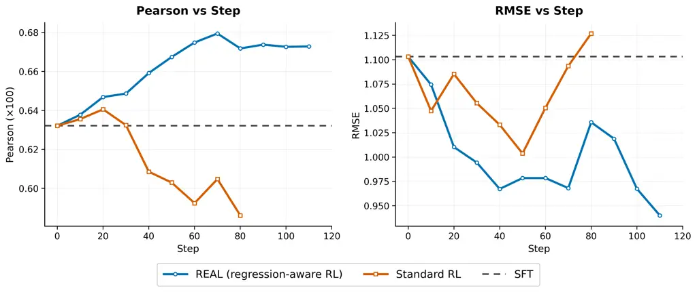
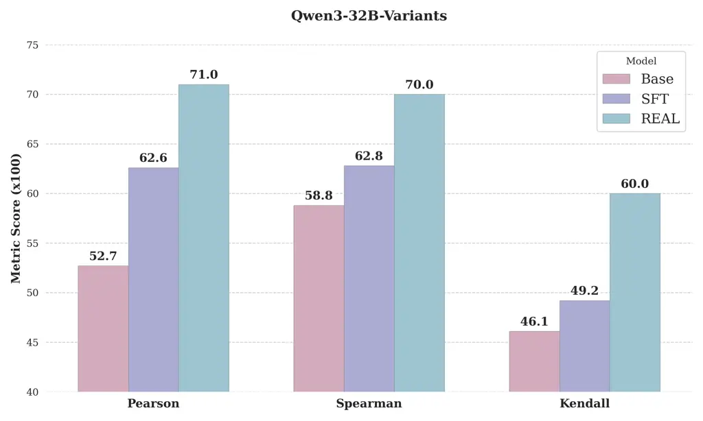
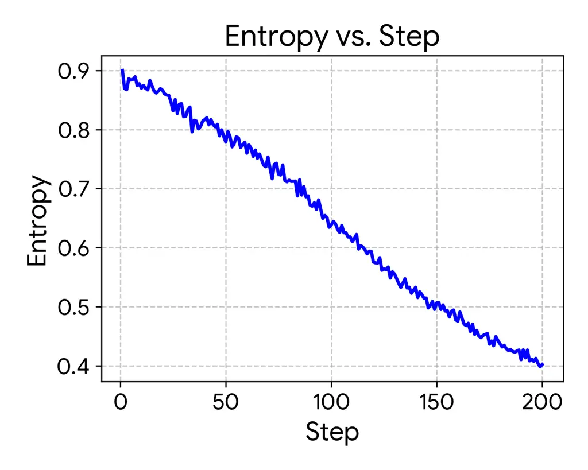
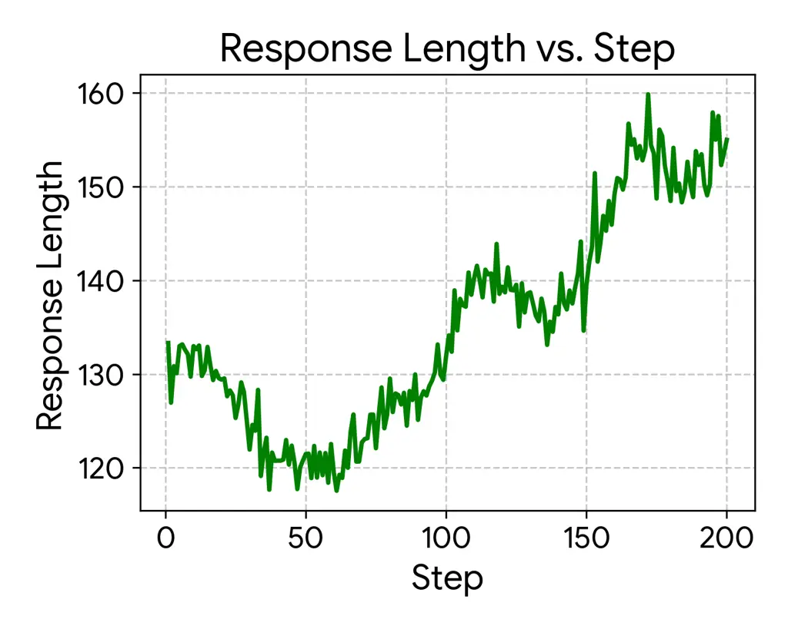

# REAL: Regression-Aware Reinforcement Learning for LLM-as-a-Judge

Yasi Zhang Affiliation: University of California, Los Angeles
Correspondence to: <yasminzhang@ucla.edu>    Tianyu Chen
Affiliation: The University of Texas at Austin Correspondence to:
<tianyuchen@utexas.edu>    Mingyuan Zhou Affiliation: The University of
Texas at Austin    Oscar Leong Affiliation: University of California,
Los Angeles    Ying Nian Wu Affiliation: University of California, Los
Angeles    Michal Lukasik Affiliation: Google Research ^($`\dagger`$)Now
at Google DeepMind

###### Abstract

Large language models (LLMs) are increasingly deployed as automated
evaluators that assign numeric scores to model outputs, a paradigm known
as LLM-as-a-Judge. However, standard Reinforcement Learning (RL) methods
typically rely on binary rewards (e.g., 0-1 accuracy), thereby ignoring
the ordinal structure inherent in regression tasks; for instance, they
fail to recognize that predicting 4 is significantly better than
predicting 1 when the ground truth is 5. Conversely, existing
regression-aware approaches are often confined to Supervised Fine-Tuning
(SFT), limiting their ability to explore optimal reasoning paths. To
bridge this gap, we propose REAL (REgression-Aware Reinforcement
Learning), a principled RL framework designed to optimize regression
rewards, and also proven to be optimal for correlation metrics. A key
technical challenge is that the regression objective is explicitly
policy-dependent, thus invalidating standard policy gradient methods. To
address this, we employ the generalized policy gradient estimator, which
naturally decomposes optimization into two complementary components: (1)
exploration over Chain-of-Thought (CoT) trajectory, and (2)
regression-aware prediction refinement of the final score. Extensive
experiments across model scales (8B to 32B) demonstrate that REAL
consistently outperforms both regression-aware SFT baselines and
standard RL methods, exhibiting significantly better generalization on
out-of-domain benchmarks. These findings highlight the critical value of
integrating regression objectives into RL exploration for accurate LLM
evaluation. Code is available at
[https://github.com/YasminZhang/REAL](https://github.com/YasminZhang/REAL).

###### Keywords: 

Machine Learning, ICML

^(†)^(†)affiliationnotice: Equal contribution

Figure 1: Overview of the REAL framework. REAL addresses the limitations
of standard RL in LLM-as-a-Judge tasks by optimizing a policy-dependent
regression reward. The framework employs a generalized policy gradient
that leads to a gradient update that decomposes into two terms: (1)
Exploration Over Reasoning Trajectory; and (2) Regression-Aware
Prediction Refinement. This enables principled optimization of ordinal
structures that standard RL with binary rewards typically ignores. The
full algorithm is in Alg. 2.

## 1 Introduction

Large Language Models (LLMs) (Brown et al., 2020; Achiam et al., 2023)
have evolved beyond mere content generators to become sophisticated
evaluators, a paradigm known as LLM-as-a-Judge (Gu et al., 2024; Chiang
and Lee, 2023). This role is now central to diverse applications, from
assessing text quality (Ouyang et al., 2022) and instruction following
(Zhu et al., 2025) to safety alignment (Zhu et al., 2024) and preference
modeling (Kim et al., 2023). In these contexts, the model must produce a
numeric score that accurately reflects quality, correctness, or
preference intensity.

Despite the regression nature of these tasks, standard
practices—exemplified by Prometheus 1 and 2 (Kim et al., 2023; Kim et
al., 2024)—rely on traditional SFT via cross-entropy loss. By treating
numeric scores as categorical tokens, these methods ignore the inherent
ordinal structure of the data. Recent advancements, such as
Regression-Aware Fine-Tuning (RAFT) (Lukasik et al., 2025; Lukasik et
al., 2024), have begun to bridge this gap by optimizing models using
regression losses over expected numerical predictions. Extensions like
TRACT (Chiang et al., 2025) further incorporate Chain-of-Thought (CoT)
supervision to improve reasoning faithfulness. However, these approaches
remain confined to the SFT regime: they depend on static ground-truth
trajectories and lack a principled mechanism for exploring
model-generated reasoning pathways.

Transitioning from regression-aware SFT to Reinforcement Learning (RL)
is, therefore, a natural progression to enable exploration over CoT
pathways. This shift allows the model to search for optimal reasoning
trajectories guided by downstream numerical objectives. However,
standard RL post-training frameworks (Schulman et al., 2017; Guo et al.,
2025; Ahmadian et al., 2024) typically rely on rule-based verifiers to
produce binary rewards (Guo et al., 2025) (e.g., 0–1 accuracy), creating
a mismatch between the LLM-as-a-Judge task’s regression nature and
categorical RL optimization. For instance, standard RL fails to
recognize that predicting a 4 is significantly better than predicting a
1 when the ground truth is 5. Empirically, we also find that standard RL
leads to suboptimal learning behavior, specifically a collapse in
correlation metrics (see Fig. 2 and Tab. 2).

To address this challenge, we introduce Regression-Aware Reinforcement
Learning (REAL), a principled framework designed specifically for
LLM-as-a-Judge and pointwise evaluation tasks, as presented in Fig. 1.
However, integrating regression-aware objectives into RL introduces a
significant theoretical challenge: the resulting reward functions depend
explicitly on the policy parameters themselves. To resolve the resulting
policy-dependency reward issue, we employ the generalized policy
gradient (Schulman et al., 2015) that explicitly accounts for
parameter-dependent rewards. This derivation decomposes the learning
process into two complementary components: (1) A CoT policy-gradient
term that encourages exploration over reasoning trajectories based on
downstream regression-aware rewards; and (2) A prediction refinement
term that provides regression-aware supervision to the final numerical
prediction via standard backpropagation. This decomposition clarifies
how reasoning exploration and numerical accuracy can be jointly
optimized within a unified framework.

Theoretically, Sec. 3 proves that minimizing the regression loss leads
to optimal optimization in terms of correlation metrics. Empirically,
REAL consistently outperforms prior regression-aware SFT methods
(Lukasik et al., 2025; Chiang et al., 2025) across multiple benchmarks
(See Fig. 3). Notably, REAL exhibits superior generalization to
out-of-domain tasks, highlighting the importance of modeling regression
structures directly within RL. While concurrent works like J1
(Whitehouse et al., 2025) also apply RL to the LLM-as-a-Judge setting,
they fail to exploit the ordinal nature of numeric scoring. To the best
of our knowledge, we are the first to successfully integrate a
regression-aware objective directly into the RL training pipeline for
LLM evaluators.



Figure 2: Evaluation performance during RL training. Both standard RL
with binary reward (i.e., $`r_{\text{acc}}=\mathbf{1}(y=y^{*})`$) and
REAL with regression-aware reward (i.e., Eq. 5) were initialized from
the SOTA SFT checkpoint, i.e., TRACT (Chiang et al., 2025). Standard RL
results in suboptimal performance in correlation metrics compared to our
proposed approach: REAL.



Figure 3: Performance gains on Qwen3-32B. Our method achieves an average
increase of +8.40 Pearson and +7.20 Spearman correlation over the SFT
baseline, and +18.30/+11.20 over the base model.

In summary, our contributions are threefold:

1.  1.  We propose REAL, a principled regression-aware RL framework that
        bridges the gap between standard RL and regression-based tasks by
        introducing a policy-dependent regression loss, as presented in Fig.
    1.  This formulation explicitly models the ordinal structure of
        evaluation tasks, addressing the inherent limitations of binary
        rewards (See Fig. 2). Furthermore, we provide a theoretical proof
        demonstrating that minimizing this regression loss also optimizes
        correlation metrics, as presented in Sec. 3.
2.  2.  We employ a generalized policy gradient estimator that enables
        mathematically sound optimization of policy-dependent objectives.
        This derivation reveals a functional decomposition that decouples
        the exploration of reasoning trajectories (CoT) from the
        optimization of final numerical predictions.
3.  3.  Experiments across model scales (8B to 32B) demonstrate that REAL
        consistently outperforms both regression-aware SFT baselines and
        standard RL methods. REAL exhibits superior generalization on
        out-of-domain benchmarks; specifically, on Qwen3-32B, we achieve
        gains of +8.40 Pearson and +7.20 Spearman correlation over the SFT
        baseline, and +18.30/+11.20 over the base model, as shown in Fig. 3.

## 2 Background

### 2.1 LLMs and Reinforcement Learning

LLMs are typically trained in phases, starting from pre-training (Kaplan
et al., 2020; Brown et al., 2020), following with multiple stages of
post-training (Ouyang et al., 2022), most notably an alignment phase
where an LLM is trained to improve its reasoning capabilities via
Reinforcement Learning (RL) (Guo et al., 2025). Let $`x`$ denote the
input prompt, $`c`$ the chain-of-thought (CoT), and $`y`$ the final
answer. We define $`\mathcal{D}`$ as the training set, which, depending
on the context, may consist of prompts $`\{x\}`$, prompt-target pairs
$`\{(x,y^{*})\}`$, or triplets $`\{(x,c^{*},y^{*})\}`$. Here, the
superscript ^(∗) denotes ground truth, as opposed to a predicted value
from the model. Furthermore, let $`\pi_{\theta}(\cdot\mid x)`$ represent
the distribution over token sequences, typically the CoT reasoning $`c`$
followed by the final answer $`y`$, as generated by a language model
with learnable parameters $`\theta`$. Fundamentally, the objective of
reinforcement learning (Sutton et al., 1999) is to maximize a reward:

```math
\displaystyle\mathcal{L}({\theta})=\mathbb{E}_{x\sim\mathcal{D},(c,y)\sim\pi_{\theta}(\cdot|x)}\left[r(x,y)\right], \tag{1}
```

where the reward function $`r`$ is commonly an accuracy-based reward in
the form of $`\mathbf{1}(y=y^{*})`$ if the ground-truth label $`y^{*}`$
is available in the training dataset.

Since the reward $`r(x,y)`$ in LLM applications is typically only
available after the entire sequence is generated, it is common to treat
the full completion as a single action, resulting in a bandit-style
formulation. This enables the use of the REINFORCE gradient estimator
(Williams, 1992; Nguyen et al., 2017). Under this formulation, the
policy gradient can be written as:

```math
\displaystyle\nabla_{\theta}\mathcal{L}(\theta)=\mathbb{E}_{x\sim\mathcal{D},(c,y)\sim\pi_{\theta}(\cdot\mid x)}\left[r(x,y)\,\nabla_{\theta}\log\pi_{\theta}(y,c|x)\right]. \tag{2}
```

In this formulation, the reward $`r(x,y)`$ serves as a scalar weighting
factor on the policy gradient, amplifying updates for high-reward
generations while attenuating those associated with low rewards. We note
that the derivation of the gradient relies on the assumption that the
reward does not explicitly depend on the policy parameters, i.e.,
$`\nabla_{\theta}r(x,y)=0`$.

### 2.2 Regression-Aware Inference and Finetuning in LLMs

Standard supervised fine-tuning (SFT) for LLMs typically relies on
cross-entropy loss (Brown et al., 2020). This objective is suboptimal
for regression tasks as it treats all incorrect numerical tokens
equally, failing to account for their metric distance from the target
value. To address this, several methods have been proposed to align LLM
outputs with the inherent structure of numerical targets.

Regression-Aware Fine-Tuning (RAFT) (Lukasik et al., 2025) replaces
token-level classification with a squared error loss. This loss is
computed between the ground-truth score and an expected-value predictor,
which applies a Bayes-optimal decision rule to the model’s output
distribution. Specifically, given an input $`x`$ and ground-truth
reasoning $`c^{*}`$ and label $`y^{*}`$ from a dataset $`\mathcal{D}`$,
the RAFT objective to minimize is defined as:

```math
\displaystyle\mathcal{L}_{\text{RAFT}}({\theta})= \displaystyle\mathbb{E}_{(x,c^{*},y^{*})\sim\mathcal{D}}
```

```math
\displaystyle[\underbrace{(\hat{y}_{\theta}(x,c^{*})-y^{*})^{2}}_{\text{regression loss}}-\underbrace{\lambda\log\pi_{\theta}(c^{*},y^{*}|x)}_{\text{next token prediction loss}}], \tag{3}
```

where
$`\hat{y}_{\theta}(x,c)=\sum_{k\in\mathcal{K}}k\cdot\pi_{\theta}(k|x,c)`$
denotes the expected value of the numerical prediction, originally
proposed as the RAIL predictor (see Alg. 1) for regression-aware
inference (Lukasik et al., 2024). Here, $`\mathcal{K}=\{0,1,\dots,9\}`$
represents the set of single-digit numerical tokens, and $`\lambda`$ is
a hyperparameter balancing the regression objective with the standard
next-token prediction (NTP) loss. The RAIL predictor has been shown to
offer “free-lunch” improvements in Pearson and Spearman correlation
(Lukasik et al., 2025; Chiang et al., 2025), a finding we corroborate in
Tab. 2.

1: Input prompt $`x`$, LLM $`\pi_{\theta}`$

2: Generate chain of thought $`c\sim\pi_{\theta}(\cdot|x)`$

3: \# Compute expected value over digit token set $`\mathcal{K}`$

4:
$`\hat{y}_{\theta}\leftarrow\sum_{k\in\mathcal{K}}k\cdot\pi_{\theta}(k\mid x,c)`$

5: return RAIL predictor $`\hat{y}_{\theta}`$

Algorithm 1 RAIL predictor (Lukasik et al., 2024)

Building on this foundation, TRACT (Chiang et al., 2025) extends the
RAFT framework by incorporating self-generated reasoning paths. TRACT
utilizes a two-stage SFT pipeline: initially, a temporary model
$`\pi_{\text{temp}}`$ is trained via the RAFT objective (Eq. 3).
Subsequently, a refined dataset is synthesized by pairing the original
inputs $`x`$ with reasoning trajectories $`c`$ sampled from the
temporary policy, $`c\sim\pi_{\text{temp}}(\cdot|x)`$, while retaining
the ground-truth labels $`y^{*}`$. The final model is then trained on
this augmented triplet dataset $`\{(x,c,y^{*})\}`$ using the same RAFT
objective. While this self-generation strategy significantly improves
performance, it remains fundamentally a static SFT procedure. It lacks a
principled mechanism for continuous, active exploration of the reasoning
space—a limitation we overcome by transitioning to a reinforcement
learning framework.

## 3 Optimal Decision Rule for LLM-as-a-Judge Evaluation Metrics

Standard approaches for LLM post-training often frame reinforcement
learning using a binary accuracy reward (i.e., the indicator function
$`\mathbf{1}\{{y}=y^{*}\}`$), strictly optimizing for prediction
correctness while performing inference via standard stochastic decoding.
We argue that this paradigm is theoretically suboptimal for benchmarks
primarily evaluated on correlation metrics, such as LLM-as-a-Judge (Gu
et al., 2024; Chiang and Lee, 2023; Zheng et al., 2023b; Liu et al.,
2023a; Zhu et al., 2024; Ouyang et al., 2022; Zhu et al., 2025). Prior
works on regression-aware LLMs showed that other decision rules are
optimal for regression loss (Lukasik et al., 2025; Chiang et al., 2025),
but an optimal rule for correlation has not been discussed in these
works, despite evaluating on correlation.

A fundamental challenge in optimizing for correlation is that it is
inherently a population statistic defined over a set of predictions,
rather than a single data point. Consequently, correlation cannot be
directly utilized as a standard per-sample reward signal in
reinforcement learning. We formally demonstrate that this limitation can
be bypassed by identifying a shared optimal estimator: the squared error
loss, a tractable per-sample objective, serves as the natural proxy for
maximizing Pearson correlation.

###### Lemma 3.1 (Optimality of Squared Error for Pearson Correlation).

Consider the following distributions: the distribution over input
prompts $`x\sim P_{\mathcal{D}}(.)`$, the distribution over chains of
thought (CoTs) $`c\sim\pi_{\theta}(.\mid x)`$ generated by the LLM
policy $`\pi_{\theta}`$, and the distribution over targets conditioned
on the inputs, $`y^{*}\sim P(.\mid x)`$. In this case, we assume the
conditional independence $`c\perp y^{*}\mid x`$, yielding the joint
distribution:
$`P_{\theta}(x,c,y^{*})=P_{\mathcal{D}}(x)\pi_{\theta}(c\mid x)P(y^{*}\mid x).`$
All expectations $`\mathbb{E}[\cdot]`$ below are taken with respect to
$`P_{\theta}(x,c,y^{*})`$. Define the posterior mean
$`\mu(x,c)\triangleq\mathbb{E}[y^{*}\mid x,c]`$ and the squared-error
risk
$`\mathcal{R}(\hat{y})\triangleq\mathbb{E}\!\left[\big(\hat{y}(x,c)-y^{*}\big)^{2}\right].`$
Assume $`\mathrm{Var}(y^{*})>0`$ and $`\mathrm{Var}(\mu(x,c))>0`$. The
risk $`\mathcal{R}(\hat{y})`$ is minimized (a.s.) by
$`\hat{y}^{*}(x,c)=\mu(x,c)`$, and the Pearson correlation
$`\rho(\hat{y}(x,c),y^{*})`$ is maximized by any positive affine
transform of $`\mu`$:
$`\hat{y}(x,c)=a\,\mu(x,c)+b,\quad a>0,\ b\in\mathbb{R}.`$ In
particular, the squared-error minimizer
$`\hat{y}^{*}(x,c)=\mathbb{E}[y^{*}\mid x,c]`$ is also optimal for
maximizing Pearson correlation. In other words, by minimizing the
squared error, we implicitly train the predictor to be the optimal
estimator for the Pearson correlation metric.

The proof, provided in Appendix E, establishes that the Pearson
correlation is maximized by any positive linear transformation of the
conditional expectation (Lemma E.1), and that the squared error loss is
uniquely minimized by that same conditional expectation (Lemma E.2). By
minimizing the squared loss, we implicitly train the predictor to be the
optimal estimator for the Pearson correlation metric. This result aligns
with empirical findings in RAFT (Lukasik et al., 2025) and TRACT (Chiang
et al., 2025), which demonstrate that regression-aware objectives are
effective for both squared error and correlation-based evaluation
metrics.

## 4 REAL: Regression-Aware Reinforcement Learning

In this section, we introduce Regression-Aware Reinforcement Learning
(REAL), a framework that leverages regression-based rewards to optimize
LLM evaluators. As theoretically demonstrated in Sec. 3, this
formulation is optimal for maximizing correlation metrics.

We first note that REAL extends the principles of regression-aware
supervised fine-tuning—specifically RAFT (Lukasik et al., 2025) and
TRACT (Chiang et al., 2025)—into the reinforcement learning regime. By
transitioning to RL, the model is no longer confined to static,
ground-truth reasoning but is instead able to explore and refine its own
self-generated reasoning trajectories. A key distinction in our
framework is that the resulting regression reward is policy-dependent,
which necessitates the use of a generalized policy gradient to ensure
valid optimization. This estimator naturally decomposes the training
process into two distinct components: the exploration of reasoning
pathways and the refinement of numerical predictions.

### 4.1 REAL Objective

We define the REAL objective to minimize
$`\mathcal{L}_{\text{REAL}}(\theta)`$ as:

```math
\displaystyle\mathcal{L}_{\text{REAL}}(\theta)= \displaystyle\mathbb{E}_{(x,y^{*})\sim\mathcal{D},c\sim\pi_{\theta}(\cdot|x)}
```

```math
\displaystyle[(\hat{y}_{\theta}(x,c)-y^{*})^{2}-\lambda\log\pi_{\theta}(y^{*}|x,c)], \tag{4}
```

In other words, we are augmenting the regression loss with an auxiliary
log-likelihood term on the final answer tokens. When setting
$`\lambda=0`$ we recover the exact regression loss, which is of key
importance for endowing the model with better numerical prediction
abilities. Augmenting with the log-likelihood term is also in line with
the SFT objective design in TRACT (Chiang et al., 2025).

Consequently, the implicit reward function in our framework is defined
as:

```math
r_{\text{REAL}}(\theta,x,c)=-(\hat{y}_{\theta}(x,c)-y^{*})^{2}+\lambda\log\pi_{\theta}(y^{*}|c,x). \tag{5}
```

Crucially, unlike standard RL post training where the reward is provided
by a fixed external model, our reward function $`r_{\text{REAL}}`$
explicitly depends on the policy parameters $`\theta`$ (via the
estimator $`\hat{y}_{\theta}`$ and probability $`\pi_{\theta}`$).

### 4.2 Generalized Policy Gradient with Policy-Dependent Reward Functions

In standard LLM post-training methodologies, the reward function is
typically modeled as an external signal derived from the environment or
a fixed preference model, independent of the current policy
$`\pi_{\theta}`$ (i.e., $`\nabla_{\theta}r=0`$). However, our framework
introduces a reward function $`r_{\text{REAL}}(\theta,x,c)`$ (Eq.5) that
explicitly depends on the policy parameters $`\theta`$. Consequently,
the standard policy gradient formulation is insufficient. In this
section, we formalize the generalized policy gradient (Schulman et al., 2015) for this class of policy-dependent reward functions.

###### Lemma 4.1 (Generalized Policy Gradient with Policy-Dependent Rewards for Regression).

Let the objective be
$`\mathcal{L}(\theta)=\mathbb{E}_{x\sim\mathcal{D}}\mathbb{E}_{c\sim\pi_{\theta}(\cdot\mid x)}[r(\theta,x,c)]`$.
The gradient $`\nabla_{\theta}\mathcal{L}(\theta)`$ is given by:

```math
\begin{split}\nabla_{\theta}&\mathcal{L}(\theta)=\mathbb{E}_{(x,y^{*})\sim\mathcal{D},c\sim\pi_{\theta}(\cdot\mid x)}\\
&\Bigr[\underbrace{r(\theta,x,c)\nabla_{\theta}\log\pi_{\theta}(c\mid x)}_{\text{Term 1: CoT Update}}+\underbrace{\nabla_{\theta}r(\theta,x,c)}_{\text{Term 2: Prediction Update}}\Bigr].\end{split} \tag{6}
```

The first term optimizes the CoT generation, weighted by the reward; the
second term provides supervision for final answer prediction through
standard backpropagation. Specifically, by substituting the REAL reward
function (Eq. 5) into the general gradient expression (Eq. 6), we obtain
the gradient for the REAL objective (Eq. 4). Specifically, Term 2 can be
expanded as:

```math
\displaystyle\text{Term 2}=-2(\hat{y}_{\theta}(x,c) \displaystyle-y^{*})\nabla_{\theta}\hat{y}_{\theta}(x,c)
```

```math
\displaystyle+\lambda\nabla_{\theta}\log\pi_{\theta}(y^{*}|x,c) \tag{7}
```

where the gradient of the predicted value is
$`\nabla_{\theta}\hat{y}_{\theta}(x,c)=\sum_{k\in\mathcal{K}}k\cdot\nabla_{\theta}\pi_{\theta}(k|x,c).`$

#### Distinguishing Reasoning Exploration from Prediction Refinement

The REAL gradient (i.e., Eq. 6) explicitly decomposes optimization into
two distinct parts: exploring reasoning trajectories (Term 1) and
refining score prediction (Term 2). This separation is critical because
standard RL approaches like GRPO (Shao et al., 2024) treat the reasoning
chain $`c`$ and final answer $`y`$ as a homogeneous sequence, applying a
uniform update rule. In contrast, our framework addresses their
structural differences: the CoT update allows exploration via policy
gradients, whereas the final score targets a known ground truth,
allowing for direct correction via standard backpropagation.

### 4.3 Stabilization and Implementation

To enhance the stability of the REAL objective during training, we
utilize the RLOO estimator (Kool et al., 2019) for the first term, which
governs reasoning exploration. Other stabilization approaches (Schulman
et al., 2017; Guo et al., 2025) can be explored in future work. We note
that this is not central to the core contribution of our paper, i.e.,
the regression-aware RL objective and algorithm.

For a given input $`(x,y^{*})`$, we sample $`K`$ independent CoT
trajectories $`\{c_{1},c_{2},\dots,c_{K}\}`$ from the current policy
$`\pi_{\theta}(\cdot|x)`$. Let
$`r^{(i)}=r_{\text{REAL}}(\theta,x,c_{i})`$ denote the reward associated
with the $`i`$-th trajectory. The advantage $`{A}^{(i)}`$ is computed
as:
$`{A}^{(i)}=r^{(i)}-b^{(i)};b^{(i)}=\frac{1}{K-1}\sum_{j\neq i}r^{(j)}`$.
We further compute the standardized advantage
$`\tilde{A}^{(i)}=\text{clip}\left(\frac{A^{(i)}}{\sigma(A)+\epsilon},-1,1\right)`$
for better training stability, where $`\sigma(A)`$ denotes the standard
deviation of the advantages within the sampled group and
$`\epsilon=10^{-8}`$. Then from Eq. 6, replacing reward by RLOO
advantages in Term 1 and add $`\beta`$ on Term 2 controls the strength
of the prediction updates, we have the stabilized gradient estimator
defined as

```math
\displaystyle\nabla_{\theta}\mathcal{L}_{\text{REAL}}^{\text{RLOO}}(\theta)\approx\frac{1}{K}\sum_{i=1}^{K}\bigg[\underbrace{\tilde{A}^{(i)}_{\text{REAL}}\nabla_{\theta}\log\pi_{\theta}(c_{i}|x)}_{\text{CoT Update}}+\beta\underbrace{\nabla_{\theta}r_{\text{REAL}}(\theta,x,c_{i})}_{\text{Prediction Update}}\bigg] \tag{8}
```

Following (Tang et al., 2025) we introduce a prediction weight $`\beta`$
to balance Term 1 and Term 2. Note that Eq. 6 implies an exact weighting
of $`\beta=1.0`$, which we find to already bring good results, as shown
in Tab. 9.

### 4.4 Relations with Prior Methods

We provide a complete conceptual comparison with prior methods in Tab.

1.

|                          |          |                 |                   |                                                                                                                                                                         |
| ------------------------ | -------- | --------------- | ----------------- | ----------------------------------------------------------------------------------------------------------------------------------------------------------------------- | ------------------------------------- | ----------------------------------------- | ------------- |
| Method                   | Paradigm | CoT Exploration | Ordinal Awareness | Gradient                                                                                                                                                                |
| SFT                      | SFT      | ✗               | ✗                 | $`\mathbb{E}_{(x,y^{\*})\sim\mathcal{D}}\left[\nabla_{\theta}\log\pi\_{\theta}(y^{\*}                                                                                   | x)\right]`$                           |
| RAFT/TRACT               | SFT      | ✗               | ✓                 | $`\mathbb{E}_{(x,c,y^{*})\sim\mathcal{D}}\left[\nabla_{\theta}r(\theta,x,c)\right]`$                                                                                    |
| Standard RL              | RL       | ✓               | ✗                 | $`\mathbb{E}_{x\sim\mathcal{D},(c,y)\sim\pi_{\theta}(\cdot\mid x)}\left[r(x,y)\nabla*{\theta}\log\pi*{\theta}(y,c                                                       | x)\right]`$                           |
| JEPO (Tang et al., 2025) | RL       | ✓               | ✗                 | $`\mathbb{E}_{x\sim\mathcal{D},c\sim\pi_{\theta}(\cdot\mid x)}\left[\log\pi\_{\theta}(y^{\*}                                                                            | x,c)\nabla*{\theta}\log\pi*{\theta}(c | x)+\nabla*{\theta}\log\pi*{\theta}(y^{\*} | x,c)\right]`$ |
| REAL (ours)              | RL       | ✓               | ✓                 | $`\mathbb{E}_{(x,y^{*})\sim\mathcal{D},c\sim\pi_{\theta}(\cdot\mid x)}\left[r(\theta,x,c)\nabla_{\theta}\log\pi_{\theta}(c\mid x)+\nabla_{\theta}r(\theta,x,c)\right]`$ |

Table 1: Conceptual comparison of selected SFT and RL training methods
on non-ordinal and ordinal targets.
$`r(\theta,x,c)=-(\hat{y}_{\theta}(x,c)-y^{*})^{2}+\lambda\log\pi_{\theta}(y^{*}|x,c)`$
represents the regression-aware reward. REAL is the first framework to
combine a regression-aware reward with reinforcement learning for
reasoning exploration. Note that JEPO further approximates the gradient
with the multi-sample Jensen’s Bound.

#### Comparison to TRACT: Active vs. Static Reasoning

We identify both a conceptual connection and a critical limitation in
TRACT (Chiang et al., 2025). While TRACT introduces reasoning traces to
the regression setting, it remains confined to the SFT paradigm.
Specifically, TRACT treats all self-generated Chain-of-Thought (CoT)
trajectories as ground truth, failing to evaluate their intermediate
quality. In contrast, REAL leverages a regression-aware reward to
actively explore and rank CoT trajectories during RL. Mathematically,
TRACT’s update is equivalent to the prediction refinement term (Term 2)
of our objective, but it lacks the trajectory exploration component
(Term 1) necessary for true reinforcement learning, as can be seen when
comparing the respective rows in Tab. 1. Thus, TRACT can be viewed as an
offline, supervised subset of the more general REAL framework.

#### Regression-Aware vs. Standard RL

Standard RL typically relies on coarse binary rewards (e.g., 0/1
accuracy), which ignores the ordinal structure inherent in evaluation
tasks. As illustrated in Fig. 2, REAL utilizes the policy’s full
probability distribution to shape a fine-grained, regression-aware
reward. This allows the model to distinguish ”near-miss” predictions
from total failures, leading to significantly higher alignment with
human judgment as demonstrated by the correlation metrics in Tab. 2.

#### Comparison to JEPO:

JEPO (Tang et al., 2025) optimizes the marginal log-likelihood
$`\log p(y^{*}|x)`$ using Jensen’s bound to handle unverifiable data.
While effective for tasks like mathematical proofs, JEPO lacks the
ordinal awareness required for numeric scoring in LLM-as-a-Judge
settings. Our REAL objective (4) is explicitly regression-aware,
providing a more principled approach for tasks where the distance
between scores matters. We contrast JEPO and our objectives in Tab. 1.
Since JEPO does not release an official codebase, we reproduced their
results in our setting. The empirical comparisons in Tab. 14 in the
Appendix confirm that REAL consistently outperforms JEPO across all
regression metrics.

|                        |          |           |          |          |          |       |          |          |            |          |          |          |          |          |         |          |          |
| ---------------------- | -------- | --------- | -------- | -------- | -------- | ----- | -------- | -------- | ---------- | -------- | -------- | -------- | -------- | -------- | ------- | -------- | -------- |
| Method                 | Training | Inference | FB Bench |          |          | FLASK |          |          | Vic. Bench |          |          | MT Bench |          |          | Average |          |          |
|                        |          |           | $`r`$    | $`\rho`$ | $`\tau`$ | $`r`$ | $`\rho`$ | $`\tau`$ | $`r`$      | $`\rho`$ | $`\tau`$ | $`r`$    | $`\rho`$ | $`\tau`$ | $`r`$   | $`\rho`$ | $`\tau`$ |
| Baseline Reward Models |          |           |          |          |          |       |          |          |            |          |          |          |          |          |         |          |          |
| GPT-3.5-Turbo-0613     | None     | Standard  | 56.3     | 52.1     | 45.3     | 27.0  | 23.2     | 18.7     | 27.5       | 26.7     | 20.2     | 42.2     | 37.1     | 29.9     | 38.3    | 34.8     | 28.5     |
| Prometheus-1-7B        | SFT      | Standard  | 84.7     | 84.9     | 76.7     | 45.7  | 45.7     | 36.5     | 29.3       | 29.5     | 21.6     | 36.7     | 37.1     | 28.5     | 49.1    | 49.3     | 40.8     |
| Prometheus-1-13B       | SFT      | Standard  | 86.0     | 85.8     | 77.1     | 46.6  | 42.9     | 34.6     | 47.3       | 45.1     | 34.1     | 46.7     | 45.5     | 34.5     | 56.7    | 54.8     | 45.1     |
| Prometheus-2-7B        | SFT      | Standard  | 84.5     | 84.7     | 76.5     | 51.2  | 49.3     | 40.5     | 48.8       | 48.0     | 41.1     | 51.9     | 48.3     | 39.2     | 59.1    | 57.6     | 49.3     |
| Prometheus-2-7B        | SFT      | RAIL      | 85.3     | 85.3     | 72.9     | 52.5  | 51.4     | 39.2     | 51.0       | 51.3     | 40.3     | 53.8     | 51.1     | 38.9     | 60.7    | 59.8     | 47.8     |
| Mistral2-7B-Variants   |          |           |          |          |          |       |          |          |            |          |          |          |          |          |         |          |          |
| Base (w/ warmup)       | None     | Standard  | 83.1     | 83.3     | 74.8     | 41.5  | 41.9     | 34.1     | 49.2       | 42.4     | 36.1     | 30.9     | 31.8     | 25.3     | 51.2    | 49.8     | 42.6     |
| Base (w/ warmup)       | None     | RAIL      | 83.7     | 84.3     | 70.2     | 42.5  | 43.7     | 32.3     | 50.3       | 45.4     | 34.0     | 32.0     | 29.9     | 21.4     | 52.1    | 50.8     | 39.5     |
| RAFT                   | SFT      | RAIL      | 87.9     | 88.0     | 76.3     | 41.8  | 41.9     | 31.5     | 52.8       | 51.3     | 40.9     | 39.9     | 41.8     | 30.7     | 55.6    | 55.8     | 44.8     |
| TRACT                  | SFT      | RAIL      | 93.9     | 93.7     | 82.9     | 50.7  | 50.0     | 37.2     | 56.2       | 54.8     | 42.6     | 52.1     | 50.1     | 36.6     | 63.2    | 62.2     | 49.8     |
| Standard RL            | RL       | RAIL      | 93.7     | 93.7     | 82.8     | 51.6  | 50.5     | 37.9     | 58.0       | 56.0     | 43.4     | 52.9     | 50.7     | 37.1     | 64.1    | 62.7     | 50.3     |
| REAL (ours)            | RL       | RAIL      | 93.2     | 93.4     | 82.5     | 56.0  | 54.1     | 41.1     | 63.3       | 60.2     | 46.3     | 59.3     | 56.9     | 42.2     | 67.9    | 66.2     | 53.0     |
| Qwen3-8B-Variants      |          |           |          |          |          |       |          |          |            |          |          |          |          |          |         |          |          |
| Base                   | None     | Standard  | 56.6     | 62.7     | 53.9     | 44.8  | 48.0     | 40.1     | 37.3       | 46.5     | 40.8     | 35.5     | 32.7     | 26.5     | 43.6    | 47.4     | 40.3     |
| Base                   | None     | RAIL      | 56.7     | 65.4     | 54.1     | 45.0  | 48.3     | 38.5     | 37.3       | 46.1     | 38.6     | 35.9     | 35.5     | 27.0     | 43.7    | 48.8     | 39.5     |
| RAFT                   | SFT      | RAIL      | 84.3     | 85.5     | 73.0     | 49.2  | 50.1     | 37.5     | 59.9       | 57.2     | 44.0     | 54.1     | 51.7     | 38.5     | 61.9    | 61.1     | 48.3     |
| TRACT                  | SFT      | RAIL      | 94.9     | 94.7     | 84.3     | 51.4  | 51.3     | 38.5     | 50.5       | 50.4     | 38.3     | 55.8     | 58.6     | 43.6     | 63.1    | 63.8     | 51.2     |
| Standard RL            | RL       | RAIL      | 94.0     | 94.2     | 83.5     | 52.3  | 52.4     | 39.5     | 57.1       | 56.1     | 43.0     | 49.5     | 53.5     | 39.7     | 63.2    | 64.0     | 51.4     |
| REAL (ours)            | RL       | RAIL      | 92.0     | 92.1     | 85.7     | 53.8  | 53.9     | 43.1     | 60.5       | 57.8     | 48.2     | 61.7     | 60.8     | 47.1     | 67.0    | 66.0     | 56.1     |
| Qwen3-32B-Variants     |          |           |          |          |          |       |          |          |            |          |          |          |          |          |         |          |          |
| Base                   | None     | RAIL      | 63.4     | 70.8     | 56.7     | 54.3  | 60.4     | 47.2     | 50.8       | 57.4     | 45.0     | 42.5     | 46.8     | 35.3     | 52.7    | 58.8     | 46.1     |
| RAFT                   | SFT      | RAIL      | 85.4     | 86.5     | 72.9     | 52.1  | 52.9     | 39.9     | 51.9       | 52.0     | 39.9     | 61.1     | 59.6     | 43.9     | 62.6    | 62.8     | 49.2     |
| REAL (ours)            | RL       | RAIL      | 91.1     | 91.7     | 85.9     | 58.9  | 58.6     | 47.4     | 65.1       | 60.7     | 51.2     | 68.9     | 69.1     | 55.2     | 71.0    | 70.0     | 60.0     |

Table 2: Evaluation results ($`\times 100`$) across benchmarks using
Pearson ($`r`$), Spearman ($`\rho`$), and Kendall ($`\tau`$). All
baseline reward model scores are taken from TRACT (Chiang et al., 2025)
and Prometheus (Kim et al., 2023). Results for the Mistral and Qwen
models are obtained from our own runs. Underline indicates the
initialization checkpoint used by REAL. We find that TRACT saturates on
the Qwen3 series models, so we choose RAFT as the initialization
checkpoint. Mistral2-7B’s base model failed to follow instructions and
respond in the correct format, so we applied a 100-step warmup. Due to
computational constraints we run only RAFT and REAL for Qwen3-32B; we
include all baselines for other models.

|          |                    |                       |                       |                     |                    |
| -------- | ------------------ | --------------------- | --------------------- | ------------------- | ------------------ |
| Setting  | $`r`$ $`\uparrow`$ | $`\rho`$ $`\uparrow`$ | $`\tau`$ $`\uparrow`$ | RMSE $`\downarrow`$ | MAE $`\downarrow`$ |
| $`N=1`$  | 67.9               | 66.2                  | 53.0                  | 0.968               | 0.697              |
| $`N=4`$  | 68.1               | 66.2                  | 53.0                  | 0.965               | 0.695              |
| $`N=10`$ | 68.1               | 66.2                  | 53.0                  | 0.964               | 0.695              |

Table 3: Average-of-N results at inference. Averaging the results of
$`N`$ generations slightly improves performance, although REAL already
enjoys efficiency and strong performance at $`N=1`$.

|                  |      |       |          |          |
| ---------------- | ---- | ----- | -------- | -------- |
| Method           | Type | $`r`$ | $`\rho`$ | $`\tau`$ |
| TRACT            | SFT  | 63.2  | 62.2     | 49.8     |
| Standard RL(acc) | RL   | 64.1  | 62.7     | 50.3     |
| Standard RL(reg) | RL   | 63.4  | 62.6     | 50.1     |
| REAL             | RL   | 67.9  | 66.2     | 53.0     |

Table 4: Comparison between standard RL baselines and REAL on
Mistral2-7B. Standard RL(reg) with regression-aware policy-independent
rewards also fail to improve upon the SFT checkpoint.

|          |                    |                       |                       |                     |                    |
| -------- | ------------------ | --------------------- | --------------------- | ------------------- | ------------------ |
| Setting  | $`r`$ $`\uparrow`$ | $`\rho`$ $`\uparrow`$ | $`\tau`$ $`\uparrow`$ | RMSE $`\downarrow`$ | MAE $`\downarrow`$ |
| $`K=4`$  | 63.7               | 62.6                  | 50.2                  | 1.063               | 0.775              |
| $`K=8`$  | 67.2               | 65.0                  | 52.0                  | 0.943               | 0.679              |
| $`K=16`$ | 67.9               | 66.2                  | 53.0                  | 0.968               | 0.697              |

Table 5: Ablation on group size $`K`$. Larger values of $`K`$ generally
result in better correlation performance.

|                |                    |                       |                       |                     |                    |
| -------------- | ------------------ | --------------------- | --------------------- | ------------------- | ------------------ |
| Setting        | $`r`$ $`\uparrow`$ | $`\rho`$ $`\uparrow`$ | $`\tau`$ $`\uparrow`$ | RMSE $`\downarrow`$ | MAE $`\downarrow`$ |
| TRACT          | 63.2               | 62.2                  | 49.8                  | 1.103               | 0.813              |
| $`\lambda=0`$  | 66.0               | 64.6                  | 51.8                  | 1.027               | 0.736              |
| $`\lambda=1`$  | 67.9               | 66.2                  | 53.0                  | 0.968               | 0.697              |
| $`\lambda=5`$  | 68.1               | 65.8                  | 52.7                  | 0.955               | 0.719              |
| $`\lambda=10`$ | 68.1               | 66.1                  | 52.9                  | 0.928               | 0.699              |

Table 6: Ablation on log-likelihood weight $`\lambda`$. Using
regression-aware reward alone ($`\lambda=0`$) already yields excellent
results, while extra log-likelihood reward further improves.

|                           |                    |                       |                       |                     |                    |
| ------------------------- | ------------------ | --------------------- | --------------------- | ------------------- | ------------------ |
| Setting                   | $`r`$ $`\uparrow`$ | $`\rho`$ $`\uparrow`$ | $`\tau`$ $`\uparrow`$ | RMSE $`\downarrow`$ | MAE $`\downarrow`$ |
| $`0<\text{acc}<1`$        | 67.2               | 65.0                  | 52.0                  | 0.943               | 0.679              |
| $`0<\text{acc}\leq 1`$    | 65.6               | 64.1                  | 51.3                  | 1.000               | 0.711              |
| $`0\leq\text{acc}<1`$     | 65.3               | 63.4                  | 50.9                  | 1.001               | 0.728              |
| $`0\leq\text{acc}\leq 1`$ | 65.5               | 63.9                  | 51.1                  | 0.990               | 0.715              |

Table 7: Ablation on dynamic sampling when group size $`K=8`$. Partially
correct prompts provide the best learning signal.

|                 |                    |                       |                       |                     |                    |
| --------------- | ------------------ | --------------------- | --------------------- | ------------------- | ------------------ |
| Setting         | $`r`$ $`\uparrow`$ | $`\rho`$ $`\uparrow`$ | $`\tau`$ $`\uparrow`$ | RMSE $`\downarrow`$ | MAE $`\downarrow`$ |
| base            | 52.1               | 50.8                  | 39.5                  | 1.225               | 0.901              |
| init. from base | 58.8               | 56.8                  | 45.1                  | 1.155               | 0.793              |
| $`\Delta`$      | +6.7               | +6.0                  | +5.6                  | -0.070              | -0.108             |
| SFT             | 63.2               | 62.2                  | 49.8                  | 1.103               | 0.813              |
| init. from SFT  | 67.9               | 66.2                  | 53.0                  | 0.968               | 0.697              |
| $`\Delta`$      | +4.7               | +4.0                  | +3.2                  | -0.135              | -0.116             |

Table 8: Initialization from different checkpoints. Initializing from a
high-quality SFT checkpoint can lead to better SOTA performance. Our
algorithm works with different checkpoint types.

|                 |                    |                       |                       |                     |                    |
| --------------- | ------------------ | --------------------- | --------------------- | ------------------- | ------------------ |
| Setting         | $`r`$ $`\uparrow`$ | $`\rho`$ $`\uparrow`$ | $`\tau`$ $`\uparrow`$ | RMSE $`\downarrow`$ | MAE $`\downarrow`$ |
| Init. from Base |                    |                       |                       |                     |                    |
| $`\beta=0`$     | 57.7               | 56.9                  | 45.1                  | 1.200               | 0.831              |
| $`\beta=0.01`$  | 58.8               | 56.8                  | 45.1                  | 1.155               | 0.793              |
| $`\beta=1`$     | 57.9               | 56.4                  | 44.4                  | 1.184               | 0.822              |
| Init. from SFT  |                    |                       |                       |                     |                    |
| $`\beta=0`$     | 67.3               | 65.9                  | 52.5                  | 0.980               | 0.701              |
| $`\beta=0.01`$  | 67.9               | 66.2                  | 53.0                  | 0.968               | 0.697              |
| $`\beta=1`$     | 66.7               | 64.5                  | 51.6                  | 0.935               | 0.677              |

Table 9: Ablation on prediction weight $`\beta`$. We choose
$`\beta=0.01`$ (See Eq. 8) for initialization from both base and SFT
checkpoints.

|           |                    |                       |                       |                     |                    |
| --------- | ------------------ | --------------------- | --------------------- | ------------------- | ------------------ |
| Setting   | $`r`$ $`\uparrow`$ | $`\rho`$ $`\uparrow`$ | $`\tau`$ $`\uparrow`$ | RMSE $`\downarrow`$ | MAE $`\downarrow`$ |
| $`T=0.8`$ | 66.8               | 64.7                  | 51.9                  | 0.973               | 0.725              |
| $`T=1`$   | 67.9               | 66.2                  | 53.0                  | 0.968               | 0.697              |

Table 10: Ablation on temperature $`T`$. $`T=1`$ is chosen by default.
The temperature parameter is applied in both the training and inference
stages, for both CoT generation and score prediction.

## 5 Experiments

We mainly follow the experimental setup in (Chiang et al., 2025; Kim et
al., 2023; Kim et al., 2024) for evaluation, and implement our RL
algorithm using the codebase of verl (Sheng et al., 2024).

#### Models

We implement REAL on three LLMs with different architectures,
tokenizers, and sizes to demonstrate robustness across backbones: 1)
Mistral2-7B (Jiang et al., 2023), for a fair comparison with TRACT and
Prometheus-2, which both use it as their base model; 2) Qwen3-8B (Yang
et al., 2025), which uses a different tokenizer than Mistral and has
recently shown strong reasoning and instruction-following abilities; and 3) Qwen3-32B (Yang et al., 2025), to which we scale up performance to
demonstrate the scalability of REAL.

#### Datasets

We implement training on Feedback Collection (Kim et al., 2023), which
consists of approximately 100K pointwise samples together with 1K
fine-grained score rubrics, 20K instructions. Following (Chiang et al.,
2025; Kim et al., 2023; Kim et al., 2024), we evaluate pointwise
LLM-as-a-Judge performance on four widely used benchmarks: 1) Feedback
Bench, the official test set for Feedback Collection, includes 1K
non-overlapping score rubrics and 200 instructions; 2) FLASK, a
fine-grained evaluation benchmark, consists of 200 prompts, 12 score
rubrics, and 2K responses generated by Alpaca-7B (Taori et al., 2023),
Vicuna-13B (Chiang et al., 2023), Bard (Google, 2023), and
GPT-3.5-Turbo-0613 (OpenAI, 2023); 3) Vicuna Bench, a single-turn
dialogue dataset, includes 80 test prompts, 80 hand-crafted score
rubrics, and 320 responses generated by WizardLM-13B (Xu et al., 2023),
Vicuna-13B (Chiang et al., 2023), Llama-2Chat-13B (Touvron et al.,
2023), and GPT-3.5-Turbo-0613 (OpenAI, 2023); and 4) MT Bench, a
multi-turn chat benchmark, contains 80 test prompts, 80 hand-crafted
score rubrics, and 320 responses generated by the same models as above.
Together, these datasets cover a diverse range of prompts, score
rubrics, response styles, and difficulty levels. In addition, we note
that Feedback Bench can be regarded as more of an in-domain test
dataset, while the other three are out-of-distribution.

#### Evaluation Metrics

We report the Pearson correlation coefficient $`r`$ (Pearson, 1895),
Spearman’s rank correlation $`\rho`$ (Spearman, 1961), and Kendall’s
$`\tau`$ (Kendall, 1938) with ground-truth scores. Additionally, we
provide RMSE and MAE metrics in the ablation study for reference.

#### Baselines

We compare REAL against zero-shot, SFT, and RL baselines:

- (i)
  Zero-shot inference using the base model;
- (ii)
  RAFT (Lukasik et al., 2025), which applies regression-aware supervised
  fine-tuning with Eq. 3;
- (iii)
  TRACT (Chiang et al., 2025), which performs two-stage regression-aware
  supervised fine-tuning. Note that TRACT simply treats all
  self-generated CoTs as ground truth for the second stage, without any
  CoT update. In contrast, our method conducts CoT policy gradient
  updates weighted by the REAL reward;
- (iv)
  Standard RL (accuracy reward) (Kool et al., 2019), a baseline that
  uses accuracy as the reward, where
  $`r_{\text{acc}}=\mathbf{1}(y=y^{*})`$, and updates via
  $`A_{\text{acc}}\nabla_{\theta}\pi(c,y\mid x)`$, where
  $`A_{\text{acc}}`$ is the RLOO advantage for $`r_{\text{acc}}`$;
- (v)
  Other baseline reward models: 1) zero-shot GPT3.5-Turbo (OpenAI,
  2023); 2) Prometheus-1-7B (Kim et al., 2023); 3) Prometheus-1-13B (Kim
  et al., 2023); and 4) Prometheus-2-7B (Kim et al., 2024).

Following the findings in (Chiang et al., 2025; Lukasik et al., 2024),
we mainly report RAIL inference results, as RAIL has been shown to offer
free-lunch improvements under Pearson and Spearman correlation metrics
at inference.

#### Configuration

We conduct experiments using 8 NVIDIA A100 GPUs for Mistral2-7B and
Qwen3-8B, and 2×8 A100 GPUs for Qwen3-32B. All experiments are performed
using full-parameter fine-tuning. The learning rate is set to
$`5\times 10^{-8}`$ for the Mistral models and $`1\times 10^{-6}`$ for
the Qwen series. The max_response_length is set to 1024. Unless
otherwise specified, other hyperparameters are shared across all three
evaluated LLMs. Ablation studies are carried out to analyze the impact
of different hyperparameter settings on model performance.

### 5.1 Main Results

See Tab. 2 for all the results. Across all benchmarks and model
backbones, REAL consistently improves correlation with ground-truth
scores compared to the zero-shot inference, regression-aware supervised
fine-tuning, and the standard RL methods. We note that REAL performs
significantly better on out-of-domain benchmarks such as Vicuna, MT, and
Flask. We provide a qualitative example in Appendix G.

#### Average-of-N results at inference

We average the RAIL prediction $`\hat{y}_{\theta}`$ over $`N`$
generations for each test prompt as the final output and then calculate
the metrics shown in Tab. 3. Scaling $`N`$ to 4 or 10 slightly improves
performance, which indicates that REAL already achieves strong results
at $`N=1`$. This demonstrates that the model learns a robust policy
capable of efficiently identifying high-reward outputs. This
single-generation capability ensures peak sampling efficiency, making
REAL highly suitable for low-latency, real-world deployment by
eliminating the computational overhead of multi-sample averaging.

### 5.2 On Regression-Aware Policy-Independent Rewards

A natural question is whether the gains of REAL mainly come from the
regression-aware reward itself, rather than from our generalized policy
gradient formulation. To investigate this, we additionally evaluate a
policy-independent regression reward under standard RL training.
Specifically, Standard RL above uses an accuracy accuracy reward
$`r_{\text{acc}}=\mathbf{1}(y=y^{*})`$. We further construct a
regression-aware but policy-independent reward using squared error,
$`r_{\text{reg}}=-({y}-y^{*})^{2}`$ where
$`{y}=\arg\max_{k}\pi_{\theta}(k|x,c)`$, and train it with standard RL,
denoted as Standard RL(reg). Tab. 4 shows that Standard RL(reg) behaves
very similarly to Standard RL and quickly collapses during RL training,
whereas REAL consistently improves performance.

Intuitively, the key issue is that standard RL methods fail to evaluate
the true quality of sampled trajectories. For example, suppose the
ground-truth score is $`y^{*}=5`$. Since our REAL model is initialized
from a strong SFT checkpoint, many sampled trajectories already
correctly decode to $`{y}=5`$. Under standard RL methods such as RLOO,
PPO, or GRPO, all such trajectories receive identical rewards and
advantages, regardless of whether $`\pi_{\theta}(k=5|x,c)=0.9`$ or
$`0.8`$. Even with the regression-aware reward $`r_{\text{reg}}`$, the
advantage remains identical as long as the decoded prediction $`{y}`$ is
unchanged.

REAL circumvents this limitation by defining the reward on the
predictive distribution, which explicitly depends on the policy
parameters. Consequently, two trajectories that both decode to $`5`$ may
still yield different rewards (e.g., $`4.99`$ vs. $`4.70`$), providing a
substantially richer learning signal. These results suggest that the
gains of REAL do not simply come from replacing classification rewards
with regression-style rewards. Instead, the key ingredient is combining
a policy-dependent regression-aware reward with the generalized policy
gradient required to optimize it.

### 5.3 Ablation Studies

Rows shaded in gray indicate the default setting used in our
experiments.

#### Group size $`K`$: RLOO variance reduction results in superior performance

Tab. 5 indicates a clear positive correlation between the number of
sampled responses and the quality of the learned model. Increasing the
group size from $`K=4`$ to $`K=16`$ yields consistent improvements
across all correlation metrics, with the Pearson correlation $`r`$
rising from $`63.7`$ to $`67.9`$, indicating the effectiveness of RLOO
variance reduction.

#### Log-likelihood weight $`\lambda`$: regression-aware reward alone excels in performance; additional log-likelihood term gives further benefits.

Tab. 6 shows that using the regression-aware reward alone
($`\lambda=0`$) already significantly outperforms the TRACT baseline.
Moreover, introducing the log-likelihood objective ($`\lambda=1/5/10`$)
provides further enhancement. This suggests that the log-likelihood
component serves as a beneficial complement to the core regression
objective. $`\lambda=1`$ is chosen by default.

#### Dynamic Sampling Strategy: Partially Correct Prompts Provide the Most Informative Learning Signal.

As shown in Tab. 7, we evaluate four training settings based on
different dynamic sampling (Yu et al., 2025; Xu et al., 2025) strategies
using group accuracy as the primary metric.

Let $`\{y^{(k)}\}_{k=1}^{K}`$ denote a group of $`K`$ generated
responses for a given prompt $`x`$, and let $`y^{*}`$ be the
ground-truth label. We define the group accuracy $`\text{acc}(x)`$ as
the proportion of correct responses within the group:
$`\text{acc}(x)=\frac{1}{K}\sum_{k=1}^{K}\mathbf{1}\{y^{(k)}=y^{*}\}`$.
Aligned with (Yu et al., 2025), our results demonstrate that training
exclusively on the partially correct set ($`0<\text{acc}<1`$)
consistently yields the best performance. This indicates that these
prompts provide a rich learning signal while avoiding the gradient noise
of entirely incorrect examples ($`\text{acc}=0`$) and the vanishing
supervision of already mastered ones ($`\text{acc}=1`$).

#### Initialization checkpoints, Prediction weight $`\beta`$, and Temperature $`T`$.

Tab. 8 demonstrates that REAL is robust to different starting
configurations, yielding consistent improvements whether initialized
from a base model or a high-quality SFT checkpoint. Tab. 9 indicates
$`\beta=0.01`$ brings the best performance regardless of initialization
checkpoint types. $`T=1`$ is chosen by default as supported by Tab. 10.

### 5.4 Generalizability to Other Settings

#### Extension to continuous-valued scores.

REAL supports continuous-valued prediction during both training and
inference. Specifically, REAL outputs a continuous regression prediction
$`\hat{y}_{\theta}`$, and the ground-truth labels $`y^{*}`$ can be
arbitrary real values without needing to be integers. Our experiments
include continuous-valued benchmarks such as FLASK, MT-Bench, and
Vicuna, where the ground-truth targets are averages of multiple integer
ratings from humans or GPT-4.

#### Extension to wider score ranges.

For datasets with score ranges exceeding our default setting (e.g.
$`[1,100]`$), labels can simply be normalized into a smaller range
during training, such as $`[0,9]`$. This scales the targets to match the
single-digit token space used by the expected-value predictor, which can
then be mapped back through de-normalization at inference time.

#### Extension to pairwise difference modeling.

REAL is applicable to pairwise scoring settings as well. For example,
the HuggingFace prometheus-eval/Preference_Collection dataset provides
scores for pairs of responses, denoting the preference of the first
response over the second response. In case such scores span a wide range
(e.g. negative values), they can be easily shifted into a non-negative
range, after which REAL can be trained to predict the shifted difference
score directly, as shown in Appendix C.

## 6 Limitations

REAL relies on the quality and calibration of the underlying score
supervision. If training labels are noisy, inconsistent, or
systematically biased, the regression-aware objective may optimize
toward imperfect numerical targets. In addition, REAL relies on
self-generated Chain-of-Thought reasoning during evaluation, which may
inherit biases or systematic errors from the underlying base models.

## 7 Conclusion

We introduced REAL, a regression-aware reinforcement learning framework
that employs the generalized policy gradient methods to solve
regression-aware objectives. Our practical implementation combines RLOO
stabilization with regression-aware prediction updates. Empirically,
REAL achieves significant and consistent improvements across multiple
LLM-as-a-Judge benchmarks over zero-shot and SFT baselines, specifically
for out-of-domain evaluation. We believe this work provides a foundation
for future research on RL algorithms for LLM-as-a-Judge.

## Acknowledgements

The authors would like to thank Junfeng He and Avinab Saha from Google
for bringing us together. The authors would also like to thank the three
anonymous reviewers for their constructive feedback. Ying Nian Wu was
supported in part by NSF DMS-2415226, DARPA W912CG25CA007, and research
gifts from Amazon and Qualcomm. Tianyu Chen and Mingyuan Zhou
acknowledge the support of NSF-IIS 2212418 and NIH-R37 CA271186.

## Impact Statement

This work contributes to the development of more faithful
regression-based LLM-as-a-Judge systems, which can improve the
reliability of automatic evaluation for large-scale language model
research. By better respecting the ordinal and numerical structure of
evaluation scores, REAL has the potential to reduce noise, instability,
and miscalibration in benchmark-driven model comparison, thereby
supporting more reproducible and efficient research workflows. However,
the use of automated evaluators raises important considerations
regarding appropriate deployment. Although REAL improves numerical
consistency and robustness, its predictions remain inherently
model-dependent and reflect biases present in the underlying language
model and training data. Consequently, such systems should not be
interpreted as objective or normative arbiters of quality, particularly
in high-stakes or value-laden decision-making contexts. Over-reliance on
automated judgments may create a false sense of precision or neutrality
when evaluation criteria are underspecified or subjective.

## References

- Achiam et al. (2023) J. Achiam, S. Adler, S. Agarwal, L. Ahmad, I.
  Akkaya, F. L. Aleman, D. Almeida, J. Altenschmidt, S. Altman, S.
  Anadkat, et al. Gpt-4 technical report. arXiv preprint
  arXiv:2303.08774. Cited by: Appendix A, §1.
- Agirre et al. (2013) E. Agirre, D. Cer, M. Diab, A. Gonzalez-Agirre,
  and W. Guo \* SEM 2013 shared task: semantic textual similarity. In
  Second joint conference on lexical and computational semantics (\*
  SEM), volume 1: proceedings of the Main conference and the shared
  task: semantic textual similarity, pp. 32–43. Cited by: Appendix A.
- Ahmadian et al. (2024) A. Ahmadian, C. Cremer, M. Gallé, M. Fadaee, J.
  Kreutzer, O. Pietquin, A. Üstün, and S. Hooker Back to basics:
  revisiting REINFORCE-style optimization for learning from human
  feedback in LLMs. In Proceedings of the 62nd Annual Meeting of the
  Association for Computational Linguistics (Volume 1: Long Papers), L.
  Ku, A. Martins, and V. Srikumar (Eds.), Bangkok, Thailand,
  pp. 12248–12267. External Links:
  [Link](https://aclanthology.org/2024.acl-long.662/),
  [Document](https://dx.doi.org/10.18653/v1/2024.acl-long.662) Cited by:
  Appendix A, §1.
- Askell et al. (2021) A. Askell, Y. Bai, A. Chen, D. Drain, D.
  Ganguli, T. Henighan, A. Jones, N. Joseph, B. Mann, N. DasSarma, et
  al. A general language assistant as a laboratory for alignment. arXiv
  preprint arXiv:2112.00861. Cited by: Appendix C.
- Bishop and Nasrabadi (2006) C. M. Bishop and N. M. Nasrabadi Pattern
  recognition and machine learning. Vol. 4, Springer. Cited by: §E.1.
- Bottai et al. (2022) M. Bottai, T. Kim, B. Lieberman, G. Luta, and E.
  Peña On optimal correlation-based prediction. The American
  Statistician 76 (4), pp. 313–321. Cited by: §E.1, §E.3.
- Brown et al. (2020) T. B. Brown, B. Mann, N. Ryder, M. Subbiah, J.
  Kaplan, P. Dhariwal, A. Neelakantan, P. Shyam, G. Sastry, A.
  Askell, S. Agarwal, A. Herbert-Voss, G. Krueger, T. Henighan, R.
  Child, A. Ramesh, D. M. Ziegler, J. Wu, C. Winter, C. Hesse, M.
  Chen, E. Sigler, M. Litwin, S. Gray, B. Chess, J. Clark, C. Berner, S.
  McCandlish, A. Radford, I. Sutskever, and D. Amodei Language models
  are few-shot learners. External Links: 2005.14165,
  [Link](https://arxiv.org/abs/2005.14165) Cited by: Appendix A, §1,
  §2.1, §2.2.
- Chiang et al. (2025) C. Chiang, H. Lee, and M. Lukasik TRACT:
  regression-aware fine-tuning meets chain-of-thought reasoning for
  LLM-as-a-judge. In Proceedings of the 63rd Annual Meeting of the
  Association for Computational Linguistics (Volume 1: Long Papers), W.
  Che, J. Nabende, E. Shutova, and M. T. Pilehvar (Eds.), Vienna,
  Austria, pp. 2934–2952. External Links:
  [Link](https://aclanthology.org/2025.acl-long.147/),
  [Document](https://dx.doi.org/10.18653/v1/2025.acl-long.147), ISBN
  979-8-89176-251-0 Cited by: Appendix A, Figure 2, Figure 2, §1, §1,
  §2.2, §2.2, §3, §3, §4.1, §4.4, Table 2, Table 2, §4, item (iii), §5,
  §5, §5.
- Chiang and Lee (2023) C. Chiang and H. Lee Can large language models
  be an alternative to human evaluations?. In Proceedings of the 61st
  Annual Meeting of the Association for Computational Linguistics
  (Volume 1: Long Papers), pp. 15607–15631. Cited by: Appendix A, §1,
  §3.
- Chiang et al. (2023) W. Chiang, Z. Li, Z. Lin, Y. Sheng, Z. Wu, H.
  Zhang, L. Zheng, S. Zhuang, Y. Zhuang, J. E. Gonzalez, I. Stoica,
  and E. P. Xing Vicuna: an open-source chatbot impressing gpt-4 with
  90%\* chatgpt quality. External Links:
  [Link](https://lmsys.org/blog/2023-03-30-vicuna/) Cited by: §5.
- Deshpande et al. (2023) A. Deshpande, C. Jimenez, H. Chen, V.
  Murahari, V. Graf, T. Rajpurohit, A. Kalyan, D. Chen, and K.
  Narasimhan C-sts: conditional semantic textual similarity. In
  Proceedings of the 2023 Conference on Empirical Methods in Natural
  Language Processing, pp. 5669–5690. Cited by: Appendix A.
- Dong et al. (2023) H. Dong, W. Xiong, D. Goyal, Y. Zhang, W. Chow, R.
  Pan, S. Diao, J. Zhang, K. SHUM, and T. Zhang RAFT: reward ranked
  finetuning for generative foundation model alignment. Transactions on
  Machine Learning Research. Note: External Links: ISSN 2835-8856,
  [Link](https://openreview.net/forum?id=m7p5O7zblY) Cited by: Appendix
  A.
- Google (2023) Google Bard: an experimental ai chatbot. Note:
  [https://blog.google/technology/ai/bard-google-ai-search-updates/](https://blog.google/technology/ai/bard-google-ai-search-updates/)
  Cited by: §5.
- Gu et al. (2024) J. Gu, X. Jiang, Z. Shi, H. Tan, X. Zhai, C. Xu, W.
  Li, Y. Shen, S. Ma, H. Liu, et al. A survey on llm-as-a-judge. arXiv
  preprint arXiv:2411.15594. Cited by: Appendix A, §1, §3.
- Guo et al. (2025) D. Guo, D. Yang, H. Zhang, J. Song, R. Zhang, R.
  Xu, Q. Zhu, S. Ma, P. Wang, X. Bi, et al. Deepseek-r1: incentivizing
  reasoning capability in llms via reinforcement learning. arXiv
  preprint arXiv:2501.12948. Cited by: Appendix A, §1, §2.1, §4.3.
- Jiang et al. (2023) A. Q. Jiang, A. Sablayrolles, A. Mensch, C.
  Bamford, D. S. Chaplot, D. de las Casas, F. Bressand, G. Lengyel, G.
  Lample, L. Saulnier, L. R. Lavaud, M. Lachaux, P. Stock, T. L.
  Scao, T. Lavril, T. Wang, T. Lacroix, and W. E. Sayed Mistral 7b.
  External Links: 2310.06825, [Link](https://arxiv.org/abs/2310.06825)
  Cited by: §5.
- Kaplan et al. (2020) J. Kaplan, S. McCandlish, T. Henighan, T. B.
  Brown, B. Chess, R. Child, S. Gray, A. Radford, J. Wu, and D. Amodei
  Scaling laws for neural language models. arXiv preprint
  arXiv:2001.08361. Cited by: §2.1.
- Kendall (1938) M. G. Kendall A new measure of rank correlation.
  Biometrika 30 (1-2), pp. 81–93. External Links: ISSN 0006-3444,
  [Document](https://dx.doi.org/10.1093/biomet/30.1-2.81),
  [Link](https://doi.org/10.1093/biomet/30.1-2.81),
  https://academic.oup.com/biomet/article-pdf/30/1-2/81/423380/30-1-2-81.pdf
  Cited by: §5.
- Kim et al. (2023) S. Kim, J. Shin, Y. Cho, J. Jang, S. Longpre, H.
  Lee, S. Yun, S. Shin, S. Kim, J. Thorne, et al. Prometheus: inducing
  fine-grained evaluation capability in language models. In The Twelfth
  International Conference on Learning Representations, Cited by:
  Appendix A, §1, §1, Table 2, Table 2, item (v), §5, §5.
- Kim et al. (2024) S. Kim, J. Suk, S. Longpre, B. Y. Lin, J. Shin, S.
  Welleck, G. Neubig, M. Lee, K. Lee, and M. Seo Prometheus 2: an open
  source language model specialized in evaluating other language models.
  In Proceedings of the 2024 Conference on Empirical Methods in Natural
  Language Processing, Y. Al-Onaizan, M. Bansal, and Y. Chen (Eds.),
  Miami, Florida, USA, pp. 4334–4353. External Links:
  [Link](https://aclanthology.org/2024.emnlp-main.248/),
  [Document](https://dx.doi.org/10.18653/v1/2024.emnlp-main.248) Cited
  by: Appendix A, Appendix C, §1, item (v), §5, §5.
- Kool et al. (2019) W. Kool, H. van Hoof, and M. Welling Buy 4
  REINFORCE samples, get a baseline for free!. External Links:
  [Link](https://openreview.net/forum?id=r1lgTGL5DE) Cited by: Appendix
  A, §4.3, item (iv).
- Li et al. (2024a) J. Li, S. Sun, W. Yuan, R. Fan, P. Liu, et al.
  Generative judge for evaluating alignment. In International Conference
  on Learning Representations, Vol. 2024, pp. 27547–27574. Cited by:
  Appendix C.
- Li et al. (2023) J. Li, S. Sun, W. Yuan, R. Fan, H. Zhao, and P. Liu
  Generative judge for evaluating alignment. arXiv preprint
  arXiv:2310.05470. Cited by: Appendix A.
- Li et al. (2024b) T. Li, W. Chiang, E. Frick, L. Dunlap, T. Wu, B.
  Zhu, J. E. Gonzalez, and I. Stoica From crowdsourced data to
  high-quality benchmarks: arena-hard and benchbuilder pipeline. arXiv
  preprint arXiv:2406.11939. Cited by: Appendix D.
- Liu et al. (2023a) Y. Liu, D. Iter, Y. Xu, S. Wang, R. Xu, and C. Zhu
  G-eval: nlg evaluation using gpt-4 with better human alignment. In
  Proceedings of the 2023 Conference on Empirical Methods in Natural
  Language Processing, Cited by: Appendix A, §3.
- Liu et al. (2023b) Y. Liu, D. Iter, Y. Xu, S. Wang, R. Xu, and C. Zhu
  G-eval: nlg evaluation using gpt-4 with better human alignment. arXiv
  preprint arXiv:2303.16634. Cited by: Appendix A.
- Lukasik et al. (2025) M. Lukasik, Z. Meng, H. Narasimhan, Y.
  Chang, A. K. Menon, F. Yu, and S. Kumar Better autoregressive
  regression with LLMs via regression-aware fine-tuning. In The
  Thirteenth International Conference on Learning Representations,
  External Links: [Link](https://openreview.net/forum?id=xGs7Ch3Vyo)
  Cited by: Appendix A, §1, §1, §2.2, §2.2, §3, §3, §4, item (ii).
- Lukasik et al. (2024) M. Lukasik, H. Narasimhan, A. K. Menon, F. Yu,
  and S. Kumar Regression aware inference with LLMs. In Findings of the
  Association for Computational Linguistics: EMNLP 2024, Y.
  Al-Onaizan, M. Bansal, and Y. Chen (Eds.), Miami, Florida, USA,
  pp. 13667–13678. External Links:
  [Link](https://aclanthology.org/2024.findings-emnlp.799/),
  [Document](https://dx.doi.org/10.18653/v1/2024.findings-emnlp.799)
  Cited by: Appendix A, §1, §2.2, §5, Algorithm 1.
- Nguyen et al. (2017) K. Nguyen, H. Daumé III, and J. Boyd-Graber
  Reinforcement learning for bandit neural machine translation with
  simulated human feedback. In Proceedings of the 2017 Conference on
  Empirical Methods in Natural Language Processing, pp. 1464–1474. Cited
  by: Appendix A, §2.1.
- OpenAI (2023) OpenAI GPT-3.5-turbo api documentation. Note:
  [https://platform.openai.com/docs/models/gpt-3.5-turbo](https://platform.openai.com/docs/models/gpt-3.5-turbo)Version:
  gpt-3.5-turbo-0613 Cited by: item (v), §5.
- Ouyang et al. (2022) L. Ouyang, J. Wu, X. Jiang, D. Almeida, C.
  Wainwright, P. Mishkin, C. Zhang, S. Agarwal, K. Slama, A. Ray, et al.
  Training language models to follow instructions with human feedback.
  Advances in neural information processing systems 35, pp. 27730–27744.
  Cited by: Appendix A, Appendix A, §1, §2.1, §3.
- Pearson (1895) K. Pearson VII. note on regression and inheritance in
  the case of two parents. proceedings of the royal society of London 58
  (347-352), pp. 240–242. Cited by: §5.
- Schulman et al. (2015) J. Schulman, N. Heess, T. Weber, and P. Abbeel
  Gradient estimation using stochastic computation graphs. Advances in
  neural information processing systems 28. Cited by: §1, §4.2.
- Schulman et al. (2017) J. Schulman, F. Wolski, P. Dhariwal, A.
  Radford, and O. Klimov Proximal policy optimization algorithms. arXiv
  preprint arXiv:1707.06347. Cited by: Appendix A, §1, §4.3.
- Shao et al. (2024) Z. Shao, P. Wang, Q. Zhu, R. Xu, J. Song, X. Bi, H.
  Zhang, M. Zhang, Y. Li, Y. Wu, et al. Deepseekmath: pushing the limits
  of mathematical reasoning in open language models. arXiv preprint
  arXiv:2402.03300. Cited by: §4.2.
- Sheng et al. (2024) G. Sheng, C. Zhang, Z. Ye, X. Wu, W. Zhang, R.
  Zhang, Y. Peng, H. Lin, and C. Wu HybridFlow: a flexible and efficient
  rlhf framework. arXiv preprint arXiv: 2409.19256. Cited by: §5.
- Song et al. (2026) Z. Song, B. Zhang, Q. Zhang, D. Yin, X. Sun, and C.
  Li PoLi-RL: a point-to-list reinforcement learning framework for
  conditional semantic textual similarity. In The Fourteenth
  International Conference on Learning Representations, External Links:
  [Link](https://openreview.net/forum?id=sLcRCH1U68) Cited by: Appendix
  A.
- Spearman (1961) C. Spearman The proof and measurement of association
  between two things.. Cited by: §5.
- Sutton et al. (1999) R. S. Sutton A. G. Barto et al. Reinforcement
  learning. Journal of Cognitive Neuroscience 11 (1), pp. 126–134. Cited
  by: Appendix A, §2.1.
- Tang et al. (2025) Y. Tang, S. Wang, L. Madaan, and R. Munos Beyond
  verifiable rewards: scaling reinforcement learning in language models
  to unverifiable data. In The Thirty-ninth Annual Conference on Neural
  Information Processing Systems, External Links:
  [Link](https://openreview.net/forum?id=pc6M9h3T9m) Cited by: §4.3,
  §4.4, Table 1.
- Taori et al. (2023) R. Taori, I. Gulrajani, T. Zhang, Y. Dubois, X.
  Li, C. Guestrin, P. Liang, and T. B. Hashimoto Stanford alpaca: an
  instruction-following llama model. GitHub. Note:
  [https://github.com/tatsu-lab/stanford_alpaca](https://github.com/tatsu-lab/stanford_alpaca)
  Cited by: §5.
- Touvron et al. (2023) H. Touvron, L. Martin, K. Stone, P. Albert, A.
  Almahairi, Y. Babaei, N. Bashlykov, S. Batra, P. Bhargava, S. Bhosale,
  et al. Llama 2: open foundation and fine-tuned chat models. arXiv
  preprint arXiv:2307.09288. Cited by: §5.
- Wang et al. (2023) Y. Wang, Z. Yu, Z. Zeng, L. Yang, C. Wang, H.
  Chen, C. Jiang, R. Xie, J. Wang, X. Xie, et al. Pandalm: an automatic
  evaluation benchmark for llm instruction tuning optimization. arXiv
  preprint arXiv:2306.05087. Cited by: Appendix A.
- Whitehouse et al. (2025) C. Whitehouse, T. Wang, P. Yu, X. Li, J.
  Weston, I. Kulikov, and S. Saha J1: incentivizing thinking in
  llm-as-a-judge via reinforcement learning. arXiv preprint
  arXiv:2505.10320. Cited by: Appendix A, §1.
- Williams (1992) R. J. Williams Simple statistical gradient-following
  algorithms for connectionist reinforcement learning. Machine learning
  8 (3), pp. 229–256. Cited by: Appendix A, §2.1.
- Xu et al. (2023) C. Xu, Q. Sun, K. Zheng, X. Geng, P. Zhao, J.
  Feng, C. Tao, and D. Jiang Wizardlm: empowering large language models
  to follow complex instructions. arXiv preprint arXiv:2304.12244. Cited
  by: §5.
- Xu et al. (2025) Y. E. Xu, Y. Savani, F. Fang, and J. Z. Kolter Not
  all rollouts are useful: down-sampling rollouts in llm reinforcement
  learning. arXiv preprint arXiv:2504.13818. Cited by: §5.3.
- Yang et al. (2025) A. Yang, A. Li, B. Yang, B. Zhang, B. Hui, B.
  Zheng, B. Yu, C. Gao, C. Huang, C. Lv, et al. Qwen3 technical report.
  arXiv preprint arXiv:2505.09388. Cited by: §5.
- Yu et al. (2025) Q. Yu, Z. Zhang, R. Zhu, Y. Yuan, X. Zuo, Y. Yue, W.
  Dai, T. Fan, G. Liu, L. Liu, et al. Dapo: an open-source llm
  reinforcement learning system at scale. arXiv preprint
  arXiv:2503.14476. Cited by: §5.3, §5.3.
- Zausinger et al. (2025) J. Zausinger, L. Pennig, K. Chlodny, V.
  Limbach, A. Ketteler, T. Prein, V. M. Singh, M. M. Danziger, and J.
  Born Regress, don’t guess: a regression-like loss on number tokens for
  language models. In Proceedings of the 42nd International Conference
  on Machine Learning (ICML), External Links:
  [Link](https://arxiv.org/abs/2411.02083) Cited by: Appendix A.
- Zheng et al. (2023a) L. Zheng, W. Chiang, Y. Sheng, S. Zhuang, Z.
  Wu, Y. Zhuang, Z. Lin, Z. Li, D. Li, E. Xing, et al. Judging
  llm-as-a-judge with mt-bench and chatbot arena. Advances in neural
  information processing systems 36, pp. 46595–46623. Cited by: Appendix
  C.
- Zheng et al. (2023b) L. Zheng, W. Chiang, Y. Sheng, S. Zhuang, Z.
  Wu, Y. Zhuang, Z. Lin, Z. Li, D. Li, E. Xing, et al. Judging
  llm-as-a-judge with mt-bench and chatbot arena. Advances in neural
  information processing systems 36, pp. 46595–46623. Cited by: Appendix
  A, §3.
- Zhu et al. (2024) K. Zhu, Q. Zhao, H. Chen, J. Wang, and X. Xie
  Promptbench: a unified library for evaluation of large language
  models. Journal of Machine Learning Research 25 (254), pp. 1–22. Cited
  by: Appendix A, §1, §3.
- Zhu et al. (2025) L. Zhu, X. Wang, and X. Wang JudgeLM: fine-tuned
  large language models are scalable judges. In The Thirteenth
  International Conference on Learning Representations, External Links:
  [Link](https://openreview.net/forum?id=xsELpEPn4A) Cited by: Appendix
  A, §1, §3.

## Appendix A Related Work

#### Reinforcement Learning in LLMs

Reinforcement learning (Sutton et al., 1999) has emerged as a key
technique for fine-tuning large language models (LLMs), initially aimed
at aligning model outputs with human preferences (Ouyang et al., 2022).
In this setting, the RL formulation typically involves a
single-generation, single-action structure (Nguyen et al., 2017).
Popular approaches include REINFORCE (Williams, 1992) and Proximal
Policy Optimization (PPO) (Schulman et al., 2017). RLOO (Kool et al., 2019) is an unbiased policy gradient estimator that reduces variance
without requiring a learned value function. It improves upon standard
REINFORCE by using a leave-one-out baseline, where each sample’s
advantage is computed relative to the average reward of the other
samples in the batch. Beyond RLOO, actor–critic methods such as Proximal
Policy Optimization (PPO) (Schulman et al., 2017) leverages intermediate
state value functions to reduce gradient variance, at the cost of
introducing bias into the estimator. Unlike RLOO, PPO typically requires
an additional critic model, which increases computational overhead.
During training, the updates of the generative policy and the critic are
interleaved. Group Relative Policy Optimization (GRPO) (Guo et al., 2025) further removes the need for an explicit critic by normalizing
rewards within a group of samples generated for the same prompt. While
early RLHF methods focused on preference alignment, recent efforts have
used reinforcement learning to explicitly incentivize desirable
capabilities, such as step-by-step reasoning (Guo et al., 2025). This
shift reflects a broader trend toward leveraging reward signals not only
for alignment but also for improving the utility and robustness of LLMs
in complex tasks. Recent studies (Ahmadian et al., 2024) have shown that
RLOO can outperform biased actor-critic methods such as PPO on key
baselines in large-scale settings. While we mainly use RLOO variance
reduction techniques, other stabilization approaches can be explored in
future work. We note that this is not central to the core contribution
of our paper, i.e., the regression-aware RL objective and algorithm.

#### Regression-Aware LLMs.

Standard LLM fine-tuning uses a cross-entropy loss (Brown et al., 2020),
which is suboptimal for regression tasks as it treats all incorrect
numerical tokens equally, regardless of their numeric distance from the
target. Several methods have been proposed to make LLMs more
regression-aware. (Lukasik et al., 2024) introduced Regression-Aware
Inference for Language models (RAIL), an inference-time technique that
applies a Bayes-optimal decision rule to the model’s output
probabilities. For squared error loss, this rule simplifies to
calculating the expected value of the numerical prediction. A follow-up
work, Regression-Aware Fine-Tuning (RAFT) by (Lukasik et al., 2025),
incorporated this logic directly into the training process. RAFT
fine-tunes the model using a squared error loss calculated between the
ground truth score and the expected value predictor from RAIL. A
follow-up work from (Zausinger et al., 2025) also applied a regression
loss over numerical tokens for regression tasks. More recently, TRACT
(Chiang et al., 2025) builds on this by combining the numerical scoring
ability of RAFT with CoT reasoning. TRACT is a two-stage SFT approach,
which 1) first applies RAFT loss on the training dataset, and then 2)
uses self-generated CoT from the first-stage trained model, appended
with the ground truth labels, to train a base model with the RAFT loss
again. The first stage acts as a CoT rewriter, addressing the
distribution gap between the training dataset’s CoT and the model’s own
outputs. We note both a flaw in TRACT and a connection between their
method and ours: 1. TRACT does not evaluate the quality of the
self-generated CoT and treats all generated CoTs as ground truth for the
second stage. In contrast, our method evaluates CoT quality using the
REAL reward, and 2. In the second stage, TRACT appends the ground truth
and then applies RAFT loss. This gradient on the prediction is identical
to our prediction update term. The TRACT method can be viewed as a
remedy for SFT and an intermediate step between SFT and RL. Our method,
REAL, is the first to formalize RL training with regression-aware
objectives for the LLM-as-a-Judge setting. Concurrently, PoLi-RL (Song
et al., 2026) explores a heuristic listwise reward in the Conditional
Semantic Textual Similarity (C-STS) setting (Deshpande et al., 2023;
Agirre et al., 2013), which focuses on semantic similarity between texts
in specific contexts. While related in spirit, C-STS presents a
different and generally more constrained setup compared to
LLM-as-a-Judge, which involves broader evaluations based on alignment
with task instructions and overall response quality. Additionally, it’s
important to note that Regression-Aware Fine-Tuning (RAFT) is distinct
from Reward-Ranked Fine-Tuning (Dong et al., 2023), which is an
alignment method that iteratively fine-tunes models on a filtered subset
of high-reward samples. Our work further extends this regression-aware
paradigm to reinforcement learning and achieves superior performance in
terms of correlation metrics.

#### LLM-as-a-Judge

Recently, employing language models as judges has gained attention as a
promising paradigm to mimic the depth and granularity of human
evaluation (Gu et al., 2024; Chiang and Lee, 2023; Zheng et al., 2023b;
Liu et al., 2023a; Zhu et al., 2024; Ouyang et al., 2022; Zhu et al.,
2025). In terms of output format, we classify LLM-as-a-Judge into two
types: 1. Pointwise, where the output is a score usually ranging from 1
to 5 (Chiang and Lee, 2023; Liu et al., 2023b); 2. Pairwise, where the
LLM is asked to compare two responses and select the better one (Zheng
et al., 2023b; Wang et al., 2023; Li et al., 2023). While recent
advancements such as Prometheus 1 and 2 (Kim et al., 2023; Kim et al., 2024) leverage proprietary models (e.g., GPT-4 (Achiam et al., 2023)) to
synthesize training data for standard SFT, they primarily focus on
replicating existing evaluator behaviors. Similarly, J1 (Whitehouse et
al., 2025) advances the LLM-as-a-Judge paradigm by applying standard RL
and transforming existing datasets into prompt-response pairs with
verifiable rewards. In contrast, our approach, REAL, targets pointwise
evaluation and formulates it as a regression problem, directly
integrating the continuous nature of scoring objectives into the RL
algorithm.

## Appendix B Computational Cost

We provide a detailed computation cost comparison in Tab. 11.

|             |      |            |                         |           |
| ----------- | ---- | ---------- | ----------------------- | --------- |
| Method      | Type | Model Size | Hardware                | GPU Hours |
| Prometheus2 | SFT  | 7B         | 8$`\times`$A100 (40GB)  | 800       |
| TRACT       | SFT  | 7B         | 1$`\times`$RTX A6000    | 100       |
| Standard RL | RL   | 7B         | 8$`\times`$A100 (80GB)  | 100       |
| REAL        | RL   | 7B         | 8$`\times`$A100 (80GB)  | 100       |
| REAL        | RL   | 32B        | 16$`\times`$A100 (80GB) | 500       |

Table 11: Computation cost comparison across methods.

For 7B models, we run RL training for 200 steps, while for 32B models,
we train for 500 steps. During gradient updates, REAL uses approximately
55% GPU memory for 7B models and about 90% for 32B models.

We obtain the compute specifications for Prometheus2 and TRACT directly
from their original papers. We additionally note that TRACT is a
two-stage SFT method requiring two SFT passes plus a full generation
pass, where the generation cost is excluded from the reported 100 GPU
hours. Meanwhile, Prometheus2 is trained on both pairwise and pointwise
datasets using 40GB GPUs, contributing to its substantially higher total
GPU-hour requirement.

## Appendix C Extension to pairwise difference modeling

In this section, we demonstrate that REAL can be applied pairwise
datasets. In particular, we conducted an additional experiment using
Qwen3-1.7B and the HuggingFace prometheus-eval/Preference_Collection¹¹ 1
[https://huggingface.co/datasets/prometheus-eval/Preference-Collection](https://huggingface.co/datasets/prometheus-eval/Preference-Collection)
dataset, which provides scores for Responses A and B, both in the range
$`[1,5]`$. We construct the pairwise annotation by taking a difference
between the scores, and shifting the result by $`+5`$ to map the final
scores to $`[1,9]`$. We then prompt the LLM to predict this difference.

In Tab. 12, we evaluate the model on the in-domain Preference-Bench (Kim
et al., 2024) (using correlation metrics) and the out-of-domain HHH
Alignment (Askell et al., 2021)/ MT-Bench Human Judgement (Zheng et al.,
2023a) / Auto-J (Li et al., 2024a) benchmarks (using accuracy with
threshold $`5`$, since they do not provide ground-truth score
differences). REAL consistently outperforms the SFT baseline on
out-of-domain tasks while maintaining strong in-domain performance.

|        |                      |                       |                  |                  |                  |                  |
| ------ | -------------------- | --------------------- | ---------------- | ---------------- | ---------------- | ---------------- |
|        | Preference-Bench     |                       |                  | HHH              | MT-Bench         | Auto-J           |
| Method | Pearson $`\uparrow`$ | Spearman $`\uparrow`$ | Acc $`\uparrow`$ | Acc $`\uparrow`$ | Acc $`\uparrow`$ | Acc $`\uparrow`$ |
| Base   | 9.30                 | 17.6                  | 12.2             | 50.7%            | 64.8%            | 64.7%            |
| TRACT  | 93.9                 | 92.8                  | 82.3             | 75.6%            | 75.6%            | 79.2%            |
| REAL   | 93.4                 | 92.8                  | 84.1             | 76.9%            | 76.3%            | 79.7%            |

Table 12: Results on score-difference prediction using the
Preference_Collection dataset. REAL achieves better out-of-domain
generalization while maintaining competitive in-domain performance.

## Appendix D Additional benchmarks

In Tab. 13, we provide additional results on Mistral-7B series (Base /
TRACT / REAL) on ArenaHard 2.0 (Li et al., 2024b), measuring agreement
(out of 750) with closed-source judges (GPT-4.1 and Gemini-2.5). Across
three response-model families, REAL consistently achieves the highest
agreement, providing evidence that the gains are not limited to older
benchmarks.

|                    |             |                               |                                  |
| ------------------ | ----------- | ----------------------------- | -------------------------------- |
| Response Model     | Judge Model | Agree w/ GPT-4.1 $`\uparrow`$ | Agree w/ Gemini-2.5 $`\uparrow`$ |
| o4-mini-2025-04-16 | Base        | 5                             | 1                                |
|                    | TRACT       | 71                            | 55                               |
|                    | REAL        | 81                            | 67                               |
| Gemini-2.5         | Base        | 0                             | 2                                |
|                    | TRACT       | 56                            | 49                               |
|                    | REAL        | 81                            | 71                               |
| DeepSeek-R1        | Base        | 0                             | 2                                |
|                    | TRACT       | 85                            | 82                               |
|                    | REAL        | 98                            | 96                               |

Table 13: Agreement results on ArenaHard 2.0. We report agreement counts
(out of 750) with closed-source judges GPT-4.1 and Gemini-2.5. REAL
consistently achieves the strongest alignment across different
response-model families.

## Appendix E Proofs of the theoretical results

First, to prove Lemma 3.1, we restate and utilize the following two
results from statistical theory: 1) We show that this conditional
expectation is the optimal estimator for maximizing Pearson correlation
(Lemma E.1); 2) We establish that minimizing the regression-aware loss
(MSE) recovers the conditional expectation (Lemma E.2).

### E.1 Additional Lemmas

###### Lemma E.1 (Optimality of the Posterior Mean for Pearson Correlation).

Measure space and generative graph. Let
$`(\Omega,\mathcal{F},\mathbb{P})`$ be a probability space on the tuple
$`(x,c,y^{*})`$ with the following data-generating process:

```math
x\sim P_{\mathcal{D}}\quad\longrightarrow\quad\begin{cases}c\sim\pi_{\theta}(\cdot\mid x),\\
y^{*}\sim P(\cdot\mid x),\end{cases}
```

i.e., $`c\perp y^{*}\mid x`$.

This induces the joint distribution

```math
\displaystyle P_{\theta}(x,c,y^{*})\;=\;P_{\mathcal{D}}(x)\,\pi_{\theta}(c\mid x)\,P(y^{*}\mid x), \tag{9}
```

and expectations $`\mathbb{E}[\cdot]`$ are taken w.r.t.
$`P_{\theta}(x,c,y^{*})`$ unless stated otherwise.

Conditional mean. Define the conditional mean (posterior mean) of the
label given $`(x,c)`$ as

```math
\displaystyle\mu(x,c)\;\triangleq\;\mathbb{E}\!\left[y^{*}\mid x,c\right]. \tag{10}
```

Under the conditional independence $`c\perp y^{*}\mid x`$, we have

```math
\displaystyle P(y^{*}\mid x,c)=P(y^{*}\mid x)\quad\text{and thus}\quad\mu(x,c)=\mathbb{E}[y^{*}\mid x,c]=\mathbb{E}[y^{*}\mid x]. \tag{11}
```

Pearson correlation objective. Let $`\hat{y}(x,c)\in\mathbb{R}`$ be any
measurable estimator with finite second moment. Assume Pearson
correlation is well-defined and non-degenerate:

```math
\displaystyle\mathrm{Var}(y^{*})>0,\qquad\mathrm{Var}(\hat{y}(x,c))>0,\qquad\mathrm{Var}(\mu(x,c))>0. \tag{12}
```

Define Pearson correlation as

```math
\displaystyle\rho(U,V)\;\triangleq\;\frac{\mathrm{Cov}(U,V)}{\sqrt{\mathrm{Var}(U)\,\mathrm{Var}(V)}}. \tag{13}
```

Claim. The set of estimators that maximize the Pearson correlation
$`\rho(\hat{y}(x,c),y^{*})`$ (over all such $`\hat{y}`$) is exactly the
set of positive affine transformations of $`\mu(x,c)`$:

```math
\displaystyle\hat{y}^{*}(x,c)\in\arg\max_{\hat{y}}\ \rho\big(\hat{y}(x,c),y^{*}\big)\quad\Longleftrightarrow\quad\hat{y}^{*}(x,c)=a\,\mu(x,c)+b,\ \ \forall a>0,\ b\in\mathbb{R}. \tag{14}
```

Remark (invariance and conditional-independence). Pearson correlation is
invariant to positive scaling and shifting:
$`\rho(\hat{y},y^{*})=\rho(a\hat{y}+b,y^{*})`$ for any $`a>0`$ and
$`b\in\mathbb{R}`$, hence the maximizer is not unique. Moreover, since
$`c\perp y^{*}\mid x`$ in (9), $`\mu(x,c)`$ reduces to
$`\mathbb{E}[y^{*}\mid x]`$ as in (11); we retain the $`(x,c)`$ notation
to match the policy-generated reasoning variable used in post-training.
This result follows from Cauchy–Schwarz arguments; see, e.g., (Bottai et
al., 2022).

###### Lemma E.2 (Optimality of Regression Objective).

The unique global minimizer of the squared error loss
$`\mathcal{R}(\theta)=\mathbb{E}[(\hat{y}_{\theta}(x,c)-y^{*})^{2}]`$ is
the conditional expectation:

```math
\displaystyle\hat{y}_{\theta}(x,c)=\mathbb{E}[y^{*}\mid x,c]. \tag{15}
```

This is a standard result in Bayesian decision theory (see (Bishop and
Nasrabadi, 2006)).

### E.2 Proof of Lemma 3.1

By Lemma E.2, the estimator that minimizes the squared error loss is
$`\hat{y}^{*}=\mathbb{E}[y^{*}|x,c]`$. By setting $`a=1`$ and $`b=0`$ in
Lemma E.1, it follows that this specific estimator is also a maximizer
of the Pearson correlation. Thus, the regression objective is a
sufficient condition for achieving the optimal correlation estimator.
$`\square`$

### E.3 Proof of Lemma E.1

#### Setup and computation graph.

Let $`(X,C,Y^{*})`$ be random variables on a probability space
$`(\Omega,\mathcal{F},\mathbb{P})`$ with the following data-generating
process:

```math
X\sim P_{\mathcal{D}},\qquad C\sim\pi_{\theta}(\cdot\mid X),\qquad Y^{*}\sim P(\cdot\mid X).
```

Equivalently, the conditional independence relation is

```math
\displaystyle C\perp Y^{*}\mid X, \tag{16}
```

which corresponds to the computation graph
$`C\leftarrow X\rightarrow Y^{*}`$. This induces the joint distribution

```math
\displaystyle P_{\theta}(x,c,y^{*})\;=\;P_{\mathcal{D}}(x)\,\pi_{\theta}(c\mid x)\,P(y^{*}\mid x). \tag{17}
```

All expectations $`\mathbb{E}[\cdot]`$ below are with respect to
$`P_{\theta}(x,c,y^{*})`$ unless stated otherwise.

#### Conditional mean.

Define the conditional mean (posterior mean)

```math
\displaystyle\mu(x,c)\triangleq\mathbb{E}[Y^{*}\mid X=x,C=c]. \tag{18}
```

Under (16), we have $`P(y^{*}\mid x,c)=P(y^{*}\mid x)`$ and hence

```math
\displaystyle\mu(x,c)=\mathbb{E}[Y^{*}\mid X=x,C=c]=\mathbb{E}[Y^{*}\mid X=x]. \tag{19}
```

We keep the notation $`\mu(x,c)`$ because our estimator is explicitly a
function of both $`(x,c)`$.

#### Remark (role of the reasoning variable $`c`$).

In the supervised dataset, only $`(x,y^{*})`$ is observed; the reasoning
chain $`c`$ is _not_ a supervised variable and is instead generated by
the model/policy via $`\pi_{\theta}(c\mid x)`$ during training and
inference. From the statistical model (16), conditioning on $`c`$ does
not reveal additional information about the label beyond $`x`$, so the
Bayes-optimal conditional mean reduces as in (19). Nevertheless, in our
post-training procedure the predictor we optimize is of the form
$`\hat{y}_{\theta}(x,c)`$, i.e., it is evaluated on realizations of
$`(x,c)`$ sampled from $`P_{\mathcal{D}}(x)\pi_{\theta}(c\mid x)`$. The
lemma therefore characterizes the correlation-optimal form _within the
space of functions of $`(x,c)`$_ (and the correlation is taken over the
induced joint distribution over $`(x,c,y^{*})`$).

#### Goal.

Let $`\hat{y}(x,c)`$ be any measurable real-valued estimator with finite
second moment. Assume Pearson correlation is well-defined and
non-degenerate:

```math
\displaystyle\mathrm{Var}(Y^{*})>0,\quad\mathrm{Var}(\hat{y}(X,C))>0,\quad\mathrm{Var}(\mu(X,C))>0. \tag{20}
```

We show that any maximizer of $`\rho(\hat{y}(X,C),Y^{*})`$ must be of
the form $`\hat{y}^{*}(x,c)=a\,\mu(x,c)+b`$ with $`a>0`$.

#### Step 1: Covariance with $`Y^{*}`$ reduces to covariance with $`\mu(X,C)`$.

Recall the Pearson correlation definition

```math
\displaystyle\rho(U,V)\triangleq\frac{\mathrm{Cov}(U,V)}{\sqrt{\mathrm{Var}(U)\mathrm{Var}(V)}}. \tag{21}
```

We start from the covariance term:

```math
\displaystyle\mathrm{Cov}(\hat{y}(X,C),Y^{*})=\mathbb{E}[\hat{y}(X,C)Y^{*}]-\mathbb{E}[\hat{y}(X,C)]\,\mathbb{E}[Y^{*}]. \tag{22}
```

Using the law of iterated expectations and conditioning on $`(X,C)`$,

```math
\displaystyle\mathbb{E}[\hat{y}(X,C)Y^{*}] \displaystyle=\mathbb{E}\big[\,\mathbb{E}[\hat{y}(X,C)Y^{*}\mid X,C]\,\big]. \tag{23}
```

At this point, it is important to note that $`\hat{y}(X,C)`$ is a
(measurable) function of $`(X,C)`$, hence it is $`(X,C)`$-measurable and
acts as a constant inside the conditional expectation given $`(X,C)`$.
Therefore,

```math
\displaystyle\mathbb{E}[\hat{y}(X,C)Y^{*}\mid X,C] \displaystyle=\hat{y}(X,C)\,\mathbb{E}[Y^{*}\mid X,C]=\hat{y}(X,C)\,\mu(X,C), \tag{24}
```

and substituting back into (23) yields

```math
\displaystyle\mathbb{E}[\hat{y}(X,C)Y^{*}]=\mathbb{E}[\hat{y}(X,C)\mu(X,C)]. \tag{25}
```

Similarly,

```math
\displaystyle\mathbb{E}[Y^{*}]=\mathbb{E}\big[\,\mathbb{E}[Y^{*}\mid X,C]\,\big]=\mathbb{E}[\mu(X,C)]. \tag{26}
```

Plugging (25)–(26) into (22) gives

```math
\displaystyle\mathrm{Cov}(\hat{y}(X,C),Y^{*}) \displaystyle=\mathbb{E}[\hat{y}(X,C)\mu(X,C)]-\mathbb{E}[\hat{y}(X,C)]\,\mathbb{E}[\mu(X,C)]
```

```math
\displaystyle=\mathrm{Cov}(\hat{y}(X,C),\mu(X,C)). \tag{27}
```

This identity holds irrespective of whether $`Y^{*}`$ depends on $`C`$;
in our setting, $`\mu(X,C)`$ further reduces to
$`\mathbb{E}[Y^{*}\mid X]`$ by (19).

#### Step 2: Maximizing correlation with $`Y^{*}`$ is equivalent to maximizing correlation with $`\mu(X,C)`$.

Using (27),

```math
\displaystyle\rho(\hat{y}(X,C),Y^{*}) \displaystyle=\frac{\mathrm{Cov}(\hat{y}(X,C),\mu(X,C))}{\sigma_{\hat{y}}\sigma_{Y^{*}}}
```

```math
\displaystyle=\frac{\mathrm{Cov}(\hat{y}(X,C),\mu(X,C))}{\sigma_{\hat{y}}\sigma_{\mu}}\cdot\frac{\sigma_{\mu}}{\sigma_{Y^{*}}}
```

```math
\displaystyle=\rho(\hat{y}(X,C),\mu(X,C))\cdot\frac{\sigma_{\mu}}{\sigma_{Y^{*}}}, \tag{28}
```

where $`\sigma_{\hat{y}}=\sqrt{\mathrm{Var}(\hat{y}(X,C))}`$ and
$`\sigma_{\mu}=\sqrt{\mathrm{Var}(\mu(X,C))}`$. By (20), the factor
$`\sigma_{\mu}/\sigma_{Y^{*}}`$ is a positive constant that does not
depend on the choice of $`\hat{y}`$. Hence, maximizing
$`\rho(\hat{y}(X,C),Y^{*})`$ is equivalent to maximizing
$`\rho(\hat{y}(X,C),\mu(X,C))`$.

#### Step 3: Correlation is maximized by a positive affine transformation of $`\mu(X,C)`$.

Let $`\tilde{A}\triangleq A-\mathbb{E}[A]`$ denote the centered version
of a random variable. Then

```math
\displaystyle\mathrm{Cov}(\hat{y}(X,C),\mu(X,C))=\mathbb{E}\big[\tilde{\hat{y}}\,\tilde{\mu}\big]. \tag{29}
```

By the Cauchy–Schwarz inequality in $`L_{2}`$,

```math
\displaystyle\mathbb{E}\big[\tilde{\hat{y}}\,\tilde{\mu}\big]\leq\sqrt{\mathbb{E}[\tilde{\hat{y}}^{2}]}\,\sqrt{\mathbb{E}[\tilde{\mu}^{2}]}=\sigma_{\hat{y}}\,\sigma_{\mu}. \tag{30}
```

Dividing both sides by $`\sigma_{\hat{y}}\sigma_{\mu}`$ shows

```math
\displaystyle\rho(\hat{y}(X,C),\mu(X,C))\leq 1, \tag{31}
```

with equality if and only if $`\tilde{\hat{y}}=a\,\tilde{\mu}`$ almost
surely for some $`a\geq 0`$. Equivalently,

```math
\displaystyle\hat{y}(X,C)=a\,\mu(X,C)+b\quad\text{a.s.} \tag{32}
```

for some $`a\geq 0`$ and $`b\in\mathbb{R}`$. If $`a=0`$ then
$`\mathrm{Var}(\hat{y}(X,C))=0`$, which is excluded by (20); thus
$`a>0`$. This proves Lemma E.1.

#### Connection to regression objectives.

Since the Bayes-optimal minimizer of expected squared loss is
$`\mu(x,c)=\mathbb{E}[Y^{*}\mid x,c]`$ (and reduces to
$`\mathbb{E}[Y^{*}\mid x]`$ under (16)), a regression-aware objective
that targets the conditional mean yields an estimator that is also
optimal for Pearson correlation, up to a positive affine transformation.
A closely related formulation appears in Bottai et al. (2022).

### E.4 Proof of Lemma E.2

#### Optimality of MSE for Conditional Expectation.

Let the risk function for the regression-aware loss be defined over the
joint distribution of inputs $`x`$, generated chains
$`c\sim\pi_{\theta}(\cdot|x)`$, and ground-truth labels
$`y^{*}\sim P(\cdot|x)`$:

```math
\displaystyle\mathcal{R}(\hat{y})=\mathbb{E}_{x,c,y^{*}}\left[(\hat{y}(x,c)-y^{*})^{2}\right]. \tag{33}
```

Let $`\mu(x,c)=\mathbb{E}[y^{*}\mid x,c]`$ denote the conditional
expectation of the label given the input and reasoning chain. We can
decompose the squared error term by adding and subtracting $`\mu(x,c)`$:

```math
\displaystyle\mathbb{E}\left[(\hat{y}-y^{*})^{2}\mid x,c\right] \displaystyle=\mathbb{E}\left[(\hat{y}-\mu(x,c)+\mu(x,c)-y^{*})^{2}\mid x,c\right]
```

```math
\displaystyle=\mathbb{E}\left[(\hat{y}-\mu(x,c))^{2}\mid x,c\right]+\mathbb{E}\left[(\mu(x,c)-y^{*})^{2}\mid x,c\right]
```

```math
\displaystyle\quad+2(\hat{y}-\mu(x,c))\underbrace{\mathbb{E}\left[\mu(x,c)-y^{*}\mid x,c\right]}_{=0}. \tag{34}
```

The cross-term vanishes because $`\mathbb{E}[y^{*}\mid x,c]=\mu(x,c)`$
by definition. The total risk is thus:

```math
\displaystyle\mathcal{R}(\hat{y})=\mathbb{E}_{x,c}\left[(\hat{y}(x,c)-\mu(x,c))^{2}\right]+\text{Var}(y^{*}\mid x,c). \tag{35}
```

The second term, $`\text{Var}(y^{*}\mid x,c)`$, represents irreducible
noise and is independent of the estimator $`\hat{y}`$. Therefore,
minimizing the risk $`\mathcal{R}(\hat{y})`$ is equivalent to minimizing
the first term, which is strictly non-negative and equals zero if and
only if:

```math
\displaystyle\hat{y}(x,c)=\mu(x,c)=\mathbb{E}[y^{*}\mid x,c]. \tag{36}
```

Thus, the global minimizer of the regression-aware loss is the
conditional expectation.

### E.5 Proof of Lemma 4.1

To derive the gradient, we expand the inner expectation as an integral
over the reasoning trajectories $`c\sim\pi_{\theta}(c\mid x)`$:

```math
\mathcal{L}(\theta)=\mathbb{E}_{(x,y^{*})\sim\mathcal{D}}\int_{c}\pi_{\theta}(c\mid x)r(\theta,x,c)\,dc.
```

Applying the gradient operator $`\nabla_{\theta}`$ and utilizing the
product rule for differentiation:

```math
\displaystyle\nabla_{\theta}\mathcal{L}(\theta) \displaystyle=\mathbb{E}_{(x,y^{*})\sim\mathcal{D}}\int_{c}\nabla_{\theta}\left[\pi_{\theta}(c\mid x)r(\theta,x,c)\right]dc
```

```math
\displaystyle=\mathbb{E}_{(x,y^{*})\sim\mathcal{D}}\int_{c}\left[\left(\nabla_{\theta}\pi_{\theta}(c\mid x)\right)r(\theta,x,c)+\pi_{\theta}(c\mid x)\left(\nabla_{\theta}r(\theta,x,c)\right)\right]dc.
```

#### Term 1: CoT Policy Update.

Using the log-derivative trick,
$`\nabla_{\theta}\pi_{\theta}(c\mid x)=\pi_{\theta}(c\mid x)\nabla_{\theta}\log\pi_{\theta}(c\mid x)`$,
the first part of the sum becomes:

```math
\mathbb{E}_{(x,y^{*})\sim\mathcal{D}}\int_{c}\pi_{\theta}(c\mid x)\left[r(\theta,x,c)\nabla_{\theta}\log\pi_{\theta}(c\mid x)\right]dc=\mathbb{E}_{(x,y^{*})\sim\mathcal{D},c\sim\pi_{\theta}}\left[r(\theta,x,c)\nabla_{\theta}\log\pi_{\theta}(c\mid x)\right].
```

This term performs reinforcement learning on the reasoning process,
shifting the policy’s mass toward trajectories that yield higher
rewards.

#### Term 2: Prediction Update.

The second part accounts for the explicit dependence of the reward on
$`\theta`$. Within this integral, the trajectory $`c`$ is a sample from
the current policy (effectively a stopped-gradient $`c`$):

```math
\mathbb{E}_{(x,y^{*})\sim\mathcal{D}}\int_{c}\pi_{\theta}(c\mid x)\left[\nabla_{\theta}r(\theta,x,c)\right]dc=\mathbb{E}_{(x,y^{*})\sim\mathcal{D},c\sim\pi_{\theta}}\left[\nabla_{\theta}r(\theta,x,c)\right].
```

This term enables direct backpropagation through the differentiable
components of the reward, mapping the predicted
$`\hat{y}_{\theta}(x,c)`$ to the target value $`y^{*}`$.

## Appendix F Algorithm and Experiments

### F.1 Response Length and Entropy

We note that the response length increases, and entropy decreases
throughout REAL training, as shown in Fig. 4.





Figure 4: Response length and entropy during REAL training. Response
length increases, and the per-token entropy of the policy model
decreases steadily.

### F.2 Comparison with JEPO

We conduct a direct comparison with JEPO as shown in Tab. 14. The JEPO
does not perform as effectively as our proposed approach in
regression-aware tasks.

|        |          |          |          |       |          |          |            |          |          |          |          |          |         |          |          |
| ------ | -------- | -------- | -------- | ----- | -------- | -------- | ---------- | -------- | -------- | -------- | -------- | -------- | ------- | -------- | -------- |
| Method | FB Bench |          |          | FLASK |          |          | Vic. Bench |          |          | MT Bench |          |          | Average |          |          |
|        | $`r`$    | $`\rho`$ | $`\tau`$ | $`r`$ | $`\rho`$ | $`\tau`$ | $`r`$      | $`\rho`$ | $`\tau`$ | $`r`$    | $`\rho`$ | $`\tau`$ | $`r`$   | $`\rho`$ | $`\tau`$ |
| JEPO   | 92.5     | 92.9     | 81.6     | 54.3  | 52.6     | 39.6     | 61.7       | 59.7     | 45.9     | 55.7     | 54.9     | 39.8     | 66.3    | 64.8     | 51.8     |
| REAL   | 93.2     | 93.4     | 82.5     | 56.0  | 54.1     | 41.1     | 63.3       | 60.2     | 46.3     | 59.3     | 56.9     | 42.2     | 67.9    | 66.2     | 53.0     |

Table 14: Comparison with JEPO with Mistral2-7B.

### F.3 REAL Algorithm

See Algo. 2 for detailed implementation.

1: dataset $`\mathcal{D}`$, policy $`\pi_{\theta}`$, log-likelihood
weight $`\lambda`$, prediction weight $`\beta`$, group size $`K`$,
learning rate $`\eta`$.

2: while not converged do

3:   Sample batch $`B=\{(x,y^{*})\}\sim\mathcal{D}`$.

4:   /\* Step 1: Sample $`K`$ generations with CoTs \*/

5:   Sample $`K`$ reasoning chains
$`\{c_{1},\dots,c_{K}\}\sim\pi_{\theta}(\cdot|x)`$.

6:   Compute rewards $`r_{\text{REAL}}(\theta,x,c_{i})`$ via Eq. 5.

7:   /\* Step 2: Compute CoT Update term and Prediction Update term \*/

8:   Compute Advantage $`\tilde{A}^{(i)}_{\text{REAL}}`$

9:   Forward the generation again to acquire the gradient for both CoT
and Prediction tokens.

10:   Aggregate terms to estimate
$`\nabla_{\theta}\mathcal{L}_{\text{REAL}}^{\text{RLOO}}`$ ( Eq. 8).

11:   /\* Step 3: Optimization \*/

12:   Update parameters:
$`\theta\leftarrow\theta+\eta\cdot\frac{1}{|B|}\sum\nabla_{\theta}\mathcal{L}_{\text{REAL}}^{\text{RLOO}}`$.

13: end while

Algorithm 2 REAL: Regression-Aware Reinforcement Learning

## Appendix G Qualitative Results

See below for an example test prompt and REAL’s output.

|                                                                                                                                                                                                                                                                                                                                                                                   |
| --------------------------------------------------------------------------------------------------------------------------------------------------------------------------------------------------------------------------------------------------------------------------------------------------------------------------------------------------------------------------------- |
| Sample Question (Vicuna Bench)                                                                                                                                                                                                                                                                                                                                                    |
| Task Description:                                                                                                                                                                                                                                                                                                                                                                 |
| An instruction (might include an Input inside it), a response to evaluate, a reference answer that gets a score of 5, and a score rubric representing a evaluation criteria are given.                                                                                                                                                                                            |
| 1. Write a detailed feedback that assess the quality of the response strictly based on the given score rubric, not evaluating in general.                                                                                                                                                                                                                                         |
| 2. After writing a feedback, write a score that is an integer between 1 and 5. You should refer to the score rubric.                                                                                                                                                                                                                                                              |
| 3. The output format should look as follows: ”Feedback: (write a feedback for criteria) \[RESULT\] (an integer number between 1 and 5)                                                                                                                                                                                                                                            |
| 4. Please do not generate any other opening, closing, and explanations.                                                                                                                                                                                                                                                                                                           |
|                                                                                                                                                                                                                                                                                                                                                                                   |
| The instruction to evaluate:                                                                                                                                                                                                                                                                                                                                                      |
| How can I improve my time management skills?                                                                                                                                                                                                                                                                                                                                      |
|                                                                                                                                                                                                                                                                                                                                                                                   |
| Response to evaluate:                                                                                                                                                                                                                                                                                                                                                             |
| Improving your time management skills can help you to be more productive, reduce stress, and achieve your goals. Here are some tips to help you improve your time management skills:                                                                                                                                                                                              |
|                                                                                                                                                                                                                                                                                                                                                                                   |
| 1. Prioritize your tasks: Make a to-do list at the beginning of each day and prioritize the most important tasks. This will help you to focus on what’s most important and avoid wasting time on low-priority tasks.                                                                                                                                                              |
| 2. Use a calendar or planner: Use a calendar or planner to schedule your tasks and appointments. This will help you to stay organized and ensure that you have enough time for everything you need to do.                                                                                                                                                                         |
| 3. Set goals: Set realistic goals for yourself and break them down into smaller, manageable tasks. This will help you to stay focused and motivated.                                                                                                                                                                                                                              |
| 4. Eliminate distractions: Identify the things that distract you the most, such as social media or email notifications, and find ways to eliminate them. This could be as simple as turning off your phone or logging out of social media during work hours.                                                                                                                      |
| 5. Take breaks: Taking regular breaks can help you to stay focused and avoid burnout. Take a few minutes every hour to stretch, go for a walk, or do something that you enjoy.                                                                                                                                                                                                    |
| 6. Learn to say no: Don’t overcommit yourself by taking on too many tasks or responsibilities. Learn to say no to requests that don’t align with your goals or values.                                                                                                                                                                                                            |
| 7. Review and adjust: Regularly review your schedule and priorities to ensure that you are making the most of your time. Adjust your plans as needed to accommodate changes in your workload or personal life.                                                                                                                                                                    |
|                                                                                                                                                                                                                                                                                                                                                                                   |
| By implementing these tips, you can improve your time management skills and become more productive and efficient.                                                                                                                                                                                                                                                                 |
|                                                                                                                                                                                                                                                                                                                                                                                   |
| Reference Answer (Score 5):                                                                                                                                                                                                                                                                                                                                                       |
| To improve your time management skills, start by setting clear goals. Understand what you want to achieve and by when. This will give you a roadmap to follow. Next, prioritize your tasks based on their importance and urgency. Use tools like the Eisenhower Box to help you with this. Break down larger tasks into smaller, manageable parts to prevent feeling overwhelmed. |
|                                                                                                                                                                                                                                                                                                                                                                                   |
| Establish a routine and stick to it. This could be a daily, weekly, or monthly routine depending on your goals. Use tools like calendars, planners, or apps like Google Calendar to schedule your tasks and set reminders.                                                                                                                                                        |
|                                                                                                                                                                                                                                                                                                                                                                                   |
| Avoid multitasking as it can lead to mistakes and inefficiency. Instead, focus on one task at a time until it’s complete.                                                                                                                                                                                                                                                         |
|                                                                                                                                                                                                                                                                                                                                                                                   |
| Finally, take regular breaks to avoid burnout. Techniques like the Pomodoro Technique, where you work for 25 minutes then take a 5-minute break, can be very effective. Remember, managing your time effectively also involves taking care of your mental health.                                                                                                                 |
|                                                                                                                                                                                                                                                                                                                                                                                   |
| Score Rubrics:                                                                                                                                                                                                                                                                                                                                                                    |
| Does the response provide detailed and actionable steps grounded on real-world scenarios?                                                                                                                                                                                                                                                                                         |
| Score 1: The response lacks detail and provides no actionable steps or real-world context.                                                                                                                                                                                                                                                                                        |
| Score 2: The response provides limited detail and few actionable steps, with minimal real-world grounding.                                                                                                                                                                                                                                                                        |
| Score 3: The response has some detailed and actionable steps, though not all are grounded in real-world scenarios.                                                                                                                                                                                                                                                                |
| Score 4: The response is detailed with mostly actionable steps, and the majority are grounded in real-world scenarios.                                                                                                                                                                                                                                                            |
| Score 5: The response is comprehensive, offering detailed and actionable steps, all of which are firmly grounded on real-world scenarios.                                                                                                                                                                                                                                         |
|                                                                                                                                                                                                                                                                                                                                                                                   |
| Feedback:                                                                                                                                                                                                                                                                                                                                                                         |

|                                                                                                                                                                                                                                                                                                                                                                                                                                                                                                                              |                                                                                                                                                                                                                                                                                                                                                                                                                                                                                              |
| ---------------------------------------------------------------------------------------------------------------------------------------------------------------------------------------------------------------------------------------------------------------------------------------------------------------------------------------------------------------------------------------------------------------------------------------------------------------------------------------------------------------------------- | -------------------------------------------------------------------------------------------------------------------------------------------------------------------------------------------------------------------------------------------------------------------------------------------------------------------------------------------------------------------------------------------------------------------------------------------------------------------------------------------- |
| GPT4 Output: The response is comprehensive and offers a series of detailed and actionable steps for improving time management skills. Steps such as prioritizing tasks, using a calendar or planner, setting goals, eliminating distractions, taking breaks, learning to say no, and reviewing and adjusting schedules can be directly implemented by anyone. These steps are firmly grounded on real-world scenarios, making them practical and beneficial for individuals looking to enhance their time management skills. | REAL Output: The response provided is comprehensive and offers detailed and actionable steps to improve time management skills. It covers various aspects such as setting goals, prioritizing tasks, creating a schedule, breaking down tasks, eliminating distractions, delegating, using productivity tools, time-blocking, learning to say no, and taking breaks. The response also emphasizes the importance of self-care and mental health, which is essential in real-world scenarios. |
| Score: 5                                                                                                                                                                                                                                                                                                                                                                                                                                                                                                                     | Greedy decoding: 5, RAIL inference: 4.99                                                                                                                                                                                                                                                                                                                                                                                                                                                     |

Table 15: Example generation by REAL. GPT4 output serves as the
reference ground truth answer in the dataset.
