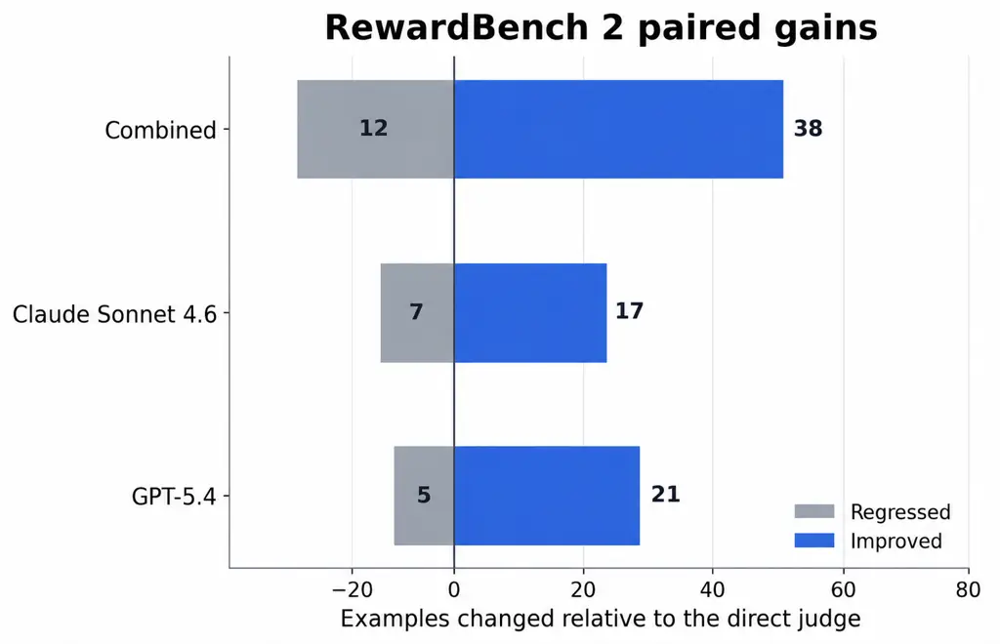
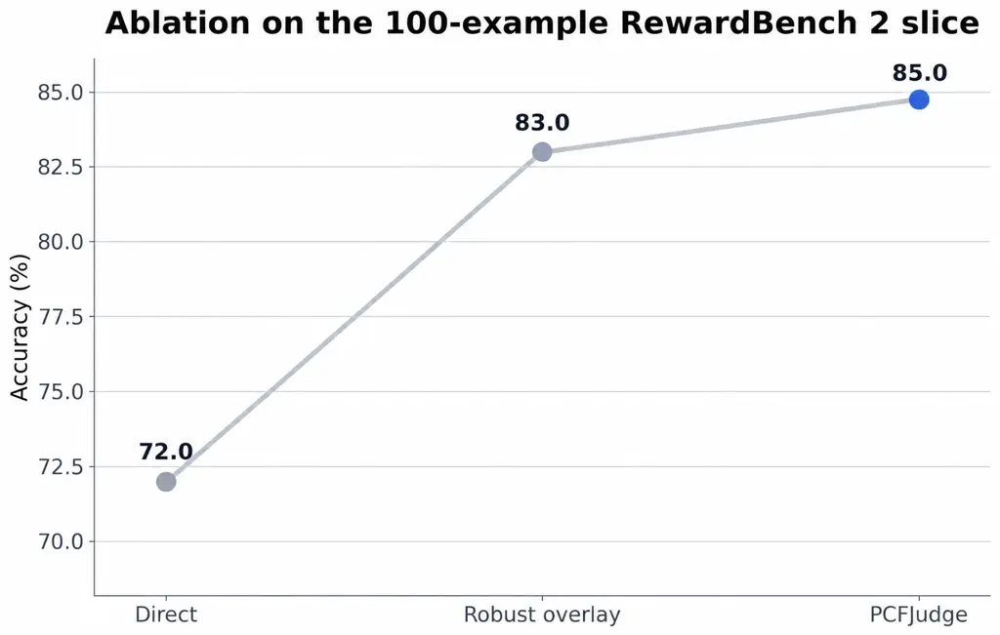

# Permutation-Consensus Listwise Judging for Robust Factuality Evaluation

Tianyi Huang ^(†)^(†)thanks: Primary and Corresponding author.
Affiliation: Ryquo Email: [tianyi@ryquo.com](mailto:)    Nathan Huang
Affiliation: App-In Club Email: [nathan.huang@appinclub.org](mailto:)   
Justin Tang Affiliation: App-In Club
Email: [justin@appinclub.org](mailto:)    Wenqian Chen
Affiliation: App-In Club Email: [wenqian.chen@appinclub.org](mailto:)   
Elsa Fan Affiliation: Carnegie Mellon University
Email: [elsaf@andrew.cmu.edu](mailto:)

###### Abstract

Large language models (LLMs) are now widely used as judges, yet their
decisions can change under presentation choices that should be
irrelevant. We study one such source of instability: candidate-order
sensitivity in listwise factuality evaluation, where several answers can
look similarly polished while differing substantially in hallucination
risk. We introduce PCFJudge, an inference-time method that reruns the
same factuality-first listwise prompt over multiple orderings of the
same candidate set and aggregates the resulting scores, ranks, and
uncertainty signals into a single consensus decision. On RewardBench 2
Factuality, the final seven-permutation aggregate ($`K=7`$) improves
top-1 selection accuracy from 86.00% to 91.33% with GPT-5.4 and from
86.33% to 89.67% with Claude Sonnet 4.6. These results suggest that
candidate order can be a meaningful source of factuality-judging error
and that marginalizing over this nuisance variation can improve the
reliability of LLM evaluation.

## 1 Introduction

LLM-as-a-judge has become a core evaluation primitive in modern NLP.
Early systems such as G-Eval and PandaLM showed that large models can
serve as practical reference-free evaluators and pairwise selectors (Liu
et al., 2023; Wang et al., 2024a), and strong proprietary models are now
routinely used to rank candidate responses, approximate human
preferences, audit downstream systems, and provide reward signals for
post-training (Zheng et al., 2023; Gu et al., 2025; Li et al., 2024). At
the same time, the reliability of these judges remains uncertain. A
growing body of work documents position bias, rubric sensitivity, scale
instability, and related forms of evaluation drift that can materially
change judge decisions (Shi et al., 2025; Hong et al., 2026; Wang et
al., 2025). Recent work further argues that the relevant failure mode
for judge-based selection is not global score correlation but
within-prompt ranking quality: a judge can look good on aggregate
metrics yet still make poor best-of-$`N`$ decisions (Landesberg, 2026;
Zhou et al., 2025).

This paper studies one source of instability: _candidate-order
sensitivity in listwise factuality evaluation_. RewardBench 2 explicitly
supports rankings-based generative evaluation and includes a factuality
subset designed to separate safer, better-calibrated responses from
answers that sound confident but contain unsupported details (Malik et
al., 2025). This is exactly the regime in which ordering artifacts are
dangerous. If a candidate is preferred only when it happens to appear
first, the resulting judge is not measuring factuality robustly.

We ask a deliberately simple question: _what if we treat candidate order
as nuisance variation and average over it?_ Our answer is PCFJudge, a
judge that reruns a factuality-first listwise prompt over multiple
permutations of the same candidate set and aggregates the results into a
consensus score at runtime. The method uses no retrieval and no external
verifier; it asks the same judge to evaluate the same candidates under
shuffled orders and then extracts the stable signal.

Empirically, this intervention improves top-1 selection accuracy for
both judge backbones on RewardBench 2 Factuality, with gains of 5.33
percentage points for GPT-5.4 and 3.33 percentage points for Claude
Sonnet 4.6 in the final seven-permutation setting. Additional controls
separate the effect of order perturbation from repeated canonical-order
calls: averaging repeated evaluations in the canonical order gives
little or no comparable benefit, while permutation consensus remains
positive across reduced-$`K`$ settings. A pairwise transfer variant
yields smaller but still positive gains in JudgeBench (Tan et al.,
2025). The contrast is informative: permutation consensus is especially
effective in the _multi-candidate factuality selection_ setting it was
designed for, but it is not designed to solve every judge setting.

Our contributions are as follows.

1.  1.  We introduce a training-free permutation-consensus judge specialized
        to listwise factuality evaluation.
2.  2.  We formalize the method as an order-robust consensus estimator and
        use a simple majority-vote analysis to motivate why consensus can
        reduce order noise, while explicitly noting that real permutation
        errors are correlated.
3.  3.  We report RewardBench 2 Factuality improvements with two proprietary
        judge backbones, add reduced-$`K`$, repeated-canonical, and
        weight-sensitivity controls, and evaluate a smaller pairwise
        transfer variant on JudgeBench.

## 2 Related Work

Broad surveys now frame LLM-as-a-judge research around four recurring
design questions: how to construct judges, how to prompt or aggregate
them, how to evaluate judges themselves, and how to control their biases
in deployment (Gu et al., 2025; Li et al., 2024). Our work is most
aligned with the third and fourth categories: we treat judge reliability
as an inference-time measurement problem rather than as a judge-training
problem.

#### Building stronger evaluators.

One common route to better LLM evaluation is to improve the evaluator
itself, either through prompting, specialization, or model aggregation.
Prompted systems such as G-Eval and PandaLM encode evaluation criteria
or comparison procedures directly in the judge prompt (Liu et al., 2023;
Wang et al., 2024a), while MT-Bench and Chatbot Arena operationalize LLM
judges for scalable conversational comparison (Zheng et al., 2023). More
recent work trains judge-specialized models, as in Prometheus 2 (Kim et
al., 2024), or pools heterogeneous backbones, as in PoLL (Verga et al.,
2024). These approaches seek a stronger evaluator or a stronger panel of
evaluators. Our work is complementary: we keep the backbone fixed and
ask whether reliability can be improved by changing only the test-time
protocol.

#### Judge quality depends on the downstream decision.

A second line of work argues that judge quality should be evaluated with
respect to the downstream decision the judge supports. RewardBench and
RewardBench 2 study reward-model and judge accuracy on subtle
preference, instruction-following, and factuality distinctions (Lambert
et al., 2024; Malik et al., 2025). JudgeBench shifts the focus further
toward _objective correctness_, constructing hard response pairs from
reasoning-heavy source tasks such as MMLU-Pro, math, and coding (Tan et
al., 2025; Wang et al., 2024b). JETTS evaluates judges in
test-time-scaling settings such as reranking, beam search, and
critique-based refinement, showing that judges can help some decision
procedures more than others (Zhou et al., 2025). Closest aligned with
our motivation, Landesberg (2026) argues that global agreement metrics
can substantially overstate a judge’s value for best-of-$`N`$ selection
because they blur together prompt-level effects and within-prompt
ranking quality. This perspective is central to our setting: listwise
factuality evaluation is fundamentally a _within-prompt selection_
problem.

#### Bias, instability, and judge inference.

A third line of work studies judges as noisy measurement instruments
whose outputs can change under presentation choices that should be
irrelevant. Early analyses of MT-Bench and Chatbot Arena already noted
position and verbosity effects (Zheng et al., 2023). Shi et al. provide
a systematic study of position bias in both pairwise and listwise
judging, showing that simple order changes can materially alter outcomes
even for strong backbones (Shi et al., 2025). RULERS pushes this
critique further by arguing that trustworthy judging requires locked
rubrics, evidence-anchored scoring, and calibrated scales rather than
prompt phrasing alone (Hong et al., 2026). Other work seeks to stabilize
judge decisions without retraining the judge: Wang et al. (2025) improve
inference by using the full judgment distribution rather than greedy
text outputs, while Verga et al. (2024) reduce idiosyncratic model bias
by pooling diverse judges. Our method aggregates over a different source
of variation: not model diversity and not output-token uncertainty, but
the order in which the same candidate set is presented.

#### What is still missing.

Prior work has established that presentation order can bias LLM judges,
including in listwise settings. Less is known about how to turn that
diagnosis into a simple robustness procedure for _top-1 factuality
selection_, where several plausible candidates compete simultaneously
and the downstream decision is the single answer to trust. This gap is
particularly relevant when candidates differ less in fluency than in
hallucination risk.

## 3 Method

### 3.1 Problem setting

Let $`x`$ be a prompt and $`Y=\{y_{1},\dots,y_{n}\}`$ a set of candidate
responses. The factuality target is order-invariant, but a deployed
listwise judge consumes an ordered presentation of $`Y`$ and returns
per-candidate scores and a winner. In practice, those outputs can depend
on the presentation order. Our goal is to reduce this order sensitivity
without changing the judge model or training a new evaluator.

### 3.2 A skeptical factuality-first listwise prompt

The direct baseline and PCFJudge share the same core prompt. The judge
is instructed to rank candidates by factual reliability rather than by
generic helpfulness, with particular emphasis on avoiding major factual
error and unsupported specificity. The prompt asks for _five_ outputs
for each candidate: a numeric score in $`[0,100]`$, a short rationale, a
binary flag for major factual error, a binary flag for hallucinated
specificity, and a binary flag for calibrated uncertainty. Calibrated
uncertainty is treated as a weak positive signal only when it reflects
appropriate caution rather than evasiveness. The two negative flags make
factual-error and unsupported-specificity considerations explicit during
each per-permutation scoring decision. We do not apply them a second
time as external penalties in the final aggregation.

### 3.3 Permutation-consensus aggregation

PCFJudge runs the same prompt over $`K`$ orderings of the candidate
list. Let $`\pi^{(1)},\dots,\pi^{(K)}`$ be candidate permutations. For
each run $`r`$, the judge returns:

- •
  a score $`s_{i}^{(r)}\in[0,100]`$ for each candidate $`i`$,
- •
  a full ranking, from which we derive a Borda-style contribution,
- •
  a top-set indicator for the highest-scored candidate(s), and
- •
  binary indicators for calibrated uncertainty, major error, and
  hallucinated specificity.

We map every response back to its original candidate identifier and
aggregate the runs into four summary statistics:

```math
\displaystyle\bar{s}_{i} \displaystyle=\frac{1}{K}\sum_{r=1}^{K}s_{i}^{(r)}, \tag{1}
```

```math
\displaystyle B_{i} \displaystyle=\frac{100}{K(n-1)}\sum_{r=1}^{K}\bigl(n-\operatorname{rank}_{i}^{(r)}\bigr), \tag{2}
```

```math
\displaystyle v_{i} \displaystyle=\frac{1}{K}\sum_{r=1}^{K}\frac{\mathbf{1}[i\in T^{(r)}]}{|T^{(r)}|}, \tag{3}
```

```math
\displaystyle u_{i} \displaystyle=\frac{1}{K}\sum_{r=1}^{K}\mathbf{1}[i\text{ marked calibrated uncertainty}], \tag{4}
```

where $`T^{(r)}`$ is the top-scoring set in run $`r`$ under the
0.5-point tie tolerance described below, and
$`\operatorname{rank}_{i}^{(r)}=1`$ denotes the highest-ranked
candidate. The final consensus score is

```math
C_{i}=0.50\bar{s}_{i}+0.25B_{i}+0.20(100v_{i})+0.05(100u_{i}). \tag{5}
```

The winner is the candidate with maximal $`C_{i}`$; ties are retained
when top scores fall within the fixed 0.5-point tolerance used in all
experiments. Because $`\bar{s}_{i}`$, $`B_{i}`$, $`100v_{i}`$, and
$`100u_{i}`$ all lie in $`[0,100]`$, the consensus score $`C_{i}`$ is
itself a weighted average on the same scale, and the weights in Eq. 5
sum to one. In the final RewardBench 2 runs we use $`K=7`$.

Equation 5 matches the implementation used in the experiments reported
below. The weights are a fixed heuristic rather than learned parameters;
Section 5.3 ablates several reasonable alternatives. The weighting
places most mass on two signals: per-permutation factuality score and
order-robust relative rank. The uncertainty term is small by design:
caution should help when it avoids fabricated detail, not dominate the
decision. We do _not_ separately reweight the major-error and
hallucinated-specificity flags in the final aggregation. In development,
using those flags twice—once inside the judge’s per-run scoring decision
and again as an external penalty—tended to over-penalize cautious but
incomplete responses.

1: Prompt $`x`$, candidates $`Y=\{y_{1},\dots,y_{n}\}`$, number of
permutations $`K`$

2: for $`r=1`$ to $`K`$ do

3:   sample or retrieve candidate permutation $`\pi^{(r)}`$

4:   run the factuality-first listwise judge on $`(x,\pi^{(r)}(Y))`$

5:   remap scores, ranks, and binary flags back to original candidate
IDs

6: end for

7: for each candidate $`i`$ do

8:   compute $`\bar{s}_{i}`$, $`B_{i}`$, $`v_{i}`$, and $`u_{i}`$

9:   compute consensus score $`C_{i}`$ using Eq. 5

10: end for

11: return candidate(s) with maximal $`C_{i}`$

Algorithm 1 PCFJudge for one prompt $`x`$ with candidates $`Y`$

### 3.4 Why consensus should help

Our exact scoring rule is heuristic, but the core intuition admits a
simple analysis. Suppose that under a random candidate ordering, the
judge places the true best candidate first with probability
$`q>\tfrac{1}{2}`$ and that these top-choice events are conditionally
independent across permutations. Then majority vote over the top-choice
identities already reduces error exponentially in $`K`$.

###### Proposition 1.

Let $`Z_{r}\in\{0,1\}`$ indicate whether permutation run $`r`$ places
the true best candidate first, with $`\Pr(Z_{r}=1)=q>\tfrac{1}{2}`$ and
$`Z_{1},\dots,Z_{K}`$ independent. If $`K`$ is odd and we choose the
final winner by majority vote over the top choices, then

```math
\Pr\!\left(\sum_{r=1}^{K}Z_{r}\leq\frac{K}{2}\right)\leq\exp\!\left(-2K\left(q-\frac{1}{2}\right)^{2}\right).
```

This follows from Hoeffding’s inequality (Hoeffding, 1963). PCFJudge is
richer than pure majority vote because it also aggregates within-run
scores, full ranks, and calibrated uncertainty. The proposition should
therefore be read as intuition rather than as a proof of Eq. 5.

Exact independence is unlikely in practice. All permutation runs share
the same backbone, prompt, item, and candidate set, so their errors can
be correlated. If the errors are perfectly correlated, repeated
evaluation does not reduce error. We therefore use the reduced-$`K`$ and
repeated canonical controls in Section 5.2 as empirical checks of
whether order perturbations add signal beyond repeated calls.

### 3.5 Pairwise transfer variant for JudgeBench

JudgeBench is pairwise rather than listwise, so we use a separate
transfer variant, APOCJudge. We use a separate name because this
protocol is not the listwise algorithm in Algorithm 1; it is an
order-consensus adaptation for two-response evaluation. For a response
pair $`(y_{A},y_{B})`$, the baseline direct judge scores the original
order once. APOCJudge adds two safeguards. First, it evaluates both
candidate orders and uses order-consensus as a disagreement signal.
Second, it only accepts an order-based override when a separate
keyed-judgment pass—which first resolves the underlying question and
then compares the two responses against that resolved answer—confirms
the same winner. To avoid a failure mode observed in development, the
final variant skips keyed overrides on estimation-style prompts. We
include JudgeBench to test scope, not to claim that this pairwise
transfer variant is as strong as the main listwise method.

## 4 Experimental Setup

### 4.1 Models

We evaluate two proprietary judge backbones: GPT-5.4 via the OpenAI API
(OpenAI, 2026) and Claude Sonnet 4.6 via the Anthropic API (Anthropic,
2026). We use the same backbone for both the direct baseline and the
corresponding consensus method so that gains reflect the inference
procedure rather than the base judge.

### 4.2 RewardBench 2 Factuality

Our main evaluation uses the public RewardBench 2 test split,
specifically the Factuality subset (Malik et al., 2025). Each item
contains four candidate responses, making it a natural fit for listwise
selection. For each backbone, we evaluate a fixed 300-example slice,
with the direct baseline and all PCFJudge variants using the same slice
for matched paired comparisons.

The direct baseline uses the same factuality-first listwise prompt as
PCFJudge but evaluates only the canonical candidate order ($`K=1`$).
PCFJudge uses predetermined permutations that are reused across items
for reproducibility, with $`K=7`$ as the main setting. To reduce
run-level noise in the final $`K=7`$ estimate, we execute the PCFJudge
evaluation three times on the same slice and prompt configuration. For
each item, we average the resulting per-candidate consensus scores
across these executions and then select one final winner before
computing the paired statistics in Table 1. The reported RewardBench 2
numbers are micro-averaged top-1 accuracies over the evaluated slice,
expressed as percentages in the results tables. Tie rates were
negligible in the final runs and in the diagnostic controls (mean
top-tie size $`\approx 1.00`$). Diagnostic controls in Tables 2–3 are
reported as exact top-1 accuracy percentages so that each value has the
same interpretation as the main RewardBench 2 accuracy columns.

### 4.3 Mechanism and cost controls

We add three controls on the same RewardBench 2 slices. First, to
separate order perturbation from repeated calls and aggregation, we run
a repeated-canonical baseline: the judge sees the same canonical order
$`K`$ times and we aggregate the repeated outputs with the same
consensus rule. Second, to characterize cost, we evaluate PCFJudge at
$`K\in\{3,5,7\}`$. Third, to test sensitivity to the heuristic weights
in Eq. 5, we recompute winners under several fixed weight settings,
including uniform weighting, score-only, rank-only, top-vote-only, and
variants that remove the uncertainty term. These controls are computed
from one fully logged diagnostic run for each backbone, so the
reduced-$`K`$ and weight comparisons are made on matched raw judge
outputs.

### 4.4 JudgeBench transfer study

JudgeBench contains objective response pairs derived from difficult
source tasks, with public gpt and claude splits containing 350 and 270
unique pairs respectively (Tan et al., 2025). Each JSON item includes
the source bucket (e.g., mmlu-pro-history), the question, two candidate
responses, and an objective label such as $`A\!>\!B`$. JudgeBench
reports source-aware performance rather than only a single pooled
accuracy, which is important because source tasks differ sharply in
difficulty.

We evaluate fixed 100-pair slices from the public JudgeBench splits.
Here, $`N`$ denotes the number of unique pairs. Following JudgeBench’s
source-aware reporting structure, we first compute accuracy within each
source bucket represented in the slice and then macro-average those
per-source values. This is why the reported percentage is not
constrained to being a multiple of $`1/N`$.

### 4.5 Metrics and significance

For RewardBench 2 we report top-1 selection accuracy, expressed as a
percentage, and paired improvement/regression counts relative to the
direct baseline. For the main $`K=7`$ results we also report unchanged
counts, since most examples agree with the direct judge. For the
diagnostic control tables, all entries are exact top-1 accuracy
percentages from a matched single run, while Table 1 reports the final
three-run aggregate described above. For JudgeBench we report the
macro-averaged accuracy percentage described above. For the main
RewardBench 2 slices we compute exact paired sign tests over the
discordant examples (improved vs. regressed) as a significance check.

## 5 Results

### 5.1 Main RewardBench 2 results

Table 1 reports the main RewardBench 2 result. On RewardBench 2
Factuality, the final aggregate estimate for the $`K=7`$ configuration
improves both judge backbones: GPT-5.4 improves from 86.00% to 91.33%,
and Claude Sonnet 4.6 improves from 86.33% to 89.67%. The micro-average
over the two evaluated slices improves from 86.17% to 90.50%.

| Model      | $`N`$ | Direct (%) | PCFJudge (%) | $`\Delta`$ (pp) | Imp./Reg. | Same |
| ---------- | ----- | ---------- | ------------ | --------------- | --------- | ---- |
| GPT-5.4    | 300   | 86.00      | 91.33        | +5.33           | 21 / 5    | 274  |
| Claude 4.6 | 300   | 86.33      | 89.67        | +3.33           | 17 / 7    | 276  |
| Micro avg. | 600   | 86.17      | 90.50        | +4.33           | 38 / 12   | 550  |

Table 1: Main RewardBench 2 Factuality results. Accuracy columns are
top-1 selection accuracy percentages; $`\Delta`$ is measured in
percentage points. Direct uses one canonical candidate order. Each
PCFJudge execution uses seven candidate-order permutations with the
consensus rule in Eq. 5. The final $`K=7`$ PCFJudge numbers aggregate
three separately executed $`K=7`$ evaluations on the same fixed
300-example slice. For each item, we average per-candidate consensus
scores across the three executions before selecting one final winner;
paired counts are then computed against the corresponding direct
baseline.

The paired counts show that the gains are not only changes in aggregate
accuracy. GPT-5.4 improves on 21 examples and regresses on 5, giving an
exact two-sided sign-test value of $`p=0.0025`$. Claude Sonnet 4.6
improves on 17 examples and regresses on 7, a positive but weaker paired
signal ($`p=0.064`$). As a descriptive pooled check over the 600
evaluated item-backbone pairs, the discordant counts are 38 improvements
versus 12 regressions ($`p=3.1\times 10^{-4}`$). Figure 1 visualizes the
same paired asymmetry, while Table 1 also shows that most examples
remain unchanged.



Figure 1: Paired comparison against the direct judge on the final
300-example RewardBench 2 Factuality slices. Bars show only changed
examples; unchanged counts are reported in Table 1.

The backbone-specific pattern is intentionally interpreted
conservatively. Both models improve, but the paired evidence is stronger
for GPT-5.4 than for Claude Sonnet 4.6. Together, these results support
the narrower claim that order perturbation can recover some errors made
by strong single-pass factuality judges in this setting.

### 5.2 Cost and mechanism controls

Table 2 reports the diagnostic control suite used to separate
permutation consensus from repeated calls and to characterize the effect
of $`K`$. The table uses one fully logged run per backbone so that
$`K=3`$, $`K=5`$, $`K=7`$, and repeated-canonical baselines are directly
comparable on the same raw judge outputs. Because this table is a
matched single-run diagnostic, its $`K=7`$ entries are not expected to
exactly match the three-run aggregate in Table 1.

| Model      | Protocol           | $`K=3`$ (%)       | $`K=5`$ (%)       | $`K=7`$ (%)   |
| ---------- | ------------------ | ----------------- | ----------------- | ------------- |
| GPT-5.4    | repeated canonical | 86.67 (+0.67)     | 85.67 ($`-`$0.33) | 86.00 (+0.00) |
|            | PCFJudge           | 89.33 (+3.33)     | 88.67 (+2.67)     | 89.33 (+3.33) |
| Claude 4.6 | repeated canonical | 86.00 ($`-`$0.33) | 87.00 (+0.67)     | 86.67 (+0.33) |
|            | PCFJudge           | 87.00 (+0.67)     | 87.67 (+1.33)     | 88.00 (+1.67) |

Table 2: Diagnostic cost and mechanism controls on RewardBench 2
Factuality. Entries are exact top-1 accuracy percentages, with absolute
percentage-point change over the direct baseline in parentheses.
Repeated canonical uses $`K`$ calls to the same candidate order;
PCFJudge uses $`K`$ candidate-order permutations. This table is a
matched single-run diagnostic control, while Table 1 reports the final
three-run aggregate for the main $`K=7`$ setting.

The repeated-canonical rows do not show a stable gain: additional calls
to the same order do not reliably improve either backbone. In contrast,
the permutation rows are positive across all reported $`K`$ values.
GPT-5.4 already recovers most of the diagnostic-run gain at $`K=3`$,
whereas Claude Sonnet 4.6 improves more gradually from $`K=3`$ to
$`K=7`$. This suggests a practical tradeoff: $`K=7`$ is the base
configuration used for the Table 1 aggregate, but lower-$`K`$ settings
may be preferable when inference cost is the binding constraint.

### 5.3 Sensitivity to consensus weights

Table 3 ablates the heuristic weights in Eq. 5. The proposed weights are
not uniquely optimal, but the main conclusion is stable: a range of
score-, rank-, and top-vote-based variants remain above the direct
baseline on both backbones. This indicates that the improvement is not a
fragile artifact of one hand-chosen coefficient vector.

| Variant        | $`w_{s}`$ | $`w_{B}`$ | $`w_{v}`$ | $`w_{u}`$ | GPT-5.4 (%) | Claude 4.6 (%) |
| -------------- | --------- | --------- | --------- | --------- | ----------- | -------------- |
| Proposed       | 0.50      | 0.25      | 0.20      | 0.05      | 89.33       | 88.00          |
| Uniform        | 0.25      | 0.25      | 0.25      | 0.25      | 90.00       | 87.00          |
| Score only     | 1.00      | 0.00      | 0.00      | 0.00      | 88.67       | 87.00          |
| Rank only      | 0.00      | 1.00      | 0.00      | 0.00      | 89.00       | 88.00          |
| Top vote only  | 0.00      | 0.00      | 1.00      | 0.00      | 89.00       | 88.33          |
| No uncertainty | 0.50      | 0.27      | 0.23      | 0.00      | 89.33       | 88.33          |
| Score/rank     | 0.50      | 0.50      | 0.00      | 0.00      | 89.33       | 88.00          |
| Score/top      | 0.60      | 0.00      | 0.40      | 0.00      | 89.33       | 88.67          |

Table 3: Weight sensitivity on the same diagnostic runs as Table 2.
Entries are exact top-1 accuracy percentages. Columns show the weights
on mean score ($`w_{s}`$), Borda rank ($`w_{B}`$), top-set frequency
($`w_{v}`$), and calibrated uncertainty ($`w_{u}`$). Direct baselines
are 86.00% for GPT-5.4 and 86.33% for Claude Sonnet 4.6.

We keep Eq. 5 as the main rule because it is the final configuration
used for the main experiments and balances score, rank, top-set
agreement, and a small uncertainty signal. The ablation suggests,
however, that the exact 0.50/0.25/0.20/0.05 split should not be
over-interpreted. In these runs, the robust signal comes primarily from
aggregating over order perturbations, not from tuning a delicate set of
weights.

### 5.4 JudgeBench transfer

Table 4 reports the transfer study. The gains are smaller than on
RewardBench 2, but they remain positive for both backbones: +3.24
percentage points for Claude Sonnet 4.6 and +2.70 percentage points for
GPT-5.4. This difference is consistent with the narrower scope of the
method. JudgeBench is an objective, pairwise, domain-diverse benchmark
rather than the listwise factuality setting PCFJudge was designed for.
The transfer experiment therefore serves as a boundary-condition check:
order-robust judging still helps, but the strongest evidence remains the
listwise factuality setting where candidate-order instability is
directly tied to the downstream decision.

| Model      | $`N`$ | Direct (%) | APOCJudge (%) | $`\Delta`$ (pp) |
| ---------- | ----- | ---------- | ------------- | --------------- |
| Claude 4.6 | 100   | 79.09      | 82.33         | +3.24           |
| GPT-5.4    | 100   | 76.21      | 78.91         | +2.70           |

Table 4: JudgeBench transfer results. $`N`$ counts unique response
pairs, while the reported value is the macro-averaged accuracy
percentage over the source buckets present in the 100-pair slice, so the
percentages need not be multiples of $`1/N`$. APOCJudge uses our
order-swapped pairwise protocol with keyed confirmation before accepting
an override.

### 5.5 Development ablations and lessons

Development ablations informed the final design. Figure 2 reports an
earlier comparable ablation on a fixed 100-example GPT-5.4 RewardBench 2
Factuality development slice. The “robust overlay” variant was a heavier
two-stage design that first produced a permutation-consensus ranking and
then added an additional arbitration pass over the most plausible
winners. It recovered much of the gain over direct judging, but the
simpler permutation-consensus ranker still performed better. This is why
the final method keeps the core decision rule simple rather than
stacking additional arbitration layers on top of it.



Figure 2: Development ablation on a fixed 100-example GPT-5.4
RewardBench 2 Factuality slice. Values are exact top-1 accuracy
percentages on the development slice. Most of the recoverable error is
removed by permutation consensus itself; extra overlay logic helps less
than simply trusting the consensus ranker.

Earlier 50-example development slices showed the same pattern more
noisily: anchor ladders, panel arbitration, and evidence-backed
overrides did not reliably improve over simpler consensus ranking, and
some variants regressed. These attempts suggested that additional judge
stages do not automatically add independent signal. In our setting,
directly targeting order variation appeared more effective than
introducing extra arbiters.

Together, Figure 2 and the controls in Tables 2–3 support a modest
lesson: a targeted intervention on a concrete nuisance variable can be
more useful than increasingly elaborate meta-judging pipelines.

### 5.6 Qualitative patterns

Table 5 summarizes representative qualitative patterns from
prediction-file inspection. These patterns are diagnostic rather than a
complete error taxonomy, but they help explain the kinds of cases where
the method can help. The central effect is not extra world knowledge.
Rather, PCFJudge is less willing to reward an answer whose advantage
depends on a particular presentation order.

| Pattern                      | Observed direct-judge behavior                                                                   | Observed PCFJudge recovery                                                 | Why it matters                                                                                          |
| ---------------------------- | ------------------------------------------------------------------------------------------------ | -------------------------------------------------------------------------- | ------------------------------------------------------------------------------------------------------- |
| Unsupported specificity      | Polished answers that add precise settings, dates, or source claims without solid support        | Safer answers whose advantage survives across permutations                 | Illustrates how consensus can reduce reward for hallucinated detail rather than merely smoothing scores |
| Calibrated narrow correction | Broader but speculative responses that sound more complete                                       | Narrower responses that correctly state that evidence is limited or absent | Aligns the judge with factual reliability rather than informativeness style                             |
| Near-tie candidate sets      | Small stylistic differences can dominate when all candidates share the same broad factual stance | Limited changes unless an order-stable preference emerges                  | Explains why improvements are concentrated on genuinely unstable cases                                  |
| Transfer failure mode        | Pairwise estimation or ballpark prompts where an auxiliary checker can overcommit                | Final transfer variant suppresses these overrides                          | Clarifies why JudgeBench gains are positive but smaller than RewardBench 2                              |

Table 5: Representative qualitative patterns from prediction-file
inspection. The main benefit of PCFJudge is not extra knowledge; it is
greater reluctance to reward answers whose advantage depends on a
particular candidate order.

The first two rows of Table 5 capture observed RewardBench 2 success
modes in corrected cases. Direct judging can overweight polished answers
that add unsupported specifics on product-setting, website-grounded, or
niche-source prompts. Permutation consensus can favor the safer and
better-calibrated response when that preference remains stable across
orderings. In these cases, the method is not making the judge more
encyclopedic; it is making the judge less vulnerable to rhetorically
attractive but unstable winners. The last two rows help explain why
transfer is positive but smaller on JudgeBench. RewardBench 2 Factuality
often presents several plausible answers whose key difference is
unsupported specificity, whereas many JudgeBench pairs turn on objective
task solving. This contrast is consistent with the intended scope of the
method.

## 6 Conclusion

PCFJudge suggests that arbitrary candidate order is a consequential
nuisance variable in listwise factuality selection. By marginalizing
over order instead of trusting a single presentation, the same judge
backbone can make more stable choices without finetuning, retrieval, or
a separate verifier. The repeated-canonical control indicates that the
benefit is not simply the result of making more calls; the order
perturbations themselves provide useful signal. The method still has
real costs and does not remove the need for broader audits, but the
results suggest that order-robustness is a useful design consideration
for future factuality-judging pipelines.

## Limitations

The main evidence comes from fixed API-budgeted slices rather than full
benchmark sweeps, so larger runs would better characterize variance
across slices and domains. PCFJudge also increases inference cost by a
factor of $`K`$ in its basic form; the reduced-$`K`$ controls suggest
that $`K=3`$ or $`K=5`$ can be useful when cost is binding, but the
extra calls remain a practical deployment cost. The consensus weights in
Eq. 5 are heuristic: Table 3 suggests that the method is not brittle to
the chosen weights, but does not establish that they are optimal.
Proposition 1 assumes independent permutation errors, whereas repeated
calls to the same model, prompt, and candidate set are likely
correlated; such correlation can limit consensus gains. Finally, the
strongest evidence is on RewardBench 2 Factuality, while JudgeBench
shows smaller pairwise transfer. Our study isolates presentation-order
variation and does not address issues such as benchmark validity, label
noise, or hidden contamination.

## Broader Impact and Ethical Considerations

This work focuses on evaluation rather than direct user-facing
generation, but evaluation still shapes what behaviors are rewarded
during model development and deployment. More stable factuality judges
can reduce incentives to reward confident fabrication, make
best-of-$`N`$ pipelines less sensitive to arbitrary prompt order, and
make judge failures easier to inspect when models are iterated rapidly.
At the same time, a factuality-first judge may over-prefer terse
caution, under-credit partially correct exploratory answers, or entrench
a benchmark’s notion of acceptable uncertainty if it is deployed outside
its intended scope.

Because PCFJudge averages multiple judge calls, it also increases API
usage and, if adopted uncritically, may further concentrate the
evaluative power in proprietary systems. We therefore view it as a
limited-scope reliability layer that should be paired with
domain-specific audits, human oversight, and benchmark validation rather
than treated as a stand-alone arbiter of truth. If evaluation
infrastructure shapes what future models are rewarded to learn, then
making that infrastructure less arbitrary is a practical step toward
reducing one pathway by which hallucinations are reinforced.

## References

- Anthropic (2026) Anthropic Introducing claude sonnet 4.6. Note:
  [https://www.anthropic.com/news/claude-sonnet-4-6](https://www.anthropic.com/news/claude-sonnet-4-6)
  Cited by: §4.1.
- Gu et al. (2025) J. Gu, X. Jiang, Z. Shi, H. Tan, X. Zhai, C. Xu, W.
  Li, Y. Shen, S. Ma, H. Liu, S. Wang, K. Zhang, Y. Wang, W. Gao, L. Ni,
  and J. Guo A survey on llm-as-a-judge. External Links: 2411.15594,
  [Link](https://arxiv.org/abs/2411.15594) Cited by: §1, §2.
- Hoeffding (1963) W. Hoeffding Probability inequalities for sums of
  bounded random variables. Journal of the American Statistical
  Association 58 (301), pp. 13–30. External Links: ISSN 01621459,
  1537274X, [Link](http://www.jstor.org/stable/2282952) Cited by: §3.4.
- Hong et al. (2026) Y. Hong, H. Yao, B. Shen, W. Xu, H. Wei, and Y.
  Dong RULERS: locked rubrics and evidence-anchored scoring for robust
  llm evaluation. External Links: 2601.08654,
  [Link](https://arxiv.org/abs/2601.08654) Cited by: §1, §2.
- Kim et al. (2024) S. Kim, J. Suk, S. Longpre, B. Y. Lin, J. Shin, S.
  Welleck, G. Neubig, M. Lee, K. Lee, and M. Seo Prometheus 2: an open
  source language model specialized in evaluating other language models.
  External Links: 2405.01535, [Link](https://arxiv.org/abs/2405.01535)
  Cited by: §2.
- Lambert et al. (2024) N. Lambert, V. Pyatkin, J. Morrison, L.
  Miranda, B. Y. Lin, K. Chandu, N. Dziri, S. Kumar, T. Zick, Y.
  Choi, N. A. Smith, and H. Hajishirzi RewardBench: evaluating reward
  models for language modeling. External Links: 2403.13787,
  [Link](https://arxiv.org/abs/2403.13787) Cited by: §2.
- Landesberg (2026) E. Landesberg When llm judge scores look good but
  best-of-n decisions fail. External Links: 2603.12520,
  [Link](https://arxiv.org/abs/2603.12520) Cited by: §1, §2.
- Li et al. (2024) H. Li, Q. Dong, J. Chen, H. Su, Y. Zhou, Q. Ai, Z.
  Ye, and Y. Liu LLMs-as-judges: a comprehensive survey on llm-based
  evaluation methods. External Links: 2412.05579,
  [Link](https://arxiv.org/abs/2412.05579) Cited by: §1, §2.
- Liu et al. (2023) Y. Liu, D. Iter, Y. Xu, S. Wang, R. Xu, and C. Zhu
  G-eval: nlg evaluation using gpt-4 with better human alignment.
  External Links: 2303.16634, [Link](https://arxiv.org/abs/2303.16634)
  Cited by: §1, §2.
- Malik et al. (2025) S. Malik, V. Pyatkin, S. Land, J. Morrison, N. A.
  Smith, H. Hajishirzi, and N. Lambert RewardBench 2: advancing reward
  model evaluation. External Links: 2506.01937,
  [Link](https://arxiv.org/abs/2506.01937) Cited by: §1, §2, §4.2.
- OpenAI (2026) OpenAI Introducing gpt‑5.4. Note:
  [https://openai.com/index/introducing-gpt-5-4/](https://openai.com/index/introducing-gpt-5-4/)
  Cited by: §4.1.
- Shi et al. (2025) L. Shi, C. Ma, W. Liang, X. Diao, W. Ma, and S.
  Vosoughi Judging the judges: a systematic study of position bias in
  llm-as-a-judge. External Links: 2406.07791,
  [Link](https://arxiv.org/abs/2406.07791) Cited by: §1, §2.
- Tan et al. (2025) S. Tan, S. Zhuang, K. Montgomery, W. Y. Tang, A.
  Cuadron, C. Wang, R. A. Popa, and I. Stoica JudgeBench: a benchmark
  for evaluating llm-based judges. External Links: 2410.12784,
  [Link](https://arxiv.org/abs/2410.12784) Cited by: §1, §2, §4.4.
- Verga et al. (2024) P. Verga, S. Hofstatter, S. Althammer, Y. Su, A.
  Piktus, A. Arkhangorodsky, M. Xu, N. White, and P. Lewis Replacing
  judges with juries: evaluating llm generations with a panel of diverse
  models. External Links: 2404.18796,
  [Link](https://arxiv.org/abs/2404.18796) Cited by: §2, §2.
- Wang et al. (2025) V. Wang, M. J. Q. Zhang, and E. Choi Improving
  llm-as-a-judge inference with the judgment distribution. External
  Links: 2503.03064, [Link](https://arxiv.org/abs/2503.03064) Cited by:
  §1, §2.
- Wang et al. (2024a) Y. Wang, Z. Yu, Z. Zeng, L. Yang, C. Wang, H.
  Chen, C. Jiang, R. Xie, J. Wang, X. Xie, W. Ye, S. Zhang, and Y. Zhang
  PandaLM: an automatic evaluation benchmark for llm instruction tuning
  optimization. External Links: 2306.05087,
  [Link](https://arxiv.org/abs/2306.05087) Cited by: §1, §2.
- Wang et al. (2024b) Y. Wang, X. Ma, G. Zhang, Y. Ni, A. Chandra, S.
  Guo, W. Ren, A. Arulraj, X. He, Z. Jiang, T. Li, M. Ku, K. Wang, A.
  Zhuang, R. Fan, X. Yue, and W. Chen MMLU-pro: a more robust and
  challenging multi-task language understanding benchmark. External
  Links: 2406.01574, [Link](https://arxiv.org/abs/2406.01574) Cited by:
  §2.
- Zheng et al. (2023) L. Zheng, W. Chiang, Y. Sheng, S. Zhuang, Z.
  Wu, Y. Zhuang, Z. Lin, Z. Li, D. Li, E. P. Xing, H. Zhang, J. E.
  Gonzalez, and I. Stoica Judging llm-as-a-judge with mt-bench and
  chatbot arena. External Links: 2306.05685,
  [Link](https://arxiv.org/abs/2306.05685) Cited by: §1, §2, §2.
- Zhou et al. (2025) Y. Zhou, A. Xu, P. Wang, C. Xiong, and S. Joty
  Evaluating judges as evaluators: the jetts benchmark of llm-as-judges
  as test-time scaling evaluators. External Links: 2504.15253,
  [Link](https://arxiv.org/abs/2504.15253) Cited by: §1, §2.
