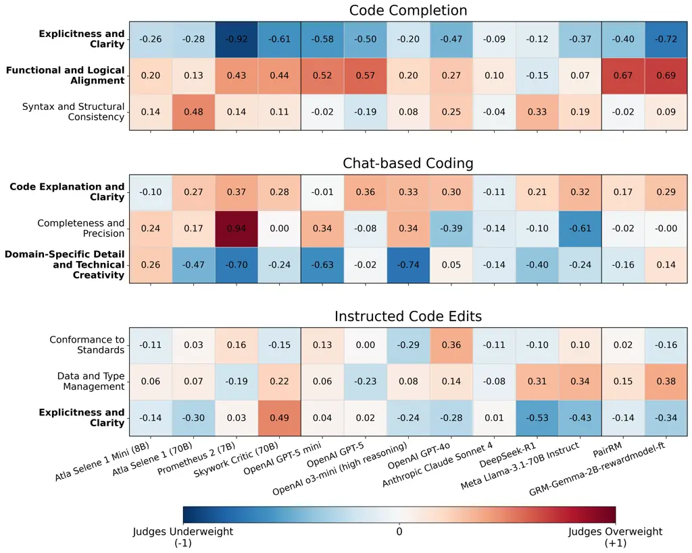

# Comparing Developer and LLM Biases in Code Evaluation

Aditya Mittal^(∗)   Ryan Shar^(∗)   Zichu Wu   Shyam Agarwal  
Tongshuang Wu   Chris Donahue   Ameet Talwalkar     
Wayne Chi^(†)   Valerie Chen^(†)  
Carnegie Mellon University  
{adityamittal307, ryan.shar01}@gmail.com

###### Abstract

LLMs are increasingly used as judges in code applications, yet their
efficacy remains untested in realistic code settings that often feature
partial context and ambiguous intent. We present TRACE (Tool for Rubric
Analysis in Code Evaluation), a framework that evaluates LLM judges’
ability to predict human preferences and automatically extracts rubric
items to highlight systematic differences in how humans and models
weight these criteria. Across three modalities—IDE autocompletion,
chat-based programming, and instructed code editing—we benchmark 13
judge models spanning general-purpose LLMs, specialized judge models,
and reward models. Among these models, even the best judges align with
human preference only 6-18% above random chance. TRACE identifies 8
significantly misaligned rubric items across interaction modalities. For
example, in chat-based coding, judges prefer longer code explanations
while humans prefer shorter ones. Many of these gaps occur within
existing code quality dimensions, showing that current LLM judges remain
misaligned with human evaluation in realistic coding workflows.

## 1 Introduction

As LLM-powered tools accelerate software development
(peng2023impactaideveloperproductivity), there is an increasing need for
reliable evaluation methods (chen2025surveyevaluatinglargelanguage).
LLM-as-a-judge has emerged as a widely-used, scalable alternative to
human evaluation for assessing model outputs
(li2025generationjudgmentopportunitieschallenges), including in domains
like software engineering (Wang_2025). Existing work typically considers
static settings, using polished code from well-maintained GitHub
repositories (li2024evocodebenchevolvingcodegeneration; 11071936) or
competitive programming tasks
(jiang2025codejudgebenchbenchmarkingllmasajudgecoding;
qing2025effibenchxmultilanguagebenchmarkmeasuring). While grounded in
real software artifacts, these sources fail to capture the messy and
underspecified conditions in which developers evaluate and refine code,
revealing little about whether LLM judges reflect the implicit criteria
developers use in practice. We ask: what preferences do LLM judges
exhibit when evaluating code, and how do they compare to those of
developers?

Since real software development rarely occurs in such static settings,
evaluation of LLM outputs should capture functional correctness along
with developer intent, constraints, and workflow expectations. Empirical
evidence shows that only 25% of GitHub autocompletions are accepted by
developers and users often report that models fail to meet specific
requirements or match their expectations
(ziegler2022productivityassessmentneuralcode; Liang2023ALS). To
understand these challenges observed in AI-assisted software
development, we examine three representative interaction modalities
identified in developer-AI interaction taxonomies
(treude2025developersinteractaitaxonomy): IDE autocompletion
(chi2025copilotarenaplatformcode), chat-based programming assistance
(chiang2024chatbotarenaopenplatform), and instructed code editing
(chi2025editbenchevaluatingllmabilities). By comparing LLM judgments to
developers’ preferences across these settings, we analyze how judges
weight code quality criteria in practice and where their biases diverge
from human preferences.

Figure 1: Example of developer–LLM misalignment on a code editing task.
Here, the developer provides a prompt and receives two LLM code
solutions. In this example, the user prefers the top response while the
LLM judge selects the bottom response. We compare these responses with
the extracted rubric items to see that the developer prefers less
robustness and more comments, while LLM judges prefer more robustness
and fewer comments.

We propose TRACE (Tool for Rubric Analysis in Code Evaluation), the
first framework to evaluate and diagnose LLM judge misalignment in
realistic coding workflows with interpretable rubric-level analysis.
TRACE measures how closely model judgments align with human preferences
in the ambiguity of real-world settings. Beyond aggregate agreement, we
focus on cases of divergence between model and human evaluations. To
explain these disagreements, TRACE automatically discovers decision
criteria that account for judgment differences across samples. Building
on prior work in automatic LLM-based criteria discovery (Dunlap:2025;
kim2025evaletevaluatinglargelanguage;
findeis2025inverseconstitutionalaicompressing), we aggregate differences
in responses to create a set of qualitative, interpretable “rubric”
items. We then analyze how both human and model judgments correlate with
these rubric items, revealing systematic differences in evaluation
behavior and preference across judges and modalities (Figure 1). We
evaluate across a diverse set of 13 judges, including general-purpose
third-party models, specialized judge models, and reward models to show
that:

- •
  LLM judges are consistently misaligned with human code preferences.
  Across the three interaction modalities, the strongest LLM judges
  align with human preference only 6-18% above random guessing, and no
  single judge consistently dominates. Notably, fine-tuned judge LLMs do
  not reliably outperform general-purpose models, suggesting that
  current shortcomings are not solely due to training data or
  specialization.
- •
  In each modality, human and LLM judges are misaligned on different
  rubric items. Across the three modalities, 8 rubric items exhibit
  significant gaps. In code completion, LLMs tend to overweight code
  functionality and underweight readability inside a live file. In
  edits, judges more often discount clarity, while developers expect
  changes to be precise. In chat, judges typically reward generic
  explanations, while humans prefer context-aware solutions. These gaps
  show there are multiple notions of “good code” depending on modality,
  and judges are unable to reliably capture these nuances.
- •
  Judges are misaligned on established software engineering criteria.
  Across three interaction modalities in code, we identify 16 recurring
  evaluation themes, with 11 aligning closely with canonical software
  engineering criteria like syntactic correctness, formatting, and
  robustness. We find that LLM judges remain significantly misaligned
  with human preference on 6 of these 11 themes across modalities,
  suggesting that alignment gaps with human preferences on code quality
  persist during judge training.

## 2 Related Work

Interaction Modalities in Software Engineering. LLMs now support a range
of interaction modalities in software development, from real-time,
low-overhead code completion (Svyatkovskiy2020IntelliCodeCC;
Pu2025AssistanceOD), to conversational chat for multi-turn problem
solving (Ross2023ThePA), to emerging agent systems that autonomously
modify codebases (Chen2025CodeWM; Li2025DeepCodeOA). Prior work shows
these modes induce distinct usage patterns (Barke2022GroundedCH;
Weber2024SignificantPG) and that adoption hinges on reducing effort and
accelerating tasks (Vaithilingam2022ExpectationVE;
Liang2023UnderstandingTU; Mozannar2022ReadingBT), while preserving user
control, contextual grounding, and trust (Chen2025ScreenRP;
Liang2023ALS; Brandebusemeyer2025DevelopersExperienceWG;
Awad2025PreFilteringCS; Kula2025TheSF; Lyu2025MyPI). Our work studies
LLM judges across multiple interaction modalities to evaluate and
compare judges with human preferences in software development contexts.

LLM as a Judge. With the growing adoption of LLM judges, researchers
have proposed many techniques to align LLMs with human preferences.
These include fine-tuning approaches (wang2025djpo), which produce
specialized judge models such as JudgeLM (zhu2025judgelm), Prometheus
(kim2024prometheus), and Atla Selene Mini
(alexandru2025atlaseleneminigeneral). Additionally, judgment alignment
can be improved with inference time methods using multiple LLMs
(verga2024juries) and structured prompting frameworks (jung2025trust).
Specialized benchmarks were developed for systematically comparing LLM
judges. For example, JudgeBench (judgebench2024) uses pairwise questions
using objective correctness and Arena-Hard
(li2024crowdsourceddatahighqualitybenchmarks) curates high-quality
in-the-wild human prompts for evaluation. We build on this line of work
by evaluating LLM judges in the types of realistic, ambiguous situations
developers face in practice.

Explaining LLM Decisions. As LLM judges expand across domains, there is
a need to explain LLM judgments (ryu-etal-2023-retrieval;
brake-schaaf-2024-comparing). Existing work like WIMHF
(movva2025whatshumanfeedbacklearning) measures pairwise preferences by
training an SAE on embedding differences to encode latent features in
responses. Other approaches remove the need for training. VibeCheck
(Dunlap:2025) offers an initial approach to identify evaluation criteria
from pairwise differences using LLMs. Evalet
(kim2025evaletevaluatinglargelanguage) provides a method for analyzing
LLM judge alignment given a set of evaluation criteria from the user.
ICAI (findeis2025inverseconstitutionalaicompressing) proposes a method
to generate explicit instruction criteria for alignment, but these
criteria do not generalize across the entire dataset for multiple
judges. We extend these approaches to automatically discover
interpretable rubric items to compare human and LLM judge preference
across interaction modalities.

## 3 Methodology

Given a dataset of human preferences and a set of candidate LLM judges,
how do we determine which judge best aligns with human preferences and
compare human and judge preferences? TRACE answers these questions in
three stages (Figure 2): (1) measure judge agreement with human pairwise
preferences, (2) generate interpretable rubric items that capture the
evaluative criteria distinguishing response pairs, and (3) compare how
humans and judge preferences differ using rubric items.

Step 1: Measure whether judges align with human preference. Each
dataset—see Section 4.1 for examples—consists of $`n`$ pairwise
preference examples $`(x,y_{A},y_{B},w)`$, where $`x`$ denotes the input
context, $`y_{A}`$ and $`y_{B}`$ are candidate responses, and
$`w\in\{-1,1\}`$ indicates human preference. For each judge $`J`$, we
provide $`(x,y_{A},y_{B})`$ as input and record a binary decision
$`J(x,y_{A},y_{B})\in\{-1,1\}`$, following prior work
(zheng2023judgingllmasajudgemtbenchchatbot). We report both overall
accuracy and positionally consistent accuracy. To calculate positionally
consistent accuracy, we evaluate each sample twice, once in the original
order and once with responses swapped, and discard cases where the
judge’s prediction changes. Full prompts are provided in Appendix .

Figure 2: Overview of TRACE. Given a set of pairwise options, TRACE
follows a three-step workflow: (1) we collect LLM judgments to measure
alignment with human preferences; (2) we generate rubric items capturing
differences between responses (e.g., error handling); (3) we construct
feature vectors from rubric criteria and train a model to predict LLM
judgments. We use the learned coefficients to identify items that
misalign between LLMs and humans.

Step 2: Identify rubric items to explain preferences. For each dataset,
we construct a rubric $`R`$ of natural language criteria that
characterize differences between pairs of code samples. For instance, a
rubric item for robustness and error handling may capture whether one
response incorporates more exception handling or systematically
anticipates edge cases than the other. We create $`R`$ using two
sources:

- •
  LLM-generated Rubric Items. We generate rubrics using the procedure
  described in VibeCheck (Dunlap:2025). We sample batches from the
  dataset and prompt an LLM to describe concrete differences between the
  two generated responses. A subsequent LLM aggregates these differences
  into a rubric $`R_{A}`$ by merging semantically similar items.
- •
  Human-Annotated Rubric Items. To incorporate human judgment into
  rubric construction, we had annotators review examples from each
  dataset to create a set of broad evaluative criteria that apply across
  examples, yielding a rubric $`R_{H}`$.

Finally, we aggregate similar items in $`R_{A}`$ and $`R_{H}`$ using an
LLM to produce a final rubric $`R`$. These rubric items serve as
heuristic dimensions for diagnosing differences between judgments rather
than definitive criteria for code quality. See Appendix for details.

Step 3: Diagnose human-judge misalignment via rubric-based preference
models. To characterize disagreements between humans and LLM judges, we
treat rubric items in $`R`$ as a basis for preference decisions and use
interpretable models to analyze how humans and LLMs weight each item. To
do this, we use an LLM to assign a score in $`\{-1,0,1\}`$ for each
sample and rubric item, indicating whether response $`y_{A}`$ better
satisfies the rubric item ($`-1`$), $`y_{B}`$ does ($`1`$), or both
satisfy it equally ($`0`$). These scores form a feature matrix $`S`$,
where rows correspond to response pairs and columns correspond to rubric
items. We then train separate logistic regression models for humans and
each LLM judge using $`S`$ as input features. Human judgments define the
labels for the human model, while each judge’s judgments define the
labels for its corresponding model. This yields a human preference
coefficient vector $`\beta_{H}`$ and judge-specific vectors
$`\beta_{J}`$, where each coefficient captures the influence of rubric
item $`R_{i}`$ on preferences under the same feature representation.

We quantify judge-level misalignment using $`\beta_{J,i}-\beta_{H,i}`$:
positive values indicate that a judge places greater emphasis on
$`R_{i}`$ than humans, while negative values indicate less emphasis. A
judge is considered misaligned on rubric $`R_{i}`$ when the 95%
confidence interval for $`\beta_{J,i}`$ excludes $`\beta_{H,i}`$, with
intervals computed via bootstrap resampling. To assess rubric-level
misalignment, we pool judge coefficients through a random effects
meta-analysis using the Paule-Mandel estimator. This yields a pooled
judge coefficient $`\hat{\beta}_{J,i}`$, and we test whether
$`\hat{\beta}_{J,i}-\beta_{H,i}`$ differs significantly from zero using
its standard error; rubric items with significant differences are
considered misaligned. See Appendix for additional experimental details
and robustness checks.

## 4 Experimental Set-Up

Code and implementation details are available in a public repository. ¹¹
1 https://github.com/rShar01/TRACE The Code Completion and Code Edit
data samples were inspected to remove PII, api keys/secrets, and
offensive content. Our input set will be released as a part of the
public repository.

### 4.1 Preference Datasets

We apply TRACE to three representative interaction modalities identified
in developer-AI taxonomies (treude2025developersinteractaitaxonomy):
in-file code completion, instructed code editing, and open-ended chat.
Table 1 summarizes the differences between these settings.

|                             |                 |        |           |
| --------------------------- | --------------- | ------ | --------- |
|                             | Code Completion | Chat   | Code Edit |
| \# of Natural Languages     | 23              | 14     | 20        |
| \# of Programming Languages | 39              | 57     | 43        |
| Context Length - p50        | 2,233           | 1,013  | 3,490     |
| Context Length - p95        | 13,984          | 12,509 | 28,189    |
| Output Length - p50         | 108             | 5,491  | 531       |
| Output Length - p95         | 613             | 20,156 | 3,053     |
| Lines of Code - p50         | 78              | 117    | 136       |
| Lines of Code - p95         | 383             | 539    | 744       |
| Edit Distance - p50         | 5               | 123    | 9         |
| Edit Distance - p95         | 20              | 579    | 68        |
| Natural Language Instruct   |                 | ✓      | ✓         |
| Edits Existing Code         | ✓               |        | ✓         |
| In-IDE                      | ✓               |        | ✓         |

Table 1: Coding modalities differ sharply in context length and output
scale. We summarize three developer interaction settings—code
completion, chat, and code edits—each with over 500 samples per dataset.
Natural languages are detected using Lingua (stahl2024lingua);
programming languages in chat are inferred from code block tags. Edit
Distance reports the line-level Levenshtein edit distance between the
two candidate responses (after newline normalization; for chat, computed
on concatenated code blocks when present).

- •
  Code completions. We obtain user preferences for code completion from
  Copilot Arena (chi2025copilotarenaplatformcode), which collects
  pairwise judgments through a VSCode extension. The extension presents
  two fill-in-the-middle completions from different LLMs, and the user
  selects the one they prefer to insert into their file. We define $`x`$
  as the file context in the workspace, $`y_{A},y_{B}`$ as the two
  candidate completions, and $`w`$ is the user’s choice.
- •
  Chat responses. Developers commonly interact with LLM using chats. We
  source pairwise preferences from Chatbot Arena
  (chiang2024chatbotarenaopenplatform), where users submit prompts and
  two LLM assistants generate replies. Since Chatbot Arena is a
  general-purpose dataset, we filter for 500 code-specific examples
  (Appendix ). Here, we define $`x`$ as the prompt, $`y_{A},y_{B}`$ as
  the two chat responses, and $`w`$ is the user selection.
- •
  Instructed code edits. In instructed code edits, users highlight a
  region of code and provide instructions describing edits. We source
  these preferences from EDIT-Bench
  (chi2025editbenchevaluatingllmabilities), where users select their
  preferred edit from two LLM solutions. In this setting, $`x`$ is the
  user instruction with the highlighted region and file context,
  $`y_{A},y_{B}`$ are the two candidate edits, and $`w`$ is the user
  selection.

### 4.2 LLM Judges

We consider 13 different candidate LLM judges from the following
categories:

3rd Party Models. We include widely deployed general-purpose LLMs,
including OpenAI GPT-5 (singh2025openaigpt5card), OpenAI GPT-4o
(ahmad2024gpt4o), DeepSeek-R1
(deepseekai2025deepseekr1incentivizingreasoningcapability), Meta
Llama-3.1-70B Instruct (grattafiori2024llama3herdmodels), and Anthropic
Claude Sonnet 4 (claude). We also evaluate smaller variants, such as
OpenAI GPT-5 mini (singh2025openaigpt5card) and OpenAI o3-mini (high
reasoning) (openai2025o3o4). These models represent the current frontier
of general reasoning systems and serve as baselines for how untuned LLMs
perform as judges in code-centric tasks.

Specialized Judge Models. We also evaluated models designed specifically
for judging. Unlike reward models, these systems produce natural
language critiques and decisions, but are trained for evaluation rather
than generation. Prometheus 2 (7B) (kim2024prometheus) is a dedicated
evaluator that combines scoring and pairwise comparison objectives. Atla
Selene 1 Mini (8B) (alexandru2025atlaseleneminigeneral) trains on
supervised preferences with a DPO-style ranking loss to sharpen
separation between preferred and non-preferred outputs. Atla Selene 1
(70B) scales this design, outperforming frontier models on RewardBench
(RewardBench). Skywork Critic (70B) (skyworkcritic2024) generates
synthetic critic data during finetuning and ranks among the leading
models on RewardBench.

|                                   |                                         |                  |                                         |                  |                                         |                  |
| --------------------------------- | --------------------------------------- | ---------------- | --------------------------------------- | ---------------- | --------------------------------------- | ---------------- |
|                                   | Code Completion                         |                  | Instructed Code Edits                   |                  | Chat-based Coding                       |                  |
|                                   | $`\text{Acc}_{\text{PC}}`$ $`\uparrow`$ | Acc $`\uparrow`$ | $`\text{Acc}_{\text{PC}}`$ $`\uparrow`$ | Acc $`\uparrow`$ | $`\text{Acc}_{\text{PC}}`$ $`\uparrow`$ | Acc $`\uparrow`$ |
| Fine-tuned Judge                  |                                         |                  |                                         |                  |                                         |                  |
| Atla Selene 1 Mini (Llama-3.1-8B) | 59.01                                   | 37.67            | 51.8                                    | 31.6             | 63.76                                   | 19.00            |
| Atla Selene 1 (Llama-3.3-70B)     | 61.99                                   | 46.00            | 54.35                                   | 30.4             | 67.40                                   | 24.40            |
| Prometheus 2 (7B)                 | 53.62                                   | 29.60            | 52.21                                   | 26.0             | 58.80                                   | 25.40            |
| Skywork Critic (Llama-3.1-70B)    | 63.28                                   | 48.6             | 56.14                                   | 32.00            | 61.87                                   | 51.6             |
| 3rd Party                         |                                         |                  |                                         |                  |                                         |                  |
| OpenAI GPT-5 mini                 | 62.23                                   | 51.40            | 53.76                                   | 41.6             | 65.60                                   | 57.60            |
| OpenAI GPT-5                      | 62.73                                   | 54.20            | 53.40                                   | 40.8             | 62.32                                   | 51.6             |
| OpenAI o3-mini (high reasoning)   | 57.53                                   | 46.60            | 53.20                                   | 36.60            | 66.33                                   | 52.00            |
| OpenAI GPT-4o                     | 53.76                                   | 38.60            | 54.06                                   | 34.60            | 63.64                                   | 49.00            |
| Anthropic Claude Sonnet 4         | 68.14                                   | 55.60            | 54.04                                   | 38.8             | 64.53                                   | 52.40            |
| DeepSeek-R1                       | 65.71                                   | 41.00            | 52.01                                   | 28.6             | 65.23                                   | 45.40            |
| Meta Llama-3.1-70B Instruct       | 62.03                                   | 46.40            | 51.82                                   | 31.80            | 66.83                                   | 27.80            |
| Reward Models                     |                                         |                  |                                         |                  |                                         |                  |
| PairRM                            | 50.60                                   | 50.60            | 47.00                                   | 47.00            | 51.80                                   | 51.80            |
| GRM-Gemma-2B-rewardmodel-ft       | 60.80                                   | 60.80            | 45.80                                   | 45.80            | 53.40                                   | 53.40            |
| Human                             |                                         |                  |                                         |                  |                                         |                  |
| Majority-User Agreement           | –                                       | 83.3             | –                                       | 66.7             | –                                       | 70.0             |
| Annotator Improvement Over Best   | –                                       | 22.5             | –                                       | 15.9             | –                                       | 12.4             |

Table 2: Automated judges trail human agreement across coding
modalities. We report accuracy (Acc, %) and positional accuracy
($`\text{Acc}_{\text{PC}}`$, %) across three modalities.
$`\text{Acc}_{\text{PC}}`$ conditions on valid, positionally consistent
decisions (the judge flips its choice when the two candidates are
swapped). “Fine-tuned Judge” models are trained for evaluation and
output a discrete winner; “3rd Party” models are general-purpose
instruction-tuned LLMs used zero-shot as judges; “Reward Models” output
scalar preference scores and are inherently order-invariant. Human rows
report majority–user agreement on a 30-example overlap set and the
absolute-point improvement over the best model.

Reward Models. Finally, we evaluate reward models, which output scalar
preference scores rather than natural language judgments. PairRM
(llm-blender-2023) employs a lightweight pairwise comparison
architecture at 0.4B parameters. GRM-Gemma-2B-rewardmodel-ft
(yang2024regularizing) derives from Gemma-2B and is fine-tuned on human
preference data, reaching state-of-the-art performance for models under
6B parameters on RewardBench.

## 5 Results

### 5.1 How well do LLM judges predict human preferences?

Table 2 reports both overall accuracy and positional accuracy for all
models across the three modalities. Performance on established judge
benchmarks transfers weakly to our modalities, suggesting that
benchmarks do not reliably predict real-world preference alignment in
interactive coding settings (Appendix ).

No model family consistently outperforms the rest. Third-party frontier
models lead in overall accuracy, while fine-tuned judges typically
achieve the strongest positional accuracy in the selected modalities.
Reward models remain consistently weaker. Overall, differences among
fine-tuned, third-party, and reward models remain small, indicating
current judge training strategies do not address the sources of
misalignment we observe.

Judges exhibit strong position bias. Across all three datasets, language
models exhibit a substantial gap between positional accuracy and overall
accuracy. In 3rd-party models, we found that the gap between
$`\text{Acc}_{\text{PC}}`$ and Acc ranges from 8-24%, and even stronger
positional bias exists for fine-tuned judge models with gaps ranging
from 10-45%. Reward models show no such gap because their pairwise
scoring is inherently order-invariant. This gap suggests that much of
the error arises from sensitivity to input order rather than
disagreement alone.

### 5.2 How do human and judge preferences compare?

Figure 3: Judge misalignment highlights distinct rubric-level
differences across interaction modalities. Each cell shows the signed
difference between judge and human preference coefficients
($`\beta_{J,i}-\beta_{H,i}`$) for selected rubric items within each
interaction modality. Positive values (red) indicate that judges
overweight a rubric item relative to humans, while negative values
(blue) indicate underweighting. Rows show the highest-divergence rubric
dimensions within each modality. Bolded values indicate rubric items
with significant pooled judge misalignment.

Figure 3 highlights rubric-level differences between human and LLM judge
preference models across all three modalities. We show the rubric items
with the highest divergence for each modality, see Appendix for all
rubric items. We discuss insights for each interaction modality:

In code completion settings, judges overvalue the importance of
functional code. Judges systematically underweight Explicitness and
Clarity and overweight Functional and Logical Alignment. This pattern
suggests completion judging emphasizes properties that are directly
verifiable from the provided code block, such as logical consistency. By
contrast, dimensions like clarity may depend on longer-term context,
such as team conventions, which users implicitly account for when
deciding whether to insert a completion into their codebase. We provide
a concrete example of this misalignment in Table .

[TABLE]
