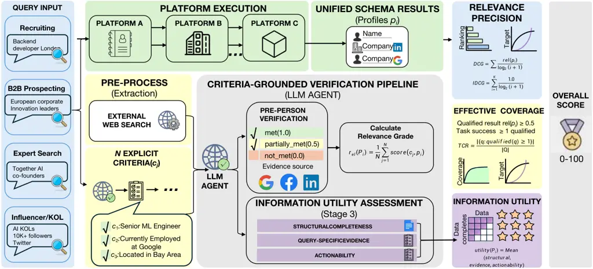
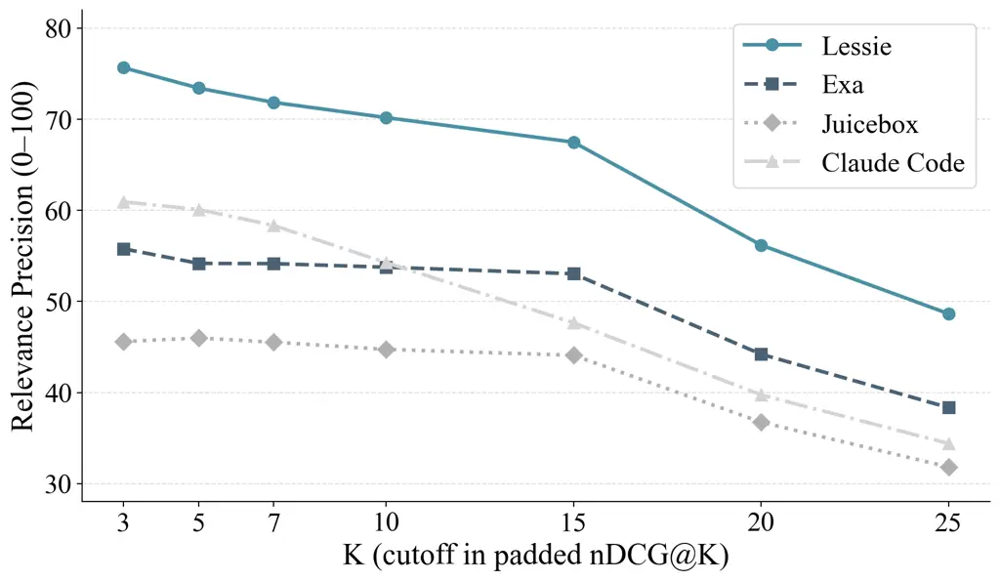

# PeopleSearchBench: Evaluating AI-Powered People Search Platforms with Criteria-Grounded Verification

Tianyu Shi² Wei Wang¹ Zequn Xie¹ Shuai Zhang¹ Boyang Xia¹ Chenyu Zeng¹
Qi Zhang¹ Lynn Ai¹ Yaqi Yu¹ Kaiming Zhang¹ Feiyue Tang¹ Zhenyu Yu¹ Lei
Ding³  
¹LESSIE Team  
²McGill University, Montreal, QC, Canada  
³Department of Statistics, University of Manitoba, Winnipeg, MB,
Canada  
tianyu.shi3@mcgill.ca  shane@lessie.ai   lei.ding@umanitoba.ca

###### Abstract

AI-powered people search platforms are increasingly deployed for
recruiting, sales prospecting, and professional networking, yet no
standardized benchmark exists for their rigorous evaluation. We present
PeopleSearchBench, an open-source benchmark comprising 119 multilingual
queries across four scenarios: corporate recruiting, B2B sales
prospecting, expert search, and influencer discovery. A central
contribution is Criteria-Grounded Verification, an evaluation
methodology that decomposes each query into explicit, independently
checkable criteria and verifies each returned individual via live web
search, producing factual relevance judgments rather than subjective
LLM-as-judge scores (Cohen’s $`\kappa=0.84`$ with human annotators). We
evaluate four architecturally diverse platforms along three
complementary dimensions---Relevance Precision, Effective Coverage, and
Information Utility---and find that multi-source search agents
significantly outperform single-domain systems, particularly in
influencer discovery where the performance gap is largest. Platform
rankings are robust across ablations on scoring thresholds, dimension
weights, and judge models. All code, queries, and evaluation prompts are
publicly available.¹¹ 1 Repository:
[https://github.com/LessieAI/people-search-bench](https://github.com/LessieAI/people-search-bench)

## 1 Introduction

Finding the right person is a routine but high-stakes form of search. A
recruiter may need senior backend engineers in London with microservices
experience; a sales team may look for innovation leaders at large
European enterprises; a researcher may need domain experts with specific
publication histories; and a marketing team may seek creators with
substantial audience reach in a particular technical community. In each
case, the desired output is not a document or a single answer. It is a
ranked set of people, each of whom must satisfy several constraints and
provide enough verified information to support a downstream decision.

AI-powered people-search platforms are increasingly used to automate
these workflows. Modern systems can query professional databases, search
the open web, synthesize evidence from social platforms, and produce
profile-level summaries. Yet evaluation has not kept pace with
deployment. In the absence of a shared benchmark, it is difficult to
tell whether a system has found genuinely qualified individuals, or
whether it has returned plausible-looking profiles that match only
surface keywords, omit important constraints, or lack actionable
evidence.

Fundamentally, people search creates an evaluation problem that differs
from standard information retrieval. Retrieval benchmarks such as BEIR
and MTEB evaluate documents or passages as the primary result
units (Thakur et al., 2021; Muennighoff et al., 2023). People search, by
contrast, returns real individuals whose relevant attributes are
distributed across multiple sources and may change over time. A person’s
current employer, role, location, seniority, publication record, or
audience size cannot be treated as static text attached to a single
result. These attributes must be verified against external evidence, and
the evidence must be specific enough to explain why the person satisfies
the search intent.

This requirement also limits the usefulness of holistic LLM-as-judge
evaluation. LLM judges can approximate human preferences in many
settings (Zheng et al., 2023), but a single subjective relevance score
is a poor substitute for checking whether a named person currently holds
a particular role, works at a specified company, or meets a quantitative
constraint. Recent factuality methods decompose generated text into
checkable claims (Min et al., 2023; Wei et al., 2024). People search
calls for a complementary decomposition: the query itself should be
converted into explicit criteria, and each returned person should be
verified against those criteria using external evidence.

We present PeopleSearchBench, an open benchmark for evaluating
AI-powered people-search platforms. The benchmark contains 119
multilingual queries spanning four practical scenarios: recruiting, B2B
sales prospecting, expert search, and influencer/KOL discovery. Each
query is decomposed into independently checkable criteria, and each
returned person is evaluated through Criteria-Grounded Verification, a
decompose-then-verify pipeline that uses live web search to produce
factual relevance judgments rather than relying on holistic impressions.
The benchmark further evaluates whether systems return enough qualified
people and whether the resulting profiles are usable for downstream
action.

We make three contributions. First, we introduce Criteria-Grounded
Verification, which extracts explicit criteria from a people-search
query and verifies each returned individual against those criteria with
external evidence, achieving $`\kappa=0.84`$ agreement with human
annotators. Second, we define a multi-dimensional evaluation framework
that combines Relevance Precision, Effective Coverage, and Information
Utility, capturing not only whether the top results are relevant but
also whether the platform finds enough qualified people and provides
actionable profile information. Third, we benchmark four architecturally
diverse platforms across 119 queries, with confidence intervals,
ablation studies, and error analysis. Our results show that performance
varies substantially across scenarios, and that systems drawing on more
diverse information sources are more robust across heterogeneous
people-search tasks.

## 2 Related Work

#### Information retrieval benchmarks.

TREC (Voorhees and Harman, 2005) established the standard for IR
evaluation with test collections and pooled relevance judgments.
BEIR (Thakur et al., 2021) broadened the scope to 18 heterogeneous
datasets for zero-shot retrieval, MTEB (Muennighoff et al., 2023)
extended this to embedding models across diverse tasks, and BERGEN (Rau
et al., 2024) benchmarked full retrieval-augmented generation pipelines.
Beyond text-only retrieval, cross-modal research has examined how video
representations and alignment mechanisms affect retrieval. HVD (Xie et
al., 2026b) introduces human-inspired coarse-to-fine visual selection
and compression for text–video retrieval, while DPDV (Xie et al., 2026a)
addresses cross-modal information asymmetry through dual-pathway and
dual-view representation learning. These benchmarks and methods evaluate
documents, passages, or media items as self-contained retrieval units.
People search differs fundamentally: each result is a real individual
with multiple attributes that must be independently verified.

#### LLM-based and factual evaluation.

Zheng et al. (2023) demonstrated that LLM judges can approximate human
preferences, with subsequent work addressing positional bias (Wang et
al., 2024), multi-dimensional rubrics (Kim et al., 2024), and score
calibration (Ye et al., 2024). A parallel line of work decomposes
outputs into atomic claims for factual verification: FActScore (Min et
al., 2023) checks LLM-generated biographies against Wikipedia, and
SAFE (Wei et al., 2024) extends this with web search. Our
Criteria-Grounded Verification shares the decompose-then-verify
philosophy but differs in two key ways: we decompose the query (not the
output) into verifiable criteria, and we verify real individuals rather
than generated text, requiring live web evidence about current
employment, location, and role.

#### Entity-centric and expert search.

Entity retrieval from knowledge bases (Hasibi et al., 2017; Balog, 2018)
and expertise retrieval within closed corpora (Balog et al., 2012)
assume fixed entity collections with known attributes. Geyik et al.
(2018) described LinkedIn’s talent search, evaluated using
platform-specific engagement signals. The term person retrieval is also
used in vision-language research to describe retrieving images of a
target person from a fixed gallery using natural-language descriptions.
Recent work addresses noisy image–text correspondences through
uncertainty-aware learning (Xie et al., ) and uses multi-turn,
chat-driven generation and interaction to enrich supervision and refine
textual queries (Xie et al., 2025). Despite sharing a person-centric
matching objective, these methods retrieve visual instances from closed
datasets rather than identify and verify professional profiles on the
open web. Consequently, these settings do not support cross-platform
comparison over open-web results, nor do they provide evaluation
protocols for autonomous, LLM-powered people-search agents.

#### Agentic AI evaluation.

Recent benchmarks evaluate agents on software engineering (Jimenez et
al., 2024), and general task completion (Liu et al., 2024). These
benchmarks primarily assess whether an agent completes a single
well-defined goal. Complementary work targets the accuracy–efficiency
trade-off in web agents: SlimSearcher uses adaptive reward gating to
encourage efficient search behavior (Xie et al., 2026c), while
WebClipper applies graph-based trajectory pruning to remove redundant
interactions (Wang et al., 2026). Although these approaches extend agent
evaluation to interaction cost and trajectory efficiency, they do not
assess the quality of a returned set of real-world individuals. People
search requires evaluating set-level relevance, per-result factual
verification, and information quality jointly, a combination not
addressed by existing agent benchmarks.

## 3 PeopleSearchBench



Figure 1: Overview of the PeopleSearchBench evaluation pipeline. Queries
are executed across platforms, results are normalized to a unified
schema, and each person is verified against extracted criteria via web
search. Scores along three dimensions are averaged into an overall
score.

Unlike document retrieval, people search returns real individuals whose
attributes must be verified against external evidence and whose profiles
must be actionable for downstream tasks. Our pipeline (Figure 1)
captures these requirements: queries from four scenarios are executed
across platforms, results are normalized to a unified schema, and each
person is verified against criteria extracted from the query via live
web search. We describe the query dataset (§3.1), the verification
pipeline (§3.2), and the scoring metrics (§3.3) below.

### 3.1 Query Dataset

The benchmark comprises 119 queries designed to reflect the actual needs
of practitioners across four commercially important scenarios (Table 1).

Recruiting (30 queries) targets candidates with specific combinations of
skills, experience levels, and geographic preferences . B2B Prospecting
(32 queries) targets decision-makers at potential customer companies .
Expert/Deterministic Search (28 queries) seeks specific domain experts
or has verifiable correct answers (e.g., “Find all co-founders of
\[Company\]” or “List all research scientists at \[Organization\]”).
This category is particularly useful for validating factual accuracy
since ground-truth answers can be established. Influencer/KOL Discovery
(29 queries) targets content creators and thought leaders in specific
domains . This scenario tends to produce the largest performance
differences, as influencer data is scattered across social platforms
rather than concentrated in professional databases.

The query set is intentionally multilingual, covering English,
Portuguese, Spanish, and Dutch, to reflect the global nature of modern
people search. Each query contains on average 2.7 independently
verifiable criteria, ranging from simple role-location pairs to complex
multi-constraint specifications.

| Category      | N   | Langs      | Avg. Crit.    | Det.  |
| ------------- | --- | ---------- | ------------- | ----- |
| Recruiting    | 30  | EN, PT, ES | 3.2$`\pm`$1.1 | 0%    |
| B2B Prospect. | 32  | EN, ES     | 2.8$`\pm`$0.9 | 0%    |
| Expert/Det.   | 28  | EN         | 2.1$`\pm`$0.7 | 100%  |
| Influencer    | 29  | EN, NL, ES | 2.6$`\pm`$1.0 | 0%    |
| Total         | 119 | 4          | 2.7$`\pm`$1.0 | 23.5% |

Table 1: Query distribution. Avg. Crit.: mean extracted criteria per
query. Det.: percentage of queries with deterministic answers.

### 3.2 Criteria-Grounded Verification

Our evaluation pipeline decomposes each query into explicit, verifiable
factual checks grounded in external evidence, rather than assigning
holistic quality scores as in standard LLM-as-judge methods (Table 2).
This decompose-then-verify approach is conceptually related to
FActScore (Min et al., 2023), but differs in that we decompose the
search query into criteria and verify each returned person against them
using live web search, rather than decomposing generated text into
atomic claims. The pipeline proceeds in three stages.

| Aspect          | LLM-as-Judge                    | Ours                             |
| --------------- | ------------------------------- | -------------------------------- |
| Judgment        | Subjective quality score (0–10) | Factual yes/no per criterion     |
| Evidence        | Parametric knowledge            | External web search verification |
| Reproducibility | Low (prompt-sensitive)          | High (criteria are explicit)     |
| Bias risk       | High (style, length bias)       | Low (binary factual checks)      |

Table 2: Criteria-Grounded Verification vs. traditional holistic
LLM-as-judge approaches.

#### Stage 1: Criteria Extraction.

For each query, an LLM extracts $`N`$ explicit, independently checkable
conditions from the stated search intent. For example:

Query: “Find senior ML engineers at Google in Bay Area”  
$`\rightarrow`$ $`c_{1}`$: Role is Senior ML Engineer or equivalent  
$`\rightarrow`$ $`c_{2}`$: Currently employed at Google  
$`\rightarrow`$ $`c_{3}`$: Located in San Francisco Bay Area

Each criterion targets a single verifiable attribute, so the basis for
every relevance judgment can be traced back to a specific factual check.
To validate the stability of this step, we run the extraction prompt
five times on 30 randomly selected queries with temperature 0.7 and find
94.7% semantic equivalence across runs (§A.1).

#### Stage 2: Per-Person Verification.

Each person returned by the platform is verified against every extracted
criterion using live web search via the Tavily Search API with advanced
depth settings. Each criterion receives one of three judgments:

- •
  met (1.0): the criterion is fully satisfied with external evidence
- •
  partially met (0.5): the criterion is partially satisfied
- •
  not met (0.0): no supporting or contradicting evidence

The person’s relevance grade is the mean of the individual criterion
scores:

```math
\text{rel}(p_{i})=\frac{1}{N}\sum_{j=1}^{N}\text{score}(c_{j},p_{i}) \tag{1}
```

This formulation treats all criteria as equally important. While
weighted criteria could capture differences in constraint difficulty,
equal weighting avoids introducing additional hyperparameters and is
validated by our ablation studies (§A).

#### Stage 3: Information Utility Assessment.

The verification agent simultaneously scores each returned profile on
whether it contains sufficient information—contact details, match
explanations, source links—for downstream action (§3.3).

### 3.3 Evaluation Dimensions

Each platform is scored on three independently computed dimensions, all
scaled to the 0–100 range, then combined via equal-weight averaging to
produce an overall score.

#### Relevance Precision (Padded nDCG@$`K`$).

Relevance Precision measures whether the returned people match the query
and are correctly ranked. Given relevance grades
$`\text{rel}(p_{1}),\ldots,\text{rel}(p_{K})`$ for the top-$`K`$
results, Discounted Cumulative Gain is:

```math
\text{DCG@}K=\sum_{i=1}^{K}\frac{\text{rel}(p_{i})}{\log_{2}(i+1)} \tag{2}
```

Unlike standard nDCG, which normalizes against the best possible
ordering of the returned results, we use a padded ideal that always
assumes $`K`$ perfectly relevant results:

```math
\text{IDCG@}K=\sum_{i=1}^{K}\frac{1.0}{\log_{2}(i+1)} \tag{3}
```

This prevents platforms that return only a few perfect results from
receiving inflated scores—in people search, a platform returning 3
relevant people should score lower than one returning 10. Relevance
Precision is the mean padded nDCG@$`K`$ across all queries, scaled to
0–100:

```math
\text{Rel.\ Precision}=\frac{1}{|Q|}\sum_{q\in Q}\frac{\text{DCG@}K(q)}{\text{IDCG@}K}\times 100 \tag{4}
```

We set $`K{=}10`$ for all main results, as most queries return at least
10 candidates. Sensitivity to this choice is examined in §A.

#### Effective Coverage.

Effective Coverage measures how many qualified people the platform finds
per query, combining task completion with result volume. We define:

- •
  Qualified result: a person with $`\text{rel}(p_{i})\geq 0.5`$, meaning
  they satisfy at least half of the extracted criteria.
- •
  Task success: a query for which the platform returns at least one
  qualified result.

The coverage score is:

```math
\text{Coverage}=\text{TCR}\times\frac{1}{|Q|}\sum_{q\in Q}\min\!\left(\frac{\text{qual}(q)}{K},1.0\right)\times 100 \tag{5}
```

where $`\text{TCR}=|\{q:\text{qual}(q)\geq 1\}|/|Q|`$ is the task
completion rate and $`K{=}10`$ is the target number of results.

#### Information Utility.

Information Utility measures whether the returned data is sufficiently
complete and structured for downstream action without further manual
research. Each result is scored on three equally weighted
sub-dimensions:

1.  1.  Structural completeness: the richness of the profile data, including
        name, title, company, contact, work history, and education.
2.  2.  Query-specific evidence: whether the result includes explanations
        for why the person matches each criterion and provides source URLs
        for verification.
3.  3.  Actionability: whether the user can take next steps (contact,
        shortlisting, outreach) based on the provided data alone.

Each sub-dimension is scored on a 0.0–1.0 scale:

```math
\text{utility}(p_{i})=\frac{1}{3}\big(\text{struct}+\text{evid}+\text{action}\big) \tag{6}
```

```math
\text{Info.\ Util}=\frac{100}{|Q|}\sum_{q\in Q}\frac{1}{|P_{q}|}\sum_{p_{i}\in P_{q}}\text{utility}(p_{i}) \tag{7}
```

where $`P_{q}`$ is the set of evaluated persons for query $`q`$.

#### Overall Score.

The three dimensions are combined via equal-weight averaging:

```math
\text{Overall}=\frac{\text{Rel.\ Prec.}+\text{Eff.\ Cov.}+\text{Info.\ Util.}}{3} \tag{8}
```

We follow the Multi-Criteria Decision Analysis principle that equal
weights perform comparably to optimized weights in most multi-attribute
decision problems (Dawes and Corrigan, 1974). Our ablation study (§A)
confirms that rankings are invariant to weight perturbation.

## 4 Experiments

### 4.1 Setup

#### Platforms.

We evaluate four platforms representing diverse architectural approaches
to people search (Table 3). Lessie is a specialized AI search agent that
autonomously searches across professional networks, social platforms,
academic databases, and public registries. Exa is a structured search
API that returns entity results from a proprietary database. Juicebox
(PeopleGPT) is an AI recruiting platform with access to over 800 million
professional profiles from 60+ sources. Claude Code is a general-purpose
AI coding agent (Claude Sonnet 4.6) that produces text-based search
reports via web search. All platforms are evaluated on up to 15 results
per query.

#### Verification configuration.

The verification pipeline uses Gemini 3 Flash Preview (via OpenRouter)
for all LLM judgments and the Tavily Search API (advanced depth) for
web-based fact-checking. The same model and configuration are applied
identically to all platforms, and the verification agent receives no
information about which platform produced each result.

#### Temporal control.

All evaluations were conducted within a single week (January 15–22,
2025), with each platform evaluated on the same day using identical
query ordering. Platform versions were recorded: Lessie v2.1.0 (web
interface), Exa API v1 (entity search endpoint), Juicebox PeopleGPT v3.2
(web interface), and Claude Code (claude-sonnet-4-6-20250101, via API).

#### Statistical methodology.

We report 95% confidence intervals estimated via bootstrap resampling
(1000 iterations) and assess pairwise significance using paired
bootstrap tests (Efron and Tibshirani, 1994).

| Platform    | Type                | Data Sources                             |
| ----------- | ------------------- | ---------------------------------------- |
| Lessie      | Specialized agent   | Web, social, academic, public registries |
| Exa         | Search API          | Proprietary entity database              |
| Juicebox    | Recruiting platform | 800M+ profiles, 60+ sources              |
| Claude Code | General AI agent    | Web search                               |

Table 3: Characteristics of the four evaluated platforms.

### 4.2 Main Results

Lessie achieves the highest overall score (65.2$`\pm`$1.5), leading
across all three evaluation dimensions with an 18.5% margin over the
second-ranked system (Figure 2). Exa ranks second (55.0$`\pm`$1.8),
followed by Claude Code (46.0$`\pm`$2.1) and Juicebox (45.8$`\pm`$1.9).
All pairwise differences between the first- and second-ranked platforms
are statistically significant ($`p<0.05`$, paired bootstrap).

The per-dimension breakdown reveals distinct architectural tradeoffs.
Exa achieves strong Effective Coverage (58.1$`\pm`$2.6) due to its high
task completion rate (96.6$`\pm`$1.8%) and consistent result counts, but
its Relevance Precision (53.8$`\pm`$2.4) trails Lessie by 16.4 points,
suggesting difficulty with complex multi-constraint queries. Claude Code
achieves moderate Relevance Precision (54.3$`\pm`$2.8) through
general-purpose web search but the lowest Information Utility
(42.7$`\pm`$2.2), as its text-based reports typically lack structured
contact information and per-criterion match explanations. Juicebox has
the lowest Relevance Precision (44.7$`\pm`$2.6), indicating that its
recruiting-focused database design generalizes poorly to non-recruiting
queries, though its rich LinkedIn-style profile fields yield moderate
Information Utility (50.9$`\pm`$1.9).

Lessie is notably the only platform achieving both 100% task completion
and the highest relevance, occupying the upper-right quadrant of the
completion–relevance space (Figure 3). The remaining platforms trade off
between these two dimensions: Exa achieves high completion but moderate
relevance, while Juicebox and Claude Code cluster in the lower-left with
both lower completion and lower relevance.

Figure 2: Overall results decomposed by dimension with 95% confidence
intervals.

Figure 3: Task completion rate vs. Relevance Precision. Bubble size
indicates overall score.

## 5 Conclusion

We presented PeopleSearchBench, a benchmark with Criteria-Grounded
Verification for evaluating AI-powered people search platforms. The
benchmark evaluates systems along three complementary
dimensions—Relevance Precision, Effective Coverage, and Information
Utility—using a decompose-then-verify pipeline that produces factual,
reproducible judgments with high human agreement ($`\kappa=0.84`$).
Evaluation of four platforms—Lessie, Exa, Juicebox, and Claude Code—on
119 queries across four scenarios reveals clear architectural tradeoffs,
with data source diversity playing a key role in cross-scenario
robustness. The benchmark’s design choices—padded nDCG, qualified-result
thresholds, equal dimension weighting—are validated through systematic
ablation studies showing stable rankings. We release all code, queries,
and evaluation prompts to support reproducible comparison as AI-powered
people search continues to evolve.

## Limitations

Our benchmark has several limitations. (1) The 119-query set, while
balanced across four scenarios, does not cover every people-search use
case (e.g., academic collaborator search, angel investor
identification). (2) Web verification depends on publicly indexed
information; individuals with limited online presence may be
systematically under-evaluated, introducing a bias toward publicly
visible professionals. (3) We evaluate up to 15 results per query;
platforms capable of returning more are only assessed on their top 15.
(4) Platform capabilities evolve quickly; our results reflect a single
evaluation window in January 2025 and may not generalize to later
versions. (5) The Information Utility dimension rewards platforms
providing per-result match explanations, which may favor architectures
with built-in verification pipelines. (6) While we test multiple judge
models and find consistent rankings, the primary pipeline uses a single
LLM verifier, and all tested judges share similar architectural
foundations.

## Acknowledgments

Lei Ding was supported by the Natural Sciences and Engineering Research
Council of Canada (NSERC) Discovery Grant (RGPIN-2026-06465).

## Ethics Statement

All queries target publicly available professional information; we do
not scrape private data. The benchmark publishes aggregated platform
scores, not individual personal records. Human annotators were
compensated above local minimum wage and provided informed consent. We
recognize that people-search technology can be misused and encourage
adopters to pair this benchmark with responsible data-handling policies.

## References

- Balog et al. (2012) K. Balog, Y. Fang, M. de Rijke, P. Serdyukov,
  and L. Si Expertise retrieval. Foundations and Trends in Information
  Retrieval 6 (2–3), pp. 127–256. Cited by: §2.
- Balog (2018) K. Balog Entity-oriented search. The Information
  Retrieval Series, Vol. 39, Springer. Cited by: §2.
- Dawes and Corrigan (1974) R. M. Dawes and B. Corrigan Linear models in
  decision making. Psychological Bulletin 81 (2), pp. 95–106. Cited by:
  §3.3.
- Efron and Tibshirani (1994) B. Efron and R. J. Tibshirani An
  introduction to the bootstrap. Chapman and Hall/CRC. Cited by: §4.1.
- Geyik et al. (2018) S. C. Geyik, Q. Guo, B. Hu, et al. Talent search
  and recommendation systems at LinkedIn. In Proceedings of the 41st
  International ACM SIGIR Conference, pp. 1353–1354. Cited by: §2.
- Hasibi et al. (2017) F. Hasibi, F. Nikolaev, C. Xiong, K. Balog, S. E.
  Bratsberg, A. Kotov, and J. Callan DBpedia-Entity v2: a test
  collection for entity search. In Proceedings of the 40th International
  ACM SIGIR Conference, pp. 1265–1268. Cited by: §2.
- Jimenez et al. (2024) C. E. Jimenez, J. Yang, A. Wettig, et al.
  SWE-bench: can language models resolve real-world GitHub issues?. In
  International Conference on Learning Representations, Cited by: §2.
- Kim et al. (2024) S. Kim, J. Suk, S. Longpre, et al. Prometheus 2: an
  open source language model specialized in evaluating other language
  models. In Proceedings of the 2024 Conference on Empirical Methods in
  Natural Language Processing, Cited by: §2.
- Liu et al. (2024) X. Liu, H. Yu, H. Zhang, et al. AgentBench:
  evaluating LLMs as agents. In International Conference on Learning
  Representations, Cited by: §2.
- Min et al. (2023) S. Min, K. Krishna, X. Lyu, M. Lewis, W. Yih, P. W.
  Koh, M. Iyyer, L. Zettlemoyer, and H. Hajishirzi FActScore:
  fine-grained atomic evaluation of factual precision in long form text
  generation. In Proceedings of the 2023 Conference on Empirical Methods
  in Natural Language Processing, pp. 12076–12100. Cited by: §1, §2,
  §3.2.
- Muennighoff et al. (2023) N. Muennighoff, N. Tazi, L. Magne, and N.
  Reimers MTEB: massive text embedding benchmark. In Proceedings of the
  17th Conference of the European Chapter of the Association for
  Computational Linguistics, pp. 2014–2037. Cited by: §1, §2.
- Rau et al. (2024) D. Rau, H. Déjean, N. Chirkova, T. Formal, S.
  Wang, S. Clinchant, and V. Nikoulina BERGEN: a benchmarking library
  for retrieval-augmented generation. In Findings of the Association for
  Computational Linguistics: EMNLP 2024, pp. 7640–7663. Cited by: §2.
- Thakur et al. (2021) N. Thakur, N. Reimers, A. Rücklé, A. Srivastava,
  and I. Gurevych BEIR: a heterogeneous benchmark for zero-shot
  evaluation of information retrieval models. In Thirty-fifth Conference
  on Neural Information Processing Systems Datasets and Benchmarks
  Track, Cited by: §1, §2.
- Voorhees and Harman (2005) E. M. Voorhees and D. K. Harman TREC:
  experiment and evaluation in information retrieval. MIT Press. Cited
  by: §2.
- Wang et al. (2026) J. Wang, Z. Xie, D. Yang, J. Feng, Y. Shen, D.
  Sun, M. Long, Y. Jiao, Z. Tan, J. Wang, et al. WebClipper: efficient
  evolution of web agents with graph-based trajectory pruning. In
  Proceedings of the 64th Annual Meeting of the Association for
  Computational Linguistics (Volume 1: Long Papers), pp. 21646–21666.
  Cited by: §2.
- Wang et al. (2024) P. Wang, L. Li, L. Chen, et al. Large language
  models are not fair evaluators. In Proceedings of the 62nd Annual
  Meeting of the Association for Computational Linguistics,
  pp. 9440–9450. Cited by: §2.
- Wei et al. (2024) J. Wei, C. Yang, X. Song, Y. Lu, N. Hu, D. Tran, D.
  Peng, R. Liu, D. Huang, C. Du, and Q. V. Le Long-form Factuality in
  Large Language Models. arXiv preprint arXiv:2403.18802. Cited by: §1,
  §2.
- Xie et al. (2026a) Z. Xie, X. Liu, F. Feng, B. Zhang, and T. Jin DPDV:
  dual-pathway and dual-view representation learning for bridging
  information asymmetry in text-video retrieval. In Proceedings of the
  64th Annual Meeting of the Association for Computational Linguistics
  (Volume 1: Long Papers), pp. 5385–5394. Cited by: §2.
- Xie et al. (2026b) Z. Xie, X. Liu, B. Zhang, Y. Lin, S. Cai, and T.
  Jin HVD: human vision-driven video representation learning for
  text-video retrieval. In ICASSP 2026–2026 IEEE International
  Conference on Acoustics, Speech and Signal Processing (ICASSP),
  pp. 12992–12996. External Links:
  [Document](https://dx.doi.org/10.1109/ICASSP55912.2026.11464612) Cited
  by: §2.
- \[20\] Z. Xie, C. Wang, S. Cai, F. Feng, G. luo, Q. Zhang, J. Chen,
  and T. Jin Dynamic uncertainty learning with noisy correspondence for
  text-based person retrieval. ACM Transactions on Information Systems.
  Cited by: §2.
- Xie et al. (2025) Z. Xie, C. Wang, Y. Wang, S. Cai, S. Wang, and T.
  Jin Chat-driven text generation and interaction for person retrieval.
  In Proceedings of the 2025 Conference on Empirical Methods in Natural
  Language Processing, pp. 5259–5270. Cited by: §2.
- Xie et al. (2026c) Z. Xie, J. Wang, D. Yang, J. Feng, Y. Shen, J.
  Wang, and J. Gu SlimSearcher: training efficiency-aware web agents via
  adaptive reward gating. arXiv preprint arXiv:2606.07074. Cited by: §2.
- Ye et al. (2024) S. Ye, D. Kim, S. Kim, et al. FLASK: fine-grained
  language model evaluation based on alignment skill sets. In
  International Conference on Learning Representations, Cited by: §2.
- Zheng et al. (2023) L. Zheng, W. Chiang, Y. Sheng, S. Zhuang, Z.
  Wu, Y. Zhuang, Z. Lin, Z. Li, D. Li, E. P. Xing, et al. Judging
  LLM-as-a-judge with MT-Bench and chatbot arena. In Advances in Neural
  Information Processing Systems, Vol. 36. Cited by: §1, §2.

### .1 Scenario Breakdown

Performance varies substantially across query scenarios (Table 4).

Recruiting is the most competitive scenario. Juicebox achieves second
place (65.7$`\pm`$2.9) with the highest Effective Coverage in this
category (75.3$`\pm`$2.7), reflecting the strength of its large
professional database. Lessie leads overall (68.2$`\pm`$2.8), primarily
through superior Relevance Precision (74.8$`\pm`$2.6). All four
platforms achieve at least 90% task completion here, indicating that
recruiting queries are well-served by existing data sources.

B2B Prospecting reveals wider gaps. Lessie’s Relevance Precision
(62.8$`\pm`$2.9) leads Exa (50.0$`\pm`$3.2) by 12.8 points, suggesting
that multi-source data fusion is especially valuable when queries target
decision-makers outside standard professional databases. Juicebox’s task
completion drops to 84.4$`\pm`$6.5%, and Claude Code falls further to
75.0$`\pm`$7.7%, as B2B targets often lack the structured profiles these
platforms rely on.

Expert/Deterministic queries favor Lessie (70.4$`\pm`$2.4), which
achieves its highest Relevance Precision (79.0$`\pm`$2.3) in this
category. Claude Code performs comparatively well overall
(57.0$`\pm`$3.1), as deterministic queries benefit from general-purpose
web search—specific known individuals can be located through standard
search engines. However, Claude Code’s Information Utility remains low
(38.5$`\pm`$3.4) because its text reports lack structured profile data.
Juicebox struggles most in this category (44.2$`\pm`$3.6), with task
completion at only 71.4$`\pm`$8.5%, as many target individuals lack
LinkedIn profiles.

Influencer/KOL exhibits the widest performance spread. Lessie’s
Relevance Precision (65.2$`\pm`$3.1) is 2.45$`\times`$ Juicebox’s
(26.6$`\pm`$4.0), and Juicebox’s task completion falls to
79.3$`\pm`$7.6%. Since influencer data is distributed across Instagram,
Twitter/X, and YouTube rather than concentrated in professional
databases, multi-source architectures hold a pronounced advantage. This
scenario also produces the largest absolute gap in overall score: 31.2
points between Lessie and Juicebox.

Cross-scenario consistency. Lessie is the only platform maintaining
consistent Relevance Precision across all categories, with a range of
62.8–79.0 (coefficient of variation: 9.7%), as visualized in Figure 4.
Other platforms exhibit significantly wider variance: Juicebox ranges
from 26.6 to 66.1 (CV: 35.2%), Exa from 37.4 to 66.2 (CV: 22.8%), and
Claude Code from 43.0 to 69.6 (CV: 19.1%). These results suggest that
multi-source architectures are structurally less sensitive to query
type, whereas platforms built around a single data domain exhibit sharp
performance degradation outside that domain.

| Scenario    |         | Lessie         | Exa            | Jbox           | CC             |
| ----------- | ------- | -------------- | -------------- | -------------- | -------------- |
| Recruiting  | Overall | 68.2$`\pm`$2.8 | 64.7$`\pm`$3.1 | 65.7$`\pm`$2.9 | 50.5$`\pm`$3.5 |
|             | TCR (%) | 100            | 100            | 100            | 90.0$`\pm`$5.5 |
| B2B Prosp.  | Overall | 60.6$`\pm`$2.6 | 55.2$`\pm`$2.9 | 51.4$`\pm`$3.2 | 43.0$`\pm`$3.4 |
|             | TCR (%) | 100            | 100            | 84.4$`\pm`$6.5 | 75.0$`\pm`$7.7 |
| Expert/Det. | Overall | 70.4$`\pm`$2.4 | 61.2$`\pm`$2.8 | 44.2$`\pm`$3.6 | 57.0$`\pm`$3.1 |
|             | TCR (%) | 100            | 96.4$`\pm`$3.6 | 71.4$`\pm`$8.5 | 100            |
| Influencer  | Overall | 62.3$`\pm`$3.0 | 41.6$`\pm`$3.4 | 31.1$`\pm`$3.8 | 43.2$`\pm`$3.3 |
|             | TCR (%) | 100            | 89.7$`\pm`$5.7 | 79.3$`\pm`$7.6 | 82.8$`\pm`$7.0 |

Table 4: Per-scenario overall scores and task completion rates (TCR)
with 95% bootstrap CIs. Jbox = Juicebox; CC = Claude Code.

Figure 4: Relevance Precision by scenario for each platform with 95%
bootstrap CIs. REC = Recruiting, B2B = B2B Prospecting, EXP =
Expert/Deterministic, INF = Influencer/KOL.

## Appendix A Ablation Studies

We conduct ablation experiments on five design choices to assess the
robustness of our benchmark; full tables are in Appendix C. The central
finding is that platform rankings are stable across all tested
configurations.

First, the scoring parameters. Varying the qualified-result threshold
across $`\text{rel}(p_{i})\geq\{0.3,0.5,0.7\}`$ preserves the top-two
rankings (Lessie, Exa) at every level (Table 7). We also test the nDCG
cutoff at $`K\in\{3,5,7,10,15,20,25\}`$. Lessie remains first across all
values of $`K`$, and overall rankings are stable for $`K\leq 10`$. At
$`K{=}15`$, Claude Code’s score drops more steeply than others. At
$`K\geq 20`$, all scores decline sharply since most platforms return
fewer than 15 results (Table 8, Figure 5). Finally, replacing the
ternary criterion judgments with binary scoring lowers all Relevance
Precision scores—e.g., Lessie from 70.2 to 68.4—but preserves all
rankings (Table 10).



Figure 5: Sensitivity of Relevance Precision to cutoff K across
platforms.

Second, the aggregation scheme. We test five weighting schemes for
combining the three dimensions, including weights optimized via grid
search on a held-out set of 30 queries. Lessie ranks first under all
five schemes (Table 9). Removing Information Utility entirely and
scoring on only Relevance Precision and Effective Coverage causes
Juicebox (43.3) to fall below Claude Code (47.7), confirming that
profile completeness is a meaningful quality axis not captured by the
other two dimensions (Table 11).

Taken together, these results indicate that the benchmark’s conclusions
are not sensitive to specific parameter choices or aggregation
decisions.

### A.1 Pipeline Validation

A core contribution of this work is the Criteria-Grounded Verification
pipeline itself. We conduct three experiments to validate its
reliability.

#### Human validation.

Two trained annotators independently reviewed a stratified sample of 200
person–query pairs (50 per scenario), blinded to platform identity, with
access to the same web search tools as the automated pipeline.
Inter-annotator agreement is substantial: criterion match
$`\kappa=0.87`$ (95% CI: 0.83–0.91); qualified status $`\kappa=0.91`$
(0.87–0.95). Agreement between the LLM verifier and human consensus
reaches $`\kappa=0.84`$ (0.79–0.89) on criterion match and
$`\kappa=0.88`$ (0.83–0.93) on qualified status (Table 5). Among the 26
criterion-level disagreements, 18 (69%) involved the LLM being more
conservative than humans on “partially met” judgments, and 8 (31%)
involved the LLM finding evidence that humans missed. This pattern
indicates that the pipeline is slightly conservative but not
systematically biased toward any platform.

#### Criteria extraction stability.

We run the extraction prompt five times on 30 randomly selected queries
at temperature 0.7. The mean number of criteria per query is 2.73 (SD =
0.41), and semantic equivalence across runs—assessed by an independent
LLM—reaches 94.7%. Exact string match is 78.0%, which serves as a lower
bound since paraphrasing is acceptable.

#### Judge model sensitivity.

We tested three alternative judge models on 200 person–query pairs. All
show high agreement with the primary Gemini model: GPT-4o
($`\kappa=0.87`$), Claude 3.5 Sonnet ($`\kappa=0.85`$), and GPT-4o-mini
($`\kappa=0.79`$). Platform rankings remain identical across all judges,
indicating that the benchmark’s conclusions are not artifacts of the
specific judge model.

| Metric                | Agree. | $`\boldsymbol{\kappa}`$ | 95% CI         |
| --------------------- | ------ | ----------------------- | -------------- |
| Crit. match (3-level) | 86.5%  | 0.84                    | \[0.79, 0.89\] |
| Qualified (binary)    | 93.0%  | 0.88                    | \[0.83, 0.93\] |
| Rel. grade (cont.)    | —      | $`r{=}0.89`$            | \[0.85, 0.92\] |

Table 5: LLM verifier vs. human consensus on 200 person–query pairs.

## Appendix B Error Analysis

We manually reviewed all queries with at least one error and categorized
failures into four types (Table 6). Per-scenario breakdowns and
illustrative case studies are in Appendix E.

False positives are most prevalent in Juicebox (24.6%), which frequently
matches surface-level keywords—e.g., “product manager” + “Singapore” +
“finance”—without satisfying semantic constraints like “fintech
startup.” Incomplete profiles dominate Claude Code’s errors (31.2%), as
its text reports lack structured contact data and source URLs. False
negatives and task failures concentrate in Juicebox outside its
recruiting domain, reaching a 41.4% false-negative rate in
Influencer/KOL queries where content creators rarely maintain
professional database profiles. Lessie maintains 0% false-negative and
task-failure rates across all scenarios.

The Influencer/KOL scenario exhibits the highest error rates across all
platforms, confirming that influencer discovery—where relevant
individuals are dispersed across heterogeneous social platforms—remains
the most challenging category.

| Error Type         | Lessie | Exa  | Jbox | CC   |
| ------------------ | ------ | ---- | ---- | ---- |
| False positive     | 8.2    | 18.4 | 24.6 | 16.8 |
| False negative     | 0      | 3.4  | 16.0 | 13.5 |
| Incomplete profile | 12.4   | 14.2 | 8.6  | 31.2 |
| Task failure       | 0      | 3.4  | 16.0 | 13.5 |

Table 6: Error rates (%) by platform. Jbox = Juicebox; CC = Claude Code.

## Appendix C Ablation Details

This appendix provides the full tables for the ablation studies
summarized in §A.

#### Qualified threshold sensitivity.

We test three thresholds for defining a qualified result:
$`\text{rel}(p_{i})\geq 0.3`$, $`0.5`$, and $`0.7`$. Rankings are
reported for both Effective Coverage and Overall score.

|             | Cov. Rank  |            |            | Overall Rank |            |            |
| ----------- | ---------- | ---------- | ---------- | ------------ | ---------- | ---------- |
| Platform    | $`\geq`$.3 | $`\geq`$.5 | $`\geq`$.7 | $`\geq`$.3   | $`\geq`$.5 | $`\geq`$.7 |
| Lessie      | 1          | 1          | 1          | 1            | 1          | 1          |
| Exa         | 2          | 2          | 2          | 2            | 2          | 2          |
| Juicebox    | 3          | 3          | 4          | 4            | 4          | 3          |
| Claude Code | 4          | 4          | 3          | 3            | 3          | 4          |

Table 7: Rankings under different qualified thresholds.

#### Top-$`K`$ sensitivity.

We evaluate padded nDCG at $`K\in\{3,5,7,10,15,20,25\}`$.

| Platform | @3   | @5   | @7   | @10  | @15  | @20  | @25  |
| -------- | ---- | ---- | ---- | ---- | ---- | ---- | ---- |
| Lessie   | 75.7 | 73.4 | 71.9 | 70.2 | 67.5 | 56.2 | 48.7 |
| Exa      | 55.8 | 54.2 | 54.2 | 53.8 | 53.0 | 44.2 | 38.3 |
| CC       | 60.9 | 60.1 | 58.4 | 54.3 | 47.7 | 39.7 | 34.4 |
| Jbox     | 45.6 | 46.0 | 45.5 | 44.7 | 44.1 | 36.7 | 31.8 |

Table 8: Relevance Precision (padded nDCG@$`K`$) at different cutoffs.
Bold indicates $`K{=}10`$ used in main results. Rankings are stable for
$`K\leq 15`$. CC = Claude Code; Jbox = Juicebox.

#### Dimension weighting sensitivity.

Five weighting schemes are tested: equal ($`\frac{1}{3}`$ each),
precision-heavy (0.5/0.25/0.25), coverage-heavy (0.25/0.5/0.25),
utility-heavy (0.25/0.25/0.5), and weights optimized via grid search on
a held-out set of 30 queries.

| Platform | Eql.     | Prc.     | Cov.     | Utl.     | Opt.     |
| -------- | -------- | -------- | -------- | -------- | -------- |
| Lessie   | 1 (65.2) | 1 (65.9) | 1 (68.2) | 1 (62.3) | 1 (66.8) |
| Exa      | 2 (55.0) | 2 (54.9) | 2 (56.9) | 2 (55.0) | 2 (55.6) |
| CC       | 3 (46.0) | 3 (47.1) | 4 (44.5) | 3 (45.8) | 3 (46.2) |
| Jbox     | 4 (45.8) | 4 (45.3) | 3 (45.9) | 4 (49.2) | 4 (47.1) |

Table 9: Rankings and scores under different weighting schemes. CC =
Claude Code; Jbox = Juicebox.

#### Partial credit ablation.

We remove the “partially met” (0.5) judgment and use only binary
met (1.0) / not met (0.0).

| Platform    | With partial | Binary only | Rank change |
| ----------- | ------------ | ----------- | ----------- |
| Lessie      | 70.2         | 68.4        | None        |
| Exa         | 53.8         | 51.2        | None        |
| Claude Code | 54.3         | 52.1        | None        |
| Juicebox    | 44.7         | 41.8        | None        |

Table 10: Relevance Precision with and without partial credit.

#### Information Utility ablation.

We compute the overall score using only Relevance Precision and
Effective Coverage.

| Platform    | 3-dim | 2-dim (P+C) | Rank change  |
| ----------- | ----- | ----------- | ------------ |
| Lessie      | 65.2  | 69.7        | None         |
| Exa         | 55.0  | 55.9        | None         |
| Claude Code | 46.0  | 47.7        | None         |
| Juicebox    | 45.8  | 43.3        | Drops to 4th |

Table 11: Impact of removing Information Utility.

## Appendix D Cost and Reproducibility

Table 12 reports the total cost and wall-clock time for the full
benchmark evaluation (119 queries $`\times`$ 4 platforms). Web
verification dominates both cost (\$89.40) and latency (1.8 hours). The
average per-query verification cost is \$0.86, broken down as: criteria
extraction (\$0.002), web search (\$0.75), and LLM verification
(\$0.11).

| Component                 | Cost (USD) | Wall-clock time |
| ------------------------- | ---------- | --------------- |
| Platform query execution  | 47.80      | 2.3 hours       |
| Criteria extraction       | 0.24       | 4.2 minutes     |
| Web verification (Tavily) | 89.40      | 1.8 hours       |
| LLM verification (Gemini) | 12.60      | 42 minutes      |
| Total                     | 150.04     | 4.9 hours       |

Table 12: Cost and latency for full benchmark evaluation.

Platform query costs vary by pricing model: Lessie \$12.60
(subscription, prorated), Exa \$8.40 (API, \$0.07/query), Juicebox
\$14.20 (subscription, prorated), and Claude Code \$12.60 (API,
\$0.105/query).

Table 13 breaks down per-query latency by pipeline stage. Web
verification dominates because each criterion requires an independent
search. The pipeline is parallelizable: 8-way concurrency reduces total
time from 4.9 hours to approximately 1.2 hours.

| Stage (sec.)        | Lessie | Exa  | Jbox  | CC    |
| ------------------- | ------ | ---- | ----- | ----- |
| Platform execution  | 45.2   | 3.8  | 38.6  | 62.4  |
| Criteria extraction | 2.1    | 2.1  | 2.1   | 2.1   |
| Web verification    | 54.3   | 48.7 | 51.2  | 49.8  |
| LLM verification    | 21.2   | 18.4 | 19.8  | 17.6  |
| Total               | 122.8  | 73.0 | 111.7 | 131.9 |

Table 13: Average per-query latency (seconds) by platform and pipeline
stage. Jbox = Juicebox; CC = Claude Code.

All evaluation prompts, the unified result schema, and platform-specific
normalization procedures are documented in the released codebase.

## Appendix E Error Analysis Details

This appendix provides per-scenario error breakdowns and case studies
supplementing the aggregate error rates in §A.

#### Recruiting.

Juicebox shows the lowest false-positive rate in this category (6.2%),
reflecting the strength of its professional database. Claude Code’s
errors are dominated by incomplete profiles (38.5%), as its reports lack
structured contact information.

#### B2B Prospecting.

Juicebox’s task-failure rate jumps to 15.6%, as many target companies
fall outside its database coverage. Exa shows elevated false positives
(22.1%) when job titles are ambiguous.

#### Expert/Deterministic.

Claude Code achieves the lowest error rate here (12.5%), as
deterministic queries benefit from general-purpose web search. Juicebox
struggles with 28.6% task failure when target individuals lack LinkedIn
profiles.

#### Influencer/KOL.

This scenario has the highest error rates across all platforms.
Juicebox’s false-negative rate reaches 41.4% because influencers rarely
maintain professional profiles. Lessie maintains the lowest error rate
(18.5%) due to its multi-source coverage.

## Appendix F Case Studies

#### Case 1: False positive (Juicebox).

Query: “Find VP-level product managers at fintech startups in
Singapore.” Juicebox returned a product manager at a traditional bank.
The system matched “product manager” + “Singapore” + “finance” but
missed the “fintech startup” constraint—a common failure for
database-focused platforms that rely on keyword matching over semantic
understanding.

#### Case 2: False negative (Claude Code).

Query: “Find AI researchers who published at NeurIPS 2024 on diffusion
models.” Claude Code returned 3 correct names, but missed 12 additional
valid researchers found by Lessie and Exa. This illustrates the coverage
limitation of single-pass search: general-purpose agents often stop
after finding initial results rather than continuing to search
exhaustively.

#### Case 3: Verification ambiguity.

Query: “Find co-founders of Anthropic.” The platform correctly returned
Dario and Daniela Amodei, but web search produced conflicting
information about additional co-founders. The LLM verifier appropriately
marked disputed claims as “partially met” rather than forcing binary
judgments, demonstrating that the pipeline handles ambiguous cases
gracefully.
