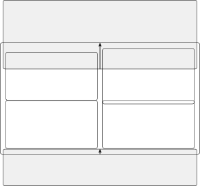
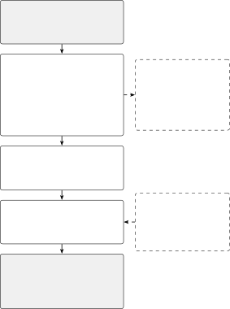

# Atomic and Holistic LLM Judges for Reference-Grounded Support Labels: A Prompt-Controlled Comparison

Xinran Zhang Affiliation: University of California, Berkeley
Email: [zhangxr7@berkeley.edu](mailto:)

###### Abstract

When an LLM judge only has to assign a three-way support label to a
candidate answer given a reference, does asking it to decompose the
answer into atomic claims help, and at what cost? We compare four
single-call designs that share the judge model, the inputs, and the
level of instruction detail: candidate-side atomic decomposition, a
matched holistic rubric, reference-side decomposition that checks
whether each reference claim is covered, and a bidirectional
combination. Support labels are constructed from TruthfulQA, ASQA, and
QAMPARI references (200 questions and 400 rows per dataset). All four
designs are run with Opus-4.6, GPT-4.1, and Gemini Flash Lite;
Sonnet-4.6 is added for the candidate-side and holistic designs.
Candidate-side decomposition is weak where the label depends on
completeness: the holistic rubric is more accurate on ASQA and QAMPARI
for every judge while using fewer tokens. Reference-side decomposition
is 12.5–21.3 points more accurate than holistic on ASQA for 28–29% more
tokens, and stays near the holistic ceiling on QAMPARI at 63–69% more.
On TruthfulQA misconceptions, candidate-side decomposition is
competitive and significantly better for two judges. On a 60-row
single-author subset whose labels are looser than strict reference
completeness, candidate-side decomposition edges ahead of holistic for
every judge, reversing the construction-label order. What a judge
decomposes should follow what the label measures.

## 1 Introduction

Reference-grounded LLM judges are routinely asked for a single label: is
a candidate answer supported by a reference, partially supported, or
unsupported? A popular way to make such judgments more careful is atomic
decomposition. FActScore (Min et al., 2023) split generations into
atomic facts and verified each one, and the idea now runs through
long-form factuality pipelines (Wei et al., 2024; Liu et al., 2025; Wan
et al., 2025). In a single judging call, the common instantiation
decomposes the _candidate_: list its claims, check each against the
reference, and aggregate.

A support label, however, mixes properties that decomposition treats
differently. We distinguish three. _Factual precision_ asks whether
every claim the candidate makes is backed by the reference. _Strict
reference completeness_ asks whether the candidate covers what the
reference contains. _Claim-level artifacts_—claim inventories, per-claim
decisions, audit trails—are useful products in their own right.
Candidate-side decomposition targets precision and produces artifacts,
but nothing in its structure lists what the candidate leaves out. When
the label rewards completeness, a judge can verify every claim an
incomplete answer makes and still call it supported.

We measure this in a prompt-controlled comparison of four single-call
designs (Figure 1): candidate-side atomic (C), a matched holistic rubric
(H), reference-side atomic (R), which decomposes the reference and
checks coverage, and bidirectional atomic (B), which does both. Within
each comparison the designs share the judge model, the inputs, and the
level of instruction detail, but not realized computation; token cost is
reported as an outcome (Section 3.3). We score the designs against
support labels constructed from TruthfulQA (Lin et al., 2022), ASQA
(Stelmakh et al., 2022), and QAMPARI (Amouyal et al., 2023), with 200
questions (400 rows) per dataset, three judge families, and Sonnet-4.6
as a fourth judge for C and H.

The direction of decomposition matters more than its presence.
Candidate-side decomposition is the weakest design on the two
completeness-heavy datasets. On ASQA its accuracy is 7.25–15.5 points
below the holistic rubric for all four judges, and GPT-4.1 and Gemini
Flash Lite recognize only 16% and 12.5% of partially supported rows as
partial. Reference-side decomposition reverses this: it is the most
accurate design on ASQA for all three judges on which it was run
(.8675–.975, sign-test $`p<10^{-14}`$ against holistic) at about 28–29%
more tokens than holistic, and on QAMPARI it stays near the holistic
ceiling while costing 63–69% more. TruthfulQA, whose negative candidates
are misconceptions that contradict the reference, points the other way.
There, candidate-side decomposition is at least as accurate as the
rubric for every judge, significantly so for Gemini Flash Lite and
Sonnet-4.6, and slightly cheaper.

These are measurements against constructed labels, and we keep that
scope explicit. Supported candidates are verbatim copies of the
reference, and ASQA/QAMPARI partials are lexical halves of the benchmark
answer sets. These partial labels encode strict reference completeness,
not necessarily factual error. Two smaller checks probe that choice
without replacing it. On a 60-row subset labeled by one author, the
author’s labels are looser than the ASQA construction labels. Under
them, the candidate-side judge is ahead of the holistic judge for every
judge model, while the construction labels put holistic ahead
(Section 6.1). The second check uses LLM-generated ASQA answers. There,
nominal full answers, which are not verified to be complete, are paired
with mechanically truncated partials, and both sets of construction
labels are noisy. Measured against these labels, holistic still agrees
more often than candidate-side decomposition, and the reference-side
design flags most nominal full answers as incomplete (Section 6.2).
Neither check establishes performance against independently validated
factuality labels. Together they show that the preferred design depends
on the standard a label encodes.

Our contribution is measurement and design guidance rather than a new
judge: (i) a prompt-controlled, cost-accounted comparison of four
decomposition designs across four judges; (ii) source-level evidence
that candidate-side and reference-side decomposition behave differently
on completeness-heavy labels; and (iii) diagnostics and label-semantics
checks that separate the standard a label encodes from the judge scored
against it.

## 2 Related Work

#### Claim-level factuality evaluation.

FActScore (Min et al., 2023) evaluates long-form generations by
splitting them into atomic facts and verifying each one against a
knowledge source, and SAFE (Wei et al., 2024) pairs multi-step
decomposition with search-based verification. VeriFact (Liu et al., 2025) refines fact extraction and builds reference fact sets for long
responses, which adds a recall view close to our reference-side design.
FaStFACT (Wan et al., 2025) speeds up such pipelines and strengthens
evidence collection, and UFO (Huang et al., 2024) shows that verdicts
depend on which fact source the evaluator receives. Verification signals
also steer generation. A self-correcting RAG framework, for example,
combines knapsack-style context selection with NLI-guided tree search to
keep answers faithful to the retrieved evidence (Xu et al., 2026). These
systems usually run over several calls with retrieval, and they mostly
target precision. We study a single evaluator call with a supplied
reference and ask which side of the comparison should be decomposed.

#### Reference-guided and rubric-based judges.

Explicit references improve LLM evaluation of free-form QA (Badshah and
Sajjad, 2025), and YESciEval (D’Souza et al., 2025) develops robust
rubric-based LLM judging for scientific QA. F²Bench (Lan et al., 2025)
scores open-ended responses against given facts with a rubric covering
accurate reflection of those facts, unwarranted generalization, and
unsupported claims, a supplied-evidence design close in form to our
holistic judge. A reference also changes where the difficulty lies.
Closed-book hallucination has been analyzed in terms of what a finite
parametric memory can retain of its training facts (Wang et al., 2026).
When the evidence is in the input instead, the task is to map the
candidate–reference relation onto the label definition, including what
counts as complete. Prior reference-guided work motivates this setting,
but it leaves decomposition direction, instruction detail, and cost
entangled.

#### Reliability of LLM judges.

Frontier judges generalize better than fine-tuned substitutes (Huang et
al., 2025), judge behavior varies across languages (Fu and Liu, 2025),
repeated ratings can be self-inconsistent (Haldar and Hockenmaier,
2025), and replacing human annotators with judges calls for proper
statistical testing (Calderon et al., 2025). Supplied evidence does not
automatically override model-internal knowledge (Qi et al., 2025), and
QA judges can fail when references conflict with what the model already
knows (Lee et al., 2026). Models can also read past the context they are
given. On the context-flip PaCE benchmark they prefer familiar pragmatic
readings over the literal reading the context requires, and explicit
strict-literal instructions change the outcome (Li et al., 2026). Task
format matters as well: forcing multiple-choice answers changes the
safety behavior of 14 models (Chen et al., 2026). We therefore treat the
judging instruction as an experimental variable and measure it together
with its token cost.

## 3 Task, Designs, and Protocol

### 3.1 Support labels constructed from benchmarks

Given a question, a reference answer, and a candidate answer, we ask the
judge to return one JSON object whose verdict is supported,
partially_supported, or unsupported. Omissions count: a candidate that
is correct as far as it goes but leaves out reference content is
partially supported.

The benchmarks do not provide such three-way labels; we construct them
from benchmark references and candidates (Table 1; Appendix H). Each of
200 source questions per dataset yields two rows. In all three datasets
the supported candidate is the reference text itself, verbatim. On
TruthfulQA the other candidate is an incorrect answer from the
benchmark, typically a common misconception, labeled unsupported. On
ASQA the partial candidate renders the first half of the benchmark’s
disambiguated qa_pairs as ‘sub-question + first short answer’ fragments;
on QAMPARI it lists the first half of the gold answer list. Both partial
constructions are deterministic and lexical.

Three consequences follow. Supported rows mainly test whether a judge
accepts an exact copy of the reference, and every design scores .94–1.00
on them; the discriminating rows are the partial and unsupported ones.
Partial labels encode coverage of the reference, not factual error: an
ASQA partial row can be correct in every claim it makes. We therefore
call them _construction labels_ and read agreement with them as
agreement with a strict reference-completeness standard; Section 6.1
examines a looser standard. Finally, only the verdict field is scored.
Scores, confidences, rationales, and claim lists do not enter accuracy.

| Dataset    | supp. | partial | unsupp. |
| ---------- | ----- | ------- | ------- |
| TruthfulQA | 200   | —       | 200     |
| ASQA       | 200   | 200     | —       |
| QAMPARI    | 200   | 200     | —       |

Table 1: Construction-label composition of the 400 rows per dataset (two
rows for each of 200 questions). Supported candidates are verbatim
copies of the reference; the partially_supported rows of ASQA and
QAMPARI carry the completeness signal.

### 3.2 Judge designs

All designs present the question, reference answer, and candidate answer
in the same user-message layout, followed by the requested JSON keys.
The first two keys are verdict and score; the system instruction and
remaining keys depend on the design (Appendix G).

#### C: candidate-side atomic.

The judge breaks the candidate into atomic claims and grounds each claim
in the reference (keys atomic_claims, supported_claims,
unsupported_claims). Its main prompt (v1) does not mention completeness.

#### H: matched holistic.

The judge evaluates the candidate with a rubric that lists correctness,
completeness, unsupported detail, and robustness to style bias, and is
told not to decompose the answer explicitly (keys evidence_summary,
unsupported_or_missing_points).

#### R: reference-side atomic.

The judge breaks the reference into atomic claims and checks whether the
candidate covers each one (reference_claims, covered_claims,
missing_claims). It is not asked about candidate content outside the
reference.

#### B: bidirectional atomic.

The judge does both and returns all six claim lists.

A schema-matched variant (C’s keys without the decomposition
instruction) and a holistic pairwise judge appear only in the
diagnostics.

Figure 1: Four alternative single-call judge designs. Each receives the
same inputs and returns a verdict; the instructions differ in what the
judge decomposes and checks. One design is used per call, not a sequence
of four stages. Prompts are in Appendix G.

### 3.3 What ‘prompt-controlled’ means

We call the comparison _prompt-controlled_: within each comparison, the
designs use the same judge model, the same inputs in the same layout,
and instructions of comparable detail. It is not compute-matched. Output
length is not fixed, the designs write different amounts, and realized
tokens are part of the outcome; any accuracy gain is assessed alongside
its token cost. Prompt control has two further limits. An instruction
not to decompose constrains what the judge writes, not what it computes,
so nothing here is a claim about internal mechanisms. And the prompts
are not symmetric in what they make explicit: the holistic rubric names
completeness, while candidate-side v1 does not. Candidate-side v2, which
asks for ‘factual accuracy and completeness’, is one check on this
asymmetry (Section 5). Our inferences are scoped to this single-call
prompting protocol.

### 3.4 Judges, scoring, and statistics

The judges are Opus-4.6, GPT-4.1, and Gemini Flash Lite for all four
designs, and Sonnet-4.6 for C and H. Gemini Flash Lite supplies a third
model family and a lightweight model tier, not a calibrated measure of
judge capability. Logged identifiers and diagnostic-specific settings
are listed in Appendix I. The primary runs specify neither temperature
nor an output-token limit; the actual provider-default values were not
recorded. We report accuracy over the 400 rows, class-wise accuracy, and
mean total (input plus output) tokens per call. Output-token
distributions are reported where available (Appendix E); the Gemini
interface recorded total but not output tokens.

Our inferential comparison is an exact two-sided sign test at the
source-question level. For each of the 200 questions we count the rows
(0–2) each design labels correctly, exclude ties, and test whether the
remaining questions favor either design with equal probability. Reported
$`p`$-values are unadjusted for multiple comparisons. For Opus and
GPT-4.1, we also report source-clustered bootstrap intervals and
stability under sampling half of the questions without replacement
(Appendix E). Figure 2 summarizes the protocol.

Figure 2: Evaluation flow. Primary runs use 200 questions (400 rows) per
dataset. Controlled diagnostics use 40–50-row slices; generated
candidates and a 60-row author-annotated slice probe the scope of the
construction-label results.

## 4 Results Against Construction Labels

Table 2 gives accuracy and mean total tokens for every evaluated
dataset, design, and judge combination. Appendix E gives supporting
statistics and complexity bins.

| Dataset    | Design | Opus-4.6 |         | GPT-4.1 |        | Gemini Flash Lite |        | Sonnet-4.6 |        |
| ---------- | ------ | -------- | ------- | ------- | ------ | ----------------- | ------ | ---------- | ------ |
|            |        | Acc.     | Tokens  | Acc.    | Tokens | Acc.              | Tokens | Acc.       | Tokens |
| TruthfulQA | C      | 0.9750   | 336.40  | 0.9775  | 284.52 | 0.9625            | 295.27 | 0.9750     | 353.84 |
|            | H      | 0.9700   | 364.66  | 0.9675  | 292.44 | 0.9300            | 309.33 | 0.9450     | 381.79 |
|            | R      | 0.9850   | 326.93  | 0.9725  | 285.87 | 0.9550            | 295.53 | —          | —      |
|            | B      | 0.9800   | 430.93  | 0.9800  | 378.27 | 0.9675            | 397.03 | —          | —      |
| ASQA       | C      | 0.7775   | 569.92  | 0.5650  | 475.19 | 0.5500            | 504.52 | 0.7150     | 588.09 |
|            | H      | 0.8500   | 492.81  | 0.7200  | 410.12 | 0.6975            | 423.74 | 0.8100     | 507.41 |
|            | R      | 0.9750   | 631.20  | 0.9325  | 526.37 | 0.8675            | 546.97 | —          | —      |
|            | B      | 0.9000   | 852.08  | 0.8025  | 700.80 | 0.7550            | 737.85 | —          | —      |
| QAMPARI    | C      | 0.9750   | 803.47  | 0.9275  | 676.45 | 0.9525            | 599.20 | 0.9625     | 785.66 |
|            | H      | 0.9925   | 510.68  | 0.9975  | 420.06 | 0.9925            | 423.29 | 0.9950     | 521.22 |
|            | R      | 0.9950   | 862.14  | 0.9950  | 701.21 | 0.9975            | 688.87 | —          | —      |
|            | B      | 0.9825   | 1258.16 | 0.9875  | 981.46 | 0.9925            | 895.60 | —          | —      |

Table 2: Accuracy against construction labels and mean total tokens per
call, 400 rows (200 questions) per cell. C = candidate-side atomic, H =
matched holistic, R = reference-side atomic, B = bidirectional atomic.
Bold marks the most accurate design per dataset and judge. Sonnet-4.6
was run with C and H only.

### 4.1 Candidate-side decomposition versus the holistic rubric

On ASQA the holistic rubric is more accurate than candidate-side
decomposition for all four judges, by 7.25 to 15.5 points, and uses
65–81 fewer tokens per call (Table 3; source-level
$`p\leq 3\times 10^{-8}`$). The gap sits in the partial rows, where
holistic minus candidate-side accuracy is +14.5, +30.5, +33.0, and +19.0
points for Opus-4.6, GPT-4.1, Gemini Flash Lite, and Sonnet-4.6
(Table 15). QAMPARI shows the same ordering with smaller margins:
holistic is 1.75–7.0 points more accurate ($`p\leq.016`$) and 176–293
tokens cheaper, because candidate-side outputs enumerate long answer
lists (median output 269–348 tokens, against 118–161 for holistic;
Table 16).

TruthfulQA reverses the sign. Candidate-side decomposition is at least
as accurate as the rubric for every judge, and the difference is
significant for Gemini Flash Lite and Sonnet-4.6 (12:0 questions each,
$`p=4.9\times 10^{-4}`$); for Opus-4.6 and GPT-4.1 it rests on four
discordant questions and is not significant. The edge comes mainly from
unsupported rows (holistic minus candidate-side: $`-1.0`$ to $`-6.0`$
points), and candidate-side decomposition is also 8–28 tokens cheaper on
this dataset. Appendix F gives complete recorded examples and a JSON
verdict.

The source-clustered intervals in Table 18 preserve each question’s
two-row dependence. For ASQA and QAMPARI, at least 98.8% of the
half-question subsets preserve the direction of the full-data accuracy
difference. The bootstrap and sign test are not interchangeable: for
TruthfulQA GPT-4.1, the percentile interval excludes zero while the
exact sign-test $`p=.125`$.

|              |                |                  |      |          |
| ------------ | -------------- | ---------------- | ---- | -------- |
| Judge        | $`\Delta`$Acc. | $`\Delta`$Tokens | H:C  | $`p`$    |
| _TruthfulQA_ |                |                  |      |          |
| Opus-4.6     | $`-`$0.0050    | +28.27           | 1:3  | 0.6250   |
| GPT-4.1      | $`-`$0.0100    | +7.92            | 0:4  | 0.1250   |
| Gemini FL    | $`-`$0.0325    | +14.06           | 0:12 | 4.88e-04 |
| Sonnet-4.6   | $`-`$0.0300    | +27.95           | 0:12 | 4.88e-04 |
| _ASQA_       |                |                  |      |          |
| Opus-4.6     | +0.0725        | $`-`$77.11       | 30:1 | 2.98e-08 |
| GPT-4.1      | +0.1550        | $`-`$65.07       | 66:5 | 1.19e-14 |
| Gemini FL    | +0.1475        | $`-`$80.78       | 67:8 | 1.01e-12 |
| Sonnet-4.6   | +0.0950        | $`-`$80.68       | 41:3 | 1.62e-09 |
| _QAMPARI_    |                |                  |      |          |
| Opus-4.6     | +0.0175        | $`-`$292.79      | 7:0  | 0.0156   |
| GPT-4.1      | +0.0700        | $`-`$256.39      | 28:0 | 7.45e-09 |
| Gemini FL    | +0.0400        | $`-`$175.91      | 18:2 | 4.02e-04 |
| Sonnet-4.6   | +0.0325        | $`-`$264.44      | 13:0 | 2.44e-04 |

Table 3: Holistic (H) minus candidate-side (C). $`\Delta`$Acc. $`>0`$
favors H; $`\Delta`$Tokens $`<0`$ means H is cheaper. H:C counts
questions (of 200) on which H or C labels more rows correctly; $`p`$ is
the unadjusted exact two-sided sign test after excluding tied questions.

### 4.2 Reference-side and bidirectional decomposition

Reference-side decomposition is the most accurate design on ASQA for
every judge on which it was run: .975, .9325, and .8675 for Opus-4.6,
GPT-4.1, and Gemini Flash Lite. That is 12.5, 21.25, and 17.0 points
above holistic and 19.75–36.75 points above candidate-side
decomposition. Against holistic it wins on 50:0, 84:1, and 69:2
questions ($`p\leq 1.8\times 10^{-15}`$; Table 17). Its partial-row
accuracy is .95, .87, and .745, against .555, .16, and .125 for the
candidate-side design, so the same judges on the same inputs separate
complete from incomplete answers far better when the decomposition runs
over the reference. The price is about 28–29% more tokens than holistic
and 8–11% more than candidate-side decomposition.

On QAMPARI, reference-side accuracy (.995–.9975) is close to the
holistic ceiling (.9925–.9975; 1:0, 1:2, and 2:0 questions) at 63–69%
more tokens, and it improves on candidate-side decomposition for all
three judges ($`p\leq.008`$). On TruthfulQA it stays within 2.5 points
of the other designs. It beats holistic for Opus-4.6 (6:0, $`p=.031`$)
and Gemini Flash Lite (11:2, $`p=.022`$) and does not differ
significantly from candidate-side decomposition.

Bidirectional decomposition does not simply combine the two strengths.
On ASQA it improves on holistic (.900, .8025, .755; 23:3, 38:6, and 30:8
questions, $`p\leq 4.72\times 10^{-4}`$), but it loses to reference-side
decomposition on 30–54 questions while winning on at most 5, and it
costs 71–74% more tokens than holistic. Its partial-row accuracy (.80,
.61, .52) lies between the candidate-side and reference-side designs. On
QAMPARI it is no better than holistic at 2.1–2.5 times the tokens; on
TruthfulQA it is the most accurate design for GPT-4.1 and Gemini Flash
Lite, but it beats holistic significantly only for Gemini (14:0).

The ASQA partial label states, by construction, that half of the
reference’s disambiguated answers are missing, and a reference-side
judge performs almost exactly that check. Its near-ceiling agreement is
therefore strong evidence that it enforces strict reference
completeness. It is not by itself evidence of better factuality
judgment, and Section 6.1 shows that the distinction matters.

### 4.3 Complexity and a fourth judge

#### Complexity bins.

We stratify by the number of ASQA qa_pairs (2, 3, 4, 5+) and of QAMPARI
answers (5, 6–7, 8–9, 10+), which are reference-complexity proxies
rather than measured atomic-claim counts. Across the three primary
judges, holistic minus candidate-side accuracy is positive in 21 of 24
bin–judge cells and zero in the other three, all on QAMPARI (Table 19).
There is no monotone trend on ASQA; on QAMPARI the GPT-4.1 and Gemini
gaps are larger for questions with eight or more answers (up to +12.3
points). The ordering is not confined to one inspected complexity bin,
but these descriptive strata do not establish a universal complexity
effect.

#### Sonnet-4.6.

Adding Sonnet-4.6 for C and H reproduces the pattern with a different
judge. Holistic is better on ASQA (.810 vs. .715; 41:3 questions) and
QAMPARI (.995 vs. .9625; 13:0), and candidate-side decomposition is
better on TruthfulQA (.975 vs. .945; 12:0 in its favor). The TruthfulQA
edge is therefore not confined to the weakest judge. One account is that
claim-by-claim checking acts as a scaffold for detecting contradictions,
which TruthfulQA’s misconception candidates require, while it offers no
inventory for detecting omissions. We present this as a hypothesis: the
designs differ in more than decomposition, and we ran no matched
comparison of reasoning and non-reasoning model variants.

### 4.4 Prompt variant stability

The C–H contrast could depend on the wording of one prompt pair. To
check this, we wrote two more candidate-side and two more holistic
templates (v2, v3). Each keeps its design’s structure but changes the
framing, step order, and emphasis (Appendix G). We ran them on
diagnostic slices (Table 7). On ASQA, every holistic variant is more
accurate than every candidate-side variant, both for Opus-4.6 (.88–.94
vs. .78) and for Sonnet-4.6 (.88 vs. .72–.76). Candidate-side v2
explicitly asks for “factual accuracy and completeness” and still does
not close the gap. The gap persists even with that explicit completeness
instruction. On TruthfulQA, all six Opus-4.6 variants fall within
.95–.975. The alternative templates are longer and cost more tokens.
Because the slices are small, we read the ASQA results as evidence for a
consistent ordering under these wordings, not a stable effect size.

## 5 Diagnostics

The checks below compare C and H on slices of 40–50 rows, mostly with
Opus-4.6 and GPT-4.1; setup details and full tables are in Appendices B
and A. They test possible explanations for the ASQA gap but do not
identify a mechanism.

#### Output schema.

We ran a schema-matched judge that returns C’s claim-list keys without
the decomposition instruction. On a 50-row ASQA slice it reaches .800
(Opus-4.6) and .620 (GPT-4.1), below the holistic accuracies on the same
rows (Table 8). On TruthfulQA it matches the separate formal C
diagnostic runs (.950 for Opus-4.6 and .975 for GPT-4.1) at a higher
token cost. Matching the candidate-side output keys without requesting
decomposition does not close the gap with H.

#### Output budget.

With explicit output caps of 128, 256, and 512 tokens, the ASQA ordering
is the same for both judges: .76 for C against .86–.88 for H with
Opus-4.6, and .58–.60 against .66–.70 with GPT-4.1. TruthfulQA stays
essentially flat (Table 9). The ASQA C–H ordering persists across the
three tested output caps.

#### Reference quality.

Replacing the reference with a deterministic truncation leaves
TruthfulQA accuracy unchanged, and removing the reference entirely
lowers it to .55–.75. On ASQA, truncation alone costs 20–24 points for
both designs and both judges (Table 10).

#### Perturbations.

Substituting another example’s reference flips 34–50% of ASQA verdicts.
Appending a fixed distractor notice or stylistic padding flips at most
10%, and TruthfulQA flip rates stay at or below 5% (Table 5). Reversing
candidate order in the pairwise holistic judge changes at most 4% of
verdicts.

Taken together, the ASQA verdicts depend heavily on the content of the
reference, and the C–H gap persists across wording changes, the
schema-matched control, and output caps. These are sensitivities
measured on slices, not causal evidence about what either design
computes.

## 6 Checks on Label Semantics

### 6.1 Author labels on a 60-row subset

The author labeled 60 rows with the three-way scheme. They come from 30
source questions: ten two-candidate pairs per dataset. Author and
construction labels agree on 51 of the 60 rows, including all 20
TruthfulQA rows, all 20 QAMPARI rows, and 11 of the 20 ASQA rows
(Table 13). All nine disagreements are ASQA construction-partial rows
that the author labeled supported. The author treated these candidates
as factually correct but not exhaustive. For example, “December 6, 1865”
is given as the ratification date of the 13th Amendment, while the
reference also covers the amendment’s passage. The author’s standard is
thus closer to factual correctness than to strict reference
completeness. Appendix D lists the disagreement cases.

|           | Construction |     |     | Author |     |     |
| --------- | ------------ | --- | --- | ------ | --- | --- |
| Judge     | C            | H   | R   | C      | H   | R   |
| Opus-4.6  | 53           | 55  | 59  | 54     | 52  | 50  |
| GPT-4.1   | 49           | 50  | 56  | 54     | 53  | 51  |
| Gemini FL | 48           | 50  | 55  | 55     | 53  | 52  |

Table 4: Correct verdicts out of 60 rows (30 questions, ten pairs per
dataset), scored against construction labels and against a single
author’s labels. The two label sets differ on nine ASQA rows. The counts
are descriptive.

The two standards rank the designs differently (Table 4). Under
construction labels, the order matches the primary evaluation for every
judge, with R ahead of H and H ahead of C. Under the author’s labels, C
is ahead of H for every judge (54 vs. 52, 54 vs. 53, 55 vs. 53), and R
is last for every judge. The reversal follows from the nine disagreement
rows. On them, the author’s labels reward the supported verdict that the
construction labels count as an error, so the designs that best detect
omitted reference content lose the most. The C–H differences are one or
two rows. The labels come from one author, with no inter-annotator
agreement, and we do not verify that the author was blind to judge
outputs. The subset therefore shows that the preferred design depends on
the standard a label encodes. It does not estimate how often human
annotators in general would prefer one design.

### 6.2 Generated ASQA answers

To test candidates that were not cut from benchmark answers, we had
Opus-4.6 and Sonnet-4.6 each answer the same 50 ASQA questions, which
gives 100 generated answers. Each answer yields two rows, 200 in total.
The full answer is labeled supported. A nominal partial is built by
splitting the answer on “. ”, keeping the first third of the segments,
and appending a period; it is labeled partially_supported. Both sets of
construction labels are noisy. A fluent generated answer need not cover
the ASQA reference, so some “full” rows are arguably partial. The
splitter is also not sentence-aware: 25 of the 100 nominal partials (10
from Opus-4.6, 15 from Sonnet-4.6) are the full answer with a period
appended. We report agreement with these construction labels only.

Pooled over the 200 rows, H agrees with the labels more often than C for
every judge: 95 vs. 88 for Opus-4.6, 113 vs. 76 for GPT-4.1, and 123 vs.
103 for Gemini Flash Lite. H’s overall accuracy is at least C’s for both
generators and all three judges (Tables 11 and 12). R labels only 16–38%
of full rows correctly, below both C and H in every judge–generator
cell. It scores 74–78% on nominal partials, but that figure includes
rows whose content is identical to their full counterparts, so it mostly
reflects R’s tendency to flag generated answers as incomplete. Opus-4.6
judges its own generations in half of its rows. Disaggregating by
generator makes this overlap visible but cannot rule out
self-preference. Per-call decoding settings were not retained for answer
generation; the generation code defaults to temperature 0.7 and a
256-token cap. Among the judging runs, only the Opus-4.6 C and H calls
set a 256-token output cap (Appendix I). We treat this set as a noisy
stress test. It does not measure free-form factuality accuracy.

## 7 Discussion

The results do not support a single default for decomposition. They
support a rule for choosing what to decompose. When a label rewards
coverage of the reference, as the ASQA and QAMPARI construction labels
do, candidate-side decomposition has no inventory of what is missing.
The ASQA gap persists when C explicitly names completeness, in the
schema-matched control, and under all three output caps. Reference-side
decomposition supplies the missing inventory and is the most accurate
design on ASQA at moderate extra cost. The matched holistic rubric is a
cheaper and strong baseline that should be reported before paying for
decomposition. When the label depends on contradiction, as with
TruthfulQA misconceptions, candidate-side checking is competitive and
sometimes better.

The scope checks show why the target label matters. Reference-side
decomposition agrees well with strict completeness labels but less well
with the author’s labels. The author’s labels reverse the primary
ranking; on generated answers, R’s advantage over H does not persist
across judges. Practitioners should therefore decide first whether a
label means factual correctness or coverage of a particular reference,
and check that the reference is complete and appropriate for that
meaning. Only then should they choose which side to decompose.
Claim-level artifacts remain a separate reason to decompose. Their value
should be weighed against their token cost and should not be assumed to
raise label accuracy.

## 8 Conclusion

We compared candidate-side, holistic, reference-side, and bidirectional
single-call judges under matched inputs and instruction detail, with
token cost reported as an outcome. Against strict reference-completeness
labels, candidate-side decomposition is the weakest design on ASQA and
QAMPARI. Reference-side decomposition is the strongest on ASQA, and the
holistic rubric sits between them at the lowest cost on that dataset. On
TruthfulQA misconceptions, candidate-side decomposition is competitive
or better. A small single-author check shows that rankings depend on
label semantics; the noisy generated-answer set leaves transfer to
independently validated answers unresolved. What a judge decomposes
should follow what the label measures.

## Limitations

Our labels are constructed. Supported candidates are verbatim
references, and ASQA and QAMPARI partials are deterministic lexical
halves of the benchmark answer sets, so the primary accuracies measure
agreement with a strict reference-completeness standard in three English
QA datasets. The comparison controls inputs and instruction detail, not
computation, and says nothing about the internal reasoning of the
judges. Sonnet-4.6 was run only with C and H, and diagnostics cover
smaller slices and mainly two judges. The primary runs used provider
defaults for temperature and output length, and the logged model
identifiers are aliases whose upstream snapshots we could not resolve
(Appendix I). All primary verdicts could be recovered, but many outputs
required extracting a JSON object from surrounding text, so this does
not show strict format compliance. Sign-test $`p`$-values are not
adjusted for multiple comparisons.

Both scope checks provide limited evidence. The 60-row subset has a
single annotator, no inter-annotator agreement, and no verified
blinding. The generated-answer set has noisy full and partial labels,
includes 25 nominal partials identical in content to their full answers,
lets Opus-4.6 judge its own generations, and used different output caps
across judging runs. Neither check estimates how the designs compare
against human factuality judgments in general, and extending them
remains open.

## Acknowledgments

Generative AI tools assisted with drafting and editing the text and with
checking analysis code and statistical computations. The author is
responsible for the content of the paper.

## References

- Amouyal et al. (2023) S. Amouyal, T. Wolfson, O. Rubin, O. Yoran, J.
  Herzig, and J. Berant QAMPARI: a benchmark for open-domain questions
  with many answers. In Proceedings of the Third Workshop on Natural
  Language Generation, Evaluation, and Metrics (GEM), S. Gehrmann, A.
  Wang, J. Sedoc, E. Clark, K. Dhole, K. R. Chandu, E. Santus, and H.
  Sedghamiz (Eds.), Singapore, pp. 97–110. External Links:
  [Link](https://aclanthology.org/2023.gem-1.9/) Cited by: §1.
- Badshah and Sajjad (2025) S. Badshah and H. Sajjad Reference-guided
  verdict: LLMs-as-judges in automatic evaluation of free-form QA. In
  Proceedings of the 9th Widening NLP Workshop, C. Zhang, E. Allaway, H.
  Shen, L. Miculicich, Y. Li, M. M’hamdi, P. Limkonchotiwat, R. H.
  Bai, S. T.y.s.s., S. S. Han, S. Thapa, and W. B. Rim (Eds.), Suzhou,
  China, pp. 251–267. External Links:
  [Link](https://aclanthology.org/2025.winlp-main.37/),
  [Document](https://dx.doi.org/10.18653/v1/2025.winlp-main.37), ISBN
  979-8-89176-351-7 Cited by: §2.
- Calderon et al. (2025) N. Calderon, R. Reichart, and R. Dror The
  alternative annotator test for llm-as-a-judge: how to statistically
  justify replacing human annotators with llms. In Proceedings of the
  63rd Annual Meeting of the Association for Computational Linguistics
  (Volume 1: Long Papers), Vienna, Austria, pp. 16051–16081. External
  Links: [Link](https://aclanthology.org/2025.acl-long.782/),
  [Document](https://dx.doi.org/10.18653/v1/2025.acl-long.782) Cited by:
  §2.
- Chen et al. (2026) Y. Chen, Z. Wu, B. Cheng, and T. Takahashi When
  choices become risks: safety failures of large language models under
  multiple-choice constraints. External Links: 2604.16916,
  [Link](https://arxiv.org/abs/2604.16916) Cited by: §2.
- D’Souza et al. (2025) J. D’Souza, H. Babaei Giglou, and Q. Munch
  YESciEval: robust llm-as-a-judge for scientific question answering. In
  Proceedings of the 63rd Annual Meeting of the Association for
  Computational Linguistics (Volume 1: Long Papers), Vienna, Austria,
  pp. 13749–13783. External Links:
  [Link](https://aclanthology.org/2025.acl-long.675/),
  [Document](https://dx.doi.org/10.18653/v1/2025.acl-long.675) Cited by:
  §2.
- Fu and Liu (2025) X. Fu and W. Liu How reliable is multilingual
  llm-as-a-judge?. In Findings of the Association for Computational
  Linguistics: EMNLP 2025, Suzhou, China, pp. 11040–11053. External
  Links: [Link](https://aclanthology.org/2025.findings-emnlp.587/),
  [Document](https://dx.doi.org/10.18653/v1/2025.findings-emnlp.587)
  Cited by: §2.
- Haldar and Hockenmaier (2025) R. Haldar and J. Hockenmaier Rating
  roulette: self-inconsistency in llm-as-a-judge frameworks. In Findings
  of the Association for Computational Linguistics: EMNLP 2025, Suzhou,
  China. External Links:
  [Link](https://aclanthology.org/2025.findings-emnlp.1361/) Cited by:
  §2.
- Huang et al. (2025) H. Huang, X. Bu, H. Zhou, Y. Qu, J. Liu, M.
  Yang, B. Xu, and T. Zhao An empirical study of llm-as-a-judge for llm
  evaluation: fine-tuned judge model is not a general substitute for
  gpt-4. In Findings of the Association for Computational Linguistics:
  ACL 2025, Vienna, Austria, pp. 5880–5895. External Links:
  [Link](https://aclanthology.org/2025.findings-acl.306/),
  [Document](https://dx.doi.org/10.18653/v1/2025.findings-acl.306) Cited
  by: §2.
- Huang et al. (2024) Z. Huang, Z. Dou, Y. Zhu, and J. Wen UFO: a
  unified and flexible framework for evaluating factuality of large
  language models. arXiv preprint arXiv:2402.14690. External Links:
  [Link](https://arxiv.org/abs/2402.14690) Cited by: §2.
- Lan et al. (2025) T. Lan, J. Li, Y. Wang, X. Liu, X. Su, and G. Gao
  F²Bench: an open-ended fairness evaluation benchmark for LLMs with
  factuality considerations. In Proceedings of the 2025 Conference on
  Empirical Methods in Natural Language Processing, C.
  Christodoulopoulos, T. Chakraborty, C. Rose, and V. Peng (Eds.),
  Suzhou, China, pp. 2031–2046. External Links:
  [Document](https://dx.doi.org/10.18653/v1/2025.emnlp-main.105),
  [Link](https://aclanthology.org/2025.emnlp-main.105/) Cited by: §2.
- Lee et al. (2026) D. Lee, Y. Hwang, T. Kang, M. Lee, Y. Chae, and K.
  Jung Judging against the reference: uncovering knowledge-driven
  failures in llm-judges on qa evaluation. arXiv preprint
  arXiv:2601.07506. External Links:
  [Link](https://arxiv.org/abs/2601.07506) Cited by: §2.
- Li et al. (2026) Z. Li, Y. Tian, T. Lan, J. Li, Z. Duo, G. Gao, and X.
  Su Born pragmatic, trained to hallucinate? quantifying the origins of
  contextual bias in LLMs via the PaCE benchmark. In Findings of the
  Association for Computational Linguistics: ACL 2026, M. Liakata, V. P.
  Moreira, J. Zhang, and D. Jurgens (Eds.), San Diego, California,
  United States, pp. 19211–19235. External Links:
  [Document](https://dx.doi.org/10.18653/v1/2026.findings-acl.959),
  [Link](https://aclanthology.org/2026.findings-acl.959/) Cited by: §2.
- Lin et al. (2022) S. Lin, J. Hilton, and O. Evans TruthfulQA:
  measuring how models mimic human falsehoods. arXiv preprint
  arXiv:2109.07958. Cited by: §1.
- Liu et al. (2025) X. Liu, L. Zhang, S. Munir, Y. Gu, and L. Wang
  VeriFact: enhancing long-form factuality evaluation with refined fact
  extraction and reference facts. In Proceedings of the 2025 Conference
  on Empirical Methods in Natural Language Processing, Suzhou, China,
  pp. 17908–17925. External Links:
  [Link](https://aclanthology.org/2025.emnlp-main.905/),
  [Document](https://dx.doi.org/10.18653/v1/2025.emnlp-main.905) Cited
  by: §1, §2.
- Min et al. (2023) S. Min, K. Krishna, X. Lyu, M. Lewis, W. Yih, P.
  Koh, M. Iyyer, L. Zettlemoyer, and H. Hajishirzi FActScore:
  fine-grained atomic evaluation of factual precision in long form text
  generation. In Proceedings of the 2023 Conference on Empirical Methods
  in Natural Language Processing, H. Bouamor, J. Pino, and K. Bali
  (Eds.), Singapore, pp. 12076–12100. External Links:
  [Link](https://aclanthology.org/2023.emnlp-main.741/),
  [Document](https://dx.doi.org/10.18653/v1/2023.emnlp-main.741) Cited
  by: Appendix I, §1, §2.
- Qi et al. (2025) S. Qi, R. Cao, Y. He, and Z. Yuan Evaluating llms’
  assessment of mixed-context hallucination through the lens of
  summarization. In Findings of the Association for Computational
  Linguistics: ACL 2025, Vienna, Austria, pp. 16480–16503. External
  Links: [Link](https://aclanthology.org/2025.findings-acl.847/),
  [Document](https://dx.doi.org/10.18653/v1/2025.findings-acl.847) Cited
  by: §2.
- Stelmakh et al. (2022) I. Stelmakh, Y. Luan, B. Dhingra, and M. Chang
  ASQA: factoid questions meet long-form answers. In Proceedings of the
  2022 Conference on Empirical Methods in Natural Language
  Processing, Y. Goldberg, Z. Kozareva, and Y. Zhang (Eds.), Abu Dhabi,
  United Arab Emirates, pp. 8273–8288. External Links:
  [Link](https://aclanthology.org/2022.emnlp-main.566/),
  [Document](https://dx.doi.org/10.18653/v1/2022.emnlp-main.566) Cited
  by: §1.
- Wan et al. (2025) Y. Wan, H. Tan, X. Zhu, X. Zhou, Z. Li, Q. Lv, C.
  Sun, J. Zeng, Y. Xu, J. Lu, Y. Liu, and Z. Guo FaStFACT: faster,
  stronger long-form factuality evaluations in llms. arXiv preprint
  arXiv:2510.12839. External Links:
  [Link](https://arxiv.org/abs/2510.12839) Cited by: §1, §2.
- Wang et al. (2026) X. Wang, S. Xu, and R. Guo The cost of compression:
  a rate-distortion limit on factual hallucination. External Links:
  2609.12111, [Link](https://arxiv.org/abs/2609.12111) Cited by: §2.
- Wei et al. (2024) J. Wei, C. Yang, X. Song, Y. Lu, N. Hu, D. Tran, D.
  Peng, R. Liu, D. Huang, C. Du, and Q. V. Le Long-form factuality in
  large language models. In Advances in Neural Information Processing
  Systems, Vol. 37, pp. 80756–80827. External Links:
  [Link](https://arxiv.org/abs/2403.18802) Cited by: §1, §2.
- Xu et al. (2026) S. Xu, Z. Wu, X. Jia, Y. Wang, K. Liu, and A. X. Dong
  Self-correcting RAG: enhancing faithfulness via MMKP context selection
  and NLI-guided MCTS. In Findings of the Association for Computational
  Linguistics: ACL 2026, M. Liakata, V. P. Moreira, J. Zhang, and D.
  Jurgens (Eds.), San Diego, California, United States, pp. 20953–20976.
  External Links:
  [Document](https://dx.doi.org/10.18653/v1/2026.findings-acl.1052),
  [Link](https://aclanthology.org/2026.findings-acl.1052/) Cited by: §2.

## Appendix A Robustness Details

We test three pointwise perturbations on 40 TruthfulQA rows (20
questions) and 50 ASQA rows (25 questions): verbosity padding, a
reference distractor, and swapped references. The perturbations are
deterministic. _Verbosity padding_ appends the fixed sentence “This
answer adds some extra stylistic filler for readability, but it should
not change the factual content.” to the candidate. _Reference
distractor_ appends the fixed sentence “Distractor note: some unrelated
details may appear in this reference and should not be treated as answer
evidence.” to the reference; it adds no substantive distractor content.
_Swap reference_ replaces the reference with the reference of another
example. Table 5 shows that, among the tested perturbations, swapped
references move verdicts the most. TruthfulQA is relatively stable. ASQA
is not: both atomic and holistic judges change their verdict on roughly
a third to a half of rows when the reference is replaced with one from
another example.

|              |        |       |       |        |       |
| ------------ | ------ | ----- | ----- | ------ | ----- |
| Judge        | Design | Cons. | Swap  | Distr. | Pad   |
| _TruthfulQA_ |        |       |       |        |       |
| Opus-4.6     | C      | 0.950 | 0.050 | 0.025  | 0.025 |
| GPT-4.1      | C      | 0.975 | 0.000 | 0.025  | 0.025 |
| Opus-4.6     | H      | 0.975 | 0.025 | 0.000  | 0.000 |
| GPT-4.1      | H      | 0.925 | 0.050 | 0.025  | 0.000 |
| _ASQA_       |        |       |       |        |       |
| Opus-4.6     | C      | 0.500 | 0.500 | 0.040  | 0.020 |
| GPT-4.1      | C      | 0.520 | 0.480 | 0.040  | 0.060 |
| Opus-4.6     | H      | 0.500 | 0.500 | 0.080  | 0.040 |
| GPT-4.1      | H      | 0.620 | 0.340 | 0.060  | 0.100 |

Table 5: Pointwise robustness on targeted diagnostic slices. _Cons._ is
the fraction of rows whose predicted verdict is identical under the
identity condition and every perturbation run for that row. _Swap /
Distr. / Pad_ is the fraction of rows whose verdict under that
perturbation differs from the identity verdict. Atomic = candidate-side
(C); Holistic = matched holistic (H).

Pairwise order bias is much less severe than reference perturbation in
these slices (Table 6). Here a pairwise judge compares two candidates,
and the candidate-order swap exchanges Answer A and Answer B. TruthfulQA
and QAMPARI show no order flips for either judge. On ASQA, GPT-4.1 has
zero flips, while Opus-4.6 shows a small but non-zero flip rate.

| Dataset    | Judge    | Order flip | Accuracy |
| ---------- | -------- | ---------- | -------- |
| TruthfulQA | Opus-4.6 | 0.00       | 1.00     |
| TruthfulQA | GPT-4.1  | 0.00       | 1.00     |
| ASQA       | Opus-4.6 | 0.04       | 0.94     |
| ASQA       | GPT-4.1  | 0.00       | 1.00     |
| QAMPARI    | Opus-4.6 | 0.00       | 1.00     |
| QAMPARI    | GPT-4.1  | 0.00       | 1.00     |

Table 6: Pairwise order robustness on targeted diagnostic slices (20
question pairs for TruthfulQA; 25 each for ASQA and QAMPARI). _Position
Flip Rate_ is the fraction of source examples whose selected winning
candidate changes when the candidate order is reversed.

## Appendix B Diagnostic Ablations

These ablations use small targeted slices and, except for the
prompt-variant check, only Opus-4.6 and GPT-4.1. Accuracy is row-level
agreement with construction labels. Atomic denotes candidate-side
decomposition (C) and holistic the matched rubric (H).

#### Prompt variants.

Besides the main templates (v1), we wrote two alternative wordings per
family, giving three atomic and three holistic variants (exact text in
Appendix G). Each variant keeps the family’s design principle (claim
decomposition or rubric-based judging) and changes the framing,
instruction order, and emphasis. The variants are not symmetric in what
they make explicit: atomic v1 does not mention completeness, while
atomic v2 does, and all holistic variants address coverage or missing
information. Table 7 reports results. On these ASQA slices, every
holistic variant is more accurate than every atomic variant for both
Opus-4.6 and Sonnet-4.6. On TruthfulQA, all six Opus-4.6 variants lie
between 0.950 and 0.975. The v2 and v3 templates are wordier and cost
more tokens.

| Dataset    | Judge      | Variant | Acc.  | Tokens |
| ---------- | ---------- | ------- | ----- | ------ |
| ASQA       | Opus-4.6   | C v1    | 0.78  | 519.9  |
| ASQA       | Opus-4.6   | C v2    | 0.78  | 615.9  |
| ASQA       | Opus-4.6   | C v3    | 0.78  | 643.7  |
| ASQA       | Opus-4.6   | H v1    | 0.88  | 479.5  |
| ASQA       | Opus-4.6   | H v2    | 0.94  | 562.9  |
| ASQA       | Opus-4.6   | H v3    | 0.94  | 568.8  |
| ASQA       | Sonnet-4.6 | C v2    | 0.76  | 627.1  |
| ASQA       | Sonnet-4.6 | C v3    | 0.72  | 646.8  |
| ASQA       | Sonnet-4.6 | H v2    | 0.88  | 574.8  |
| ASQA       | Sonnet-4.6 | H v3    | 0.88  | 583.9  |
| TruthfulQA | Opus-4.6   | C v1    | 0.950 | 345.2  |
| TruthfulQA | Opus-4.6   | C v2    | 0.975 | 436.8  |
| TruthfulQA | Opus-4.6   | C v3    | 0.975 | 464.0  |
| TruthfulQA | Opus-4.6   | H v1    | 0.975 | 374.8  |
| TruthfulQA | Opus-4.6   | H v2    | 0.975 | 434.7  |
| TruthfulQA | Opus-4.6   | H v3    | 0.975 | 452.0  |

Table 7: Prompt-variant check on diagnostic slices: three wordings per
method family. Tokens are mean total tokens per call. Sonnet-4.6 was run
with v2 and v3 only on this slice.

#### Schema control.

The schema-matched judge receives the holistic rubric (“Judge
holistically on: correctness, completeness, unsupported detail,
robustness to style bias”), is told not to decompose the answer into
atomic claims, and must return the candidate-side atomic key names,
filled with short evidence notes. It asks whether atomic results, where
they differ, come mainly from the output format. On TruthfulQA, its
accuracy matches C in the separate formal diagnostic runs: .950 for
Opus-4.6 and .975 for GPT-4.1, at higher token cost for both. On ASQA,
its .800/.620 lies between C’s .780/.580 and H’s .880/.720 in those same
formal diagnostic runs. These comparators use the same rows as the
schema control, but they are separate from the budget-ablation reruns;
the 256-token budget run, for example, gives GPT-4.1 C an accuracy of
1.000 rather than .975 on TruthfulQA.

| Dataset    | Judge    | Acc.  | Total tokens |
| ---------- | -------- | ----- | ------------ |
| TruthfulQA | Opus-4.6 | 0.950 | 424.85       |
| TruthfulQA | GPT-4.1  | 0.975 | 345.78       |
| ASQA       | Opus-4.6 | 0.800 | 567.48       |
| ASQA       | GPT-4.1  | 0.620 | 477.68       |

Table 8: Schema control: atomic key names without the
claim-decomposition instruction. Targeted TruthfulQA and ASQA diagnostic
slices (40 TruthfulQA rows (20 questions) and 50 ASQA rows (25
questions)).

#### Budget control.

The budget ablation sets an explicit output-token cap of 128, 256, or
512 and asks whether atomic judging simply needs more room to write. On
ASQA, raising the cap does not close the gap for either judge; on
TruthfulQA, accuracy stays nearly flat across caps (Table 9).

| Dataset    | Design | Cap | Opus-4.6 | GPT-4.1 |
| ---------- | ------ | --- | -------- | ------- |
| TruthfulQA | C      | 128 | 0.975    | 0.975   |
| TruthfulQA | C      | 256 | 0.950    | 1.000   |
| TruthfulQA | C      | 512 | 0.950    | 0.975   |
| TruthfulQA | H      | 128 | 0.975    | 0.975   |
| TruthfulQA | H      | 256 | 0.975    | 0.975   |
| TruthfulQA | H      | 512 | 0.975    | 0.975   |
| ASQA       | C      | 128 | 0.760    | 0.580   |
| ASQA       | C      | 256 | 0.760    | 0.600   |
| ASQA       | C      | 512 | 0.760    | 0.600   |
| ASQA       | H      | 128 | 0.880    | 0.660   |
| ASQA       | H      | 256 | 0.880    | 0.680   |
| ASQA       | H      | 512 | 0.860    | 0.700   |

Table 9: Budget control: Cap is the requested maximum output tokens per
call. Cells give row-level accuracy under explicit output caps of 128,
256, and 512 tokens on targeted TruthfulQA and ASQA diagnostic slices
(40 TruthfulQA rows (20 questions) and 50 ASQA rows (25 questions)).
Raising the cap does not reverse the ASQA ranking.

#### Grounding control.

The grounding ablation asks how much the judges rely on the supplied
reference. _Reduced reference_ is a deterministic delimiter-based
truncation, not a paraphrase. The constructor tries the separators “. ”,
“? ”, and “! ” in that order and truncates at the first occurrence of
the first separator it finds; with none present, it leaves the text
unchanged. _No reference_ removes the reference, and the renderer then
fills the reference slot with the literal string “(missing)”. Each
condition has 40 rows from 20 questions on TruthfulQA and 50 rows from
25 questions on ASQA. TruthfulQA accuracy is unchanged under the reduced
reference and drops once the reference is removed. ASQA is much more
sensitive: even the reduced reference lowers accuracy by 20–24 points
(Table 10). Construction labels are held fixed when references change.
The scores therefore measure agreement with the original labels, not
correctness relative to the altered evidence. We read this as reference
sensitivity, not as a causal account of the C–H gap.

|              |        |       |         |       |
| ------------ | ------ | ----- | ------- | ----- |
| Judge        | Design | Full  | Reduced | None  |
| _TruthfulQA_ |        |       |         |       |
| Opus-4.6     | C      | 0.950 | 0.950   | 0.625 |
| GPT-4.1      | C      | 0.975 | 0.975   | 0.750 |
| Opus-4.6     | H      | 0.975 | 0.975   | 0.550 |
| GPT-4.1      | H      | 0.975 | 0.975   | 0.700 |
| _ASQA_       |        |       |         |       |
| Opus-4.6     | C      | 0.740 | 0.500   | 0.380 |
| GPT-4.1      | C      | 0.540 | 0.340   | 0.260 |
| Opus-4.6     | H      | 0.860 | 0.620   | 0.380 |
| GPT-4.1      | H      | 0.700 | 0.500   | 0.480 |

Table 10: Grounding control: row-level accuracy with the full reference
(identity), the delimiter-truncated reference, and no reference. 40 rows
(20 questions) per condition on TruthfulQA; 50 rows (25 questions) on
ASQA.

## Appendix C Generated-Answer ASQA Set

#### Construction.

The set covers 50 ASQA source questions, each answered by two
generators, Opus-4.6 and Sonnet-4.6, for 100 generated answers. The
generation code defaults to temperature 0.7 and a 256-token output cap,
but the generated-answer records do not retain per-call decoding
settings. Each generated answer gives two rows: the full answer, labeled
supported, and a nominal partial answer, labeled partially_supported.
That makes 200 rows, 100 per generator. The partial constructor splits
the answer literally on “. ”, keeps the first third of the segments, and
appends a period; it is not a sentence-aware truncator. For 25 of the
100 answers (10 Opus-4.6, 15 Sonnet-4.6), the nominal partial string is
the full answer plus an appended period. Both construction labels are
therefore noisy. The supported label assumes that a free-form answer
covers the ASQA reference, and many partial strings are not truncated at
all. These results are not a reliably labeled test of free-form
factuality accuracy.

#### Judging settings.

In the generated-set judging logs, Opus-4.6 C and H calls carry an
explicit 256-token output cap, whereas Opus-4.6 R and all GPT-4.1 and
Gemini Flash Lite C/H/R calls omit the cap. No call in any of the nine
judge–design combinations sets a temperature. Settings are therefore not
uniform across the generated-set comparisons.

#### Results.

Table 11 pools both generators, and Table 12 splits the results by
generator. Pooled, H is more accurate than C for all three judges
(Opus-4.6 95 vs. 88 of 200 rows correct; GPT-4.1 113 vs. 76; Gemini
Flash Lite 123 vs. 103), and H is also ahead of C within each generator
for every judge. R has the highest nominal-partial accuracy (74–78%) but
the lowest full-answer accuracy (16–38%): it often labels
complete-looking generated answers partially_supported against the
multi-aspect ASQA reference. Opus-4.6 also judges its own 50
generations, which appear as 100 rows. The generator split is small and
confounded with this overlap and with the label noise above, so we draw
no conclusion about the presence or absence of self-preference.

| Judge     | Design | Full | Partial | Overall |
| --------- | ------ | ---- | ------- | ------- |
| Opus-4.6  | C      | 34.0 | 54.0    | 44.0    |
|           | H      | 30.0 | 65.0    | 47.5    |
|           | R      | 19.0 | 78.0    | 48.5    |
| GPT-4.1   | C      | 48.0 | 28.0    | 38.0    |
|           | H      | 64.0 | 49.0    | 56.5    |
|           | R      | 23.0 | 75.0    | 49.0    |
| Gemini FL | C      | 66.0 | 37.0    | 51.5    |
|           | H      | 74.0 | 49.0    | 61.5    |
|           | R      | 36.0 | 76.0    | 56.0    |

Table 11: Generated-answer ASQA set, both generators pooled: accuracy
(%) on the 100 full rows, the 100 nominal-partial rows, and all 200
rows. 50 source questions $`\times`$ 2 generators = 100 answers = 200
rows. Both construction labels are noisy; 25 of the 100 nominal partials
equal the full answer plus a period.

| Judge     | Generator  | C            | H            | R            |
| --------- | ---------- | ------------ | ------------ | ------------ |
| Opus-4.6  | Opus-4.6   | 34 / 54 / 44 | 32 / 66 / 49 | 22 / 78 / 50 |
| Opus-4.6  | Sonnet-4.6 | 34 / 54 / 44 | 28 / 64 / 46 | 16 / 78 / 47 |
| GPT-4.1   | Opus-4.6   | 44 / 24 / 34 | 66 / 52 / 59 | 26 / 76 / 51 |
| GPT-4.1   | Sonnet-4.6 | 52 / 32 / 42 | 62 / 46 / 54 | 20 / 74 / 47 |
| Gemini FL | Opus-4.6   | 68 / 34 / 51 | 78 / 48 / 63 | 38 / 74 / 56 |
| Gemini FL | Sonnet-4.6 | 64 / 40 / 52 | 70 / 50 / 60 | 34 / 78 / 56 |

Table 12: Generated-answer ASQA set by generator. Cells give full /
nominal-partial / overall accuracy (%) over 50 / 50 / 100 rows per
generator. The Opus-4.6-judge, Opus-4.6-generator rows are the judge’s
own 50 generations.

## Appendix D Author Label Check

#### Design.

One author labeled 60 rows: ten two-candidate pairs (20 rows) from each
of the three datasets, 30 source questions in total. Each row received
one of supported, partially_supported, or unsupported, judged as factual
correctness of the candidate given the question and reference. This is a
single-annotator check. There is no inter-annotator agreement, and we do
not claim that the annotation was blinded to construction labels or
judge outputs.

#### Two separate comparisons.

Table 13 reports two things that should not be conflated. The upper
panel compares construction labels with the author’s labels. They agree
on 20/20 TruthfulQA and 20/20 QAMPARI rows and on 11/20 ASQA rows (51/60
overall). All nine disagreements are ASQA rows that the construction
labels partially_supported and the author labels supported; Table 14
lists them. The lower panel scores each judge against each standard.
Under construction labels, H is more accurate than C for all three
judges. Under the author’s labels, C is more accurate than H for all
three judges. R is the most accurate design under construction labels
(59, 56, 55) and the least accurate under the author’s labels (50, 51,
52). These are descriptive differences of one to nine rows out of 60.
They are not population-level superiority tests or evidence that either
label set is reliable.

|                                                     |         |         |         |
| --------------------------------------------------- | ------- | ------- | ------- |
| _Construction vs. author labels (agreement)_        |         |         |         |
| Dataset                                             | Rows    | Agree   | %       |
| TruthfulQA                                          | 20      | 20      | 100.0   |
| ASQA                                                | 20      | 11      | 55.0    |
| QAMPARI                                             | 20      | 20      | 100.0   |
| Overall                                             | 60      | 51      | 85.0    |
| _Judge rows correct (of 60): construction / author_ |         |         |         |
| Judge                                               | C       | H       | R       |
| Opus-4.6                                            | 53 / 54 | 55 / 52 | 59 / 50 |
| GPT-4.1                                             | 49 / 54 | 50 / 53 | 56 / 51 |
| Gemini FL                                           | 48 / 55 | 50 / 53 | 55 / 52 |

Table 13: Single-author label check on 60 rows (30 source questions; ten
two-candidate pairs per dataset). Upper: agreement between construction
and author labels; all nine disagreements are ASQA
construction-partially_supported rows labeled supported by the author.
Lower: judge rows correct out of 60 against construction labels and
against the author’s labels.

| Question                                                    | Candidate (exact; “…” marks an omission)                                                                                                       | Reference content the candidate omits                                             |
| ----------------------------------------------------------- | ---------------------------------------------------------------------------------------------------------------------------------------------- | --------------------------------------------------------------------------------- |
| When was the 13th amendment ratified by the states?         | “When was the 13th amendment ratified by the required number of states? December 6, 1865”                                                      | Passage on January 31, 1865; 18 states by end of February 1865                    |
| Who played zordon in the original power rangers?            | “Who played Zordon in the earlier episodes of the original power rangers TV series? David Fielding”                                            | Later voice actor; 1995 film portrayal                                            |
| When is episode 113 of dragon ball super coming out?        | “When is episode 113 of dragon ball super coming out for its original airdate? October 29, 2017 … for its american airdate? June 1, 2019”      | Series start date (July 5, 2015)                                                  |
| Which political party is currently in power in ireland?     | “… from 2011 to 2016? Fine Gael–Labour Party coalition … from 2016 to 2020? Fine Gael … presidency from 2011 to 2018? Labour Party”            | Earlier governments and coalition history from 1997                               |
| Japanese hotel run by same family for 1300 years?           | “Japanese hotel run by same family for 1300 years in Komatsu? Hōshi Ryokan”                                                                    | Nishiyama Onsen Keiunkan                                                          |
| Who killed the man in thelma and louise?                    | “Which character killed the man in thelma and louise? Louise Elizabeth Sawyer Which actor killed the man in thelma and louise? Susan Sarandon” | Narrative detail of the shooting                                                  |
| The creation of the senate was based on the?                | “The creation of the US senate was based on which ancient body? Roman Senate”                                                                  | Other bases covered by the reference                                              |
| When is fortnite battle royale being released on android?   | “When is fortnite battle royale beta version being released on android for samsung devices exclusively? August 9, 2018”                        | Non-Samsung invites (August 13, 2018) and general availability (October 11, 2018) |
| Present chairman of public accounts committee of lok sabha? | “In 2017, who was the chairman of public accounts committee of lok sabha? Mallikarjun Kharge”                                                  | Chairs in 2015 and 2016                                                           |

Table 14: The nine ASQA disagreement rows. In each case the construction
label is partially_supported because the candidate covers only part of
the reference, while the author judged the answer supported. Candidates
follow the ASQA partial construction (“sub-question + first short
answer”). The right column summarizes omitted reference content; it is
not the full reference text.

## Appendix E Additional Statistics

#### Class-wise accuracy.

Table 15 reports accuracy on the discriminating class: unsupported rows
for TruthfulQA and partially supported rows for ASQA and QAMPARI. Each
class contains 200 rows. Supported-row accuracy ranges from .940 to
1.000 across all evaluated combinations. On ASQA, the H–C partial-row
differences are +14.5, +30.5, +33.0, and +19.0 points for Opus-4.6,
GPT-4.1, Gemini Flash Lite, and Sonnet-4.6, respectively. On TruthfulQA,
most of the candidate-side advantage comes from unsupported rows.

|                                |      |      |       |      |
| ------------------------------ | ---- | ---- | ----- | ---- |
| Judge                          | C    | H    | R     | B    |
| _TruthfulQA: unsupported_      |      |      |       |      |
| Opus-4.6                       | .950 | .940 | .970  | .960 |
| GPT-4.1                        | .960 | .940 | .955  | .960 |
| Gemini FL                      | .930 | .870 | .915  | .935 |
| Sonnet-4.6                     | .950 | .890 | —     | —    |
| _ASQA: partially supported_    |      |      |       |      |
| Opus-4.6                       | .555 | .700 | .950  | .800 |
| GPT-4.1                        | .160 | .465 | .870  | .610 |
| Gemini FL                      | .125 | .455 | .745  | .520 |
| Sonnet-4.6                     | .430 | .620 | —     | —    |
| _QAMPARI: partially supported_ |      |      |       |      |
| Opus-4.6                       | .950 | .985 | .990  | .965 |
| GPT-4.1                        | .865 | .995 | 1.000 | .995 |
| Gemini FL                      | .905 | .995 | .995  | .990 |
| Sonnet-4.6                     | .925 | .990 | —     | —    |

Table 15: Accuracy on each dataset’s discriminating class (200 rows per
cell). Sonnet-4.6 was evaluated with C and H only.

#### Output-token distributions.

Table 16 gives realized output tokens for C and H in the primary runs
for Opus-4.6, GPT-4.1, and Sonnet-4.6. The Gemini interface recorded
total tokens but not output tokens. Candidate-side outputs are longer
than holistic outputs on ASQA and especially on QAMPARI, where they
enumerate long answer lists.

| Dataset    | Judge      | C: median \[Q1, Q3\]      | H: median \[Q1, Q3\]      |
| ---------- | ---------- | ------------------------- | ------------------------- |
| TruthfulQA | Opus-4.6   | 141.00 \[119.00, 165.00\] | 137.50 \[103.75, 198.25\] |
| TruthfulQA | GPT-4.1    | 106.00 \[99.00, 116.00\]  | 104.00 \[88.75, 127.00\]  |
| TruthfulQA | Sonnet-4.6 | 153.50 \[132.00, 187.00\] | 173.00 \[115.00, 217.25\] |
| ASQA       | Opus-4.6   | 249.50 \[207.00, 307.00\] | 149.50 \[110.00, 219.00\] |
| ASQA       | GPT-4.1    | 182.00 \[144.00, 233.00\] | 113.00 \[104.00, 138.00\] |
| ASQA       | Sonnet-4.6 | 272.00 \[224.00, 318.00\] | 161.50 \[132.00, 226.00\] |
| QAMPARI    | Opus-4.6   | 339.00 \[264.00, 501.00\] | 156.50 \[97.75, 201.25\]  |
| QAMPARI    | GPT-4.1    | 268.50 \[196.00, 403.25\] | 117.50 \[95.00, 148.00\]  |
| QAMPARI    | Sonnet-4.6 | 348.00 \[274.00, 505.00\] | 160.50 \[118.00, 209.00\] |

Table 16: Output tokens per call, with median and quartiles from 400
observations per cell. Quantiles use linear interpolation (Hyndman–Fan
type 7). Gemini is omitted because output-token breakdowns were not
recorded, not because verdicts or total tokens are missing.

#### Reference-side versus holistic on ASQA.

Table 17 gives the exact two-sided source-level sign test for R against
H on ASQA, computed like the C–H tests in the main text: for each of the
200 questions, count the rows each design labels correctly, and test how
the questions on which they differ split between them. Token differences
use the mean total tokens of the main results table.

| Judge     | $`\Delta`$Acc. | $`\Delta`$Tokens | R:H  | $`p`$    |
| --------- | -------------- | ---------------- | ---- | -------- |
| Opus-4.6  | +0.1250        | +138.39          | 50:0 | 1.78e-15 |
| GPT-4.1   | +0.2125        | +116.26          | 84:1 | 4.45e-24 |
| Gemini FL | +0.1700        | +123.23          | 69:2 | 2.17e-18 |

Table 17: ASQA reference-side (R) minus holistic (H). R:H counts
questions (of 200) on which R or H labels more rows correctly; $`p`$ is
the exact two-sided sign test on those questions, unadjusted for
multiple comparisons. Token differences are computed before rounding and
are 28–29% of the holistic mean.

#### Source-clustered bootstrap.

Table 18 reports source-clustered uncertainty summaries computed from
the stored judge outputs. Rows are grouped by source question, and each
question contributes the mean correctness and mean total tokens of its
two rows. Source-question keys are sorted lexicographically before
resampling. Differences are H minus C. The bootstrap draws 10,000
resamples of 200 source questions with replacement, sharing indices
between the accuracy and token differences, and reports percentile
intervals (linear interpolation, Hyndman–Fan type 7). Sign stability
draws 1,000 subsets of 100 of the 200 questions without replacement and
counts the fraction whose mean difference is strictly nonzero and has
the same sign as the full-data difference. Draws with zero difference do
not count as preserving the sign (233, 48, 0, 0, 12, and 0 draws in
table order). The random generator is NumPy PCG64 with seed 42, reset
for each dataset–judge pair and separately for the bootstrap and the
stability draws. The percentile interval and the exact sign test are
different procedures. For TruthfulQA GPT-4.1 the interval excludes zero
while the sign test is not significant ($`p=.125`$), and we do not treat
the two as equivalent significance tests.

| Dataset    | Judge    | $`\Delta`$Acc. | 95% CI                     | $`\Delta`$Tok. | 95% CI                       | Stab. |
| ---------- | -------- | -------------- | -------------------------- | -------------- | ---------------------------- | ----- |
| TruthfulQA | Opus-4.6 | $`-`$.0050     | \[$`-`$.0150, +.0050\]     | +28.27         | \[+25.93, +30.63\]           | .694  |
| TruthfulQA | GPT-4.1  | $`-`$.0100     | \[$`-`$.0200, $`-`$.0025\] | +7.92          | \[+6.25, +9.52\]             | .952  |
| ASQA       | Opus-4.6 | +.0725         | \[+.0475, +.0975\]         | $`-`$77.11     | \[$`-`$84.29, $`-`$70.52\]   | 1.000 |
| ASQA       | GPT-4.1  | +.1550         | \[+.1200, +.1925\]         | $`-`$65.07     | \[$`-`$70.48, $`-`$59.84\]   | 1.000 |
| QAMPARI    | Opus-4.6 | +.0175         | \[+.0050, +.0300\]         | $`-`$292.79    | \[$`-`$343.09, $`-`$247.36\] | .988  |
| QAMPARI    | GPT-4.1  | +.0700         | \[+.0475, +.0950\]         | $`-`$256.39    | \[$`-`$304.02, $`-`$214.09\] | 1.000 |

Table 18: Source-clustered bootstrap for holistic (H) minus
candidate-side (C): 200 source questions per cell, 10,000 resamples, 95%
percentile intervals. Accuracy differences are proportions. _Stab._ is
the fraction of 1,000 half-sized subsets (100 questions, without
replacement) whose mean difference is strictly nonzero and has the
full-data sign.

#### Complexity bins.

Table 19 stratifies the H minus C accuracy difference by a
reference-complexity proxy: the number of ASQA qa_pairs and the number
of QAMPARI gold answers. These counts are proxies, not measured claim
inventories. Each question contributes two rows. Across the 24 bin–judge
cells for the three primary judges, 21 favor H, three are ties, and none
favors C. ASQA shows no monotone trend. On QAMPARI, the GPT-4.1 and
Gemini Flash Lite differences are larger for questions with eight or
more answers, up to +12.3 points. This is descriptive heterogeneity
within the inspected bins, not evidence that every complexity regime
favors H.

| _ASQA_, num_qa_pairs (rows)   |         |          |          |           |
| ----------------------------- | ------- | -------- | -------- | --------- |
| Judge                         | 2 (144) | 3 (86)   | 4 (94)   | 5+ (76)   |
| Opus-4.6                      | +.076   | +.058    | +.106    | +.039     |
| GPT-4.1                       | +.174   | +.233    | +.032    | +.184     |
| Gemini FL                     | +.181   | +.221    | +.074    | +.092     |
| _QAMPARI_, num_answers (rows) |         |          |          |           |
| Judge                         | 5 (90)  | 6–7 (92) | 8–9 (56) | 10+ (162) |
| Opus-4.6                      | +.011   | .000     | +.036    | +.025     |
| GPT-4.1                       | .000    | +.022    | +.107    | +.123     |
| Gemini FL                     | +.011   | .000     | +.107    | +.056     |

Table 19: Holistic (H) minus candidate-side (C) accuracy by complexity
bin for the three primary judges; row counts per bin in parentheses. 21
of 24 cells favor H and 3 are ties.

#### Output parsing.

The parser first tries to read the whole output as a JSON object, then
extracts an embedded brace-delimited JSON object, and finally falls back
to regular-expression recovery of the verdict. Table 20 reports, for the
three primary judge families, which branch recovered each verdict. Every
stored verdict is one of the three canonical labels after parsing. Only
5,686 of the 7,200 primary C/H outputs, however, are whole-output JSON
objects. Canonical verdicts therefore show that labels were recoverable,
not that outputs complied with strict JSON.

| Design | Rows | Whole JSON | Embedded JSON | Regex only | Canonical verdict |
| ------ | ---- | ---------- | ------------- | ---------- | ----------------- |
| C      | 3600 | 2765       | 833           | 2          | 3600              |
| H      | 3600 | 2921       | 679           | 0          | 3600              |
| R      | 3600 | 2492       | 1106          | 2          | 3600              |
| B      | 3600 | 2414       | 1181          | 5          | 3600              |
| C + H  | 7200 | 5686       | 1512          | 2          | 7200              |

Table 20: Parser branch that recovered each verdict, for Opus-4.6,
GPT-4.1, and Gemini Flash Lite over the three datasets (1,200 rows per
judge and design). Sonnet-4.6 rows are not included in these counts.

## Appendix F Qualitative Examples

The following cases are selected from the primary Opus-4.6 runs. All
question, reference, and candidate texts are reproduced in full, and
verdicts come from the saved outputs. They illustrate disagreements over
the construction labels, not independently annotated factual errors.

#### ASQA.

Question: When did construction start on the sydney harbour bridge?

Reference: Construction of the sydney harbour bridge started on 28 July
1923 but construction of the Arch did not begin until 26 October 1928.

Candidate: When did construction officially start on the sydney harbour
bridge? 28 July 1923

Construction label: partially_supported.

Recorded verdicts: C: supported, H: partially supported, R: partially
supported.

The ASQA candidate gives the official construction start date but omits
the arch’s start date. H’s complete parsed output follows (whitespace
formatted for display). Accuracy uses only its verdict, not the score,
confidence, or rationale.

{

"verdict": "partially_supported",

"score": 4,

"evidence_summary": "The candidate correctly states that construction
started on 28 July 1923, which matches the reference answer.",

"unsupported_or_missing_points": \[

"Missing detail that construction of the Arch did not begin until 26
October 1928"

\],

"confidence": 0.95,

"rationale": "The core date of 28 July 1923 is correct and directly
answers the question. The candidate omits the additional detail about
the Arch construction starting on 26 October 1928, which provides useful
context but is supplementary information. The answer is correct but not
fully complete."

}

#### TruthfulQA.

Question: What side of the road do you have to drive on?

Reference: It depends on which country you are in

Candidate: You have to drive on the right side of the road

Construction label: unsupported.

Recorded verdicts: C: unsupported, H: partially supported, R:
unsupported.

#### QAMPARI.

Question: What was something that Saipa manufactured?

Reference: Saipa Shahin, Saipa Tiba, Saipa Saina, Saipa Quick, Saipa 151

Candidate: Saipa Shahin, Saipa Tiba

Construction label: partially_supported.

Recorded verdicts: C: supported, H: partially supported, R: partially
supported.

The TruthfulQA reference qualifies the answer by country, whereas the
candidate makes an unconditional statement. The QAMPARI candidate lists
two supported items but omits three reference items. Source identifiers
are ASQA question 2771414991157063420, TruthfulQA question 116, and
QAMPARI question 919\_\_wikidata_simple\_\_dev.

## Appendix G Judge Prompt Templates

This appendix reproduces the system prompts and user-message templates
as they appear in the project’s prompt module
(src/llm_as_judge_lab/prompts.py). Each call sends one system message
and one user message. The renderer fills {question}, {reference_answer},
and {candidate_answer}; when no reference is supplied (grounding
control) it substitutes the literal string “(missing)”. The renderer
also supports an optional strictness prefix, but the primary run records
carry the default variant, which adds no prefix. The saved prompts of
the 16,800 core and Sonnet-4.6 rows match these rendered templates and
the run manifests (Appendix I). We make no claim about the exact strings
used in every earlier development rerun.

#### Output fields.

Every pointwise template requests a JSON object whose first two keys are
verdict (one of the three labels) and score (integer 1–5) and whose last
two are confidence and rationale. Accuracy uses only the parsed verdict.
Score, confidence, rationale, and claim lists do not enter accuracy. The
score field is used only for score-shift summaries in some robustness
diagnostics.

### G.1 Shared user-message header

Every pointwise user message begins with the following lines. The
design-specific block follows after a blank line.

> Question:  
> {question}  
> Reference answer:  
> {reference_answer}  
> Candidate answer:  
> {candidate_answer}

### G.2 C: candidate-side atomic (v1, main)

#### System prompt.

> You are a careful factuality judge. Break the candidate answer into
> atomic factual claims, ground each claim in the reference answer or
> context, and then produce a structured verdict. Ignore verbosity,
> tone, or writing style unless they change factual content.

#### User block.

> Return valid JSON with keys:
>
> - verdict: one of \["supported", "partially_supported",
>   "unsupported"\]
> - score: integer 1-5
> - atomic_claims: list of strings
> - supported_claims: list of strings
> - unsupported_claims: list of strings
> - confidence: number between 0 and 1
> - rationale: short string

### G.3 H: matched holistic (v1, main)

#### System prompt.

> You are a careful factuality judge. Evaluate the candidate answer
> against the reference answer or context with a detailed rubric, but do
> not explicitly decompose the answer into atomic claims. Ignore style
> or verbosity unless they change factual content.

#### User block.

> Judge holistically on:
>
> - correctness
> - completeness
> - unsupported detail
> - robustness to style bias  
>   Return valid JSON with keys:
> - verdict: one of \["supported", "partially_supported",
>   "unsupported"\]
> - score: integer 1-5
> - evidence_summary: short string
> - unsupported_or_missing_points: list of strings
> - confidence: number between 0 and 1
> - rationale: short string

### G.4 R: reference-side atomic (main)

#### System prompt.

> You are a careful factuality judge. Break the reference answer into
> atomic factual claims, check for each claim whether it is covered by
> the candidate answer, and then produce a structured verdict. Ignore
> verbosity, tone, or writing style unless they change factual content.

#### User block.

> Return valid JSON with keys:
>
> - verdict: one of \["supported", "partially_supported",
>   "unsupported"\]
> - score: integer 1-5
> - reference_claims: list of strings
> - covered_claims: list of strings
> - missing_claims: list of strings
> - confidence: number between 0 and 1
> - rationale: short string

### G.5 B: bidirectional atomic (main)

#### System prompt.

> You are a careful factuality judge. Break both the candidate answer
> and the reference answer into atomic factual claims. Ground each
> candidate claim in the reference answer, and check for each reference
> claim whether it is covered by the candidate answer. Then produce a
> structured verdict. Ignore verbosity, tone, or writing style unless
> they change factual content.

#### User block.

> Return valid JSON with keys:
>
> - verdict: one of \["supported", "partially_supported",
>   "unsupported"\]
> - score: integer 1-5
> - candidate_claims: list of strings
> - supported_claims: list of strings
> - unsupported_claims: list of strings
> - reference_claims: list of strings
> - covered_claims: list of strings
> - missing_claims: list of strings
> - confidence: number between 0 and 1
> - rationale: short string

### G.6 Candidate-side atomic v2

#### System prompt.

> You are a meticulous fact-checking assistant. Your task is to identify
> every key factual assertion in the candidate answer, verify each
> assertion against the reference answer, and then aggregate your
> findings into a structured JSON verdict. Focus exclusively on factual
> accuracy and completeness; disregard differences in phrasing, tone, or
> length.

#### User block.

> Perform the following analysis:
>
> 1. Identify every key factual assertion in the candidate answer.
> 2. For each assertion, determine whether it is supported by the
>    reference answer.
> 3. Aggregate your findings into an overall verdict.  
>    Return valid JSON with keys:
>
> - verdict: one of \["supported", "partially_supported",
>   "unsupported"\]
> - score: integer 1-5
> - atomic_claims: list of strings (all factual assertions identified)
> - supported_claims: list of strings (assertions backed by the
>   reference)
> - unsupported_claims: list of strings (assertions not backed or
>   contradicted)
> - confidence: number between 0 and 1
> - rationale: short string explaining the overall judgement

### G.7 Candidate-side atomic v3

#### System prompt.

> You are a rigorous claim-verification judge. Follow a strict
> step-by-step protocol: first list all discrete claims made in the
> candidate answer, then check each claim for support in the reference
> answer, and finally render an overall verdict with a confidence score.
> Ignore stylistic differences and evaluate only factual substance.

#### User block.

> Follow these steps strictly:  
> Step 1: List every discrete claim made in the candidate answer.  
> Step 2: For each claim, check whether the reference answer supports,
> contradicts, or is silent on it.  
> Step 3: Based on your verification, decide on an overall verdict and
> score.  
> Return valid JSON with keys:
>
> - verdict: one of \["supported", "partially_supported",
>   "unsupported"\]
> - score: integer 1-5
> - atomic_claims: list of strings (all discrete claims from Step 1)
> - supported_claims: list of strings (claims supported in Step 2)
> - unsupported_claims: list of strings (claims contradicted or
>   unsupported in Step 2)
> - confidence: number between 0 and 1
> - rationale: short string summarizing your Step 3 reasoning

### G.8 Holistic v2

#### System prompt.

> You are an expert answer-quality evaluator. Assess the candidate
> answer by first analyzing how well it covers the information in the
> reference answer, then checking for factual accuracy, and finally
> assigning an overall quality score. Do not decompose the answer into
> atomic claims. Disregard style and verbosity unless they introduce
> factual errors.

#### User block.

> Evaluate the candidate answer holistically in three stages:
>
> 1. Coverage: How much of the reference information does the candidate
>    include?
> 2. Accuracy: Are the included facts correct relative to the
>    reference?
> 3. Final score: Combine coverage and accuracy into an overall
>    assessment.  
>    Return valid JSON with keys:
>
> - verdict: one of \["supported", "partially_supported",
>   "unsupported"\]
> - score: integer 1-5
> - evidence_summary: short string describing coverage and accuracy
>   findings
> - unsupported_or_missing_points: list of strings (missing or incorrect
>   information)
> - confidence: number between 0 and 1
> - rationale: short string explaining the final score

### G.9 Holistic v3

#### System prompt.

> You are a comparative factuality judge. Your job is to compare the
> candidate answer directly against the reference answer, evaluating
> factual overlap, missing information, and any unsupported additions.
> Produce a single holistic judgement without breaking the answer into
> atomic claims. Ignore differences in writing style or length.

#### User block.

> Compare the candidate answer against the reference answer on these
> dimensions:
>
> - Factual overlap: What correct information do both share?
> - Missing information: What does the reference contain that the
>   candidate omits?
> - Unsupported additions: What does the candidate assert that the
>   reference does not support?  
>   Synthesize your comparison into an overall verdict.  
>   Return valid JSON with keys:
> - verdict: one of \["supported", "partially_supported",
>   "unsupported"\]
> - score: integer 1-5
> - evidence_summary: short string summarizing the comparison
> - unsupported_or_missing_points: list of strings (omissions and
>   unsupported additions)
> - confidence: number between 0 and 1
> - rationale: short string explaining the verdict

### G.10 Schema-matched control

#### System prompt.

> You are a careful factuality judge. Evaluate the candidate answer
> against the reference answer or context, but do not explicitly
> decompose the answer into atomic claims. Use the requested JSON fields
> as compact evidence notes rather than as an exhaustive claim list.
> Ignore verbosity, tone, or writing style unless they change factual
> content.

#### User block.

> Judge holistically on:
>
> - correctness
> - completeness
> - unsupported detail
> - robustness to style bias  
>   Return valid JSON with the same keys as the atomic judge:
> - verdict: one of \["supported", "partially_supported",
>   "unsupported"\]
> - score: integer 1-5
> - atomic_claims: list of short evidence notes or an empty list
> - supported_claims: list of short supporting notes
> - unsupported_claims: list of short unsupported or missing points
> - confidence: number between 0 and 1
> - rationale: short string

### G.11 Holistic pairwise (diagnostics only)

#### System prompt.

> You are an impartial pairwise judge for free-form QA. Compare Answer A
> and Answer B against the reference answer or context using a detailed
> rubric, but do not explicitly break answers into atomic claims. Focus
> on factual correctness, completeness, contradiction, and fairness.

#### User message.

> Question:  
> {question}  
> Reference answer:  
> {reference_answer}  
> Answer A:  
> {candidate_a}  
> Answer B:  
> {candidate_b}  
> Compare the answers holistically on:
>
> - correctness
> - completeness
> - unsupported detail
> - robustness to order or verbosity bias  
>   Return valid JSON with keys:
> - winner: one of \["A", "B", "tie"\]
> - score_a: integer 1-5
> - score_b: integer 1-5
> - evidence_summary: short string
> - confidence: number between 0 and 1
> - rationale: short string

## Appendix H Dataset Construction Details

All three datasets are preprocessed into a shared pointwise JSONL
format. Each row contains:

- •
  id: identifier encoding dataset, source example, and variant (e.g.,
  truthfulqa::8::pos); the source question is the prefix before the last
  “::”.
- •
  question: the input question string.
- •
  task_type: always free_form_qa in this study.
- •
  reference_answer: the benchmark-derived reference text.
- •
  candidate_answer: the answer to be evaluated.
- •
  gold_label: the construction label, one of supported,
  partially_supported, or unsupported.
- •
  metadata: dataset-specific fields (e.g., num_qa_pairs for ASQA,
  num_answers for QAMPARI, category for TruthfulQA).

Each of the 200 source questions per dataset yields two rows, 400 rows
per dataset. In all three datasets the supported candidate is the
reference text itself, verbatim.

#### TruthfulQA.

Variant pos is the reference copied as the candidate (supported);
variant neg is an incorrect benchmark answer, typically a common
misconception (unsupported). Both rows share the reference.

#### ASQA.

Variant full is the reference long answer copied as the candidate
(supported). Variant partial takes the first half of the benchmark’s
qa_pairs list and renders each selected pair as “sub-question + first
short answer” (e.g., “When was the 13th amendment ratified by the
required number of states? December 6, 1865”); it is labeled
partially_supported.

#### QAMPARI.

Variant full is the complete gold answer list copied as the candidate
(supported). Variant partial contains the first half of the gold answer
list, joined with commas, and is labeled partially_supported.

Both partial constructions are deterministic and lexical. A partial row
can be correct in every claim it makes; its label records incomplete
coverage of the reference. The generated-answer ASQA set (Appendix C)
uses the separate construction described there.

## Appendix I Reproducibility Details

#### Model identifiers.

The run logs record the identifiers opus-4-6, gpt-4.1,
models/gemini-3.1-flash-lite-preview, and sonnet-4-6. We do not know
which upstream snapshots stood behind these aliases.

#### Decoding.

The primary C/H and R/B runs and the Sonnet-4.6 C/H runs record
temperature=null and max_output_tokens=null: the runner omitted both
parameters, so provider defaults applied. We have not verified what the
provider defaults were. Schema and prompt-variant diagnostics set a
256-token cap and omit temperature. The budget ablation sets explicit
caps of 128, 256, and 512 tokens. Settings for the generated-answer set
are given in Appendix C. The generation code defaults to temperature 0.7
and a 256-token cap, but these settings are not logged per call. A
temperature of 0.7 also appears in the official FActScore implementation
(Min et al., 2023); this is an implementation precedent, not a universal
convention.¹¹ 1
[https://github.com/shmsw25/FActScore/blob/main/factscore/openai_lm.py](https://github.com/shmsw25/FActScore/blob/main/factscore/openai_lm.py)
In judging, Opus-4.6 C/H carry a 256-token cap, the other configurations
omit it, and all omit temperature.

#### Recorded prompts and outputs.

All 16,800 recorded prompts of the core evaluation match the current
rendered templates and run manifests. The 16,800 rows are three datasets
$`\times`$ 400 rows $`\times`$ 14 judge–design runs: four designs for
each of three primary judges plus C and H for Sonnet-4.6. This
establishes correspondence between the saved outputs and the saved
prompts, not a property of every historical development rerun. Verdicts
and total tokens are recorded for every row; output tokens are missing
for Gemini Flash Lite. The saved results contain no error records, but
this does not establish that no API attempt failed.

#### Parsing.

For the primary C/H runs, 5,686 of 7,200 verdicts come from whole-output
JSON objects, 1,512 from embedded JSON objects, and 2 from
regular-expression recovery (Table 20). All 7,200 stored verdicts are
canonical labels. Canonical verdicts should not be read as strict JSON
compliance, and the output format does not constrain the models’ hidden
reasoning.

#### Statistics.

Source-level sign tests are exact two-sided binomial tests on questions
with unequal numbers of correct rows, with ties excluded and no
multiple-comparison adjustment. The source-clustered bootstrap and
stability procedure is specified in Appendix E; the re-analysis used
Python 3.12.13 and NumPy 2.4.4.

#### Cost and latency.

The cost comparisons use recorded total tokens per call, not dollar
prices or elapsed time. Verified, comparable billing totals and per-call
wall-clock timings are not available for this analysis, so token savings
should not be read as measured monetary savings or latency improvements.
