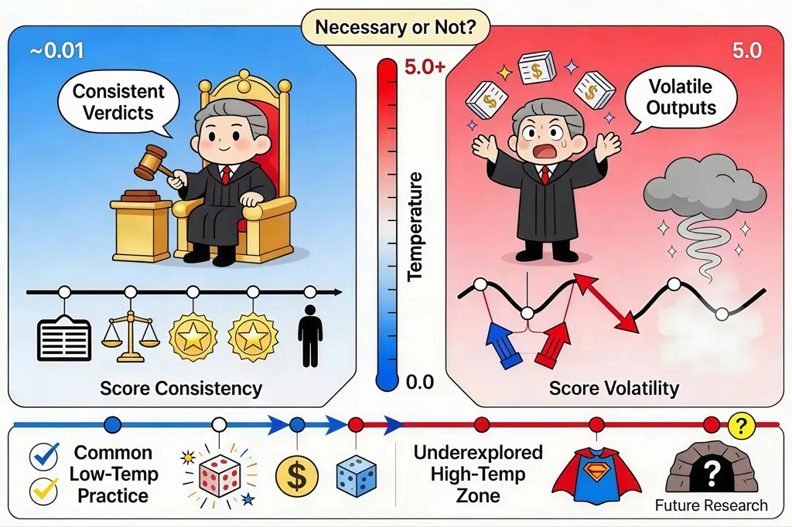
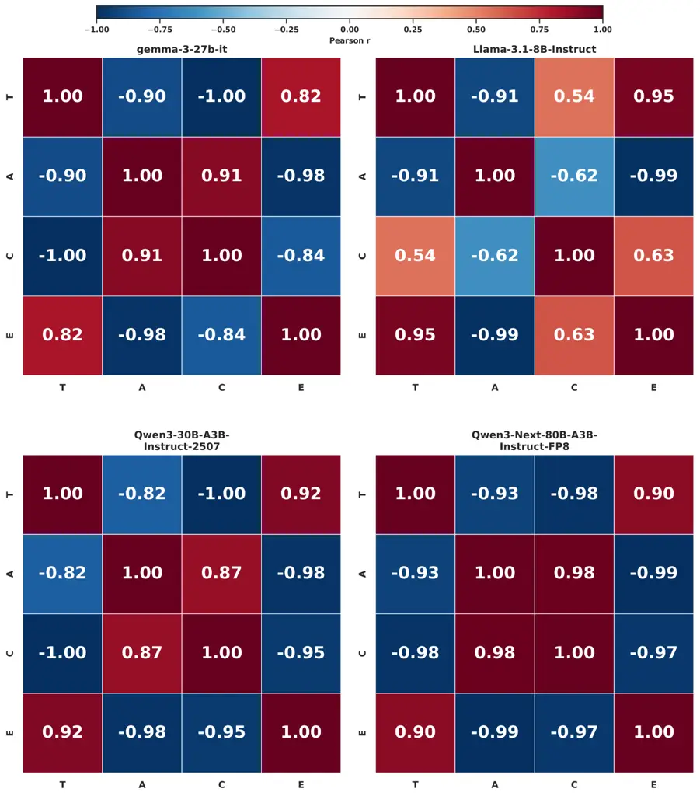
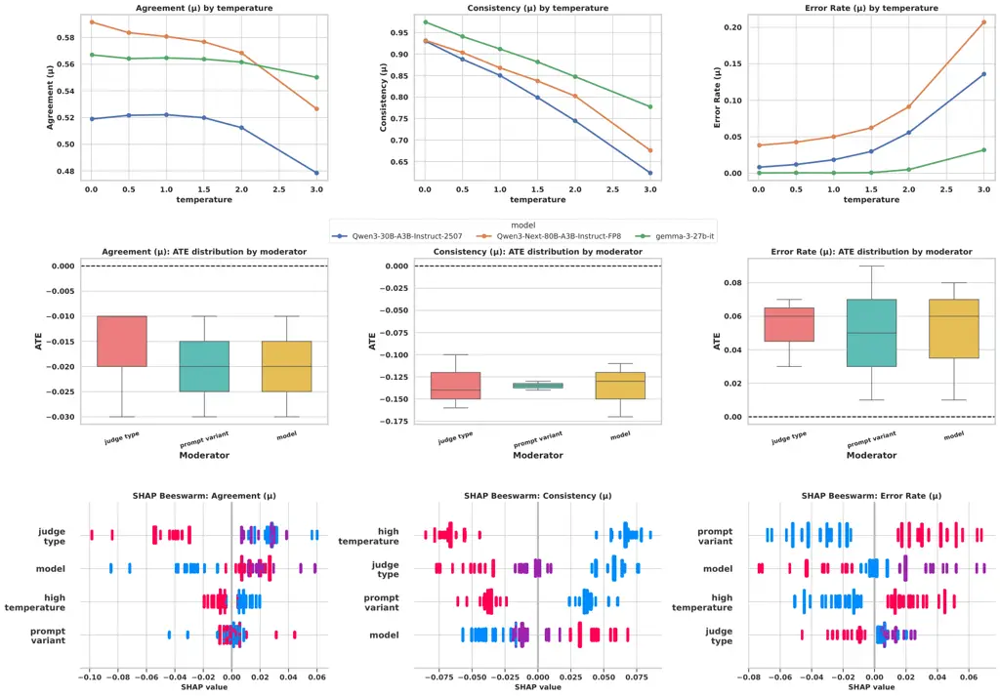

# The Necessity of Setting Temperature in LLM-as-a-Judge

Lujun Li    Lama Sleem    Yangjie Xu    Yewei Song    Aolin Jia
Affiliation: University of Luxembourg, ETH Zürich    Jerome Francois   
Radu State

###### Abstract

^(\$\spadesuit\$)^(\$\spadesuit\$)footnotetext: These authors
contributed equally to this work.

LLM-as-a-Judge has emerged as an effective and low-cost paradigm for
evaluating text quality and factual correctness. Prior studies have
shown substantial agreement between LLM judges and human experts, even
on tasks that are difficult to assess automatically. In practice,
researchers commonly employ fixed temperature configurations during the
evaluation process — with values of 0.1 and 1.0 being the most prevalent
choices — a convention that is largely empirical rather than principled.
However, recent researches suggest that LLM performance exhibits
non-trivial sensitivity to temperature settings, that lower temperatures
do not universally yield optimal outcomes, and that such effects are
highly task-dependent. This raises a critical research question: does
temperature influence judge performance in LLM-centric evaluation? To
address this, we systematically investigate the relationship between
temperature and judge performance through a series of controlled
experiments, and further adopt a causal inference framework within our
empirical statistical analysis to rigorously examine the direct causal
effect of temperature on judge behavior, offering actionable engineering
insights for the design of LLM-centric evaluation pipelines.

## 1 Introduction

LLM as a Judge: With the widespread adoption of large language models
(LLMs) in domains such as text generation, question-answering systems,
and automated evaluation, assessing the output quality of LLMs has
emerged as a pivotal challenge 7. Recent trends indicate that employing
LLMs as evaluators or judges—commonly termed LLM-as-a-judge—is
progressively supplanting common human-annotated evaluation. This shift
is driven by the capacity of model-based evaluation to substantially
reduce human labeling costs, accelerate assessment cycles, and
demonstrate superior consistency in sophisticated tasks like multi-turn
dialogues and open-ended question answering 12. Nevertheless, existing
research reveals that LLM-based evaluation outcomes are susceptible to
influences from generation parameters, such as sampling temperature 5,
which can induce score volatility, positional bias and decreased
consistency, thus undermining the interpretability and reliability of
the assessments.



Figure 1: LLM-as-a-judge Paradigm

Research Question: To the best of our knowledge, empirical settings for
the LLM temperature—such as 0.01—are commonly employed in LLM-as-a-judge
paradigms. This practice is well-understood, particularly given cost
considerations, as more powerful models have been demonstrated to
exhibit exceptionally high alignment with human judgments 20. However, a
critical question remains: Does the temperature setting influence the
evaluative performance of LLM judges, and is it necessary to configure
different temperatures for evaluation?

Moreover, the extent to which different LLM-as-a-judge configurations
are affected represents a still underexplored avenue for industrial
scenarios. Therefore, although the role of temperature control in the
diversity of generation 9 has been extensively investigated, its
underlying mechanisms on the "judging behavior" remain underexplored
through a systematic analysis. In particular, across different judge
setups, prompting strategies, and evaluation models, there is little
causal evidence showing whether temperature consistently affects judging
decisions, agreement with human annotations, and evaluation stability.
Consequently, in this work, an empirical statistical investigation is
first conducted, followed by a comprehensive causal analysis, using two
datasets and multiple state-of-the-art open-source models to examine the
effects of temperature. More than a million evaluation runs are
performed in diverse temperature configurations—including varied
prompting strategies, multiple LLM architectures, and different judging
paradigms—thereby robust statistical evidence and practical insights on
whether differentiated temperature settings should be adopted in
LLM-as-a-judge systems. Finally, a case study is presented to analyze
the real-world generative impact of temperature variations, and
noteworthy findings on the behavioral dynamics of LLM are presented.

## 2 Related work

Commonly used but understudied: Although LLMs have different types of
bias 18; 11; 2, LLMs-as-a-Judge have emerged as a novel form of
annotator capable of performing classification tasks across diverse
text-related domains 6. Fundamentally, they remain deep learning
classifiers, with their in-context learning generalization enabling
evaluations tailored to varied requirements. The authors in 20 validated
the high alignment between LLMs-as-a-Judge and human judgments through
extensive manual inspections and experiments across multiple dimensions,
employing a fixed temperature setting of 0.7. 11 conducted an in-depth
investigation into position bias under diverse configurations by
introducing metrics such as repeated stability and position consistency,
underscoring the necessity of swapping candidate pair positions;
however, this study also adopted a single temperature of 1.0. Another
work 16 preliminarily examined the impact of temperature on
LLMs-as-a-Judge, testing values from 0.0 to 0.7 and finding peak
self-consistency and accuracy at 0.1; nevertheless, the overall
temperature effects were not pronounced, the range was limited, and the
exploration remained insufficiently comprehensive.

T affects Judging: 8 provides preliminary evidence that higher
temperature settings can affect LLM performance and may even improve
performance in some cases. Related studies further suggest that
temperature can substantially influence the behavior of LLM 10; 4,
raising the possibility that it can also affect the effectiveness of
LLM-as-a-Judge system. Furthermore, whether distinct temperature
settings are required for LLMs-as-a-Judge to optimize judgment outcomes
remains an open question. Similarly, the consistency of temperature
effects on judges under different scenarios, such as different LLMs,
constitutes an unexplored yet industrially valuable domain.

## 3 Methods

### 3.1 Math Problem Formulation

Let $`v\in\mathcal{V}`$ denote the final verdict in the discrete verdict
space $`\mathcal{V}`$1. Given an input pair $`(x,r)`$, where $`x`$ is
the text input and $`r`$ denotes the candidate responses, we define

```math
\displaystyle p_{T}(v=i\mid x,r) \displaystyle=\frac{\exp\!\left(a_{i}(x,r)/T\right)}{\sum_{j\in\mathcal{V}}\exp\!\left(a_{j}(x,r)/T\right)}, \tag{1}
```

```math
\displaystyle\hat{v} \displaystyle=\mathrm{Decode}\!\left(p_{T}(\cdot\mid x,r)\right).
```

Here, $`a_{i}(x,r)`$ denotes the logit for the verdict $`i`$, and
$`T>0`$ is the decoding temperature. This formulation explicitly
demonstrates that the temperature rescales the logits without altering
their relative order. Consequently, temperature does not change the
ranking of verdict candidates, but it does modulate the sharpness of the
verdict distribution. In practice, this implies that temperature
primarily affects decision variance and reproducibility, rather than
inducing substantial shifts in mean accuracy. Furthermore, due to the
autoregressive nature of decoding, LLMs typically adhere to a Markovian
inference process19, with output diversity governed by a random seed
that controls the initial generation; however, incorporating an initial
reasoning phase—such as Chain-of-Thought (CoT) prompting—can lead to
fundamentally divergent model outputs.

### 3.2 Causal Effect Estimation

Intuitive statistical analyses cannot fully capture the direct causal
influence of temperature on the judge. They can only empirically
identify correlations without determining whether such relationships are
driven by other factors, such as the prompt. To address this limitation,
we formulate the analysis within the potential outcomes framework. For
each item $`i`$, let $`Y_{i}(t,X)`$ denote the potential outcome under
temperature $`t`$, where $`X`$ represents all confounders and
moderators. Our primary estimand is the conditional causal effect of
temperature:

```math
\tau(t,t^{\prime}\mid p,l)=\mathbb{E}\!\left[Y_{i}(t,X)-Y_{i}(t^{\prime},X)\right].
```

In this framework, the co-variates $`X`$ include Judge Type, Prompt
Variant, and Model, while the treatment variable corresponds to the
temperature parameter. We define the binary treatment indicator as

```math
T_{i}=1\!\left[t_{i}\geq 1.5\right],
```

where $`T_{i}=1`$ indicates a high-temperature sample
($`t_{i}\geq 1.5`$), and $`T_{i}=0`$ corresponds to a low-temperature
sample ($`t_{i}<1.5`$).

For causal estimation, we employ a 3-Fold Cross-Fitted Augmented Inverse
Probability Weighting (Cross-Fitted AIPW; see 3) estimator to estimate
the Average Treatment Effect (ATE). Within each training fold, three
Light Gradient Boosting Machine (LightGBM) regressors are fitted to
predict propensity scores and potential outcomes. In addition, a Shapley
value attribution analysis is conducted to examine the magnitude of the
effects of temperature and other moderators on model performance.

### 3.3 Experimental Design

In this study, we examine six temperature settings:
$`[0.01,0.5,1.0,1.5,2.0,3.0]`$. To reduce stochastic variability, each
experimental condition is repeated ten times using different random
seeds. We employ Qwen/Qwen3-Next-80B-A3B-Instruct-FP8 17; 14 and
google/gemma-3-27b-it 13 as the primary open-weight judge models,
supplemented with additional models for robustness checks and auxiliary
analyses. This configuration allows us to assess whether
temperature-induced effects remain consistent across different model
families. Furthermore, we note that other decoding parameters (e.g.,
top_p) may also influence text generation. In all experiments, we
therefore fix top_p at 0.95 and set the maximum generation length to
2048 tokens.

Following the taxonomy of judge type proposed by 20, we examine three
representative LLM-as-a-judge paradigms: pairwise comparison,
single-answer grading, and reference-guided grading (see prompt details
in Appendix B). Each paradigm is tested using both the direct base
prompt and the CoT prompt, as these represent the most common approaches
in LLM-as-a-judge evaluations. We do not additionally test few-shot
prompting here, primarily due to its potential to introduce unclear
biases whose interpretability remains underexplored. Furthermore, while
positional bias (i.e., LLM preferences when options are presented first
versus last) is a compelling topic, it is excluded from this study, as
our primary focus is the impact of temperature on the judge performance.
The results are analyzed using causal modeling and heterogeneity
analysis to determine whether—and under what conditions—temperature
influences LLM-as-a-judge outcomes, as well as the magnitude of such
effects. This constitutes an exemplary case of causal analysis, as
multiple factors directly impact the final results, and isolating a
single factor’s outcome fails to quantify proper attribution.

### 3.4 Dataset

For our dataset selection, we primarily employ MT-Bench Human Judgments
20, which encompasses extensive data from models such as GPT-3.5-Turbo,
Vicuna-13B-v1.2, Llama-13B, and others, all derived from the MT-Bench
dataset 20. Its main advantage lies in the inclusion of human-verified
annotations, which allow us to assess the alignment between
LLM-as-a-Judge performance and human evaluators under different
temperature settings. From this dataset, we randomly sampled 350
questions to construct our temperature test set.

Since MT-Bench was released in late 2023, we supplement it with
MMLU-Pro 15, which offers substantially greater difficulty compared to
the original MMLU and recommends CoT reasoning for all tasks. This makes
it particularly suitable for assessing LLM-as-a-Judge performance on
complex reasoning outcomes. Here, we sample 150 items from the original
test set according to the category proportions of the dataset, and then
randomly select two open-source models—meta-llama/Llama-3.1-8B-Instruct,
google/gemma-3-12b-it, and Qwen/Qwen2.5-14B-Instruct—to generate their
responses for comparison. However, since this dataset lacks human
annotations, we employed the current SOTA (as of February 2026) GPT-5.4
model as the evaluator to partially substitute for human-generated
annotations (see prompt details in Appendix A). Therefore, our
open-source dataset comprises 500 questions, responses, and human judge
selections (with partial coverage), enabling us to systematically
investigate the impact of temperature on LLM-as-a-Judge performance.

T Model Judge Type Prompt Strategy MT-Bench Human Judgments MMLU_Pro
AGR$`\uparrow`$ ($`\mu\pm`$ std) CON$`\uparrow`$ ($`\mu\pm`$ std)
ERR$`\downarrow`$ ($`\mu\pm`$ std) AGR$`\uparrow`$ ($`\mu\pm`$ std)
CON$`\uparrow`$ ($`\mu\pm`$ std) ERR$`\downarrow`$ ($`\mu\pm`$ std)
Direct 0.61 ± 0.00 0.98 ± 0.09 0.00 ± 0.00 0.58 ± 0.01 0.97 ± 0.12 0.00
± 0.00 Pairwise Comparison CoT 0.59 ± 0.01 0.94 ± 0.16 0.04 ± 0.01 0.55
± 0.02 0.95 ± 0.16 0.25 ± 0.03 Direct 0.54 ± 0.01 0.95 ± 0.14 0.00 ±
0.00 0.70 ± 0.01 0.94 ± 0.16 0.00 ± 0.00 Single Answer Grading CoT 0.54
± 0.01 0.91 ± 0.18 0.01 ± 0.00 0.63 ± 0.02 0.83 ± 0.26 0.17 ± 0.02
Direct 0.58 ± 0.01 0.94 ± 0.15 0.00 ± 0.00 0.65 ± 0.01 0.94 ± 0.16 0.00
± 0.00 Qwen/Qwen3-Next-80B-A3B-Instruct-FP8 Reference Guided Grading CoT
0.58 ± 0.01 0.90 ± 0.20 0.05 ± 0.01 0.64 ± 0.02 0.86 ± 0.22 0.11 ± 0.01
Direct 0.59 ± 0.00 1.00 ± 0.04 0.00 ± 0.00 0.61 ± 0.00 0.99 ± 0.08 0.00
± 0.00 Pairwise Comparison CoT 0.56 ± 0.00 0.99 ± 0.08 0.00 ± 0.00 0.53
± 0.01 0.98 ± 0.11 0.00 ± 0.00 Direct 0.51 ± 0.00 0.98 ± 0.09 0.00 ±
0.00 0.56 ± 0.01 0.98 ± 0.11 0.00 ± 0.00 Single Answer Grading CoT 0.48
± 0.01 0.94 ± 0.15 0.00 ± 0.00 0.64 ± 0.01 0.91 ± 0.18 0.00 ± 0.00
Direct 0.57 ± 0.00 1.00 ± 0.04 0.00 ± 0.00 0.69 ± 0.01 0.99 ± 0.09 0.00
± 0.00 0.01 google/gemma-3-27b-it Reference Guided Grading CoT 0.57 ±
0.01 0.96 ± 0.13 0.00 ± 0.00 0.68 ± 0.01 0.95 ± 0.15 0.00 ± 0.00 Direct
0.62 ± 0.01 0.96 ± 0.13 0.00 ± 0.00 0.58 ± 0.02 0.93 ± 0.19 0.00 ± 0.00
Pairwise Comparison CoT 0.59 ± 0.01 0.90 ± 0.21 0.06 ± 0.05 0.54 ± 0.04
0.87 ± 0.25 0.28 ± 0.12 Direct 0.54 ± 0.01 0.87 ± 0.21 0.00 ± 0.00 0.64
± 0.03 0.82 ± 0.24 0.00 ± 0.00 Single Answer Grading CoT 0.53 ± 0.01
0.82 ± 0.24 0.02 ± 0.01 0.62 ± 0.05 0.73 ± 0.30 0.18 ± 0.08 Direct 0.56
± 0.02 0.89 ± 0.22 0.00 ± 0.00 0.63 ± 0.02 0.85 ± 0.25 0.01 ± 0.01
Qwen/Qwen3-Next-80B-A3B-Instruct-FP8 Reference Guided Grading CoT 0.57 ±
0.02 0.84 ± 0.24 0.08 ± 0.06 0.60 ± 0.04 0.82 ± 0.25 0.15 ± 0.07 Direct
0.59 ± 0.00 0.99 ± 0.09 0.00 ± 0.00 0.60 ± 0.00 0.98 ± 0.12 0.00 ± 0.00
Pairwise Comparison CoT 0.56 ± 0.01 0.96 ± 0.12 0.00 ± 0.00 0.54 ± 0.01
0.96 ± 0.14 0.00 ± 0.00 Direct 0.50 ± 0.01 0.87 ± 0.22 0.00 ± 0.00 0.56
± 0.02 0.83 ± 0.24 0.00 ± 0.00 Single Answer Grading CoT 0.48 ± 0.02
0.82 ± 0.22 0.00 ± 0.00 0.61 ± 0.03 0.78 ± 0.26 0.00 ± 0.00 Direct 0.57
± 0.01 0.98 ± 0.11 0.00 ± 0.00 0.68 ± 0.01 0.96 ± 0.15 0.00 ± 0.00 1.00
google/gemma-3-27b-i Reference Guided Grading CoT 0.57 ± 0.01 0.90 ±
0.20 0.00 ± 0.00 0.68 ± 0.02 0.85 ± 0.24 0.00 ± 0.00 Direct 0.59 ± 0.03
0.84 ± 0.23 0.07 ± 0.07 0.54 ± 0.06 0.68 ± 0.26 0.17 ± 0.19 Pairwise
Comparison CoT 0.53 ± 0.07 0.66 ± 0.33 0.37 ± 0.13 0.45 ± 0.10 0.61 ±
0.33 0.46 ± 0.15 Direct 0.52 ± 0.03 0.76 ± 0.25 0.00 ± 0.00 0.60 ± 0.02
0.72 ± 0.25 0.00 ± 0.00 Single Answer Grading CoT 0.50 ± 0.02 0.63 ±
0.29 0.13 ± 0.04 0.51 ± 0.04 0.58 ± 0.32 0.35 ± 0.07 Direct 0.54 ± 0.06
0.70 ± 0.26 0.13 ± 0.12 0.60 ± 0.06 0.71 ± 0.26 0.17 ± 0.17
Qwen/Qwen3-Next-80B-A3B-Instruct-FP8 Reference Guided Grading CoT 0.45 ±
0.06 0.55 ± 0.30 0.37 ± 0.09 0.44 ± 0.10 0.57 ± 0.32 0.49 ± 0.08 Direct
0.58 ± 0.00 0.93 ± 0.19 0.00 ± 0.00 0.59 ± 0.01 0.90 ± 0.20 0.00 ± 0.00
Pairwise Comparison CoT 0.55 ± 0.02 0.86 ± 0.23 0.07 ± 0.03 0.53 ± 0.03
0.75 ± 0.27 0.09 ± 0.04 Direct 0.49 ± 0.01 0.74 ± 0.25 0.00 ± 0.00 0.53
± 0.05 0.66 ± 0.24 0.00 ± 0.00 Single Answer Grading CoT 0.47 ± 0.02
0.63 ± 0.27 0.01 ± 0.01 0.56 ± 0.03 0.57 ± 0.27 0.03 ± 0.01 Direct 0.56
± 0.01 0.88 ± 0.21 0.00 ± 0.00 0.67 ± 0.03 0.86 ± 0.25 0.00 ± 0.00 3.0
google/gemma-3-27b-i Reference Guided Grading CoT 0.55 ± 0.02 0.73 ±
0.27 0.10 ± 0.02 0.65 ± 0.04 0.66 ± 0.29 0.10 ± 0.04

Table 1: Quantitative assessment of LLM-as-a-Judge stability across
three sampling temperatures ($`T\in\{0.01,1.0,3.0\}`$), two judge
models, three evaluation paradigms (Pairwise Comparison, Single Answer
Grading, and Reference-Guided Grading), and two prompting strategies
(Direct and CoT), measured by agreement, consistency, and error rate on
MT-Bench and MMLU-Pro. Bolded values indicate the highest and
second-highest values globally within each metric–dataset combination.

### 3.5 Metrics

Three metrics are used to evaluate the judge behavior: agreement rate,
consistency, and error rate. Agreement Rate (AGR) measures the extent to
which the decisions produced by the LLM judge align with a reference
label, such as human annotations or a gold-standard judgment (i.e.,
consistency with the decision made by the "judge in the court").

```math
\text{AGR}=\frac{1}{N}\sum_{i=1}^{N}\mathbf{1}(\hat{y}_{i}=y_{i}^{*})\cdot\mathbf{1}(\hat{y}_{i}\neq\emptyset\wedge y_{i}^{*}\neq\emptyset)
```

where $`\hat{y}_{i}\in\{\text{modela, modelb, tie}\}`$ is the normalized
prediction, $`y_{i}^{*}`$ is human gold judge standard from the tested
datasets and $`\mathbf{1}`$ is an indicator function. Consistency (CON)
uses 1-Flip Consistency, which measures judge stability across repeated
runs under identical experimental conditions by computing the proportion
of adjacent repeats with consistent judgments:

```math
\text{CON}_{q}=1-\frac{1}{n_{q}-1}\sum_{k=1}^{n_{q}-1}\mathbf{1}(\hat{y}_{q,k}\neq\hat{y}_{q,k+1})
```

For each question $`q`$, compute adjacent prediction agreement in repeat
sequence. Error Rate (ERR) denotes the rate at which the LLM judge fails
to correctly parse or follow the prescribed judgment format across
different temperature settings. This metric indirectly captures the
extent to which the judge model remains compliant with the evaluation
instructions as temperature changes:

```math
\text{ERR}=\frac{1}{N}\sum_{i=1}^{N}\mathbf{1}(\text{format\_error}_{i})
```

Format errors catch unusable outputs that cannot be automatically parsed
into clear winners. Pairwise needs “A/B/C”; Single-answer judge type
needs comparable \[1,10\] scores. No clear predicted_winner means
worthless judgment for metrics. $`\sim`$10% error rate means 10% of runs
are not successfully parsed for clear winner or clear scoring.

## 4 Results

The experimental corpus comprises 500 base questions, evaluated under
three judge configurations, each operating with two prompting
strategies—Direct base prompt and CoT reasoning. Across six sampling
temperatures, each question is inferred 10 times per configuration using
distinct random seeds while holding all other generation hyperparameters
constant. This yields a total of
$`500\times 3\times 2\times 6\times 10=180{,}000`$ inference calls per
model. In the main experiments, two judge models are employed, resulting
in $`480{,}000`$ inference calls in total. This large-scale experimental
design not only enables robust empirical analysis but also provides
sufficient statistical power to support rigorous causal inference. All
results are available on Hugging Face for further exploration¹¹ 1
[https://huggingface.co/datasets/Volavion/eval_temperatures_bench](https://huggingface.co/datasets/Volavion/eval_temperatures_bench).

### 4.1 Does temperature matter?

As shown in Table 1, the performance is reported only at temperatures
0.01, 1.00, and 3.00. At low temperature ($`T=0.01`$), all
configurations exhibit exceptionally high consistency (Consistency
$`\approx 1.00`$) and near-zero error rates (Error Rate
$`\approx 0.00`$), indicating that the outputs of the LLM Judge are
highly stable and reproducible under low-temperature settings. At high
temperature ($`T=3.0`$), consistency degrades substantially
(Qwen3-Next-80B dropping as low as $`0.57`$ in certain configurations)
and error rates increase markedly (reaching a maximum of $`0.49`$),
demonstrating that high temperatures severely compromise the reliability
of the Judge. In contrast, gemma-3-27b-it demonstrates comparatively
greater robustness at high temperatures, with Consistency values
generally exceeding those of Qwen3-Next-80B and error rates remaining
lower (mostly in the range of $`0.00`$–$`0.10`$). We also observe that,
for Qwen3-Next-80B under the Pairwise Comparison setting with
Chain-of-Thought (CoT) evaluation, the model’s Judge performance at a
temperature of $`1.0`$ is comparable to that at $`0.01`$. However,
despite the increase of the error rate to $`0.28`$, the decrease in AGR
is limited to only $`0.03`$. This suggests that a temperature of $`1.0`$
may achieve better alignment, highlighting also the importance of
conducting multiple trials with different random seeds when using higher
temperatures. ensemble judging—aggregating multiple high-temperature
samples via majority voting—may prove more robust than a single
low-temperature inference pass.



Figure 2: Pearson correlation matrices between decoding temperature (T)
and evaluation metrics—agreement (A), consistency (C), and error rate
(E)—across four LLMs.

Finally, in the context of LLM-as-a-Judge, the degradation of Error Rate
and Consistency at high temperatures is itself a valuable diagnostic
signal, as it exposes the fragility boundaries of the model Judge. At
low temperatures, the standard deviation is minimal; at high
temperatures, it increases sharply, indicating that Judge outcomes for
the same input become highly unstable. The standard deviation of
gemma-3-27b-it remains relatively small at high temperatures, whereas
that of Qwen3-Next-80B is substantially larger. This reveals a
structural difference in the two models’ sensitivity to temperature
perturbation—a finding that warrants further investigation. It also
implies that model selection should be informed by model-specific
characteristics, as well as by whether output diversity is desired.

As shown also in Figure 2, when the temperature $`T`$ increases, the
Agreement $`A`$ consistently decreases (strong negative correlation,
approximately $`-0.82`$ to $`-0.93`$), while the Error $`E`$ increases
markedly (strong positive correlation, approximately $`0.82`$ to
$`0.95`$), indicating that higher sampling temperatures systematically
reduce evaluation stability and amplify error rates. Among the models
examined, gemma, Qwen3-30B, and Qwen3-Next-80B further exhibit an almost
perfect negative correlation between $`T`$ and Consistency $`C`$
($`-0.98`$ to $`-1.00`$), as well as between $`A`$ and $`E`$
(approximately $`-0.98`$ to $`-0.99`$), suggesting highly consistent
behavioral patterns across the three. In contrast, Llama-3.1-8B-Instruct
notably constitutes the main exception, exhibiting a positive
correlation between $`T`$ and $`C`$ ($`r=0.54`$), as well as between
$`C`$ and $`E`$ ($`r=0.63`$). This pattern suggests that, as a
relatively small model, its judgment outputs tend to approximate random
guessing, with variations in random seeds more readily altering its
decisions.

### 4.2 Causal Effect Analysis



Figure 3: Comprehensive ATE Analysis Across Moderators, Temperature, and
Feature Importance. Row 1: Temperature trends of different models
(shared legend), showing mean tendencies across temperature ranges
(lines indicate averages, not ATE values). Row 2: Boxplots of Average
Treatment Effect (ATE) distributions across three moderators for each
outcome metric (dashed line denotes ATE = 0). Row 3: SHAP beeswarm plots
ranking feature importance by impact magnitude for each outcome metric.
All panels share consistent bold styling and bright color palettes for
clarity.

The increase in temperature is indeed statistically negatively
correlated with performance. However, different prompt settings, judge
type configurations, and model choices also influence how temperature
affects these three metrics. Therefore, a causal analytical approach is
required to draw valid conclusions.

As shown in Figure 3, the first row illustrates the association between
temperature and the three metrics. For the three models, Agreement
decreases slightly as temperature increases, Consistency exhibits a more
pronounced decline, and Error Rate rises substantially after an
initially stable phase. Therefore, higher temperatures substantially
harm Consistency and increase Error Rate, while their effect on
Agreement is directionally stable but relatively small in magnitude.
Notably, for Qwen3-30B-A3B-Instruct-2507, increasing temperature
actually improves the judge’s Agreement performance, whereas the
significant rise in Error Rate tends to degrade Agreement. This suggests
that the increase in Error Rate induced by higher temperature is an
important factor behind the overall decline in Agreement. Thus, how to
mitigate the errors generated under higher temperatures may become an
interesting research direction for LLMs as judges.

The second row of Figure 3 shows under which conditions the temperature
causal effect is stronger or weaker (more causal effect analysis, see
Appendix E). For Agreement, the group-level ATEs are mostly in the range
$`-0.03`$ to $`-0.01`$, with small dispersion; for Consistency, the
group-level ATEs range from $`-0.17`$ to $`-0.10`$, indicating more
pronounced heterogeneity; for Error Rate, the group-level ATEs lie
between $`+0.01`$ and $`+0.09`$, with the largest variation across
prompt_variant, where higher temperature consistently leads to an
increase in error rate. In particular, the strength of the temperature
effect varies the most across different prompting strategies, while
other factors remain relatively fixed. Therefore, when the temperature
is set higher, the system tends to be more inconsistent and more prone
to errors overall. CoT requires more extensive text generation and thus
tends to amplify the negative impact of temperature on judge
performance.

The SHAP beeswarm plots (third row) illustrate both the magnitude and
direction of each feature’s contribution to the outcome models. For
Agreement, the predictions are primarily influenced by judge type
($`+0.0324`$) and model ($`+0.0251`$), whereas temperature plays a minor
role ($`+0.0089`$). For Consistency, temperature emerges as the most
influential factor ($`-0.0665`$), clearly dominating all other features.
For Error Rate, prompt_variant exerts the strongest effect
($`+0.0371`$), followed by temperature ($`+0.0249`$). Moreover, the
bootstrap standard errors are consistently small (mostly within the
range of 0.0004 to 0.002), indicating high estimation stability. These
results suggest that temperature ranks among the top two factors
influencing judge performance. When Agreement is prioritized, judge type
and model are the primary determinants; however, when Consistency is of
greater concern, temperature warrants substantially more attention.

### 4.3 Case Study

Temperature on Judge Personas: We conduct multiple high-temperature and
low-temperature responses to the same prompts. Our analysis clearly
reveals that at high temperatures, LLMs exhibit a tendency toward more
comprehensive analysis, which hinders their effectiveness as judges.
This overthinking often leads to indecisiveness in final decisions,
resulting in substantial variability in 10 repeated tests. In contrast,
at low temperatures (including $`T=0`$) or even with CoT prompting, LLMs
typically arrive at conclusions directly, fixate on a single salient
point for stark comparisons, and reach decisions rapidly. Consequently,
we hypothesize that the decline in judging performance at high
temperatures—beyond parsing errors (primarily due to incomplete
adherence to JSON output instructions)—largely stems from more thorough
analysis, fostering greater indecisiveness. Low-temperature LLMs
resemble irresponsible judges eager to expedite task completion, whereas
high-temperature LLMs act as indecisive yet thorough evaluators. For
more details on the response, see Appendix C.1.

Low temperature also confuses: When a case-by-case inspection is
performed, we find that when the model’s temperature is set to a
relatively high value, its ability to strictly adhere to the instruction
of producing well-formed JSON declines significantly. This is consistent
with the substantial increase in the previously observed error rate: at
times, the model forgets to articulate the Judge’s reasoning, and at
other times it fails to produce a valid JSON output altogether. However,
what was not anticipated is that even at temperatures as low as $`0.01`$
and $`1.0`$, we still observe a non-negligible probability of the model
deviating from the required JSON format—an outcome that we had not
previously expected. This suggests that the output randomness of LLMs
appears to be difficult to fully control. Consequently, when using LLMs
as judges, it is essential to set different random seeds as well as
different temperature values in order to obtain diverse and more robust
evaluation insights.

Human Like Expression: It is concluded that when the model is configured
with a higher temperature, its manner of expression becomes more akin to
the random, spontaneous patterns characteristic of human language. At
higher temperatures, the model tends to produce more human-like
randomness and fragmented expressions—features that are almost absent at
lower temperatures. Under low-temperature settings, the model behaves
more like a rule-following automaton; in contrast, when the temperature
is increased, it becomes less inclined to strictly follow instructions
and more willing to think, explore, and express itself in a human-like
spontaneous way. For more details about the response, please refer to
Appendix C.2.


## 5 Conclusion

This paper systematically reveals the critical impact of temperature
settings on LLM-as-a-Judge performance through large-scale controlled
experiments and causal inference analysis, providing actionable guidance
for industrial practice and future research directions on temperature
effects. The findings confirm that low temperatures yield near-perfect
consistency and negligible error rates, while high temperatures cause
consistency to drop and error rates to surge dramatically. These effects
vary across model families, judging paradigms, and prompting strategies,
with temperature strongly negatively correlated with agreement and
strongly positively correlated with error rates — establishing
temperature as a core determinant of judging reliability rather than a
trivial engineering detail. Furthermore, through a causal inference
framework, this work confirms that temperature exerts a genuine and
structural influence on LLM-as-a-Judge behavior: while high temperatures
cause relatively limited direct damage to judgment accuracy, they
severely undermine judgment stability and reproducibility while
substantially increasing format parsing error rates.

Furthermore, aggregate data and case studies uncover benefits of high
temperatures, which to some extent expand the depth and breadth of the
model’s reasoning as a judge and alter its judging persona. Contrary to
assumptions of mere hallucination without logic, high-temperature models
do engage in logical thinking but frequently deviate from user
instructions, substantially elevating parse errors and thereby degrading
performance. Notably, even low-temperature settings reveal occasional
instruction non-compliance, challenging the notion that “low temperature
is invariably optimal for judging.” Thus, high temperatures become
essential when deeper decision-making and reasoning are required from
the judge, with multiple requests using varied seeds remaining
necessary.

A promising solution for superior judging—particularly in agentic
systems—entails deploying a high-temperature agent for primary judging
and a low-temperature agent for output correction, balancing exploratory
depth with deterministic refinement. These insights advocate for
task-adaptive temperature strategies in LLM evaluation pipelines,
enhancing robustness beyond fixed low-temperature defaults. We do not
further investigate temperature effects on various judge biases, which
represents a critically important research direction. Additionally, due
to their opaque operational mechanisms, we exclude closed-source models
such as GPT from our test subjects—an avenue warranting future
investigation.

## References

- Ackley et al. (1985) D. H. Ackley, G. E. Hinton, and T. J. Sejnowski A
  learning algorithm for boltzmann machines. Cognitive Science 9 (1),
  pp. 147–169. External Links: ISSN 0364-0213,
  [Document](https://dx.doi.org/https%3A//doi.org/10.1016/S0364-0213%2885%2980012-4),
  [Link](https://www.sciencedirect.com/science/article/pii/S0364021385800124)
  Cited by: §3.1.
- Chen et al. (2024) G. H. Chen, S. Chen, Z. Liu, F. Jiang, and B. Wang
  Humans or LLMs as the judge? a study on judgement bias. In Proceedings
  of the 2024 Conference on Empirical Methods in Natural Language
  Processing, Y. Al-Onaizan, M. Bansal, and Y. Chen (Eds.), Miami,
  Florida, USA, pp. 8301–8327. External Links:
  [Link](https://aclanthology.org/2024.emnlp-main.474/),
  [Document](https://dx.doi.org/10.18653/v1/2024.emnlp-main.474) Cited
  by: §2.
- Chernozhukov et al. (2024) V. Chernozhukov, D. Chetverikov, M.
  Demirer, E. Duflo, C. Hansen, W. Newey, and J. Robins Double/debiased
  machine learning for treatment and causal parameters. External Links:
  1608.00060, [Link](https://arxiv.org/abs/1608.00060) Cited by: §3.2.
- DeepSeek (2026) DeepSeek The temperature parameter. Note:
  [https://api-docs.deepseek.com/quick_start/parameter_settings](https://api-docs.deepseek.com/quick_start/parameter_settings)Accessed:
  March 17, 2026 Cited by: §2.
- Du et al. (2025) W. Du, Y. Yang, and S. Welleck Optimizing temperature
  for language models with multi-sample inference. External Links:
  2502.05234, [Link](https://arxiv.org/abmts/2502.05234) Cited by: §1.
- Gu et al. (2026) J. Gu, X. Jiang, Z. Shi, H. Tan, X. Zhai, C. Xu, W.
  Li, Y. Shen, S. Ma, H. Liu, S. Wang, K. Zhang, Z. Lin, B. Zhang, L.
  Ni, W. Gao, Y. Wang, and J. Guo A survey on llm-as-a-judge. The
  Innovation, pp. 101253. External Links: ISSN 2666-6758,
  [Document](https://dx.doi.org/https%3A//doi.org/10.1016/j.xinn.2025.101253),
  [Link](https://www.sciencedirect.com/science/article/pii/S2666675825004564)
  Cited by: §2.
- Gu et al. (2025) J. Gu, X. Jiang, Z. Shi, H. Tan, X. Zhai, C. Xu, W.
  Li, Y. Shen, S. Ma, H. Liu, S. Wang, K. Zhang, Y. Wang, W. Gao, L. Ni,
  and J. Guo A survey on llm-as-a-judge. External Links: 2411.15594,
  [Link](https://arxiv.org/abs/2411.15594) Cited by: §1.
- Li et al. (2025) L. Li, L. Sleem, N. Gentile, G. Nichil, and R. State
  Exploring the impact of temperature on large language models: hot or
  cold?. Procedia Computer Science 264, pp. 242–251. Note: International
  Neural Network Society Workshop on Deep Learning Innovations and
  Applications 2025 External Links: ISSN 1877-0509,
  [Document](https://dx.doi.org/https%3A//doi.org/10.1016/j.procs.2025.07.135),
  [Link](https://www.sciencedirect.com/science/article/pii/S1877050925021854)
  Cited by: §2.
- Peeperkorn et al. (2024) M. Peeperkorn, T. Kouwenhoven, D. Brown,
  and A. Jordanous Is temperature the creativity parameter of large
  language models?. External Links: 2405.00492,
  [Link](https://arxiv.org/abs/2405.00492) Cited by: §1.
- Renze (2024) M. Renze The effect of sampling temperature on problem
  solving in large language models. In Findings of the Association for
  Computational Linguistics: EMNLP 2024, Y. Al-Onaizan, M. Bansal,
  and Y. Chen (Eds.), Miami, Florida, USA, pp. 7346–7356. External
  Links: [Link](https://aclanthology.org/2024.findings-emnlp.432/),
  [Document](https://dx.doi.org/10.18653/v1/2024.findings-emnlp.432)
  Cited by: §2.
- Shi et al. (2025) L. Shi, C. Ma, W. Liang, X. Diao, W. Ma, and S.
  Vosoughi Judging the judges: a systematic study of position bias in
  LLM-as-a-judge. In Proceedings of the 14th International Joint
  Conference on Natural Language Processing and the 4th Conference of
  the Asia-Pacific Chapter of the Association for Computational
  Linguistics, K. Inui, S. Sakti, H. Wang, D. F. Wong, P.
  Bhattacharyya, B. Banerjee, A. Ekbal, T. Chakraborty, and D. P. Singh
  (Eds.), Mumbai, India, pp. 292–314. External Links:
  [Link](https://aclanthology.org/2025.ijcnlp-long.18/), ISBN
  979-8-89176-298-5 Cited by: §2.
- Tang et al. (2025) Y. Tang, K. Feng, Y. Wang, Z. Chen, C. Lv, G.
  Yu, Q. Zhang, K. Ding, and H. Chen Learning an efficient multi-turn
  dialogue evaluator from multiple llm judges. arXiv preprint
  arXiv:2508.00454. Cited by: §1.
- Team (2025a) G. Team Gemma 3. Huggingface. External Links:
  [Link](https://goo.gle/Gemma3Report) Cited by: §3.3.
- Team (2025b) Q. Team Qwen3 technical report. External Links:
  2505.09388, [Link](https://arxiv.org/abs/2505.09388) Cited by: §3.3.
- Wang et al. (2024) Y. Wang, X. Ma, G. Zhang, Y. Ni, A. Chandra, S.
  Guo, W. Ren, A. Arulraj, X. He, Z. Jiang, T. Li, M. Ku, K. Wang, A.
  Zhuang, R. Fan, X. Yue, and W. Chen MMLU-pro: a more robust and
  challenging multi-task language understanding benchmark. In
  Proceedings of the 38th International Conference on Neural Information
  Processing Systems, NIPS ’24, Red Hook, NY, USA. External Links: ISBN
  9798331314385 Cited by: §3.4.
- Wei et al. (2025) H. Wei, S. He, T. Xia, F. Liu, A. Wong, J. Lin,
  and M. Han Systematic evaluation of llm-as-a-judge in llm alignment
  tasks: explainable metrics and diverse prompt templates. External
  Links: 2408.13006, [Link](https://arxiv.org/abs/2408.13006) Cited by:
  §2.
- Yang et al. (2025) A. Yang, B. Yu, C. Li, D. Liu, F. Huang, H.
  Huang, J. Jiang, J. Tu, J. Zhang, J. Zhou, J. Lin, K. Dang, K.
  Yang, L. Yu, M. Li, M. Sun, Q. Zhu, R. Men, T. He, W. Xu, W. Yin, W.
  Yu, X. Qiu, X. Ren, X. Yang, Y. Li, Z. Xu, and Z. Zhang Qwen2.5-1m
  technical report. arXiv preprint arXiv:2501.15383. Cited by: §3.3.
- Ye et al. (2024) J. Ye, Y. Wang, Y. Huang, D. Chen, Q. Zhang, N.
  Moniz, T. Gao, W. Geyer, C. Huang, P. Chen, N. V. Chawla, and X. Zhang
  Justice or prejudice? quantifying biases in llm-as-a-judge. External
  Links: 2410.02736, [Link](https://arxiv.org/abs/2410.02736) Cited by:
  §2.
- Zhang (2026) Y. Zhang A markov categorical framework for language
  modeling. External Links: 2507.19247,
  [Link](https://arxiv.org/abs/2507.19247) Cited by: §3.1.
- Zheng et al. (2023) L. Zheng, W. Chiang, Y. Sheng, S. Zhuang, Z.
  Wu, Y. Zhuang, Z. Lin, Z. Li, D. Li, E. P. Xing, H. Zhang, J. E.
  Gonzalez, and I. Stoica Judging llm-as-a-judge with mt-bench and
  chatbot arena. In Proceedings of the 37th International Conference on
  Neural Information Processing Systems, NIPS ’23, Red Hook, NY, USA.
  Cited by: §1, §2, §3.3, §3.4.

## Appendix A Prompt For Generating Gold Judge Results

To evaluate the MMLU-Pro dataset in the absence of human judges, we
employ the state-of-the-art (SOTA) GPT-5.4 model as an automated judge.
The evaluation protocol, illustrated in the following prompt box,
determines the superior response between two model outputs or declares a
tie when performance is deemed equivalent.


## Appendix B Prompt Template For Judge


## Appendix C Examples

### C.1 High Temperature Vs Low Temperature

This response from Qwen3-30B-A3B-Instruct-2507 is more direct and more
polite, yet considers fewer aspects and yields a more concise answer
from the Judge.


This response, in contrast, provides more detailed information and a
greater number of justifications for their judgment. When the
temperature is set to a high value, the model does not produce
nonsensical outputs or exhibit obvious hallucinations; instead, it
offers a more detailed explanation of its analysis to make its decisions
appear well grounded. Furthermore, the final conclusion reached is
correct, which is highly significant because it reflects the meaningful
role of the high-temperature setting.


For the same question, this response is likewise reasonable with T=3.0.
In my view, the Judge’s reasoning is more comprehensive, and its final
decision of a tie suggests that it detected certain flaws in both
responses, making it difficult to determine a clear winner.
Consequently, it ultimately concludes with a tie.


### C.2 LLM Response With Different Temperature

#### C.2.1 Response Example 1


#### C.2.2 Response Example 2


## Appendix D Vllm Inference Engine

To achieve the high throughput required for our experiments, we
implemented an optimized asynchronous inference pipeline. The
architecture employs a hierarchical concurrency model: a main loop
orchestrates task scheduling, controlled by an asyncio.Semaphore
limiting concurrent batches to MAX_CONCURRENT_BATCHES=8. Each batch
(BATCH_SIZE=64) is processed via semaphore, leveraging vLLM’s native
batch inference through a single API call to
batch_generate_prompts/completions. This design delivers exceptional
performance: $`64\times 8=512`$ concurrent tokens—over 64$`\times`$
faster than synchronous processing—enabled by vLLM’s KV cache
optimization and parallel decoding which substantially accelerating our
experimental pipeline. Each experimental condition explicitly varies the
random seed to ensure reproducibility.

## Appendix E Additional Results For ATE

Outcome Moderator Level N ATE CI Low CI High ATE (95% CI) Agreement
($`\mu`$) judge_type reference_guided 17991 -0.03 -0.04 -0.02 -0.0309
\[-0.0437, -0.0180\] Agreement ($`\mu`$) judge_type pairwise 17975 -0.01
-0.03 0.00 -0.0131 \[-0.0266, 0.0004\] Agreement ($`\mu`$) judge_type
single_answer 17954 -0.01 -0.02 0.00 -0.0086 \[-0.0208, 0.0037\]
Consistency ($`\mu`$) judge_type single_answer 17908 -0.16 -0.17 -0.15
-0.1611 \[-0.1681, -0.1540\] Consistency ($`\mu`$) judge_type
reference_guided 17972 -0.14 -0.14 -0.13 -0.1382 \[-0.1450, -0.1313\]
Consistency ($`\mu`$) judge_type pairwise 17927 -0.10 -0.11 -0.10
-0.1032 \[-0.1090, -0.0975\] Error Rate ($`\mu`$) judge_type
single_answer 18000 0.03 0.02 0.03 0.0263 \[0.0232, 0.0293\] Error Rate
($`\mu`$) judge_type pairwise 18000 0.06 0.05 0.06 0.0551 \[0.0516,
0.0585\] Error Rate ($`\mu`$) judge_type reference_guided 18000 0.07
0.07 0.07 0.0685 \[0.0651, 0.0719\]

Table 2: Estimated Average Treatment Effects (ATE) across different
judge types and outcomes. 95% Confidence Intervals (CI) are presented
for each estimate.

Outcome Moderator Level N ATE CI Low CI High ATE (95% CI) Agreement
($`\mu`$) prompt_variant cot 26920 -0.03 -0.04 -0.02 -0.0289 \[-0.0391,
-0.0187\] Agreement ($`\mu`$) prompt_variant baseline 27000 -0.01 -0.02
0.01 -0.0055 \[-0.0163, 0.0053\] Consistency ($`\mu`$) prompt_variant
cot 26807 -0.14 -0.15 -0.14 -0.1410 \[-0.1468, -0.1352\] Consistency
($`\mu`$) prompt_variant baseline 27000 -0.13 -0.13 -0.12 -0.1273
\[-0.1322, -0.1225\] Error Rate ($`\mu`$) prompt_variant baseline 27000
0.01 0.01 0.01 0.0133 \[0.0124, 0.0142\] Error Rate ($`\mu`$)
prompt_variant cot 27000 0.09 0.08 0.09 0.0864 \[0.0828, 0.0901\]

Table 3: Estimated Average Treatment Effects (ATE) across prompt
variants for each outcome. 95% Confidence Intervals (CI) are shown in
brackets.

Outcome Moderator Level N ATE CI Low CI High ATE (95% CI) Agreement
($`\mu`$) model Qwen3-Next-80B-A3B-Instruct-FP8 17929 -0.03 -0.04 -0.01
-0.0277 \[-0.0405, -0.0149\] Agreement ($`\mu`$) model
Qwen3-30B-A3B-Instruct-2507 17993 -0.02 -0.03 -0.00 -0.0172 \[-0.0297,
-0.0048\] Agreement ($`\mu`$) model gemma-3-27b-it 17998 -0.01 -0.02
0.01 -0.0062 \[-0.0196, 0.0072\] Consistency ($`\mu`$) model
Qwen3-30B-A3B-Instruct-2507 17982 -0.17 -0.17 -0.16 -0.1673 \[-0.1743,
-0.1604\] Consistency ($`\mu`$) model Qwen3-Next-80B-A3B-Instruct-FP8
17828 -0.13 -0.14 -0.12 -0.1288 \[-0.1357, -0.1219\] Consistency
($`\mu`$) model gemma-3-27b-it 17997 -0.11 -0.11 -0.10 -0.1068
\[-0.1125, -0.1011\] Error Rate ($`\mu`$) model gemma-3-27b-it 18000
0.01 0.01 0.01 0.0121 \[0.0110, 0.0131\] Error Rate ($`\mu`$) model
Qwen3-30B-A3B-Instruct-2507 18000 0.06 0.06 0.06 0.0610 \[0.0580,
0.0639\] Error Rate ($`\mu`$) model Qwen3-Next-80B-A3B-Instruct-FP8
18000 0.08 0.07 0.08 0.0765 \[0.0717, 0.0812\]

Table 4: Estimated Average Treatment Effects (ATE) across different
models for each outcome. 95% Confidence Intervals (CI) are shown in
brackets.
