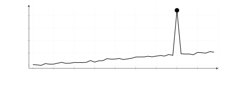

# TSQueryBench: LLM-as-a-Judge for Time-Series Explanations

Preetham Sivalingam Affiliation: BITS Pilani, Pilani, India
Correspondence to: <f20240610@pilani.bits-pilani.ac.in>    Murari Mandal
Affiliation: KIIT & Birla AI Labs, Bhubaneshwar, India    Dhruv Kumar
Affiliation: BITS Pilani & Birla AI Labs, Pilani, India    Saurabh
Deshpande Affiliation: Birla AI Labs, Mumbai, India

###### Abstract

Natural language explanations of time-series data are increasingly
produced by foundation models in high-stakes domains, making factual
correctness critical. Evaluating such explanations differs fundamentally
from standard natural language generation: correctness requires
verifying numerical claims against structured data rather than
similarity to reference text. While LLM-as-a-Judge has emerged as a
scalable paradigm for text evaluation, its applicability to numerically
grounded time-series explanations remains unstudied. We introduce
TSQueryBench, a controlled synthetic benchmark of 500 time-series
instances across 10 query types, each paired with correct, partially
correct, and incorrect explanations. We evaluate six large language
models across four tasks: explanation generation, relative ranking,
independent scoring, and multi-anomaly detection. Our central finding is
a consistent generation–evaluation asymmetry: models that fail to
generate numerically correct explanations nonetheless reliably identify
or score correct ones. These results show that rubric-guided LLM
evaluation is substantially more reliable than generation for
time-series reasoning, supporting LLM judges as scalable evaluators in
numerically grounded settings. Code and data:
[https://github.com/Prxxthxm/TSQueryBench/](https://github.com/Prxxthxm/TSQueryBench/).

###### Keywords: 

Large Language Models, Time-Series Analysis, Benchmarking, Evaluation,
LLM-as-a-Judge, Data-Grounded Reasoning

## 1 Introduction

Foundation models are increasingly used to generate natural language
explanations of time series signals in domains such as finance,
healthcare, industrial monitoring, and climate science (Zhang et al.,
2024). As these systems produce fluent interpretations of anomalies,
trends, and distributional shifts, ensuring factual grounding in the
underlying data becomes critical, as even subtle numerical inaccuracies
can lead to incorrect decisions. Reliable evaluation of such
data-grounded explanations is therefore both practically important and
technically challenging.

Existing evaluation approaches are ill-suited for this setting.
Reference-based metrics such as BLEU, ROUGE, and BERTScore measure
similarity to a gold reference (Papineni et al., 2002; Lin, 2004; Zhang
et al., 2020), but cannot verify numerical correctness. Natural language
inference models assess entailment but require reference statements and
lack grounding in numerical data (Bowman et al., 2015). Classical
time-series methods support tasks such as trend detection and anomaly
identification (Hamilton, 1994; Box et al., 2015), but cannot evaluate
free-form explanations. Human evaluation is the gold standard but does
not scale. LLM-as-a-Judge has emerged as a scalable alternative, with
methods such as GPTScore, G-Eval, and MT-Bench showing that LLMs can
approximate human judgments under rubric-based prompting (Fu et al.,
2023; Liu et al., 2023; Zheng et al., 2023), and reference-free
frameworks such as RAGAS enabling evaluation without gold references
(Akin and others, 2023). However, whether LLMs can reliably evaluate
numerically grounded explanations requiring reasoning over statistical
properties and precise quantitative claims remains unstudied.

We address this gap by introducing TSQueryBench, a controlled synthetic
benchmark of 500 time-series instances across 10 query types, each
paired with correct, partially correct, and incorrect explanations
derived from ground-truth statistics. We evaluate six LLMs across four
tasks: explanation generation, relative ranking, independent scoring,
and multi-anomaly detection. Explanation generation serves as a foil,
enabling direct comparison between generative and evaluative
capabilities. Our contributions are: (1) TSQueryBench, a benchmark with
three-level correctness labels across 10 query types; (2) a
rubric-guided multi-task evaluation framework; (3) the first systematic
study of LLM-as-a-Judge for numerically grounded time-series
explanations; and (4) empirical evidence of a robust
generation-evaluation asymmetry.

Our results show that evaluation consistently and substantially exceeds
generation across query types and model families. Even on volatility
shift tasks, where generation accuracy is near zero, models correctly
rank and score explanations above chance. This asymmetry holds across
ranking and independent scoring, indicating it is a robust property of
current foundation models. These findings support rubric-guided LLM
evaluation as a reliable approach for time-series explanation assessment
while highlighting key limitations in data-grounded generation.

## 2 Methodology

### 2.1 Overview

We study the reliability of large language models as judges of natural
language explanations grounded in time-series data. Given a time series,
a question, and a candidate explanation, the central question is whether
an LLM can determine if the explanation is factually consistent with the
underlying numerical data. Unlike reference based metrics, our framework
conditions the judge directly on the raw time series to verify numerical
claims against source data. Ground truth correctness labels are used
only for benchmarking and are not available at inference time. We
evaluate models across four tasks, as generators and as evaluators in
ranking, scoring, and anomaly detection, enabling direct measurement of
whether these capabilities are dissociable.

### 2.2 Input Representation and Evaluation Setting

Each instance consists of a univariate time series
$`T=\{t_{1},\dots,t_{n}\}`$, a question $`q`$, and an explanation $`e`$.
No reference explanation is provided; correctness is determined by
logical and numerical consistency with $`T`$.

We formulate evaluation as:

```math
y=f_{\theta}(T,q,e),\quad y\in\{0,1,2\}
```

where $`y=0`$ denotes incorrect, $`y=1`$ partially correct with numeric
inaccuracies, and $`y=2`$ fully correct.

### 2.3 Rubric-Guided Evaluation

Evaluation uses a structured rubric capturing multiple dimensions:

- •
  Data faithfulness: correctness of patterns, anomalies, or trends
- •
  Numeric accuracy: correctness of magnitudes, indices, and changes
- •
  Question relevance: whether the explanation answers the question
- •
  Logical coherence: internal consistency of reasoning
- •
  Unsupported claims: absence of claims not grounded in the data

The model verifies numerical claims directly against the time series.
These dimensions guide a single final classification rather than being
scored independently.

### 2.4 Evaluation Tasks

We evaluate four complementary tasks, each designed to probe a specific
aspect of generative or evaluative capability.

#### Explanation Generation.

Given a time series $`T`$ and question $`q`$, the model generates an
explanation $`\hat{e}`$, which is evaluated using the ternary rubric.
This task is included as an experimental foil. Generation accuracy for
the same models and instances establishes a baseline against which
evaluation performance is compared, directly quantifying the generation
evaluation gap.

#### Relative Ranking.

Given $`T`$, $`q`$, and three candidate explanations
$`\{e_{0},e_{1},e_{2}\}`$ corresponding to incorrect, partially correct,
and correct reasoning, the model selects the best explanation. This is
the primary evaluation task, directly testing LLM as a judge capability
in a comparative setting.

#### Independent Scoring.

Given $`T`$, $`q`$, and a single explanation $`e`$, the model assigns a
ternary correctness label without access to alternatives. This evaluates
whether rubric guided assessment remains reliable in the absence of
comparative context, reflecting a more realistic deployment scenario.

#### Multi-Anomaly Detection.

Given a time series $`T`$, the model identifies all anomalies along with
their indices and percentage changes. This task probes direct numerical
reasoning without an explanation to evaluate, establishing quantitative
grounding as a prerequisite for reliable judgement.

### 2.5 Design Choices and Justification

#### Why rubric-guided evaluation?

A rubric enables structured assessment of numerical accuracy and logical
consistency beyond surface-level similarity.

#### Why condition on raw data rather than reference answers?

Reference based metrics compare to gold text but do not verify numerical
correctness. Our framework verifies claims directly against the time
series. Ground truth labels are used only for benchmarking and are not
available at inference.

#### Why multiple evaluation tasks?

Generation tests production capability, ranking and scoring test
evaluation ability, and anomaly detection tests direct numerical
reasoning. Together, they provide a comprehensive view of model
behavior.

## 3 Experimental Setup

### 3.1 Models

We evaluate six large language models: Qwen-3 8B, LLaMA-3.1 8B, Gemma-4
31B, Gemma-3 12B, Claude-3 Haiku, and Deepseek v3.2, spanning variation
in parameter scale (8B to 31B), training paradigm (instruction-tuned
open-weight versus proprietary), and architectural family (Qwen, LLaMA,
Gemma, and Claude). This diversity allows us to test whether observed
failure modes are model-specific or reflect systematic limitations of
current foundation models on numerical reasoning tasks. Each model is
evaluated both as a generator of explanations and as an evaluator in
ranking and scoring tasks, enabling direct comparison under a unified
setting.

### 3.2 Datasets

We evaluate on TSQueryBench, a synthetic benchmark of 500 time-series
instances spanning ten query types: linear spike, seasonal drop,
structural break, multi-metric consistency, relative extremum, mean
shift, volatility shift, trend comparison, temporal ordering, and shape
classification. Each query type contains 50 instances, with sequence
lengths of 100, 200, 300, and 500 time steps. The structure of query
types is loosely inspired by prior time-series QA formulations, though
all instances and evaluation tasks are constructed independently.

For each instance, we generate three candidate explanations
corresponding to correct, partially correct, and incorrect reasoning
using a rule-based pipeline. Faithful explanations are derived from
ground-truth statistics (e.g., anomaly location, percentage change,
z-score, or distributional properties), partially correct explanations
introduce controlled numerical perturbations, and incorrect explanations
consist of plausible but factually inconsistent reasoning patterns such
as shifted indices or incorrect trends. This yields 1,500 explanation
instances for evaluation in the independent scoring and ranking tasks.
Full details of the construction pipeline are provided in Appendix C.

The multi-anomaly detection task uses a separate dataset of 100
time-series instances containing between 1 and 10 anomalies each, evenly
distributed across sequence lengths of 100, 200, 300, and 500.
Representative samples and full evaluation traces are provided in
Appendix B.

### 3.3 Evaluation Protocol

All tasks use structured prompts that instruct the model to reason
directly over the underlying time series rather than relying on values
stated in the explanation.

For explanation generation, model outputs are evaluated by a
domain-knowledgeable annotator using the ternary rubric described in
Section 2. The annotator is provided with the raw time series, the
question, and the model output, and verifies all numerical claims
against the data.

For relative ranking, accuracy is measured as the proportion of
instances where the correct explanation is selected, with candidate
order randomized to eliminate positional bias. For independent scoring,
accuracy is computed against ground-truth labels across all candidate
explanations. For multi-anomaly detection, performance is evaluated
using count accuracy and F1 score, with predicted indices matched to
ground truth within a tolerance of $`\pm 2`$ time steps.

### 3.4 Implementation Details

All experiments are conducted in a zero-shot setting without
task-specific fine-tuning. Prompts are standardized across models to
ensure comparability, and outputs are constrained to structured JSON
formats for deterministic parsing. Fixed decoding settings are used to
reduce stochastic variability, and all evaluations are performed on the
same set of instances.

## 4 Results and Discussion

### 4.1 Experiment 1: Explanation Generation

We first establish generation performance as the baseline against which
evaluation results in Experiments 2 and 3 are contrasted. The gap
between the two forms the central empirical finding of this paper.

#### Findings.

Overall generation performance varies substantially across query types
(see Appendix A.1). While models achieve strong accuracy on certain
structured patterns, no model performs consistently well across all
tasks.

Universal failure on Volatility Shift. All models fail almost completely
on Volatility Shift, indicating a systematic inability to reason about
changes in variance. This failure persists across model scale and
architecture, suggesting a fundamental limitation in current LLM
reasoning over higher-order statistical properties.

Format sensitivity in structured reasoning. Performance differences on
tasks such as Mean Shift reveal strong sensitivity to output structure.
Models that produce explicitly structured, rubric-aligned explanations
achieve significantly higher accuracy, indicating that correctness is
tightly coupled to output format rather than underlying reasoning
capability alone.

| Metric    | LLaMA  | Gemma | Gemma | Qwen | Haiku | DS   |
| --------- | ------ | ----- | ----- | ---- | ----- | ---- |
|           | 3.1 8B | 4 31B | 3 12B | 3 8B | 3     | v3.2 |
| Exp 1 Acc | 0.18   | 0.36  | 0.13  | 0.38 | 0.31  | 0.30 |
| Exp 2 Acc | 0.49   | 0.67  | 0.56  | 0.84 | 0.41  | 0.74 |
| Exp 3 Acc | 0.29   | 0.67  | 0.47  | 0.72 | 0.35  | 0.56 |
| Exp 4 Acc | 0.01   | 0.45  | 0.00  | 0.12 | 0.01  | 0.25 |
| Exp 4 F1  | 0.34   | 0.88  | 0.28  | 0.53 | 0.62  | 0.87 |

Table 1: Summary of model performance across all four evaluation tasks
in TSQueryBench. Best per row in bold, second-best underlined.

### 4.2 Experiment 2: Relative Ranking

#### Findings.

Ranking accuracy is consistently higher than generation accuracy across
query types (Appendix A.2), revealing a clear asymmetry between
generative and evaluative capabilities.

Generation-evaluation asymmetry. Ranking accuracy consistently and
substantially exceeds generation accuracy across all query types and
model families (Table 1, Appendix A). Most notably, on Volatility Shift,
where all models achieve near-zero generation accuracy, models still
select the correct explanation at above-chance rates. This dissociation
holds across both weaker and stronger models and is further confirmed by
the independent scoring results in Experiment 3, establishing it as a
robust finding rather than an artifact of the ranking setting.

Robustness to input length. Ranking performance remains relatively
stable across time-series lengths, indicating that evaluation tasks are
less sensitive to input scale compared to generation.

### 4.3 Experiment 3: Independent Scoring

#### Findings.

Independent scoring performance closely matches ranking results
(Appendix A.3), further reinforcing the reliability of evaluation
relative to generation.

Evaluation remains strong without comparative context. The
generation-evaluation asymmetry persists when comparative context is
removed. Models maintain strong scoring accuracy when evaluating single
explanations in isolation, confirming that the asymmetry is not an
artifact of the ranking setting. This has practical implications, as an
LLM judge can reliably assess individual outputs without requiring
comparison against alternatives, which is more representative of
real-world deployment.

### 4.4 Experiment 4: Multi-Anomaly Detection

#### Findings.

Models show low count accuracy but moderate F1 scores across all
sequence lengths (Appendix A.4).

High sensitivity, low calibration. Models tend to overestimate anomalies
rather than miss them, suggesting high sensitivity to deviations but
poor calibration in estimating exact counts.

### 4.5 Discussion

Taken together, the results support a qualified affirmative answer to
the central question: LLMs can serve as reliable judges of time-series
explanations, particularly for tasks involving pattern recognition,
trend identification, and structural change detection. Rubric guided
prompting enables evaluative accuracy that consistently exceeds
generative accuracy across models and query types, suggesting that the
primary limitation lies in generation rather than underlying numerical
understanding. However, two important boundaries on this conclusion
emerge from the results.

Structured generation evaluation gap. Models systematically perform
better at evaluating explanations than generating them, especially for
tasks requiring structured numerical reasoning.

Limits of numerical reasoning. Failures on tasks such as Volatility
Shift and anomaly counting indicate that LLMs struggle with higher order
statistical reasoning and precise quantitative calibration, even when
they perform well on simpler pattern recognition tasks.

### 4.6 Limitations

Our study has several limitations. First, explanation generation outputs
are annotated by a single domain-knowledgeable annotator, which may
introduce subjective bias, although the structured rubric reduces
ambiguity. Second, TSQueryBench consists entirely of synthetic
time-series data, enabling controlled evaluation but leaving
generalization to real-world data as an open question. Third, LLM-based
evaluation may be sensitive to prompt design, which we do not analyze.
Finally, although candidate order is randomized in the ranking task, we
do not explicitly test for residual positional bias.

## 5 Conclusion

We introduced TSQueryBench, a controlled benchmark for evaluating
data-grounded reasoning in time-series explanation tasks. Across
generation, ranking, scoring, and anomaly detection, we find a
consistent generation evaluation asymmetry: models often fail to produce
numerically correct explanations while reliably identifying or scoring
correct alternatives, especially on tasks requiring structured numerical
reasoning. These results indicate that while current LLMs struggle with
generating faithful explanations, rubric guided evaluation remains
reliable, suggesting the primary bottleneck lies in generation rather
than underlying understanding. TSQueryBench provides a foundation for
studying these behaviors and developing more robust evaluation methods,
with future work focusing on improving data-grounded generation through
prompt design, structured decoding, and advanced reasoning strategies.

## Acknowledgements

The authors acknowledge the use of AI tools such as ChatGPT, Claude, and
Gemini for improving the presentation and grammar of this paper. All
results, analyses, and proposed methods are solely the authors’
contributions. The authors take full responsibility for the content of
this paper.

## References

- Akin et al. (2023) E. Akin et al. RAGAS: automated evaluation of
  retrieval augmented generation. arXiv preprint arXiv:2309.15217.
  External Links: [Link](https://arxiv.org/abs/2309.15217) Cited by:
  Appendix D, §1.
- Bowman et al. (2015) S. R. Bowman, G. Angeli, C. Potts, and C. D.
  Manning A large annotated corpus for learning natural language
  inference. In Proceedings of the 2015 Conference on Empirical Methods
  in Natural Language Processing (EMNLP), Lisbon, Portugal, pp. 632–642.
  External Links: [Link](https://aclanthology.org/D15-1075/) Cited by:
  Appendix D, §1.
- Box et al. (2015) G. E. P. Box, G. M. Jenkins, G. C. Reinsel,
  and G. M. Ljung Time series analysis: forecasting and control. 5
  edition, Wiley, Hoboken, NJ. External Links:
  [Link](https://onlinelibrary.wiley.com/doi/book/10.1002/9781118675021)
  Cited by: Appendix D, §1.
- Chiang et al. (2024) W. Chiang, L. Zheng, Y. Sheng, et al. Chatbot
  arena: an open platform for evaluating llms by human preference. arXiv
  preprint arXiv:2403.04132. External Links:
  [Link](https://arxiv.org/abs/2403.04132) Cited by: Appendix D.
- Fu et al. (2023) J. Fu, S. Ng, Z. Liu, Y. Ma, et al. GPTScore:
  evaluate as you desire. arXiv preprint arXiv:2302.04166. External
  Links: [Link](https://arxiv.org/abs/2302.04166) Cited by: Appendix D,
  §1.
- Hamilton (1994) J. D. Hamilton Time series analysis. Princeton
  University Press, Princeton, NJ. External Links:
  [Link](https://press.princeton.edu/books/hardcover/9780691042893/time-series-analysis)
  Cited by: Appendix D, §1.
- Jin et al. (2023) M. Jin, S. Chang, Z. Yao, X. Song, Y. Wang, and T.
  Zhou Time-llm: time series forecasting by reprogramming large language
  models. arXiv preprint arXiv:2310.01728. External Links:
  [Link](https://arxiv.org/abs/2310.01728) Cited by: Appendix D.
- Jing et al. (2026) B. Jing, S. Chen, L. Zheng, B. Liu, Z. Li, J.
  Zou, T. Wei, Z. Liu, Z. Zeng, R. Qiu, X. Lin, Y. Yan, D. Fu, J. Ni, J.
  He, and H. Tong TSAQA: time series analysis question and answering
  benchmark. arXiv preprint arXiv:2601.23204. External Links:
  [Link](https://arxiv.org/abs/2601.23204) Cited by: Appendix D.
- Lin (2004) C. Lin ROUGE: a package for automatic evaluation of
  summaries. In Text Summarization Branches Out: Proceedings of the
  ACL-04 Workshop, Barcelona, Spain, pp. 74–81. External Links:
  [Link](https://aclanthology.org/W04-1013/) Cited by: Appendix D, §1.
- Liu et al. (2023) Y. Liu Y. Yang et al. G-eval: nlg evaluation using
  gpt-4 with better human alignment. arXiv preprint arXiv:2303.16634.
  External Links: [Link](https://arxiv.org/abs/2303.16634) Cited by:
  Appendix D, §1.
- Papineni et al. (2002) K. Papineni, S. Roukos, T. Ward, and W. Zhu
  BLEU: a method for automatic evaluation of machine translation. In
  Proceedings of the 40th Annual Meeting of the Association for
  Computational Linguistics (ACL), Philadelphia, PA, pp. 311–318.
  External Links: [Link](https://aclanthology.org/P02-1040/) Cited by:
  Appendix D, §1.
- Zhang et al. (2020) T. Zhang, V. Kishore, F. Wu, K. Q. Weinberger,
  and Y. Artzi BERTScore: evaluating text generation with bert. In
  International Conference on Learning Representations (ICLR), External
  Links: [Link](https://arxiv.org/abs/1904.09675) Cited by: Appendix D,
  §1.
- Zhang et al. (2024) X. Zhang, R. R. Chowdhury, R. K. Gupta, and J.
  Shang Large language models for time series: a survey. arXiv preprint
  arXiv:2402.01801. External Links:
  [Document](https://dx.doi.org/10.48550/arXiv.2402.01801),
  [Link](https://arxiv.org/abs/2402.01801) Cited by: §1.
- Zheng et al. (2023) L. Zheng, W. Chiang, Y. Sheng, et al. Judging
  llm-as-a-judge with mt-bench and chatbot arena. arXiv preprint
  arXiv:2306.05685. External Links:
  [Link](https://arxiv.org/abs/2306.05685) Cited by: Appendix D, §1.
- Zhou and Yu (2024) Z. Zhou and R. Yu Can large language models
  understand time series anomalies?. arXiv preprint arXiv:2410.05440.
  External Links: [Link](https://arxiv.org/abs/2410.05440) Cited by:
  Appendix D.

## Appendix A Extended Results

This appendix provides detailed quantitative results supporting the
findings discussed in Section 4.

### A.1 Explanation Generation

| Query Type               | LLaMA 3.1 8B | Gemma 4 31B | Gemma 3 12B | Qwen 3 8B | Claude 3 Haiku | Deepseek v3.2 |
| ------------------------ | ------------ | ----------- | ----------- | --------- | -------------- | ------------- |
| Linear Spike             | 0.70         | 0.98        | 0.46        | 0.94      | 0.68           | 0.94          |
| Seasonal Drop            | 0.06         | 0.12        | 0.00        | 0.16      | 0.24           | 0.08          |
| Structural Break         | 0.46         | 0.52        | 0.04        | 0.18      | 0.68           | 0.46          |
| Multi-Metric Consistency | 0.18         | 0.12        | 0.00        | 0.14      | 0.10           | 0.00          |
| Relative Extremum        | 0.12         | 0.60        | 0.08        | 0.02      | 0.32           | 0.10          |
| Mean Shift               | 0.02         | 0.00        | 0.02        | 0.88      | 0.02           | 0.08          |
| Volatility Shift         | 0.00         | 0.04        | 0.02        | 0.00      | 0.00           | 0.00          |
| Trend Comparison         | 0.00         | 0.28        | 0.04        | 0.67      | 0.42           | 0.70          |
| Temporal Ordering        | 0.12         | 0.08        | 0.22        | 0.26      | 0.14           | 0.12          |
| Shape Classification     | 0.18         | 0.84        | 0.38        | 0.60      | 0.48           | 0.54          |

Table 2: Explanation generation accuracy per query type. Best per row in
bold, second-best underlined.

| Model          | Wrong | Partial | Correct |
| -------------- | ----- | ------- | ------- |
| Qwen 3 8B      | 0.39  | 0.25    | 0.36    |
| Gemma 4 31B    | 0.41  | 0.23    | 0.36    |
| Deepseek v3.2  | 0.36  | 0.34    | 0.30    |
| Claude 3 Haiku | 0.43  | 0.26    | 0.31    |
| LLaMA 3.1 8B   | 0.59  | 0.22    | 0.18    |
| Gemma 3 12B    | 0.64  | 0.24    | 0.13    |

Table 3: Overall error distribution for explanation generation. Highest
per column in bold, second-highest underlined.

### A.2 Relative Ranking

| Query Type               | LLaMA 3.1 8B | Gemma 4 31B | Gemma 3 12B | Qwen 3 8B | Claude 3 Haiku | Deepseek v3.2 |
| ------------------------ | ------------ | ----------- | ----------- | --------- | -------------- | ------------- |
| Linear Spike             | 0.60         | 0.50        | 0.50        | 0.96      | 0.60           | 0.54          |
| Seasonal Drop            | 0.42         | 0.52        | 0.20        | 0.92      | 0.18           | 0.48          |
| Structural Break         | 0.58         | 0.94        | 0.80        | 0.94      | 0.38           | 0.86          |
| Multi-Metric Consistency | 0.48         | 0.54        | 0.54        | 0.94      | 0.50           | 0.58          |
| Relative Extremum        | 0.32         | 0.62        | 0.50        | 0.38      | 0.22           | 0.64          |
| Mean Shift               | 0.28         | 0.72        | 0.60        | 0.94      | 0.22           | 0.84          |
| Volatility Shift         | 0.46         | 0.44        | 0.52        | 0.62      | 0.36           | 0.54          |
| Trend Comparison         | 0.76         | 0.98        | 0.58        | 0.96      | 0.56           | 0.94          |
| Temporal Ordering        | 0.56         | 0.44        | 0.85        | 0.76      | 0.58           | 0.98          |
| Shape Classification     | 0.48         | 1.00        | 0.48        | 0.98      | 0.48           | 1.00          |

Table 4: Relative ranking accuracy per query type. Best per row in bold,
second-best underlined.

| Length | LLaMA 3.1 8B | Gemma 4 31B | Gemma 3 12B | Qwen 3 8B | Claude 3 Haiku | Deepseek v3.2 |
| ------ | ------------ | ----------- | ----------- | --------- | -------------- | ------------- |
| 100    | 0.48         | 0.69        | 0.53        | 0.87      | 0.39           | 0.79          |
| 200    | 0.44         | 0.70        | 0.58        | 0.86      | 0.46           | 0.73          |
| 300    | 0.56         | 0.66        | 0.48        | 0.81      | 0.46           | 0.69          |
| 500    | 0.51         | 0.61        | 0.44        | 0.79      | 0.34           | 0.71          |

Table 5: Ranking accuracy by time-series length. Best per row in bold,
second-best underlined.

### A.3 Independent Scoring

| Query Type               | LLaMA 3.1 8B | Gemma 4 31B | Gemma 3 12B | Qwen 3 8B | Claude 3 Haiku | Deepseek v3.2 |
| ------------------------ | ------------ | ----------- | ----------- | --------- | -------------- | ------------- |
| Linear Spike             | 0.35         | 0.67        | 0.59        | 0.96      | 0.40           | 0.62          |
| Seasonal Drop            | 0.27         | 0.68        | 0.51        | 0.82      | 0.28           | 0.42          |
| Structural Break         | 0.22         | 0.95        | 0.63        | 0.75      | 0.39           | 0.85          |
| Multi-Metric Consistency | 0.38         | 0.67        | 0.33        | 0.65      | 0.31           | 0.33          |
| Relative Extremum        | 0.16         | 0.61        | 0.15        | 0.45      | 0.43           | 0.31          |
| Mean Shift               | 0.27         | 0.71        | 0.36        | 0.91      | 0.33           | 0.79          |
| Volatility Shift         | 0.35         | 0.57        | 0.44        | 0.72      | 0.35           | 0.51          |
| Trend Comparison         | 0.33         | 0.55        | 0.43        | 0.84      | 0.33           | 0.68          |
| Temporal Ordering        | 0.31         | 0.41        | 0.61        | 0.47      | 0.33           | 0.47          |
| Shape Classification     | 0.29         | 0.90        | 0.61        | 0.67      | 0.33           | 0.58          |

Table 6: Independent scoring accuracy per query type. Best per row in
bold, second-best underlined.

| Length | LLaMA 3.1 8B | Gemma 4 31B | Gemma 3 12B | Qwen 3 8B | Claude 3 Haiku | Deepseek v3.2 |
| ------ | ------------ | ----------- | ----------- | --------- | -------------- | ------------- |
| 100    | 0.29         | 0.70        | 0.49        | 0.72      | 0.35           | 0.57          |
| 200    | 0.25         | 0.68        | 0.47        | 0.74      | 0.35           | 0.56          |
| 300    | 0.24         | 0.69        | 0.66        | 0.74      | 0.35           | 0.54          |
| 500    | 0.32         | 0.61        | 0.68        | 0.70      | 0.35           | 0.54          |

Table 7: Scoring accuracy by time-series length. Best per row in bold,
second-best underlined.

### A.4 Multi-Anomaly Detection

|        | LLaMA 3.1 8B |       | Gemma 4 31B |       | Gemma 3 12B |       | Qwen 3 8B |       | Claude 3 Haiku |       | Deepseek v3.2 |       |
| ------ | ------------ | ----- | ----------- | ----- | ----------- | ----- | --------- | ----- | -------------- | ----- | ------------- | ----- |
| Length | CA           | F1    | CA          | F1    | CA          | F1    | CA        | F1    | CA             | F1    | CA            | F1    |
| 100    | 0.00         | 0.414 | 0.56        | 0.991 | 0.00        | 0.528 | 0.08      | 0.500 | 0.00           | 0.572 | 0.20          | 0.932 |
| 200    | 0.04         | 0.391 | 0.60        | 0.976 | 0.00        | 0.270 | 0.12      | 0.455 | 0.00           | 0.492 | 0.48          | 0.871 |
| 300    | 0.00         | 0.337 | 0.24        | 0.910 | 0.00        | 0.155 | 0.12      | 0.585 | 0.00           | 0.700 | 0.16          | 0.853 |
| 500    | 0.00         | 0.205 | 0.40        | 0.632 | 0.00        | 0.148 | 0.16      | 0.576 | 0.04           | 0.696 | 0.16          | 0.838 |
| Avg.   | 0.01         | 0.337 | 0.45        | 0.877 | 0.00        | 0.275 | 0.12      | 0.529 | 0.01           | 0.615 | 0.25          | 0.874 |

Table 8: Multi-anomaly detection performance (Count Accuracy and F1
Score). Best per row in bold, second-best underlined.

## Appendix B Dataset Samples and Evaluation Traces

This appendix presents a complete end-to-end walkthrough of our
evaluation framework, followed by one representative example per task
drawn from TSQueryBench and the multi-anomaly dataset. All model outputs
are from Qwen 3 8B in a zero-shot setting. Label encoding: $`0=`$
Incorrect, $`1=`$ Partially Correct, $`2=`$ Fully Correct.

### B.1 End-to-End Illustrative Example

We walk through a single instance from the Linear Spike category to
illustrate how all four tasks operate on the same underlying data.

#### Time series and question.

Figure 1 shows a 45-step window of instance ls_0, a linearly trending
series with a sharp transient spike at $`t{=}35`$ (value $`89.20`$,
versus $`16.17`$ at $`t{=}34`$) before immediately returning to the
underlying trend. The question posed to all models is:

> _“Is there an anomaly? If yes, identify when and quantify the
> change.”_



Figure 1: Instance ls_0 (Linear Spike, $`n{=}100`$, first 45 steps
shown). The series follows a linear upward trend with Gaussian noise. A
single transient spike at $`t{=}35`$ ($`\bullet`$) deviates sharply from
the local trend before reverting immediately.

#### Candidate explanations.

Three candidates are constructed to represent the three correctness
levels:

- •
  Incorrect (label 0): “A comprehensive review of the series suggests no
  statistically significant anomaly. … The most notable deviation
  appears around $`t{=}40`$, with an estimated increase of roughly
  $`349.93\%`$.” \[wrong location, denies anomaly\]
- •
  Partially correct (label 1): “There is an anomaly at $`t{=}35`$. The
  value increases by approximately $`470.4\%`$ compared to the previous
  point. This corresponds to a z-score of about $`3.45`$.” \[correct
  location, numeric error: true change $`\approx 451.5\%`$\]
- •
  Correct (label 2): “There is a clear anomaly at $`t{=}35`$. The value
  increases by approximately $`451.51\%`$ compared to the previous
  point. This corresponds to a z-score of about $`4.02`$, indicating
  statistical significance.” \[correct location and magnitude\]

#### Experiment 1: Explanation generation.

Given only the raw series and question, Qwen 3 8B produces:

> _“Yes, there is an anomaly at index 35 with a value of 89.2. This
> represents a $`451.6\%`$ increase from the previous value (16.17 at
> index 34) and is followed by a return to lower values, indicating a
> temporary sharp deviation.”_

The explanation correctly identifies location, direction, and magnitude
and is assessed as Correct (label 2) by human annotators.

#### Experiment 2: Relative ranking.

Presented with all three candidates, the model assigns scores
$`\{`$C0: label 1, C1: label 0, C2: label 2$`\}`$ and selects C2 as the
best explanation, matching the ground truth.

#### Experiment 3: Independent scoring.

Each candidate evaluated in isolation:

| Candidate              | Predicted | Ground truth |
| ---------------------- | --------- | ------------ |
| C0 — partially correct | 1         | 1            |
| C1 — incorrect         | 0         | 0            |
| C2 — correct           | 2         | 2            |

All three labels are predicted correctly, showing that rubric-guided
evaluation reliably distinguishes among correctness levels even in
isolation.

### B.2 Explanation Generation: Failure Case

#### Instance.

vs_2 under Volatility Shift, $`n{=}100`$.

Question:

> _Does the volatility of the series change at any point? If yes,
> identify approximately when and compare the variability before and
> after._

Ground truth: Variance reduction around $`t{=}45`$; std. dev. decreases
from $`\approx 7.17`$ to $`\approx 3.25`$.

Model-generated explanation:

> _“Yes, the volatility decreases after index 34. Before this point, the
> series exhibited larger swings (e.g., from $`-10.72`$ at index 8 to
> $`18.63`$ at index 20), while after index 34 values fluctuate within a
> narrower range (e.g., $`1.02`$ at index 39 to $`19.96`$ at index 98),
> indicating reduced variability.”_

Outcome: Incorrect (label 0). The model detects the qualitative pattern
(variance reduction) but mislocates the change point ($`t{=}34`$ vs.
ground truth $`t{=}45`$) and reports no quantitative standard deviation
values, failing the numeric accuracy criterion. This is representative
of the systematic failure mode on Volatility Shift queries.

### B.3 Relative Ranking: Generation - Evaluation Asymmetry

#### Instance.

vs_2 under Volatility Shift, $`n{=}100`$ (same instance as
Appendix A.1).

Candidates and ranking result:

1.  C1.
    _“The volatility changes around $`t{=}45`$. Std. dev. before:
    $`\approx 7.17`$; after: $`\approx 3.25`$. The first segment
    exhibits higher variability.”_ GT: 2
2.  C2.
    _“The volatility shifts around $`t{=}45`$. Std. dev. before:
    $`\approx 7.0`$; after: $`\approx 3.7`$. The first half shows
    greater variability.”_ GT: 1
3.  C3.
    _“The series displays uniform variability throughout. Std. dev.
    $`\approx 10.01`$ throughout. No structural change is evident; the
    data appears homoscedastic overall.”_ GT: 0

The model assigns $`\{`$C1: label 2, C2: label 1, C3: label 0$`\}`$ and
selects C1, matching the ground truth. Although the same model cannot
generate a correct explanation for this query type (Appendix A.1), it
successfully identifies the most accurate candidate comparatively,
directly illustrating the generation-evaluation asymmetry discussed in
Section 4.

### B.4 Independent Scoring: Rubric Traces

#### Instance.

sb_0 under Structural Break, $`n{=}100`$.

Question:

> _Is there a structural change? If yes, quantify the shift._

| Candidate (truncated)                                                                                                             | GT  | Pred | Correct |
| --------------------------------------------------------------------------------------------------------------------------------- | --- | ---- | ------- |
| “Structural break at $`t{=}50`$. Mean shifts from $`\approx 9.97`$ to $`\approx 20.0`$, a $`100.62\%`$ increase.”                 | 2   | 2    | ✓       |
| “Structural change at $`t{=}50`$. Mean moves from $`8.66`$ to $`21.37`$, roughly $`109.69\%`$.”                                   | 1   | 1    | ✓       |
| “Series remains broadly consistent … average level $`\approx 6.07`$ throughout … regime stability rather than structural change.” | 0   | 0    | ✓       |

Rubric traces:

- •
  C1 $`\to`$ label 2: Break correctly identified at $`t{=}50`$;
  pre-break mean ($`9.97`$) matches ground truth; percentage increase
  ($`100.62\%`$) is numerically accurate; no unsupported claims. All
  rubric dimensions pass.
- •
  C2 $`\to`$ label 1: Location correct, but pre-break mean ($`8.66`$)
  and percentage change ($`109.69\%`$) deviate from verified values.
  Numeric accuracy dimension fails.
- •
  C3 $`\to`$ label 0: Denies any structural change, directly
  contradicting the observable mean shift. Data faithfulness dimension
  fails outright.

### B.5 Multi-Anomaly Detection

#### Instance.

multi_1 under Multi-Anomaly, $`n{=}100`$, 9 ground-truth anomalies.

Question:

> _How many anomalies are present in this series? List the index of each
> anomaly and quantify the percentage change at each one._

Ground-truth anomalies:

| Index | % change | z-score |
| ----- | -------- | ------- |
| 10    | 843.04   | 2.50    |
| 18    | 862.16   | 3.24    |
| 26    | 489.01   | 2.40    |
| 34    | 297.78   | 2.65    |
| 42    | 314.78   | 3.50    |
| 57    | 255.81   | 2.98    |
| 66    | 202.04   | 3.13    |
| 76    | 185.23   | 3.49    |
| 86    | 117.07   | 3.00    |

Model prediction: 11 anomalies at indices
$`\{4,6,10,18,26,34,42,57,66,76,86\}`$.

|         |                   |           |             |
| ------- | ----------------- | --------- | ----------- |
|         | Count correct     | Precision | Recall / F1 |
| multi_1 | × (pred 11, GT 9) | 0.818     | 1.00 / 0.90 |

All 9 ground-truth anomalies are correctly localised (recall $`=1.0`$),
but 2 false positives are introduced at $`t{=}4`$ and $`t{=}6`$,
corresponding to minor boundary fluctuations that do not reach the
anomaly threshold. This over-detection pattern of high recall at the
cost of precision is consistent with the broader finding that models
tend toward over-sensitive detection when no explicit threshold is
provided.

## Appendix C Candidate Explanation Construction

Each instance in TSQueryBench is paired with three candidate
explanations corresponding to distinct correctness levels: fully correct
(label 2), partially correct (label 1), and incorrect (label 0).
Candidates are generated deterministically from ground-truth statistics
via a rule-based pipeline, ensuring that correctness distinctions are
controlled and reproducible rather than subject to annotator
variability.

#### Fully correct explanations (label 2).

The faithful candidate is constructed by directly substituting verified
ground-truth values into a fixed natural-language template for each
query type. For example, a Linear Spike instance yields a statement of
the form: “There is a clear anomaly at $`t=k`$. The value increases by
approximately $`p`$% compared to the previous point, corresponding to a
z-score of $`z`$”, where $`k`$, $`p`$, and $`z`$ are taken directly from
ground-truth statistics. All numerical claims in the faithful candidate
are thus guaranteed to be accurate.

#### Partially correct explanations (label 1).

The numeric-error candidate preserves the correct qualitative reasoning
and identifies the right location or pattern, but introduces controlled
perturbations to numerical values. Each scalar quantity $`v`$ is
replaced by $`\hat{v}=v\cdot(1+\epsilon)`$, where
$`\epsilon\sim\mathrm{Uniform}(-0.15,\,0.15)`$ (i.e., a $`\pm`$15%
perturbation), rounded to two decimal places. This produces explanations
that are directionally correct but numerically inaccurate, targeting the
Numeric Accuracy dimension of the rubric.

#### Incorrect explanations (label 0).

The incorrect candidate is designed to be plausible in surface form
while being factually inconsistent with the data. Depending on query
type, this is achieved through one or more of the following strategies:
(i) denial, where the model explicitly asserts that no anomaly, shift,
or pattern exists; (ii) index shift, where the event is attributed to a
wrong location (e.g., $`t+4`$ or $`t+5`$ instead of the true index);
(iii) wrong label, where an incorrect category is asserted (e.g.,
classifying a concave series as monotone_increase); and (iv) direction
reversal, where the wrong segment or ordering is identified as dominant.
Incorrect explanations additionally employ verbose, hedged language to
mimic plausible but unsupported reasoning.

#### Randomization and answer key.

For each instance, the three candidates are assigned labels
$`\{0,1,2\}`$ and their presentation order is randomized using a fixed
random seed (seed=42) to eliminate positional bias during evaluation.
The shuffled candidates are written to randomized_dataset.jsonl and the
corresponding label order is stored separately in answer_key.jsonl,
which is withheld from models at inference time.

#### Query-type-specific construction.

Table 9 summarizes the construction strategy for each of the ten query
types, specifying which ground-truth fields are used for the faithful
candidate and what perturbation or distractor strategy is applied for
the incorrect candidate.

| Query Type           | Faithful fields                                               | Incorrect strategy                                                        |
| -------------------- | ------------------------------------------------------------- | ------------------------------------------------------------------------- |
| Linear Spike         | anomaly_index, percent_change, z_score                        | Denial + index shift ($`+5`$) + large perturbation ($`\pm`$50%)           |
| Seasonal Drop        | anomaly_index, percent_change, z_score                        | Denial of drop; attributes trough to seasonal cycle                       |
| Structural Break     | break_index, mean_before, mean_after, percent_shift           | Denial; reports stable mean with large perturbation ($`\pm`$50%)          |
| Multi-Metric         | anomaly_index, percent_change, z_score, variance_before/after | Denial + fixed small change (5%) + inverted variance direction            |
| Relative Extremum    | largest_spike_index, largest_spike_magnitude                  | Attributes maximum to a different spike index                             |
| Mean Shift           | mean_first_half, mean_second_half, percent_difference         | Asserts equal means; uses perturbed first-half mean for both halves       |
| Volatility Shift     | break_index, std_before, std_after, higher_volatility_segment | Asserts homoscedasticity; attributes lower std to higher-variance segment |
| Trend Comparison     | slope_first_half, slope_second_half, steeper_half             | Asserts equal slopes; uses perturbed first-half slope for both            |
| Temporal Ordering    | correct_order, segment_means                                  | Rotated order (cyclic shift by 1 position)                                |
| Shape Classification | shape, turning_point_index, value_at_start/end                | Fixed wrong label (e.g., concave $`\to`$ monotone_increase)               |

Table 9: Candidate construction strategy per query type. The “Faithful
fields” column lists the ground-truth keys substituted into the correct
template. The “Incorrect strategy” column describes how the label-0
candidate is constructed.

## Appendix D Related Work

#### Reference-based evaluation.

Automatic evaluation of generated text has traditionally relied on
reference-based metrics such as BLEU, ROUGE, and embedding-based
similarity measures (Papineni et al., 2002; Lin, 2004; Zhang et al.,
2020). These metrics quantify lexical or semantic overlap between a
generated output and a gold reference, and are widely used in machine
translation, summarization, and question answering. Natural language
inference (NLI) models similarly assess entailment between candidate
outputs and reference statements (Bowman et al., 2015). However, these
approaches assume the availability of ground-truth explanations and
operate purely in a text-to-text setting. They do not incorporate
structured numerical evidence and therefore cannot verify whether an
explanation is faithful to underlying time-series data, particularly
when numerical inconsistencies are subtle or not reflected in
surface-level text similarity.

#### Time-series and language.

Classical time-series analysis provides principled methods for modeling
temporal dynamics, including trend detection, anomaly identification,
and forecasting (Hamilton, 1994; Box et al., 2015). More recently, large
language models have been integrated into time-series pipelines, either
by reprogramming pretrained LLMs for forecasting or by generating
natural-language interpretations of temporal signals (Jin et al., 2023;
Zhou and Yu, 2024). Benchmarks such as TSAQA further emphasize
explanation-level reasoning over time-series data (Jing et al., 2026).
However, evaluation in these settings typically focuses on forecasting
accuracy or relies on surface-level textual similarity, leaving open the
problem of systematically verifying whether generated explanations are
numerically faithful to the underlying data.

#### LLMs as evaluators.

Recent work has explored using large language models as evaluators of
generated outputs. Methods such as GPTScore, G-Eval, and MT-Bench
demonstrate that LLMs can approximate human judgments under structured
prompting and rubric-based scoring (Fu et al., 2023; Liu et al., 2023;
Zheng et al., 2023). Platforms such as Chatbot Arena study comparative
evaluation and model calibration (Chiang et al., 2024), while
reference-free approaches such as RAGAS highlight the feasibility of
model-based evaluation without ground-truth references (Akin and others,
2023). However, these approaches primarily operate in text-to-text
settings. The applicability of LLM-based evaluators to numerically
grounded domains, where correctness depends on reasoning over structured
data rather than textual similarity, remains underexplored.

#### Positioning of our work.

Our work extends the LLM-as-a-Judge paradigm to a data-grounded,
reference-free setting for time-series explanations. Unlike
reference-based metrics, our approach conditions directly on raw
numerical inputs; unlike classical time-series methods, it evaluates
free-form textual reasoning. Through TSQueryBench, we introduce a
controlled benchmark and a multi-task evaluation framework that enables
systematic analysis of both generation and evaluation behavior, with a
focus on numerical faithfulness, partial correctness, and structured
reasoning failures.
