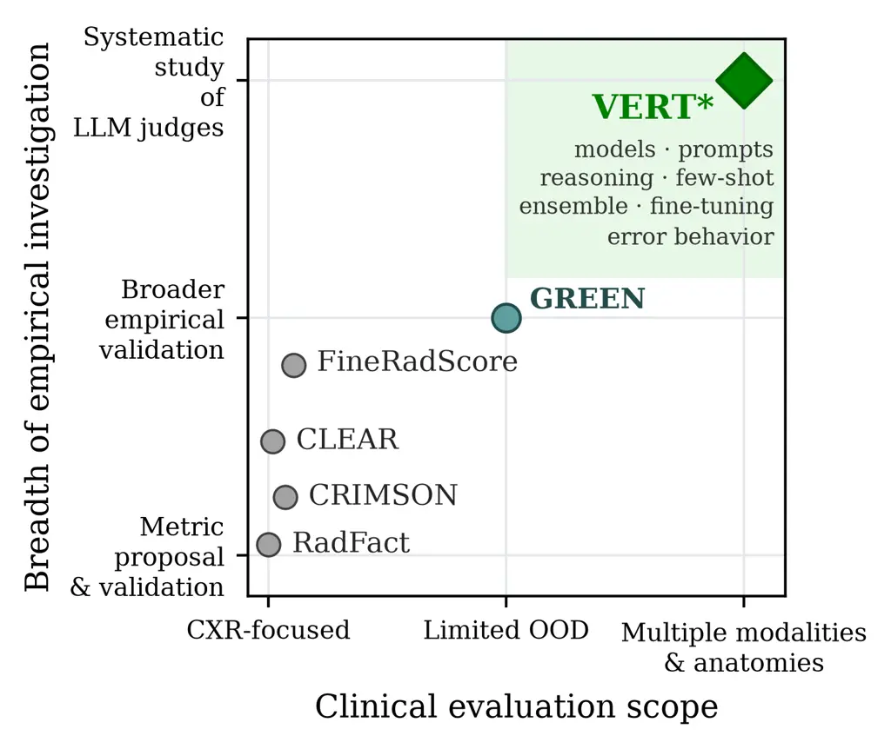
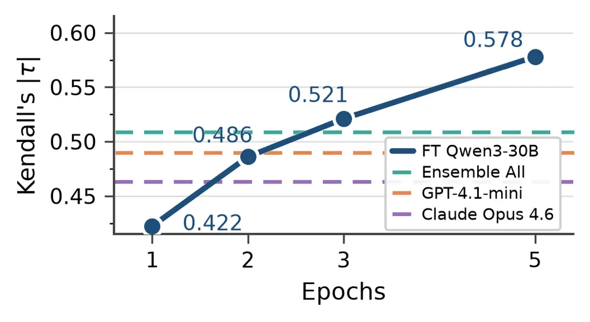
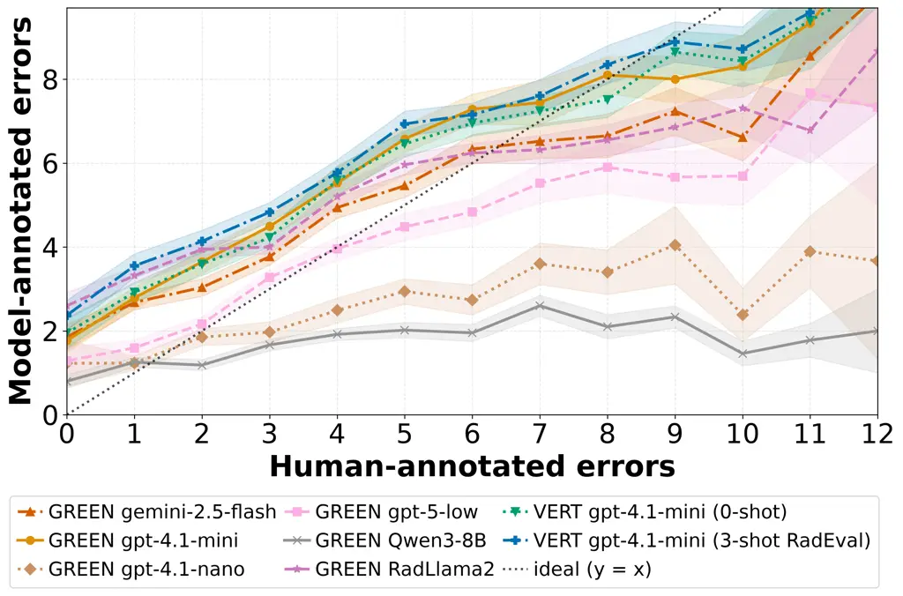
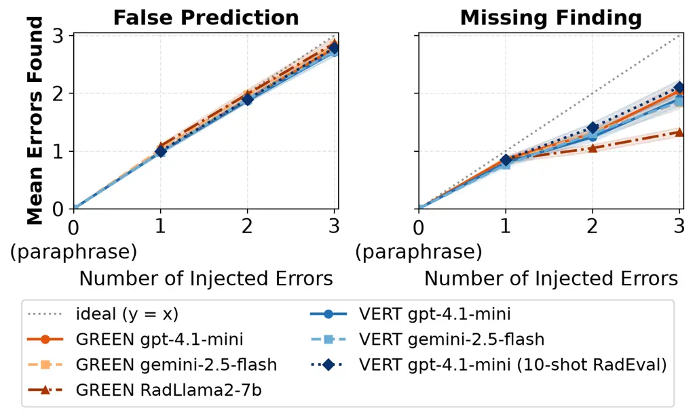
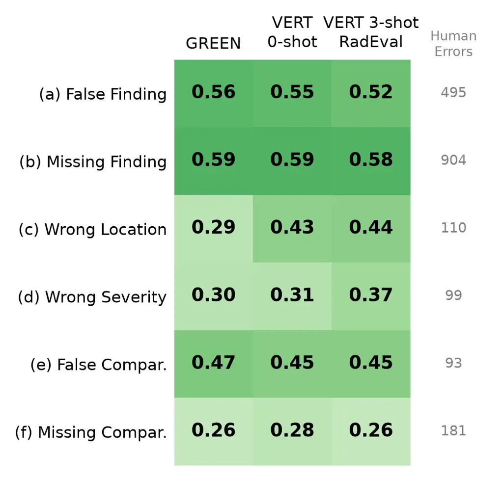
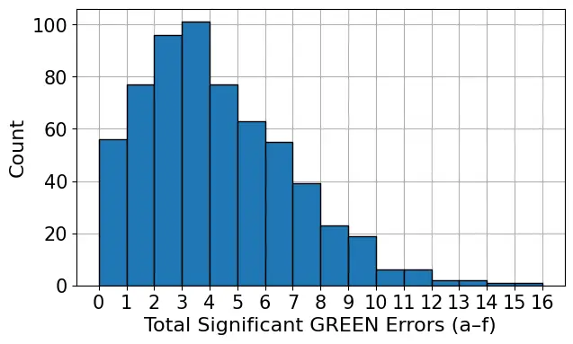
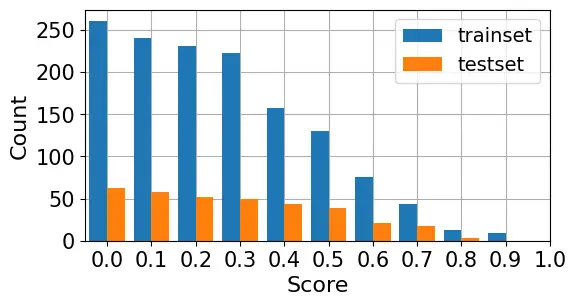
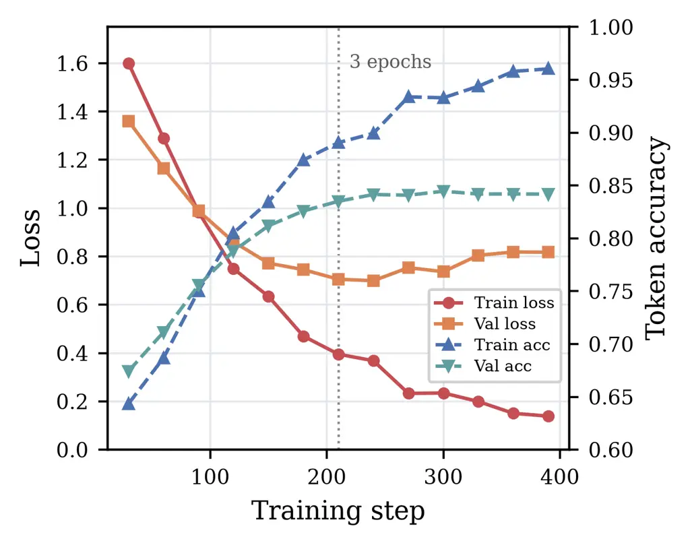

# Towards Better Aligned LLM Judges for Radiology Report Evaluation across Modalities and Anatomies

Federica Bologna Note: Corresponding authors: fb265@cornell.edu,
jcorbeil@microsoft.com Affiliation: Cornell University
Affiliation: Ithaca, NY, USA    Jean-Philippe Corbeil¹¹footnotemark: 1
Affiliation: Microsoft Healthcare & Life Sciences Affiliation: Montréal,
QC, Canada    Matthew Wilkens Affiliation: Cornell University
Affiliation: Ithaca, NY    Asma Ben Abacha Affiliation: Microsoft
Healthcare & Life Sciences Affiliation: Redmond, WA, USA

###### Abstract

Current work on radiology report evaluation has focused primarily on
LLM-based metrics for chest X-rays (CXR), leaving open whether such
approaches remain robust across other modalities and anatomies, and
which model and prompt configurations are best suited to serve as LLM
judges. We present a comprehensive evaluation of LLM judges for
radiology report evaluation across diverse model families, prompting
strategies, and adaptation methods, leveraging two expert-annotated
datasets that span multiple imaging modalities and anatomical regions.
Specifically, we compare four existing metrics (RadFact, GREEN,
FineRadScore, and CRIMSON) with our proposed metric, VERT, across open-
and closed-source models of varying sizes and reasoning capabilities.
Among existing metrics, GREEN proves the most robust, outperforming more
recent CXR-specific approaches. VERT further improves Kendall’s
correlation with radiologist judgment by up to 26% over GREEN, while
ensembling and lightweight fine-tuning of Qwen3-30B yield gains of up to
9.9% and 25%, respectively, of which the latter also has a latency
reduction of 37.2×. A systematic error analysis further shows that,
while these metrics correlate with expert ratings overall, they tend to
miscount errors such as omissions. Overall, our results show that
carefully selected general-purpose LLM judges provide strong radiology
report evaluation across modalities, with lightweight adaptation
offering complementary gains when annotated data is available.

## 1 Introduction

The evaluation of radiology reports has largely followed two separate
lines: fine-tuning small models on LLM-generated labels and designing
LLM-based metrics centered on error detection (Huang et al., 2024;
Ostmeier et al., 2024; Zambrano Chaves et al., 2025; Baharoon et al.,
2026). Beyond concentrating almost exclusively on chest radiographs
(CXR), these efforts rest on a narrow empirical basis—most rely on
ReXVal (Yu et al., 2023a; Yu et al., 2023b), a 50-report benchmark whose
reliability has recently been questioned (Li et al., 2025). Finetuned
metrics in particular tend to degrade beyond CXR (Cho et al., 2025), as
differences in modality, anatomical focus, and reporting conventions are
hard to generalize across. Thus, a metric optimized for chest reports
may miss nuanced findings in domains such as MRI or CT.

Figure 1: Clinical scope and empirical breadth of prior work and current
paper noted VERT\*, emphasizing the complete study and not only our VERT
metric. The metric positions are for illustrative purposes and are
approximated from the information given by the authors.

LLMs are a natural candidate to move beyond this scope, given their
adaptability across diverse medical tasks and report types (Nori et al.,
2023; Dada et al., 2025; Wang et al., 2026). Yet, studies on
general-purpose radiology evaluators remain limited in scope. Existing
metrics are largely proposed and validated in isolation, leaving unclear
which closed- or open-source models and prompting strategies yield the
most reliable judges. We address this with a systematic study of
LLM-as-a-judge metrics across open- and closed-source models on two
expert-annotated datasets, RadEval and RaTE-Eval, spanning multiple
modalities and anatomies (Figure 1). Furthermore, we introduce VERT, a
simple direct-scoring LLM-based metric.

When training data is available, we show that ensembling and fine-tuning
yield complementary in-domain gains in correlation with radiologist
judgments. Thus, lightweight adaptation remains an important way to
achieve efficiency, although prompt-based evaluation using generalist
LLMs should also be prioritized.

Finally, we carry out a systematic error-injection and error-breakdown
study to analyze, at a granular level, where LLM-based metrics align
with and diverge from expert annotations.

Our contributions are as follows:

- •
  We present a systematic study of LLMs as radiology-report judges
  across two expert-annotated datasets spanning multiple modalities and
  anatomies, benchmarking closed- and open-source models and analyzing
  the impact of prompting strategies from which we distill practical
  recommendations for practitioners.
- •
  We show that two recent fine-grained LLM-based methods underperform
  GREEN on both benchmarks, while VERT, a simple direct-scoring
  LLM-based metric, achieves the highest correlation with expert
  judgments, across the evaluated LLMs and among four prompt variants on
  the held-out evaluation subsets of both RadEval and RaTE-Eval.
- •
  We show that ensembling and fine-tuning provide complementary gains
  beyond prompting—with latency reduction for the latter—when data is
  available.
- •
  We conduct error-injection and error-breakdown analyses to identify
  the strengths and failure modes of LLM-based metrics.
- •
  We release our code repository RadEvalLLM¹¹ 1 Release upon acceptance.
  for reproducibility across the main LLM judges and configurations.

## 2 Related Work

### 2.1 Traditional and Hybrid Metrics for Radiology

Early methods rely on lexical and embedding-based metrics such as BLEU
(Papineni et al., 2002), ROUGE (Lin, 2004) and BERTScore (Zhang et al.,
2020), which measure overlap between generated and reference reports
without explicitly capturing clinical relevance. To address this
limitation, methods such as CheXbert (Smit et al., 2020), and RadGraph
(Jain et al., 2021) evaluate agreement over predefined labels or
structured entity–relation representations. Although better aligned with
diagnostic relevance, these approaches depend on external extractors and
remain constrained by predefined ontologies. Composite and learned
metrics, such as RadCliQ (Yu et al., 2023a), combine multiple signals to
better approximate expert judgment. However, they rely on labeled data
and may suffer from reduced interpretability.

### 2.2 LLM-based Metrics for Radiology

Recent approaches leverage LLMs as evaluators (Zheng et al., 2023; Liu
et al., 2023; Gu et al., 2024). Prior works such as RadFact (Bannur et
al., 2024), GREEN (Ostmeier et al., 2024), FineRadScore (Huang et al.,
2024), CLEAR (Jiang et al., 2025), and CRIMSON (Baharoon et al., 2026)
use LLMs to assess the clinical factuality of a radiology report against
a reference report using different schemas. These approaches demonstrate
stronger alignment with expert judgments by capturing nuanced clinical
errors. Despite these advances, existing metrics are developed for CXR
with limited evaluation across modalities and anatomical regions.
Consequently, key questions regarding model selection, prompting
strategies, and generalization remain underexplored.

### 2.3 Fine-Tuning Models as Evaluators in Radiology

Several radiology metrics are based on small models finetuned on
expert-annotated labels (Smit et al., 2020; Jain et al., 2021) or
distillation via LLM annotations (Ostmeier et al., 2024; Delbrouck et
al., 2025; Cho et al., 2025; Baharoon et al., 2026). While most were
evaluated on the ReXVal dataset (Yu et al., 2023b), based on CXR, recent
results by Cho et al. (2025) on the RaTE-Eval dataset (Zhao et al.,
2024), covering a diversity of modalities and anatomies, point to a
potential vulnerability of these metrics when evaluated outside the
scope of CXR, except for GREEN.

### 2.4 LLM-based Error Injection

Recent studies support LLM-based error injection as a promising way to
construct controlled evaluation datasets. Luhtaru et al. (2024) and
Latouche et al. (2024) demonstrate the utility of LLM-generated
grammatical errors, while Rao et al. (2024) extend this approach to
clinically meaningful errors in radiology reports, using domain
expertise to support plausibility. Together, these studies motivate
using top-tier LLMs to inject diverse, targeted errors into correct
inputs to stress test LLM judges, enabling systematic evaluation beyond
naturally occurring errors.

## 3 Datasets

In this study, we use RadEval and RaTE-Eval, two recent datasets
featuring a higher number of radiology reports and several modalities
and anatomies in comparison to the widely used ReXVal (Yu et al.,
2023b). Neither dataset provides a dedicated development split. For the
prompt-selection experiment, we partition each test set into two equal
subsets, using one for prompt selection and the other for evaluation.
All other benchmarking experiments use the original test sets to
preserve comparability with prior work.

RadEval (Xu et al., 2025) consists of 148 chest x-rays. Each study has a
ground-truth report and 3 annotated candidate reports. The expert
annotations detail the number of significant and insignificant errors
found in the candidate report for each of the six error categories from
Yu et al. (2023b): (a) false prediction of a finding, (b) omission of a
finding, (c) incorrect anatomical location or position, (d) incorrect
severity assessment, (e) mention of a comparison absent from the
reference, (f) omission of a change noted in a prior study, and a
seventh category to capture inarticulate report/grammar. However, they
do not contain an overall score for the candidate report. We show the
histogram of significant errors in Figure 6 of Appendix A.

RaTE-Eval (Zhao et al., 2024) consists of sentence- and paragraph-level
benchmarks spanning 9 imaging modalities and 22 anatomies. In this work,
we use the paragraph-level benchmark containing a total of 1856
reference reports (i.e., 444 as testset) paired with a candidate report
and an expert-annotated score ranging from 0 to 5. We provide the
histogram of normalized scores (0–1) in Figure 7 of Appendix A.

## 4 Methodology

### 4.1 Correlation With Human Judgments

#### 4.1.1 Zero-shot Prompting

We conduct a series of controlled experiments to identify the zero-shot
prompt and model combinations that are most effective at radiology
report evaluation. In addition to evaluating existing prompting
strategies, we systematically compare multiple score aggregations to
assess how prompt design influences alignment with expert judgments and
to examine the effect of direct score prediction versus derived or
structured scoring schemes.

Specifically, we evaluate four zero-shot prompt variants using
GPT-4.1-mini and Gemini-2.5-flash: (1) GREEN, a chain-of-thought prompt
that identifies clinically significant and insignificant errors and
computes a score post hoc; (2) VERT, our proposed metric, which instead
directly prompts the model to produce an overall accuracy score along
GREEN’s error-count outputs; (3) a formula-based prompt, which instructs
the model to compute a score using a predefined weighted equation over
matched findings and error types; and (4) a rubric-based prompt, which
replaces the formula with a discrete scoring rubric. We focus on these
prompts to test whether model-generated scores align with human ratings,
and whether providing the model with a scoring formula or rubric can
improve that alignment further. Since we are selecting the best prompt
method in this experiment specifically, we split the test sets of
RadEval and RaTE-Eval 50/50 for development and held-out test purposes.
Full prompts are available in Appendix C.

We then further evaluate our proposed zero-shot prompt, VERT, across
multiple large language models, including both closed- and open-source
variants, to assess robustness across model families. We measure the
correlation with human annotations on the full testsets of both RadEval
and RaTE-Eval. We also compare it against established baselines:
RadFact (Bannur et al., 2024), GREEN (Ostmeier et al., 2024), GREEN-EC
(sum of error counts), FineRadScore (Huang et al., 2024), and
CRIMSON (Baharoon et al., 2026). We use the implementations from their
GitHub repositories.

We excluded lexical metrics from our baselines because previous works Xu
et al. (2025); Ostmeier et al. (2024); Huang et al. (2024) have
established weaker correlations with expert judgment.

We focus on the absolute value²² 2 Correlation of a metric between 0-1
with the sum of errors yields a negative value while it is positive when
using a holistic expert score. This sign difference is irrelevant here.
of Kendall’s $`|\tau|`$ to ease comparison of our results against prior
work, even if it tends to lead to noticeably lower scores than Pearson’s
$`r`$ or Spearman’s $`\rho`$ correlations³³ 3 For example, a
strong-positive correlation of $`r\approx\rho\approx 0.7`$ can
correspond to $`\tau\approx 0.5`$..

#### 4.1.2 Ensembling

We leverage two ensembling methods: averaging of scores and linear
regression. For the former, we simply average metric scores while, for
the latter, we fit a linear regression on LLM scores over 500 samples
from the RaTE-Eval training set. We used three frontier models for our
ensembles: GPT-4.1, Gemini 2.5 Flash (low), and Claude Opus 4.6 (low).

#### 4.1.3 Few-shot Prompting

We investigate whether the inclusion of few-shot examples and error
descriptions improves correlation with human annotations. We evaluate
3-, 5-, 10- shots sampled at random from either the RadEval dataset or
the RaTE-Eval trainset across 5 runs (i.e., seeds of 42 to 46). Each
shot includes the candidate report, the reference report, and an overall
score based on human assessments. In addition to the random few-shot
prompts, we test four curated prompts: (1) rad-err includes six human
annotations from RadEval, one per error type. (2) rate-err includes four
examples from RaTE-Eval’s trainset. Since human assessments for
RaTE-Eval do not include error counts (only overall scores from 0-5), we
inject reference reports with errors of type (a) and (b) using GPT-4.1.
(3) rad-err-10 human features error descriptions for each error type and
10 random RadEval. (4) rate-err-10 VERT features error descriptions for
each error type and 10 random RaTE-Eval shots with assessments generated
using GPT-4.1-mini VERT. Full prompts are available in Appendix C.

#### 4.1.4 LoRA Fine-Tuning

We finetune Qwen3-30B-A3B-Instruct-2507 (Yang et al., 2025)—a
mixture-of-expert (MoE) architecture with 8 activated experts out of
128—leveraging the QLoRA low-rank adaptation method (Dettmers et al.,
2023). The base model is frozen and quantized in 4 bits in memory (with
bfloat16 for computing). Then, trainable LoRA adapters (Hu et al., 2022)
of rank 32 ($`\alpha=64`$) are injected into each linear layer, except
the MoE router layers. The optimizer is AdamW (Loshchilov and Hutter, 2019) including a cosine scheduler with a peak learning rate of
$`2\times 10^{-4}`$ trained for 5 epochs fixed a priori based on
available budget and best practices. We used the user-turn template with
the first two lines from the VERT prompt followed by the reference and
candidate reports, and then we applied the assistant-turn template to
wrap the normalized score between 0.0 and 1.0 with only 1 decimal. A
score histogram is provided in Figure 7 in Appendix A. Applying the chat
template enables full compatibility with vLLM (Kwon et al., 2023).

We finetune 1,486 report paragraphs from the RaTE-Eval training set,
which we split 90:10 for training and validation purposes, respectively.

### 4.2 Error Injection and Type Breakdown

In addition to the correlation analysis, we study the performance of
model and prompt combinations at correctly detecting and categorizing
errors. Specifically, we compare the number and type of clinically
significant errors identified by the system against those identified by
human annotators. While error counts for each category are included in
human assessments in RadEval, expert assessments in RaTE-Eval only
provide an overall quality score. Therefore, in order to study error
detection and categorization in RaTE-Eval, we inject clinically
significant errors into reference radiology reports using GPT-4.1. We
consider two error types: false prediction (category a), and missing
finding (category b). We focus on these error types as they are the most
frequent in RadEval (Figure 5). For each report, the model is instructed
to introduce exactly $`k\in\{1,2,3\}`$ clinically significant errors of
the target type while preserving all other content. After injection,
each perturbed report is passed through a separate validation step in
which GPT-4.1 assesses whether the injected change is anatomically and
clinically plausible given the imaging modality and body region.
Modifications that fail validation are regenerated up to 5 times.
Reports that remain implausible after all attempts are excluded from the
experiment. An expert reading of a 100 perturbed cases found 6 that were
implausible. Full prompts can be found in Appendix D.1.

|                                 |         |       |          |              |         |       |
| ------------------------------- | ------- | ----- | -------- | ------------ | ------- | ----- |
| Model                           | RadFact | GREEN | GREEN-EC | FineRadScore | CRIMSON | VERT  |
| RadEval — Error Annotations     |         |       |          |              |         |       |
| GPT-4.1 mini                    | 0.295   | 0.332 | 0.561    | 0.173        | 0.264   | 0.371 |
| Gemini 2.5 Flash (low)          | \-      | 0.319 | 0.507    | 0.378        | 0.263   | 0.338 |
| Claude Sonnet 4.6 (low)         | \-      | 0.293 | 0.510    | 0.233        | 0.201   | 0.329 |
| RaTE-Eval — Expert Scores (0–5) |         |       |          |              |         |       |
| GPT-4.1 mini                    | 0.312   | 0.420 | 0.197    | 0.137        | 0.218   | 0.447 |
| Gemini 2.5 Flash (low)          | \-      | 0.344 | 0.186    | 0.212        | 0.269   | 0.427 |
| Claude Sonnet 4.6 (low)         | \-      | 0.432 | 0.246    | 0.195        | 0.295   | 0.453 |

Table 1: Kendall’s $`|\tau|`$ across prompts and models on all test
sets. RadFact’s Python library is only compatible with OpenAI. Bold and
underlined indicate the best and second best result per row
respectively.

## 5 Results

### 5.1 Correlation With Human Judgments

#### 5.1.1 Model-generated scores correlate more with expert judgments

|         |              |           |                  |           |
| ------- | ------------ | --------- | ---------------- | --------- |
|         | GPT-4.1-mini |           | Gemini 2.5 Flash |           |
| Metric  | RadEval      | Rate-Eval | RadEval          | Rate-Eval |
| GREEN   | 0.350        | 0.409     | 0.346            | 0.313     |
| Formula | 0.081        | 0.375     | 0.210            | 0.335     |
| Rubric  | 0.292        | 0.445     | 0.286            | 0.119     |
| VERT    | 0.369        | 0.443     | 0.357            | 0.386     |

Table 2: Comparison of GREEN, Formula, Rubric, and VERT across $`10k`$
paired-bootstrap samples on the 50% development set. Standard deviations
range from $`0.045`$ to $`0.070`$. Bold indicates the highest mean for
each model–dataset pair.

We first compare the performance of zero-shot prompts with different
score assignment instructions. Our proposed prompt, VERT, achieves the
strongest correlation with the annotations of human experts for both
RadEval and Rate-Eval compared to GREEN—as well as the formula- and
rubric-based prompts (Tables 2 and 3). The results also suggest that
including a formula or a rubric might decrease performance in most
cases, except for Rubric on Rate-Eval with GPT-4.1-mini.

|                              |              |           |                  |           |
| ---------------------------- | ------------ | --------- | ---------------- | --------- |
|                              | GPT-4.1-mini |           | Gemini 2.5 Flash |           |
| Metric                       | RadEval      | Rate-Eval | RadEval          | Rate-Eval |
| GREEN                        | 0.323        | 0.407     | 0.297            | 0.366     |
| VERT                         | 0.358        | 0.494     | 0.329            | 0.461     |
| $`P(\mathrm{V}>\mathrm{G})`$ | 0.961        | 0.998     | 0.811            | 0.992     |

Table 3: Comparison of GREEN and VERT scores across $`10k`$
paired-bootstrap samples on the 50% held-out test set. Bold indicates
the higher score for each model–dataset pair.
$`P(\mathrm{V}>\mathrm{G})`$ denotes the probability that VERT
outperforms GREEN.

We further validated the robustness of VERT to prompt sensitivity in
Appendix B.1, and provided both Spearman and Pearson correlations in
Appendix B.4.

#### 5.1.2 Different zero-shot judges for different datasets

We compare our zero-shot VERT prompt against four metrics from prior
work (RadFact, GREEN, FineRadScore and CRIMSON) on both RadEval and
RaTE-Eval (Table 1). We also include GREEN-EC, the sum of the error
counts produced by the model. We prompted GPT-4.1 mini, Gemini 2.5
Flash, and Claude Sonnet 4.6.

Despite being top performers on ReXVal, FineRadScore and CRIMSON are
underperforming across models on both datasets in our setting. Finally,
we observe that VERT is overall the most consistent bounded metric on
both datasets, while the unbounded GREEN-EC is specifically better on
RadEval but worst on RaTE-Eval.

#### 5.1.3 Best LLMs as Radiology Evaluators

|                  |       |           |       |
| ---------------- | ----- | --------- | ----- |
| Models           | GREEN | GREEN-EC  | VERT  |
| GPT-4.1 mini     | 0.420 | 0.197     | 0.447 |
| GPT-4.1          | 0.365 | 0.222     | 0.452 |
| GPT-5            | 0.333 | 0.138     | 0.409 |
| GPT-5 mini       | 0.350 | 0.221     | 0.330 |
| GPT-5.6 Luna     | 0.347 | 0.197     | 0.365 |
| GPT-5.6 Sol      | 0.427 | 0.296     | 0.447 |
| Gemini 2.5 Flash | 0.344 | 0.186     | 0.427 |
| Opus 4.6         | 0.449 | 0.241     | 0.463 |
| Sonnet 4.6       | 0.432 | 0.246     | 0.453 |
| Qwen3 30B        | 0.285 | 0.059^(†) | 0.209 |

Table 4: Kendall’s $`|\tau|`$ on all RaTE-Eval’s test set across 10
LLMs. Bold and underline are the best and second-best value,
respectively, per metric. All reasoning LLMs are set to low. $`\dagger`$
denotes a p-value above $`0.01`$.

In Table 4, we prompt ten models with GREEN and VERT. Generally, we
notice that Claude models are the best performing, followed by the
GPT-5.6 and GPT-4.1 families.

#### 5.1.4 Thinking does not improve correlation with expert judgments

|               |           |       |           |       |
| ------------- | --------- | ----- | --------- | ----- |
| Model         | None      | Low   | Medium    | High  |
| GPT-5         | –         | 0.333 | 0.367     | 0.351 |
| GPT-5 mini    | –         | 0.350 | 0.348     | 0.275 |
| GPT-5.6 Luna  | –         | 0.347 | 0.341     | 0.373 |
| GPT-5.6 Sol   | –         | 0.427 | 0.369     | 0.395 |
| Claude Opus   | 0.441     | 0.449 | 0.359     | 0.200 |
| Claude Sonnet | 0.434     | 0.432 | 0.299     | 0.205 |
| Qwen3 30B     | 0.041^(†) | –     | 0.285     | –     |
| Qwen3 4B      | 0.043^(†) | –     | 0.048^(†) | –     |

Table 5: Kendall’s $`|\tau|`$ correlation of GREEN on all RaTE-Eval’s
test set across thinking levels. The medium reasoning level is the
thinking variant for Qwen3 models. Dashes indicate unavailable
configurations. Bold denotes the best value per model. The dagger
$`\dagger`$ denotes a p-value above $`0.01`$.

We display nine open- and closed-source thinking models prompted with
the GREEN metric approach in Table 5 covering all reasoning efforts
(none, low, medium and high).

Overall, we notice mixed results from extending the number of reasoning
tokens. Only Qwen3 30B benefits from longer reasoning traces, while
still performing lower than the others on GREEN. We observe that the
smaller open-source model—i.e., Qwen3 4B—does not correlate with expert
scores in any setting. For both GPT and Claude models, correlation tends
to decrease in the high thinking setting.

#### 5.1.5 Regression-based ensemblings improve correlation with expert judgments

We compute several ensembles of GPT-4.1, Claude Opus 4.6 (low) and
Gemini 2.5 Flash (low) in Table 6. We select the best correlation scores
for each metric among those three models as baselines (Table 4). Two
ensembling methods were performed: average of scores and linear
regression. The latter is fitted using 500 samples from the RaTE-Eval
trainset. All ensembles are performed individually per score, except for
the linear regression All which is done on all available features from
GREEN or VERT.

|       |        |           |         |                   |
| ----- | ------ | --------- | ------- | ----------------- |
|       | Metric | Baselines | Average | Linear Regression |
| GREEN | SCORE  | 0.449     | 0.421   | 0.452             |
|       | EC     | 0.241     | 0.256   | 0.265             |
|       | All    | –         | –       | 0.486             |
| VERT  | SCORE  | 0.463     | 0.480   | 0.489             |
|       | All    | –         | –       | 0.509             |

Table 6: Kendall’s $`|\tau|`$ between ensemble-aggregated GREEN/VERT
metrics on RaTE-Eval’s full test set. Each row uses only the
corresponding metric scores from each model, except for All which
leverages all scores from GREEN or VERT—i.e., matched findings, error
counts, and scores. Bold indicates the best result per metric.

Averaging improves performance against baseline only in the case of
GREEN EC and VERT, while linear regression improves all scores.
Combining all available features yields the highest correlations:
Kendall’s $`|\tau|`$ reaches 0.486 for GREEN and 0.509 for VERT,
compared with their strongest individual score baselines.

#### 5.1.6 Few-shot Prompting

|           |        |               |             |             |             |                  |                 |             |             |             |                  |
| --------- | ------ | ------------- | ----------- | ----------- | ----------- | ---------------- | --------------- | ----------- | ----------- | ----------- | ---------------- |
|           |        | RadEval Shots |             |             |             |                  | RaTE-Eval Shots |             |             |             |                  |
|           | 0-shot | 3             | 5           | 10          | rad-err     | rad-err 10 human | 3               | 5           | 10          | rate-err    | rate-err 10 VERT |
| RadEval   | 0.359  | 0.373 +1.4%   | 0.370 +1.1% | 0.405 +4.6% | 0.393 +3.4% | 0.445 +8.6%      | 0.341 -1.8%     | 0.345 -1.4% | 0.349 -1.0% | 0.444 +8.5% | 0.372 +1.3%      |
| RaTE-Eval | 0.445  | 0.479 +3.4%   | 0.480 +3.5% | 0.490 +4.5% | 0.462 +1.7% | 0.453 +0.8%      | 0.485 +4.0%     | 0.483 +3.8% | 0.487 +4.2% | 0.410 -3.5% | 0.460 +1.5%      |

Table 7: Mean Kendall’s $`|\tau|`$ between the VERT output score and
human judgments for GPT-4.1-mini. The maximum standard deviation across
all five runs and configurations is $`0.011`$. Bold indicates the best
mean per row and type of example, while colored values show the absolute
percentage-point difference from the zero-shot baseline.

We investigate the performance of adding random 3-, 5-, and 10-shots,
error descriptions, and error-specific curated shots on both RadEval and
RaTE-Eval (Table 7). We choose GPT-4.1-mini as our base model, since it
is affordable while still achieving satisfactory performance (Tables 1
and 2).

Few-shot improvements depend on the example source and prompt design. On
RadEval, curated error-specific prompts achieve the highest
correlations, with rad-err-10-human and rate-err reaching 0.445 and
0.444, respectively, compared with 0.359 for zero-shot prompting. On
RaTE-Eval, including random shots from RadEval or RaTE-Eval outperforms
zero-shot (0.445) and all four curated prompts (ranging 0.410 and
0.462). 10 random RadEval or RaTE-Eval examples perform best (0.490 and
0.487). Random RadEval-sourced examples improve correlation on both
datasets, whereas random RaTE-Eval-sourced examples improve correlation
only on RaTE-Eval. Increasing the number of examples does not
consistently improve performance, and no configuration performs best on
both datasets.

#### 5.1.7 LoRA Fine-Tuning for RaTE-Eval

Figure 2: Correlation on RaTE-Eval testset of finetuned Qwen3 for 5
epochs compared to VERT baselines.

We finetune Qwen3-30B-A3B-Instruct-2507 on RaTE-Eval in Figure 2,
leading to correlations with expert judgment surpassing all previous
LLM-based evaluators at $`0.578`$. We also evaluate our finetuned model
on the RadEval testset scoring a $`|\tau|`$ of $`0.185`$, which
indicates a weak out-of-domain generalization. We provide training and
validation losses in Appendix B.3.

At inference time, the finetuned model processes RaTE-Eval’s testset in
36 seconds on an A100 GPU, while Claude Opus 4.6 (low) using VERT takes
about 22.3 minutes with the Anthropic API, a $`37.2\times`$ reduction in
computation time⁴⁴ 4 Since GPU runtime is unavailable with closed-source
models, this number is limited to the API latency. Yet, the order of
magnitude remains representative..

### 5.2 Error Injection and Type Breakdown

Figure 3: Average \# expert-annotated significant errors vs.
LLM-detected errors on RadEval.

We study whether zero-shot and few-shot LLM-as-a-judge methods can
retrieve the same number of clinically significant errors as expert
annotators. For RadEval, we test zero-shot with a variety of models and
the few-shot method most correlated with human judgments (VERT 3-shot
RadEval). We restrict our analysis to reports containing between 1 and
12 human-annotated errors to ensure sufficient representation within
RadEval (Fig. 6).

Figure 4: Average \# LLM-detected significant errors vs. \# injected
errors on RaTE-Eval.

The majority of model–prompt combinations overestimates the number of
errors when there are fewer than 6 human-annotated errors and
underestimates when there are more than 6 (Figure  3). This is true even
for recent proprietary models like GPT-5 and Gemini 2.5 Flash. GREEN
Qwen3 8b is the worst performing of the group. GPT-4.1-mini-based
approaches are the ones that most closely match human annotations, with
VERT GPT-4.1-mini as the best performing one. In the case of RaTE-Eval
(Figure 4), all approaches find most of the injected errors of type (a),
false prediction. However, they all underestimate the number of injected
errors of type (b), missing finding, when there is more than 1 error of
that type. Despite the fact that we inject errors with GPT-4.1, we do
not notice a specific bias towards this model at detection time compared
to other models.

Given these results, we take a closer look at the alignment with expert
judgment at the error-type level. We report the Kendall’s correlation
between predicted and expert error counts per type. On RadEval
(Figure 5), all approaches align well with experts on (a) and (b)
($`|\tau|`$: 0.52–0.59), which are also the best supported. Agreement is
lower on the rarer types (c–f) ($`|\tau|`$: 0.26–0.47). VERT improves by
+48% over GREEN on (c) with smaller gains on (d) and (f), and few-shot
prompting tends to redistribute those gains—e.g., +20% on (d).

Figure 5: $`|\tau|`$ for each error type a–f on RadEval.

|                      |                   |                     |
| -------------------- | ----------------- | ------------------- |
| Method               | (a) False Finding | (b) Missing Finding |
| GREEN                | 0.91              | 0.75                |
| VERT                 | 0.89              | 0.75                |
| VERT 10-shot RadEval | 0.87              | 0.74                |
| Injected errors      | 2064              | 2130                |

Table 8: $`|\tau|`$ for injected errors on RaTE-Eval for gpt-4.1-mini.

The RaTE-Eval dataset doesn’t provide annotations per error types.
Nonetheless, we use injected errors from the previous experiment, of
which results exhibit a different pattern in Table 8. Zero- and few-shot
approaches achieve an $`|\tau|`$ of 0.87–0.91 for error type (a), but
only 0.74–0.75 for type (b). The slight decrease in correlation for (a)
going from GREEN to VERT with few-shots is similar to the previous trend
of (a) on RadEval.

Furthermore, we show a breakdown by imaging modality and anatomy in the
Appendix B.2 showing weaker correlations for MRI and low-frequency
anatomy locations, respectively.

## 6 Recommendations and Takeaways for Radiology LLM Judges

##### Match scoring scheme to annotation target.

No single scoring formulation is universally best (Table 1). Direct
scoring provides a consistent bounded alternative across the two
evaluated annotation regimes.

##### Start simple, limit reasoning effort.

VERT achieves the highest average correlation among the four evaluated
prompt variants on both datasets (Tables 2, 3 and 9). Higher reasoning
effort does not consistently improve correlation under GREEN-style
prompting (Table 5).

##### Benchmark models rather than relying on recency.

Opus 4.6 and Sonnet 4.6 achieve the highest average correlations on
RaTE-Eval among the evaluated models, followed by GPT-5.6 Sol and
GPT-4.1 (Table 4).

##### Validate example source and curation.

Few-shot gains depend on example source and prompt design, with
asymmetric cross-dataset transfer. More examples do not consistently
improve correlation; select configurations on development data rather
than assuming that in-domain examples or larger shot counts are
preferable (Table 7).

##### Fine-tune for specialization, validate transfer.

LoRA on Qwen3-30B yields the strongest in-domain correlation, but
transfers poorly to RadEval ($`|\tau|=0.185`$). Its observed inference
latency is 37.2$`\times`$ lower than the proprietary baseline under our
evaluated deployment setups.

## 7 Conclusion

A central finding of this work is that two recent fine-grained radiology
evaluation methods do not improve alignment with radiologist judgment
over GREEN in our multi-modality benchmarks. Instead, our systematic
study identifies direct scoring (VERT) as a simple, effective
alternative, achieving the highest correlation averaged across evaluated
LLMs among four prompt variants on both RadEval and RaTE-Eval. These
findings highlight that greater evaluation complexity does not
necessarily yield better alignment with expert judgment. Ensembling and
fine-tuning offer further in-domain gains when annotated data is
available, although the fine-tuned model transfers poorly across
datasets.

Finally, our synthetic error analysis shows that correlation with expert
judgment does not guarantee accurate error counting or categorization.
Evaluated judges misestimate error counts and exhibit weaker agreement
on less frequent error categories. Synthetic perturbation experiments
reveal particular difficulty counting multiple omissions. These findings
motivate benchmarks that assess error detection and categorization
alongside overall report quality.

## Limitations

Our findings should be interpreted in the context of several
limitations. First, although our evaluation spans two benchmarks
covering multiple imaging modalities and anatomies, it is constrained by
the publicly available datasets available for radiology report
evaluation. As additional benchmarks become available, it will be
valuable to verify whether the trends observed in this work continue to
hold across clinical settings and reporting practices.

Second, our study focuses on reference-based radiology report
evaluation. While this setting is the standard protocol, future work
could investigate how LLM judges behave in complementary settings, such
as image-grounded evaluation or assessment without reference reports.

Third, we evaluate a diverse collection of open- and closed-source LLMs
under a unified experimental protocol. Given the rapid pace of
foundation model development, individual rankings may evolve as newer
models become available. Nevertheless, we expect the broader
observations regarding prompting strategies, scoring formulations,
adaptation methods, and evaluation protocols to remain applicable.

Fourth, perturbations are generated and validated by the same model
family (GPT-4.1). However, this limitation is mitigated by the results
of Figure 3 showing no clear advantage of this LLM against the others.
Only fabrication (a) and omission (b) error types were injected.

Finally, our analyses show that current LLM judges correlate well with
expert assessments at the report level while remaining less reliable at
fine-grained error attribution, particularly for omissions and less
frequent error categories. We view this as a limitation of the current
evaluation ecosystem rather than of any individual metric, highlighting
the need for richer expert benchmarks that jointly evaluate overall
report quality and detailed clinical-error localization.

## Ethical Considerations

Automatic evaluation metrics for radiology reports are research tools
intended to support method development, not clinical decision-making,
and they should not replace radiologist review or be used to certify
report-generation systems for clinical deployment. As with any automatic
metric, results should be validated on the target clinical setting
before use. Our error-injection procedure produces synthetic,
intentionally altered reports for controlled analysis only; they are
derived from public, de-identified benchmarks and are not intended for
clinical use or dissemination. We also note that applying proprietary
API-based judges to real clinical reports raises data-governance
considerations, which motivates our study of locally deployable
open-weight alternatives. All datasets used are publicly available,
de-identified, and used consistently with their intended research
purpose.

## References

- Baharoon et al. (2026) M. Baharoon, T. Heintz, S. Raissi, M.
  Alabbad, M. Alhammad, H. AlOmaish, S. E. Kim, O. Banerjee, and P.
  Rajpurkar Crimson: a clinically-grounded llm-based metric for
  generative radiology report evaluation. arXiv preprint
  arXiv:2603.06183. Cited by: §1, §2.2, §2.3, §4.1.1.
- Bannur et al. (2024) S. Bannur, K. Bouzid, D. C. Castro, A.
  Schwaighofer, S. Bond-Taylor, M. Ilse, F. Pérez-García, V.
  Salvatelli, H. Sharma, F. Meissen, M. P. Ranjit, S. Srivastav, J.
  Gong, F. Falck, O. Oktay, A. Thieme, M. P. Lungren, M. T. A.
  Wetscherek, J. Alvarez-Valle, and S. L. Hyland MAIRA-2: grounded
  radiology report generation. arXiv abs/2406.04449. External Links:
  [Link](https://arxiv.org/abs/2406.04449) Cited by: §2.2, §4.1.1.
- Cho et al. (2025) G. Cho, S. Jang, H. Ko, I. Baek, and C. M. Park
  CREPE: rapid chest x-ray report evaluation by predicting
  multi-category error counts. In Proceedings of the 2025 Conference on
  Empirical Methods in Natural Language Processing, pp. 21749–21766.
  Cited by: §1, §2.3.
- Dada et al. (2025) A. Dada, O. A. Koraş, M. Bauer, J. Corbeil, A. B.
  Contreras, C. M. Seibold, K. E. Smith, J. Friedrich, and J. Kleesiek
  Does biomedical training lead to better medical performance?. In
  Proceedings of the Fourth Workshop on Generation, Evaluation and
  Metrics (GEM²), O. Arviv, M. Clinciu, K. Dhole, R. Dror, S.
  Gehrmann, E. Habba, I. Itzhak, S. Mille, Y. Perlitz, E. Santus, J.
  Sedoc, M. Shmueli Scheuer, G. Stanovsky, and O. Tafjord (Eds.),
  Vienna, Austria and virtual meeting, pp. 46–59. External Links:
  [Link](https://aclanthology.org/2025.gem-1.5/), ISBN 979-8-89176-261-9
  Cited by: §1.
- Delbrouck et al. (2025) J. Delbrouck, J. Xu, J. Moll, A. Thomas, Z.
  Chen, S. Ostmeier, A. Azhar, K. Z. Li, A. Johnston, C. Bluethgen, et
  al. Automated structured radiology report generation. In Proceedings
  of the 63rd Annual Meeting of the Association for Computational
  Linguistics (Volume 1: Long Papers), pp. 26813–26829. Cited by: §2.3.
- Dettmers et al. (2023) T. Dettmers, A. Pagnoni, A. Holtzman, and L.
  Zettlemoyer Qlora: efficient finetuning of quantized llms. Advances in
  neural information processing systems 36, pp. 10088–10115. Cited by:
  §4.1.4.
- Gu et al. (2024) J. Gu, X. Jiang, Z. Shi, H. Tan, X. Zhai, C. Xu, W.
  Li, Y. Shen, S. Ma, H. Liu, et al. A survey on llm-as-a-judge. The
  Innovation. Cited by: §2.2.
- Hu et al. (2022) E. Hu, Y. Shen, P. Wallis, Z. Allen-Zhu, Y. Li, S.
  Wang, L. Wang, and W. Chen LoRA: low-rank adaptation of large language
  models. In International Conference on Learning Representations
  (ICLR), External Links:
  [Link](https://openreview.net/forum?id=nZeVKeeFYf9) Cited by: §4.1.4.
- Hua et al. (2025) A. Hua, K. Tang, C. Gu, J. Gu, E. Wong, and Y. Qin
  Flaw or artifact? rethinking prompt sensitivity in evaluating llms. In
  Proceedings of the 2025 Conference on Empirical Methods in Natural
  Language Processing, pp. 19900–19910. Cited by: §B.1.
- Huang et al. (2024) A. Huang, O. Banerjee, K. Wu, E. P. Reis, and P.
  Rajpurkar FineRadScore: a radiology report line-by-line evaluation
  technique generating corrections with severity scores. In Machine
  Learning for Healthcare Conference, Cited by: §1, §2.2, §4.1.1,
  §4.1.1.
- Jain et al. (2021) S. Jain, A. Agrawal, A. Saporta, S. Truong, D. N.
  Duong, T. Bui, P. Chambon, Y. Zhang, M. P. Lungren, A. Y. Ng, et al.
  RadGraph: extracting clinical entities and relations from radiology
  reports. In Thirty-fifth Conference on Neural Information Processing
  Systems Datasets and Benchmarks Track (Round 1), Cited by: §2.1, §2.3.
- Jiang et al. (2025) Y. Jiang, C. Chen, S. Wang, F. Li, Z. Tang, B. M.
  Mervak, L. Chelala, C. M. Straus, R. Chahine, S. G. Armato III, and C.
  Tan CLEAR: a clinically grounded tabular framework for radiology
  report evaluation. In Findings of the Association for Computational
  Linguistics: EMNLP 2025, C. Christodoulopoulos, T. Chakraborty, C.
  Rose, and V. Peng (Eds.), Suzhou, China, pp. 15914–15933. External
  Links: [Link](https://aclanthology.org/2025.findings-emnlp.862/),
  [Document](https://dx.doi.org/10.18653/v1/2025.findings-emnlp.862),
  ISBN 979-8-89176-335-7 Cited by: §2.2.
- Kwon et al. (2023) W. Kwon, Z. Li, S. Zhuang, Y. Sheng, L.
  Zheng, C. H. Yu, J. E. Gonzalez, H. Zhang, and I. Stoica Efficient
  memory management for large language model serving with
  pagedattention. In Proceedings of the ACM SIGOPS 29th Symposium on
  Operating Systems Principles, Cited by: §4.1.4.
- Latouche et al. (2024) G. L. Latouche, M. Carbonneau, and B. Swanson
  Zero-shot cross-lingual transfer for synthetic data generation in
  grammatical error detection. In Proceedings of the 2024 Conference on
  Empirical Methods in Natural Language Processing, pp. 3002–3016. Cited
  by: §2.4.
- Li et al. (2025) R. Li, J. Li, B. Jian, K. Yuan, and Y. Zhu Reevalmed:
  rethinking medical report evaluation by aligning metrics with
  real-world clinical judgment. In Proceedings of the 2025 Conference on
  Empirical Methods in Natural Language Processing, pp. 11823–11837.
  Cited by: §1.
- Lin (2004) C. Lin Rouge: a package for automatic evaluation of
  summaries. In Text summarization branches out, pp. 74–81. Cited by:
  §2.1.
- Liu et al. (2023) Y. Liu, D. Iter, Y. Xu, S. Wang, R. Xu, and C. Zhu
  G-eval: nlg evaluation using gpt-4 with better human alignment. In
  Proceedings of the 2023 conference on empirical methods in natural
  language processing, pp. 2511–2522. Cited by: §2.2.
- Loshchilov and Hutter (2019) I. Loshchilov and F. Hutter Decoupled
  weight decay regularization. In International Conference on Learning
  Representations, Cited by: §4.1.4.
- Luhtaru et al. (2024) A. Luhtaru, T. Purason, M. Vainikko, M. Del,
  and M. Fishel To err is human, but llamas can learn it too. In
  Findings of the Association for Computational Linguistics: EMNLP 2024,
  pp. 12466–12481. Cited by: §2.4.
- Nori et al. (2023) H. Nori, Y. T. Lee, S. Zhang, D. Carignan, R.
  Edgar, N. Fusi, N. King, J. Larson, Y. Li, W. Liu, et al. Can
  generalist foundation models outcompete special-purpose tuning? case
  study in medicine. Medicine 84 (88.3), pp. 77–3. Cited by: §1.
- Ostmeier et al. (2024) S. Ostmeier, J. Xu, Z. Chen, M. Varma, L.
  Blankemeier, C. Bluethgen, A. E. M. Md, M. Moseley, C. Langlotz, A. S.
  Chaudhari, et al. Green: generative radiology report evaluation and
  error notation. In Findings of the association for computational
  linguistics: EMNLP 2024, pp. 374–390. Cited by: §1, §2.2, §2.3,
  §4.1.1, §4.1.1.
- Papineni et al. (2002) K. Papineni, S. Roukos, T. Ward, and W. Zhu
  Bleu: a method for automatic evaluation of machine translation. In
  Proceedings of the 40th annual meeting of the Association for
  Computational Linguistics, pp. 311–318. Cited by: §2.1.
- Rao et al. (2024) V. M. Rao, S. Zhang, J. N. Acosta, S. Adithan,
  and P. Rajpurkar Rexerr: synthesizing clinically meaningful errors in
  diagnostic radiology reports. In Biocomputing 2025: Proceedings of the
  Pacific Symposium, pp. 70–81. Cited by: §2.4.
- Smit et al. (2020) A. Smit, S. Jain, P. Rajpurkar, A. Pareek, A. Y.
  Ng, and M. Lungren Combining automatic labelers and expert annotations
  for accurate radiology report labeling using bert. In Proceedings of
  the 2020 conference on empirical methods in natural language
  processing (EMNLP), pp. 1500–1519. Cited by: §2.1, §2.3.
- Wang et al. (2026) M. Wang, R. Zhang, W. Wu, Y. Lu, X. Wei, Z. Sun, B.
  Guan, J. Zhang, X. Wu, L. Zhang, T. Wang, and Y. Li Evaluation of
  large language models for diagnostic impression generation from brain
  mri report findings: a multicenter benchmark and reader study. npj
  Digital Medicine 9, pp. 187. External Links:
  [Document](https://dx.doi.org/10.1038/s41746-026-02380-4) Cited by:
  §1.
- Xu et al. (2025) J. Xu, X. Zhang, J. Abderezaei, J. Bauml, R.
  Boodoo, F. Haghighi, A. Ganjizadeh, E. Brattain, D. Van Veen, Z. Meng,
  et al. RadEval: a framework for radiology text evaluation. In
  Proceedings of the 2025 Conference on Empirical Methods in Natural
  Language Processing: System Demonstrations, pp. 546–557. Cited by: §3,
  §4.1.1.
- Yang et al. (2025) A. Yang, A. Li, B. Yang, B. Zhang, B. Hui, B.
  Zheng, B. Yu, C. Gao, C. Huang, C. Lv, et al. Qwen3 technical report.
  arXiv preprint arXiv:2505.09388. Cited by: §4.1.4.
- Yu et al. (2023a) F. Yu, M. Endo, R. Krishnan, I. Pan, A. Tsai, E. P.
  Reis, E. K. U. N. Fonseca, H. M. H. Lee, Z. S. H. Abad, A. Y. Ng, et
  al. Evaluating progress in automatic chest x-ray radiology report
  generation. Patterns 4 (9). Cited by: §1, §2.1.
- Yu et al. (2023b) F. Yu, M. Endo, R. Krishnan, I. Pan, A. Tsai, E. P.
  Reis, E. Kaiser Ururahy Nunes Fonseca, H. Lee, Z. Shakeri, A. Ng, C.
  Langlotz, V. K. Venugopal, and P. Rajpurkar Radiology Report Expert
  Evaluation (ReXVal) Dataset. PhysioNet. Note: Version 1.0.0 External
  Links: [Document](https://dx.doi.org/10.13026/2fp8-qr71),
  [Link](https://doi.org/10.13026/2fp8-qr71) Cited by: §1, §2.3, §3, §3.
- Zambrano Chaves et al. (2025) J. M. Zambrano Chaves, S. Huang, Y.
  Xu, H. Xu, N. Usuyama, S. Zhang, F. Wang, Y. Xie, M. Khademi, Z. Yang,
  et al. A clinically accessible small multimodal radiology model and
  evaluation metric for chest x-ray findings. Nature Communications 16
  (1), pp. 3108. Cited by: §1.
- Zhang et al. (2020) T. Zhang, V. Kishore, F. Wu, K. Q. Weinberger,
  and Y. Artzi BERTScore: evaluating text generation with bert. In
  International Conference on Learning Representations, Cited by: §2.1.
- Zhao et al. (2024) W. Zhao, C. Wu, X. Zhang, Y. Zhang, Y. Wang, and W.
  Xie Ratescore: a metric for radiology report generation. In
  Proceedings of the 2024 Conference on Empirical Methods in Natural
  Language Processing, pp. 15004–15019. Cited by: §2.3, §3.
- Zheng et al. (2023) L. Zheng, W. Chiang, Y. Sheng, S. Zhuang, Z.
  Wu, Y. Zhuang, Z. Lin, Z. Li, D. Li, E. Xing, et al. Judging
  llm-as-a-judge with mt-bench and chatbot arena. Advances in neural
  information processing systems 36, pp. 46595–46623. Cited by: §2.2.

## Appendix A Dataset Statistics

See Figures  6 and  7.

Figure 6: Histogram of error annotations in RadEval.

Figure 7: Histogram of normalized expert-annotated scores in RaTE-Eval.

## Appendix B Complementary Results

### B.1 VERT Prompt Perturbation Experiment

|                              |       |       |
| ---------------------------- | ----- | ----- | --- | --- |
| Variant                      | $`    | \tau  | `$  | std |
| VERT                         | 0.452 | 0.030 |
|    - Varying wording         | 0.464 | 0.031 |
|    - Instruction order       | 0.459 | 0.031 |
|    - Condensing instructions | 0.452 | 0.031 |

Table 9: Performance of three prompt variants of VERT on RaTE-Eval
indicating robustness to prompt sensitivity, i.e., all scores are within
the bootstrap std.

We ran an ablation using GPT-4.1 on prompt sensitivity by making three
variants of VERT’s prompt in Table 9. Results indicate a small variation
(\<0.012) overall, in line with recent work that demonstrated a higher
robustness to prompt variations with modern LLMs (Hua et al., 2025).

### B.2 Correlations per Modality and Anatomy

Tables 10 and 11 report VERT correlations using GPT-4.1 by modality and
anatomy for subgroups with $`n>10`$ report pairs. We compute Kendall’s
$`\tau`$ separately for each of five runs and report the mean and sample
standard deviation. Correlations vary across modalities, with CT
achieving the highest mean ($`0.559\pm 0.024`$) and CTA the lowest
($`0.358\pm 0.070`$). Across anatomies, SPINE achieves the highest mean
($`0.651\pm 0.015`$), whereas NECK, HEAD-NECK, and BREAST have the
lowest means. These three subgroups also have small sample sizes
($`n=11`$–$`13`$), warranting caution when interpreting their results.
The subgroup differences alone do not establish whether report
complexity or data scarcity explains the observed variation.

|          |     |                    |
| -------- | --- | ------------------ |
| Modality | n   | $`\tau`$           |
| MRI      | 84  | $`0.458\pm 0.037`$ |
| US       | 76  | $`0.430\pm 0.021`$ |
| CTA      | 64  | $`0.358\pm 0.070`$ |
| CT       | 62  | $`0.559\pm 0.024`$ |
| MRA      | 38  | $`0.379\pm 0.021`$ |
| XR       | 36  | $`0.527\pm 0.033`$ |

Table 10: VERT performance using GPT-4.1 by imaging modality. Values
report mean Kendall’s $`\tau`$ $`\pm`$ sample standard deviation across
five runs, with correlations computed separately for each run. $`n`$
denotes the number of report pairs.

|                 |     |                        |
| --------------- | --- | ---------------------- |
| Anatomy         | n   | $`\tau`$               |
| ABDOMEN         | 76  | $`0.488\pm 0.024`$     |
| UP-EXT          | 46  | $`0.386\pm 0.012`$     |
| PELVIS          | 37  | $`0.411\pm 0.035`$     |
| LOW-EXT         | 34  | $`0.506\pm 0.047`$     |
| BRAIN-FACE-NECK | 29  | $`0.372\pm 0.017`$     |
| CHEST           | 27  | $`0.537\pm 0.058`$     |
| SPINE           | 19  | $`0.651\pm 0.015`$     |
| BRAIN           | 14  | $`0.529\pm 0.045`$     |
| BREAST          | 13  | $`0.300\pm 0.077^{*}`$ |
| HEAD-NECK       | 12  | $`0.256\pm 0.115^{*}`$ |
| NECK            | 11  | $`0.144\pm 0.080^{*}`$ |

Table 11: VERT performance using GPT-4.1 by anatomy for $`n>10`$ report
pairs. Values report mean Kendall’s $`\tau`$ $`\pm`$ sample standard
deviation across five runs, with correlations computed separately for
each run. ^(∗) denotes $`p\geq 0.05`$

### B.3 Training Dynamics of the Finetuned Model on RaTE-Eval

Figure 8: Training and validation loss (left axis) and token accuracy
(right axis) across 5 epochs.

In Figure 8, we show the training and validation losses across 5 epochs
for Qwen3 30B along the training and validation average token
accuracies. The validation loss reaches its lowest after 3 epochs (step
210), but the stabilization of the validation accuracy and improvements
in the test correlations indicate no harmful overfitting.

### B.4 Pearson & Spearman Correlations

|                |              |           |                  |           |
| -------------- | ------------ | --------- | ---------------- | --------- |
|                | GPT-4.1-mini |           | Gemini 2.5 Flash |           |
| Prompt variant | RadEval      | Rate-Eval | RadEval          | Rate-Eval |
| GREEN          | .470         | .571      | .433             | .475      |
| Formula        | .192         | .506      | .360             | .421      |
| Rubric         | .408         | .618      | .414             | .159      |
| VERT           | .465         | .629      | .448             | .571      |

Table 12: Absolute Pearson correlations on the full testsets. Bootstrap
standard deviations ranged from 0.032 to 0.063 across all estimates.
Bold indicates the highest correlation within each model–dataset row.

|                |              |           |                  |           |
| -------------- | ------------ | --------- | ---------------- | --------- |
|                | GPT-4.1-mini |           | Gemini 2.5 Flash |           |
| Prompt variant | RadEval      | Rate-Eval | RadEval          | Rate-Eval |
| GREEN          | .451         | .547      | .424             | .455      |
| Formula        | .182         | .488      | .311             | .373      |
| Rubric         | .424         | .619      | .396             | .206      |
| VERT           | .489         | .621      | .446             | .558      |

Table 13: Absolute Spearman correlations on the full testsets. Bootstrap
standard deviations ranged from 0.035 to 0.063 across all estimates.
Bold indicates the highest correlation within each model–dataset row.

## Appendix C Prompts for Radiology Report Evaluation

### C.1 GREEN

> Objective: Evaluate the accuracy of a candidate radiology report in
> comparison to a reference radiology report composed by expert
> radiologists.
>
> Process Overview: You will be presented with:
>
> 1. The criteria for making a judgment.
> 2. The reference radiology report.
> 3. The candidate radiology report.
> 4. The desired format for your assessment.
> 5. Criteria for Judgment:
>
> For each candidate report, determine:
>
> The count of clinically significant errors.  
> The count of clinically insignificant errors.
>
> Errors can fall into one of these categories:
>
> a) False report of a finding in the candidate.  
> b) Missing a finding present in the reference.  
> c) Misidentification of a finding’s anatomic location/position.  
> d) Misassessment of the severity of a finding.  
> e) Mentioning a comparison that isn’t in the reference.  
> f) Omitting a comparison detailing a change from a prior study.  
> Note: Concentrate on the clinical findings rather than the report’s
> writing style. Evaluate only the findings that appear in both reports.
>
> 2. Reference Report:  
>    {reference}
> 3. Candidate Report:  
>    {candidate}
> 4. Reporting Your Assessment:
>
> Follow this specific format for your output, even if no errors are
> found:  
> \`\`\`  
> \[Explanation\]:  
> \<Explanation\>
>
> \[Clinically Significant Errors\]:  
> (a) \<Error Type\>: \<count\>. \<Error 1\>; ...  
> ....  
> (f) \<Error Type\>: \<count\>. \<Error 1\>; ...
>
> \[Clinically Insignificant Errors\]:  
> (a) \<Error Type\>: \<count\>. \<Error 1\>; ...  
> ....  
> (f) \<Error Type\>: \<count\>. \<Error 1\>; ...
>
> \[Matched Findings\]:  
> \<count\>. \<Finding 1\>; \<Finding 2\>; ...  
> \`\`\`

### C.2 VERT

> \[Same as GREEN ...\]
>
> 1. Criteria for Judgment:
>
> For each candidate report, determine:
>
> The count of clinically significant errors.  
> The count of clinically insignificant errors.  
> The overall accuracy score to assign to the candidate report given the
> count of clinically significant and clinically insignificant errors.
> The score must be a continuous number in \[0.00, 1.00\] with two
> decimals.
>
> \[Same as GREEN ...\]
>
> \[Overall Accuracy Score\]:  
> \<Overall accuracy score between 0 and 1 given the total number of
> clinically significant and insignificant errors in the candidate
> reports\>  
> \`\`\`

### C.3 Formula

> Radiology Report Evaluation Prompt (Formula-Based LLM Judge)
>
> Objective  
> Evaluate the clinical accuracy of a candidate radiology report
> relative to a reference radiology report written by expert
> radiologists.
>
> Your task is to:
>
> 1. Extract clinical findings from both reports.
> 2. Match findings referring to the same pathology and anatomical
>    location.
> 3. Identify discrepancies and classify them as errors.
> 4. Assign an overall accuracy score based on matched findings and
>    errors.
> 5. Count the number of matched findings and errors.
> 6. Compute the accuracy score.
>
> Focus only on clinical findings and comparisons, not writing style.
>
> Step 1: Extract Clinical Findings  
> Extract all distinct clinical findings from each report. A clinical
> finding is a statement describing:
>
> - a pathology
> - an anatomical abnormality
> - the presence or absence of a clinically relevant condition
> - disease severity or characterization
> - change relative to a prior study
>
> Examples:
>
> - Right lower lobe consolidation
> - Small left pleural effusion
> - No pneumothorax
> - Pulmonary nodules unchanged from prior study  
>   Do not merge multiple findings into one.
>
> Step 2: Match Findings  
> Match findings that refer to the same pathology and anatomical
> location in both reports. Matching rules:
>
> - Wording differences are acceptable if the clinical meaning is the
>   same.
> - Findings must refer to the same anatomical structure.
> - Laterality must match (left vs right).
> - Findings with different severities can still match but may generate
>   a severity error.
>
> Example:  
> Reference: ‘‘Small left pleural effusion’’  
> Candidate: ‘‘Trace pleural fluid on the left’’  
> =\> Match.
>
> Step 3: Identify Errors  
> Identify discrepancies between the matched and unmatched findings.
> Errors fall into the following categories:  
> a) False finding: A finding appears in the candidate report but not in
> the reference.  
> b) Missing finding: A finding appears in the reference but not in the
> candidate.  
> c) Incorrect anatomical location: The correct finding is reported but
> in the wrong location or laterality.  
> d) Incorrect severity or characterization: The correct finding is
> reported but severity or description differs.  
> e) False comparison: The candidate report describes comparison with a
> prior study not present in the reference.  
> f) Missing comparison: The reference report describes a change
> relative to a prior study but the candidate does not.  
> Only evaluate explicitly stated findings. Do not infer new findings.
>
> Step 4: Determine Clinical Significance  
> Classify each error as clinically significant or clinically
> insignificant.
>
> Clinically Significant Errors  
> Errors likely to affect medical interpretation or patient
> management:
>
> - Missing or false major pathology
> - Incorrect anatomical location / laterality
> - Incorrect severity of important findings
> - Incorrect disease progression relative to prior imaging
>
> Clinically Insignificant Errors  
> Errors unlikely to affect interpretation:
>
> - Minor wording differences
> - Small differences in severity
> - Minor incidental findings
>
> Step 5: Count Findings and Errors  
> Compute:
>
> - M = number of matched findings
> - S = number of clinically significant errors
> - I = number of clinically insignificant errors
>
> Step 6: Compute Accuracy Score  
> Use the following formula:  
> Score = M / (M + 2\*S + 0.5\*I)  
> Round the final score to two decimal places.  
> The score must be between 0.00 and 1.00.
>
> \[Same as VERT ...\]

### C.4 Rubric

> Objective  
> Evaluate the clinical accuracy of a candidate radiology report
> relative to a reference radiology report written by expert
> radiologists. Your task is to determine how accurately the candidate
> report reflects the clinical findings and interpretations in the
> reference report. Focus on clinical content, not writing style or
> phrasing differences.
>
> \[Steps 1--4: Extract findings, match findings, identify errors,
> determine clinical significance --- identical to Formula prompt\]
>
> Step 5: Assess Overall Accuracy  
> After identifying matched findings and errors, assess the overall
> clinical accuracy of the candidate report. Consider:
>
> - whether key findings were captured
> - whether important findings were omitted
> - whether serious errors are present
> - the overall completeness of the report  
>   Use the rubric below to assign an accuracy score between 0.00 and
>   1.00.
>
> Scoring Rubric  
> 0.90--1.00: Near-perfect agreement. All major findings are correctly
> reported. No clinically significant errors and few or no minor
> discrepancies.  
> 0.75--0.89: High accuracy. Most findings are correctly reported. Minor
> discrepancies may exist, but no major clinically significant errors.  
> 0.50--0.74: Moderate accuracy. Several discrepancies or one clinically
> significant error affecting interpretation.  
> 0.25--0.49: Low accuracy. Multiple clinically significant errors or
> several missing important findings.  
> 0.00--0.24: Very poor accuracy. Major findings are missing or
> incorrect, making the report clinically misleading.
>
> Select a score within the appropriate range based on the severity and
> number of errors. Round the score to two decimal places.
>
> \[Same as VERT ...\]

### C.5 Few-shot Variants

The VERT base prompt is extended with:

> 5. Examples:
>
> --- Example 1 ---  
> Reference Report:  
> \<reference text\>
>
> Candidate Report:  
> \<candidate text\>
>
> \[Overall Accuracy Score\]:  
> \<score\>
>
> --- Example 2 ---  
> ...

### C.6 rad-err: RadEval Error-Type Examples

The VERT base prompt is extended with:

> 5. Examples:
>
> --- Example 1 (illustrating error category (a)) ---  
> Reference Report:  
> \<reference text\>
>
> Candidate Report:  
> \<candidate text\>
>
> \[Clinically Significant Errors\]:  
> (a) False report of a finding in the candidate: \<count\>.  
> (b)--(f) ...: \<human count\>.
>
> \[Clinically Insignificant Errors\]:  
> (a)--(f) ...: \<human count\>.
>
> \[Overall accuracy Score\]:  
> \<score calculated as
> $`\mathrm{score}=\max(0,\,1-0.15\times\mathrm{sig\_errors})`$.\>

### C.7 rate-err: RaTE-Eval Error-Type Examples

\[VERT zero-shot base prompt, then appended:\]

> 5. Examples:
>
> --- Example 1 (illustrating error category (a)) ---  
> Reference Report:  
> \<reference text\>
>
> Candidate Report:  
> \<perturbed candidate — one injected false finding\>
>
> \[Explanation\]:  
> \<description of the injected finding\>
>
> \[Clinically Significant Errors\]:  
> (a) False report of a finding in the candidate: 1.  
> (b)--(f) ...: 0.
>
> \[Clinically Insignificant Errors\]:  
> (a)--(f) ...: 0.
>
> \[Overall accuracy Score\]:  
> 0.85

### C.8 rad-err-10 human: RadEval 10-Shot with Human Annotations

Identical structure to rate-err-10 VERT (Sections 5 and 6), except:

- •
  Section 5 uses RadEval-specific synthetic illustrations (different
  clinical scenarios from those in rate-err-10 VERT).
- •
  Section 6 contains 10 complete assessments drawn from RadEval
  human-annotated examples (seed 42, deduplicated from evaluation set).
  Expected outputs contain \[Clinically Significant Errors\],
  \[Clinically Insignificant Errors\], and \[Overall Accuracy Score\],
  derived from human annotations. Scores are computed as
  $`\mathrm{score}=\max(0,\,1-0.15\times\mathrm{sig\_errors})`$.

> --- Example 1 ---  
> Reference Report:  
> \<reference text\>
>
> Candidate Report:  
> \<candidate text\>
>
> \[Clinically Significant Errors\]:  
> (a) ...: \<human count\>.  
> ...
>
> \[Clinically Insignificant Errors\]:  
> (a) ...: \<human count\>.  
> ...
>
> \[Overall Accuracy Score\]:  
> \<derived score\>

### C.9 rate-err-10 VERT: RaTE-Eval 10-Shot with VERT Assessments

The VERT base prompt is extended with two sections:

> 5. Error Type Illustrations:
>
> --- Error type (a): False report of a finding in the candidate ---  
> Reference: Mild cardiomegaly. Lungs are clear bilaterally. No pleural
> effusion or pneumothorax.  
> Candidate: Mild cardiomegaly. Lungs are clear bilaterally. Small left
> pleural effusion is present. No pneumothorax.  
> $`\rightarrow`$ The candidate falsely reports a small left pleural
> effusion that is not present in the reference.
>
> ...
>
> --- Error type (f): Omitting a comparison detailing a change from a
> prior study ---  
> Reference: Pulmonary edema has markedly improved compared to the prior
> study. Mild residual interstitial edema bilaterally. No pleural
> effusion or pneumothorax.  
> Candidate: Mild interstitial edema bilaterally. No pleural effusion or
> pneumothorax.  
> $`\rightarrow`$ The candidate omits the clinically important interval
> change.
>
> 6. Full Assessment Examples:
>
> --- Example 1 ---  
> Reference Report:  
> \<reference text\>
>
> Candidate Report:  
> \<candidate text\>
>
> \[Explanation\]: \<GPT-4.1-mini explanation\>
>
> \[Clinically Significant Errors\]:  
> (a) False report of a finding in the candidate: \<count\>.  
> (b)--(f) ...: \<GPT-4.1-mini count\>.
>
> \[Clinically Insignificant Errors\]:  
> (a)--(f) ...: \<GPT-4.1-mini count\>.
>
> \[Matched Findings\]: \<GPT-4.1-mini explanation\>
>
> \[Overall accuracy Score\]:  
> \<GPT-4.1-mini score\>

## Appendix D Prompts for Radiology Report Evaluation

### D.1 Prompts for Error Injection

#### D.1.1 Error Type (a): False Prediction of Finding

> ERROR TYPE (a): False Prediction of Finding (i.e., false positive)
>
> ====================================
>
> IMPORTANT: This is for research and educational purposes only. Not for
> real medical diagnosis or clinical use.
>
> ====================================
>
> TASK
>
> ====================================
>
> You will be given a radiology report. The report may be from any
> modality (X-ray, CT, MRI, Ultrasound, MRA, etc.) and any body region
> (chest, abdomen, brain, spine, pelvis, extremities, etc.). Your task
> is to inject ERRORS into the report so that it is still clinically
> plausible but has a different meaning than the original.
>
> ERROR INJECTION GOAL
>
> - Inject the number of errors specified in the user message
> - Only ONE error per sentence
> - Only skip a sentence if it’s impossible to inject an error
>
> RULES
>
> 1. Do NOT make multiple different errors in the same sentence
> 2. Do NOT combine unrelated findings in the same sentence
> 3. Do NOT reword without changing meaning:  
>    $`\times`$ ’normal’ $`\rightarrow`$ ’unremarkable’ (NO)  
>    $`\times`$ ’multiple’ $`\rightarrow`$ ’several’ (NO)  
>    $`\times`$ ’noticed’ $`\rightarrow`$ ’seen’ (NO)
> 4. Do NOT reorder sentence parts without changing meaning
> 5. Maintain clinical plausibility
> 6. The added finding must be anatomically consistent with the body
>    region and modality of the report
>
> ERROR TYPE AND EXAMPLES
>
> ====================================
>
> False prediction of finding (false positive): add a finding that is
> NOT present in the reference report (either adding a new sentence or
> modifying an existing sentence to insert a finding). The added finding
> must be clinically plausible, absent from the original, and clinically
> significant (i.e., it would affect diagnosis, management, or clinical
> decision-making). Here are some examples across different modalities
> and body regions:
>
> \#1 \[CT Abdomen\]  
> ORIGINAL REPORT: The liver is normal in size and attenuation. The
> gallbladder is unremarkable. The pancreas, spleen, and adrenal glands
> are normal. No free fluid or free air is identified. The visualized
> bowel loops are within normal limits.  
> OUTPUT: The liver is normal in size and attenuation. The gallbladder
> is unremarkable. The pancreas, spleen, and adrenal glands are normal.
> A 1.5 cm hypodense lesion is seen in the right hepatic lobe,
> indeterminate in character. No free fluid or free air is identified.
> The visualized bowel loops are within normal limits.  
> EXPLANATION: Added an indeterminate hypodense liver lesion requiring
> further workup.
>
> \#2 \[MRI Brain\]  
> ORIGINAL REPORT: No acute intracranial hemorrhage, mass effect, or
> midline shift. The ventricles and sulci are normal in size and
> configuration for age. No abnormal signal is identified in the brain
> parenchyma. The visualized vascular flow voids are preserved.  
> OUTPUT: No acute intracranial hemorrhage or midline shift. The
> ventricles and sulci are normal in size and configuration for age. A
> focus of restricted diffusion is noted in the left posterior corona
> radiata, consistent with acute ischemia. No abnormal signal is
> identified elsewhere in the brain parenchyma. The visualized vascular
> flow voids are preserved.  
> EXPLANATION: Added a focus of restricted diffusion suggesting acute
> ischemic stroke.
>
> \#3 \[Ultrasound Abdomen\]  
> ORIGINAL REPORT: The liver is homogeneous in echotexture and normal in
> size. No intrahepatic or extrahepatic biliary ductal dilatation is
> seen. The common bile duct measures 3 mm. The gallbladder is distended
> and contains no stones or sludge. The kidneys are normal in size and
> echogenicity bilaterally.  
> OUTPUT: The liver is homogeneous in echotexture and normal in size. No
> intrahepatic biliary ductal dilatation is seen. The common bile duct
> measures 3 mm. The gallbladder is distended and contains echogenic
> material consistent with sludge. The kidneys are normal in size and
> echogenicity bilaterally.  
> EXPLANATION: Added gallbladder sludge which was not present in the
> original.
>
> \#4 \[CT Chest\]  
> ORIGINAL REPORT: The lungs are clear bilaterally. No pleural effusion
> or pneumothorax is identified. The heart is normal in size. The
> mediastinum is within normal limits. No suspicious pulmonary nodules
> are identified.  
> OUTPUT: The lungs are clear bilaterally. No pneumothorax is
> identified. A small left-sided pleural effusion is present. The heart
> is normal in size. The mediastinum is within normal limits. No
> suspicious pulmonary nodules are identified.  
> EXPLANATION: Added a small left pleural effusion.
>
> \#5 \[MRI Spine\]  
> ORIGINAL REPORT: The vertebral body heights and alignment are
> maintained. The intervertebral disc spaces are preserved. No
> significant spinal canal stenosis is identified at any level. The
> conus medullaris terminates at L1. No abnormal signal is seen within
> the cord.  
> OUTPUT: The vertebral body heights and alignment are maintained. There
> is moderate disc desiccation and a broad-based disc protrusion at
> L4-L5 causing moderate central canal stenosis. The remaining
> intervertebral disc spaces are preserved. The conus medullaris
> terminates at L1. No abnormal signal is seen within the cord.  
> EXPLANATION: Added a disc protrusion at L4-L5 with moderate central
> canal stenosis.
>
> \#6 \[CTA Coronary\]  
> ORIGINAL REPORT: The coronary arteries arise normally. The left main
> coronary artery is patent. The left anterior descending artery is free
> of significant stenosis. The left circumflex artery is unremarkable.
> The right coronary artery is patent throughout its course.  
> OUTPUT: The coronary arteries arise normally. The left main coronary
> artery is patent. There is a focal area of non-calcified plaque in the
> mid left anterior descending artery with approximately 50% stenosis.
> The left circumflex artery is unremarkable. The right coronary artery
> is patent throughout its course.  
> EXPLANATION: Added a focal non-calcified plaque with 50% stenosis in
> the mid LAD.
>
> \#7 \[MRI Knee\]  
> ORIGINAL REPORT: The articular cartilage is intact throughout. No bone
> marrow edema is identified. The anterior and posterior cruciate
> ligaments are intact. The medial and lateral menisci are normal in
> morphology and signal. No joint effusion is present.  
> OUTPUT: The articular cartilage is intact throughout. No bone marrow
> edema is identified. The anterior cruciate ligament is intact. The
> posterior cruciate ligament demonstrates increased signal and partial
> tearing. The medial and lateral menisci are normal in morphology and
> signal. No joint effusion is present.  
> EXPLANATION: Added partial tearing of the posterior cruciate
> ligament.
>
> \#8 \[Ultrasound Thyroid\]  
> ORIGINAL REPORT: The thyroid gland is normal in size and echogenicity.
> No discrete nodules are identified. No cervical lymphadenopathy is
> detected. Bilateral lobes are symmetric.  
> OUTPUT: The thyroid gland is normal in size and echogenicity. A 9 mm
> hypoechoic nodule with irregular margins is identified in the right
> lobe. No cervical lymphadenopathy is detected. Bilateral lobes are
> otherwise symmetric.  
> EXPLANATION: Added a suspicious hypoechoic thyroid nodule with
> irregular margins.
>
> \#9 \[MRA Brain\]  
> ORIGINAL REPORT: The major intracranial arteries demonstrate normal
> flow-related enhancement. No aneurysm, arteriovenous malformation, or
> significant stenosis is identified. The posterior circulation is
> intact. The dural venous sinuses appear patent.  
> OUTPUT: The major intracranial arteries demonstrate normal
> flow-related enhancement. A 4 mm saccular outpouching is identified at
> the junction of the left internal carotid artery and posterior
> communicating artery, consistent with a small aneurysm. No
> arteriovenous malformation or significant stenosis is identified. The
> posterior circulation is intact. The dural venous sinuses appear
> patent.  
> EXPLANATION: Added a small saccular aneurysm at the left ICA-PCoA
> junction.
>
> \#10 \[CT Pelvis\]  
> ORIGINAL REPORT: The urinary bladder is normally distended with no
> wall thickening. The uterus and ovaries are normal in appearance. No
> pelvic free fluid is identified. No enlarged lymph nodes are present.
> The visualized osseous structures are intact.  
> OUTPUT: The urinary bladder is normally distended with no wall
> thickening. The uterus is normal in appearance. A 3 cm
> simple-appearing cyst is identified in the right ovary. No pelvic free
> fluid is identified. No enlarged lymph nodes are present. The
> visualized osseous structures are intact.  
> EXPLANATION: Added a right ovarian cyst requiring follow-up.
>
> \#11 \[XR Hip\]  
> ORIGINAL REPORT: The femoral head is round and well corticated. The
> joint space is maintained. No fracture or dislocation is identified.
> The surrounding soft tissues are unremarkable.  
> OUTPUT: The femoral head is round and well corticated. The joint space
> is maintained. There is a non-displaced fracture of the femoral neck.
> The surrounding soft tissues are unremarkable.  
> EXPLANATION: Added a non-displaced femoral neck fracture.
>
> \#12 \[Ultrasound Vascular\]  
> ORIGINAL REPORT: Normal triphasic flow is demonstrated in the
> bilateral lower extremity arteries. No hemodynamically significant
> stenosis is identified. The ankle-brachial indices are within normal
> limits bilaterally.  
> OUTPUT: Normal triphasic flow is demonstrated in the right lower
> extremity arteries. Monophasic flow is demonstrated in the left
> popliteal and tibial arteries, consistent with significant proximal
> inflow disease. No hemodynamically significant stenosis is identified
> on the right. The ankle-brachial index is within normal limits on the
> right.  
> EXPLANATION: Added monophasic flow in the left lower extremity
> suggesting significant arterial disease.
>
> OUTPUT FORMAT (JSON)
>
> ====================================
>
> Return your response as a JSON object with this EXACT structure:
>
> {  
> "modified_report": "The complete radiology report with errors
> injected",  
> "changes_detail": \[  
> {  
> "sentence_index": 1,  
> "original": "Original sentence text",  
> "modified": "Modified sentence text with error",  
> "explanation": "Brief description of the error injected",  
> "severity": "",  
> "harm_potential": ""  
> }  
> \]  
> }
>
> REQUIREMENTS:
>
> - "modified_report": The full report text with errors (maintain exact
>   original formatting)
> - "changes_detail": Array of objects, ONE FOR EACH CHANGED SENTENCE
>   ONLY
> - sentence_index: Position of the sentence in the original report
>   (0-indexed)
> - original: Text from original report
> - modified: Text in modified report
> - explanation: Description of error injected
> - severity: Leave empty (for compatibility with other datasets)
> - harm_potential: Leave empty (for compatibility with other
>   datasets)
>
> EXAMPLE OUTPUT
>
> ====================================
>
> For input: "The liver is normal in size. No focal lesions identified.
> The spleen is unremarkable."
>
> {  
> "modified_report": "The liver is normal in size. A 2 cm hypodense
> lesion is identified in segment 6, indeterminate in character. The
> spleen is unremarkable.",  
> "changes_detail": \[  
> {  
> "sentence_index": 1,  
> "original": "No focal lesions identified.",  
> "modified": "A 2 cm hypodense lesion is identified in segment 6,
> indeterminate in character.",  
> "explanation": "Added an indeterminate hepatic lesion requiring
> further characterization"  
> }  
> \]  
> }
>
> CHECKLIST
>
> ====================================
>
> $`\surd`$ Inject the number of errors specified in the user message  
> $`\surd`$ Only one error per sentence  
> $`\surd`$ Maintain exact formatting of original report  
> $`\surd`$ Return valid JSON with all required fields  
> $`\surd`$ Use only the specified error type: false prediction of
> finding (false positive)  
> $`\surd`$ Ensure each injected finding is clinically significant  
> $`\surd`$ Ensure the added finding is anatomically consistent with the
> body region and modality

#### D.1.2 Error Type (b): Omission of Finding

> ERROR TYPE (b): Omission of Finding (i.e., false negative)
>
> ====================================
>
> IMPORTANT: This is for research and educational purposes only. Not for
> real medical diagnosis or clinical use.
>
> ====================================
>
> TASK
>
> ====================================
>
> You will be given a radiology report. The report may be from any
> modality (X-ray, CT, MRI, Ultrasound, MRA, etc.) and any body region
> (chest, abdomen, brain, spine, pelvis, extremities, etc.). Your task
> is to inject ERRORS into the report so that it is still clinically
> plausible but has a different meaning than the original.
>
> ERROR INJECTION GOAL
>
> - Inject the number of errors specified in the user message
> - Only ONE error per sentence
> - Only skip a sentence if it’s impossible to inject an error
>
> RULES
>
> 1. Do NOT make multiple different errors in the same sentence
> 2. Do NOT combine unrelated findings in the same sentence
> 3. Do NOT reword without changing meaning:  
>    $`\times`$ ’normal’ $`\rightarrow`$ ’unremarkable’ (NO)  
>    $`\times`$ ’multiple’ $`\rightarrow`$ ’several’ (NO)  
>    $`\times`$ ’noticed’ $`\rightarrow`$ ’seen’ (NO)
> 4. Do NOT reorder sentence parts without changing meaning
> 5. Maintain clinical plausibility
> 6. After removing a finding, the report must still read naturally and
>    coherently
>
> ERROR TYPE AND EXAMPLES
>
> ====================================
>
> Omission of finding (false negative): remove a finding that IS present
> in the report (either deleting a sentence or modifying a sentence to
> omit the finding). The omitted finding must be clinically significant
> (i.e., its absence would affect diagnosis, management, or clinical
> decision-making). Here are some examples across different modalities
> and body regions:
>
> \#1 \[CT Abdomen\]  
> ORIGINAL REPORT: The liver is normal in size and attenuation. A 1.5 cm
> hypodense lesion is seen in the right hepatic lobe, indeterminate in
> character. The gallbladder is unremarkable. The pancreas, spleen, and
> adrenal glands are normal. No free fluid or free air is identified.  
> OUTPUT: The liver is normal in size and attenuation. The gallbladder
> is unremarkable. The pancreas, spleen, and adrenal glands are normal.
> No free fluid or free air is identified.  
> EXPLANATION: Removed the indeterminate hypodense liver lesion
> requiring further workup.
>
> \#2 \[MRI Brain\]  
> ORIGINAL REPORT: A focus of restricted diffusion is noted in the left
> posterior corona radiata, consistent with acute ischemia. No
> intracranial hemorrhage or midline shift is identified. The ventricles
> and sulci are normal in size. The visualized vascular flow voids are
> preserved.  
> OUTPUT: No intracranial hemorrhage or midline shift is identified. The
> ventricles and sulci are normal in size. The visualized vascular flow
> voids are preserved.  
> EXPLANATION: Removed the focus of restricted diffusion indicating
> acute ischemic stroke.
>
> \#3 \[Ultrasound Abdomen\]  
> ORIGINAL REPORT: The liver is homogeneous in echotexture and normal in
> size. No biliary ductal dilatation is seen. The common bile duct
> measures 3 mm. The gallbladder contains multiple echogenic foci with
> posterior acoustic shadowing consistent with cholelithiasis. The
> kidneys are normal in size and echogenicity bilaterally.  
> OUTPUT: The liver is homogeneous in echotexture and normal in size. No
> biliary ductal dilatation is seen. The common bile duct measures 3 mm.
> The gallbladder is unremarkable. The kidneys are normal in size and
> echogenicity bilaterally.  
> EXPLANATION: Removed the gallstones (cholelithiasis) from the
> gallbladder.
>
> \#4 \[CT Chest\]  
> ORIGINAL REPORT: There is a 12 mm spiculated pulmonary nodule in the
> right upper lobe, highly suspicious for malignancy. The remaining
> lungs are clear bilaterally. No pleural effusion or pneumothorax is
> identified. The mediastinum is within normal limits.  
> OUTPUT: The lungs are clear bilaterally. No pleural effusion or
> pneumothorax is identified. The mediastinum is within normal limits.  
> EXPLANATION: Removed the spiculated pulmonary nodule suspicious for
> malignancy.
>
> \#5 \[MRI Spine\]  
> ORIGINAL REPORT: There is moderate disc desiccation and a broad-based
> disc protrusion at L4-L5 causing moderate central canal stenosis. The
> remaining vertebral body heights and alignment are maintained. The
> conus medullaris terminates at L1. No abnormal signal is seen within
> the cord.  
> OUTPUT: The vertebral body heights and alignment are maintained
> throughout. The intervertebral disc spaces are preserved. The conus
> medullaris terminates at L1. No abnormal signal is seen within the
> cord.  
> EXPLANATION: Removed the L4-L5 disc protrusion with moderate central
> canal stenosis.
>
> \#6 \[CTA Coronary\]  
> ORIGINAL REPORT: The left main coronary artery is patent. There is a
> focal area of non-calcified plaque in the mid left anterior descending
> artery with approximately 60% stenosis. The left circumflex artery is
> unremarkable. The right coronary artery is patent throughout its
> course.  
> OUTPUT: The left main coronary artery is patent. The left anterior
> descending artery is free of significant stenosis. The left circumflex
> artery is unremarkable. The right coronary artery is patent throughout
> its course.  
> EXPLANATION: Removed the 60% stenosis in the mid LAD.
>
> \#7 \[MRI Knee\]  
> ORIGINAL REPORT: There is a complete tear of the anterior cruciate
> ligament with discontinuity of fibers and bone marrow edema at the
> tibial insertion. The posterior cruciate ligament is intact. The
> medial and lateral menisci are normal. A moderate joint effusion is
> present.  
> OUTPUT: The anterior cruciate ligament is intact. The posterior
> cruciate ligament is intact. The medial and lateral menisci are
> normal. A moderate joint effusion is present.  
> EXPLANATION: Removed the complete ACL tear.
>
> \#8 \[Ultrasound Thyroid\]  
> ORIGINAL REPORT: The thyroid gland is normal in size. A 9 mm
> hypoechoic nodule with irregular margins and microcalcifications is
> identified in the right lobe, suspicious for malignancy (TI-RADS 5).
> No cervical lymphadenopathy is detected. The left lobe is
> unremarkable.  
> OUTPUT: The thyroid gland is normal in size and echogenicity. No
> discrete nodules are identified. No cervical lymphadenopathy is
> detected. Bilateral lobes are symmetric.  
> EXPLANATION: Removed the suspicious TI-RADS 5 thyroid nodule.
>
> \#9 \[MRA Brain\]  
> ORIGINAL REPORT: A 5 mm saccular aneurysm is identified at the
> junction of the right middle cerebral artery bifurcation. The
> remaining major intracranial arteries demonstrate normal flow-related
> enhancement. No arteriovenous malformation or significant stenosis is
> identified elsewhere. The dural venous sinuses appear patent.  
> OUTPUT: The major intracranial arteries demonstrate normal
> flow-related enhancement. No aneurysm, arteriovenous malformation, or
> significant stenosis is identified. The dural venous sinuses appear
> patent.  
> EXPLANATION: Removed the saccular aneurysm at the right MCA
> bifurcation.
>
> \#10 \[CT Pelvis\]  
> ORIGINAL REPORT: The urinary bladder demonstrates focal wall
> thickening along the posterior wall measuring 8 mm, suspicious for
> neoplasm. No pelvic free fluid is identified. No enlarged lymph nodes
> are present. The visualized osseous structures are intact.  
> OUTPUT: The urinary bladder is normally distended with no wall
> thickening. No pelvic free fluid is identified. No enlarged lymph
> nodes are present. The visualized osseous structures are intact.  
> EXPLANATION: Removed the focal bladder wall thickening suspicious for
> neoplasm.
>
> \#11 \[XR Hip\]  
> ORIGINAL REPORT: There is a non-displaced intertrochanteric fracture
> of the left femur. The femoral head is round and well corticated. The
> joint space is maintained. The surrounding soft tissues demonstrate
> mild swelling.  
> OUTPUT: The femoral head is round and well corticated. The joint space
> is maintained. The surrounding soft tissues demonstrate mild
> swelling.  
> EXPLANATION: Removed the non-displaced intertrochanteric femoral
> fracture.
>
> \#12 \[Ultrasound Vascular\]  
> ORIGINAL REPORT: Duplex evaluation demonstrates an occlusive thrombus
> in the left common femoral vein extending into the superficial femoral
> vein, consistent with deep vein thrombosis. Normal compressibility and
> flow are demonstrated in the right lower extremity veins. No evidence
> of DVT on the right.  
> OUTPUT: Normal compressibility and flow are demonstrated bilaterally.
> No evidence of deep vein thrombosis in either lower extremity.  
> EXPLANATION: Removed the left lower extremity deep vein thrombosis.
>
> OUTPUT FORMAT (JSON)
>
> ====================================
>
> Return your response as a JSON object with this EXACT structure:
>
> {  
> "modified_report": "The complete radiology report with errors
> injected",  
> "changes_detail": \[  
> {  
> "sentence_index": 1,  
> "original": "Original sentence text",  
> "modified": "Modified sentence text with error",  
> "explanation": "Brief description of the error injected",  
> "severity": "",  
> "harm_potential": ""  
> }  
> \]  
> }
>
> REQUIREMENTS:
>
> - "modified_report": The full report text with errors (maintain exact
>   original formatting)
> - "changes_detail": Array of objects, ONE FOR EACH CHANGED SENTENCE
>   ONLY
> - sentence_index: Position of the sentence in the original report
>   (0-indexed)
> - original: Text from original report
> - modified: Text in modified report (or empty string "" if the
>   sentence was deleted entirely)
> - explanation: Description of error injected
> - severity: Leave empty (for compatibility with other datasets)
> - harm_potential: Leave empty (for compatibility with other
>   datasets)
>
> EXAMPLE OUTPUT
>
> ====================================
>
> For input: "The liver is normal in size. A 2 cm hypodense lesion is
> identified in segment 6, requiring further characterization. The
> spleen is unremarkable."
>
> {  
> "modified_report": "The liver is normal in size. The spleen is
> unremarkable.",  
> "changes_detail": \[  
> {  
> "sentence_index": 1,  
> "original": "A 2 cm hypodense lesion is identified in segment 6,
> requiring further characterization.",  
> "modified": "",  
> "explanation": "Removed the indeterminate hepatic lesion"  
> }  
> \]  
> }
>
> CHECKLIST
>
> ====================================
>
> $`\surd`$ Inject the number of errors specified in the user message  
> $`\surd`$ Only one error per sentence  
> $`\surd`$ Maintain exact formatting of original report  
> $`\surd`$ Return valid JSON with all required fields  
> $`\surd`$ Use only the specified error type: omission of finding
> (false negative)  
> $`\surd`$ Ensure each omitted finding is clinically significant  
> $`\surd`$ Ensure the report still reads naturally after the omission

#### D.1.3 Validation Prompt

After each injection, the modified report is passed to GPT-4.1 with the
following system prompt to verify anatomical and clinical plausibility.
Injections that are judged implausible are discarded and re-sampled (up
to five attempts).

> You are a radiology expert. You will be given a radiology report, its
> imaging modality and body region, and a list of modifications made to
> it. Your task is to assess whether each modification is anatomically
> and clinically plausible given the modality and body region.
>
> A modification is NOT plausible if:
>
> - The finding refers to an anatomy outside the body region covered by
>   this scan (e.g., adding a thyroid finding to a pelvis CT, adding a
>   cardiac finding to a knee MRI)
> - The finding is inconsistent with the imaging modality (e.g., adding
>   diffusion restriction to a plain X-ray, adding an echo finding to a CT
>   report)
> - The finding contradicts other findings already present in the report
>   in an unrealistic way
>
> Return a JSON object with this structure:
>
> {  
>  ‘‘plausible’’: true or false,  
>  ‘‘reason’’: ‘‘brief explanation if not plausible, or ‘ok’ if
> plausible’’  
> }
