# LLM-as-Judge for Semantic Judging of Powerline Segmentation in UAV Inspection

Akram Hossain    Rabab Abdelfattah    Xiaofeng Wang    Kareem Abdelfatah
^(†)^(†)thanks: Corresponding author: Rabab Abdelfattah (e-mail:
rabab.abdelfattah@usm.edu)^(†)^(†)thanks: A. Hossain, and R. Abdelfattah
are with the School of Computing Sciences and Computer Engineering, The
University of Southern Mississippi, Hattiesburg, MS 39406
USA.^(†)^(†)thanks: Xiaofeng Wang is with the Electrical Engineering
Department, University of South Carolina, Columbia, SC,
USA.^(†)^(†)thanks: Kareem Abdelfatah is with the Computer Science
Department, Faculty of Computers & Artificial Intelligence, Fayoum
University, Fayoum, Egypt.

###### Abstract

The deployment of lightweight segmentation models on drones for
autonomous power line inspection presents a critical challenge:
maintaining reliable performance under real-world conditions that differ
from training data. Although compact architectures such as U-Net enable
real-time onboard inference, their segmentation outputs can degrade
unpredictably in adverse environments, raising safety concerns. In this
work, we study the feasibility of using a large language model (LLM) as
a semantic judge to assess the reliability of power line segmentation
results produced by drone-mounted models. Rather than introducing a new
inspection system, we formalize a watchdog scenario in which an offboard
LLM evaluates segmentation overlays and examine whether such a judge can
be trusted to behave consistently and perceptually coherently. To this
end, we design two evaluation protocols that analyze the judge’s
repeatability and sensitivity. First, we assess repeatability by
repeatedly querying the LLM with identical inputs and fixed prompts,
measuring the stability of its quality scores and confidence estimates.
Second, we evaluate perceptual sensitivity by introducing controlled
visual corruptions (fog, rain, snow, shadow, and sunflare) and analyzing
how the judge’s outputs respond to progressive degradation in
segmentation quality. Our results show that the LLM produces highly
consistent categorical judgments under identical conditions while
exhibiting appropriate declines in confidence as visual reliability
deteriorates. Moreover, the judge remains responsive to perceptual cues
such as missing or misidentified power lines, even under challenging
conditions. These findings suggest that, when carefully constrained, an
LLM can serve as a reliable semantic judge for monitoring segmentation
quality in safety-critical aerial inspection tasks.

###### Index Terms: 

Powerline inspection, UAV-based monitoring, semantic safety evaluation,
multimodal large language models, LLM-as-Judge, robustness analysis,
repeatability assessment, real-time vision systems

## I Introduction

The automation of powerline inspection using unmanned aerial vehicles
represents a major step toward scalable and cost-effective
infrastructure maintenance. Modern deep learning models have
demonstrated strong performance in segmenting thin structures such as
powerlines under controlled benchmark conditions \[1, 2, 3\]. However,
once deployed in real-world environments, these models are exposed to a
wide range of previously unseen conditions, including adverse weather,
changing illumination, motion blur, partial occlusions, and sensor
noise. Under such conditions, segmentation quality may degrade silently,
without any ground truth available to signal failure. This gap between
offline evaluation and online deployment poses a fundamental challenge
for safety-critical inspection systems.

Traditional performance metrics such as intersection over union or pixel
accuracy are inherently tied to the availability of ground truth
annotations. As a result, they become unusable once a model is deployed
in the field. In practice, this leaves autonomous inspection systems
without a principled mechanism to assess whether their visual perception
remains reliable. The current safeguard relies on human operators who
manually review video streams or flagged frames. While effective in
limited settings, human-in-the-loop monitoring does not scale to
continuous, long-duration, or large-fleet deployments and undermines the
autonomy promised by aerial inspection platforms. This work addresses a
challenging practical question: how can the performance of a deployed
vision model be monitored in real time in the absence of ground truth?

Instead of estimating conventional accuracy metrics post-deployment, we
propose reframing the problem as one of _semantic safety monitoring_.
Specifically, the system should reason about whether the visual output
is plausible, structurally consistent, and reliable enough to support
downstream decisions. Recent advances in multimodal large language
models have revealed strong visual reasoning capabilities that extend
beyond classification or captioning. These models can reason about
spatial structure, continuity, and semantic plausibility in complex
scenes. This observation motivates a new role for such models, not as
primary perception engines, but as independent evaluators of perception
quality. In this paper, we introduce the _LLM-as-Judge_ paradigm, in
which a multimodal language model receives an overlay of a segmentation
mask on the corresponding image and produces a structured assessment
consisting of a discrete quality score, a confidence estimate, and a
textual rationale.

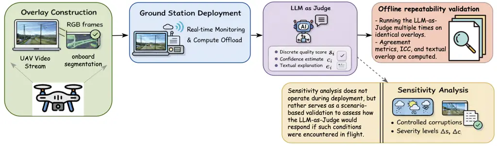

Fig. 1: System overview of the proposed LLM-as-Judge framework for
powerline inspection. UAV RGB frames are segmented onboard and streamed
as mask–image overlays to a ground station for compute offload. A
multimodal LLM produces a discrete quality score $`s_{i}`$, confidence
estimate $`c_{i}`$, and textual explanation $`e_{i}`$ for real-time
safety monitoring. Offline repeatability and scenario-based sensitivity
analyses evaluate output stability and robustness under controlled
corruptions.

While the LLM-as-Judge paradigm has been widely explored for text-based
evaluation and, more recently, for image-level semantic judgments such
as safety classification or preference ranking, its application to
_thin-object segmentation outputs_ has not been systematically studied.
In powerline inspection, segmentation errors manifest as broken
continuity, missing line segments, or spurious detections—failure modes
that are subtle, geometric, and safety-critical, and fundamentally
different from semantic misclassification or caption quality. Moreover,
once deployed, powerline inspection systems operate without ground
truth, making it unclear whether existing LLM-as-Judge methodologies and
evaluation criteria are suitable for this setting.

To enable real-time deployment, we design the system such that the
segmentation model operates onboard the drone, while the LLM-based judge
runs on a ground control station. Video frames and predicted masks are
streamed to the ground station, where the judge performs semantic
inspection without imposing computational burden on the aerial platform.
This architecture supports real-time semantic monitoring and
post-mission auditing, with the potential to inform live intervention.
The judge can flag critical failure modes such as broken line
continuity, spurious detections, or implausible structures, thereby
acting as a semantic safety monitor rather than a replacement for the
segmentation model. Fig. 1 illustrates the overall architecture of the
proposed LLM-as-Judge framework, highlighting the separation between
onboard perception and ground-based semantic monitoring.

A key challenge in adopting such a system lies in establishing trust in
the behavior of the LLM-based judge itself. Language models are known to
exhibit stochastic decoding, raising concerns about output stability and
consistency under repeated evaluation. Moreover, a judge that produces
identical outputs regardless of visual degradation would be perceptually
unsuitable for safety monitoring. For this reason, we develop a rigorous
evaluation framework that characterizes two essential properties of the
LLM-as-Judge: _repeatability_ and _sensitivity_. Repeatability measures
whether the judge produces stable numeric outputs under identical
inputs, while sensitivity evaluates whether its judgments vary
coherently in response to controlled degradation of visual evidence.
Together, these properties define whether the judge can function as a
reliable monitoring component in autonomous inspection pipelines.

By explicitly separating perception from judgment, the proposed
framework enables modular integration with existing vision systems and
motivates further research into real-time reliability assessment,
adaptive autonomy, and explainable safety monitoring. While this work
focuses specifically on _powerline (thin-object) segmentation_, the
underlying principles may extend to other deployed vision systems where
structured outputs must be monitored continuously in the absence of
ground truth.

The main contributions of this paper are summarized as follows.

- •
  We present the first systematic study of _LLM-as-Judge for powerline
  (thin-object) segmentation_, investigating whether a multimodal
  language model can reliably assess segmentation quality in
  safety-critical inspection tasks without ground truth.
- •
  We reformulate post-deployment evaluation for _powerline inspection_
  as a semantic safety monitoring problem, shifting the focus from
  offline accuracy metrics to online reliability assessment under
  real-world operating conditions.
- •
  We introduce a rigorous evaluation methodology tailored to powerline
  segmentation that quantifies the _repeatability_ and _perceptual
  sensitivity_ of LLM-based judges using agreement metrics, intraclass
  correlation analysis, effect sizes, and controlled visual degradation
  experiments.
- •
  We demonstrate that, under realistic corruption scenarios affecting
  powerline imagery, the proposed LLM-as-Judge exhibits stable
  categorical judgments and conservative confidence behavior, supporting
  its suitability as a semantic safety monitor for deployed aerial
  inspection systems.

## II Related Work

With the introduction of large language models (LLMs) and their strong
reasoning capabilities, researchers have increasingly explored their use
as automated evaluators or judges. One of the earliest works to
explicitly frame LLMs as evaluators is JudgeLM \[4\], which demonstrates
that open-source language models can be fine-tuned into scalable judges
for open-ended text generation. This work positions LLM-based judges as
a practical alternative to both coarse automatic metrics and costly
human evaluation.

Despite their effectiveness, LLM judges are known to exhibit systematic
biases. Ye et al. \[5\] formalize this issue by identifying twelve
distinct bias types in LLM-based judgment and proposing a framework to
measure them quantitatively. While such biases cannot be fully
eliminated, subsequent work suggests that LLMs can still serve as
effective reliability judges in specific settings such as faithfulness
verification and uncertainty assessment, either through direct
evaluation or specialized judge training \[6\].

Beyond bias, the structure of the judging task itself plays a critical
role in evaluation quality. Zheng et al. \[7\] categorize LLM-based
evaluation into three primary paradigms: (i) pairwise comparison, where
a judge selects the better of two responses (or declares a tie), (ii)
single-answer grading, where a numeric or categorical score is assigned
to one output, and (iii) reference-guided grading, where outputs are
evaluated against a provided reference. They further demonstrate that
judgment accuracy improves when complex evaluation criteria are
decomposed into simpler sub-questions. Complementing this perspective,
Pan et al. \[8\] advocate for a human-centered evaluation design that
emphasizes aspect-level judgments, alignment with expert standards, and
transparent explanations from LLM judges.

Nevertheless, recent studies show that LLM-as-a-judge can diverge
substantially from subject-matter experts on expert knowledge tasks.
Szymanski et al. \[9\] report that agreement between LLM judges and
human experts often remains in the mid-60% range in domains such as
dietetics and mental health, suggesting that LLM judges may overlook
domain-critical errors or risks. This gap motivates evaluation pipelines
that retain human experts in the loop rather than relying solely on
automated judgment. Similarly, Son et al. \[10\] show that while LLMs
function well as scalable evaluators with strong cross-lingual transfer
and competence in surface-level or comparative assessments, they remain
unreliable in identifying factual inaccuracies, cultural errors, and
complex reasoning failures, limiting their applicability in high-stakes
evaluations.

Several works propose training and architectural strategies to improve
the robustness of LLM judges. Saha et al. \[11\] introduce EvalPlanner,
a Thinking-LLM-as-a-Judge framework that explicitly separates evaluation
into planning, reasoning, and final judgment stages. By training judges
using self-generated evaluation plans and synthetic preference data,
their approach improves judgment accuracy and data efficiency across
multiple benchmarks. Yu et al. \[12\] further argue that judging should
be treated as a general capability of LLMs rather than a task-specific
skill, proposing a two-stage training framework that combines supervised
warm-up with preference optimization to enhance both judgment accuracy
and general reasoning ability.

Other work focuses on the construction and benchmarking of evaluation
datasets. Raju et al. \[13\] propose a pipeline for building
domain-specific and multilingual evaluation sets tailored to
LLM-as-a-judge, noting that common judge benchmarks disproportionately
focus on generic English prompts while under-representing specialized
domains such as law and medicine. Their method combines manual seeding,
embedding-based clustering, and stratified sampling to curate a balanced
benchmark that better differentiates strong models and aligns more
closely with Chatbot Arena rankings than existing benchmarks.

Despite these advances, LLM judges remain vulnerable to exploitation.
Zhao et al. \[14\] demonstrate that LLM-based judges can be
systematically misled by adversarially crafted or stylistically
manipulated outputs, revealing that high judge scores do not always
correspond to true task quality. In parallel, Schroeder et al. \[15\]
examine judge reliability by framing it in terms of internal consistency
rather than agreement with humans. They show that single-shot or
deterministic evaluations often mask substantial judgment variability
due to stochastic sampling and introduce a reliability framework based
on McDonald’s omega. Wei et al. \[16\] similarly study LLM-as-a-judge
for alignment evaluation, showing that prompt templates, internal
decision inconsistency, and positional and length biases strongly affect
reliability, leading to only moderate alignment with human preferences.

While the majority of prior work focuses on text-based inputs,
comparatively little attention has been paid to LLM-as-a-judge in vision
or multimodal settings. Wang et al. \[17\] introduce CLUE, a zero-shot
MLLM-as-a-judge framework for image safety that eliminates the need for
human-labeled data by decomposing safety constitutions into objectified
rules and precondition chains. Their approach combines debiased
token-level judgments with selective chain-of-thought reasoning and
demonstrates improved reliability and generalization over naive
prompting and fine-tuned classifiers.

Chen et al. \[18\] present MLLM-as-a-Judge, a large-scale
vision–language benchmark that evaluates whether multimodal LLMs can
function as judges across scoring, pairwise comparison, and ranking
tasks. Their results show that while advanced models such as GPT-4V
align reasonably well with human preferences in pairwise judgments, they
suffer from significant bias, hallucination, and inconsistency in
absolute scoring and ranking scenarios. Finally, Narayanan et al. \[19\]
introduce a real-world news-image benchmark to study social bias in
vision–language models, using an LLM-as-a-judge to jointly assess
accuracy, faithfulness, and bias. Their findings show that visible
social cues can systematically trigger stereotypes, particularly for
gender and occupation, and that higher faithfulness does not necessarily
correspond to lower bias.

Overall, prior work establishes LLM-as-a-judge as a viable and scalable
evaluation paradigm for text-based tasks, while also revealing important
limitations related to bias, reliability, and robustness. In contrast,
the application of LLM judges to vision and multimodal settings remains
comparatively underexplored, with existing studies largely focusing on
benchmarking or narrowly scoped safety evaluations. This gap highlights
the need for further investigation into how LLM-based judges behave when
evaluating structured visual outputs in real-world, safety-critical
scenarios.

## III Methodology

This section describes the proposed evaluation methodology for assessing
the reliability of the LLM-as-Judge in safety-critical inspection
scenarios. Rather than focusing on segmentation accuracy, the
methodology characterizes the judge’s behavior through two complementary
properties: repeatability and sensitivity. Repeatability evaluates the
stability of the judge’s numeric outputs under identical inputs and
fixed inference settings, while sensitivity examines whether its
judgments respond coherently to controlled degradations of visual
evidence. Together, these analyses establish whether the LLM-as-Judge
can function as a dependable semantic safety monitor in real-world
deployment conditions.

### III-A Repeatability and Stability of the LLM-as-Judge

Large multimodal language models exhibit strong visual reasoning
capabilities, yet their decoding processes are inherently stochastic. In
safety-critical applications such as autonomous aerial inspection, this
stochasticity introduces unacceptable uncertainty: identical visual
inputs must consistently yield identical safety judgments. If an
evaluator oscillates between different assessments under identical
conditions, it cannot be reliably integrated into downstream
decision-making. Consequently, the first requirement of an LLM-as-Judge
is Stability, defined here as stable numeric behavior under fixed inputs
and inference settings.

We formalize the LLM-as-Judge as a function

```math
f_{\theta}(x_{i},p)=(s_{i},c_{i},e_{i}), \tag{1}
```

where $`x_{i}`$ denotes an input overlay image composed of an RGB frame
and its predicted segmentation mask, and $`p`$ is a fixed structured
prompt. The outputs consist of a discrete segmentation-quality score
$`s_{i}\in\{1,\ldots,5\}`$, a continuous confidence value
$`c_{i}\in[0,1]`$, and a textual explanation $`e_{i}`$. In deployment,
only $`(s_{i},c_{i})`$ are used for safety decisions, while $`e_{i}`$
provides interpretability and traceability.

|                                                              |                                                              |                                                              |                                                              |                                                              |                                                              |
| ------------------------------------------------------------ | ------------------------------------------------------------ | ------------------------------------------------------------ | ------------------------------------------------------------ | ------------------------------------------------------------ | ------------------------------------------------------------ |
| Clean                                                        | Rain                                                         | Fog                                                          | Shadow                                                       | Sunflare                                                     | Snow                                                         |
|   | 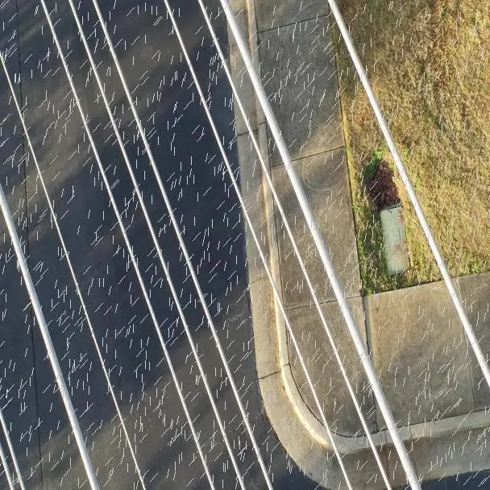  |   | 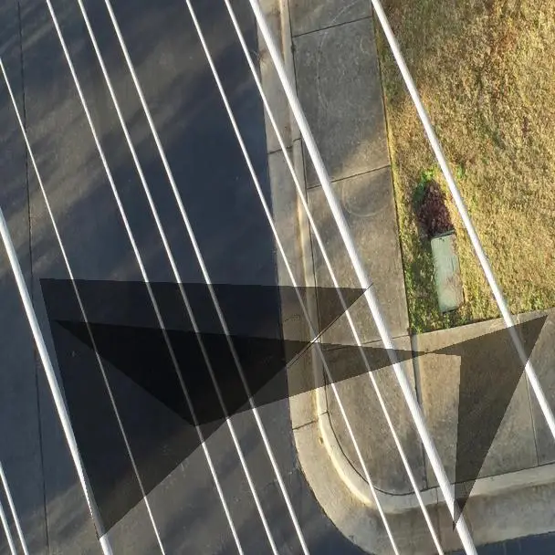  | 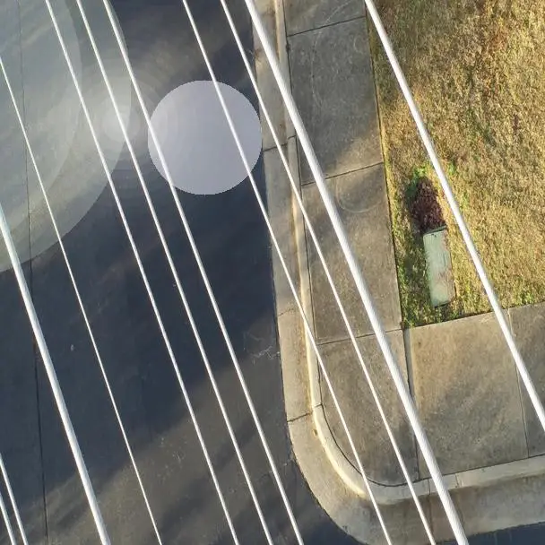  | 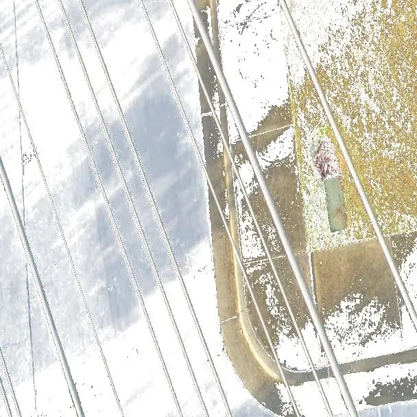  |
| 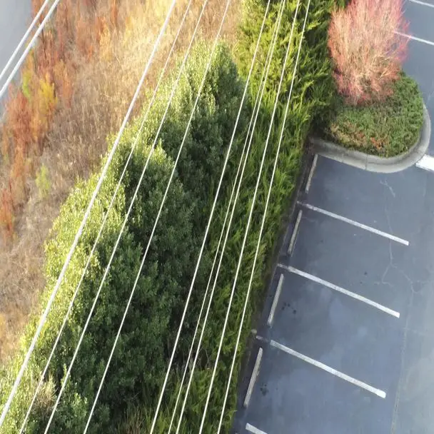  |   | 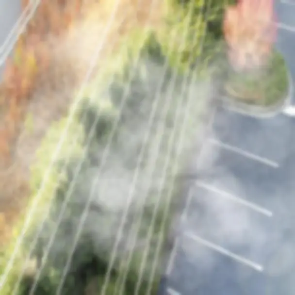 | 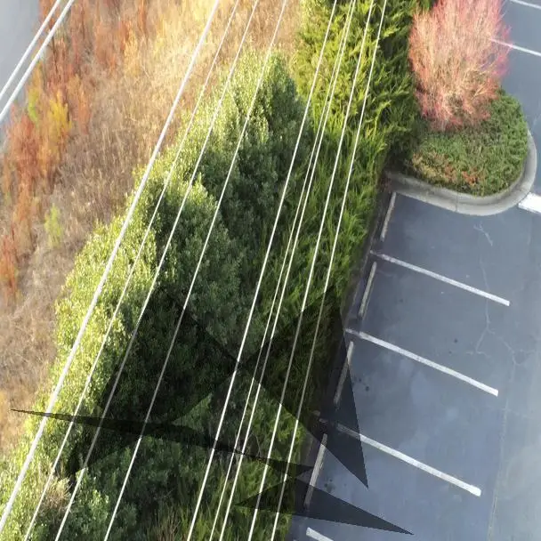 | 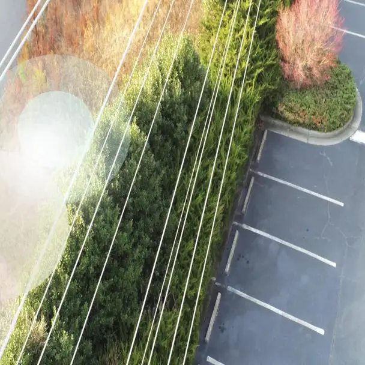 | 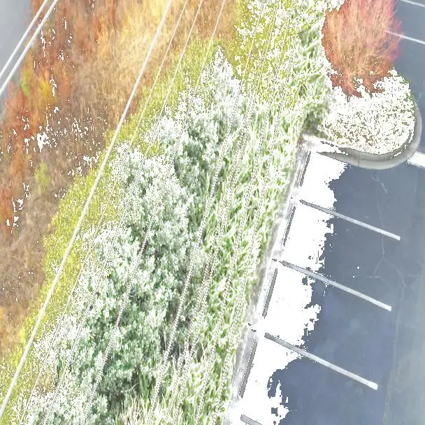 |
|  | 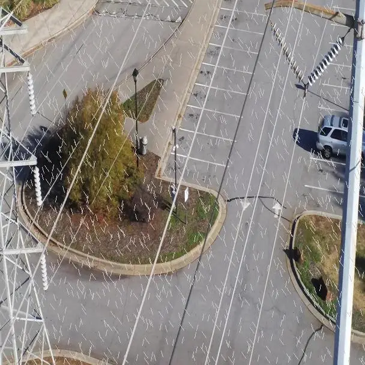 | 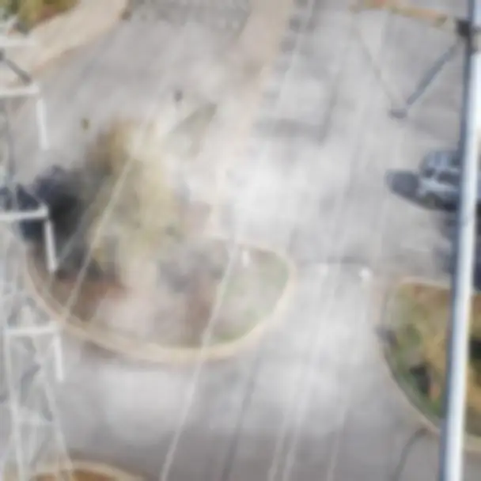 | 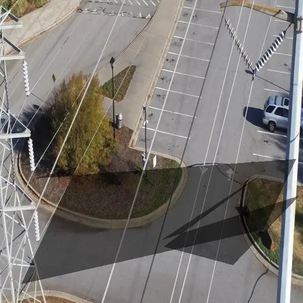 | 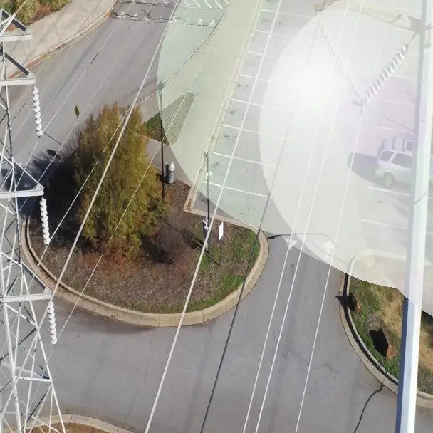 | 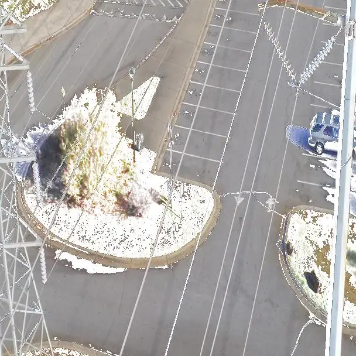 |

Fig. 2: Examples of clean images and synthetically corrupted variants
used to construct the challenge set. Each column corresponds to a
corruption type and each row shows a different image instance.

Repeatability is evaluated by running the same model multiple times on
an identical dataset using the same prompt and decoding parameters. For
each image $`x_{i}`$, we obtain

```math
\{(s_{i}^{(r)},c_{i}^{(r)},e_{i}^{(r)})\}_{r=1}^{R}, \tag{2}
```

where $`R`$ denotes the number of independent runs. A numerically
deterministic judge would satisfy
$`(s_{i}^{(r)},c_{i}^{(r)})=(s_{i}^{(1)},c_{i}^{(1)})`$ for all $`r>1`$,
while allowing natural linguistic variation in $`e_{i}^{(r)}`$.

The primary indicator of score stability is the score agreement

```math
A_{s}=\frac{1}{N}\sum_{i=1}^{N}\mathbb{I}\!\left(\max_{r}s_{i}^{(r)}-\min_{r}s_{i}^{(r)}=0\right), \tag{3}
```

where $`\mathbb{I}(\cdot)`$ denotes the indicator function and $`N`$
denotes the total number of evaluated input samples (overlay images) in
the dataset. A high value of $`A_{s}`$ indicates that the model assigns
the same categorical interpretation of segmentation quality on every
invocation and measures the fraction of images receiving identical
scores across all runs.

Similarly, confidence agreement is defined as

```math
A_{c}=\frac{1}{N}\sum_{i=1}^{N}\mathbb{I}\!\left(\max_{r}c_{i}^{(r)}-\min_{r}c_{i}^{(r)}\leq\epsilon\right), \tag{4}
```

where $`\epsilon`$ is a small tolerance to account for floating-point
variability in probabilistic outputs. In our experiments, we set
$`\epsilon=10^{-6}`$, enforcing a strict equality criterion that
reflects the expectation that confidence outputs remain numerically
stable under identical inputs. A high $`A_{c}`$ implies that the model
consistently assigns the same degree of confidence to its judgment.
Because downstream safety logic depends on both score and confidence, we
define the combined numeric stability

```math
\displaystyle A_{s,c}=\frac{1}{N}\sum_{i=1}^{N}\mathbb{I}\Big( \displaystyle\max_{r}s_{i}^{(r)}-\min_{r}s_{i}^{(r)}=0 \tag{5}
```

```math
\displaystyle\wedge\;\max_{r}c_{i}^{(r)}-\min_{r}c_{i}^{(r)}\leq\epsilon\Big).
```

which represents the probability that both numeric outputs are
simultaneously reproducible.

To capture reproducibility beyond strict equality, we additionally
report the one-way random-effects intraclass correlation coefficient
computed over the score values:

```math
\mathrm{ICC}(1,1)=\frac{\sigma^{2}_{\mathrm{between}}-\sigma^{2}_{\mathrm{within}}}{\sigma^{2}_{\mathrm{between}}+(R-1)\sigma^{2}_{\mathrm{within}}}, \tag{6}
```

where $`\mathrm{ICC}(1,1)`$ denotes the one-way random-effects
intraclass correlation coefficient, $`\sigma^{2}_{\text{between}}`$
denotes the variance of the score $`s_{i}`$ across different images,
$`\sigma^{2}_{\text{within}}`$ denotes the variance of $`s_{i}`$ across
repeated runs for the same image, and $`R`$ is the number of repeated
evaluations.

Finally, textual reproducibility is quantified using word-level overlap
rather than exact string equality:

```math
A_{t}=\frac{1}{N}\sum_{i=1}^{N}\mathrm{Overlap}(e_{i}^{(1)},\ldots,e_{i}^{(R)}), \tag{7}
```

where $`\mathrm{Overlap}(\cdot)`$ denotes the average normalized word
overlap across runs for a given image. This metric reflects semantic
consistency while accommodating natural linguistic variation.

Interpretation of Repeatability Metrics. A repeatable judge should
exhibit low variability across repeated evaluations of the same image
while preserving variability across different images. The intraclass
correlation coefficient quantifies this tradeoff by measuring the
proportion of total variance attributable to differences between images
rather than stochastic fluctuations across runs. High ICC values
therefore indicate strong repeatability of the LLM-as-Judge under
identical inputs.

### III-B Sensitivity Framework

While repeatability ensures stability under identical conditions, it
does not guarantee that the LLM-as-Judge responds meaningfully to
changes in visual evidence. A model may be deterministic yet
perceptually inert. For reliable deployment, the judge must therefore
exhibit sensitivity: its numeric outputs should vary coherently in
response to degradations in image quality and structural fidelity.

Sensitivity is evaluated by introducing controlled perturbations that
emulate realistic distributional shifts encountered during aerial
inspection. For each corruption type and severity level, the degradation
is applied to the RGB image prior to segmentation. The corrupted image
is then processed by the segmentation network, yielding a
correspondingly degraded prediction mask. The corrupted RGB image and
its predicted mask are combined into an overlay, which serves as the
visual input evaluated by the LLM-as-Judge. All evaluations use the same
prompt and inference settings to isolate the effect of visual
degradation.

Let $`x_{i,0}`$ denote the overlay generated from an uncorrupted RGB
image and its predicted segmentation mask. For each perturbation type
$`t`$ and severity level $`k\in\{1,2,3\}`$, the corresponding input
$`x_{i,t,k}`$ is defined as the overlay generated from the corrupted RGB
image and its predicted mask. The LLM-as-Judge produces outputs
$`(s_{i,t,k}^{(r)},c_{i,t,k}^{(r)},e_{i,t,k}^{(r)})`$ for each input,
where the superscript $`(r)`$ denotes repeated evaluations under
identical inference settings. Sensitivity is quantified by comparing
these outputs to their clean-reference counterparts.

The mean deviations in score and confidence are defined as

```math
\displaystyle\Delta s_{t,k} \displaystyle=\frac{1}{N}\sum_{i=1}^{N}\left(s_{i,0}^{(r)}-s_{i,t,k}^{(r)}\right), \tag{8}
```

```math
\displaystyle\Delta c_{t,k} \displaystyle=\frac{1}{N}\sum_{i=1}^{N}\left(c_{i,0}^{(r)}-c_{i,t,k}^{(r)}\right).
```

Unless otherwise stated, the deviations are computed per run and then
averaged across repeated evaluations.

To assess whether the response varies monotonically with increasing
degradation severity, we compute the Spearman rank correlation between
severity level and mean score drop:

```math
\rho_{s,t}=\mathrm{Spearman}\left([1,2,3],[\Delta s_{t,1},\Delta s_{t,2},\Delta s_{t,3}]\right). \tag{9}
```

The Spearman rank correlation measures the strength of a monotonic
relationship between two variables based on their ranked values rather
than their absolute magnitudes. Unlike Pearson correlation, it does not
assume linearity or normally distributed variables, making it well
suited for assessing whether the judge’s scores change consistently with
increasing degradation severity, regardless of the exact scale or rate
of change. A high value of $`\rho_{s,t}`$ approaching $`1`$ indicates
that the judge’s scores vary monotonically with increasing perturbation
severity, evidencing a coherent perceptual response to progressive
visual degradation.

Finally, to determine whether the observed deviations are statistically
meaningful at the image level, score residuals are defined as

```math
d_{i,t,k}^{(r)}=s_{i,0}^{(r)}-s_{i,t,k}^{(r)}. \tag{10}
```

Paired significance testing is performed on $`d_{i,t,k}^{(r)}`$ under
the null hypothesis

```math
H_{0}:\mathbb{E}[d_{t,k}]=0, \tag{11}
```

using parametric or non-parametric tests depending on normality, to
determine whether the observed deviations arise from systematic
perceptual shifts rather than random noise.

| Metric                                   | Value  |
| ---------------------------------------- | ------ |
| Confidence agreement                     | 70.05  |
| Score agreement                          | 81.11  |
| ICC(1,1)                                 | 0.858  |
| Conf. std (mean)                         | 0.0093 |
| Conf. std (95th)                         | 0.0424 |
| Text overlap                             | 40.92  |
| Combined numeric stability ($`A_{s,c}`$) | 69.59  |

(a) Original

| Metric                                   | Value  |
| ---------------------------------------- | ------ |
| Confidence agreement                     | 60.83  |
| Score agreement                          | 82.49  |
| ICC(1,1)                                 | 0.901  |
| Conf. std (mean)                         | 0.0151 |
| Conf. std (95th)                         | 0.0548 |
| Text overlap                             | 39.58  |
| Combined numeric stability ($`A_{s,c}`$) | 60.37  |

(b) Sunflare

| Metric                                   | Value  |
| ---------------------------------------- | ------ |
| Confidence identical (all 5 runs)        | 58.53  |
| Score agreement (all 5 runs)             | 82.95  |
| ICC(1,1) for scores                      | 0.888  |
| Confidence std (mean)                    | 0.0132 |
| Confidence std (95th pct.)               | 0.0548 |
| Text explanation word-overlap            | 44.53  |
| Combined numeric stability ($`A_{s,c}`$) | 58.53  |

(c) Rain

| Metric                                   | Value  |
| ---------------------------------------- | ------ |
| Confidence agreement                     | 54.38  |
| Score agreement                          | 80.18  |
| ICC(1,1)                                 | 0.880  |
| Conf. std (mean)                         | 0.0179 |
| Conf. std (95th)                         | 0.0572 |
| Text overlap                             | 37.74  |
| Combined numeric stability ($`A_{s,c}`$) | 53.46  |

(d) Shadow

| Metric                                   | Value  |
| ---------------------------------------- | ------ |
| Confidence agreement                     | 43.78  |
| Score agreement                          | 78.80  |
| ICC(1,1)                                 | 0.898  |
| Conf. std (mean)                         | 0.0225 |
| Conf. std (95th)                         | 0.0707 |
| Text overlap                             | 36.72  |
| Combined numeric stability ($`A_{s,c}`$) | 42.86  |

(e) Snow

| Metric                                   | Value  |
| ---------------------------------------- | ------ |
| Confidence agreement                     | 33.18  |
| Score agreement                          | 90.78  |
| ICC(1,1)                                 | 0.917  |
| Conf. std (mean)                         | 0.0880 |
| Conf. std (95th)                         | 0.3162 |
| Text overlap                             | 68.11  |
| Combined numeric stability ($`A_{s,c}`$) | 33.18  |

(f) Fog

TABLE I: Repeatability metrics over 5 runs under different segmentation
corruption conditions (schema-constrained).

## IV Experiment Setup

### IV-A Dataset preparation

We conduct our experiments using the TTPLA dataset \[20\], a public
benchmark for powerline inspection that contains aerial RGB images
captured from diverse viewpoints, altitudes, and backgrounds. The
dataset includes approximately 1,100 images with fine-grained polygon
annotations of powerline structures, where powerlines occupy a small
fraction of the image area, reflecting the inherent sparsity and thin
geometry of the target objects.

To evaluate the robustness of the proposed framework under adverse
operating conditions, we construct a _challenge set_ derived from the
original TTPLA images. Starting from the clean RGB images, we apply
synthetic corruptions using the Albumentations library to simulate
visual degradations commonly encountered during aerial inspection. These
corruptions introduce controlled variations in visibility and
illumination while preserving pixel-level alignment between clean and
perturbed images.

Each corruption type is applied at three severity levels
($`k\in\{1,2,3\}`$). The considered corruption families include (i)
weather effects, such as fog, rain, snow, and sun flare, which reduce
global contrast and obscure line continuity, and (ii) lighting shifts,
implemented through shadow perturbations that locally alter luminance
and visibility of thin structures. This process yields a balanced and
visually diverse challenge set without introducing artificial artifacts
that could confound the semantic reasoning of the LLM.

### IV-B LLM-as-Judge Configuration.

All experiments use a single multimodal large language model as the
LLM-as-Judge. Specifically, we employ GPT-4o \[21\], accessed via the
OpenAI API, which supports image–text inputs and exhibits strong visual
reasoning capabilities required for evaluating segmentation overlays.
The model receives RGB–mask overlay images together with a fixed
structured prompt and produces a discrete quality score, a confidence
estimate, and a textual rationale.

### IV-C Experiment Setup for Repeatability

To evaluate repeatability, we conduct experiments on both the original
TTPLA dataset and the constructed challenge set. Each RGB image, whether
clean or corrupted, is processed by a U-Net model trained for 25 epochs
on the original TTPLA training split to generate a predicted
segmentation mask. The resulting mask–image overlays are then evaluated
by the LLM-as-Judge, which assigns a discrete quality score and
confidence estimate to each sample. This evaluation is repeated over
five independent runs using identical inputs and fixed inference
settings, allowing us to assess the stability of the judge’s outputs
across clean images and all corruption conditions.

### IV-D Experiment Setup for Sensitivity

For sensitivity analysis, we evaluate the LLM-as-Judge on the clean
TTPLA images and on all corrupted variants across three severity levels.
For each condition, the RGB image is first segmented by the U-Net model,
and the resulting mask–image overlay is provided to the LLM-as-Judge.
For every sample, the judge produces a quality score, a confidence
estimate, a textual explanation, and a response latency (ms), enabling
analysis of how the judge’s outputs vary in response to increasing
visual degradation.

| corruption | severity | mean_ds | std_ds | ci95_ds_lo | ci95_ds_hi | mean_dc | std_dc | ci95_dc_lo | ci95_dc_hi | dz_score | dz_conf |
| ---------- | -------- | ------- | ------ | ---------- | ---------- | ------- | ------ | ---------- | ---------- | -------- | ------- |
| fog        | 1        | 3.124   | 0.912  | 2.991      | 3.249      | 0.736   | 0.213  | 0.705      | 0.762      | 3.426    | 3.453   |
| fog        | 2        | 3.143   | 0.949  | 3.005      | 3.263      | 0.741   | 0.211  | 0.711      | 0.768      | 3.311    | 3.509   |
| fog        | 3        | 3.115   | 0.918  | 2.982      | 3.235      | 0.732   | 0.214  | 0.701      | 0.759      | 3.393    | 3.419   |
| rain       | 1        | 0.465   | 0.828  | 0.350      | 0.571      | 0.052   | 0.149  | 0.030      | 0.071      | 0.562    | 0.346   |
| rain       | 2        | 0.581   | 0.760  | 0.479      | 0.677      | 0.067   | 0.120  | 0.050      | 0.082      | 0.764    | 0.558   |
| rain       | 3        | 0.806   | 0.871  | 0.687      | 0.922      | 0.109   | 0.166  | 0.085      | 0.131      | 0.926    | 0.654   |
| shadow     | 1        | 0.631   | 0.741  | 0.530      | 0.733      | 0.071   | 0.117  | 0.054      | 0.086      | 0.852    | 0.604   |
| shadow     | 2        | 0.581   | 0.863  | 0.465      | 0.700      | 0.063   | 0.147  | 0.041      | 0.082      | 0.673    | 0.428   |
| shadow     | 3        | 0.562   | 0.820  | 0.452      | 0.673      | 0.056   | 0.146  | 0.035      | 0.076      | 0.685    | 0.386   |
| snow       | 1        | 0.700   | 0.975  | 0.567      | 0.834      | 0.101   | 0.207  | 0.074      | 0.130      | 0.718    | 0.489   |
| snow       | 2        | 0.853   | 1.026  | 0.710      | 0.991      | 0.130   | 0.222  | 0.101      | 0.160      | 0.831    | 0.586   |
| snow       | 3        | 0.963   | 1.004  | 0.825      | 1.101      | 0.147   | 0.227  | 0.118      | 0.177      | 0.959    | 0.647   |
| sunflare   | 1        | 0.479   | 0.811  | 0.373      | 0.590      | 0.054   | 0.145  | 0.034      | 0.073      | 0.591    | 0.371   |
| sunflare   | 2        | 0.558   | 0.798  | 0.452      | 0.664      | 0.067   | 0.146  | 0.046      | 0.085      | 0.699    | 0.457   |
| sunflare   | 3        | 0.507   | 0.788  | 0.401      | 0.608      | 0.056   | 0.131  | 0.037      | 0.072      | 0.643    | 0.425   |

TABLE II: Sensitivity Statistics of LLM-as-Judge Scores and Confidence
Under Controlled Visual Corruptions

## V Results Analysis

### V-A Repeatability and Stability of LLM-as-Judge

Table I extend our repeatability study from the clean TTPLA\[20\] images
to the corrupted challenge set, showing how different real-world
conditions affect the stability of the LLM-as-Judge. The main
divergences appear in the confidence agreement $`A_{c}`$ (Eq. (4)).
Depending on the corruption, the confidence-identical rate varies widely
from relatively stable behavior under sunflare (60.83%) and rain
(58.53%) to much lower stability under fog (33.18%) and snow (43.78%).
These patterns match the confidence-standard-deviation results: fog, in
particular, introduces strong variation in confidence, which is expected
because the blur and haze obscure powerlines and remove reliable visual
cues. Conversely, corruptions like rain or shadow degrade the scene
without fully eliminating structure, allowing the LLM to maintain more
stable uncertainty estimates.

The combined numeric stability follows a similar trend. It is high on
clean images (69.59%) but drops sharply under fog (33.18%), showing that
while discrete scoring remains stable, confidence calibration becomes
more sensitive to loss of visual evidence. This joint behavior is
captured by the combined numeric stability metric $`A_{s,c}`$ defined in
Eq. (5), which enforces simultaneous consistency of both score and
confidence outputs under identical inputs. From a safety perspective,
this is desirable: when cues degrade, the judge appropriately becomes
less certain, behaving as a cautious evaluator rather than
over-confidently hallucinating structure. As expected,
textual-explanation match rates stay low across all settings, since
natural linguistic variation does not affect the underlying semantic
judgment.

Overall, the model remains quite consistent in its discrete scoring:
across all corruption types, the score agreement $`A_{s}`$ defined in
Eq. (3) remains between 78–91%. At first glance, it may seem
counterintuitive that some corrupted settings, such as fog (90.78%) and
snow (78.80%), exhibit even higher score agreement than the clean images
(81.11%). However, this trend aligns with how corruption interacts with
the underlying segmentation model. In many fog- and snow-corrupted
cases, the segmentation model fails to detect most or all powerlines,
producing overlays with few or no highlighted structures. These “empty”
or near-empty overlays lead to simple, uniformly poor segmentation
cases, which the LLM judge evaluates consistently across runs, typically
assigning a stable low score. In contrast, clean images contain multiple
visible powerlines, often appearing in varied positions and levels of
local visibility. This forces the LLM to inspect several line instances
per image, some of which may be partially occluded or faint. As a
result, the judgment task is more complex: subtle variations in
attention or phrasing during each run can cause small fluctuations in
the assigned score. Thus, clean images feature more semantic load per
judgment, which naturally lowers perfect score agreement relative to
heavily corrupted cases where the segmentation model often fails more
uniformly and predictably.

The ICC values (0.858–0.917), computed using Eq. (6), reinforce this
interpretation by showing that the relative ranking of image quality
remains stable across corruption conditions, even when exact score
agreement varies. Since ICC captures consistency in ordinal structure
rather than exact label matching, these results indicate that the
LLM-as-Judge preserves a reliable notion of structural correctness even
under changing corruption regimes, which is essential for
threshold-based safety monitoring.

Taken together, these findings support the two key ideas introduced in
Section III-A. First, the LLM-as-Judge exhibits strong stability in its
discrete quality scores across repeated evaluations, even under
significant visual corruption. Second, its confidence estimates adapt
proportionally to the degradation of visual evidence, particularly in
challenging conditions such as fog and snow where structural cues are
severely diminished. This combination of stable categorical judgment and
adaptive uncertainty indicates that the LLM-as-Judge functions as a
reliable and cautious semantic monitor for real-time powerline
inspection. Under fixed inputs and inference settings, the observed
numeric stability satisfies a necessary requirement for deployment in
safety-critical monitoring pipelines.

### V-B Sensitivity to Segmentation of the LLM-as-Judge

Table II summarizes the sensitivity of the LLM-as-Judge to controlled
degradations of segmentation overlays across five corruption families
and three severity levels. Sensitivity is quantified relative to a
clean-reference baseline using the score and confidence deviations
defined in Eq. (8). Columns mean*ds and mean_dc report the mean score
and confidence deviations, $`\Delta s*{t,k}`$ and $`\Delta c\_{t,k}`$,
respectively, measuring the average drop in discrete quality score and
confidence under corruption type $`t`$ and severity level $`k`$. These
values reflect the magnitude of the judge’s perceptual response relative
to the uncorrupted condition. To characterize variability across images,
the columns std_ds and std_dc report the standard deviations of the
per-image residuals defined in Eq. (10). The corresponding columns
ci95_ds_lo, ci95_ds_hi, ci95_dc_lo, and ci95_dc_hi provide 95%
confidence intervals computed from these residuals, capturing the
consistency of the judge’s response across the dataset.

Finally, the columns dz_score and dz_conf report standardized
paired-effect sizes computed from the same per-image residuals. These
effect sizes correspond to the paired significance testing performed
under the null hypothesis in Eq. (11) and quantify whether the observed
deviations reflect systematic perceptual sensitivity rather than random
stochastic variation. Together, these statistics provide a complete
characterization of sensitivity, capturing not only the magnitude of
score and confidence changes under visual degradation, but also their
consistency and statistical significance.

Across corruption types, the judge exhibits a coherent sensitivity
profile that aligns with the watchdog objective of detecting reliability
loss in safety-critical powerline inspection. Fog induces by far the
largest and most stable degradation:
$`\text{mean\_ds}\approx 3.12`$–$`3.14`$ across severities, paired with
a large confidence drop of $`\text{mean\_dc}\approx 0.73`$–$`0.74`$. The
corresponding effect sizes are extremely high for both score and
confidence ($`d_{z}\approx 3.31`$–$`3.43`$ and
$`d_{z}\approx 3.42`$–$`3.51`$, respectively), indicating strong
per-image agreement that fogged overlays represent severe structural
unreliability. Notably, the response is nearly saturated across severity
levels, suggesting a ceiling effect: once haze substantially obscures
thin line evidence and/or causes the segmentation to collapse toward
missing structures, increasing fog strength produces only marginal
additional perceived loss.

Rain and snow exhibit the expected monotonic sensitivity pattern. For
rain, mean*ds increases from $`0.465`$ to $`0.806`$ as severity rises,
with confidence drops increasing from $`0.052`$ to $`0.109`$; the paired
effect sizes similarly strengthen ($`d*{z}`$ for score from $`0.562`$ to
$`0.926`$, and for confidence from $`0.346`$ to $`0.654`$). Snow follows
the same trend, with mean_ds rising from $`0.700`$ to $`0.963`$ and
mean_dc from $`0.101`$ to $`0.147`$, accompanied by increasing effect
sizes (score $`d*{z}`$ from $`0.718`$ to $`0.959`$, confidence $`d*{z}`$
from $`0.489`$ to $`0.647`$). These results indicate that the judge not
only detects worsening segmentation reliability under progressive
weather clutter, but does so consistently at the per-image level.

Lighting-driven corruptions (shadow and sunflare) produce smaller and
less strictly monotonic shifts, consistent with the fact that such
distortions can be locally disruptive without uniformly breaking global
line continuity. Shadow shows modest score drops (mean*ds decreasing
from $`0.631`$ to $`0.562`$ across severities) and conservative
confidence drops (mean_dc from $`0.071`$ to $`0.056`$), with positive
but moderate effect sizes (score $`d*{z}\approx 0.67`$–$`0.85`$,
confidence $`d*{z}\approx 0.39`$–$`0.60`$). Sunflare behaves similarly:
while severity 2 yields the largest average drop
($`\text{mean_ds}=0.558`$, $`\text{mean_dc}=0.067`$), severity 3
partially rebounds ($`\text{mean_ds}=0.507`$,
$`\text{mean_dc}=0.056`$), and effect sizes remain moderate (score
$`d*{z}\approx 0.59`$–$`0.70`$, confidence
$`d\_{z}\approx 0.37`$–$`0.46`$). This mild non-monotonicity is plausible
in glare regimes where additional saturation can reduce visible clutter
in ways that do not linearly translate to perceived segmentation error,
especially when the judge relies on the overlay’s geometric coherence
rather than raw photometric fidelity.

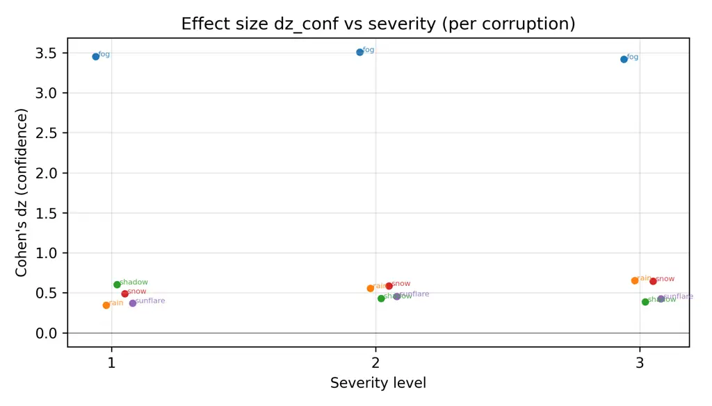

(a) Effect size $`d_{z}`$ (confidence) vs. severity

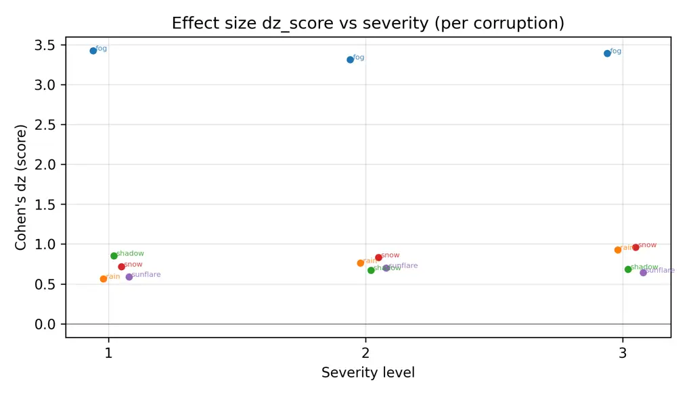

(b) Effect size $`d_{z}`$ (score) vs. severity

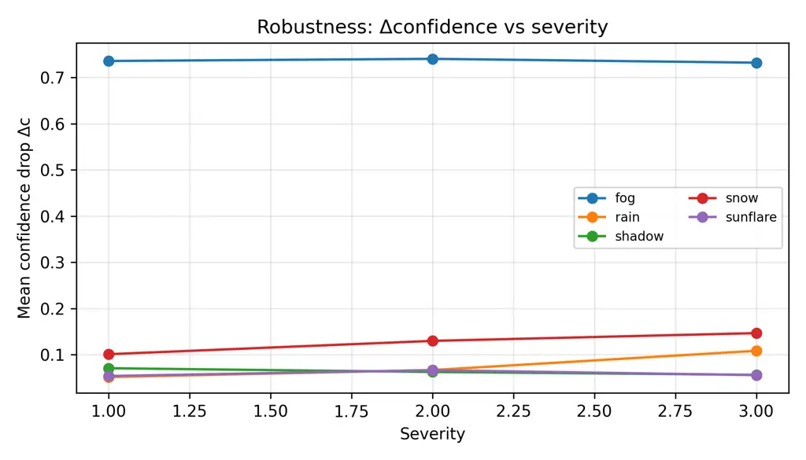

(c) Mean confidence drop $`\Delta c`$ vs. severity

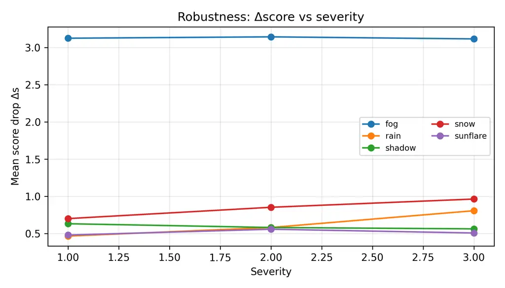

(d) Mean score drop $`\Delta s`$ vs. severity

Fig. 3: Visualization of sensitivity across corruption types.

Overall, the judge’s confidence signal is systematically more
conservative than its discrete score signal for all non-fog corruptions
(e.g., $`\text{mean\_dc}\leq 0.147`$ while mean_ds approaches
$`\sim 1.0`$ under severe snow), whereas fog triggers large coupled
declines in both score and confidence. This is desirable for an
automated watchdog: the judge remains discriminative in its quality
scoring while reserving strong uncertainty escalation for the most
visibility-destroying conditions. Taken together, the monotonic trends
for rain and snow, the strong saturation-consistent response for fog,
and the consistently positive per-image effect sizes across all
conditions support the conclusion that the LLM-as-Judge is perceptually
grounded in segmentation reliability cues (e.g., missing or
misidentified powerlines) and responds robustly to real-world
degradations that threaten safe autonomous inspection.

Figure 3 illustrates the sensitivity of the LLM as Judge across
corruption types and severity levels. The top row reports per image
effect sizes $`d_{z}`$ for confidence and score, showing that fog
induces the strongest and most consistent perceptual degradation, with
very large effect sizes exceeding $`3`$. Other corruptions, including
rain, snow, shadow, and sunflare, exhibit moderate but stable effect
sizes, indicating that the judge reliably detects meaningful structural
distortions even when degradation is less severe. The bottom row shows
the mean drops in score and confidence relative to clean images. Score
deviations increase monotonically with severity for rain, snow, and
sunflare, reflecting progressive loss of structural fidelity in the
predicted masks. Confidence follows the same trend but with smaller
magnitudes, demonstrating a conservative and proportional uncertainty
response. Fog again produces the largest and most uniform decline across
severities, confirming its strong impact on geometric visibility.
Together, these results demonstrate that the LLM-as-Judge does not
merely produce stable outputs, but responds systematically to meaningful
changes in visual evidence, satisfying the sensitivity criterion
required for semantic safety monitoring.

## VI Conclusion

This paper studied the reliability of large multimodal language models
when used as automated judges for segmentation quality in safety
critical visual inspection tasks. We proposed an evaluation framework
that characterizes reliability through two complementary properties,
repeatability and sensitivity. Repeatability captures the stability of
the judge under identical inputs, while sensitivity evaluates whether
the judge responds coherently to controlled degradations in visual
evidence. Together, these properties define the behavioral requirements
of a trustworthy LLM based evaluator.

Experiments on clean and synthetically corrupted powerline inspection
imagery demonstrate that the LLM as Judge exhibits strong repeatability
in its discrete quality scores, with high agreement rates and consistent
intraclass correlation values across conditions. Confidence estimates
decrease appropriately as visual cues deteriorate, particularly under
severe corruptions such as fog and snow, indicating adaptive uncertainty
rather than overconfident behavior. Sensitivity analysis further shows
that score and confidence deviations increase monotonically with
corruption severity, supported by large per image effect sizes that
reflect meaningful perceptual shifts rather than noise. Together, these
results indicate that large multimodal language models can serve as
reliable semantic monitors for deployed vision systems when their
behavior is rigorously characterized beyond traditional accuracy
metrics.

## References

- \[1\] A. Hossain, N. Maharjan, R. Abdelfattah, M. Ezz-Eldin, X.
  Wang, M. Fouda, and K. Abdelfatah (2026) From classical pipelines to
  promptable foundation models: a cross-domain survey of thin-object
  segmentation for power lines, cracks, and retinal vessels. IEEE
  Internet of Things Journal. Cited by: §I.
- \[2\] R. Abdelfattah, X. Wang, and S. Wang (2023) PLGAN: generative
  adversarial networks for power-line segmentation in aerial images.
  IEEE Transactions on Image Processing 32, pp. 6248–6259. External
  Links: [Document](https://dx.doi.org/10.1109/TIP.2023.3321465) Cited
  by: §I.
- \[3\] A. Hossain, M. Hasan, R. Abdelfattah, D. Scott, K. Abdelfatah,
  and A. Sherif (2025) Evaluating prompt engineering for generalized
  power line segmentation. In SoutheastCon 2025, pp. 508–513. External
  Links:
  [Document](https://dx.doi.org/10.1109/SoutheastCon56624.2025.10971697)
  Cited by: §I.
- \[4\] L. Zhu, X. Wang, and X. Wang (2023) JudgeLM: fine-tuned large
  language models are scalable judges. arXiv preprint arXiv:2310.17631.
  Cited by: §II.
- \[5\] J. Ye, Y. Wang, Y. Huang, D. Chen, Q. Zhang, N. Moniz, T.
  Gao, W. Geyer, C. Huang, P. Chen, et al. (2024) Justice or prejudice?
  quantifying biases in LLM-as-a-judge. arXiv preprint arXiv:2410.02736.
  Cited by: §II.
- \[6\] D. Li, B. Jiang, L. Huang, A. Beigi, C. Zhao, Z. Tan, A.
  Bhattacharjee, Y. Jiang, C. Chen, T. Wu, et al. (2025) From generation
  to judgment: opportunities and challenges of llm-as-a-judge. In
  Proceedings of the 2025 Conference on Empirical Methods in Natural
  Language Processing, pp. 2757–2791. Cited by: §II.
- \[7\] L. Zheng, W. Chiang, Y. Sheng, S. Zhuang, Z. Wu, Y. Zhuang, Z.
  Lin, Z. Li, D. Li, E. Xing, et al. (2023) Judging LLM-as-a-judge with
  mt-bench and chatbot arena. Advances in neural information processing
  systems 36, pp. 46595–46623. Cited by: §II.
- \[8\] Q. Pan, Z. Ashktorab, M. Desmond, M. S. Cooper, J. Johnson, R.
  Nair, E. Daly, and W. Geyer (2024) Human-centered design
  recommendations for llm-as-a-judge. arXiv preprint arXiv:2407.03479.
  Cited by: §II.
- \[9\] A. Szymanski, N. Ziems, H. A. Eicher-Miller, T. J. Li, M. Jiang,
  and R. A. Metoyer (2025) Limitations of the llm-as-a-judge approach
  for evaluating llm outputs in expert knowledge tasks. In Proceedings
  of the 30th International Conference on Intelligent User Interfaces,
  pp. 952–966. Cited by: §II.
- \[10\] G. Son, H. Ko, H. Lee, Y. Kim, and S. Hong (2023)
  LLM-as-a-judge reward model: what they can and cannot do, 2024. URL
  https://arxiv. org/abs/2409.11239. Cited by: §II.
- \[11\] S. Saha, X. Li, M. Ghazvininejad, J. Weston, and T. Wang (2025)
  Learning to plan & reason for evaluation with thinking LLM-as-a-judge.
  arXiv preprint arXiv:2501.18099. Cited by: §II.
- \[12\] J. Yu, S. Sun, X. Hu, J. Yan, K. Yu, and X. Li (2025) Improve
  LLM-as-a-judge ability as a general ability. arXiv preprint
  arXiv:2502.11689. Cited by: §II.
- \[13\] R. S. Raju, S. Jain, B. Li, J. L. Li, and U. Thakker (2024)
  Constructing domain-specific evaluation sets for LLM-as-a-judge. In
  Proceedings of the 1st Workshop on Customizable NLP: Progress and
  Challenges in Customizing NLP for a Domain, Application, Group, or
  Individual (CustomNLP4U), pp. 167–181. Cited by: §II.
- \[14\] Y. Zhao, H. Liu, D. Yu, S. Kung, M. Chen, H. Mi, and D.
  Yu (2025) One token to fool LLM-as-a-judge. arXiv preprint
  arXiv:2507.08794. Cited by: §II.
- \[15\] K. Schroeder and Z. Wood-Doughty (2024) Can you trust LLM
  judgments? reliability of llm-as-a-judge. arXiv preprint
  arXiv:2412.12509. Cited by: §II.
- \[16\] H. Wei, S. He, T. Xia, F. Liu, A. Wong, J. Lin, and M.
  Han (2024) Systematic evaluation of LLM-as-a-judge in llm alignment
  tasks: explainable metrics and diverse prompt templates. arXiv
  preprint arXiv:2408.13006. Cited by: §II.
- \[17\] Z. Wang, S. Hu, S. Zhao, X. Lin, F. Juefei-Xu, Z. Li, L.
  Han, H. Subramanyam, L. Chen, J. Chen, et al. (2025) MLLM-as-a-judge
  for image safety without human labeling. In Proceedings of the
  Computer Vision and Pattern Recognition Conference, pp. 14657–14666.
  Cited by: §II.
- \[18\] D. Chen, R. Chen, S. Zhang, Y. Wang, Y. Liu, H. Zhou, Q.
  Zhang, Y. Wan, P. Zhou, and L. Sun (2024) MLLM-as-a-judge: assessing
  multimodal llm-as-a-judge with vision-language benchmark. In
  Forty-first International Conference on Machine Learning, Cited by:
  §II.
- \[19\] A. Narayanan, V. R. Khazaie, and S. Raza (2025) Bias in the
  picture: benchmarking vlms with social-cue news images and
  llm-as-judge assessment. arXiv preprint arXiv:2509.19659. External
  Links: [Document](https://dx.doi.org/) Cited by: §II.
- \[20\] R. Abdelfattah, X. Wang, and S. Wang (2020) TTPLA: an
  aerial-image dataset for detection and segmentation of transmission
  towers and power lines. In Proceedings of the Asian conference on
  computer vision, External Links: [Document](https://dx.doi.org/) Cited
  by: §IV-A, §V-A.
- \[21\] OpenAI (2024) GPT-4o model documentation. Note:
  https://platform.openai.com/docs/models/gpt-4oAccessed: Jan. 2026
  Cited by: §IV-B.
