# Label Effects: Shared Heuristic Reliance in Trust Assessment by Humans and LLM-as-a-Judge

Xin Sun Affiliation: National Institute of Informatics (NII), Japan
Affiliation: University of Amsterdam, the Netherlands    Di Wu
Affiliation: University of Amsterdam, the Netherlands    Sijing Qin
Affiliation: National Institute of Informatics (NII), Japan
Affiliation: Hitotsubashi University, Japan    Isao Echizen
Affiliation: National Institute of Informatics (NII), Japan
Affiliation: University of Tokyo, Japan    Abdallah El Ali
Affiliation: Centrum Wiskunde & Informatica (CWI), the Netherlands
Affiliation: Utrecht University, the Netherlands    Saku Sugawara
Affiliation: National Institute of Informatics (NII), Japan
Affiliation: University of Tokyo, Japan

###### Abstract

Large language models (LLMs) are increasingly used as automated
evaluators (LLM-as-a-Judge). This work challenges its reliability by
showing that trust judgments by LLMs are biased by disclosed source
labels. Using a counterfactual design, we find that both humans and LLM
judges assign higher trust to information labeled as human-authored than
to the same content labeled as AI-generated. Eye-tracking data reveal
that humans rely heavily on source labels as heuristic cues for
judgments. We analyze LLM internal states during judgment. Across label
conditions, models allocate denser attention to the label region than
the content region, and this label dominance is stronger under Human
labels than AI labels, consistent with the human gaze patterns. Besides,
decision uncertainty measured by logits is higher under AI labels than
Human labels. These results indicate that the source label is a salient
heuristic cue for both humans and LLMs. It raises validity concerns for
label-sensitive LLM-as-a-Judge evaluation, and we cautiously raise that
aligning models with human preferences may propagate human heuristic
reliance into models, motivating debiased evaluation and alignment.

## 1 Introduction

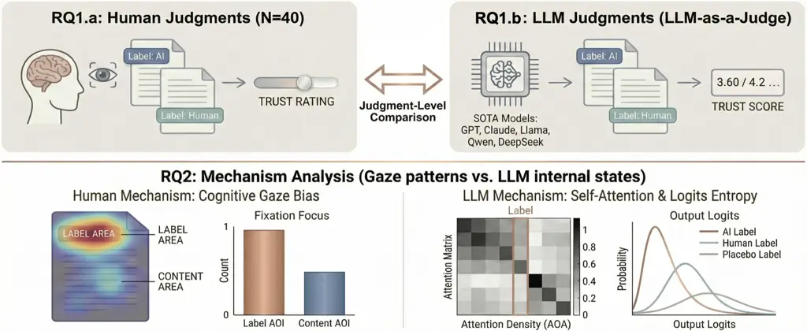

Figure 1: Three studies examine how source labels affect trust judgments
by an LLM-as-a-judge and investigate the alignment with human behavior
via mechanistic analyses of gaze attention, model self-attention, and
logits entropy.

In the era of large language models (LLMs), health information is easier
to access. However, non-experts often struggle to judge trustworthiness
as it requires expertise. Thus, they frequently show reliance on
heuristic cues such as source credibility (e.g., “Written by an
Expert”) Marecos et al. (2024) for trust assessment. Such labels are
double-edged: they can foster trust Scharowski et al. (2023) but also
undermine it Yin et al. (2024); Jakesch et al. (2019), showing that
trust judgments are sensitive to these heuristic cues Liao and Sundar
(2022). We refer to this phenomenon as the _“Label Effect”_. While
heuristics reduce cognitive effort, they also bias evaluation: strong
labels may overshadow content and enable “blind trust", leading to the
acceptance of low-quality advice based on perceived authority or
compliance-related AI disclosures (e.g., EU AI Act) El Ali et al.
(2024). This risk is amplified in health and generative-AI settings,
where provenance can be mismatched (e.g., AI-generated advice presented
as expert-written), leading to real-world harm.

While LLMs are increasingly used as a judge for scalable automated
evaluations Li et al. (2024); Li et al. (2025a), with the assumption
that LLM judgments can objectively reflect quality of the evaluated
content Gu et al. (2025), many studies argue that LLM-as-a-Judge
evaluations exhibit bias in practice Ye et al. (2024), including
inconsistency Wang et al. (2025b); Haldar and Hockenmaier (2025),
limited reliability Schroeder and Wood-Doughty (2025),
self-preference Wataoka et al. (2025), reasoning bias Wang et al.
(2025a) and scoring bias Li et al. (2025b). For high-stakes health
information, it remains unclear whether source labels bias trust scoring
by LLM-as-a-Judge and how these label-driven shifts are consistent with
human heuristic-driven trust patterns Liao and Sundar (2022). This
motivates our first research question:

1.  (RQ1: judgment-level) In high-stakes health contexts, to what extent
    do disclosed source labels affect trust judgments by (a) humans
    and (b) LLM-as-a-Judge under counterfactual label swaps for
    identical health information?

To ground our investigation, we first conduct a controlled human study
with a counterfactual design that isolates label effects. Participants
rate their trust in identical health information presented with
different source labels (i.e., as either “human-authored” or
“AI-generated”). We found that Human-labeled information consistently
received higher trust than AI-labeled information. LLM-as-a-Judge
exhibits the same judgment-level label effect: LLMs assign higher trust
to Human-labeled information than to AI-labeled information.

These findings raise important practical concerns. Alignment techniques
aim to shape model behavior toward human preferences (Ouyang et al.,
2022; Jiang et al., 2024), assuming that aligning model behaviors with
human values yields safer, more rational systems. However, this
assumption overlooks that human cognition itself may contain heuristic
reliance or bias. If humans prioritize trust heuristic cues like source
labels for judgment Reis et al. (2024), then aligning models to human
preferences may risk encoding this bias directly into models’ generation
and reasoning capabilities, making LLM judges vulnerable to label
spoofing and less reliable as impartial evaluators. We then go beyond
judgment-level behaviors and keep asking:

1.  (RQ2: mechanism-level) How do source labels alter internal
    processing signals during trust assessment in humans (gaze) and
    LLM-as-a-Judge (attention and uncertainty)?

We explore how label effects manifest at the processing level by
analyzing (i) human gaze patterns across AoIs (Areas of Interest) and
labels; and (ii) LLM’s attention and inference uncertainty Sheng et al.
(2025), while noting that these signals provide correlates rather than
causal explanations for both humans Cacioppo et al. (2016) and
LLM-as-a-Judge Wiegreffe and Pinter (2019).

From our analysis, LLM-as-a-Judge exhibits a similar label-driven
pattern during trust assessment following the same directional reliance
observed in human ratings. Specifically, LLMs allocate denser attention
to the label region than the content region, and this label dominance is
stronger for the Human label than the AI label. This is consistent with
the human gaze patterns that participants fixate more on the label area
under Human labels than AI labels, suggesting that label semantics serve
as a heuristic cue for both humans and LLM judges. It raises a broader
concern that human preference-based alignment may inherit such human
shortcut cues Brady et al. (2025); Cheung et al. (2025), making LLM
judges vulnerable to label spoofing.

Our work makes three contributions. (1) We provide controlled empirical
evidence that source labels bias trust judgments in both human and
LLM-as-a-Judge evaluators, raising validity concerns. (2) We investigate
internal patterns of LLMs associated with label effects. (3) By
grounding LLM judgments with humans, we show that aligning human
preference may propagate human biases into LLMs. These results have
direct implications for the design of LLM-as-a-Judge evaluation and for
model alignment with human values. We provide materials and codes for
reproducibility¹¹ 1
[https://anonymous.4open.science/r/Label-Effects/](https://anonymous.4open.science/r/Label-Effects/).

## 2 Related Work

### 2.1 Source Credibility Cues for Human Trust

Trustworthiness assessment is cognitively demanding, especially for
non-experts in high-stakes domains such as healthcare. A large body of
psychology and communication research shows that when readers cannot
easily verify accuracy, they rely on _heuristic cues_, such as source
credibility signals (e.g., authority, expertise disclosures), as
shortcuts for trust judgments Liao and Sundar (2022). Dual-process
theory Gawronski et al. (2024) echoes that such cues can dominate when
ability to scrutinize content is limited. Empirically, source labels and
credibility badges can shift perceived trust even when content is
unchanged, increasing risks to misleading or spoofed attribution Yin
et al. (2024).

Despite these insights, it remains unclear how these cue-driven trust
judgments relate to emerging LLM-based judgments. We address this gap by
grounding label effects in a controlled eye-tracking study, which we
compare against LLM-as-a-Judge behaviors under identical label
manipulations.

### 2.2 LLM-as-a-Judge and Evaluation Biases

Using LLMs as automatic evaluators (i.e., LLM-as-a-Judge) has become a
practice for scalable evaluation Li et al. (2024); Gu et al. (2025).
Prior work also shows that LLM judges can be fragile: ratings may shift
with prompt framing Li et al. (2025c), positional structures Shi et al.
(2025), or self-preferences Spiliopoulou et al. (2025); Laurito et al.
(2025); Dai et al. (2024), factors unrelated to the target quality
signal. These findings indicate that LLM-as-a-Judge scores are not
purely objective, but can be shaped by evaluation artifacts.

Recent work Marioriyad et al. (2025); Chen et al. (2024) shows that
authority cues can bias LLM-as-a-Judge. However, the effects of true
source and labels (Human vs. AI) remain unclear in high-stakes health
trust assessment, and most prior work examines only output scores
without probing internals or contrasting LLM behavior with human
behaviors. We investigate deeper to address these gaps.

### 2.3 Alignment of LLMs with Human Values

Current LLM alignment methods aim to make model behavior consistent with
human and safety expectations by incorporating human-derived
preferences. A dominant approach is Reinforcement Learning from Human
Feedback (RLHF) Ouyang et al. (2022), which uses human preferences to
instruct models (e.g., InstructGPT). Several studies report agreement
between LLM-as-a-Judge and humans Liu et al. (2023); Zheng et al.
(2023). While others argue that LLMs fail to reflect human-like
behavior Tjuatja et al. (2024).

Recent work indicates that LLMs can produce both heuristic, bias-prone
responses as humans. However, these behaviors are not equivalent to
human cognition, as “cognitive” biases in LLMs likely reflect reward
bias from training data Brady et al. (2025). We connect it to provenance
cues in this work: if humans rely on source labels as shortcuts,
aligning models to human preferences may amplify the same reliance in
LLM-as-a-Judge.

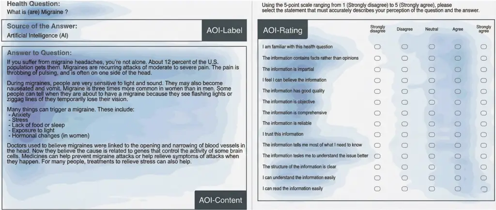

Figure 2: An example heatmap of gaze points on stimuli that are
displayed on the lab monitor during the human assessment. Three AoIs are
predefined: AoI-Label is the area for presenting disclosed label;
AoI-Content is the area for presenting health information; AoI-Rating is
the area to rate trust level in information on the left side.

## 3 Methodology

##### Experimental Design and Dataset

We adopt 150 health question-answer (QA) pairs from dataset Yadav et al.
(2022). Each data point is denoted as a tuple $`D=(Q,A,L)`$, where $`Q`$
represents the health question, $`A`$ is the answer to the question, and
$`L`$ is the source label of the answer.

To separate the effects of true answer source from the effects of
disclosed source labels, we use a controlled $`2\times 2`$ factorial
design with counterfactual variants $`(Q,A,L)`$ that differ in both
$`A`$ and $`L`$. Because the _same answer text_ is presented under
different labels (congruent or incongruent with its source), this design
enables counterfactual comparisons that test the _label effect_ while
holding content constant. Below are the manipulations we did:

- •
  Source of Content ($`S`$) (i.e., actual source):
  - –
    $`S_{human}`$: the answer was written by Human Professionals from
    the selected dataset.
  - –
    $`S_{LLM}`$: the answer was generated by GPT-4o OpenAI (2024) with
    length/format constraints to match expert-authored answers. To
    reduce confounds, domain experts reviewed the GPT-generated answers
    to ensure they were comparable to $`S_{human}`$ in relevance to the
    length, presentation format and relevance.

- •
  Label of Source ($`L`$) (i.e., manipulated source):
  - –
    $`L_{human}`$: A human label (“Human Authored”).
  - –
    $`L_{AI}`$: An AI label (“AI-Generated”).

##### Tasks and Conditions

Human participants and LLM-as-a-Judge models perform the same trust
judgment task. Given a tuple $`(Q,A,L)`$, evaluators rate their
perceived trust in both information on a 5-point Likert scale, adapted
from validated Trust of Online Health Information questionnaire Johnson
et al. (2015); Rowley et al. (2015), with multiple trust-related items
(e.g., credibility, reliability) as shown in Fig. 2. We aggregate and
average the ratings of these items as the trust score.

##### Study Overview

We conduct the following studies (see Fig. 1) that map directly to our
RQs:

- •
  Human grounding: label effects and gaze attention (Sec. 3.1). We
  quantify how disclosed labels influence human trust ratings (RQ1.a)
  and gaze between Label and Content AoIs (Area of Interest),
  establishing a cognitive behavioral reference of reliance on trust
  heuristic cues.
- •
  LLM-as-a-Judge: judgment-level label effects (Sec. 3.2). Using
  counterfactual label swaps with identical content, we test whether LLM
  trust ratings differ across labels (RQ1.b).
- •
  Mechanism analysis of label effects (Sec. 3.3) We analyze LLM
  attention allocation between Label and Content regions and decision
  uncertainty via logits, enabling human-LLM alignment comparisons
  (RQ2). We further validate the semantic label effects using a placebo
  label condition.

### 3.1 Human Grounding of Label Effects with Eye-Tracking

We conducted a laboratory study employing eye-tracking to provide human
grounding by examining whether source labels affect trust judgment
(RQ1.a) and how gaze attention is allocated during human cognitive
processing (RQ2).

##### Participants and Procedure

We recruited participants ($`N=40`$) with non-medical backgrounds
(demographics in Appendix A). Each participant read 12 QA pairs from two
actual sources (_$`S_{human}`$ vs. $`S_{LLM}`$_) manipulated by two
labels (_$`L_{human}`$ vs. $`L_{AI}`$_) in counterbalanced order
(Sec. 3). Participants read each QA pair at their own pace and then
rated trust. To avoid memory effects, no participant saw the same answer
under both labels. Gazes were recorded with a screen-based eye-tracker
(sampling rate: 60 Hz) (setups in Appendix C).

##### Areas of Interest (AoIs) for Gaze Attention

To quantify attention allocation during judgment, we defined two
non-overlapping AoIs for each $`(Q,A,L)`$ as shown in Fig. 2:

- •
  Label AoI ($`AoI_{\mathrm{label}}`$): The region displaying the
  disclosed source label (e.g., “Human-authored” or “LLM-generated”).
- •
  Content AoI ($`AoI_{\mathrm{content}}`$): The region containing the
  answer text to the health question.

As gaze metrics, we use _Fixation Count_ and *Fixation Duration* Just
and Carpenter (1980) as proxies for visual attention, defined as the
number of fixations and total dwell time within each AoI.

### 3.2 Judgment-Level Label Effect of LLMs

This study specifically tests RQ1.b: whether source labels affect trust
ratings by LLMs. We applied the same design used in the human
experiments.

##### Models

We evaluate a diverse set of proprietary and open-sourced LLMs (detailed
in Appendix E):

- •
  Proprietary LLMs: GPT-5.2, GPT-4o, Claude-Sonnet-4.5, Claude-Opus-4.5.
- •
  Open-weight LLMs: GPT-OSS-120B, LLaMA-3.2-70B, Qwen3-235B,
  DeepSeek-v3.2-685B.

##### Prompt Design

We designed the prompt to closely mirror the instructions given to human
evaluators. Each model receives a tuple $`(Q,A,L)`$ consisting of a
health question $`Q`$, an answer $`A`$, and a source label $`L`$. The
label $`L`$ is manipulated, while $`Q`$ and $`A`$ are identical across
label conditions. Models were instructed to rate the trust scores on a
5-point scale using the same dimensions as in human experiments
(Fig. 2), enabling direct comparison between human and LLM judgments. We
set the decoding temperature to 0 to minimize sampling randomness and
make condition differences attributable to label manipulations. Full
prompt templates are provided in Appendix F.

### 3.3 Mechanism-Level Analysis of Label Effect

This study addresses RQ2 by probing how disclosed source labels
influence LLMs’ judgment internally, and by enabling AoI-level
comparisons to human gaze patterns. We analyze two LLM internal states:
(i) attention allocation between Label and Content regions, and (ii)
judgment uncertainty quantified by logits. We test these open-weighted
models: _LLaMA-3.2-3B & 70B, GPT-OSS-20B & 120B, and Qwen3-30B normal &
instructed versions_ (Details in Appendix E).

#### 3.3.1 Attention Allocation

##### AoA-level attention density with same label

For each model and label (Human, AI), we extract last-layer attention
weights (aggregated across heads) at final inference step by
“Area-of-Attention” (i.e., Label AoA vs. Content AoA). To account for
unequal token lengths across AoAs, we compute token-normalized attention
density:

```math
\text{Density}_{AoA}=\frac{\sum\text{Attn}_{AoA}}{|T_{AoA}|},AoA\in\{\text{label},\text{content}\},
```

where $`T_{AoA}`$ denotes the length of tokens in each $`AoA`$. We
summarize relative label reliance using:

```math
\text{LogRatio}=\log\left(\frac{\text{Density}_{\text{Label}}}{\text{Density}_{\text{Content}}}\right),
```

where $`\text{LogRatio}>0`$ indicates greater reliance of attention to
the Label AoA than Content AoA.

##### Label-level attention within same AoA

To echo human eye-tracking analysis, we test _within-AoA_ differences of
attention. For each $`AoA\in\{\text{Label},\text{Content}\}`$, we test
whether: $`\Delta\text{Attn}_{AoA}^{(\text{Label A vs.\ Label B})}`$ are
statistically and significantly different between label conditions:
$`LabelA~\&B\in\{\text{Human},\text{AI}\}`$.

#### 3.3.2 Decision Uncertainty by Logits

At each _judgment step_ (when model outputs a score for each rating
item: $`1-5`$), we derive the logits, apply a softmax, and compute
Shannon entropy.

```math
E_{\text{logit}}=-\sum_{y=1}^{5}p(y)\log p(y)
```

We average $`E`$ for each $`(Q,A,L)`$, as its uncertainty score. Then we
compare the uncertainty across label conditions to test whether labels
alter LLM’s inference uncertainty. Higher $`E_{\text{logit}}`$ indicates
a flatter distribution and greater decision uncertainty.

#### 3.3.3 Linking Label Effects to Semantics

As a follow-up control for LLM-as-a-Judge, we add a placebo label
(Source of the answer: \[TAG\]) that matches label’s format and position
but removes Human/AI semantics Shi et al. (2025). Comparing Human/AI
labels against this placebo helps separate semantic label effects from
generic label-structure effects: if Human–AI differences are not
replicated by the placebo, the effect is attributable to label meaning
rather than label presence.

## 4 Results

### 4.1 RQ1: Judgment-Level Label Effect

|                |                              |                                                           |                       |
| -------------- | ---------------------------- | --------------------------------------------------------- | --------------------- |
| Dependent Var. | Independent Var.             | Condition                                                 | Mean (SD)             |
| Trust score    | Label (regardless of source) | Human                                                     | 3.80 (.61)            |
|                |                              | AI                                                        | 3.67 (.65)            |
|                |                              | Pairwise comparison: $`p`$-value / effect (Std.$`\beta`$) | .01 / .23 (medium)    |
|                | Source (regardless of label) | Human                                                     | 3.62 (.64)            |
|                |                              | LLM                                                       | 3.85 (.60)            |
|                |                              | Pairwise comparison: $`p`$-value / effect (Std.$`\beta`$) | \<.001 / .35 (medium) |
|                | $`2\times 2`$ design         | Source: Human, Label: Human                               | 3.67 (.63)            |
|                |                              | Source: Human, Label: AI                                  | 3.56 (.64)            |
|                |                              | Source: LLM, Label: Human                                 | 3.92 (.56)            |
|                |                              | Source: LLM, Label: AI                                    | 3.78 (.63)            |
|                |                              | Pairwise comparison: $`p`$-value / effect (Std.$`\beta`$) | see Fig. 8            |

Table 1: Human trust scores by the disclosed label and actual source
with pairwise $`2\times 2`$ comparisons. Trust is higher under Human
labels than AI labels, while higher for LLM-sourced answers than
human-sourced answers.

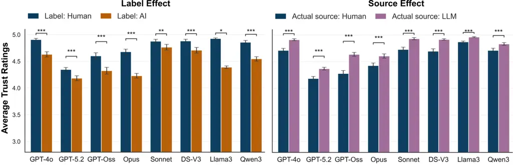

Figure 3: LLM-as-a-Judge trust scores. (Left) Main effects of disclosed
label (Human vs. AI) and (Right) content source (Human vs. LLM) on trust
ratings by Wilcoxon signed rank test Rosner et al. (2006) with
corrections. Horizontal brackets indicate statistically significant
pairwise differences (\*\*\*$`p<0.001`$, \*$`p<0.05`$).

#### 4.1.1 Human Judges

##### Label effect

Trust ratings show a robust label effect. Holding the true source
constant, the same answers were rated significantly more trustworthy
when labeled as Human-authored than as AI-generated (Table 1; Fig. 8). A
mixed ANOVA test confirms this main effect of label, with human-labeled
answers receiving higher trust than AI-labeled answers ($`p<.001`$,
effect size $`=.39`$).

##### Source effect

We also observe a smaller but significant true-source effect: collapsing
across labels, participants rated LLM-generated answers higher than
human-sourced answers ($`p=.024`$; Table 1), suggesting that true origin
can also influence trust.

#### 4.1.2 LLM-as-a-Judge

##### Label effect

Across LLM-as-a-Judge models, disclosed labels produce a consistent and
significant shift in trust ratings (Fig. 3, left). Holding the content
constant, answers labeled as Human are rated higher than the same
answers labeled as AI-generated in all models, with most pairwise
differences reaching significance. This indicates a robust label effect:
LLM judges’ trust scores are significantly sensitive to provenance
disclosure.

##### Source effect

We also observe a significant true-origin effect across models (Fig. 3,
right). Collapsing across labels, LLM-generated answers receive higher
ratings than human-authored answers, and this pattern is significant for
all models.

Notably, the label effect remains present even when controlling for true
origin, suggesting that disclosed labels and true source contribute
independently to LLM judges’ trust assessments.

#### 4.1.3 Judgment-Level Alignment

Across both evaluators, disclosed source labels act as salient cues for
judgment, significantly shifting trust ratings in the same direction.
Humans assign higher trust to information labeled as human-authored than
the identical information labeled as AI-generated (Table 1).
LLM-as-a-Judge exhibits the same pattern: holding content constant,
trust ratings follow _$`L_{Human}`$_\>_$`L_{AI}`$_ (Fig. 3). This
consistency suggests that both humans and LLM judges use source labels
as heuristic cues for trust judgments, rather than relying on content
alone.

### 4.2 RQ2: Mechanism-Level Label Effect

We analyze human gaze and LLM internal states under label manipulations
to further investigate the _mechanism-level_ processing on source
labels.

#### 4.2.1 Human Gaze Patterns

Fig. 5 reports results by GEE test (Generalized Estimating
Equation) Hardin and Hilbe (2012) for fixation count (FC) and duration
(FD) in Label AoI and Content AoI. In Label AoI, participants fixated
more under Human label than AI label ($`p<.05`$). In Content AoI, the
pattern reversed: participants showed more fixations under AI label than
Human label ($`p<.05`$), indicating increased content scrutiny when
label signals lower credibility. Content-AoI processing was higher for
LLM-sourced than human-sourced answers. Overall, gaze shifts show a
label-driven trade-off: Human labels draw attention to label region,
while AI labels shift attention to the content.

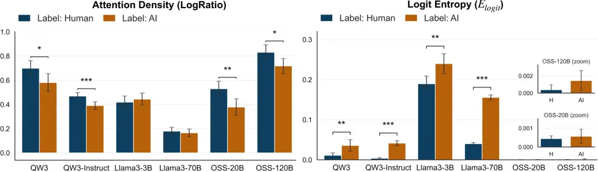

Figure 4: (Left): LLM’s attention allocation between two AoAs (i.e.,
label vs. content) and (Right): LLM’s logit entropy, across two label
conditions (i.e., Human vs. AI). (\*\*$`p`$\<.01, \*$`p`$\<.05).

#### 4.2.2 LLM Internal States

##### Attention is label-dominant and modulated by label condition

As shown in Fig. 4 (left), LLMs allocate denser attention to the Label
region than the Content region at the judgment step (i.e.,
$`\text{LogRatio}>0`$ across label conditions and LLMs), indicating
label-dominant attention. Moreover, the magnitude of label dominance
under the Human label is stronger than that of the AI label.

##### Decision uncertainty is amplified by AI labels

AI-labeled information consistently yields higher logits entropy across
LLMs (Fig. 4; right), indicating greater uncertainty when the model
commits to its rating under an AI disclosure.

##### Dissociation between attention and uncertainty

The results show a dissociation between attention allocation and
decision confidence. Across models, attention is consistently
label-dominant, with stronger label-AoA attention under Human than AI
labels, while decision uncertainty is highest under AI labels. This
indicates that label effects in LLM-as-a-Judge manifest in both
label-focused attention patterns and label-dependent shifts in
uncertainty.

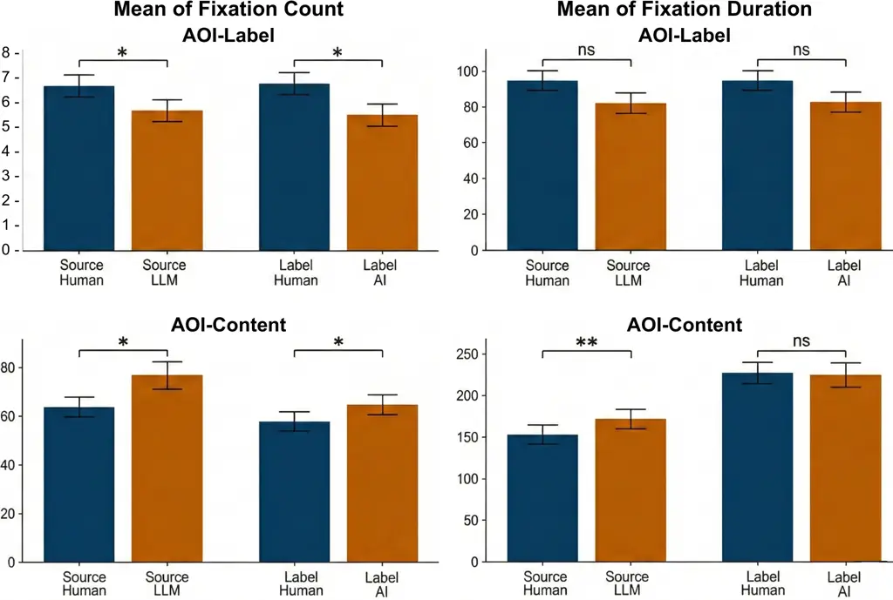

Figure 5: Analyses by GEE test Hardin and Hilbe (2012) with FDR
correction Haynes (2013) of human gaze patterns (i.e., fixation count
and fixation duration) in two AoIs. (\*\*$`p`$\<.01, \*$`p`$\<.05, “ns”
is not significant).

#### 4.2.3 Mechanism-Level Alignment

In the eye-tracking study (Sec.3.1), participants fixate more on the
label AoI under Human labels than AI labels, and this co-occurs with
higher trust ratings for Human-labeled information. Under AI labels,
participants shift gaze toward Content AoI, indicating increased content
scrutiny rather than relying on label as a shortcut. LLM internal
analyses show the same cue salience (Fig. 5). Across models and label
conditions, attention is label-dominant (higher density in Label AoA
than Content AoA; $`\text{LogRatio}>0`$). Moreover, label-AoA attention
is consistently higher under $`L_{\text{Human}}`$ than under
$`L_{\text{AI}}`$, matching the direction of human fixations in
label-AoI. The heatmap in Fig. 6 further illustrates the pattern:
label-AoA attention density is higher under Human label than AI label
across models. Also, this Human–AI gap becomes more pronounced as models
are scaled up within the same LLM family.

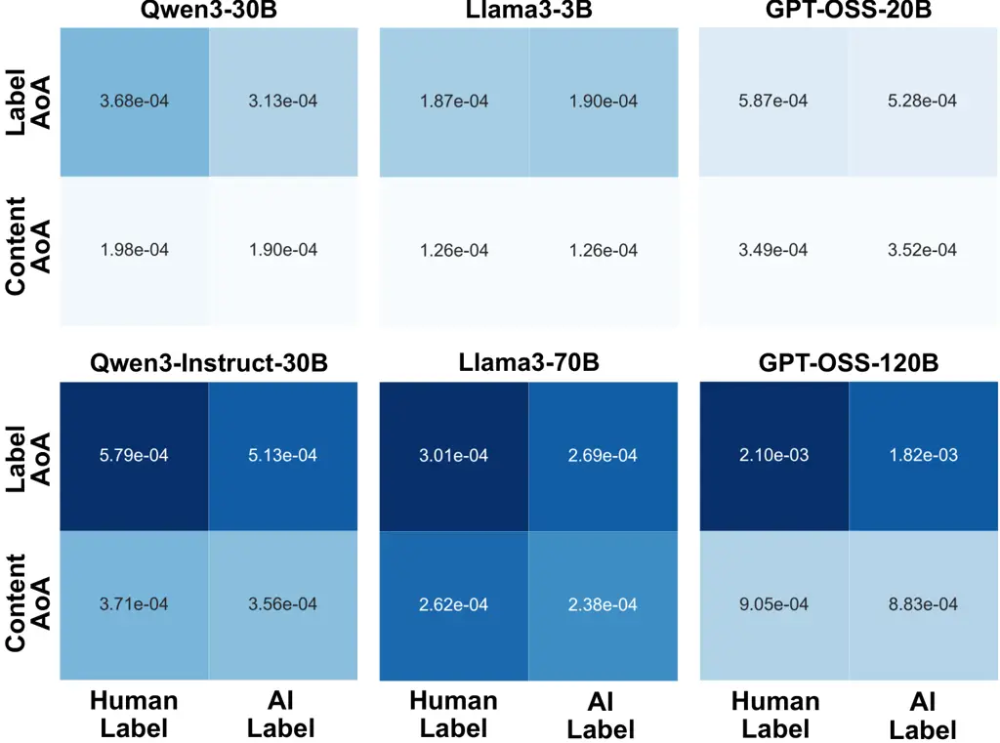

Figure 6: LLM attention distribution density across AoAs (Label AoA vs.
Content AoA) and two label conditions (Human vs. AI) across LLMs.

#### 4.2.4 Semantic Effects by Placebo Test

As a follow-up control, we introduce a placebo label that matches the
label’s position and format but removes provenance semantics
(Sec. 3.3.3). The placebo elicits the strongest label-AoA attention,
consistent with increased processing of an underspecified cue rather
than higher trust. In addition, logits entropy keeps the highest under
AI label, while Human and placebo are similar, suggesting that
uncertainty shifts are driven by semantic meaning of AI disclosure
rather than label presence. Additional placebo results are in
Appendix G.

## 5 Discussion

##### The validity of LLM-as-a-Judge

LLM-as-a-Judge is increasingly used as a scalable substitute for human
evaluation Gu et al. (2025). However, prior work argues that LLM judges
can be fragile Haldar and Hockenmaier (2025); Li et al. (2025a);
Schroeder and Wood-Doughty (2025); our work echoes. Using counterfactual
label swaps, we show that trust judgments shift significantly when only
the source label changes, even though the answer text is identical
(RQ1.b). This shows that for health QA trust assessment, LLM judges are
not purely content-based but are influenced by metadata such as
disclosed authority identity.

Moreover, label effect is not limited to LLM’s judgment-level outputs:
our internal analyses indicate that LLMs demonstrate label-dominant
attention allocation internally and are modulated by uncertainty. In
addition, the source effects report that LLM-generated answers receive
higher trust than human-authored answers, regardless of the source
labels. It aligns with the prior work, indicating that LLMs have
preference biases for self-produced contents over human-authored
ones Wataoka et al. (2025); Laurito et al. (2025); Dai et al. (2024).

Implications: Our findings raise validity concerns that complement prior
work on fragility of LLM judges Li et al. (2025c). In high-stakes
settings where provenance cues are salient but often noisy or
provider-controlled, label-aware judging can fail in two ways:
over-trusting low-quality advice under expert labels or under-rating
accurate advice under AI labels, mirroring source-credibility shortcuts
in humans Bates et al. (2006); Marecos et al. (2024). As AI regulations
expand (e.g., EU transparency obligations El Ali et al. (2024)),
AI-generated content will more often carry transparent disclosures,
which may inadvertently steer model judgments. Accordingly,
LLM-as-a-Judge scores should not be treated as ground-truth
trustworthiness unless the evaluation well-controls provenance metadata
(e.g., origin, expertise, or authority cues).

##### Human biases in data and model alignments

A core question of this work is how source labels shape LLM trust
judgments internally and whether the mechanism resembles human trust
heuristics (RQ2). Prior work is mixed: several studies report human-like
internal similarities Kuribayashi et al. (2025) or trust behavior in
LLMs Xie et al. (2024), while others argue that LLMs fail to reflect
human-like responses Tjuatja et al. (2024) and
judgments Dominguez-Olmedo et al. (2024).

Recent work shows that LLMs can inherit human-like cognitive biases from
human (created) training data and preference signals Echterhoff et al.
(2024), and may even amplify such cognitive biases in
decision-making Cheung et al. (2025). Our findings align with this view.
Eye-tracking provides behavioral grounding: participants treat source
labels as salient cues, shifting attention between the Label and Content
AoIs in a label-dependent way, consistent with prior work on heuristic
cue use in trust assessment Liao and Sundar (2022). Model-side analyses
reveal a parallel functional alignment: across conditions, LLMs are
label-dominant (more attention to the Label than Content AoA), and both
attention allocation and decision uncertainty vary systematically with
label manipulations. Together, these results suggest that LLM judges
respond to identity/authority cues in a directionally human-like
manner Yin et al. (2024); Bates et al. (2006), plausibly reflecting
source-related priors shaped by data and training Echterhoff et al.
(2024); Brady et al. (2025).

Implications: The functional alignment we observe, both humans and LLM
judges treating source labels as salient cues, suggests risks for
“human-aligned” judging: human-oriented alignment may inherit human
cognitive biases, employ heuristics Echterhoff et al. (2024); Brady
et al. (2025), or even amplify such biases Cheung et al. (2025).
Consistent with this, our results show that such cues not only shift
trust ratings but also modulate internal processing, underscoring the
need for blind or identity-controlled judging protocols, along with
de-biased reasoning Yang et al. (2025) and preference-data curation to
reduce reliance on inherent heuristics such as the provenance cues.

## 6 Conclusion

To our knowledge, we present the first investigation on source-label
bias in trust assessment from cognitive perspectives, linking human gaze
patterns with LLMs’ internal states. Across both humans and LLM judges,
changing only the disclosed source label leads to significant and
directionally consistent shifts in trust ratings, indicating a shared
heuristic reliance on provenance cues for trust judgment beyond content
alone. It raises concerns about relying on LLMs to serve as objective
evaluators, particularly in high-stakes domains such as healthcare. To
mitigate this risk, we recommend blind or identity-controlled judging to
verify that LLM judges depend on the content itself. Lastly, we
cautiously suggest that future alignment and training should reduce
identity-related bias in human preferences to limit models’ reliance on
such cues.

## Limitations

We acknowledge several limitations in this work.

First, our experiments focus on health QA, and label effects may differ
in other domains. Future work should test the same label-swap design on
broader domains to assess generality.

Second, we study a small set of labels (Human, AI, Placebo), whereas
real platforms use richer provenance signals (e.g., verification, expert
review, or mixed attributions). Future work can expand labels and add
multiple placebo variants that tightly control length, position, and
formatting to better separate semantic effects from prompt structure.

Third, our mechanism analyses are based on internal correlates (LLM’s
attention and logits). While these signals echo label manipulations,
they do not by themselves establish a complete causal explanation for
model inference Wiegreffe and Pinter (2019). Future work should
incorporate more probes, such as label-token ablations or position
swaps, and test whether these interventions jointly shift internal
signals and trust judgments.

Lastly, our human-LLM alignment is functional and cautious: eye-tracking
measures cognitive attention, while transformer attention reflects
computational weighting, so direct mapping is not assumed. Future work
could add complementary human measures (e.g., confidence) and model-side
causal attribution to refine the comparisons.

## Ethical Considerations

This study was approved by the institute’s data privacy and ethics board
(ID: XXX). Our work concerns trust assessment of health information, a
high-stakes domain where incorrect judgments may lead to harmful
decisions. We show that simple provenance labels can influence both
human and LLM trust judgments. While we present this as an evaluation
confound, the same mechanism could be misused or deployed naively to
manipulate perceived credibility (e.g., label spoofing). To reduce
misuse risk, we report results at an aggregate level and emphasize
mitigation strategies (e.g., blind or label-controlled judging and
label-swap audits) rather than providing deployment guidance for
manipulation. Our human study includes eye-tracking, which is sensitive
behavioral data. Participants provided informed consent, data were
anonymized, and we report only aggregate statistics. Lastly, our work
does not use medical advice and does not validate any specific health
claims.

## References

- AB (2024) Tobii AB. 2024. [Tobii pro lab](http://www.tobii.com/).
  Computer software.
- Bates et al. (2006) Benjamin R Bates, Sharon Romina, Rukhsana Ahmed,
  and Danielle Hopson. 2006. The effect of source credibility on
  consumers’ perceptions of the quality of health information on the
  internet. _Medical informatics and the Internet in medicine_,
  31(1):45–52.
- Brady et al. (2025) Oliver Brady, Paul Nulty, Lili Zhang, Tomás E
  Ward, and David P McGovern. 2025. Dual-process theory and
  decision-making in large language models. _Nat. Rev. Psychol._,
  4(12):777–792.
- Cacioppo et al. (2016) John T. Cacioppo, Louis G. Tassinary, and
  Gary G. Berntson. 2016. _Strong Inference in Psychophysiological
  Science_, page 3–15. Cambridge Handbooks in Psychology. Cambridge
  University Press.
- Chen et al. (2024) Guiming Hardy Chen, Shunian Chen, Ziche Liu, Feng
  Jiang, and Benyou Wang. 2024. [Humans or LLMs as the judge? a study on
  judgement bias](https://doi.org/10.18653/v1/2024.emnlp-main.474). In
  _Proceedings of the 2024 Conference on Empirical Methods in Natural
  Language Processing_, pages 8301–8327, Miami, Florida, USA.
  Association for Computational Linguistics.
- Cheung et al. (2025) Vanessa Cheung, Maximilian Maier, and Falk
  Lieder. 2025. [Large language models show amplified cognitive biases
  in moral decision-making](https://doi.org/10.1073/pnas.2412015122).
  _Proceedings of the National Academy of Sciences_,
  122(25):e2412015122.
- Dai et al. (2024) Sunhao Dai, Yuqi Zhou, Liang Pang, Weihao Liu,
  Xiaolin Hu, Yong Liu, Xiao Zhang, Gang Wang, and Jun Xu. 2024. [Neural
  retrievers are biased towards llm-generated
  content](https://doi.org/10.1145/3637528.3671882). In _Proceedings of
  the 30th ACM SIGKDD Conference on Knowledge Discovery and Data
  Mining_, KDD ’24, page 526–537, New York, NY, USA. Association for
  Computing Machinery.
- Dominguez-Olmedo et al. (2024) Ricardo Dominguez-Olmedo, Moritz Hardt,
  and Celestine Mendler-Dünner. 2024. Questioning the survey responses
  of large language models. In _Proceedings of the 38th International
  Conference on Neural Information Processing Systems_, NIPS ’24, Red
  Hook, NY, USA. Curran Associates Inc.
- Echterhoff et al. (2024) Jessica Maria Echterhoff, Yao Liu, Abeer
  Alessa, Julian McAuley, and Zexue He. 2024. [Cognitive bias in
  decision-making with
  LLMs](https://doi.org/10.18653/v1/2024.findings-emnlp.739). In
  _Findings of the Association for Computational Linguistics: EMNLP
  2024_, pages 12640–12653, Miami, Florida, USA. Association for
  Computational Linguistics.
- El Ali et al. (2024) Abdallah El Ali, Karthikeya Puttur Venkatraj,
  Sophie Morosoli, Laurens Naudts, Natali Helberger, and Pablo
  Cesar. 2024. [Transparent ai disclosure obligations: Who, what, when,
  where, why, how](https://doi.org/10.1145/3613905.3650750). In
  _Extended Abstracts of the CHI Conference on Human Factors in
  Computing Systems_, CHI EA ’24, New York, NY, USA. Association for
  Computing Machinery.
- Faul et al. (2007) Franz Faul, Edgar Erdfelder, Albert-Georg Lang, and
  Axel Buchner. 2007. G\*Power 3: a flexible statistical power analysis
  program for the social, behavioral, and biomedical sciences. _Behav.
  Res. Methods_, 39(2):175–191.
- Gawronski et al. (2024) Bertram Gawronski, Dillon M Luke, and Laura A
  Creighton. 2024. Dual-process theories. In _The Oxford Handbook of
  Social Cognition, Second Edition_, pages 319–353. Oxford University
  Press.
- Girden (1992) Ellen R Girden. 1992. _ANOVA: Repeated measures_. 84.
  Sage.
- Gu et al. (2025) Jiawei Gu, Xuhui Jiang, Zhichao Shi, Hexiang Tan,
  Xuehao Zhai, Chengjin Xu, Wei Li, Yinghan Shen, Shengjie Ma, Honghao
  Liu, Saizhuo Wang, Kun Zhang, Yuanzhuo Wang, Wen Gao, Lionel Ni, and
  Jian Guo. 2025. [A survey on
  llm-as-a-judge](https://arxiv.org/abs/2411.15594). _Preprint_,
  arXiv:2411.15594.
- Haldar and Hockenmaier (2025) Rajarshi Haldar and Julia
  Hockenmaier. 2025. [Rating roulette: Self-inconsistency in
  LLM-as-a-judge
  frameworks](https://doi.org/10.18653/v1/2025.findings-emnlp.1361). In
  _Findings of the Association for Computational Linguistics: EMNLP
  2025_, pages 24986–25004, Suzhou, China. Association for Computational
  Linguistics.
- Hardin and Hilbe (2012) James W Hardin and Joseph M Hilbe. 2012.
  _Generalized estimating equations, second edition_, 2 edition. Chapman
  & Hall/CRC, Philadelphia, PA.
- Haynes (2013) Winston Haynes. 2013. [_Benjamini–Hochberg
  Method_](https://doi.org/10.1007/978-1-4419-9863-7_1215), pages 78–78.
  Springer New York, New York, NY.
- Jakesch et al. (2019) Maurice Jakesch, Megan French, Xiao Ma,
  Jeffrey T. Hancock, and Mor Naaman. 2019. [Ai-mediated communication:
  How the perception that profile text was written by ai affects
  trustworthiness](https://doi.org/10.1145/3290605.3300469). In
  _Proceedings of the 2019 CHI Conference on Human Factors in Computing
  Systems_, CHI ’19, page 1–13, New York, NY, USA. Association for
  Computing Machinery.
- Jiang et al. (2024) Ruili Jiang, Kehai Chen, Xuefeng Bai, Zhixuan He,
  Juntao Li, Muyun Yang, Tiejun Zhao, Liqiang Nie, and Min Zhang. 2024.
  A survey on human preference learning for large language models.
  _arXiv preprint arXiv:2406.11191_.
- Johnson et al. (2015) Frances C. Johnson, Jennifer E. Rowley, and
  Laura Sbaffi. 2015. [Modelling trust formation in health information
  contexts](https://api.semanticscholar.org/CorpusID:206454953).
  _Journal of Information Science_, 41:415 – 429.
- Just and Carpenter (1980) Marcel A Just and Patricia A
  Carpenter. 1980. A theory of reading: From eye fixations to
  comprehension. _Psychol. Rev._, 87(4):329–354.
- Kuribayashi et al. (2025) Tatsuki Kuribayashi, Yohei Oseki,
  Souhaib Ben Taieb, Kentaro Inui, and Timothy Baldwin. 2025. [Large
  language models are human-like
  internally](https://doi.org/10.1162/TACL.a.58). _Transactions of the
  Association for Computational Linguistics_, 13:1743–1766.
- Laurito et al. (2025) Walter Laurito, Benjamin Davis, Peli Grietzer,
  Tomáš Gavenčiak, Ada Böhm, and Jan Kulveit. 2025. [Ai–ai bias: Large
  language models favor communications generated by large language
  models](https://doi.org/10.1073/pnas.2415697122). _Proceedings of the
  National Academy of Sciences_, 122(31):e2415697122.
- Li et al. (2025a) Dawei Li, Bohan Jiang, Liangjie Huang, Alimohammad
  Beigi, Chengshuai Zhao, Zhen Tan, Amrita Bhattacharjee, Yuxuan Jiang,
  Canyu Chen, Tianhao Wu, Kai Shu, Lu Cheng, and Huan Liu. 2025a. [From
  generation to judgment: Opportunities and challenges of
  LLM-as-a-judge](https://doi.org/10.18653/v1/2025.emnlp-main.138). In
  _Proceedings of the 2025 Conference on Empirical Methods in Natural
  Language Processing_, pages 2757–2791, Suzhou, China. Association for
  Computational Linguistics.
- Li et al. (2024) Haitao Li, Qian Dong, Junjie Chen, Huixue Su, Yujia
  Zhou, Qingyao Ai, Ziyi Ye, and Yiqun Liu. 2024. Llms-as-judges: a
  comprehensive survey on llm-based evaluation methods. _arXiv preprint
  arXiv:2412.05579_.
- Li et al. (2025b) Qingquan Li, Shaoyu Dou, Kailai Shao, Chao Chen, and
  Haixiang Hu. 2025b. [Evaluating scoring bias in
  llm-as-a-judge](https://arxiv.org/abs/2506.22316). _Preprint_,
  arXiv:2506.22316.
- Li et al. (2025c) Songze Li, Chuokun Xu, Jiaying Wang, Xueluan Gong,
  Chen Chen, Jirui Zhang, Jun Wang, Kwok-Yan Lam, and Shouling Ji.
  2025c. [Llms cannot reliably judge (yet?): A comprehensive assessment
  on the robustness of
  llm-as-a-judge](https://arxiv.org/abs/2506.09443). _Preprint_,
  arXiv:2506.09443.
- Liao and Sundar (2022) Q.Vera Liao and S. Shyam Sundar. 2022.
  [Designing for responsible trust in ai systems: A communication
  perspective](https://doi.org/10.1145/3531146.3533182). In _Proceedings
  of the 2022 ACM Conference on Fairness, Accountability, and
  Transparency_, FAccT ’22, page 1257–1268, New York, NY, USA.
  Association for Computing Machinery.
- Liu et al. (2023) Yang Liu, Dan Iter, Yichong Xu, Shuohang Wang,
  Ruochen Xu, and Chenguang Zhu. 2023. [G-eval: Nlg evaluation using
  gpt-4 with better human alignment](https://arxiv.org/abs/2303.16634).
  _Preprint_, arXiv:2303.16634.
- Marecos et al. (2024) Joao Marecos, Duarte Tude Graça, Francisco
  Goiana-da Silva, Hutan Ashrafian, and Ara Darzi. 2024. [Source
  credibility labels and other nudging interventions in the context of
  online health misinformation: A systematic literature
  review](https://doi.org/10.3390/journalmedia5020046). _Journalism and
  Media_, 5(2):702–717.
- Marioriyad et al. (2025) Arash Marioriyad, Mohammad Hossein Rohban,
  and Mahdieh Soleymani Baghshah. 2025. [The silent judge:
  Unacknowledged shortcut bias in
  llm-as-a-judge](https://arxiv.org/abs/2509.26072). _Preprint_,
  arXiv:2509.26072.
- OpenAI (2024) OpenAI. 2024. [Gpt-4 technical
  report](https://arxiv.org/abs/2303.08774). _Preprint_,
  arXiv:2303.08774.
- Ouyang et al. (2022) Long Ouyang, Jeffrey Wu, Xu Jiang, Diogo Almeida,
  Carroll Wainwright, Pamela Mishkin, Chong Zhang, Sandhini Agarwal,
  Katarina Slama, Alex Ray, and 1 others. 2022. Training language models
  to follow instructions with human feedback. _Advances in neural
  information processing systems_, 35:27730–27744.
- Peirce et al. (2019) Jonathan Peirce, Jeremy R Gray, Sol Simpson,
  Michael MacAskill, Richard Höchenberger, Hiroyuki Sogo, Erik Kastman,
  and Jonas Kristoffer Lindeløv. 2019. PsychoPy2: Experiments in
  behavior made easy. _Behavior Research Methods_, 51(1):195–203.
- Reis et al. (2024) Moritz Reis, Florian Reis, and Wilfried
  Kunde. 2024. Influence of believed AI involvement on the perception of
  digital medical advice. _Nature Medicine_.
- Rosner et al. (2006) Bernard Rosner, Robert J Glynn, and Mei-Ling T
  Lee. 2006. The wilcoxon signed rank test for paired comparisons of
  clustered data. _Biometrics_, 62(1):185–192.
- Rowley et al. (2015) Jennifer E. Rowley, Frances C. Johnson, and Laura
  Sbaffi. 2015. [Students’ trust judgements in online health information
  seeking](https://api.semanticscholar.org/CorpusID:21888204). _Health
  Informatics Journal_, 21:316 – 327.
- Scharowski et al. (2023) Nicolas Scharowski, Michaela Benk, Swen J.
  KÌhne, Léane Wettstein, and Florian BrÌhlmann. 2023. [Certification
  Labels for Trustworthy AI: Insights From an Empirical Mixed-Method
  Study](https://doi.org/10.1145/3593013.3593994). In _2023 ACM
  Conference on Fairness, Accountability, and Transparency_, pages
  248–260, Chicago IL USA. ACM.
- Schroeder and Wood-Doughty (2025) Kayla Schroeder and Zach
  Wood-Doughty. 2025. [Can you trust llm judgments? reliability of
  llm-as-a-judge](https://arxiv.org/abs/2412.12509). _Preprint_,
  arXiv:2412.12509.
- Sheng et al. (2025) Huanxin Sheng, Xinyi Liu, Hangfeng He, Jieyu Zhao,
  and Jian Kang. 2025. [Analyzing uncertainty of LLM-as-a-judge:
  Interval evaluations with conformal
  prediction](https://doi.org/10.18653/v1/2025.emnlp-main.569). In
  _Proceedings of the 2025 Conference on Empirical Methods in Natural
  Language Processing_, pages 11297–11339, Suzhou, China. Association
  for Computational Linguistics.
- Shi et al. (2025) Lin Shi, Chiyu Ma, Wenhua Liang, Xingjian Diao,
  Weicheng Ma, and Soroush Vosoughi. 2025. [Judging the judges: A
  systematic study of position bias in
  llm-as-a-judge](https://arxiv.org/abs/2406.07791). _Preprint_,
  arXiv:2406.07791.
- Spiliopoulou et al. (2025) Evangelia Spiliopoulou, Riccardo Fogliato,
  Hanna Burnsky, Tamer Soliman, Jie Ma, Graham Horwood, and Miguel
  Ballesteros. 2025. [Play favorites: A statistical method to measure
  self-bias in llm-as-a-judge](https://arxiv.org/abs/2508.06709).
  _Preprint_, arXiv:2508.06709.
- Tjuatja et al. (2024) Lindia Tjuatja, Valerie Chen, Tongshuang Wu,
  Ameet Talwalkwar, and Graham Neubig. 2024. [Do LLMs exhibit human-like
  response biases? a case study in survey
  design](https://doi.org/10.1162/tacl_a_00685). _Transactions of the
  Association for Computational Linguistics_, 12:1011–1026.
- Wang et al. (2025a) Qian Wang, Zhanzhi Lou, Zhenheng Tang, Nuo Chen,
  Xuandong Zhao, Wenxuan Zhang, Dawn Song, and Bingsheng He. 2025a.
  [Assessing judging bias in large reasoning models: An empirical
  study](https://arxiv.org/abs/2504.09946). _Preprint_,
  arXiv:2504.09946.
- Wang et al. (2025b) Yidong Wang, Yunze Song, Tingyuan Zhu, Xuanwang
  Zhang, Zhuohao Yu, Hao Chen, Chiyu Song, Qiufeng Wang, Cunxiang Wang,
  Zhen Wu, Xinyu Dai, Yue Zhang, Wei Ye, and Shikun Zhang. 2025b.
  [Trustjudge: Inconsistencies of llm-as-a-judge and how to alleviate
  them](https://arxiv.org/abs/2509.21117). _Preprint_, arXiv:2509.21117.
- Wataoka et al. (2025) Koki Wataoka, Tsubasa Takahashi, and Ryokan
  Ri. 2025. [Self-preference bias in
  llm-as-a-judge](https://arxiv.org/abs/2410.21819). _Preprint_,
  arXiv:2410.21819.
- Wiegreffe and Pinter (2019) Sarah Wiegreffe and Yuval Pinter. 2019.
  [Attention is not not
  explanation](https://doi.org/10.18653/v1/D19-1002). In _Proceedings of
  the 2019 Conference on Empirical Methods in Natural Language
  Processing and the 9th International Joint Conference on Natural
  Language Processing (EMNLP-IJCNLP)_, pages 11–20, Hong Kong, China.
  Association for Computational Linguistics.
- Xie et al. (2024) Chengxing Xie, Canyu Chen, Feiran Jia, Ziyu Ye,
  Shiyang Lai, Kai Shu, Jindong Gu, Adel Bibi, Ziniu Hu, David Jurgens,
  James Evans, Philip H.S. Torr, Bernard Ghanem, and Guohao Li. 2024.
  Can large language model agents simulate human trust behavior? In
  _Proceedings of the 38th International Conference on Neural
  Information Processing Systems_, NIPS ’24, Red Hook, NY, USA. Curran
  Associates Inc.
- Yadav et al. (2022) Shweta Yadav, Deepak Gupta, and Dina
  Demner-Fushman. 2022. [Chq-summ: A dataset for consumer healthcare
  question summarization](https://arxiv.org/abs/2206.06581). _Preprint_,
  arXiv:2206.06581.
- Yang et al. (2025) Haoyan Yang, Runxue Bao, Cao Xiao, Jun Ma,
  Parminder Bhatia, Shangqian Gao, and Taha Kass-Hout. 2025. [Any large
  language model can be a reliable judge: Debiasing with a
  reasoning-based bias detector](https://arxiv.org/abs/2505.17100).
  _Preprint_, arXiv:2505.17100.
- Ye et al. (2024) Jiayi Ye, Yanbo Wang, Yue Huang, Dongping Chen, Qihui
  Zhang, Nuno Moniz, Tian Gao, Werner Geyer, Chao Huang, Pin-Yu Chen,
  Nitesh V Chawla, and Xiangliang Zhang. 2024. [Justice or prejudice?
  quantifying biases in
  llm-as-a-judge](https://arxiv.org/abs/2410.02736). _Preprint_,
  arXiv:2410.02736.
- Yin et al. (2024) Yidan Yin, Nan Jia, and Cheryl J. Wakslak. 2024. [Ai
  can help people feel heard, but an ai label diminishes this
  impact](https://doi.org/10.1073/pnas.2319112121). _Proceedings of the
  National Academy of Sciences_, 121(14):e2319112121.
- Zheng et al. (2023) Lianmin Zheng, Wei-Lin Chiang, Ying Sheng, Siyuan
  Zhuang, Zhanghao Wu, Yonghao Zhuang, Zi Lin, Zhuohan Li, Dacheng Li,
  Eric P. Xing, Hao Zhang, Joseph E. Gonzalez, and Ion Stoica. 2023.
  [Judging llm-as-a-judge with mt-bench and chatbot
  arena](https://arxiv.org/abs/2306.05685). _Preprint_,
  arXiv:2306.05685.

## Appendix

## Appendix A Demographic Details of Human Study

For the in-person lab study 1 (Sec. 3.1), participants were recruited
via the institute’s recruitment system. Eligibility required being at
least 18 years old and fluent in English. A priori power analysis in
G\*Power 3.1 Faul et al. (2007) for a within-subjects ANOVA Girden
(1992) indicated a minimum of 28 participants to detect a medium effect
(f=0.24) at $`\alpha=0.05`$ with 80% power.

Table 2 summarizes participant characteristics. We enrolled $`N=40`$
participants (23 female, 16 male, 1 non-binary), aged 18 to 65+, with
92.5% between 18–34. For online health information seeking, 22.5%
reported frequent or constant use, 62.5% occasional use, and 15.0% rare
use. For AI tool usage, 60.0% reported frequent or constant use, 22.5%
occasional use, and 17.5% rare or no use.

| Demographic                 | Category       | n (%)     |
| --------------------------- | -------------- | --------- |
| Gender (N=40)               |                |           |
|                             | Female         | 23 (57.5) |
|                             | Male           | 16 (40.0) |
|                             | Non-binary     | 1 (2.5)   |
| Age                         |                |           |
|                             | 18–24          | 23 (57.5) |
|                             | 25–34          | 14 (35.0) |
|                             | 35–44          | 1 (2.5)   |
|                             | 45–54          | 1 (2.5)   |
|                             | 65+            | 1 (2.5)   |
| Education                   |                |           |
|                             | Bachelor       | 18 (45.0) |
|                             | Master         | 17 (42.5) |
|                             | Doctorate+     | 5 (12.5)  |
| Professional domain         |                |           |
|                             | Health/Medical | 2 (5.0)   |
|                             | STEM           | 11 (27.5) |
|                             | Business/Law   | 8 (20.0)  |
|                             | Arts/Media     | 7 (17.5)  |
|                             | Edu/SocSci     | 7 (17.5)  |
|                             | Other          | 5 (12.5)  |
| Health info seeking (freq.) |                |           |
|                             | Rarely         | 6 (15.0)  |
|                             | Sometimes      | 25 (62.5) |
|                             | Often          | 7 (17.5)  |
|                             | Always         | 2 (5.0)   |
| AI tool use (freq.)         |                |           |
|                             | Never          | 2 (5.0)   |
|                             | Rarely         | 5 (12.5)  |
|                             | Sometimes      | 9 (22.5)  |
|                             | Often          | 18 (45.0) |
|                             | Always         | 6 (15.0)  |

Table 2: Participant characteristics in Study 1 (Sec. 3.1).

## Appendix B Instruction, Consent, and Compensation for Human Study

Participants in the human eye-tracking study (see Sec. 3.1) were
recruited through the institute’s participant pool and scheduled for an
in-person session at the laboratory.

Before the study, they reviewed an information sheet and signed the
informed consent, including consent for eye-tracking recording. They
were informed that they can withdraw at any time without penalty. At the
start of the session, participants completed a brief demographic
questionnaire and received standardized task instructions (Fig. 7): in
each trial, they read a health QA item presented with a source label
disclosing the source of the answer, then rated the answer’s
trustworthiness on a 1-5 scale across the specified dimensions. Trials
were presented in counterbalanced order, and participants proceeded at
their own pace (no time limit for each trial, but the total lab session
is around 60 minutes) to preserve natural reading behavior.

Participants were compensated 10 euros (or 1.0 course credit) for the
lab session (lasting approx. 60 minutes, following the institutional
requirements.

Figure 7: Instruction shown to the participants during the lab session
before the human study.

## Appendix C Technical Setup of Human Study

This is the technical setup for Study 1 (Sec. 3.1).

We implemented a custom web interface to present each health QA pair and
trust-rating questionnaire (see Fig.2). Stimuli (i.e., tuple
$`D=(Q,A,L)`$) followed the design in Sec.3. Each item (i.e., QA pair)
displayed a disclosed source label (Human Professionals” or Artificial
Intelligence”); for the placebo condition used in Sec. 3.3.3, the label
was replaced with a non-semantic tag (“\[TAG\]”), regardless of the true
content source.

Stimuli were shown on a PHILIPS Full HD monitor (1920$`\times`$1080,
100,Hz). Eye movements and pupil diameter (PD) were recorded with a
Tobii Pro Fusion remote eye tracker mounted below the monitor and
operated via Tobii Pro Lab AB (2024) on a Windows PC (Core i5, 16 GB
RAM). Data collection was initiated through a central PsychoPy
application Peirce et al. (2019), which synchronized recordings by
connecting to sensors via IP.

## Appendix D Visualization of Human Judgment

Fig. 8 visualizes the results from Study 1 (Sec.3.1), reporting the
pairwise comparisons of human trust ratings on information from actual
sources (human vs. LLM) across disclosed labels (human vs. AI) via the
GEE test Hardin and Hilbe (2012). Detailed descriptive statistics are
reported in Table 1.

Human trust ratings varies significant by both true source and disclosed
label. Collapsing across labels, LLM-sourced answers receive higher
trust than human-sourced answers (source coefficient $`=0.22`$,
$`p<0.01`$; $`Std.\ \beta=0.35`$). Collapsing across true sources,
AI-labeled answers receive lower trust than human-labeled answers (label
coefficient $`=-0.15`$, $`p=0.01`$; $`Std.\ \beta=0.23`$).

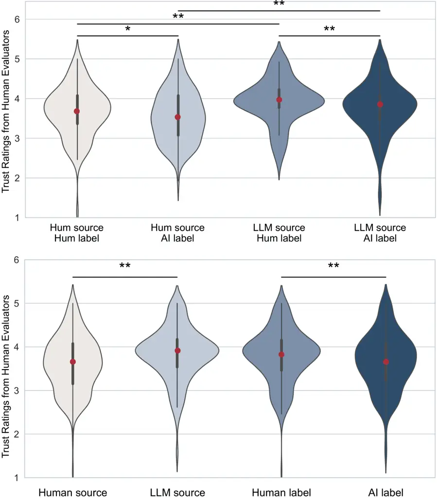

Figure 8: Human trust ratings in Study 1. Top: Trust score distributions
for the four ($`2\times 2`$) conditions crossing true answer source
(Human vs. LLM) and disclosed label (Human vs. AI). Bottom: Main effects
collapsed across the other factor: trust scores by true source
(regardless of label) and by disclosed label (regardless of true
source). Violins show density; red dots indicate means; black lines
indicate medians; thick bars denote interquartile ranges (IQR).
Horizontal brackets mark significant pairwise differences
($`{}^{**}p<.01`$, $`{}^{*}p<.05`$).

## Appendix E Implementation Details of LLMs

We evaluate a diverse set of LLMs spanning both proprietary and
open-weight families. All models are used in compliance with their
licenses.

In Study 2 (Sec. 3.2), we test both proprietary models and open-weight
models. For proprietary LLMs. We evaluated _GPT-5.2 ²² 2
https://platform.openai.com/docs/models/gpt-5.2, GPT-4o ³³ 3
https://platform.openai.com/docs/models/gpt-4o, Claude-Sonnet-4.5 ⁴⁴ 4
https://www.anthropic.com/news/claude-sonnet-4-5, and Claude-Opus-4.5 ⁵⁵
5 https://www.anthropic.com/news/claude-opus-4-5_ via their official
APIs. Model parameter counts are not publicly disclosed for these
systems, we therefore report them by model name and provider.

For open-weight LLMs (local inference), we evaluated the representative
models: (1) OpenAI GPT-OSS: GPT-OSS (120B) ⁶⁶ 6
https://huggingface.co/openai/gpt-oss-120b. (2) Meta Llama:
Llama-3.3-Instruct (70B) ⁷⁷ 7
https://huggingface.co/meta-llama/Llama-3.3-70B-Instruct. (3) Qwen3:
Qwen3-235B-A22B (235B) ⁸⁸ 8
https://huggingface.co/Qwen/Qwen3-235B-A22B-Instruct-2507. (4) DeepSeek:
DeepSeek-V3.2 (685B) ⁹⁹ 9
https://huggingface.co/deepseek-ai/DeepSeek-V3.2. These open-weight
models were run locally using Hugging Face Transformers. To minimize
sampling noise in trust scoring, we used deterministic decoding:
temperature=0 and a fixed $`max_{n}ew_{t}okens`$ sufficient for
returning the required structured scores.

In Study 3 (Sec. 3.3 Because proprietary APIs typically do not expose
full attention tensors, Study 3 is restricted to open-weight models
where internal states can be extracted during inference. We use
open-weight models for internal analyses to assess attention and logits:
(1) OpenAI GPT-OSS: GPT-OSS-20B ¹⁰¹⁰ 10
https://huggingface.co/openai/gpt-oss-20b and GPT-OSS-120B. (2) Qwen3:
Qwen3-30B in both base ¹¹¹¹ 11 https://huggingface.co/Qwen/Qwen3-30B-A3B
and instructed ¹²¹² 12
https://huggingface.co/Qwen/Qwen3-30B-A3B-Instruct-2507 variants. (3)
Meta Llama: LLaMA-3.2-3B-Instruct ¹³¹³ 13
https://huggingface.co/meta-llama/Llama-3.2-3B-Instruct and
LLaMA-3.3-70B-Instruct.

As for LLM’s internals. _Attention_: we enabled
“$`output_{attentions}=True`$” and extracted last-layer attention
weights at the rating step (aggregating all heads). _Logits (for
uncertainty)_: we captured the pre-softmax logits for the rating
token(s) (i.e., scale from 1 to 5) and computed entropy-based
uncertainty metrics from the normalized probability distribution over
five candidate rating outputs.

## Appendix F Prompt Design and Template

We designed the prompt $`\mathcal{P}`$ to strictly mirror the
instructions given to human participants. The source label $`L`$ was
injected into the context. The prompt structure is defined as follows:

| Field          | Template                                                                                                                                                                                                                                                                                                                                                                                                                                                                                                                                                                                                                                                                                                                                                                                                                                                                                                                                                                             |
| -------------- | ------------------------------------------------------------------------------------------------------------------------------------------------------------------------------------------------------------------------------------------------------------------------------------------------------------------------------------------------------------------------------------------------------------------------------------------------------------------------------------------------------------------------------------------------------------------------------------------------------------------------------------------------------------------------------------------------------------------------------------------------------------------------------------------------------------------------------------------------------------------------------------------------------------------------------------------------------------------------------------ |
| Prefix         | You are an evaluator of health information. Given a health question and its answer, you should provide your perceived trust ratings.                                                                                                                                                                                                                                                                                                                                                                                                                                                                                                                                                                                                                                                                                                                                                                                                                                                 |
| Question $`Q`$ | {QUESTION}, e.g., “What is (are) Low Blood Pressure?”                                                                                                                                                                                                                                                                                                                                                                                                                                                                                                                                                                                                                                                                                                                                                                                                                                                                                                                                |
| Label $`L`$    | {LABEL_TEXT}, e.g., “Source of the following answer: Artificial Intelligence-Generated”                                                                                                                                                                                                                                                                                                                                                                                                                                                                                                                                                                                                                                                                                                                                                                                                                                                                                              |
| Answer $`A`$   | {ANSWER}, e.g., “You’ve probably heard that high blood pressure is a problem. Sometimes, blood pressure that is too low can also cause problems. Blood pressure is the force of your blood pushing against the walls of your arteries. Each time your heart beats, it pumps out blood into the arteries. ……”                                                                                                                                                                                                                                                                                                                                                                                                                                                                                                                                                                                                                                                                         |
| Task           | Rate the information rigorously and strictly based on the following assessment items using a 1-5 Likert scale: 1=strongly disagree, 2=disagree, 3=neutral, 4=agree, 5=strongly agree. - Fact: The information contains facts rather than opinions - Impartiality: The information is impartial - Credibility: I feel I can believe the information - Quality: The information has good quality - Objectivity: The information is objective - Comprehensiveness: The information is comprehensive - Reliability: The information is reliable - Trustworthiness: I trust this information - Usefulness2: The information tells me most of what I need to know - Usefulness1: The information helps me to understand the issue better - Clarity: The structure of the information is clear - Understandability: I can understand the information easily - Readability: I can read the information easily Return ONLY a JSON object with integer values between 1 and 5 (no extra keys). |

Table 3: LLM-as-a-Judge prompt template used in Study 2 (Sec. 3.2) and
Study 3 (Sec. 3.3).

## Appendix G Visualization of LLM Judgment with Placebo Label Test

Fig. 9 visualizes trust ratings under three disclosed labels (i.e.,
Human vs. AI vs. Placebo) described in Sec. 3.3.3). Across models, AI
label yields consistently lower trust scores than Human label, with most
Human-AI label gaps statistically significant. The placebo label serves
as an additional control receiving ratings that differ from AI-labeled
condition and are closer to the Human-labeled condition. The three-label
comparison reinforces that provenance disclosure can shift LLMs’ trust
judgments.

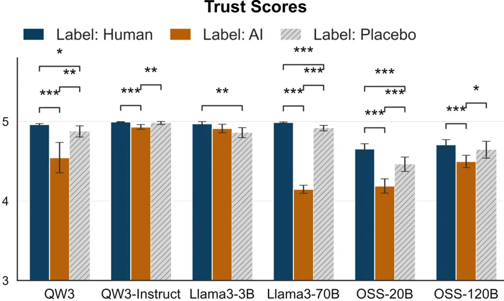

Figure 9: Trust scores of LLM-as-a-Judge under three label conditions
from Study 3 (Sec. 3.3). Mean trust ratings (with error bars) produced
by each model when the same health QA content is shown across three
labels: Human, AI, and a non-semantical Placebo label as “\[TAG\]”.
Horizontal brackets indicate significant pairwise differences
($`{}^{***}p<.001`$, $`{}^{**}p<.01`$, $`{}^{*}p<.05`$).

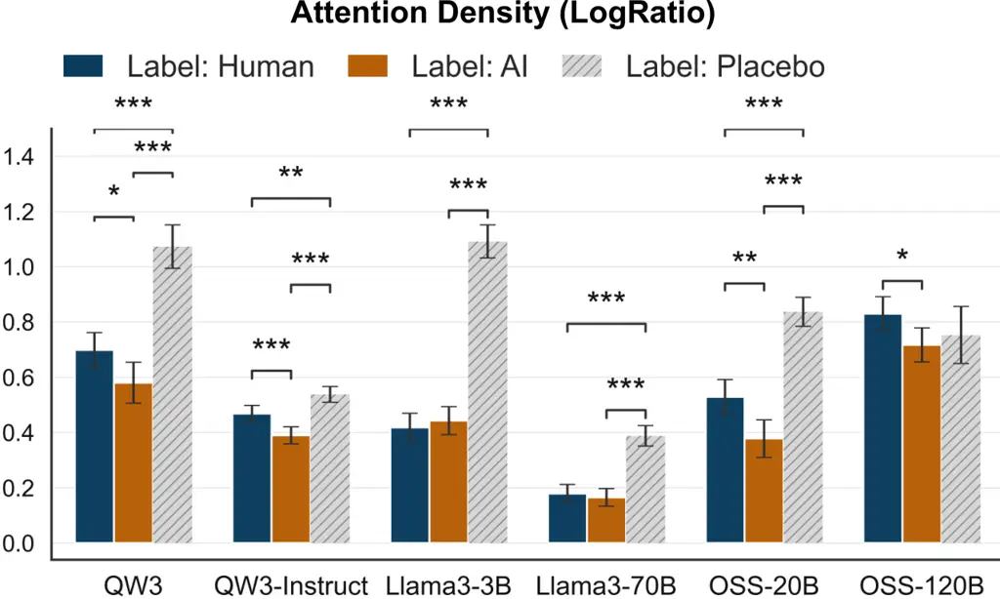

Figure 10: LLM’s attention allocation between two AoAs (i.e., Label AoA
vs. Content AoA) across three label conditions (i.e., Human vs. AI vs.
Placebo). (\*\*\*$`p`$\<.001, \*\*$`p`$\<.01, \*$`p`$\<.05)

Fig. 10 reports the attention allocation “LogRatio” between Label AoA
and Content AoA across three label conditions. Across all models and
conditions, LogRatio is consistently above zero, indicating consistent
label-dominant attention allocation at the judgment step. The placebo
condition often elicits the largest LogRatio, suggesting that an
underspecified label can attract extra processing to the label region
because it has no semantic meaning.

Fig. 11 shows the logits entropy at the judgment step under three label
conditions. Across models, the AI label generally yields higher entropy
than the Human label, indicating greater decision uncertainty when the
same content is disclosed as AI-generated. Overall, label manipulations
modulate model uncertainty.

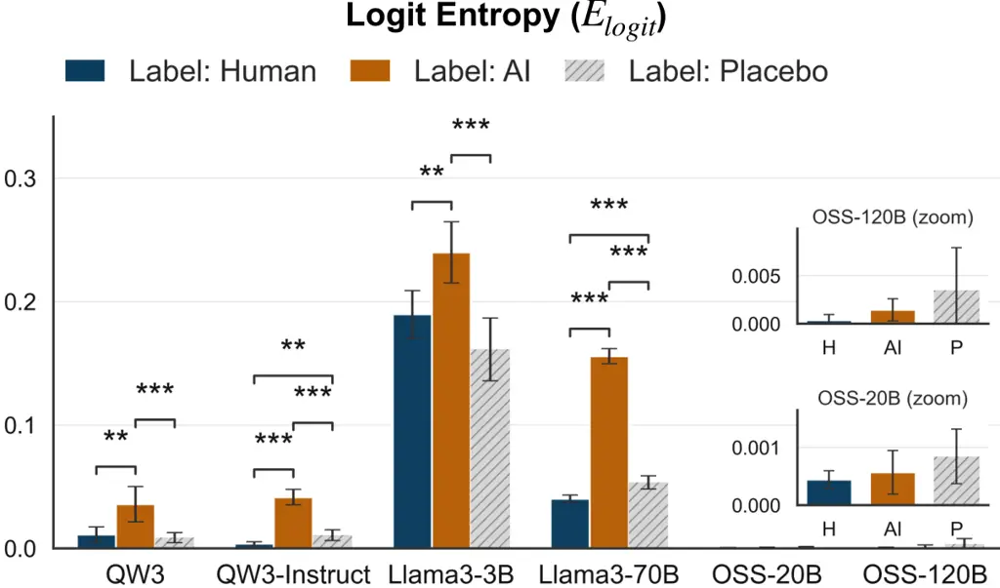

Figure 11: LLM’s logit entropy between two AoAs (i.e., label vs.
content) across three label conditions (i.e., Human vs. AI vs. Placebo).
(\*\*\*$`p`$\<.001, \*\*$`p`$\<.01)

Fig. 12 visualizes token-normalized attention density for the Label AoA
and Content AoA under three label conditions. Across models, attention
density is higher in the Label AoA than in the Content AoA in all label
conditions, consistent with label-dominant processing during judgment.

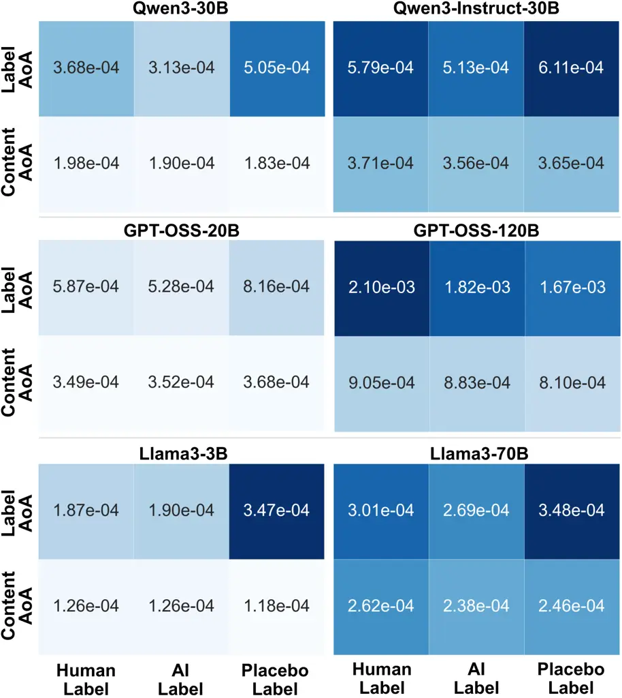

Figure 12: LLM attention distribution density across AOAs (Label AoA vs.
Content AoA) and three labels (i.e., Human vs. AI vs. Placebo) across
LLMs.

## Appendix H AI Usage Disclosure

We used AI tools for: (1) language editing (e.g., improving clarity and
conciseness) by GPT-5.2. (2) minor figure polishing (e.g., layout
structure and color choice for Fig. 1) by Gemini 3. All figures are
based on our own data and results. All study design, analysis,
literature review, and writing were conducted and verified by the
authors.
