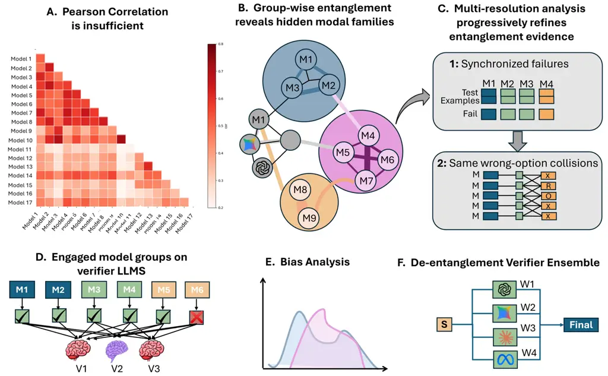
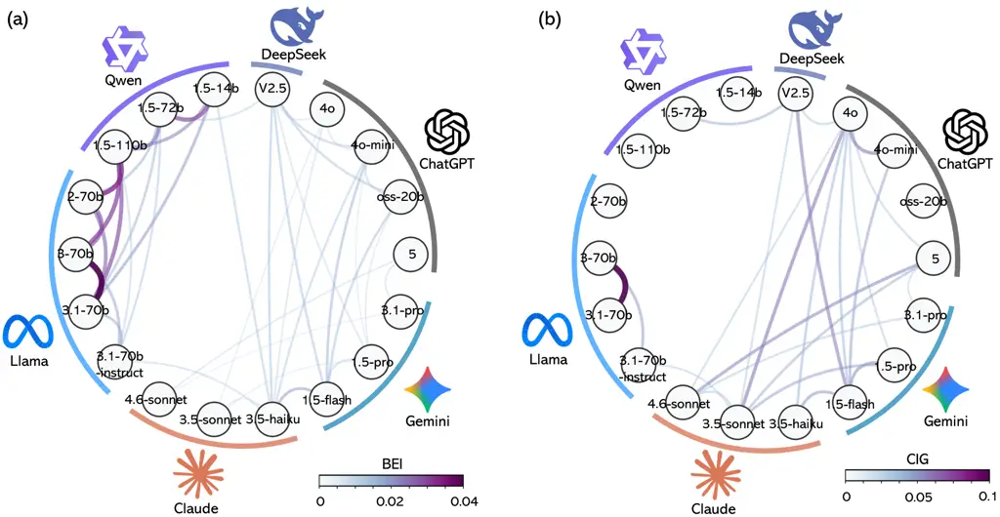
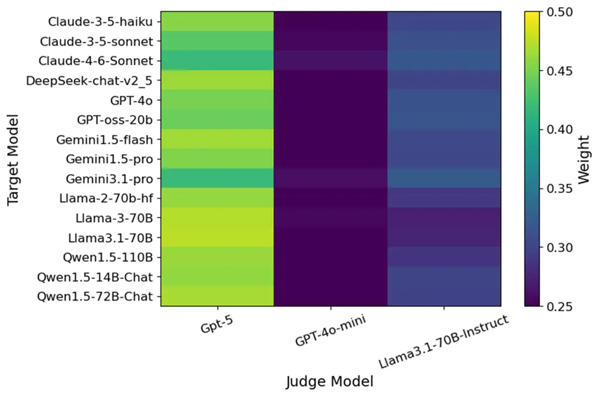
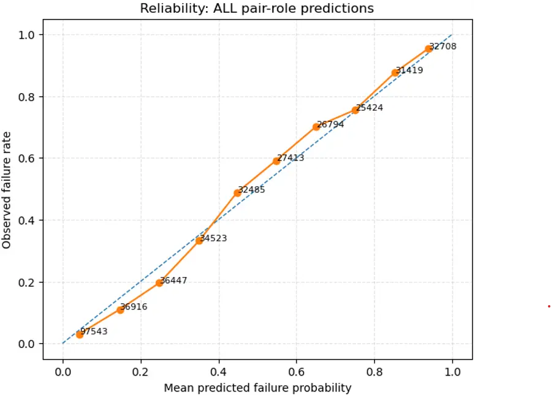

# A Statistical Framework for Auditing Behavioral Dependence and Induced Bias in LLM Judges

Chenchen Kuai ^(†)^(†)thanks: Equal contribution.    Jiwan
Jiang¹¹footnotemark: 1    Zihao Zhu    Hao Wang    Keshu Wu    Zihao Li
   Yunlong Zhang    Chenxi Liu Affiliation: Texas A&M University,
Marquette University, University of Utah    Zhengzhong Tu    Zhiwen Fan
   & Yang Zhou ^(†)^(†)thanks: Corresponding author:
yangzhou295@tamu.edu

###### Abstract

The rapid growth of the large language model (LLM) ecosystem raises a
critical question: are seemingly diverse models truly independent?
Shared pretraining data, distillation, and alignment pipelines can
induce hidden behavioral dependencies, latent entanglement, that
undermine multi-model systems such as LLM-as-a-judge pipelines and
ensemble verification, which implicitly assume independent signals. In
practice, this manifests as correlated reasoning patterns and
synchronized failures, where apparent agreement reflects shared error
modes rather than independent validation. To address this, we develop a
statistical framework for auditing behavioral entanglement among
black-box LLMs. Our approach introduces a multi-resolution hierarchy
that characterizes the joint failure manifold through two
information-theoretic metrics: (i) a Difficulty-Weighted Behavioral
Entanglement Index (BEI), which amplifies synchronized failures on easy
tasks, and (ii) a Cumulative Information Gain (CIG) metric, which
captures directional alignment in erroneous responses. Through
experiments on 18 LLMs from 6 model families, we identify statistically
significant behavioral entanglement. Such behavioral dependence is
associated with judge over-endorsement bias on a disjoint MMLU-Pro
evaluation set ($`\rho=0.508`$ for BEI and $`0.520`$ for CIG;
$`p<0.01`$). The association further transfers to the MATH-500 benchmark
($`\rho=0.441`$ and $`0.457`$; $`p<0.05`$), providing cross-benchmark
evidence that the identified dependency structure generalizes beyond the
data and response format used for its estimation. Finally, we
demonstrate a practical use case of entanglement through de-entangled
verifier ensemble reweighting, achieving 3.5 and 2.6 percentage-point
gains in accuracy and precision, respectively, over majority voting.

|     |
| --- |
|     |

## 1 Introduction

The rapid expansion of Large Language Models (LLMs) has outpaced our
ability to verify their structural independence. This is increasingly
critical as modern AI systems rely on multi-model infrastructures such
as LLM-as-a-judge pipelines (Gu et al., 2026), ensemble evaluation
frameworks, and redundancy-based safety mechanisms. For example, in
LLM-as-a-judge pipelines, multiple models may unanimously endorse an
incorrect answer, where agreement is often treated as evidence of
correctness. However, if models share training lineage or alignment
signals, such agreement may instead reflect correlated failure rather
than independent verification. As a result, these systems implicitly
assume independent signals, while the apparent diversity of LLMs may be
misleading.

Many LLMs share substantial portions of their training pipelines,
overlapping pre-training corpora, shared alignment procedures (Zhou et
al., 2023), and widespread knowledge distillation (Cho and Hariharan,
2019; Park et al., 2019), which can induce hidden behavioral
dependencies. We term this phenomenon latent entanglement, whereby
ostensibly independent models exhibit synchronized reasoning patterns
and similar failure modes despite being developed separately (Ye et al.,
2025). This poses a fundamental risk for multi-LLM systems: apparent
agreement may reflect a _consensus of correlated errors_ rather than
independent verification, leading to overestimated reliability and
shared blind spots (Zheng et al., 2023; Liu et al., 2024c; Liu et al.,
2024d; Chen et al., 2025; Zhang and Ma, 2026). Existing analyses
typically rely on descriptive behavioral signals, such as output
overlap, embedding similarity, or agreement-based scores (Liu et al.,
2024b; Rosas et al., 2019); however, these measures are not identifiable
with respect to independence, as similar outputs may arise from either
independent reasoning or latent coupling induced by shared data,
benchmark contamination, or evaluator self-preference across related
model families (Xu et al., 2024). Moreover, because such signals operate
at the level of observable outputs or explanations, they can be
strategically perturbed without altering the underlying decision
process, thereby masking dependence.

To address this limitation, we adopt a statistical perspective that
explicitly tests whether observed agreement is consistent with
independent reasoning, leveraging principled null models and uncertainty
quantification. Our key observation is that while correct answers may
naturally converge, the structure of errors is more informative: under
independence, failures should disperse across a large hypothesis space,
whereas coincident failures, especially on easy tasks or along identical
incorrect options, provide statistically significant evidence of latent
dependence. We formalize this intuition by analyzing the joint failure
manifold through a hierarchy of behavioral synchronization.

Specifically, this paper makes the following contributions: (1) A
Multi-Resolution Statistical Framework for Behavioral Entanglement. We
propose a hierarchical statistical framework for auditing dependencies
within the LLM failure manifold. This hierarchy integrates two novel
information-theoretic metrics: the Difficulty-Weighted Behavioral
Entanglement Index for binary failure synchronization, with more
emphasis on the joint failures on easy questions and Cumulative
Information Gain for directional error alignment, providing a robust
toolset to detect shared behavior entanglement.(2) We conduct extensive
experiments on 18 LLMs from six model families to identify behavioral
entanglement and its impact on LLM-as-a-judge evaluation. By leveraging
model outputs and cross-model verification signals, we statistically
characterize entanglement patterns and demonstrate their association
with drop in judge precision. (3) We demonstrate a practical use case
for Verifier Ensembles through De-entangled Ensemble Reweighting. We
adopt a mitigation algorithm that utilizes entanglement scores to
regularize ensemble fusion. By reweighting verifiers based on their
statistical independence from the target model, our method significantly
reduces bias and restores the accuracy of multi-model verification.

## 2 Related Work

This study connects three related topics: shared model lineage, bias in
LLM-as-a-judge systems, and behavioral signals used to infer dependence
among models. Together, they motivate our focus on whether agreement
among black-box LLMs is trustworthy when dependencies are not accounted
for.

### 2.1 Knowledge Distillation and Shared Model Lineage

A primary source of latent dependence is knowledge distillation and
synthetic supervision (Wang et al., 2025). Student models can retain
detectable traces of their teachers even when the teacher is accessible
only as a black box. For example, Wadhwa et al. (2025) show that student
outputs often preserve identifiable teacher footprints. This concern is
reinforced by the widespread use of model-generated instruction data in
alignment pipelines (Dubois et al., 2023; Ji, 2023; Peng et al., 2023).
At the ecosystem level, recursive reuse of synthetic data can further
homogenize future models (Shumailov et al., 2024). Together, these
trends suggest that behavioral agreement across models may reflect
inherited decision structure rather than independent reasoning.

### 2.2 LLM-as-a-Judge and Evaluation Biases

This issue is especially important in the LLM-as-a-judge setting, where
strong models are used to evaluate others (Zheng et al., 2023; Wang et
al., 2024a; Kuai et al., 2026). Recent work shows that such judges are
not neutral. Wataoka et al. (2024) identify self-preference bias,
whereby judges favor outputs that are more familiar to them, while Chen
et al. (2025) show that judges can systematically prefer outputs from
related models, including inherited students or models from the same
family. As a result, agreement between a judge and a target model cannot
automatically be interpreted as independent verification (Li et al.,
2026). Our work is motivated by precisely this failure mode.

### 2.3 Contamination and the Limits of Output-Level Signals

A related line of work examines benchmark contamination and other
output-level signals that may confound model comparison (Deng et al.,
2024; Dong et al., 2024; Dekoninck et al., 2024). Contamination arises
when benchmark examples, or close variants of them, appear in training
corpora, thereby inflating apparent model capability and
agreement (Sainz et al., 2023; Magar and Schwartz, 2022; Xu et al.,
2024). Existing diagnostics, such as overlap- or perplexity-based
heuristics, can detect some forms of direct leakage (Shi et al., 2024),
but they remain limited for paraphrased contamination and do not
determine whether multiple models are behaviorally independent. More
broadly, observable agreement or similarity alone is not identifiable
with respect to independence: models may agree because they reason
independently, because they share contaminated benchmark exposure, or
because they inherit common decision structure from shared training
pipelines. This limitation motivates the need for a statistical
framework that moves beyond surface-level signals and directly tests for
dependence through the structure of model errors.



Figure 1: A Multi-Resolution Entanglement Hierarchy for Behavioral
Dependence

## 3 Statistical Framework for Auditing Behavioral Entanglement

Our goal is to determine whether a group of large language models
behaves as statistically independent reasoning agents or exhibits hidden
structural dependence due to shared training data, distillation, or
architectural lineage. Given $`M`$ black-box models evaluated on $`N`$
tasks, we test whether their outputs are consistent with independent
error processes or display higher-order synchronization indicative of
latent entanglement.

A key difficulty is that agreement does not imply dependence: correct
answers naturally converge because tasks typically have a single
solution. In contrast, errors occupy a much larger hypothesis space.
When multiple models fail in the same way across many tasks, especially
easy tasks, the probability of such synchronization under independence
becomes extremely small. This motivates focusing on the failure
manifold, where dependence signals become statistically identifiable.

The following subsections describe the two levels of the hierarchy (see
Figure 1) and its downstream application. Level 1 introduces the
Difficulty-Weighted Behavioral Entanglement Index (BEI\_(w)) for
synchronized failures, while Level 2 introduces Cumulative Information
Gain (CIG) for directional error alignment. We then examine the
downstream association with judge bias and develop an entanglement-aware
verifier reweighting strategy.

### 3.1 Level 1: Failure Synchronization and Pairwise Behavioral Entanglement

We begin with a coarse manifestation of behavioral dependence: the
excess occurrence of co-failures across tasks. Even under behavioral
independence, two models are more likely to fail together on
intrinsically difficult tasks, simply because both models have higher
marginal failure probabilities on such tasks. Therefore, whether an
observed co-failure is excessive cannot be assessed without accounting
for task difficulty. We address this by defining behavioral independence
conditionally on task difficulty. Deviations from this
conditional-independence null provide evidence of pairwise behavioral
entanglement and are subsequently quantified by the proposed BEI metric.

The assessment is conducted on tasks with objectively verifiable
answers. Consider $`M`$ models evaluated across $`T`$ tasks. For each
model $`m`$ and task $`t`$, let $`Y_{m,t}\in\{0,1\}`$ denote the binary
error indicator, where $`Y_{m,t}=1`$ indicates that model $`m`$ answers
task $`t`$ incorrectly. For a focal model pair $`(i,j)`$, we
characterize the empirical difficulty of task $`t`$ using the failure
rate among the remaining models:

```math
d_{t}=\frac{1}{M-2}\sum_{m\notin\{i,j\}}Y_{m,t}. \tag{1}
```

Excluding the focal pair prevents the two outcomes being tested from
mechanically entering their own conditioning variable. The corresponding
task easiness is denoted as $`a_{t}=1-d_{t}`$, so that larger $`a_{t}`$
corresponds to an easier task.

Conditional Independence Null. We define the null hypothesis as
behavioral independence conditional on task difficulty. Intuitively,
among tasks of the same difficulty, the correctness outcomes of two
models are assumed to be independent: once task difficulty is known,
observing whether one model succeeds or fails provides no additional
information about the other model’s outcome. Formally,

```math
H_{0}:\quad Y_{i,t}\perp\!\!\!\perp Y_{j,t}\mid d_{t}. \tag{2}
```

For an individual model $`m`$, its marginal failure probability on a
task of difficulty $`d_{t}`$ can be written as
$`\mathbb{P}(Y_{m,t}=1\mid d_{t})`$. The conditional-independence null
therefore implies that the probability that models $`i`$ and $`j`$ fail
the same task jointly is determined entirely by their respective
marginal failure probabilities at that difficulty:

```math
\mathbb{P}\left(Y_{i,t}=1,\,Y_{j,t}=1\mid d_{t}\right)=\mathbb{P}(Y_{i,t}=1\mid d_{t})\,\mathbb{P}(Y_{j,t}=1\mid d_{t}). \tag{3}
```

To model how the marginal failure probability of each model varies with
task difficulty, define its difficulty-response function as
$`p_{m}(d):=\mathbb{P}(Y_{m,t}=1\mid d_{t}=d).`$ In practice,
$`p_{m}(d)`$ can be estimated using logistic regression. This
formulation is analogous to difficulty calibration in item response
theory (Bock and Gibbons, 2021): the objective is not necessarily to
construct a perfect predictive model, but to account for the systematic
variation in marginal failure probability associated with task
difficulty through calibration. Considering the co-failure for model
pair $`(i,j)`$ on task $`t`$ is $`Y_{i,t}Y_{j,t}`$, which equals one if
and only if both models fail task $`t`$. Under $`H_{0}`$, the expected
co-failure probability follows directly from conditional independence
$`\mathbb{E}_{0}[Y_{i,t}Y_{j,t}\mid d_{t}]=p_{i}(d_{t})\,p_{j}(d_{t}).`$

Behavioral Entanglement Index. The deviation from this null expectation
provides a task-level measure of synchronized failure. A direct
aggregation across all evaluated tasks yields the mean co-failure
residual,

```math
\overline{r}_{ij}=\frac{1}{T}\sum_{t=1}^{T}\left(Y_{i,t}Y_{j,t}-p_{i,t}p_{j,t}\right). \tag{4}
```

This quantity measures the average excess co-failure exhibited by a
model pair beyond that expected from their individual
difficulty-conditioned failure probabilities.

Although the unweighted residual is naturally centered at zero under
$`H_{0}`$, residuals from different tasks are not equally informative
about shared failure modes. On difficult tasks, the expected co-failure
probability $`p_{i,t}p_{j,t}`$ is already high, so the absence of a
co-failure can produce a large negative residual. Such negative
contributions are difficult to interpret as evidence against behavioral
entanglement, since success on a difficult task may reflect sufficient
capability rather than genuinely distinct behavior. Conversely,
co-failures on easy tasks are more diagnostically informative. When both
models are individually expected to succeed, their simultaneous failure
is more indicative of a shared blind spot beyond what task difficulty
alone would predict. We therefore weight task-level residuals by task
easiness, attenuating contributions from difficult tasks while
emphasizing unexpected co-failures on easier ones. Let $`a_{t}`$ denote
task easiness and define the weighting function
$`a_{t}^{w}=(1-d_{t})^{w}`$ for $`w\geq 0`$. The proposed
$`\mathrm{BEI}_{w}`$ is therefore:

```math
\mathrm{BEI}_{w}(i,j)=\frac{1}{T}\sum_{t=1}^{T}a_{t}^{w}\left(Y_{i,t}Y_{j,t}-p_{i,t}p_{j,t}\right) \tag{5}
```

The parameter $`w`$ controls the strength of the easiness emphasis.
Setting $`w=0`$ recovers mean co-failure residual in Eq. (4), whereas
increasing $`w`$ progressively attenuates contributions from difficult
tasks.

Proposition 1 (Null centering under easiness weighting). Under
$`H_{0}`$, the task-level co-failure residual is centered at zero. Since
the easiness weight is a deterministic function of task difficulty,
weighting preserves this zero expectation, and hence
$`\mathbb{E}_{0}[\mathrm{BEI}_{w}(i,j)]=0`$. A proof is provided in
Appendix A.

Statistical Inference. To determine whether the dependence captured by
BEI is statistically significant, we test whether the observed excess
co-failure is significantly greater than zero. As established above,
$`\mathrm{BEI}_{w}(i,j)`$ is centered at zero under the
conditional-independence null; accordingly, we consider the one-sided
alternative $`H_{1}:\mathbb{E}[\mathrm{BEI}_{w}(i,j)]>0`$.

For each task $`t`$, the fitted difficulty-response functions provide
the marginal failure probabilities $`\hat{p}_{i,t}=\hat{p}_{i}(d_{t})`$
and $`\hat{p}_{j,t}=\hat{p}_{j}(d_{t})`$. we generate a synthetic
realization under $`H_{0}`$ by independently sampling the two model
outcomes from Bernoulli distributions with these probabilities while
keeping the observed task difficulties fixed. We then recompute BEI on
the simulated outcomes. Repeating this procedure produces the Monte
Carlo null distribution of BEI under conditional independence, from
which a one-sided $`p`$-value is obtained by comparing the observed BEI
with the simulated values. Since the audit tests multiple model pairs,
we further apply the Benjamini–Hochberg procedure to control the false
discovery rate (FDR) and report the corresponding adjusted $`q`$-values
(Benjamini and Hochberg, 1995).

### 3.2 Level 2: Directional Failure Collision and Cumulative Information Gain

Level 1 identifies whether two models fail together more often than
expected, but does not distinguish whether their failures follow the
same direction. In multiple-choice question (MCQ) settings, two models
may both fail while selecting different distractors, whereas repeatedly
selecting the same distractor provides more specific evidence of aligned
erroneous behavior. However, such collisions can also arise because some
distractors are intrinsically more attractive than others. We therefore
assess directional alignment relative to a task-specific distractor
distribution and quantify excess alignment CIG.

For an MCQ task $`t`$ with $`K-1`$ distractors, let
$`S_{m,t}\in\{1,\ldots,K-1\}`$ denote the distractor selected by model
$`m`$ when $`Y_{m,t}=1`$. For a focal pair $`(i,j)`$, the attractiveness
of distractor $`k`$ is estimated from the failing responses of the
remaining models (Chen and Goodman, 1999):

```math
\pi_{k,t}=\frac{n_{k,t}^{(-ij)}+\alpha}{n_{t}^{(-ij)}+\alpha(K-1)},\qquad n_{k,t}^{(-ij)}=\sum_{\begin{subarray}{c}m\notin\{i,j\}\\
Y_{m,t}=1\end{subarray}}\mathbb{I}(S_{m,t}=k), \tag{6}
```

where $`n_{t}^{(-ij)}=\sum_{m\notin\{i,j\}}Y_{m,t}`$ and $`\alpha=1`$
corresponds to add-one smoothing. Pair exclusion prevents the tested
responses from entering their own directional baseline, while smoothing
avoids zero probability for distractors not selected by the remaining
models.

Directional Independence Null. Conditional on both models failing task
$`t`$, the null assumes that their distractor choices are independent
draws from the task-specific distribution:

```math
H_{0}^{\mathrm{dir}}:\quad\mathbb{P}\left(S_{i,t}=k,\,S_{j,t}=\ell\mid Y_{i,t}=Y_{j,t}=1\right)=\pi_{k,t}\pi_{\ell,t}. \tag{7}
```

Define the directional collision indicator
$`Z_{ij,t}^{\mathrm{dir}}=\mathbb{I}(S_{i,t}=S_{j,t}).`$ Under
$`H_{0}^{\mathrm{dir}}`$, the expected collision probability is

```math
c_{t}=\mathbb{E}_{0}\left[Z_{ij,t}^{\mathrm{dir}}\mid Y_{i,t}=Y_{j,t}=1\right]=\sum_{k=1}^{K-1}\pi_{k,t}^{\,2}. \tag{8}
```

Cumulative Information Gain. The deviation
$`Z_{ij,t}^{\mathrm{dir}}-c_{t}`$ measures excess directional agreement
beyond that expected from distractor attractiveness. These deviations
are not equally informative: when $`c_{t}`$ is large, selecting the same
distractor is already likely under the null, whereas a collision with
small $`c_{t}`$ is more surprising. We therefore weight each residual by
its null surprisal, $`-\log c_{t}`$.

Let $`\mathcal{T}_{ij}^{\mathrm{cf}}=\{t:Y_{i,t}=Y_{j,t}=1\}`$ denote
the set of co-failure tasks. The proposed CIG is

```math
\mathrm{CIG}(i,j)=\frac{1}{T}\sum_{t\in\mathcal{T}_{ij}^{\mathrm{cf}}}\left(-\log c_{t}\right)\left(Z_{ij,t}^{\mathrm{dir}}-c_{t}\right). \tag{9}
```

Positive CIG values indicate excess same-distractor alignment, with
greater contribution from collisions that are unlikely under directional
independence.

Statistical Inference. To determine whether the directional dependence
captured by CIG is statistically significant, we test whether the
observed excess directional agreement is significantly greater than
zero. Accordingly, we consider the one-sided alternative
$`H_{1}^{\mathrm{dir}}:\mathbb{E}[\mathrm{CIG}(i,j)]>0.`$ For each
co-failure task $`t`$, we generate a null directional collision as
$`Z_{ij,t}^{\mathrm{dir},(b)}\sim\operatorname{Bernoulli}(c_{t}),`$ and
recompute CIG across tasks. Repeating this procedure produces the Monte
Carlo null distribution under directional independence, from which a
one-sided $`p`$-value is obtained by comparing the observed CIG with the
simulated values (Hope, 1968). As in Level 1, we apply the
Benjamini–Hochberg procedure across model pairs and report FDR-adjusted
$`q`$-values.

Remarks. Level 2 complements Level 1 by refining pairwise failure
synchronization into directional structure. While Level 1 captures
whether two models excessively _fail together_, Level 2 captures whether
they excessively fail in the _same way_.

### 3.3 Entanglement-Aware Verifier Reweighting

Beyond auditing behavioral dependence, the proposed metrics can provide
a simple signal for adjusting verifier aggregation in multiple LLM
judges. Rather than treating all verifier outputs as independent
evidence, we examine whether the influence of a verifier can be reduced
when it is behaviorally entangled with the target model. We present this
reweighting as a downstream use case of the proposed audit.

Let $`S`$ denote the target model and
$`\mathcal{J}=\{J_{1},\ldots,J_{M_{J}}\}`$ the set of verifiers. Each
verifier $`J_{m}`$ is assigned a competence score $`q_{m}\in(0,1]`$,
estimated on a calibration set. Since BEI and CIG characterize
complementary forms of dependence but operate on different scales, we
first normalize their positive components on the calibration set. Let
$`\widetilde{\mathrm{BEI}}(i,j)`$ and $`\widetilde{\mathrm{CIG}}(i,j)`$
denote the resulting scores. Their combined pairwise entanglement is
defined as

```math
E(i,j)=\lambda\widetilde{\mathrm{BEI}}(i,j)+(1-\lambda)\widetilde{\mathrm{CIG}}(i,j),\qquad\lambda\in[0,1]. \tag{10}
```

For each verifier, we consider two forms of dependence:

```math
R_{m}=\frac{1}{M_{J}-1}\sum_{\begin{subarray}{c}\ell=1\\
\ell\neq m\end{subarray}}^{M_{J}}E(J_{m},J_{\ell}),\qquad T_{m}^{(S)}=E(J_{m},S). \tag{11}
```

Here, $`R_{m}`$ measures the average redundancy of verifier $`J_{m}`$
with the remaining verifier ensemble, while $`T_{m}^{(S)}`$ measures its
behavioral dependence on the target model.

We then combine verifier competence with penalties for these two forms
of dependence:

```math
w_{m}^{(S)}=\frac{q_{m}^{\kappa}\exp\!\left(-\eta_{1}R_{m}-\eta_{2}T_{m}^{(S)}\right)}{\displaystyle\sum_{\ell=1}^{M_{J}}q_{\ell}^{\kappa}\exp\!\left(-\eta_{1}R_{\ell}-\eta_{2}T_{\ell}^{(S)}\right)}. \tag{12}
```

The competence term $`q_{m}^{\kappa}`$ favors more reliable verifiers,
while the two exponential penalties reduce the influence of verifiers
that provide potentially redundant evidence. The parameter $`\eta_{1}`$
controls the penalty for dependence within the verifier ensemble, and
$`\eta_{2}`$ controls the penalty for dependence between a verifier and
the target model. Setting $`\eta_{1}=\eta_{2}=0`$ recovers
competence-based weighting, while additionally setting $`\kappa=0`$
recovers uniform aggregation. For binary verifier decisions
$`V_{m}^{(S)}\in\{0,1\}`$, the resulting ensemble score is

```math
\widehat{P}^{(S)}=\sum_{m=1}^{M_{J}}w_{m}^{(S)}V_{m}^{(S)}, \tag{13}
```

which replaces the uniform vote share used in majority voting. All
normalization procedures and reweighting parameters are determined on
the calibration set and fixed before evaluation. This construction tests
whether the behavioral dependence identified by BEI and CIG can provide
a useful adjustment to verifier aggregation, without claiming to
identify or eliminate the underlying source of that dependence.

## 4 Experiments

### 4.1 Experimental Setup

Models and Datasets. We evaluate 18 LLMs spanning the GPT (Singh et al.,
2025), Claude, Qwen (Bai et al., 2023), Llama (Grattafiori et al.,
2024), Gemini (Team et al., 2023), and DeepSeek (Liu et al., 2024a)
families to examine behavioral dependence both within and across model
families (full list in Appendix B). Three representative models,
Llama-3.1-70B-Instruct, GPT-5, and GPT-4o-mini, are further used as
judges, covering open-source, high-capability closed-source, and
cost-efficient closed-source settings.

Our primary audit uses MMLU-Pro (Wang et al., 2024b). We construct two
disjoint 1,000-question subsets: biology/psychology (473/527) for
estimating pairwise BEI and CIG, and law/business (295/705) for
evaluating their association with judge bias. We additionally use
MATH-500 (Lightman et al., 2024) as a cross-benchmark transfer test,
applying the dependence metrics estimated on MMLU-Pro to judge-bias
evaluation on non-MCQ mathematical responses. The MATH-500 experiment
includes the 14 models that remained available at evaluation time.

Implementation Details. The experiments consist of two stages: (1)
behavioral-dependence estimation and (2) evaluation of
dependency-induced judge bias. For answer generation, all models use a
unified 5-shot prompt following Wang et al. (2024b), with temperature
set to 0 whenever supported. Pairwise BEI and CIG are estimated on the
first MMLU-Pro subset using the leave-pair-out null constructions
described in Sections 3.1 and 3.2. We compare the proposed metrics
against conventional dependence measures, including answer correlation,
mutual information, co-failure Jaccard similarity, error-only agreement,
and difficulty-adjusted residual correlation.

Judge bias is evaluated on the disjoint second MMLU-Pro subset and the
MATH-500 benchmark. Each judge evaluates multiple candidate-model
responses within a common prompt, with response order randomly shuffled
to reduce ordering effects, and assigns correctness and
reasoning-quality scores according to a unified rubric. We additionally
conduct a 500-question ablation comparing this joint-prompt setting with
independent single-response judging to assess prompt-induced stability,
with results reported in Appendix C.3. For verifier reweighting, the
1,000-question evaluation subset is further divided into 500 questions
for parameter calibration and 500 held-out questions for final
performance reporting.



Figure 2: Behavioral entanglement graph of LLMs on MMLU-Pro: (a)
co-failure entanglement (BEI); and (b) directional entanglement (CIG).
Reported are only statistically significant BEI and CIG values and FDR
corrected relationships (q-value $`<0.05`$).

Metrics. We use the deviation in conditional precision
($`\Delta\mathrm{Prec}`$) as an operational proxy for over-endorsement
bias, measuring how much a judge’s precision for a specific target model
deviates from its overall precision across models:

```math
\Delta\mathrm{Prec}(J_{j},M_{i})=\mathbb{P}(Y=1\mid\hat{Y}_{j}=1)-\mathbb{P}(Y=1\mid\hat{Y}_{j}=1,M=M_{i}). \tag{14}
```

where $`Y=1`$ indicates that the target-model response is correct and
$`\hat{Y}_{j}=1`$ indicates that judge $`J_{j}`$ predicts the response
as correct. A positive $`\Delta\mathrm{Prec}`$ indicates lower
conditional precision for model $`M_{i}`$ relative to the judge’s
overall precision, consistent with greater model-specific
over-endorsement. We use the Spearman coefficient to quantify the
monotonic association between behavioral dependence and
$`\Delta\mathrm{Prec}`$.

The proposed BEI and CIG are compared with a diverse set of dependence
baselines capturing complementary forms of behavioral association. These
include Pearson correlation (Pearson, 1895), mutual information
(Shannon, 1948), co-failure Jaccard similarity (Jaccard, 1901),
error-only answer agreement, and difficulty-adjusted residual
correlation following the residual-dependence principle of Yen (1984).
Detailed definitions of all baseline metrics are provided in Appendix B.

### 4.2 LLM Entanglement and Induced Judge Bias

Entanglement Identification. We apply our framework to uncover
structural relationships across models in the failure space. Using
BEI*(w) and CIG, we construct a behavioral dependency graph (Figure 2),
organizing models by shared blind spots and directional error alignment.
Based on BEI*(w), which captures synchronized failures conditioned on
task difficulty, we observe strong intra-family entanglement (e.g.,
within the _LLaMA family_). These findings suggest that behavioral
entanglement extends beyond architectural lineage or model genealogy and
may be associated with shared training signals, alignment strategies,
and generation design choices. Detailed pairwise BEI and CIG statistics,
including raw $`p`$-values and FDR-adjusted $`q`$-values, are provided
in Appendix C.2.

While BEI\_(w) provides a coarse view of dependence through correctness
and task easiness, CIG offers a more refined perspective by capturing
directional collision in errors. Under CIG, the entanglement structure
becomes more selective. Consistent patterns are identified by both BEI
and CIG, with more statistically significant entanglement pairs observed
among closed-weight models and fewer between open- and closed-weight
models. In particular, we observe cross-generation entanglement among
frontier models (e.g., GPT-5, Claude 4.6, Gemini-3.1-pro), as well as
secondary clusters such as Claude 3.5 with GPT-4o, and DeepSeek V2.5
with Gemini 1.5 and Qwen 1.5. These findings suggest that behavioral
entanglement extends beyond architectural lineage or model genealogy.
These patterns may be associated with shared training signals, alignment
strategies, and generation-era design choices, although the present
analysis does not identify their causal origin.

|                                        |            |             |            |             |
| -------------------------------------- | ---------- | ----------- | ---------- | ----------- |
| Metric                                 | MMLU-pro   |             | MATH-500   |             |
|                                        | $`\rho`$   | $`p`$-value | $`\rho`$   | $`p`$-value |
| Co-failure audit                       |            |             |            |             |
| Corr.                                  | 0.063      | 0.724       | 0.187      | 0.360       |
| MI                                     | 0.113      | 0.525       | 0.208      | 0.309       |
| Jaccard                                | 0.428      | 0.012^(∗)   | 0.275      | 0.175       |
| BEI                                    | 0.508      | 0.002^(∗∗)  | 0.441      | 0.024^(∗)   |
| Directional failure audit              |            |             |            |             |
| Err-agree                              | -0.107     | 0.545       | -0.172     | 0.399       |
| Resid. corr.                           | 0.151      | 0.394       | -0.057     | 0.746       |
| CIG                                    | 0.520      | 0.002^(∗∗)  | 0.457      | 0.019^(∗)   |
| $`{}^{*}p<0.05`$, $`{}^{**}p<0.01`$.   |            |             |            |             |

Table 1: Metrics and their Spearman correlations with
$`\Delta{\mathrm{Prec}}`$ on MMLU-pro and MATH-500.

Induced Over-endorsement Bias. We further investigate whether the
identified behavioral dependence is associated with systematic
over-endorsement in LLM-as-a-judge evaluation. Table 1 compares the
proposed metrics with several conventional dependence measures,
including Pearson correlation, mutual information, co-failure Jaccard
similarity, error-only answer agreement, and difficulty-adjusted
residual correlation. On MMLU-Pro, BEI and CIG show the strongest
associations with $`\Delta\mathrm{Prec}`$, with Spearman coefficients of
$`0.508`$ and $`0.520`$, respectively ($`p<0.01`$). In contrast, Pearson
correlation and mutual information exhibit only weak and non-significant
relationships. This contrast suggests that structured failure-based
dependence captures aspects of judge–model coupling that are not well
represented by conventional aggregate similarity measures, particularly
when shared errors contribute to over-endorsement.

Importantly, the same dependency estimates remain predictive when
transferred to MATH-500. BEI and CIG retain significant positive
correlations with $`\Delta\mathrm{Prec}`$, reaching $`\rho=0.441`$ and
$`\rho=0.457`$, respectively ($`p<0.05`$), while most baseline metrics
are not significant. These results suggest that the dependency signals
identified on MMLU-Pro are not specific to the original estimation
subset and remain informative when transferred to a math benchmark,
capturing a transferable structure associated with judge
over-endorsement across evaluation settings.

|    $`w`$    |    MMLU-pro $`\rho`$    |    MATH-500 $`\rho`$    |
| ----------- | ----------------------- | ----------------------- |
|    0        |    0.289                |    0.032                |
|    1        |    0.508^(∗∗)           |    0.441^(∗)            |
|    2        |    0.490^(∗∗)           |    0.275                |
|    3        |    0.504^(∗∗)           |    0.231                |
|    4        |    0.465^(∗∗)           |    0.236                |
|    5        |    0.363^(∗)            |    0.180                |

$`{}^{*}p<0.05`$, $`{}^{**}p<0.01`$.

Table 2: Sensitivity of BEI correlations to the difficulty-weighting
exponent $`w`$.

A sensitivity analysis of BEI with respect to the difficulty-weighting
exponent $`w`$ is conducted (Table 2). When $`w=0`$, BEI reduces to the
mean co-failure residual. Although this form is mathematically simple,
its empirical association with $`\Delta\mathrm{Prec}`$ is weaker,
suggesting that unweighted residuals retain noise from less informative
events, particularly outcomes on difficult tasks. Introducing a positive
$`w`$ places greater emphasis on co-failures on easier tasks, where
synchronized errors provide clearer evidence of behavioral entanglement.
However, overly large $`w`$ increasingly concentrates the metric on only
the easiest tasks and weakens the association. Across both MMLU-Pro and
MATH-500, the results suggest that moderate weighting, around
$`w=1`$–$`2`$, provides a reasonable balance and transfers more
consistently across benchmarks.

### 4.3 LLM Verifier Ensemble Re-weighting

Through experiments using three judge models as a verifier ensemble, we
evaluate the effectiveness of different aggregation strategies. We
compare majority voting with an accuracy-calibrated reweighting baseline
and the proposed entanglement-aware reweighting approach. Results on the
MMLU-Pro test set show that both reweighting strategies outperform
majority voting (Table 3). Notably, our entanglement-aware reweighting
achieves the best performance, yielding the highest accuracy and
precision.

| Aggregation             | Acc   | F1    | Precision | $`\Delta`$Acc |
| ----------------------- | ----- | ----- | --------- | ------------- |
| Majority Vote           | 0.847 | 0.901 | 0.870     | –             |
| Accuracy-based Reweight | 0.881 | 0.919 | 0.891     | +0.034        |
| Entangle-based Reweight | 0.882 | 0.922 | 0.896     | +0.035        |

Table 3: Verifier aggregation performance on MMLU-Pro.



Figure 3: Calibrated verifier ensemble weights.

The calibrated weights (Figure 3) reflect both verifier competence and
the identified dependency structure, with weights adapting across target
models according to verifier redundancy and verifier–target dependence.
This illustrates how the proposed reweighting adjusts verifier influence
according to the estimated dependence structure.

## 5 Conclusion

This work presents a statistical approach for systematically auditing
hidden behavioral dependence among LLMs. By shifting the focus from
simple output similarity to the structural alignment of the failure
manifold, we develop a multi-resolution framework that characterizes
dependence through synchronized failures and directional error
alignment.

It provides a deeper investigation into the behavioral dependency
structure underlying responses generated by different LLMs. It
introduces a statistical framework for auditing behavioral entanglement
through the failure manifold, using a difficulty-weighted entanglement
index (BEI) and a directional error metric (CIG) to detect shared blind
spots and aligned erroneous reasoning. Across 18 models from six
families, the study reveals widespread intra- and cross-family
entanglement, including cross-generation patterns, and demonstrates that
stronger dependency is significantly associated with increased judge
over-endorsement bias in LLM-as-a-judge settings. It further proposes a
practical mitigation strategy, entanglement-aware verifier reweighting,
which penalizes dependent models and improves ensemble verification
accuracy over majority voting. The paper highlights that Multi-LLM Judge
should account for dependency structure, as consensus among entangled
models may reflect correlated errors rather than reliable, independent
validation signals.

Several limitations remain. The current framework is pairwise, and CIG
is most naturally defined for MCQ settings, while MATH-500 evaluates
transfer rather than re-estimating directional dependence. Moreover, the
proposed audit identifies behavioral association but does not establish
its causal origin. Future work should extend the framework to
higher-order dependence, broader response formats, and controlled
analyses of training lineage, distillation, and temporal model
evolution. Finally, our experiments are restricted to English-language
benchmarks and represent a snapshot of model behavior at the time of
evaluation. Because model APIs and alignment pipelines evolve, estimated
dependency structures should not be viewed as permanent model
properties. Future work should examine cross-lingual robustness and
repeated audits across model versions.

## References

- Agarwal et al. (2025) S. Agarwal, L. Ahmad, J. Ai, S. Altman, A.
  Applebaum, E. Arbus, R. K. Arora, Y. Bai, B. Baker, H. Bao, et al.
  Gpt-oss-120b & gpt-oss-20b model card. arXiv preprint
  arXiv:2508.10925. Cited by: §B.1.
- Bai et al. (2023) J. Bai, S. Bai, Y. Chu, Z. Cui, K. Dang, X. Deng, Y.
  Fan, W. Ge, Y. Han, F. Huang, et al. Qwen technical report. arXiv
  preprint arXiv:2309.16609. Cited by: §B.1, §4.1.
- Benjamini and Hochberg (1995) Y. Benjamini and Y. Hochberg Controlling
  the false discovery rate: a practical and powerful approach to
  multiple testing. Journal of the Royal statistical society: series B
  (Methodological) 57 (1), pp. 289–300. Cited by: §3.1.
- Bock and Gibbons (2021) R. D. Bock and R. D. Gibbons Item response
  theory. John Wiley & Sons. Cited by: §3.1.
- Chen and Goodman (1999) S. F. Chen and J. Goodman An empirical study
  of smoothing techniques for language modeling. Computer speech &
  language 13 (4), pp. 359–394. Cited by: §3.2.
- Chen et al. (2025) Z. Chen, H. Wang, X. Zhang, E. Hu, and Y. Lin
  Beyond the surface: measuring self-preference in llm judgments. In
  Proceedings of the 2025 Conference on Empirical Methods in Natural
  Language Processing, pp. 1653–1672. Cited by: §1, §2.2.
- Cho and Hariharan (2019) J. H. Cho and B. Hariharan On the efficacy of
  knowledge distillation. In 2019 IEEE/CVF International Conference on
  Computer Vision (ICCV), pp. 4793–4801. Cited by: §1.
- Dekoninck et al. (2024) J. Dekoninck, M. N. Müller, and M. Vechev
  Constat: performance-based contamination detection in large language
  models. Advances in Neural Information Processing Systems 37,
  pp. 92420–92464. Cited by: §2.3.
- Deng et al. (2024) C. Deng, Y. Zhao, X. Tang, M. Gerstein, and A.
  Cohan Investigating data contamination in modern benchmarks for large
  language models. In Proceedings of the 2024 Conference of the North
  American Chapter of the Association for Computational Linguistics:
  Human Language Technologies (Volume 1: Long Papers), pp. 8706–8719.
  Cited by: §2.3.
- Dong et al. (2024) Y. Dong, X. Jiang, H. Liu, Z. Jin, B. Gu, M. Yang,
  and G. Li Generalization or memorization: data contamination and
  trustworthy evaluation for large language models. In Findings of the
  Association for Computational Linguistics: ACL 2024, pp. 12039–12050.
  Cited by: §2.3.
- Dubois et al. (2023) Y. Dubois, C. X. Li, R. Taori, T. Zhang, I.
  Gulrajani, J. Ba, C. Guestrin, P. S. Liang, and T. B. Hashimoto
  Alpacafarm: a simulation framework for methods that learn from human
  feedback. Advances in Neural Information Processing Systems 36,
  pp. 30039–30069. Cited by: §2.1.
- Grattafiori et al. (2024) A. Grattafiori, A. Dubey, A. Jauhri, A.
  Pandey, A. Kadian, A. Al-Dahle, A. Letman, A. Mathur, A. Schelten, A.
  Vaughan, et al. The llama 3 herd of models. arXiv preprint
  arXiv:2407.21783. Cited by: §B.1, §4.1.
- Gu et al. (2026) J. Gu, X. Jiang, Z. Shi, H. Tan, X. Zhai, C. Xu, W.
  Li, Y. Shen, S. Ma, H. Liu, et al. A survey on llm-as-a-judge. The
  Innovation 7 (6). Cited by: §1.
- Hope (1968) A. C. Hope A simplified monte carlo significance test
  procedure. Journal of the Royal Statistical Society Series B:
  Statistical Methodology 30 (3), pp. 582–598. Cited by: §3.2.
- Hurst et al. (2024) A. Hurst, A. Lerer, A. P. Goucher, A. Perelman, A.
  Ramesh, A. Clark, A. Ostrow, A. Welihinda, A. Hayes, A. Radford, et
  al. Gpt-4o system card. arXiv preprint arXiv:2410.21276. Cited by:
  §B.1.
- Jaccard (1901) P. Jaccard Étude comparative de la distribution florale
  dans une portion des alpes et des jura. Bull Soc Vaudoise Sci Nat 37,
  pp. 547–579. Cited by: §B.2, §4.1.
- Ji (2023) B. Ji Vicunaner: zero/few-shot named entity recognition
  using vicuna. arXiv preprint arXiv:2305.03253. Cited by: §2.1.
- Kuai et al. (2026) C. Kuai, C. Wu, Y. Zhou, B. Wang, T. Yang, Z.
  Tu, Z. Li, and Y. Zhang Cyportqa: benchmarking multimodal large
  language models for cyclone preparedness in port operation. In
  Proceedings of the AAAI Conference on Artificial Intelligence, Vol.
  40, pp. 38781–38789. Cited by: §2.2.
- Li et al. (2026) D. Li, R. Sun, Y. Huang, M. Zhong, B. Jiang, J.
  Han, X. Zhang, W. Wang, et al. Preference leakage: a contamination
  problem in llm-as-a-judge. In International Conference on Learning
  Representations, Vol. 2026, pp. 60486–60511. Cited by: §2.2.
- Lightman et al. (2024) H. Lightman, V. Kosaraju, Y. Burda, H.
  Edwards, B. Baker, T. Lee, J. Leike, J. Schulman, I. Sutskever, and K.
  Cobbe Let’s verify step by step. In International Conference on
  Learning Representations, Vol. 2024, pp. 39578–39601. Cited by: §4.1.
- Liu et al. (2024a) A. Liu, B. Feng, B. Wang, B. Wang, B. Liu, C.
  Zhao, C. Dengr, C. Ruan, D. Dai, D. Guo, et al. Deepseek-v2: a strong,
  economical, and efficient mixture-of-experts language model. arXiv
  preprint arXiv:2405.04434. Cited by: §B.1, §4.1.
- Liu et al. (2024b) Y. Liu, H. Zhou, Z. Guo, E. Shareghi, I. Vulić, A.
  Korhonen, and N. Collier Aligning with human judgement: the role of
  pairwise preference in large language model evaluators. arXiv preprint
  arXiv:2403.16950. Cited by: §1.
- Liu et al. (2024c) Y. Liu, N. S. Moosavi, and C. Lin LLMs as
  narcissistic evaluators: when ego inflates evaluation scores. In
  Findings of the Association for Computational Linguistics: ACL 2024,
  pp. 12688–12701. Cited by: §1.
- Liu et al. (2024d) Y. Liu, T. Yang, S. Huang, Z. Zhang, H. Huang, F.
  Wei, W. Deng, F. Sun, and Q. Zhang Calibrating llm-based evaluator. In
  Proceedings of the 2024 joint international conference on
  computational linguistics, language resources and evaluation
  (lrec-coling 2024), pp. 2638–2656. Cited by: §1.
- Magar and Schwartz (2022) I. Magar and R. Schwartz Data contamination:
  from memorization to exploitation. In Proceedings of the 60th Annual
  Meeting of the Association for Computational Linguistics (Volume 2:
  Short Papers), pp. 157–165. Cited by: §2.3.
- Park et al. (2019) W. Park, D. Kim, Y. Lu, and M. Cho Relational
  knowledge distillation. In 2019 IEEE/CVF Conference on Computer Vision
  and Pattern Recognition (CVPR), pp. 3962–3971. Cited by: §1.
- Pearson (1895) K. Pearson Note on regression and inheritance in the
  case of two parents. proceedings of the royal society of London 58,
  pp. 240–242. Cited by: §B.2, §4.1.
- Peng et al. (2023) B. Peng, C. Li, P. He, M. Galley, and J. Gao
  Instruction tuning with gpt-4. arXiv preprint arXiv:2304.03277. Cited
  by: §2.1.
- Rosas et al. (2019) F. E. Rosas, P. A. Mediano, M. Gastpar, and H. J.
  Jensen Quantifying high-order interdependencies via multivariate
  extensions of the mutual information. Physical Review E 100 (3),
  pp. 032305. Cited by: §1.
- Sainz et al. (2023) O. Sainz, J. Campos, I. García-Ferrero, J.
  Etxaniz, O. L. de Lacalle, and E. Agirre NLP evaluation in trouble: on
  the need to measure llm data contamination for each benchmark. In
  Findings of the Association for Computational Linguistics: EMNLP 2023,
  pp. 10776–10787. Cited by: §2.3.
- Shannon (1948) C. E. Shannon A mathematical theory of communication.
  The Bell system technical journal 27 (3), pp. 379–423. Cited by: §B.2,
  §4.1.
- Shi et al. (2024) W. Shi, A. Ajith, M. Xia, Y. Huang, D. Liu, T.
  Blevins, D. Chen, and L. Zettlemoyer Detecting pretraining data from
  large language models. In International Conference on Learning
  Representations, Vol. 2024, pp. 51826–51843. Cited by: §2.3.
- Shumailov et al. (2024) I. Shumailov, Z. Shumaylov, Y. Zhao, N.
  Papernot, R. Anderson, and Y. Gal AI models collapse when trained on
  recursively generated data. Nature 631 (8022), pp. 755–759. Cited by:
  §2.1.
- Singh et al. (2025) A. Singh, A. Fry, A. Perelman, A. Tart, A.
  Ganesh, A. El-Kishky, A. McLaughlin, A. Low, A. Ostrow, A. Ananthram,
  et al. Openai gpt-5 system card. arXiv preprint arXiv:2601.03267.
  Cited by: §B.1, §4.1.
- Team et al. (2023) G. Team, R. Anil, S. Borgeaud, J. Alayrac, J.
  Yu, R. Soricut, J. Schalkwyk, A. M. Dai, A. Hauth, K. Millican, et al.
  Gemini: a family of highly capable multimodal models. arXiv preprint
  arXiv:2312.11805. Cited by: §B.1, §4.1.
- Team et al. (2024) G. Team, P. Georgiev, V. I. Lei, R. Burnell, L.
  Bai, A. Gulati, G. Tanzer, D. Vincent, Z. Pan, S. Wang, et al. Gemini
  1.5: unlocking multimodal understanding across millions of tokens of
  context. arXiv preprint arXiv:2403.05530. Cited by: §B.1.
- Touvron et al. (2023) H. Touvron, L. Martin, K. Stone, P. Albert, A.
  Almahairi, Y. Babaei, N. Bashlykov, S. Batra, P. Bhargava, S. Bhosale,
  et al. Llama 2: open foundation and fine-tuned chat models. arXiv
  preprint arXiv:2307.09288. Cited by: §B.1.
- Wadhwa et al. (2025) S. Wadhwa, C. Shaib, S. Amir, and B. C. Wallace
  Who taught you that? tracing teachers in model distillation. In
  Findings of the Association for Computational Linguistics: ACL 2025,
  pp. 3307–3315. Cited by: §2.1.
- Wang et al. (2025) H. Wang, A. Prasad, E. Stengel-Eskin, and M. Bansal
  Retrieval-augmented generation with conflicting evidence. arXiv
  preprint arXiv:2504.13079. Cited by: §2.1.
- Wang et al. (2024a) Y. Wang, Z. Yu, W. Yao, Z. Zeng, L. Yang, C.
  Wang, H. Chen, C. Jiang, R. Xie, J. Wang, et al. Pandalm: an automatic
  evaluation benchmark for llm instruction tuning optimization. In
  International Conference on Learning Representations, Vol. 2024,
  pp. 43573–43593. Cited by: §2.2.
- Wang et al. (2024b) Y. Wang, X. Ma, G. Zhang, Y. Ni, A. Chandra, S.
  Guo, W. Ren, A. Arulraj, X. He, Z. Jiang, et al. Mmlu-pro: a more
  robust and challenging multi-task language understanding benchmark.
  Advances in Neural Information Processing Systems 37, pp. 95266–95290.
  Cited by: §4.1, §4.1.
- Wataoka et al. (2024) K. Wataoka, T. Takahashi, and R. Ri
  Self-preference bias in llm-as-a-judge. arXiv preprint
  arXiv:2410.21819. Cited by: §2.2.
- Xu et al. (2024) C. Xu, S. Guan, D. Greene, M. Kechadi, et al.
  Benchmark data contamination of large language models: a survey. arXiv
  preprint arXiv:2406.04244. Cited by: §1, §2.3.
- Ye et al. (2025) J. Ye, Y. Wang, Y. Huang, D. Chen, Q. Zhang, N.
  Moniz, T. Gao, W. Geyer, C. Huang, P. Chen, et al. Justice or
  prejudice? quantifying biases in llm-as-a-judge. In International
  Conference on Learning Representations, Vol. 2025, pp. 102351–102390.
  Cited by: §1.
- Yen (1984) W. M. Yen Effects of local item dependence on the fit and
  equating performance of the three-parameter logistic model. Applied
  Psychological Measurement 8 (2), pp. 125–145. Cited by: §B.2, §4.1.
- Zhang and Ma (2026) X. Zhang and X. Ma Grounding latent algorithm
  routing in transformer reasoning. arXiv preprint arXiv:2607.24471.
  Cited by: §1.
- Zheng et al. (2023) L. Zheng, W. Chiang, Y. Sheng, S. Zhuang, Z.
  Wu, Y. Zhuang, Z. Lin, Z. Li, D. Li, E. Xing, et al. Judging
  llm-as-a-judge with mt-bench and chatbot arena. Advances in neural
  information processing systems 36, pp. 46595–46623. Cited by: §1,
  §2.2.
- Zhou et al. (2023) K. Zhou, Y. Zhu, Z. Chen, W. Chen, W. X. Zhao, X.
  Chen, Y. Lin, J. Wen, and J. Han Don’t make your llm an evaluation
  benchmark cheater. arXiv preprint arXiv:2311.01964. Cited by: §1.

## Appendix A Proofs

### A.1 Proof of Proposition 1

Proof. For a fixed model pair $`(i,j)`$ and task $`t`$, let

```math
p_{i,t}=p_{i}(d_{t})=\mathbb{P}(Y_{i,t}=1\mid d_{t}),\qquad p_{j,t}=p_{j}(d_{t})=\mathbb{P}(Y_{j,t}=1\mid d_{t}).
```

Under the conditional-independence null $`H_{0}`$,

```math
Y_{i,t}\perp\!\!\!\perp Y_{j,t}\mid d_{t}.
```

Since $`Y_{i,t},Y_{j,t}\in\{0,1\}`$, their product indicates a joint
failure. Therefore,

```math
\displaystyle\mathbb{E}_{0}[Y_{i,t}Y_{j,t}\mid d_{t}] \displaystyle=\mathbb{P}_{0}(Y_{i,t}=1,Y_{j,t}=1\mid d_{t})
```

```math
\displaystyle=\mathbb{P}_{0}(Y_{i,t}=1\mid d_{t})\mathbb{P}_{0}(Y_{j,t}=1\mid d_{t})
```

```math
\displaystyle=p_{i,t}p_{j,t}. \tag{A.1}
```

Hence, the task-level co-failure residual

```math
R_{ij,t}=Y_{i,t}Y_{j,t}-p_{i,t}p_{j,t}
```

is conditionally centered:

```math
\mathbb{E}_{0}[R_{ij,t}\mid d_{t}]=0.
```

The BEI weighting term is

```math
a_{t}^{w}=(1-d_{t})^{w},\qquad w\geq 0,
```

which is a deterministic function of $`d_{t}`$. Conditional on
$`d_{t}`$, it can therefore be taken outside the expectation:

```math
\displaystyle\mathbb{E}_{0}[a_{t}^{w}R_{ij,t}\mid d_{t}] \displaystyle=a_{t}^{w}\,\mathbb{E}_{0}[R_{ij,t}\mid d_{t}]=0. \tag{A.2}
```

By the law of total expectation,

```math
\mathbb{E}_{0}[a_{t}^{w}R_{ij,t}]=0.
```

Finally, from

```math
\mathrm{BEI}_{w}(i,j)=\frac{1}{T}\sum_{t=1}^{T}a_{t}^{w}R_{ij,t},
```

linearity of expectation gives

```math
\displaystyle\mathbb{E}_{0}[\mathrm{BEI}_{w}(i,j)] \displaystyle=\frac{1}{T}\sum_{t=1}^{T}\mathbb{E}_{0}[a_{t}^{w}R_{ij,t}]=0. \tag{A.3}
```

Thus, weighting by task easiness preserves the null centering of the
co-failure residual. This result does not require independence across
tasks, since it follows task-wise from conditional independence and
linearity of expectation.

## Appendix B Experimental Details

### B.1 Selected models

We select 18 models from the ChatGPT, Claude, Qwen, Llama, Gemini, and
DeepSeek families to examine potential entanglement both within and
across model families. Specifically, the selected models are GPT-5
(Singh et al., 2025), GPT-4o, GPT-4o-mini (Hurst et al., 2024),
GPT-oss-20B (Agarwal et al., 2025), Claude 4.6 Sonnet,
Claude-3.5-Sonnet, Claude-3.5-Haiku, Gemini-3.1-Pro (Team et al., 2023),
Gemini-1.5-Pro (Team et al., 2024), Gemini-1.5-Flash (Team et al.,
2024), Llama-3.1-70B (Grattafiori et al., 2024),
Llama-3.1-70B(-Instruct) (Grattafiori et al., 2024), Llama-3-70B
(Grattafiori et al., 2024), Llama-2-70b (Touvron et al., 2023),
Qwen1.5-110B (Bai et al., 2023), Qwen1.5-72B Chat, Qwen1.5-14B Chat (Bai
et al., 2023), and DeepSeek-Chat-v2.5 (Liu et al., 2024a), where
“Instruct” denotes instruction-tuned variants.

### B.2 Baseline Dependence Metrics

We compare BEI and CIG against five conventional dependence measures
that capture complementary aspects of model behavior. Let
$`Y_{m,t}\in\{0,1\}`$ denote the failure indicator of model $`m`$ on
task $`t`$, and let

```math
\mathcal{F}_{m}=\{t:Y_{m,t}=1\}
```

denote its set of failed tasks.

Pearson correlation. We measure the overall linear association between
the binary failure patterns of models $`i`$ and $`j`$ using the Pearson
correlation coefficient (Pearson, 1895):

```math
\mathrm{Corr}(i,j)=\frac{\sum_{t=1}^{T}(Y_{i,t}-\bar{Y}_{i})(Y_{j,t}-\bar{Y}_{j})}{\sqrt{\sum_{t=1}^{T}(Y_{i,t}-\bar{Y}_{i})^{2}\sum_{t=1}^{T}(Y_{j,t}-\bar{Y}_{j})^{2}}}, \tag{B.1}
```

where $`\bar{Y}_{m}=T^{-1}\sum_{t=1}^{T}Y_{m,t}`$.

Mutual information. Mutual information measures general statistical
dependence between the two binary failure indicators (Shannon, 1948).
Let

```math
\hat{P}_{ab}=\frac{1}{T}\sum_{t=1}^{T}\mathbb{I}(Y_{i,t}=a,Y_{j,t}=b),\qquad a,b\in\{0,1\},
```

with marginal probabilities $`\hat{P}_{a\cdot}=\sum_{b}\hat{P}_{ab}`$
and $`\hat{P}_{\cdot b}=\sum_{a}\hat{P}_{ab}`$. We compute

```math
\mathrm{MI}(i,j)=\sum_{a,b\in\{0,1\}}\hat{P}_{ab}\log\frac{\hat{P}_{ab}}{\hat{P}_{a\cdot}\hat{P}_{\cdot b}}. \tag{B.2}
```

Co-failure Jaccard similarity. To measure overlap specifically between
model failure sets, we use the Jaccard similarity coefficient (Jaccard,
1901):

```math
\mathrm{Jac}(i,j)=\frac{|\mathcal{F}_{i}\cap\mathcal{F}_{j}|}{|\mathcal{F}_{i}\cup\mathcal{F}_{j}|}=\frac{\sum_{t=1}^{T}Y_{i,t}Y_{j,t}}{\sum_{t=1}^{T}\mathbb{I}(Y_{i,t}+Y_{j,t}>0)}. \tag{B.3}
```

Error-only answer agreement. For MCQ tasks, let
$`\mathcal{T}_{ij}^{\mathrm{cf}}=\{t:Y_{i,t}=Y_{j,t}=1\}`$ denote the
set of co-failure tasks, and let $`S_{m,t}`$ denote the distractor
selected by model $`m`$. The error-only agreement rate is

```math
\mathrm{ErrAgree}(i,j)=\frac{1}{|\mathcal{T}_{ij}^{\mathrm{cf}}|}\sum_{t\in\mathcal{T}_{ij}^{\mathrm{cf}}}\mathbb{I}(S_{i,t}=S_{j,t}). \tag{B.4}
```

Unlike CIG, this baseline treats all same-distractor collisions equally
and does not account for task-specific distractor attractiveness.

Difficulty-adjusted residual correlation. Finally, we consider an
IRT-style residual-correlation baseline (Yen, 1984). Using the fitted
difficulty-response probability $`\hat{p}_{m,t}=\hat{p}_{m}(d_{t})`$,
define

```math
e_{m,t}=Y_{m,t}-\hat{p}_{m,t}. \tag{B.5}
```

The residual dependence between models $`i`$ and $`j`$ is then measured
by

```math
\mathrm{ResCorr}(i,j)=\mathrm{Corr}\left(\{e_{i,t}\}_{t=1}^{T},\{e_{j,t}\}_{t=1}^{T}\right). \tag{B.6}
```

This baseline removes first-order variation associated with task
difficulty before measuring pairwise association.

### B.3 Judge and Verifier Prompts

Each model is required to evaluate the performance of all other models
under a unified cross-evaluation protocol. To mitigate ordering effects
and prevent positional bias, the sequence of evaluated model responses
is randomly shuffled for each query. All responses are presented within
a single prompt to ensure consistent evaluation context across models.
The verifier is instructed to independently assess each response based
on two criteria: (i) correctness of the selected answer and (ii) quality
of the reasoning process, following strict rubrics to enforce
consistency and comparability. The evaluation is designed to be
objective and model-agnostic, avoiding reliance on stylistic preferences
or verbosity. By standardizing both input formatting and evaluation
instructions, this setup minimizes prompt-induced variability and
ensures that observed differences in judgments reflect model behavior
rather than evaluation artifacts.


### B.4 Reweighting Calibration and Hyperparameters

For verifier reweighting, we use a separated calibration and evaluation
procedure to avoid tuning on the reported test results. The
1,000-question MMLU-Pro evaluation subset is divided into 500 questions
for calibration and 500 held-out questions for final evaluation. On the
calibration split, we first estimate each verifier’s competence score
$`q_{m}`$ and normalize the positive BEI and CIG values used to
construct the pairwise entanglement score. The reweighting parameters
$`\lambda`$, $`\kappa`$, $`\eta_{1}`$, and $`\eta_{2}`$ are then
calibrated by minimizing binary cross-entropy between the weighted
verifier ensemble prediction and the ground-truth correctness label of
each target-model response. Here, $`\lambda`$ controls the relative
contribution of BEI and CIG, $`\kappa`$ controls the influence of
verifier competence, and $`\eta_{1}`$ and $`\eta_{2}`$ penalize
verifier–verifier redundancy and verifier–target dependence,
respectively. After calibration, all normalization statistics and
hyperparameters are fixed and applied unchanged to the held-out
evaluation split.

## Appendix C Supplementary Results

### C.1 Difficulty-response Function Calibration in BEI Calculation

To estimate the difficulty response function
$`p_{m}(d_{t})=\mathbb{P}(Y_{m,t}=1\mid d_{t})`$, we fit a logistic
regression model for each model $`m`$, using task difficulty $`d_{t}`$
as the input and the binary failure indicator $`Y_{m,t}`$ as the target.
This provides a calibrated estimate of each model’s expected failure
probability conditioned on task difficulty, which is used to compute the
residuals.

| Metric | Mean  | Std.  | Range            |
| ------ | ----- | ----- | ---------------- |
| AUC    | 0.865 | 0.050 | \[0.752, 0.934\] |
| ECE    | 0.041 | 0.012 | \[0.022, 0.077\] |
| Brier  | 0.130 | 0.039 | \[0.065, 0.192\] |

Table C.1: Calibration diagnostics for the difficulty-response models
used in BEI.



Figure C.1: Reliability curve of the difficulty-response models used for
BEI calibration.

We evaluate the difficulty-response calibration using AUC, ECE, and
Brier score, together with the reliability curves shown in Figure C.1.
As summarized in Table C.1, the fitted models achieve a mean AUC of
0.865, a low mean ECE of 0.041, and a mean Brier score of 0.130.
Together with the reliability curves, these results indicate that task
difficulty provides strong discrimination of model failures while the
estimated failure probabilities remain reasonably well calibrated for
the subsequent BEI calculation.

### C.2 Pairwise Statistical Inference and FDR Correction

To complement the aggregate dependency analysis, we report the strongest
pairwise BEI and CIG relationships together with their raw $`p`$-values
and Benjamini–Hochberg FDR-adjusted $`q`$-values. This allows the
magnitude of behavioral dependence to be distinguished from its
statistical reliability under multiple pairwise comparisons.

Table C.2 shows the largest BEI values. The strongest relationships are
concentrated primarily among closely related model families, including
Llama–Llama and Qwen–Qwen pairs, while several cross-family
relationships are also observed. Importantly, the leading BEI
relationships remain statistically significant after FDR correction,
supporting the robustness of the detected co-failure dependencies.

| Model 1          | Model 2          | BEI    | $`p`$-value | $`q`$-value |
| ---------------- | ---------------- | ------ | ----------- | ----------- |
| Llama-3-70B      | Llama-3_1-70B    | 0.0525 | 5.00E-05    | 9.50E-04    |
| Llama-2-70b-hf   | Qwen1.5-110B     | 0.0398 | 5.00E-05    | 9.50E-04    |
| Llama-3-70B      | Qwen1.5-110B     | 0.0352 | 5.00E-05    | 9.50E-04    |
| Qwen1.5-14B-Chat | Qwen1.5-72B-Chat | 0.0333 | 5.00E-05    | 9.50E-04    |
| Llama-2-70b-hf   | Llama-3-70B      | 0.0326 | 5.00E-05    | 9.50E-04    |
| Llama-3_1-70B    | Qwen1.5-110B     | 0.0325 | 5.00E-05    | 9.50E-04    |
| Llama-2-70b-hf   | Llama-3_1-70B    | 0.0290 | 1.50E-04    | 1.97E-03    |
| Qwen1.5-110B     | Qwen1.5-72B-Chat | 0.0266 | 2.50E-04    | 2.38E-03    |
| Qwen1.5-110B     | Qwen1.5-14B-Chat | 0.0245 | 8.50E-04    | 6.61E-03    |
| Llama-3_1-70B    | Qwen1.5-14B-Chat | 0.0211 | 2.15E-03    | 1.31E-02    |

Table C.2: Top 10 pairwise BEI values with raw $`p`$-values and
FDR-adjusted $`q`$-values.

Table C.3 reports the corresponding results for CIG. Compared with BEI,
the largest CIG values reveal a more selective directional dependency
structure, including both intra-family relationships, such as
Llama–Llama and GPT–GPT, and cross-family relationships involving
Claude, Gemini, and DeepSeek models. The leading CIG relationships
likewise retain significance after FDR adjustment.

| Model 1                    | Model 2                | CIG    | $`p`$-value | $`q`$-value |
| -------------------------- | ---------------------- | ------ | ----------- | ----------- |
| Llama-3-70B                | Llama-3_1-70B          | 0.1332 | 5.00E-05    | 1.09E-03    |
| Claude-3-5-sonnet-20241022 | GPT-4o-2024-08-06      | 0.0525 | 5.00E-05    | 1.09E-03    |
| GPT-4o-2024-08-06          | GPT-4o-mini            | 0.0523 | 5.00E-05    | 1.09E-03    |
| DeepSeek-chat-v2_5         | Gemini-1.5-flash-002   | 0.0502 | 5.00E-05    | 1.09E-03    |
| Claude-4-6-Sonnet          | Gpt-5                  | 0.0471 | 5.00E-05    | 1.09E-03    |
| Gemini-1.5-flash-002       | Gemini-1.5-pro-002     | 0.0454 | 5.00E-05    | 1.09E-03    |
| Claude-3-5-haiku-20241022  | Gemini-1.5-flash-002   | 0.0429 | 2.00E-04    | 3.40E-03    |
| Llama-3-70B                | Llama-3_1-70B-Instruct | 0.0414 | 2.50E-04    | 3.83E-03    |
| Gemini-1.5-flash-002       | GPT-4o-mini            | 0.0393 | 8.50E-04    | 8.61E-03    |

Table C.3: Top pairwise CIG values with raw $`p`$-values and
FDR-adjusted $`q`$-values.

### C.3 Joint-Prompt vs. Independent-Prompt Ablation

We compare the joint-prompt evaluation with independent single-response
judging on a 500-question subset. Let $`V_{1}`$ and $`V_{2}`$ denote the
joint-prompt and independent-prompt settings, respectively. As shown in
Table C.4, the paired $`t`$-test finds no significant shift in
$`\Delta\mathrm{Prec}`$ ($`p=0.421`$), while the rank-equivalence test
supports consistent target-model rankings across the two prompting
settings ($`p=7.6\times 10^{-5}`$). Overall, the aggregate judge-bias
pattern remains stable under independent prompting.

| Target                  | Test              | Null hypothesis                             | $`p`$-value           | Interpretation     |
| ----------------------- | ----------------- | ------------------------------------------- | --------------------- | ------------------ |
| $`\Delta\mathrm{Prec}`$ | Paired $`t`$-test | $`\mathbb{E}[p_{t}(V_{2})-p_{t}(V_{1})]=0`$ | 0.421                 | No mean shift      |
| Ranking                 | Equivalence test  | $`\rho\leq 1-\epsilon,\ \epsilon=0.05`$     | $`7.6\times 10^{-5}`$ | Ranking consistent |

Table C.4: Joint-prompt versus independent-prompt evaluation ablation.
