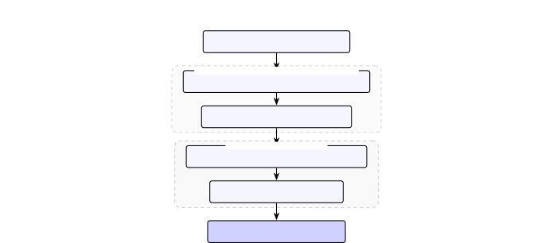
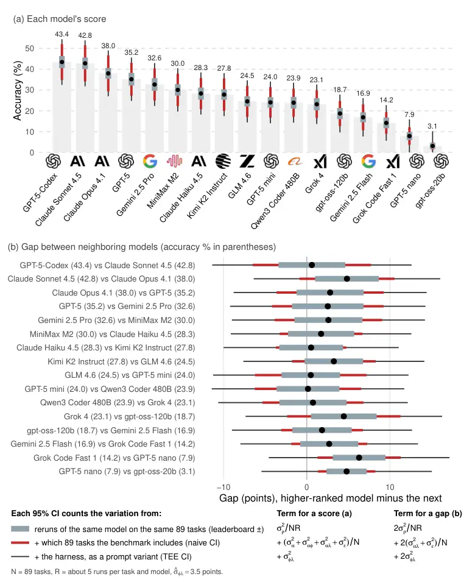

# Hidden Measurement Error in LLM Pipelines Distorts Annotation, Evaluation, and BenchmarkingThanks: The SI Appendix is available at [https://solomonmg.github.io/pdf/totalevalerror_si.pdf](https://solomonmg.github.io/pdf/totalevalerror_si.pdf).

Solomon Messing ^(†)^(†)thanks: Corresponding author.
Affiliation: Center for Social Media, AI, and Politics, New York
University Affiliation: MLCommons

###### Abstract

LLM evaluations drive model deployment, safety standards, research
conclusions, and future projections, for example, about AI’s impact on
the labor market. Yet the way we often estimate noise from autoraters
(LLM-as-judge) ignores variability from factors like judge model choice
and prompt phrasing, which means we’re underestimating error in a way
that _worsens_ with more data. This unmeasured variance can affect
results enough to reverse conclusions (Baumann et al., 2025; Huang
et al., 2026). And judge-pipelines that fail to average this variation
are more vulnerable to “benchmark hacking” (Singh et al., 2025). This
paper introduces a framework we call “total evaluation error (TEE),”
which decomposes LLM pipeline uncertainty and uses design-study
projections to reduce total error. In our safety and ideology
applications, naive standard errors are 53 - 70% smaller than the
corrected SE under our TEE framework. Using Chatbot Arena data, we show
naive 95% CI coverage drops as $`n`$ grows, while TEE-corrected coverage
holds at 95%, and TEE-guided pipelines restrict the potential range of
benchmark gaming by roughly 43%. We show further that a small pilot
allows for the estimation of proper CIs, with the added benefit of
projecting which design changes most improve precision. Using those
projections to allocate API calls cut MMLU estimation error roughly in
half against the answer key at the same budget, and increased per-match
agreement with human voters on Chatbot Arena by 7.9 percentage points.

## 1 Introduction

LLM measurement pipelines introduce variance at multiple stages that
traditional reporting norms ignore. Researchers who use LLMs for
annotation, evaluation, or content moderation routinely do so with no
assessment of prompt sensitivity, temperature dependence, or item-level
heterogeneity (Pecher et al., 2026; Barrie et al., 2025). Benchmark
scores likewise depend on prompt wording and scoring model choice, and
this dependence is seldom measured (SI Appendix, Table ).¹¹ 1 AlpacaEval
and Chatbot Arena report item-sampling CIs; AILuminate uses a
multi-judge evaluator ensemble; no benchmark decomposes prompt,
temperature, or interaction variance. Full survey of 10 benchmarks and 3
annotation studies in SI Appendix, Table . In all cases, unmeasured
variation can create analogues to $`p`$-hacking (Simmons et al., 2011;
Gelman and Loken, 2013) and overfitting (Recht et al., 2019) such that
the results reflect measurement noise, not general phenomena.

At best, current practice reports confidence intervals (CIs) reflecting
variation from repeated sampling at identical settings, ignoring prompt
sensitivity, item heterogeneity, and their interactions. Figure 1
presents simulation results showing that we should expect under-coverage
to _worsen_ with more items, because omitted variance from prompt and
judge choices does not shrink with $`N`$.²² 2 Variance parameters
estimated via REML according to the framework introduced below; 1,000
simulation replicates per data point (see Section  for simulation
details).

Figure 1: Naive confidence intervals fail because pipeline variance from
prompt, judge, and temperature choice does not shrink with items
($`N`$). (a) 95% CI coverage versus $`N`$ in 6 scenarios (A-F).
(b) Variance components accounted for in each scenario. Scenario A
corresponds to the naive estimate $`\Phi^{-1}(0.975)\times s/\sqrt{N}`$;
scenarios B-F represent adding more variance parameters estimated
according to the framework introduced below. Scenarios D-F overlap.

The problem is especially urgent in benchmarking, where unstable scores
make rank-order differences between closely spaced models (or systems
under test, SUT) uninterpretable for evaluators and give model
developers exploitable degrees of freedom. On stable measurement,
Romanou et al. (2026) show that semantics-preserving input perturbations
explain near half of performance variance, minor reorderings of answer
choices shift MMLU leaderboard rankings by up to 8 positions (Alzahrani
et al., 2024), and on Chatbot Arena dropping just 0.003% of human
preferences is enough to flip the top-ranked model (Huang et al., 2026).
With respect to exploitation, Singh et al. (2025) document best-of-$`K`$
leaderboard gaming in production, the mechanism Section 4.4 quantifies.

Ignoring this variability can harm the scientific literature as well.
One re-evaluation study found 31% of hypotheses tested with
state-of-the-art LLM annotations yielded incorrect conclusions under LLM
configuration variation (model, prompt), and found malicious actors
could reverse the sign of 68% of statistically significant effects
through adversarial configuration selection (Baumann et al., 2025).
Other work has found that formatting choices alone produced a 76-point
accuracy spread (Sclar et al., 2024), while infrastructure
nondeterminism produced accuracy standard deviations of up to nine
percentage points even at temperature zero (Yuan et al., 2025).³³ 3 Note
that setting $`T=0`$ does not eliminate underlying model uncertainty.
Greedy decoding picks the highest-probability token at each step to
yield a single deterministic output, even when the token distribution
has high entropy, hiding the variation that sampling at $`T>0`$ would
show. In chain-of-thought models, greedy decoding across a long
reasoning trace can also lock in early token choices that do not reflect
the broader distribution of answers (Renze and Guven, 2024).

## 2 Related Work

Several concurrent works address components of this problem, including
variance decomposition (Haase et al., 2026; Wang, 2025), uncertainty
quantification (Longjohn et al., 2025), sensitivity taxonomies (Romanou
et al., 2026), meta-evaluation of benchmark reliability (McGregor
et al., 2025), and statistical tests for whether LLMs can replace human
annotators (Calderon et al., 2025). Camuffo et al. (2026) develop a
variance taxonomy for LLM annotation (construct, interface, model,
output, aggregation) and tie annotation variance to bias in downstream
estimates. NIST AI 800-3 (Keller et al., 2026) develop a GLMM for
benchmark evaluation, distinguish benchmark- from generalized accuracy
as separate estimands, decompose variance into inter- and intra-item
components, and propose a number of design diagnostics. However,
Dobriban (2025) argue that “a comprehensive and unified statistical
methodology that addresses most of the common evaluation problems
…remains to be developed.” TEE builds on generalizability theory
(G-theory) (Cronbach et al., 1972; Brennan, 2001; Shavelson and Webb,
1991; Bayerl and Paul, 2007; Song et al., 2025) and uses its standard
estimators. We contribute the LLM-specific measurement design that makes
prompts, temperatures, models, judges, scoring methods, and interactions
such as item$`\times`$judge and prompt$`\times`$judge explicit sources
of pipeline error, where they are currently hidden implementation
choices (SI Appendix, Section  maps G-theory terms onto TEE).

## 3 Total Evaluation Error (TEE) Framework

We call this framework Total Evaluation Error (TEE, Figure 2). It
decomposes the variance using first order interactions in a mixed
effects model. The framework also yields projections that can be used to
generate better calibrated CIs and reduce error through aggregation
using a D-study. The name follows total survey error (Sen et al., 2021;
Groves et al., 2010), which treats every stage of a measurement pipeline
as a source of error, and the framework draws on the text-as-data
literature (Grimmer and Stewart, 2013). Note that TEE focuses on
measurement reliability, whereas judge correctness and construct
coverage are validity questions that require external ground-truth data
(Sections 4.1 and 6).



Figure 2: TEE separates aggregation-reducible noise from design-choice
sensitivity at every pipeline stage. For content-annotation tasks (e.g.,
labeling social media posts) the SUT layer is omitted.

Figure 3(a) illustrates the TEE decomposition based on 141 safety items
from the AILuminate benchmark. The 3-judge panel contributes 43.8% of
the variance with item$`\times`$judge adding another 16.7%. On the other
hand, prompt wording contributes less than 0.5%. This means investing in
additional judges will lower the variance more than prompts or
additional benchmark items.

### 3.1 Data-Generating Process

An LLM evaluation pipeline yields output $`Y_{ivhm}^{(r)}`$, based on
item $`i`$ ($`i=1,\ldots,N`$), prompt variant $`v`$ ($`v=1,\ldots,V`$),
temperature $`h`$, model $`m`$ (a judge or SUT), and replication $`r`$.
Replications are repeated model calls.⁴⁴ 4 In G-theory terms, these
factors and the scoring protocol comprise the admissible observations.
For agents, the harness sets the system prompt, the tools, and the agent
loop. Different harnesses therefore count as different prompt variants,
and the prompt terms below include harness variance. The framework
specifies the linear mixed model:

```math
\begin{split}Y_{ivhm}^{(r)}=\mu+\alpha_{i}+\phi_{v}+\tau_{h}+\lambda_{m}+(\alpha\phi)_{iv}+(\alpha\tau)_{ih}+(\phi\tau)_{vh}+(\alpha\lambda)_{im}+(\phi\lambda)_{vm}\\
+\epsilon_{ivhm}+\rho_{ivhm}^{(r)}\end{split} \tag{1}
```

where $`\mu`$ is the grand mean, $`\alpha_{i}`$ is the item random
effect, $`\phi_{v}`$ the prompt variant random effect, $`\tau_{h}`$ the
temperature fixed effect, $`\lambda_{m}`$ the model fixed effect, and
the five parenthesized interaction terms are two-way interaction random
effects. $`\epsilon_{ivhm}\sim N(0,\sigma^{2}_{\epsilon})`$ captures
cell-level error from unmodeled higher-order interactions, and
$`\rho_{ivhm}^{(r)}\sim N(0,\sigma^{2}_{\rho})`$ captures within-cell
replicate noise.

We treat items and prompt variants as _random_ to get an estimand over
all items and prompts that might have been drawn. On the other hand, we
treat temperature and model as _fixed_ because usually we select judge
models with intent and generally do not seek to generalize to some model
population. Similarly we consider temperatures as analogous to a “dose”
rather than something to be sampled. Note that temperature has
nonlinear, non-additive effects on output variance (Renze and Guven,
2024; Li et al., 2025) (SI Appendix, Section ).

### 3.2 Variance Decomposition

Decomposing the variance requires three formal assumptions: conditional
exchangeability of replications and prompt variants, additivity with
two-way interactions, and independent zero mean random effects (SI
Appendix, Section ).

For prompt variants, the exchangeability assumption requires that
variants all measure the same construct. Drawing on G-theory (Cronbach
et al., 1972; Brennan, 2001), survey methodology on question wording
(Groves et al., 2010), and multi-prompt LLM evaluation (Mizrahi et al.,
2024; Sclar et al., 2024; Barrie et al., 2024), we require that variants
hold constant the task or rubric, inserted benchmark content, answer
format, reasoning level, and scoring mode (SI Appendix, Section ).

Because the random effects are mutually independent, their variances
add. At fixed temperature $`h`$ and model $`m`$, $`\tau_{h}`$ and
$`\lambda_{m}`$ are constants and drop out, so the observation-level
variance decomposes as:

```math
\begin{split}\Var(Y\mid h,m)=\sigma^{2}_{\alpha}+\sigma^{2}_{\phi}+\sigma^{2}_{\alpha\phi}+\sigma^{2}_{\alpha\tau}\\
+\sigma^{2}_{\phi\tau}+\sigma^{2}_{\alpha\lambda}+\sigma^{2}_{\phi\lambda}+\sigma^{2}_{\epsilon}+\sigma^{2}_{\rho}\end{split} \tag{2}
```

At any fixed level, the temperature and model interaction terms still
vary across the sampled items and prompts, so they remain in the
decomposition.

Random components (item, prompt variant, replication) shrink by
aggregation within a chosen design; fixed-effect contributions
(temperature, model, scoring method) shrink only by aggregating across
designs, and otherwise should be reported as sensitivity alongside the
point estimate (Steegen et al., 2016).

### 3.3 D-Study Projections

Once variance components are estimated, a D-study projects the variance
of the estimated grand mean $`\hat{\theta}`$ under a proposed design. We
denote the _proposed_ D-study design ($`N^{\prime}`$, $`V^{\prime}`$,
$`R^{\prime}`$), while the observed G-study counts remain $`N`$, $`V`$,
$`R`$, which are used to estimate the variance components.

In classical psychometrics with human raters, D-studies involve trying
to choose how many raters, items, and occasions a study can afford
(Brennan, 2001). However, in LLM/autorater pipelines how much of each
facet (e.g., $`N^{\prime}`$ items, $`V^{\prime}`$ variants,
$`R^{\prime}`$ replicates) a study can afford is a matter of API calls,
so an autorater D-study can trade off all facets under a given compute
budget.

For $`N^{\prime}`$ items, $`V^{\prime}`$ prompt variants, and
$`R^{\prime}`$ replications at fixed temperature, the variance is:⁵⁵ 5
When averaging over $`M`$ models, a design-sensitivity term
$`\sigma^{2}_{\lambda}=\frac{1}{M}\sum_{m}(\lambda_{m}-\bar{\lambda})^{2}`$
is added. The same is true for averaging over multiple temperatures.
Here
$`\bar{\sigma}^{2}_{\epsilon}=\frac{1}{M}\sum_{m}\sigma^{2}_{\epsilon,m}`$
and $`\bar{\sigma}^{2}_{\rho}=\frac{1}{M}\sum_{m}\sigma^{2}_{\rho,m}`$
are the cell-level and replicate-noise variances averaged over models.

```math
\begin{split}\Var(\hat{\theta}_{h})=\frac{\sigma^{2}_{\alpha}}{N^{\prime}}+\frac{\sigma^{2}_{\phi}}{V^{\prime}}+\frac{\sigma^{2}_{\lambda}}{M}+\frac{\sigma^{2}_{\alpha\phi}}{N^{\prime}V^{\prime}}+\frac{\sigma^{2}_{\alpha\tau}}{N^{\prime}}+\frac{\sigma^{2}_{\phi\tau}}{V^{\prime}}\\
+\frac{\sigma^{2}_{\alpha\lambda}}{N^{\prime}M}+\frac{\sigma^{2}_{\phi\lambda}}{V^{\prime}M}+\frac{\bar{\sigma}^{2}_{\epsilon}}{N^{\prime}V^{\prime}M}+\frac{\bar{\sigma}^{2}_{\rho}}{N^{\prime}V^{\prime}MR^{\prime}}\end{split} \tag{3}
```

D-study variance allows us to estimate the standard error and 95% CI:
$`\hat{\theta}\pm 1.96\cdot\sqrt{\Var(\hat{\theta})}`$, which accounts
for all identified pipeline variance. The interval includes variance for
generalizing to new judges and temperatures, which is why when the
target is a fixed panel our approach is overly conservative (99 - 100%
coverage in SI Appendix, Section , see also Section ).

Monte Carlo simulations (1,000 replicates) confirm that D-study
intervention _rankings_ are highly reliable; under the default DGP, the
correct top-1 intervention is identified in 98% of simulations. Four
assumption violations and a latent-ambiguity sweep each lead to
$`|\text{bias}|\leq 9\%`$ (SI Appendix, Sections  and ).

We use REML (Jiang, 1996) via lmer (Bates et al., 2015) to estimate
variance via a crossed random-effects specification. We consider both
temperature and the model to be fixed, with every random facet and
interaction as an independent term, for example, (1\|item) +
(1\|prompt_variant) + (1\|item:model). The value of variance of each of
these terms corresponds to $`\sigma^{2}`$ in Equation 2, which
Equation 3 divides by the number of levels a proposed design averages
over. The full formula and pilot-design thresholds are in SI Appendix,
Sections  and .

#### Choosing facets and judges.

In practice, crossing through all possible factors rapidly becomes
combinatorially expensive. We recommend running a small pilot study
across the actual factors that vary in deployment and estimating the
decomposition based on this to identify where the variance lies. In our
applications, one or two factors usually accounted for most of the
variance (most often judge choice), whereas temperature and further
replications were much less important. Sampling parameters such as
top-$`p`$ or top-$`k`$ could be included in the same fashion as
temperature. On the other hand, switching between direct and
chain-of-thought prompting, output format, or reasoning mode should be
done with care since such modifications may change answer parsing or
even construct of interest and thus cannot be used without passing the
construct equivalence test discussed above, they are better treated as
separate design factors. When selecting judges, we recommend starting
with a small crossed pilot study using a broad set of plausible models,
examining the judge marginals and leave-one-judge-out diagnostics
(Section 4.1), and comparing with human calibration labels if any. Since
the recommendations depend on which prompts and judges are included in
the pilot study, TEE is best applied as a diagnostic tool rather than a
mechanical rule.

## 4 Empirical Demonstrations

We apply the TEE decomposition across three empirical domains in the
main text: binary safety classification (AILuminate), multiple-choice QA
(MMLU), and pairwise model comparison validated against human votes
(Chatbot Arena). For the safety and Arena demonstrations, we decompose
variance across judges, treating each (prompt, SUT-response) pair as an
item,⁶⁶ 6 In Arena, each item is one battle, consisting of the user
prompt and the two SUT responses being compared. while in MMLU there is
no judge, each benchmark question is an item, and we decompose variance
across SUTs scored against the answer key (SI Appendix, Section ).
Section 4.4 then quantifies the gaming surface single-configuration
benchmarks expose. In the SI, we provide a political affinity annotation
demonstration (Section ) with a 9-annotator human baseline, a Likert vs
pairwise scoring comparison (Section ), and a pilot validation showing
that a small sample recovers the qualitative D-study guidance of an
8$`\times`$ larger full run (Section ).

### 4.1 Safety: Judge Disagreement Dominates

We first illustrate the variance decomposition using AILuminate v1.0
(Ghosh et al., 2025), a safety benchmark from MLCommons. The benchmark
assesses whether LLM responses cross safety lines across 12 hazard
categories (hate speech, self-harm, violent crime, etc.). Most items are
unambiguously safe (94% safe rate) and the variance concentrates on the
6% of borderline cases where judges disagree about whether a refusal is
adequate. We decompose the variance based on 36 demonstration prompts,
using responses from Claude Opus 4.5, GPT-5.1, DeepSeek Chat v3.1, and
Grok 4.1 Fast (141 items after dropping 3 SUT refusals).

Judge choice matters for safety rating variability and for item-level
variance. The decomposition (Figure 3(a)) shows that the judge panel
accounts for the largest share of variance (43.8%), with the
item$`\times`$judge interaction adding another 16.7%. Both shrink as
$`1/M`$ when the projection averages over $`M`$ judges.

We also ran leave-one-judge-out estimates, which confirm that no one
judge drives this pattern. The three judge-related terms account for 73%
of the variance with the full panel, and 68 - 83% after dropping any one
judge (see also SI ). Of course, knowing _which_ judge is most accurate
requires validation against gold standard labels (e.g., known-answer
items, the hazard taxonomy, human labelled data). However, we can still
get a lot of mileage from the decomposition alone — a large judge mean
offset implies we should recalibrate or remove a rater, while large
item$`\times`$judge disagreement suggests closer review of specific
cases.

(a) Variance decomposition

(b) Cost-efficiency frontier

Figure 3: Safety decomposition (a) and cost-efficiency frontier (b) for
AILuminate. Judge-model variance dominates the decomposition in (a). A
TEE-guided design that aggregates over diverse judges captures most of
the available SE reduction at modest cost (b).

Within-category item heterogeneity contributes 20.8% and
prompt$`\times`$judge 12.4%, with each remaining component below 5%.
Replicate noise $`\sigma^{2}_{\rho}`$ and cell-level error
$`\sigma^{2}_{\epsilon}`$ are large components at the item level, but
enter $`\Var(\hat{\theta})`$ divided by
$`N^{\prime}V^{\prime}H^{\prime}M^{\prime}R^{\prime}`$ and
$`N^{\prime}V^{\prime}H^{\prime}M^{\prime}`$ respectively, so each
contributes less than 0.5% to the variance of the mean. Per-category
variance spans more than an order of magnitude in replicate noise
$`\hat{\sigma}^{2}_{\rho}`$, from $`\hat{\sigma}^{2}_{\rho}=0.001`$ for
specialized advice to $`\hat{\sigma}^{2}_{\rho}=0.033`$ for sex crimes
(SI Appendix, Section ). Temperature and prompt main effects contribute
negligibly. ⁷⁷ 7 Three-way interaction terms
(item$`\times`$prompt$`\times`$temperature,
item$`\times`$temperature$`\times`$judge) are statistically significant
but substantively negligible, supporting the two-way interaction
specification.

The D-study then projects precision under any proposed design (any new
combination of $`N^{\prime}V^{\prime}H^{\prime}M^{\prime}R^{\prime}`$,
etc.), enabling a cost-efficiency analysis. Figure 3(b) plots projected
standard error against API cost for 360 candidate designs of the safety
benchmark. The status quo design (141 items, one prompt, one judge, no
replication) sits well above the efficient frontier; for the same
budget, designs on the frontier that trade some items for judge
diversity reduce the SE by 9%. A TEE-guided design (141 items, 3
prompts, 3 judges, no replication) lowers the SE by 49% at 9$`\times`$
the cost, whereas running the full factorial (5 prompts, 3 judges, 8
replications) yields only an extra 5% reduction at 120$`\times`$ the
cost. Beyond roughly 1,000 API calls, the curve flattens out with clear
diminishing returns.

### 4.2 MMLU: Item and Prompt Reallocation Roughly Halves Error

Unlike our safety analysis, which centers on an LLM-as-judge/autorater
layer, our MMLU benchmark analysis has no judge model at all. Because
MMLU (Massive Multitask Language Understanding) (Hendrycks et al., 2021)
consists of answers to multiple choice problems, we can measure
estimation accuracy as well as coverage. We treat evaluation as a
budget-allocation problem where the problem is how to allocate the API
calls among number of items ($`N`$), prompt variants ($`V`$), and
replications ($`R`$), given a fixed budget. We compare three approaches:
(i) a _naive_ allocation ($`V\!=\!1`$, $`R\!=\!3`$) where each call is
repeated three times, (ii) a _standard_ allocation ($`V\!=\!1`$,
$`R\!=\!1`$) where the goal is to sample more items, and (iii) an
allocation guided by TEE, which utilizes a D-study to choose between
adding items, prompts, or replications at each budget level (see SI
Appendix, Section  for details).

For the G-study (Figure 4(a)), items explain the majority of variance,
with the contribution of heterogeneity within categories being 72.2% of
$`\Var(\hat{\theta})`$ and heterogeneity between categories contributing
7.7%. Item$`\times`$SUT adds 10.5% and SUT-model design sensitivity adds
6.7%. In contrast, the three prompt variables combined explain only
2.7%, with accuracy levels ranging from 83.9% to 85.3% across the four
prompt variants.⁸⁸ 8 A fifth prompt variant omitted the instruction to
answer with a letter, so many responses were cut off. Because it fails
the answer-format requirement in Section 3.2, we exclude it here.
Scoring these cut-off responses as wrong would increase the
prompt-related share to 70% of $`\Var(\hat{\theta})`$ (SI Appendix,
Section ). Re-estimating the model with a logit link similarly finds
item heterogeneity to be the largest component (71.4%, with prompt terms
at 6.1%; SI Appendix, Section ).

Using these figures, the TEE D-study begins with sampling more items
(80% of variance) before moving on to sampling prompts (after using the
170 items left after a pilot of 30 items). Since the naive sampling
approach uses two-thirds of its trials for replicating with hardly any
information gain, it is 1.6 to 2.4 times more error-prone than TEE
regardless of the budget size (Figure 4(b)). The standard strategy
samples as much as items as it can; however, once all available items
are sampled, its error remains unchanged. However, since TEE averages
across prompt variants once the item pool is exhausted, it continues to
lower its error until it achieves half of the error of the standard
strategy’s RMSE at larger budgets. It also yields well-calibrated
confidence intervals, maintaining $`\geq`$97% coverage throughout,
whereas the naive CI omits prompt sensitivity and under-covers at the
two smallest budgets (91% and 93%).

(a) G-study: variance decomposition

(b) D-study: budget allocation

Figure 4: TEE-guided estimation on MMLU roughly halves the standard RMSE
at large budgets and maintains nominal 95% CI coverage, while naive
under-covers at the smallest budgets. (a) Variance decomposition at the
operational design ($`N{=}200`$, $`V{=}4`$, $`M{=}3`$ SUTs, $`H{=}3`$,
$`R{=}8`$). (b) RMSE against ground-truth accuracy (top) and 95% CI
coverage (bottom) by API call budget. 1,000 Monte Carlo replicates per
SUT$`\times`$temperature cell.

### 4.3 Chatbot Arena: Coverage, Accuracy, D-Study Validation

Chatbot Arena (Chiang et al., 2024) extends the domain to pairwise human
choices. Gathering votes from people is slow and expensive, and (outside
of Chatbot Arena) LLM judges are often used to score benchmarks.
However, if we want to replace human raters with LLM judges, their
scores shouldn’t depend on prompt wording, judge models, etc. Thus we
compare a TEE pipeline and a naïve single-judge approach with respect to
4,676 Arena matches (battles) selected from the publicly available
lmarena-ai/arena-human-preference-100k dataset. We stratify by model and
category (Creative Writing, Coding, Factual QA, and Persuasion). Each
match has five prompt variants scored by three judges. We use both 1 - 5
Likert and pairwise scoring formats (see SI Section  for details).

A simulation experiment shows that TEE averaging recovers properly
calibrated uncertainty estimates. Naive 95% CIs based on a single
(judge, prompt variant) cell have reasonable coverage at $`n_{m}=100`$,
but by $`n_{m}=2,000`$ coverage drops to 78% (Figure 5). The TEE CI
remains at or above 95%. Increasing the value of $`n_{m}`$ leads to a
narrower interval centered on the average of one configuration, so more
data actually means worse coverage.

Figure 5: Naive coverage on Chatbot Arena drops as the sample grows,
while TEE maintains nominal coverage. (a) Coverage versus match sample
size $`n_{m}`$ for naive and TEE. (b) Half-width of CI versus $`n_{m}`$.
TEE approaches the appropriate floor
($`\sigma_{V}^{2}/V+\sigma_{J}^{2}/J`$) while naive keeps shrinking.
Ground truth $`p^{*}=0.389`$ is the mean across all 3 judges and 5
prompt variants in the Likert factorial, a finite-panel target. The TEE
interval instead includes variance for generalizing to new prompts and
judges, so it over-covers $`p^{*}`$ at large $`n_{m}`$. An interval for
the finite-panel target would hold variants and judges fixed and
bootstrap over matches.

TEE averaging also improves per-match agreement with the individual
human vote across all four categories (SI Appendix, Figure ). Pooled
across 4,676 matches, TEE Likert raises AB-only agreement over
single-judge Likert by $`+7.9`$ pp (74.9% vs. 67.0%) and TEE pairwise
raises it over single-judge pairwise by $`+3.6`$ pp (71.9% vs. 68.3%,
see SI Appendix Table ).

A D-study fit on 80% of matches projects per-category SE reductions of
0.53 - 0.59 from single-judge to TEE. Across the four held-out
categories, projected SE reductions track observed Likert agreement
lifts at Spearman $`\rho=0.80`$ (n = 4; SI Appendix Figure ).

Both findings matter when the goal is to score matches one at a time, as
in training supervised models on Arena labels (Egami et al., 2023) or
filtering individual items.

### 4.4 Single-Configuration Benchmarks Vulnerable to Benchmark Hacking

Singh et al. (2025) document Meta running 27 private Llama-4 variants on
Chatbot Arena before launch and publishing only the top scorer
(_benchmark hacking_), which constitutes best-of-$`K`$ exploitation of
pipeline noise. Some ways it can happen are that, for leaderboards, many
models are submitted to the leaderboard using different names, and the
top performing one is reported. In open-source benchmarks, they can
conduct the test inside using various forms of prompts and scoring
configurations until they get a favorable score. The expected inflation
is $`\E[\max(Z_{1},\ldots,Z_{K})]\cdot\sigma_{\text{pipeline}}`$, where
$`\sigma_{\text{pipeline}}`$ is the standard deviation of the pipeline
noise decomposed above. Prompt formatting alone can produce up to 76
accuracy points of spread on identical models (Sclar et al., 2024),
suggesting the gameable surface is broad in practice.

We quantify the gaming surface in the context of Chatbot Arena by
bootstrapping 4,676 matches across pipeline configurations (Figure 6).
The Arena human leaderboard already exposes a 45-Elo surface at
$`K{=}27`$ from voter sampling alone, large enough to flip rankings
between adjacent models. A single-configuration LLM-judge replacement
($`V{=}1`$, $`M{=}1`$) increases the surface to 56 Elo, since a
developer can target both the LLM-judge configuration and the underlying
voter sample. Averaging across either prompts or judges alone recovers
the human baseline ($`V{=}5`$, $`M{=}1`$: 46 Elo; $`V{=}1`$, $`M{=}3`$:
46 Elo). TEE-LLM ($`V{=}5`$, $`M{=}3`$ averaging) cuts the surface to 32
Elo, about 30% below the human leaderboard. Judge main effects account
for the largest share of gameable LLM variance (Table ), the component a
developer most directly controls when picking judge models.

Figure 6: Best-of-$`K`$ gaming surface on Chatbot Arena across pipeline
configurations. “Gaming surface” is the expected Elo boost a developer
earns by submitting $`K`$ model variants and reporting only the
highest-scoring one,
$`\E[\max(Z_{1},\ldots,Z_{K})]\cdot\sigma_{\text{pipeline}}`$. The
dashed line marks $`K{=}27`$, the number of private Llama-4 variants
Meta ran (Singh et al., 2025). Variance surface computed by
bootstrapping 4,676 Arena matches.

The best-of-$`K`$ simulation comprises just one facet of the
manipulation surface. Singh et al. (2025)’s analysis finds that
providers can retract scores from unfavorable runs, that proprietary
providers received a disproportionate share of data (61.4% of all battle
data), and that access to Arena-specific data boosted performance by up
to 112% on the Arena distribution without corresponding gains on
external benchmarks.

## 5 Discussion

Across the empirical demonstrations, naive error estimates substantially
understate measurement uncertainty. Naive CIs omit judge disagreement,
prompt sensitivity, and their interactions, which can lead evaluators to
mistake pipeline noise for genuine benchmark capability differences or
generalizable patterns in LLM-annotated research. The gap between naive
and TEE-informed error estimates corresponds to the relative variance
between pipelines, which scales with both subjectivity and complexity.
The data we analyze from Chatbot Arena, MMLU, and our propaganda audit
(SI Appendix) further show that failure to aggregate over these noise
sources also reduces accuracy.

In fact, some benchmarks report intervals that are even more
anticonservative than the naive interval. SWE-bench (Jimenez et al., 2024) and Tau-bench (Yao et al., 2024) report scores with no interval at
all. Other benchmarks report confidence intervals that are narrower than
the naive interval, because they hold the evaluation items fixed and
only account for variation between repeated runs (replicates). And, in
its system cards, OpenAI resamples “model attempts per problem” and
notes that this “can lead to overly tight confidence intervals” (OpenAI,
2025). MLE-bench and PaperBench report the standard error across
replicates (Chan et al., 2025; Starace et al., 2025), and Vals.ai
similarly estimates replicate error (Vals.ai, 2026). Terminal-Bench 2.0
estimates error based on the spread of trials within each task, on their
leaderboard and in their paper (Merrill et al., 2026), which again
assumes fixed items. In our reanalysis of Terminal-Bench 2.0, the
published intervals separate 4 of the neighboring model pairs, while the
TEE intervals overlap on all 16 pairs (Figure 7; SI Appendix, Section ).
Readers should treat rerun-only intervals as lower bounds on the
uncertainty.



Figure 7: Once we account for harness variance (prompt variance under
TEE), all neighboring models on the Terminal-Bench 2.0 leaderboard have
substantial CI overlap. (a) Each model’s score under the Terminus 2
harness (bar and black dot). (b) The gap between each model’s score and
the next (black dot; accuracies in parentheses). Both panels show three
nested 95% CIs. The thick grey bar is the leaderboard’s interval, which
counts only reruns of the same 89 tasks. The red line is the naive
interval over tasks, paired in (b). The thin black line is the TEE
interval, which treats harnesses as prompt variants and adds the
model$`\times`$harness variance $`\sigma^{2}_{\phi\lambda}`$, estimated
from settings-matched cells ($`\hat{\sigma}_{\phi\lambda}=3.5`$ points).
Data: 22,198 trials of 17 models under six harnesses (Merrill et al.,
2026); details in SI Appendix, Section .

Pipeline variance can also serve as a gaming surface in benchmarking and
in research. We show that submitting best-of $`K{=}27`$ variants (as
documented in Singh et al. (2025)) inflates Chatbot Arena Elo scores by
56 points, while averaging over multiple judges and prompts cuts that
surface by 43% (§4.4). The same vulnerability extends to LLM-annotated
research, where pipeline variance maps onto labeling error and predicts
misclassification against the 9-rater human consensus in our propaganda
demonstration ($`r=-0.68`$, SI Appendix, Section ), consistent with the
configuration- and adversarial-search reversals Baumann et al. (2025)
document across 37 LLM-annotation tasks. The implications extend beyond
model capability overestimates, as benchmarks like SWE-Bench,
LegalBench, and HealthBench inform estimates of labor substitution and
productivity gains (Eloundou et al., 2023) associated with widespread
LLM adoption.

How should researchers and benchmark designers respond in practice?
Across our applications, whenever a pipeline includes an LLM judge
layer, our D-study projections indicate that averaging across multiple
judges reduces variance more than any other single change, followed by
adding items on AILuminate and adding prompt variants on Arena.
Following those projections improves both CI coverage and agreement with
human ground truth. More broadly, because almost all evaluation claims
aim to generalize across a domain of items, sampling more items is
consistently valuable, and results should not rest on a single judge
model or prompt template. Even though the variance percentages provided
by the rankings here are helpful guidelines, their actual values vary
depending on the application, and for this reason, doing a pilot study
in the target pipeline will prove extremely useful.

Because benchmark results and LLM annotations are used to carry out
safety assessments and empirical studies and make projections about the
economy or labor market, underestimating the variability of the pipeline
will lead to distorted conclusions further down the line. Conducting a
pilot study in the TEE framework will help achieve that at much less
expense than in a full factorial design.

## 6 Limitations

TEE has a number of simplifying assumptions worth noting. For example,
when a model emits reasoning traces, the variance they generate is not
attributed under the current framework and instead inflates
$`\sigma^{2}_{\epsilon}`$. What’s more, when the scoring function relies
on an LLM-as-judge, its variance may compound with the SUT’s (Haldar and
Hockenmaier, 2025; Chehbouni et al., 2025), and SUT$`\times`$judge
interactions aren’t currently captured in our decomposition (SI
Appendix, Section ).

Perhaps more importantly, TEE cannot say whether the items (eval
prompts) truly cover and represent the constructs of interest, which of
course limits generalizability. A toxicity benchmark that omits coded
hate speech will generate precise and incomplete estimates. Total survey
error has long called this coverage error (Sen et al., 2021).

Last, our demonstrations comprise English-only tasks with API-served
models, and do not test ambiguous tasks that require open-ended
reasoning.

## 7 Conclusion

If they are provided at all, variance estimates in LLM-as-judge or
autorater evaluations are anti-conservative. This means our frontier
model evaluations overstate precision, while naively scored benchmarks
let developers exploit measurement error in a way analogous to p-hacking
or overfitting. Our TEE framework not only helps detect this issue but
lets researchers estimate variance components from a small pilot study,
estimate confidence intervals with valid coverage, and predict how
design modifications will help in reducing error (SI Appendix,
Section ). As LLM evaluations become more important for practical
applications (model deployment, safety criteria), research, and
estimates of the impact of AI on the economy and the labor market, it is
vital to take pipeline uncertainty into account.

## Acknowledgments and Disclosure of Funding

Thanks to Chris Barrie, Ben Guinaudeau, Aaron Kaufman, Brandon Stewart,
Kylan Rutherford, and participants at the 2026 CSMAP conference for
helpful feedback. Thanks to Peter Mattson, Bennett Hillenbrand, Andrew
Gruen, Rebecca Weiss, Hannah Waight, Molly Roberts, Brandon Stewart,
Eddie Yang, Ben Guinaudeau, Melina Much, Chris Barrie, Joe Higton, Kylan
Rutherford, Jennifer Allen, Jonathan Nagler, and Josh Tucker for helpful
early conversations about the problem of confidence intervals in LLM
evals, benchmarks, and LLM-as-judge measurement problems, which helped
inspire this paper.

MLCommons funded the author’s salary for this work.

The author has personal financial interests in AI-related companies, in
particular Nvidia, Alphabet, Microsoft, and Taiwan Semiconductor. The
author worked at Facebook (now Meta) in various capacities from 2011 to
2015 and 2018 to 2020 and at Twitter (now X) from 2021 to 2023, and
contracts for MLCommons, a 501(c)(6) non-profit that releases AI
benchmarks, including AILuminate, which this paper analyzes (2026 to
present). The author has accepted a position at Google DeepMind. For an
unrelated project, the author received a 2010 Google Research Award for
research on “Social cues and reliability in content selection and
evaluation.”

## References

- Alzahrani et al. \[2024\] Norah Alzahrani, Hisham Alyahya, Yazeed
  Alnumay, Sultan AlRashed, Shaykhah Alsubaie, Yousef Almushayqih,
  Faisal Mirza, Nouf Alotaibi, Nora Al-Twairesh, Areeb Alowisheq,
  M. Saiful Bari, and Haidar Khan. When benchmarks are targets:
  Revealing the sensitivity of large language model leaderboards. In
  _Proceedings of the 62nd Annual Meeting of the Association for
  Computational Linguistics (Volume 1: Long Papers)_, pages 13787–13805.
  Association for Computational Linguistics, 2024.
- Barrie et al. \[2024\] Christopher Barrie, Elli Palaiologou, and
  Petter Törnberg. Prompt stability scoring for text annotation with
  large language models. _arXiv preprint_, 2024. arXiv:2407.02039.
- Barrie et al. \[2025\] Christopher Barrie, Alexis Palmer, and Arthur
  Spirling. Replication for language models. _Working paper_, 2025.
- Bates et al. \[2015\] Douglas Bates, Martin Mächler, Ben Bolker, and
  Steve Walker. Fitting linear mixed-effects models using lme4. _Journal
  of Statistical Software_, 67(1):1–48, 2015.
- Baumann et al. \[2025\] Joachim Baumann, Paul Röttger, Aleksandra
  Urman, Albert Wendsjö, Flor Miriam Plaza-del Arco, Johannes B. Gruber,
  and Dirk Hovy. Large language model hacking: Quantifying the hidden
  risks of using LLMs for text annotation. _arXiv preprint_, 2025.
  arXiv:2509.08825.
- Bayerl and Paul \[2007\] Petra Saskia Bayerl and Karsten Ingmar Paul.
  Identifying sources of disagreement: Generalizability theory in manual
  annotation studies. _Computational Linguistics_, 33(1):3–8, 2007.
- Brennan \[2001\] Robert L. Brennan. _Generalizability Theory_.
  Springer, 2001.
- Calderon et al. \[2025\] Nitay Calderon, Roi Reichart, and Rotem Dror.
  The alternative annotator test for LLM-as-a-judge: How to
  statistically justify replacing human annotators with LLMs. In
  _Proceedings of the 63rd Annual Meeting of the Association for
  Computational Linguistics_, 2025. arXiv:2501.10970.
- Camuffo et al. \[2026\] Arnaldo Camuffo, Alfonso Gambardella, Saeid
  Kazemi, Jakub Malachowski, and Abhinav Pandey. Variance-aware LLM
  annotation for strategy research: Sources, diagnostics, and a protocol
  for reliable measurement. _arXiv preprint_, 2026. arXiv:2601.02370.
- Chan et al. \[2025\] Jun Shern Chan, Neil Chowdhury, Oliver Jaffe,
  James Aung, Dane Sherburn, Evan Mays, Giulio Starace, Kevin Liu, Leon
  Maksin, Tejal Patwardhan, Lilian Weng, and Aleksander Madry.
  MLE-bench: Evaluating machine learning agents on machine learning
  engineering. In _International Conference on Learning Representations
  (ICLR)_, 2025. arXiv:2410.07095.
- Chehbouni et al. \[2025\] Khaoula Chehbouni, Mohammed Haddou, Jackie
  Chi Kit Cheung, and Golnoosh Farnadi. Neither valid nor reliable?
  investigating the use of LLMs as judges. In _Advances in Neural
  Information Processing Systems (NeurIPS)_, 2025. arXiv:2508.18076.
- Chiang et al. \[2024\] Wei-Lin Chiang, Lianmin Zheng, Ying Sheng,
  Anastasios Nikolas Angelopoulos, Tianle Li, Dacheng Li, Hao Zhang,
  Banghua Zhu, Michael Jordan, Joseph E. Gonzalez, and Ion Stoica.
  Chatbot arena: An open platform for evaluating LLMs by human
  preference. In _Proceedings of the 41st International Conference on
  Machine Learning (ICML)_, 2024. arXiv:2403.04132.
- Cronbach et al. \[1972\] Lee J. Cronbach, Goldine C. Gleser, Harinder
  Nanda, and Nageswari Rajaratnam. _The Dependability of Behavioral
  Measurements: Theory of Generalizability for Scores and Profiles_.
  Wiley, New York, 1972.
- Dobriban \[2025\] Edgar Dobriban. Statistical methods in generative
  AI. _Annual Review of Statistics and Its Application_, 2025.
  arXiv:2509.07054.
- Egami et al. \[2023\] Naoki Egami, Musashi Hinck, Brandon M. Stewart,
  and Hanying Wei. Using imperfect surrogates for downstream inference:
  Design-based supervised learning for social science applications of
  large language models. In _Advances in Neural Information Processing
  Systems (NeurIPS)_, 2023. arXiv:2306.04746.
- Eloundou et al. \[2023\] Tyna Eloundou, Sam Manning, Pamela Mishkin,
  and Daniel Rock. Gpts are gpts: An early look at the labor market
  impact potential of large language models. _arXiv preprint
  arXiv:2303.10130_, 2023.
- Gelman and Loken \[2013\] Andrew Gelman and Eric Loken. The garden of
  forking paths: Why multiple comparisons can be a problem, even when
  there is no “fishing expedition” or “$`p`$-hacking” and the
  comparisons are not even made. _Department of Statistics, Columbia
  University_, 2013.
- Ghosh et al. \[2025\] Shaona Ghosh, Heather Frase, Adina Williams,
  Sarah Luger, Paul Röttger, Fazl Barez, Sean McGregor, Kenneth
  Fricklas, Mala Kumar, Quentin Feuillade-Montixi, Kurt Bollacker, Felix
  Friedrich, Ryan Tsang, Bertie Vidgen, et al. AILuminate: Introducing
  v1.0 of the AI risk and reliability benchmark from MLCommons. _arXiv
  preprint arXiv:2503.05731_, 2025.
- Grimmer and Stewart \[2013\] Justin Grimmer and Brandon M. Stewart.
  Text as data: The promise and pitfalls of automatic content analysis
  methods for political texts. _Political Analysis_,
  21(3):267–297, 2013.
- Groves et al. \[2010\] Robert M. Groves, Floyd J. Fowler, Mick P.
  Couper, James M. Lepkowski, Eleanor Singer, and Roger Tourangeau.
  _Survey Methodology_. Wiley, 2nd edition, 2010.
- Haase et al. \[2026\] Jennifer Haase, Jana Gonnermann-Müller, Paul
  H. P. Hanel, Nicolas Leins, Thomas Kosch, Jan Mendling, and Sebastian
  Pokutta. Within-model vs between-prompt variability in large language
  models for creative tasks. _arXiv preprint_, 2026. arXiv:2601.21339.
- Haldar and Hockenmaier \[2025\] Rajarshi Haldar and Julia Hockenmaier.
  Rating roulette: Self-inconsistency in LLM-As-A-Judge frameworks. In
  _Findings of EMNLP_, 2025. arXiv:2510.27106.
- Hendrycks et al. \[2021\] Dan Hendrycks, Collin Burns, Steven Basart,
  Andy Zou, Mantas Mazeika, Dawn Song, and Jacob Steinhardt. Measuring
  massive multitask language understanding. In _Proceedings of the
  International Conference on Learning Representations (ICLR)_, 2021.
- Huang et al. \[2026\] Jenny Y. Huang, Yunyi Shen, Dennis Wei, and
  Tamara Broderick. Dropping just a handful of preferences can change
  top large language model rankings. In _Proceedings of the Fourteenth
  International Conference on Learning Representations (ICLR)_, 2026.
- Jiang \[1996\] Jiming Jiang. REML estimation: Asymptotic behavior and
  related topics. _Annals of Statistics_, 24(1):255–286, 1996.
- Jimenez et al. \[2024\] Carlos E. Jimenez, John Yang, Alexander
  Wettig, Shunyu Yao, Kexin Pei, Ofir Press, and Karthik Narasimhan.
  SWE-bench: Can language models resolve real-world GitHub issues? In
  _International Conference on Learning Representations (ICLR)_, 2024.
  arXiv:2310.06770.
- Keller et al. \[2026\] Drew Keller, Kweku Kwegyir-Aggrey, Ryan Steed,
  Anita K. Rao, Julia L. Sharp, and A. Stevie Bergman. Expanding the AI
  evaluation toolbox with statistical models. NIST Trustworthy and
  Responsible AI Report NIST AI 800-3, National Institute of Standards
  and Technology, February 2026. URL
  [https://doi.org/10.6028/NIST.AI.800-3](https://doi.org/10.6028/NIST.AI.800-3).
- Li et al. \[2025\] Lujun Li, Lama Sleem, Niccolò Gentile, Geoffrey
  Nichil, and Radu State. Exploring the impact of temperature on large
  language models: Hot or Cold? In _Procedia Computer Science_, 2025.
- Longjohn et al. \[2025\] Rachel Longjohn, Giri Gopalan, and Emily
  Casleton. Statistical uncertainty quantification for aggregate
  performance metrics in machine learning benchmarks. _arXiv
  preprint_, 2025. arXiv:2501.04234.
- McGregor et al. \[2025\] Sean McGregor, Victor Lu, Vassil Tashev,
  Armstrong Foundjem, Aishwarya Ramasethu, Sadegh AlMahdi Kazemi
  Zarkouei, Chris Knotz, Kongtao Chen, Alicia Parrish, Anka Reuel, and
  Heather Frase. Risk management for mitigating benchmark failure modes:
  BenchRisk. In _Advances in Neural Information Processing Systems
  (NeurIPS)_, 2025. arXiv:2510.21460.
- Merrill et al. \[2026\] Mike A. Merrill, Alexander G. Shaw, Nicholas
  Carlini, Boxuan Li, et al. Terminal-Bench: Benchmarking agents on
  hard, realistic tasks in command line interfaces. _arXiv
  preprint_, 2026. arXiv:2601.11868.
- Mizrahi et al. \[2024\] Moran Mizrahi, Guy Kaplan, Dan Malkin, Rotem
  Dror, Dafna Shahaf, and Gabriel Stanovsky. State of what art? A call
  for multi-prompt LLM evaluation. _Transactions of the Association for
  Computational Linguistics_, 12:933–949, 2024.
- OpenAI \[2025\] OpenAI. GPT-5 system card. System card, August
  13, 2025. URL
  [https://cdn.openai.com/gpt-5-system-card.pdf](https://cdn.openai.com/gpt-5-system-card.pdf).
- Pecher et al. \[2026\] Branislav Pecher, Stefan Spiegel, Samuel
  Belanec, and Jan Cegin. Revisiting prompt sensitivity in large
  language models for text classification: The role of prompt
  underspecification. _arXiv preprint_, 2026. arXiv:2602.04297.
- Recht et al. \[2019\] Benjamin Recht, Rebecca Roelofs, Ludwig Schmidt,
  and Vaishaal Shankar. Do ImageNet classifiers generalize to ImageNet?
  _Proceedings of the 36th International Conference on Machine Learning
  (ICML)_, pages 5389–5400, 2019.
- Renze and Guven \[2024\] Matthew Renze and Erhan Guven. The effect of
  sampling temperature on problem solving in large language models.
  _arXiv preprint arXiv:2402.05201_, 2024.
- Romanou et al. \[2026\] Angelika Romanou, Mark Ibrahim, Candace Ross,
  Chantal Shaib, Kerem Oktar, Samuel J. Bell, Anaelia Ovalle, Jesse
  Dodge, Antoine Bosselut, Koustuv Sinha, and Adina Williams.
  BrittleBench: Quantifying LLM robustness via prompt sensitivity.
  _arXiv preprint_, 2026. arXiv:2603.13285.
- Sclar et al. \[2024\] Melanie Sclar, Yejin Choi, Yulia Tsvetkov, and
  Alane Suhr. Quantifying language models’ sensitivity to spurious
  features in prompt design. In _International Conference on Learning
  Representations (ICLR)_, 2024.
- Sen et al. \[2021\] Indira Sen, Fabian Flöck, Katrin Weller, Bernd
  Weiß, and Claudia Wagner. A total error framework for digital traces
  of human behavior on online platforms. _Public Opinion Quarterly_,
  85(S1):S399–S422, 2021.
- Shavelson and Webb \[1991\] Richard J. Shavelson and Noreen M. Webb.
  _Generalizability Theory: A Primer_. Sage, 1991.
- Simmons et al. \[2011\] Joseph P. Simmons, Leif D. Nelson, and Uri
  Simonsohn. False-positive psychology: Undisclosed flexibility in data
  collection and analysis allows presenting anything as significant.
  _Psychological Science_, 22(11):1359–1366, 2011.
- Singh et al. \[2025\] Shivalika Singh, Yiyang Nan, Alex Wang, Daniel
  D’Souza, Sayash Kapoor, Ahmet Ustun, Sanmi Koyejo, Yuntian Deng,
  Shayne Longpre, Noah A. Smith, Beyza Ermis, Marzieh Fadaee, and Sara
  Hooker. The leaderboard illusion. _arXiv preprint
  arXiv:2504.20879_, 2025.
- Song et al. \[2025\] Dan Song, Won-Chan Lee, and Hong Jiao. Exploring
  LLM autoscoring reliability in large-scale writing assessments using
  generalizability theory. _arXiv preprint_, 2025. arXiv:2507.19980.
- Starace et al. \[2025\] Giulio Starace, Oliver Jaffe, Dane Sherburn,
  James Aung, Jun Shern Chan, Leon Maksin, Rachel Dias, Evan Mays,
  Benjamin Kinsella, Wyatt Thompson, Johannes Heidecke, Amelia Glaese,
  and Tejal Patwardhan. PaperBench: Evaluating AI’s ability to replicate
  AI research. _arXiv preprint_, 2025. arXiv:2504.01848.
- Steegen et al. \[2016\] Sara Steegen, Francis Tuerlinckx, Andrew
  Gelman, and Wolf Vanpaemel. Increasing transparency through a
  multiverse analysis. _Perspectives on Psychological Science_,
  11(5):702–712, 2016.
- Vals.ai \[2026\] Vals.ai. Methodology.
  [https://www.vals.ai/methodology](https://www.vals.ai/methodology),
  accessed November 8, 2026, 2026.
- Wang \[2025\] Sida Wang. Measuring all the noises of LLM evals. _arXiv
  preprint_, 2025. arXiv:2512.21326.
- Yao et al. \[2024\] Shunyu Yao, Noah Shinn, Pedram Razavi, and Karthik
  Narasimhan. $`\tau`$-bench: A benchmark for tool-agent-user
  interaction in real-world domains. _arXiv preprint_, 2024.
  arXiv:2406.12045.
- Yuan et al. \[2025\] Jiayi Yuan, Hao Li, Xinheng Ding, Wenya Xie,
  Yu-Jhe Li, Wentian Zhao, Kun Wan, Jing Shi, Xia Hu, and Zirui Liu.
  Understanding and mitigating numerical sources of nondeterminism in
  LLM inference. In _Advances in Neural Information Processing Systems
  (NeurIPS)_, 2025. arXiv:2506.09501.
