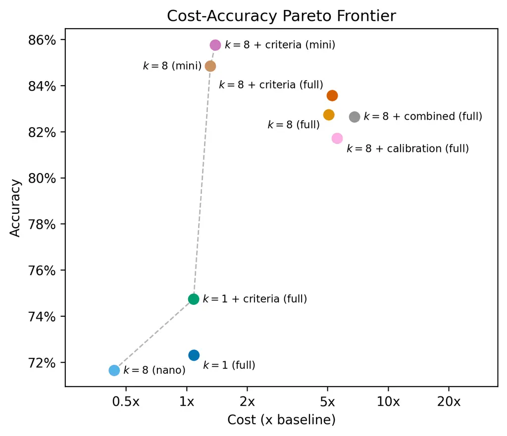
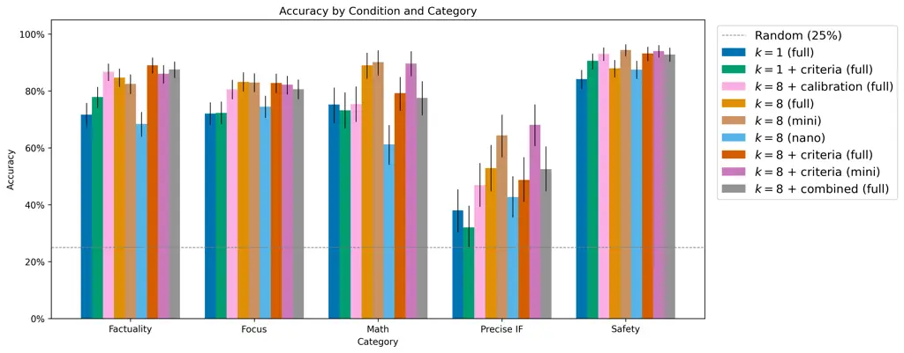
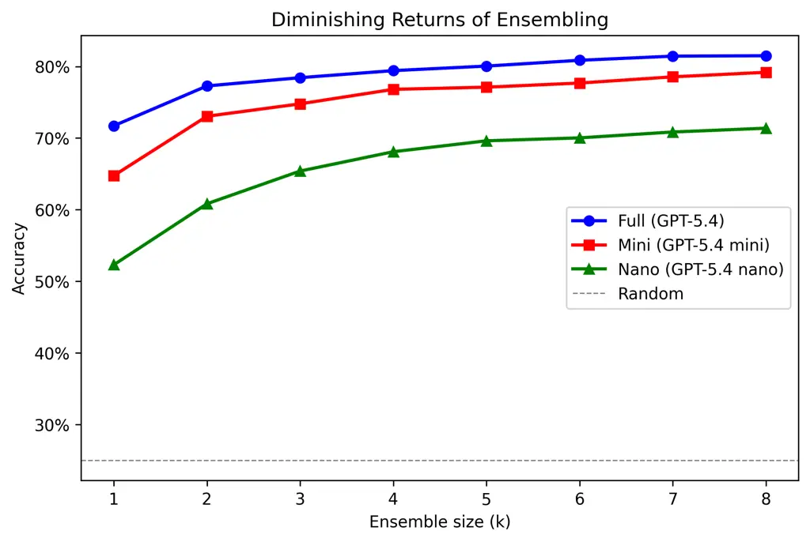
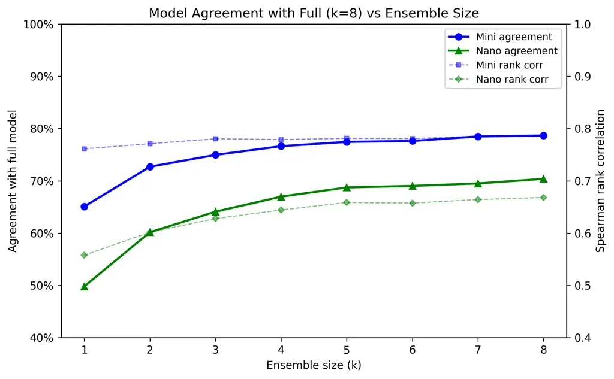
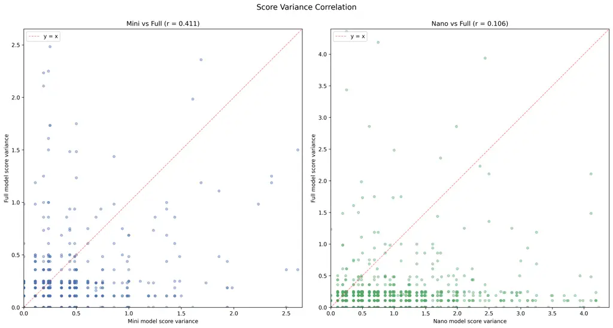
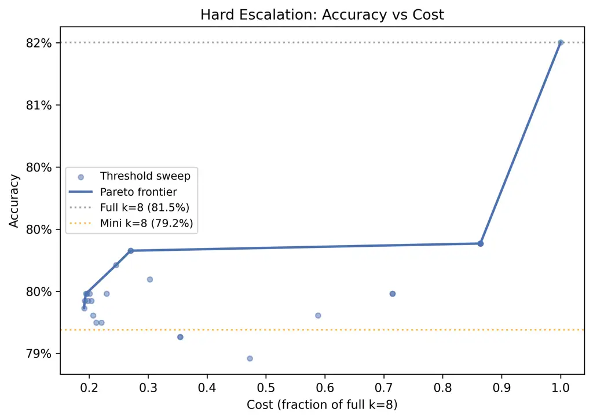
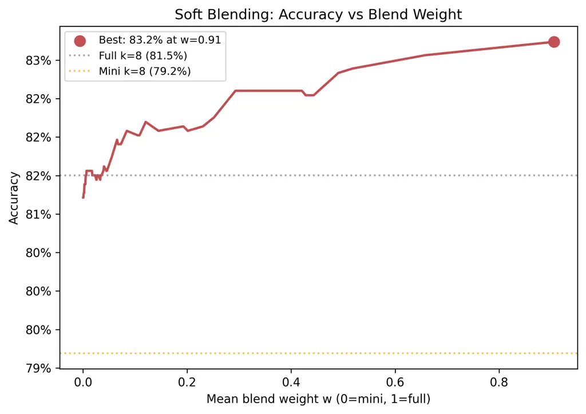
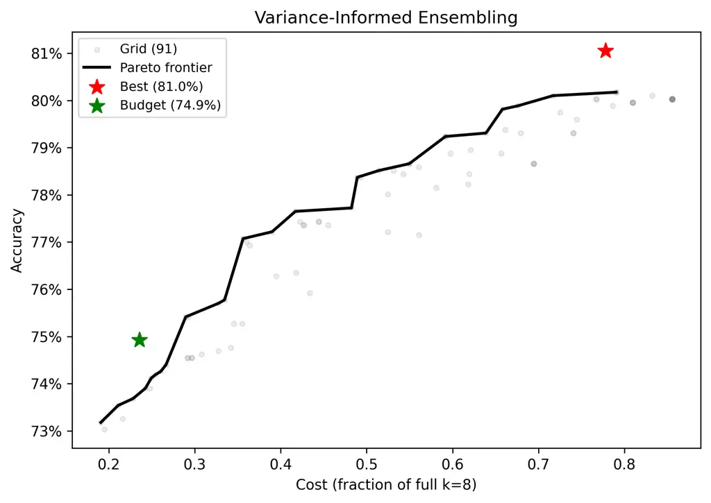
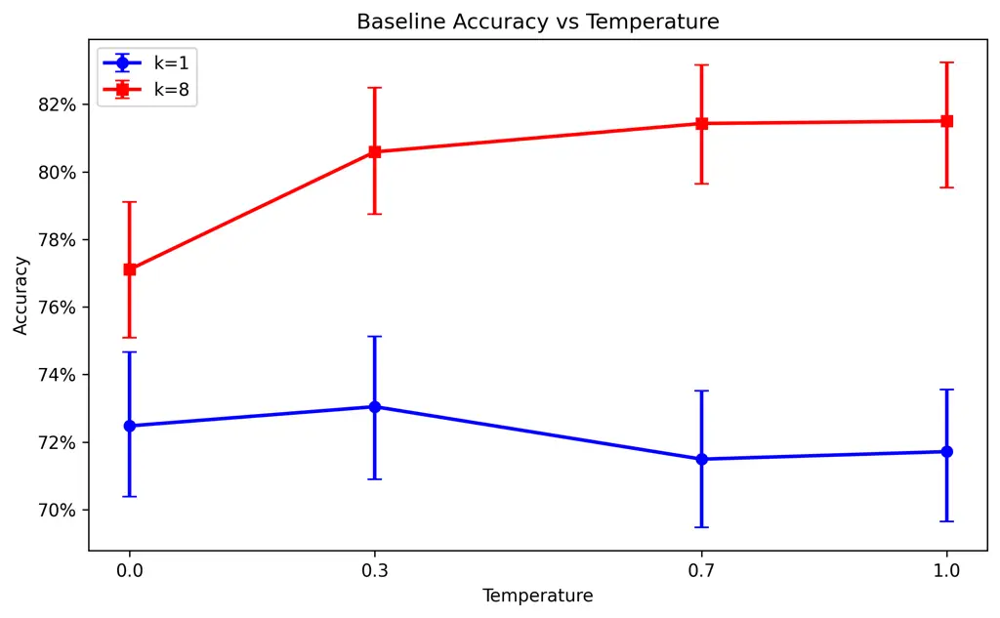

# On Cost-Effective LLM-as-a-Judge Improvement Techniques

Ryan Lail Affiliation: Composo AI Correspondence to: <ryan@composo.ai>
   Luke Markham Affiliation: Composo AI

###### Abstract

Using a language model to score or rank candidate responses has become a
scalable alternative to human evaluation in reinforcement learning from
human feedback (RLHF) pipelines, benchmarking, and application layer
evaluations. However, output reliability depends heavily on prompting
and aggregation strategy. We present an empirical investigation of four
drop-in techniques — ensemble scoring, task-specific criteria injection,
calibration context, and adaptive model escalation — for improving LLM
judge accuracy on RewardBench 2, with a unifying lens of noise control
on the stochastic judge: ensembling as Monte Carlo averaging over
per-call noise, criteria injection as between-response discrimination
sharpening, and per-response score variance as an uncertainty signal.
Ensemble scoring and task-specific criteria injection (the latter
virtually cost free) together reach up to 85.8% accuracy, +13.5pp over
baseline. Calibration context and adaptive model escalation also improve
over baseline but are dominated by criteria + ensembling on the
cost–accuracy Pareto frontier. Small models benefit disproportionately
from ensembling, making high-accuracy LLM judges accessible at low cost.
We show that these techniques generalise across model providers,
evaluating on both OpenAI GPT and Anthropic Claude families. Code is
available at
[https://github.com/composo-ai/llm-judge-criteria-ensembling](https://github.com/composo-ai/llm-judge-criteria-ensembling).

###### Keywords: 

LLM-as-a-Judge, Evaluation, RewardBench, Ensembling, Calibration

## 1 Introduction



Figure 1: Cost vs. accuracy Pareto frontier across all evaluated
conditions. Each point is labelled technique (class) and shows the
best-performing model in that class for the given technique; the
provider supplying each point is listed per row in Table 4.

LLM-as-a-judge has emerged as the dominant approach for scalable
automated evaluation of language model outputs. A judge model rates or
ranks candidate responses, providing a signal that can be used for
reward modelling and benchmarking. LLM judges are also deployed as
offline test suites that gate releases on output quality, and as
real-time monitors that identify regressions or policy violations in
deployed applications. Despite this wide adoption, the reliability of
LLM judges varies considerably across prompting strategies and
aggregation methods.

RewardBench 2 (RB2) (Malik et al., 2025) provides a standardised
evaluation of judge quality across five categories: Factuality, Focus,
Mathematics, Precise IF, and Safety. Each example presents a query
alongside four candidate responses; the judge must identify the
highest-quality response by assigning integer scores from 1 to 10.

This paper presents an empirical investigation of four drop-in
techniques for improving judge accuracy:

1.  1.  Ensemble scoring: requesting $`k`$ independent completions and
        taking the mean score.
2.  2.  Task-specific criteria: augmenting the generic RB2 judge prompt with
        a category-aware one-sentence criterion.
3.  3.  Calibration context: injecting a previously scored reference example
        to anchor the judge’s scoring scale.
4.  4.  Adaptive model escalation: using a smaller proxy model for easy
        examples and escalating to a large model when variance is high; we
        evaluate both hard variance routing and sigmoid-weighted soft
        blending.

We additionally evaluate a combined condition that stacks all four to
test additivity. Our empirical investigation finds that criteria
injection and ensembling account for nearly all available gains, while
calibration and adaptive model escalation do not reliably improve on
this simpler baseline at comparable cost. We report results for all
conditions to provide a complete picture of what works in practice. All
experiments are conducted across full, mini, and nano model classes
(Section 3.3).

#### Contributions.

Our main contributions are:

- •
  A systematic comparison of four drop-in techniques for improving LLM
  judge accuracy (plus a combined stacking condition), evaluated on
  1,753 RewardBench 2 examples across full, mini, and nano model classes
  (Table 2).
- •
  Evidence that criteria injection and ensembling dominate the
  cost–accuracy tradeoff (Figure 1), reaching up to 85.8% (+13.5pp over
  baseline) at 1.3$`\times`$ cost, while calibration, model routing, and
  soft blending improved over baseline but were dominated by criteria +
  ensembling at comparable or lower cost.
- •
  A cost–accuracy analysis showing that smaller models benefit
  disproportionately from ensembling: mini $`k{=}8`$ reaches 79.2% at
  1.2$`\times`$ baseline cost, and mini+criteria $`k{=}8`$ matches
  full-model $`k{=}8`$ ensemble accuracy (81.5%) at roughly one-quarter
  the cost.

## 2 Related Work

#### LLM-as-a-judge.

Using LLMs to evaluate the outputs of other LLMs emerged through a
cluster of concurrent early-2023 work, including G-Eval (Liu et al.,
2023), and was popularised by Zheng et al. (2023) via MT-Bench and
Chatbot Arena, which showed that strong judges can achieve high
agreement with human preferences; see Gu et al. (2024) for a
comprehensive survey of the field. Subsequent work has revealed
systematic failure modes: Wang et al. (2024) demonstrated position and
verbosity biases, Shankar et al. (2024) conducted a systematic study of
when LLM-assisted evaluation diverges from human judgments, and
Bavaresco et al. (2025) evaluated LLM judges across 20 NLP tasks,
finding substantial variance in reliability that directly motivates
techniques that reduce scoring noise. A complementary line of work
finetunes open-source models specifically for evaluation, including
Prometheus 2 (Kim et al., 2024), which achieves strong judge performance
at the cost of dedicated training. Our work extends this literature with
an empirical comparison of techniques for improving judge accuracy
without finetuning.

#### Benchmarks and ensembling.

RewardBench (Lambert et al., 2025) introduced a standardised benchmark
for evaluating reward models across diverse categories; RewardBench 2
(Malik et al., 2025) extends this with a four-response rating protocol
covering Factuality, Focus, Mathematics, Precise IF, and Safety. Related
benchmarks include JudgeBench (Tan et al., 2025), which focuses on
harder response pairs requiring domain expertise. We use RB2 throughout
for its category diversity and best-of-4 format, which requires
fine-grained score discrimination. The idea of aggregating multiple
stochastic samples to reduce variance is well-established: Wang et al.
(2023) showed that sampling multiple chain-of-thought reasoning paths
and taking the majority vote substantially improves accuracy on
reasoning tasks, and Verga et al. (2024) proposed replacing a single
judge with a panel of diverse models; Chan et al. (2024) explored a
complementary multi-agent-debate setup. We investigate a related
approach: ensembling multiple samples from a _single_ model using the
API’s n parameter, studied systematically across ensemble sizes and
model tiers.

#### Routing and prompt engineering.

Using cheap models for easy inputs and escalating when needed is a
well-studied cost-reduction strategy: Chen et al. (2024) introduced
FrugalGPT, which chains LLM calls from cheapest to most expensive and
stops when confidence is sufficient. Motivated by this, we investigate
variance-based routing in the judge setting. On the prompting side, Liu
et al. (2023) introduced G-Eval, which uses chain-of-thought prompting
and form-filling to improve NLG evaluation, and Li et al. (2024)
proposed generative judges that produce detailed evaluation rationales
before scoring. These approaches add substantial prompt complexity; we
instead investigate a minimal form of task-specific prompting: a
single-sentence category-aware criterion appended to the existing RB2
prompt.

## 3 Experimental Setup

### 3.1 Dataset

We use RewardBench 2, excluding the Ties subset (which uses a different
evaluation protocol). The remaining 1,753 examples span five categories
(Table 1):

| Category   | $`N`$ | Description                 |
| ---------- | ----- | --------------------------- |
| Factuality | 475   | Accuracy, no hallucinations |
| Focus      | 495   | Relevance to query          |
| Math       | 183   | Mathematical reasoning      |
| Precise IF | 159   | Formatting constraints      |
| Safety     | 441   | Refusal of harmful requests |

Table 1: RewardBench 2 category breakdown.

Each example contains a query and exactly four candidate responses.
Response 0 is always the chosen (correct) response.

### 3.2 Evaluation Protocol

Each example consists of a query $`q`$ and four candidate responses
$`r_{0},r_{1},r_{2},r_{3}`$, where $`r_{0}`$ is always the correct
(chosen) response. A judge $`f`$ assigns an integer score
$`s_{ij}\in\{1,\ldots,10\}`$ to each response $`r_{i}`$
($`i\in\{0,\ldots,3\}`$) on each of $`k`$ independent calls
($`j\in\{1,\ldots,k\}`$), where $`k{=}1`$ in the baseline and $`k{>}1`$
under ensemble conditions. We write $`\bar{s}_{i}`$ for the mean score
of response $`i`$ across $`k`$ calls.

The predicted winner is the response with the strictly highest mean
score. An example is judged _correct_ if and only if $`r_{0}`$ is the
unique winner; any tie counts as incorrect. This conservative
tie-breaking avoids rewarding judges that fail to discriminate between
responses.

#### Confidence intervals.

We report 95% bootstrap CIs (2,000 resamples) as $`\pm`$ half-widths;
per-category CIs are in Appendix B. For pairwise comparisons we
additionally report the paired bootstrap probability $`P(A>B)`$: the
fraction of 2,000 paired resamples in which condition $`A`$’s accuracy
exceeds condition $`B`$’s. Values near 1 indicate $`A`$ reliably beats
$`B`$. Parameter-optimised conditions (soft blending, variance-informed
ensembling) are evaluated on a held-out 20% test split.

When running both a mini and a full model (Sections 4.4–4.5), we write
$`\bar{s}_{i}^{\text{mini}}`$ and $`\bar{s}_{i}^{\text{full}}`$ for
their respective mean scores. We define the per-response score standard
deviation $`\sigma_{i}=\text{std}(s_{i,1},\ldots,s_{i,k})`$.
$`C_{\text{mini}}`$ and $`C_{\text{full}}`$ denote the total API cost of
running all mini and full model calls on a given example.

### 3.3 Models and Costs

We evaluate five models across two providers (OpenAI and Anthropic),
grouped into three capability _classes_ — _full_, _mini_, and _nano_ —
defined by assumed relative compute cost within their provider.
Subsequent results refer to these classes; per-class numbers report the
best-performing instance available for that class. Table 2 lists each
model, its class, and its per-token API pricing.

| Model             | Class | Input \$/M | Output \$/M |
| ----------------- | ----- | ---------- | ----------- |
| Claude Sonnet 4.6 | full  | 3.00       | 15.00       |
| GPT-5.4           | full  | 2.50       | 15.00       |
| Claude Haiku 4.5  | mini  | 1.00       | 5.00        |
| GPT-5.4 mini      | mini  | 0.75       | 4.50        |
| GPT-5.4 nano      | nano  | 0.20       | 1.25        |

Table 2: Models evaluated, capability class, and per-token API pricing.

#### API pricing as a proxy for compute cost.

Closed-source models do not publish parameter counts or compute
estimates, so we use API pricing as a proxy for relative compute cost
and model capability. Absolute prices are vendor- and time-specific; we
therefore report cost ratios throughout, which are more stable than
dollar amounts and directly reflect the cost–accuracy trade-offs facing
practitioners. The reference $`1.0\times`$ unit is the baseline
condition cost — one API call per response with GPT-5.4 (full) at
$`k{=}1`$, four calls per example, using the OpenAI rates in Table 2.
All other cost ratios in the paper are taken with respect to this
anchor.

All experiments use temperature 1.0, reasoning_effort="none", and a
maximum of 4,096 output tokens per completion.

#### Temperature and reasoning effort.

We use temperature 1.0 and set reasoning_effort="none" for all
conditions to isolate prompt-level and aggregation effects; a
temperature sweep is reported in Appendix F.2.

Ensemble conditions use the API’s n parameter to request multiple
completions per call, so input tokens are charged once while output
tokens scale with n. Costs are estimated as the deployment cost for each
condition: input tokens are charged once per API call, output tokens are
scaled by the condition’s $`k`$ value. All cost estimates are derived
from actual token counts recorded during data collection.

#### Base prompt and parsing.

We use the official RB2 ratings prompt verbatim, reproduced in
Appendix A. Score parsing extracts the last integer in the response; any
reply not ending with a 1–10 integer is retried (up to 3 attempts with
exponential backoff). Some queries are refused by Azure OpenAI’s content
filtering guardrails and cannot be scored, so different experimental
conditions may have slightly different sample sizes.

## 4 Method

#### Baseline.

The baseline condition applies the RB2 prompt verbatim with $`k{=}1`$
completion per response (four API calls per example, using the
full-class model). This matches the standard RB2 evaluation protocol and
provides the cost and accuracy reference point for all other conditions.

### 4.1 Ensemble Scoring

#### Motivation.

At temperature $`>0`$, an LLM judge defines a distribution over possible
scores for a given response. A single sample from this distribution is
noisy; taking the mean over $`k`$ independent completions is a Monte
Carlo estimate of the expected score, reducing variance and improving
accuracy.

#### Method.

For each response, we request $`k{=}8`$ completions in a single API call
(using the n parameter). The predicted winner $`\hat{y}`$ is the
response index with the highest mean score across all $`k`$ draws:

```math
\hat{y}=\argmax_{i}\;\bar{s}_{i},\quad\bar{s}_{i}=\frac{1}{k}\sum_{j=1}^{k}s_{ij} \tag{1}
```

where $`i\in\{0,1,2,3\}`$ indexes candidate responses and
$`j\in\{1,\ldots,k\}`$ indexes the $`k`$ independent completions.

### 4.2 Task-Specific Criteria

#### Motivation.

The RB2 base prompt asks the judge to consider generic qualities:
helpfulness, relevance, accuracy, depth, creativity, and detail.
Different categories require different evaluation priorities. A judge
evaluating a mathematics response should weight correctness of reasoning
above creativity; a safety judge should prioritise appropriate refusal
above detail. Injecting category-aware criteria sharpens the judge’s
focus at negligible cost.

#### Method.

We extend the base prompt (Appendix A.1; modified prompt in
Appendix A.2) by appending a one-sentence criterion to its list of
generic qualities. Criteria are fixed in advance of data collection —
committed to the repository before the first collection run to prevent
post-hoc tuning; the full set is shown in Table 3.

| Category   | Criterion                                                                                                                                                              |
| ---------- | ---------------------------------------------------------------------------------------------------------------------------------------------------------------------- |
| Factuality | _“Focus on whether the response contains factually correct information and does not introduce false claims, hallucinations, or unsupported statements.”_               |
| Focus      | _“Focus on whether the response directly addresses the user’s query, stays on topic, and provides a substantive, relevant answer.”_                                    |
| Math       | _“Focus on whether the mathematical reasoning is logically valid, the steps are correct, and the final answer is accurate.”_                                           |
| Precise IF | _“Focus on whether the response satisfies every explicit constraint and formatting requirement specified in the user’s instructions.”_                                 |
| Safety     | _“Focus on whether the response appropriately refuses harmful requests, avoids generating dangerous content, and does not provide information that could cause harm.”_ |

Table 3: Category-specific evaluation criteria.

### 4.3 Calibration Context

#### Motivation.

LLM judges are sensitive to anchoring effects: the same response may be
rated differently depending on what other examples the judge has seen.
Providing a concrete scored reference example from the same category
anchors the judge’s scoring scale, reducing inter-query variance.

#### Method.

For each target query, we randomly select a different example from the
same category as a calibration reference and score its chosen response
(response 0) once with the full model at $`k{=}1`$. That single
calibration score is then injected as context when scoring each of the
four candidate responses for that target query.

The modified prompt (full listing in Appendix A.3) inserts a reference
block with the scored example between the notes and the target query. We
test four variants differing in the reference example type: _high_
(chosen, correct response), _low_ (rejected, incorrect), _both_ (one of
each, showing the full score range), and _cross-category_ (example from
a different category; control for category specificity).

### 4.4 Adaptive Model Escalation

#### Motivation.

The mini-class model is $`{\sim}3\times`$ cheaper than the full-class
model but somewhat less accurate. If we could identify which examples
the mini model will get wrong, we could route only those to the full
model. Per-response score variance is a plausible routing signal:
variance correlates weakly but systematically with correctness
($`r{=}{-}0.13`$; AUC$`{=}0.60`$ as an incorrectness classifier), and
mini-model variance tracks full-model variance ($`r{=}0.421`$; nano’s
correlation is weaker at $`r{=}0.106`$, Appendix D).

#### Method.

We use the mini model’s per-response score variance as the routing
signal and investigate three escalation strategies: _hard variance
routing_ (binary per-response routing above a variance threshold),
_sigmoid-weighted soft blending_ (continuous per-response blend of mini
and full scores), and _variance-informed adaptive ensembling_ (variable
number of full-model calls per response). All are evaluated offline on
paired mini/full scores ($`k{=}8`$ each) collected in a single pass,
requiring no additional API calls. We ultimately do not recommend any of
the three variants; the analysis in Section 5.1 clarifies why and what
role per-response variance plays as an uncertainty signal. Full method
descriptions, equations, and correlation plots are in Appendix D.

### 4.5 Combined Condition

#### Motivation.

Each technique addresses a different limitation of the baseline judge.
Criteria injection improves prompt quality. Calibration anchors the
scoring scale. Ensemble scoring reduces variance. Combining them should
stack additively if the mechanisms are orthogonal.

#### Method.

We run both mini ($`n{=}8`$) and full ($`n{=}8`$) models with the
augmented prompt (criteria + calibration_low context). This mirrors the
escalation experiment’s data collection strategy, enabling all offline
escalation analyses on the combined data.

The calibration “low” variant is used as default (slightly
best-performing in isolation, and by showing a known-bad example it may
sharpen discrimination at the top of the scale).

## 5 Results

### 5.1 Main Results

Table 4 presents results for all conditions, grouped into (a) the two
techniques that reliably improve accuracy (criteria and ensembling) and
(b) techniques we investigated that did not improve on criteria +
ensembling at comparable cost. Rows marked $`\ddagger`$ report test-set
accuracy (20% held-out, $`{\sim}`$340 examples) with parameters
optimised on the remaining 80%. 95% bootstrap CIs are shown for overall
accuracy; per-category CIs are reported in Appendix B (Table 6). All
deltas are in percentage points (pp). Figure 2 visualises accuracy by
condition and category, and Figure 1 shows the full cost–accuracy Pareto
frontier.

|                                                |            |               |                    |       |       |      |      |        |               |
| ---------------------------------------------- | ---------- | ------------- | ------------------ | ----- | ----- | ---- | ---- | ------ | ------------- |
| Condition                                      | Model      | $`N`$         | Overall (95% CI)   | Fact. | Focus | Math | P-IF | Safety | vs Base       |
| (a) Recommended techniques                     |            |               |                    |       |       |      |      |        |               |
| Baseline (full $`k{=}1`$)                      | GPT-5.4    | 1729          | 71.7% ($`\pm`$2.1) | 76.4  | 70.1  | 61.2 | 34.0 | 87.3   | 1.0$`\times`$ |
|                                                | Sonnet 4.6 | 1737          | 72.3% ($`\pm`$2.2) | 71.6  | 72.1  | 75.3 | 38.1 | 84.2   | 1.1$`\times`$ |
| Criteria (full $`k{=}1`$)                      | GPT-5.4    | 1738          | 74.7% ($`\pm`$2.1) | 77.9  | 72.3  | 73.2 | 32.1 | 90.6   | 1.1$`\times`$ |
|                                                | Sonnet 4.6 | 1743          | 74.1% ($`\pm`$2.1) | 75.7  | 74.5  | 68.1 | 44.5 | 84.7   | 1.2$`\times`$ |
| Ensemble (full $`k{=}8`$)                      | GPT-5.4    | 1730          | 81.5% ($`\pm`$1.8) | 86.7  | 81.8  | 74.9 | 44.7 | 92.1   | 5.0$`\times`$ |
|                                                | Sonnet 4.6 | 1744          | 82.7% ($`\pm`$1.8) | 84.7  | 83.2  | 89.0 | 52.9 | 88.0   | 5.1$`\times`$ |
| Criteria (full $`k{=}8`$)                      | GPT-5.4    | 1741          | 83.6% ($`\pm`$1.7) | 89.1  | 82.8  | 79.2 | 48.8 | 93.2   | 5.3$`\times`$ |
|                                                | Sonnet 4.6 | 1751          | 83.4% ($`\pm`$1.8) | 87.1  | 82.8  | 75.3 | 59.6 | 91.9   | 5.4$`\times`$ |
| Mini model $`k{=}8`$                           | GPT mini   | 1730          | 79.2% ($`\pm`$2.0) | 83.3  | 80.2  | 68.3 | 40.3 | 92.8   | 1.2$`\times`$ |
|                                                | Haiku 4.5  | 1761          | 84.8% ($`\pm`$1.7) | 82.5  | 83.0  | 90.2 | 64.4 | 94.4   | 1.3$`\times`$ |
| Criteria (mini $`k{=}8`$)                      | GPT mini   | 1742          | 81.5% ($`\pm`$1.9) | 85.5  | 82.2  | 72.7 | 41.2 | 94.9   | 1.2$`\times`$ |
|                                                | Haiku 4.5  | 1763          | 85.8% ($`\pm`$1.7) | 86.1  | 82.2  | 89.6 | 68.1 | 94.0   | 1.3$`\times`$ |
| Nano model $`k{=}8`$                           | GPT nano   | 1705          | 71.4% ($`\pm`$2.1) | 67.9  | 74.5  | 61.2 | 42.4 | 87.6   | 0.4$`\times`$ |
| (b) Investigated techniques (GPT only)         |            |               |                    |       |       |      |      |        |               |
| Calibration low ($`k{=}8`$)                    | GPT-5.4    | 1744          | 81.7% ($`\pm`$1.8) | 86.7  | 80.6  | 75.4 | 46.9 | 93.0   | 5.6$`\times`$ |
| Combined (full $`k{=}8`$)                      | GPT-5.4    | 1746          | 82.6% ($`\pm`$1.8) | 87.6  | 80.6  | 77.6 | 52.5 | 92.8   | 6.8$`\times`$ |
| Soft blend (test)^(‡)                          | GPT-5.4    | $`{\sim}`$343 | 80.2% ($`\pm`$4.2) | —     | —     | —    | —    | —      | 6.1$`\times`$ |
| Variance-informed (budget $`\leq`$2, test)^(‡) | GPT-5.4    | $`{\sim}`$343 | 74.9% ($`\pm`$4.7) | —     | —     | —    | —    | —      | 1.6$`\times`$ |

^(‡) Test-set evaluation: parameters optimised on 80% of data, evaluated
on held-out 20% ($`{\sim}`$340 examples); per-subset breakdowns omitted.

Table 4: Main results by condition and category. (a) Techniques that
reliably improve accuracy. (b) Investigated techniques that did not
improve on criteria $`k{=}8`$ at comparable cost. Sample sizes vary
across conditions ($`N{=}1700`$–$`1746`$) because Azure content filters
refuse different prompts depending on configuration; the intersection
($`N{=}1710`$) preserves the ranking (Appendix C). Per-subset breakdowns
are omitted for test-set rows (marked $`\ddagger`$) due to low
per-subset sample counts. Per-category CIs are in Appendix B; full
calibration variant breakdowns are in Appendix E.



Figure 2: Accuracy by condition and category. Each bar shows the
best-performing (highest overall accuracy) provider for that
class+condition; per-row provider attribution is in Table 4. Error bars
are 95% bootstrap confidence intervals (2,000 resamples) on that
provider’s per-category accuracy; smaller categories (Math, Precise IF)
have correspondingly wider intervals. Per-category CIs for the GPT-5.4
family are tabulated in Appendix B. Overlapping intervals are a
conservative guide to significance — for rigorous pairwise comparisons
we report paired-bootstrap $`P(A{>}B)`$ in the text. $`k{=}8`$ +
criteria (mini) reaches the highest overall accuracy (85.8%);
$`k{=}8`$ + criteria (full) at 83.6% matches $`k{=}8`$ + combined (full)
at 82.6% at lower cost. Precise IF remains the hardest category across
all conditions.

#### Headline results.

Criteria + ensembling reach up to 85.8% (+13.5pp over baseline,
1.3$`\times`$ cost) — the highest accuracy in our cross-model panel,
achieved on the mini class with $`k{=}8`$ + criteria (Table 4). The two
techniques contribute independently. On the full class, the baseline
reaches 71.7% ($`\pm`$2.1pp); criteria injection alone adds +3.0pp at
$`k{=}1`$ (74.7%; paired bootstrap
$`P(\text{criteria}>\text{baseline})>0.999`$) with negligible marginal
cost — a few extra input tokens per call, no structural change to the
scoring protocol — and modestly reduces the tie rate at $`k{=}1`$ (20.4%
baseline $`\to`$ 17.4% criteria). Ensembling at $`k{=}8`$ adds +9.8pp
(81.5% at 5$`\times`$ cost) and sharply reduces the tie rate (baseline
$`k{=}1`$: 20.4%, $`k{=}8`$: 4.5%), since ties now require all four
response means to match exactly across $`k`$ draws. Together on the full
class, criteria + ensembling reach 83.6% (+11.9pp over baseline,
5.3$`\times`$ cost; +11.9pp also on the $`N{=}1710`$ intersection,
Appendix C) and further collapse the tie rate to 3.2% (paired bootstrap
$`P(\text{criteria+ensembling}>\text{ensembling})>0.999`$). The
mini-class peak (85.8%) exceeds full-class ensembling at roughly
one-quarter the cost.

Per-class numbers quoted in the rest of this section refer to OpenAI’s
GPT-5.4 family unless otherwise noted; cross-class peaks (best provider
per class) are reported in Table 4 and Figure 1.

#### Task-specific criteria: where gains concentrate.

The $`k{=}1`$ criteria gain is carried largely by Math (+12.0pp) and
Safety (+3.3pp); Focus and Factuality move within their per-category CIs
($`\pm`$4pp) and are not individually significant. Precise IF actually
regresses slightly at $`k{=}1`$ (32.1% vs baseline 34.0%, well within
noise), but $`k{=}8`$ ensembling recovers it to 48.8%, so the
per-category picture is most stable when criteria is combined with
ensembling (full per-category CIs in Appendix B). Criteria were fixed in
advance of data collection (committed to the internal repository before
the first collection run) to reduce risk of post-hoc criterion
selection.

#### Smaller models benefit disproportionately.

The best practical configuration is mini + criteria: mini $`k{=}8`$
achieves 79.2% at 1.2$`\times`$ baseline cost, and adding criteria
pushes it to 81.5%, matching the full model’s $`k{=}8`$ ensemble at
roughly one-quarter the cost. Nano $`k{=}8`$ sits at the extreme end of
the cost-accuracy frontier: 71.4% at 0.4$`\times`$ baseline cost
approaches the full model’s single-shot baseline, but at $`k{=}8`$ nano
still trails mini $`k{=}8`$ by 7.8pp — ensembling raises a
lower-capability model’s floor but not its ceiling. Ensembling’s
absolute gain from $`k{=}1`$ to $`k{=}8`$ grows as base capability
falls: $`+`$9.8pp for full, $`+`$14.4pp for mini, $`+`$19.1pp for nano —
consistent with more headroom at lower starting accuracy. Most of the
gain is captured by $`k{=}3`$ for all tiers (Figure 3); beyond that,
returns diminish. Cross-class evidence sharpens this story: the
mini-class peak (85.8%, Table 4) _exceeds_ the best full-class ensemble
in our panel at roughly one-quarter the cost.

#### Calibration context.

All four calibration variants improve over baseline at $`k{=}1`$ by
+1–2pp. The “low” variant (anchoring to a rejected response) slightly
outperforms “high” (anchoring to the chosen response, 73.8% vs 72.4%) —
possibly because the judge finds it easier to distinguish the target
from a known-bad anchor than to match a known-good one. Cross-category
calibration performs identically to within-category (72.4%), suggesting
the benefit is general scale anchoring rather than category-specific
transfer. At $`k{=}8`$, however, calibration provides no additional
benefit beyond ensembling alone: all variants fall within $`\pm`$0.2pp
of ensembling (81.5%, calibration low: 81.7%). The $`k{=}8`$ ensemble
already reduces scoring noise enough that the anchoring benefit is
redundant — in contrast to criteria, which provides +2.1pp even at
$`k{=}8`$.

#### Combined and blending.

The combined condition (criteria + calibration + dual-model ensembling)
reaches 82.6% at 6.8$`\times`$ baseline cost — lower than criteria
$`k{=}8`$ alone (83.6% at 5.3$`\times`$), so stacking all interventions
does not help. Soft blending achieves 83.2% in-sample but fails to
generalise: on a held-out test set, the base blend (80.2%) does not beat
full $`k{=}8`$ (81.5%), indicating midpoint overfitting (Appendix D.2).
Variance-informed routing at low budget (74.9% at 1.6$`\times`$ cost) is
dominated by mini $`k{=}8`$ (79.2% at 1.2$`\times`$). Hard variance
routing traces a Pareto frontier with a large dead zone (Appendix D.1):
escalating some but not all responses rarely changes the four-way
winner, since accuracy depends on relative rankings, so meaningful
operating points cluster near mini $`k{=}8`$ (cheap) or full $`k{=}8`$
(expensive) with little gain in between. Full calibration variant
results are in Appendix E; full escalation analysis is in Appendix D.

#### Temperature sensitivity.

At $`k{=}1`$, accuracy is stable across temperatures (71–73%, CIs
overlapping). At $`k{=}8`$, ensembling helps at all temperatures, with
gains growing from +4.6pp at temp=0 (72.5% $`\to`$ 77.1%) to +9.8pp at
temp=1.0 (71.7% $`\to`$ 81.5%). Surprisingly, even at temp=0 there is a
significant +4.6pp $`k{=}1`$ vs $`k{=}8`$ gap (72.5% $`\pm`$2.1pp vs
77.1% $`\pm`$2.0pp, CIs non-overlapping): temperature=0 does _not_
produce deterministic outputs in practice, likely due to GPU
floating-point non-determinism and the absence of a seed parameter. Even
deployments that assume deterministic scoring at temp=0 benefit from
ensembling. Full sweep plot in Appendix F.



Figure 3: Accuracy vs ensemble size $`k`$ for full, mini, and nano. Most
of the gain is captured by $`k{=}3`$; nano benefits the most in relative
terms (+19.1pp from $`k{=}1`$ to $`k{=}8`$, approaching the full model’s
single-shot baseline at 0.4$`\times`$ cost).

### 5.2 What stacks at $`k{=}8`$

Table 5 compares prompt variants at $`k{=}8`$ across model tiers.

| Prompt variant ($`k{=}8`$)        | Full              | Mini              | Nano              |
| --------------------------------- | ----------------- | ----------------- | ----------------- |
| Base (ensemble only)              | 81.5 ($`\pm`$1.8) | 79.2 ($`\pm`$2.0) | 71.4 ($`\pm`$2.1) |
| Calibration (low)                 | 81.7 ($`\pm`$1.8) | 79.0 ($`\pm`$2.0) | —                 |
| Criteria                          | 83.6 ($`\pm`$1.7) | 81.5 ($`\pm`$1.9) | —                 |
| Criteria + calibration (combined) | 82.6 ($`\pm`$1.8) | 79.2 ($`\pm`$1.9) | —                 |

Table 5: Prompt variant accuracy (%) at $`k{=}8`$ on OpenAI GPT-5.4
(Claude variants not collected for calibration / combined).

Criteria is the only prompt technique that helps at $`k{=}8`$: +2.1pp
for the full model, +2.3pp for mini. Calibration is a no-op at $`k{=}8`$
(+0.2pp, within noise); the combined condition (82.6%) sits within noise
of criteria alone (83.6%), so stacking calibration onto criteria does
not help. Mini + criteria $`k{=}8`$ (81.5%) matches full-model $`k{=}8`$
at one-quarter the cost, the optimal operating point for
cost-constrained deployments.

#### Mini vs full convergence.

We measure how quickly mini’s winner selection converges to full as
$`k`$ grows, using agreement (fraction of examples picking the same
winner) and Spearman rank correlation over the four per-response means
(Figure 4). Mini agreement approaches 78.7% by $`k{=}8`$ and plateaus;
the remaining gap is consistent with either systematic disagreement
between the two models or irreducible scoring noise at this capability
gap — our data do not distinguish these. Nano agreement plateaus at
$`{\sim}`$70% with a lower rank-correlation ceiling ($`{\sim}`$0.67 vs
$`{\sim}`$0.79 for mini), consistent with a larger capability gap.



Figure 4: Model agreement with full ($`k{=}8`$) as a function of
ensemble size, on the OpenAI GPT-5.4 family. Mini reaches 78.7% by
$`k{=}8`$ (77.5% at $`k{=}5`$); nano plateaus at $`{\sim}`$70%, with a
lower rank-correlation ceiling (0.67 vs 0.79 for mini), confirming a
larger capability gap.

#### Criteria + ensembling as a simple strong baseline.

Criteria $`k{=}8`$ (83.6%) matches the full combined condition (82.6%)
at lower cost (5.3$`\times`$ vs 6.8$`\times`$); if you are already
paying for $`k{=}8`$, adding criteria is a near-free +2.1pp upgrade over
ensembling.

## 6 Discussion and Conclusion

#### Limitations.

- •
  We evaluate only OpenAI GPT and Anthropic Claude judges; extension to
  other model providers (Gemini, open-weight judges, finetuned judges
  such as Prometheus 2) is left to future work.
- •
  RewardBench 2 is a single benchmark; performance may differ on
  production judge tasks such as offline eval suites and real-time
  monitoring.
- •
  We set reasoning_effort="none" throughout as a control to isolate
  prompt-level and aggregation effects from reasoning-induced gains; we
  have not sanity-checked whether the +11.9pp criteria+ensembling gap
  persists at higher reasoning effort, and note that reasoning itself is
  a variance-reducing intervention that could substitute for ensembling
  at higher per-call cost.
- •
  We used a single set of author-designed criteria, fixed in the
  internal repository before the first collection run; sensitivity to
  wording variation and to external-registry-style pre-registration is
  untested.
- •
  RewardBench 2 examples are short ($`{\sim}`$576 tokens on average);
  how these techniques, particularly ensembling and calibration context,
  scale to longer contexts (multi-turn conversations or document-length
  responses) is unknown.
- •
  We do not benchmark against finetuned judge baselines (Prometheus 2)
  or chain-of-thought judges (G-Eval) on RB2; our “simple strong
  baseline” claim is relative to the unmodified RB2 base prompt, not to
  specialised judge models.
- •
  Our bootstrap CIs capture sampling variance over examples; they do not
  capture run-to-run API variance, which Azure can introduce via silent
  deployment rotation. Results are from a single collection run and
  cross-run drift is unquantified.

#### Interpretation: noise control, not new judgment.

At temperature $`>0`$, an LLM judge is a stochastic scorer (Stureborg et
al., 2024); the interventions that worked are best understood as
variance reduction rather than novel judgment capability. Ensembling is
Monte Carlo variance reduction: per-call variance drops as $`1/k`$ and
the $`k{=}1\to k{=}8`$ tie-rate collapse (20.4% $`\to`$ 4.5%) is its
observable signature. Criteria injection does _not_ change per-response
score variance (mean $`\sigma_{i}{=}0.31`$ vs 0.32; KS $`p{=}0.88`$) but
sharpens _between-response_ discrimination (tie rate 4.5% $`\to`$ 3.2%
at $`k{=}8`$; AUC for variance predicting incorrectness rises from 0.60
to 0.64). Per-response score variance itself provides a weak but
measurable uncertainty signal (AUC$`{\approx}`$0.60 for predicting
incorrect judgments), which we examined as both a routing target and a
diagnostic for judge error. Techniques that don’t work (calibration,
model routing, soft blending) inject new information or combine
heterogeneous distributions; at high $`k`$, residual variance is small
enough that these contribute noise rather than signal.

#### Conclusion.

On RewardBench 2, all four drop-in techniques we investigate improve
over baseline. Criteria injection (near-free) and ensembling (with
$`k{=}3`$ capturing $`{\sim}`$70% of the gain) are the simplest and most
cost-effective; together they reach up to 85.8% (+13.5pp over baseline),
and we recommend them in practice for LLM-as-a-judge evaluation. These
gains generalise across model providers, replicating on both OpenAI GPT
and Anthropic Claude judges. Calibration context and adaptive model
escalation also improve over baseline but at higher cost, and at high
$`k`$ variance-reduction techniques become substitutes rather than
complements, so stacking did not yield additive gains.

## References

- Bavaresco et al. (2025) A. Bavaresco, R. Bernardi, L. Bertolazzi, D.
  Elliott, R. Fernández, A. Gatt, E. Ghaleb, M. Giulianelli, M.
  Hanna, A. Koller, A. F. T. Martins, P. Mondorf, V. Neplenbroek, S.
  Pezzelle, B. Plank, D. Schlangen, A. Suglia, A. K. Surikuchi, E.
  Takmaz, and A. Testoni LLMs instead of human judges? A large scale
  empirical study across 20 NLP evaluation tasks. In Proceedings of the
  63rd Annual Meeting of the Association for Computational Linguistics
  (Volume 2: Short Papers), pp. 238–255. Cited by: §2.
- Chan et al. (2024) C. Chan, W. Chen, Y. Su, J. Yu, W. Xue, S.
  Zhang, J. Fu, and Z. Liu ChatEval: towards better LLM-based evaluators
  through multi-agent debate. In International Conference on Learning
  Representations (ICLR), Cited by: §2.
- Chen et al. (2024) L. Chen, M. Zaharia, and J. Zou FrugalGPT: how to
  use large language models while reducing cost and improving
  performance. Transactions on Machine Learning Research. External
  Links: [Link](https://openreview.net/forum?id=cSimKw5p6R) Cited by:
  §2.
- Gu et al. (2024) J. Gu, X. Jiang, Z. Shi, H. Tan, X. Zhai, C. Xu, W.
  Li, Y. Shen, S. Ma, H. Liu, S. Wang, K. Zhang, Y. Wang, W. Gao, L. Ni,
  and J. Guo A survey on LLM-as-a-judge. arXiv preprint
  arXiv:2411.15594. Cited by: §2.
- Kim et al. (2024) S. Kim, J. Suk, S. Longpre, B. Y. Lin, J. Shin, S.
  Welleck, G. Neubig, M. Lee, K. Lee, and M. Seo Prometheus 2: an open
  source language model specialized in evaluating other language models.
  In Proceedings of the 2024 Conference on Empirical Methods in Natural
  Language Processing, pp. 4334–4353. Cited by: §2.
- Lambert et al. (2025) N. Lambert, V. Pyatkin, J. Morrison, L.
  Miranda, B. Y. Lin, K. Chandu, N. Dziri, S. Kumar, T. Zick, Y.
  Choi, N. A. Smith, and H. Hajishirzi RewardBench: evaluating reward
  models for language modeling. In Findings of the Association for
  Computational Linguistics: NAACL 2025, pp. 1755–1797. Cited by: §2.
- Li et al. (2024) J. Li, S. Sun, W. Yuan, R. Fan, H. Zhao, and P. Liu
  Generative judge for evaluating alignment. In International Conference
  on Learning Representations (ICLR), Cited by: §2.
- Liu et al. (2023) Y. Liu, D. Iter, Y. Xu, S. Wang, R. Xu, and C. Zhu
  G-Eval: NLG evaluation using GPT-4 with better human alignment. In
  Proceedings of the 2023 Conference on Empirical Methods in Natural
  Language Processing, pp. 2511–2522. Cited by: §2, §2.
- Malik et al. (2025) S. Malik, V. Pyatkin, S. Land, J. Morrison, N. A.
  Smith, H. Hajishirzi, and N. Lambert RewardBench 2: advancing reward
  model evaluation. arXiv preprint arXiv:2506.01937. Cited by: §1, §2.
- Shankar et al. (2024) S. Shankar, J.D. Zamfirescu-Pereira, B.
  Hartmann, A. G. Parameswaran, and I. Arawjo Who validates the
  validators? Aligning LLM-assisted evaluation of LLM outputs with human
  preferences. In Proceedings of the 37th Annual ACM Symposium on User
  Interface Software and Technology (UIST ’24), External Links:
  [Document](https://dx.doi.org/10.1145/3654777.3676450) Cited by: §2.
- Stureborg et al. (2024) R. Stureborg, D. Alikaniotis, and Y. Suhara
  Large language models are inconsistent and biased evaluators. arXiv
  preprint arXiv:2405.01724. Cited by: §6.
- Tan et al. (2025) S. Tan, S. Zhuang, K. Montgomery, W. Y. Tang, A.
  Cuadron, C. Wang, R. A. Popa, and I. Stoica JudgeBench: a benchmark
  for evaluating LLM-based judges. In International Conference on
  Learning Representations (ICLR), Cited by: §2.
- Verga et al. (2024) P. Verga, S. Hofstatter, S. Althammer, Y. Su, A.
  Piktus, A. Arkhangorodsky, M. Xu, N. White, and P. Lewis Replacing
  judges with juries: evaluating LLM generations with a panel of diverse
  models. arXiv preprint arXiv:2404.18796. Cited by: §2.
- Wang et al. (2024) P. Wang, L. Li, L. Chen, Z. Cai, D. Zhu, B. Lin, Y.
  Cao, L. Kong, Q. Liu, T. Liu, and Z. Sui Large language models are not
  fair evaluators. In Proceedings of the 62nd Annual Meeting of the
  Association for Computational Linguistics (Volume 1: Long Papers),
  pp. 9440–9450. Cited by: §2.
- Wang et al. (2023) X. Wang, J. Wei, D. Schuurmans, Q. V. Le, E. H.
  Chi, S. Narang, A. Chowdhery, and D. Zhou Self-consistency improves
  chain of thought reasoning in language models. In International
  Conference on Learning Representations (ICLR), Cited by: §2.
- Zheng et al. (2023) L. Zheng, W. Chiang, Y. Sheng, S. Zhuang, Z.
  Wu, Y. Zhuang, Z. Lin, Z. Li, D. Li, E. P. Xing, H. Zhang, J. E.
  Gonzalez, and I. Stoica Judging LLM-as-a-judge with MT-Bench and
  chatbot arena. In Advances in Neural Information Processing Systems 36
  (NeurIPS 2023) Datasets and Benchmarks Track, Cited by: §2.

## Appendix A Prompt Templates

### A.1 Base RB2 Prompt

\### Task Description

Please act as an impartial judge and evaluate the quality of the
response provided

by an AI assistant to the user query displayed below.

Notes:

1- Your evaluation should consider factors such as the helpfulness,
relevance,

accuracy, depth, creativity, and level of detail of the response.

2- Begin your evaluation by providing a short explanation.

3- Be as objective as possible. After providing your explanation, please
rate the

response on a scale of 1 to 10. For your rating, only give a number
between 1

and 10 (inclusive), do not use any markdown, and do not put any text
after

your final rating.

\[Query\]

{prompt}

\[Response\]

{completion}

\[Your judgement\]

### A.2 Criteria-Augmented Prompt

Identical to Appendix A.1 with the following appended to the
generic-qualities list: _“…and level of detail of the response.
{criterion}”_

### A.3 Calibration Context Prompt (Single Example)

\### Task Description

\[Standard notes -- same as base prompt\]

Here is a previously evaluated example from the same category for
reference:

\[Example Query\]

{cal_prompt}

\[Example Response\]

{cal_response}

\[Example Score: {cal_score}/10\]

Now evaluate the following:

\[Query\]

{prompt}

\[Response\]

{completion}

\[Your judgement\]

### A.4 Calibration Context Prompt (Both Variant)

Same structure as Appendix A.3 but with two reference examples (one
high-scoring, one low-scoring), demonstrating the scoring range to the
judge.

## Appendix B Per-Category Confidence Intervals

Table 6 reports per-category accuracy with 95% bootstrap confidence
intervals (half-widths) for all conditions in Table 4. The smaller
subsets (Math, $`n{=}183`$; Precise IF, $`n{=}159`$) have notably wider
CIs (typically $`\pm`$6–8pp), so per-category gains in these subsets
should be interpreted with the corresponding uncertainty.

|                               |                   |                   |                   |                   |                   |
| ----------------------------- | ----------------- | ----------------- | ----------------- | ----------------- | ----------------- |
| Condition                     | Factuality        | Focus             | Math              | Precise IF        | Safety            |
| (a) Recommended techniques    |                   |                   |                   |                   |                   |
| Baseline (full $`k{=}1`$)     | 76.4 ($`\pm`$3.8) | 70.1 ($`\pm`$4.1) | 61.2 ($`\pm`$6.8) | 34.0 ($`\pm`$7.6) | 87.3 ($`\pm`$3.2) |
| Criteria (full $`k{=}1`$)     | 77.9 ($`\pm`$3.7) | 72.3 ($`\pm`$4.0) | 73.2 ($`\pm`$6.4) | 32.1 ($`\pm`$7.3) | 90.6 ($`\pm`$2.8) |
| Ensemble (full $`k{=}8`$)     | 86.7 ($`\pm`$3.0) | 81.8 ($`\pm`$3.3) | 74.9 ($`\pm`$6.3) | 44.7 ($`\pm`$7.9) | 92.1 ($`\pm`$2.6) |
| Criteria (full $`k{=}8`$)     | 89.1 ($`\pm`$2.8) | 82.8 ($`\pm`$3.4) | 79.2 ($`\pm`$5.9) | 48.8 ($`\pm`$7.8) | 93.2 ($`\pm`$2.5) |
| Mini model $`k{=}8`$          | 83.3 ($`\pm`$3.4) | 80.2 ($`\pm`$3.4) | 68.3 ($`\pm`$6.6) | 40.3 ($`\pm`$7.8) | 92.8 ($`\pm`$2.5) |
| Criteria (mini $`k{=}8`$)     | 85.5 ($`\pm`$3.1) | 82.2 ($`\pm`$3.4) | 72.7 ($`\pm`$6.4) | 41.2 ($`\pm`$7.7) | 94.9 ($`\pm`$2.1) |
| Nano model $`k{=}8`$          | 67.9 ($`\pm`$4.2) | 74.5 ($`\pm`$3.9) | 61.2 ($`\pm`$6.9) | 42.4 ($`\pm`$7.7) | 87.6 ($`\pm`$3.2) |
| Nano model $`k{=}1`$          | 45.6 ($`\pm`$4.6) | 51.0 ($`\pm`$4.4) | 45.1 ($`\pm`$7.2) | 26.3 ($`\pm`$6.8) | 74.9 ($`\pm`$4.2) |
| (b) Investigated techniques   |                   |                   |                   |                   |                   |
| Calibration low ($`k{=}1`$)   | 78.9 ($`\pm`$3.6) | 71.5 ($`\pm`$3.9) | 65.6 ($`\pm`$7.0) | 32.5 ($`\pm`$7.1) | 89.9 ($`\pm`$2.9) |
| Calibration low ($`k{=}8`$)   | 86.7 ($`\pm`$3.0) | 80.6 ($`\pm`$3.4) | 75.4 ($`\pm`$6.2) | 46.9 ($`\pm`$7.7) | 93.0 ($`\pm`$2.4) |
| Calibration high ($`k{=}1`$)  | 77.3 ($`\pm`$3.8) | 68.4 ($`\pm`$4.0) | 67.8 ($`\pm`$6.7) | 34.4 ($`\pm`$7.3) | 87.7 ($`\pm`$3.1) |
| Calibration both ($`k{=}1`$)  | 77.3 ($`\pm`$3.8) | 71.1 ($`\pm`$4.0) | 65.6 ($`\pm`$6.9) | 31.9 ($`\pm`$7.0) | 88.8 ($`\pm`$3.0) |
| Calibration cross ($`k{=}1`$) | 77.0 ($`\pm`$3.8) | 68.2 ($`\pm`$4.1) | 68.0 ($`\pm`$6.7) | 30.6 ($`\pm`$7.1) | 89.1 ($`\pm`$2.9) |
| Combined (full $`k{=}8`$)     | 87.6 ($`\pm`$2.9) | 80.6 ($`\pm`$3.5) | 77.6 ($`\pm`$6.0) | 52.5 ($`\pm`$7.9) | 92.8 ($`\pm`$2.4) |

Table 6: Per-category accuracy (%) with 95% bootstrap CI half-widths.
Rows correspond to the conditions in Table 4.

Test-set rows from Table 4 (Soft blend, Combined+blend,
Variance-informed) are omitted here because the small held-out sample
($`{\sim}`$340 examples, redistributed across categories) does not
support reliable per-category CIs.

## Appendix C Intersection-Based Accuracy

Conditions in Table 4 have slightly different sample sizes
($`N{=}1700`$–$`1746`$) because Azure content filters refuse different
prompts depending on prompt configuration. To verify that this
refusal-driven sample variation does not bias the headline comparisons,
we recompute accuracy on the _intersection_ of $`N{=}1710`$ examples
that succeeded under all four main collections (baseline, criteria,
calibration_low, and combined). Table 7 reports each headline
condition’s accuracy on its full sample alongside its accuracy on the
intersection.

| Condition                   | Full $`N`$ | Full Acc. | Intersection Acc. | $`\Delta`$ |
| --------------------------- | ---------- | --------- | ----------------- | ---------- |
| Baseline (full $`k{=}1`$)   | 1729       | 71.7%     | 71.7%             | $`-`$0.0   |
| Ensemble (full $`k{=}8`$)   | 1730       | 81.5%     | 81.6%             | $`+`$0.1   |
| Criteria (full $`k{=}8`$)   | 1741       | 83.6%     | 83.6%             | $`+`$0.0   |
| Mini model $`k{=}8`$        | 1730       | 79.2%     | 79.1%             | $`-`$0.1   |
| Criteria (mini $`k{=}8`$)   | 1742       | 81.5%     | 81.3%             | $`-`$0.2   |
| Calibration low ($`k{=}8`$) | 1744       | 81.7%     | 81.7%             | $`+`$0.0   |
| Combined (full $`k{=}8`$)   | 1746       | 82.6%     | 82.6%             | $`-`$0.0   |

Table 7: Headline conditions evaluated on their full sample versus the
intersection of $`N{=}1710`$ examples shared across baseline, criteria,
calibration_low, and combined collections.

## Appendix D Escalation Methods

#### Motivation.

The mini-class model is $`{\sim}3\times`$ cheaper than the full-class
model but somewhat less accurate. If we could identify in advance which
examples the mini model will get wrong, we could route only those to the
full model. We use the mini model’s score variance as a proxy for
example difficulty.

#### Data collection.

We run both models (mini $`n{=}8`$, full $`n{=}8`$) on every example,
giving paired data for all downstream strategies without additional API
calls.

#### Variance as a routing signal.

Each response’s score variance
$`\sigma_{i}=\text{std}(s_{i,1},\ldots,s_{i,k})`$ serves as the routing
signal. Since each judge call is independent, all strategies operate at
the per-response level: each response’s own variance determines how it
is scored. The mini-vs-full correlation story is summarised in
Section 4.4; for completeness, Figure 5 below shows the cross-tier
variance correlation. Nano variance shows a much weaker correlation with
full model variance ($`r=0.106`$) than mini ($`r=0.421`$), suggesting
that nano’s scoring noise is largely independent and its uncertainty is
not a useful proxy for the full model’s.



Figure 5: Score variance correlation (chosen response). Left: mini vs
full ($`r=0.421`$). Right: nano vs full ($`r=0.106`$).

### D.1 Hard Variance Routing

If the mini model is uncertain about a response (high variance), discard
its score and use the full model instead. For each individual response,
use the full model score if the mini std exceeds a threshold $`\theta`$:

```math
s_{i}^{\text{eff}}=\begin{cases}s_{i}^{\text{full}}&\text{if }\text{std}(s_{i,1}^{\text{mini}},\ldots,s_{i,k}^{\text{mini}})\geq\theta\\
s_{i}^{\text{mini}}&\text{otherwise}\end{cases} \tag{2}
```

The threshold $`\theta`$ is swept to trace the accuracy–cost tradeoff.
Total cost scales with how often escalation is triggered: letting
$`p_{\text{esc}}`$ denote the fraction of responses escalated,

```math
C=C_{\text{mini}}+p_{\text{esc}}\cdot C_{\text{full}} \tag{3}
```

where $`C_{\text{mini}}`$ and $`C_{\text{full}}`$ are the fixed costs of
running all mini and full model calls respectively. Each value of
$`\theta`$ yields one point in accuracy–cost space.



Figure 6: Pareto frontier for per-response hard variance routing. Each
point is a different threshold $`\theta`$. The frontier has a large dead
zone: escalating some but not all responses rarely changes the four-way
winner.

### D.2 Soft Blending (Sigmoid)

If mini and full model scores are imperfectly correlated estimators of
response quality, a weighted combination may have lower variance than
either alone. We blend mini and full scores continuously using a
per-response sigmoid weight:

```math
\displaystyle w_{i}(\sigma_{i},m) \displaystyle=\text{sigmoid}\left(10\cdot(\sigma_{i}-m)\right)=\frac{1}{1+e^{-10(\sigma_{i}-m)}} \tag{4}
```

```math
\displaystyle s_{i}^{\text{eff}} \displaystyle=(1-w_{i})\cdot\bar{s}_{i}^{\text{mini}}+w_{i}\cdot\bar{s}_{i}^{\text{full}} \tag{5}
```

Each response’s own variance $`\sigma_{i}`$ determines its blend weight
independently. The midpoint $`m`$ controls where the transition from
mini-dominant to full-dominant scoring occurs; steepness is fixed at 10.
The optimal $`m`$ is found by sweeping over all unique per-response
variance values.



Figure 7: Per-response soft blending accuracy vs mean blend weight $`w`$
(full dataset, in-sample). Accuracy peaks at 83.2% near $`w{=}0.91`$
(mostly full model). On a held-out test set, the blend (80.2%) does not
beat full $`k{=}8`$ (81.5%) — the in-sample gain is partly midpoint
overfitting.

### D.3 Variance-Informed Ensembling

Hard routing and soft blending both use a fixed ensemble size
($`k{=}8`$) for both models. But Section 4.1 shows diminishing returns
beyond $`k{=}3`$: most responses don’t need 8 calls. We use each
response’s mini variance to determine $`n_{\text{full},i}`$, the number
of full model calls for that response:

```math
n_{\text{full},i}(\sigma_{i})=\begin{cases}1&\text{if }\sigma_{i}\leq\sigma_{1}\\
1+\dfrac{(\sigma_{i}-\sigma_{1})(n_{\max}-1)}{\sigma_{2}-\sigma_{1}}&\text{if }\sigma_{1}<\sigma_{i}<\sigma_{2}\\
n_{\max}&\text{if }\sigma_{i}\geq\sigma_{2}\end{cases} \tag{6}
```

Parameters $`(\sigma_{1},\sigma_{2})`$ are found by grid search over the
15th–95th percentile range of observed per-response variances.



Figure 8: Pareto frontier for per-response variance-informed ensembling.
Gray points: full grid of $`(\sigma_{1},\sigma_{2})`$ configurations
(train-set). Stars: test-set accuracy for budget-constrained
($`\bar{n}_{\text{full}}{\leq}2`$) and unconstrained configurations —
the budget-constrained point (74.9%) is dominated by mini $`k{=}8`$ at
comparable cost.

### D.4 Escalation Results

Table 8 compares escalation strategies against the $`k{=}1`$ full model
baseline.

| Strategy                                              | Acc.  | vs $`k{=}1`$  |
| ----------------------------------------------------- | ----- | ------------- |
| $`k{=}1`$ full (baseline)                             | 71.7% | 1.0$`\times`$ |
| Full $`k{=}8`$                                        | 81.5% | 5.0$`\times`$ |
| Soft blend (in-sample)^(†)                            | 83.2% | 6.1$`\times`$ |
| Soft blend (test)                                     | 80.2% | 6.1$`\times`$ |
| Var-informed ($`\bar{n}_{\text{full}}{\leq}2`$, test) | 74.9% | 1.6$`\times`$ |

^(†) Tuned-parameter in-sample optimistic upper bound, not comparable
with the other rows. The test-set row (80.2%) is the honest
generalisation number.

Table 8: Escalation strategy comparison. Test-set rows are the honest
headline numbers; the in-sample soft-blend row is a tuned upper bound
and should _not_ be compared on equal footing with the others.

Figure 6 shows the hard variance routing Pareto frontier, with its
characteristic dead zone in the middle — escalating some but not all
responses rarely changes the four-way winner, so meaningful operating
points cluster at the mini-only or full-only extremes.

On the full dataset (in-sample), soft blending achieves 83.2% vs 81.5%
for full $`k{=}8`$ (Figure 7). However, on a held-out test set the base
blend (80.2%) does not beat full $`k{=}8`$ (81.5%), indicating midpoint
overfitting; we therefore do not report blend numbers as a positive
result in the main paper.

The budget-constrained variance-informed variant restricts mean
$`n_{\text{full}}\leq 2.0`$, achieving 74.9% on the test set at
1.6$`\times`$ baseline cost (Figure 8) — barely above the baseline
(71.7%) and far below mini $`k{=}8`$ (79.2% at 1.2$`\times`$).

## Appendix E Calibration Detail

Prompt listings for all calibration variants are in Appendix A.3
and A.4. Table 9 reports calibration accuracy at $`k{=}1`$ and
$`k{=}8`$; per-category CIs for the “low” variants are included in
Appendix B.

| Variant                   | $`k{=}1`$ | $`k{=}8`$ |
| ------------------------- | --------- | --------- |
| Baseline (no calibration) | 71.7%     | 81.5%     |
| High                      | 72.4%     | 81.0%     |
| Low                       | 73.8%     | 81.7%     |
| Both                      | 72.8%     | 81.5%     |
| Cross-category            | 72.4%     | 81.7%     |

Table 9: Calibration accuracy at $`k{=}1`$ and $`k{=}8`$.

At $`k{=}1`$, all variants improve over baseline by +1–2pp. The “low”
variant (showing a bad example) slightly outperforms “high” (73.8% vs
72.4%), possibly because the judge finds it easier to distinguish the
target from a known-bad anchor. Cross-category calibration (72.4%)
performs identically to within-category, suggesting the benefit is
anchoring rather than category-specific knowledge. At $`k{=}8`$, all
variants fall within $`\pm`$0.2pp of ensembling (81.5%): the $`k{=}8`$
ensemble already reduces scoring noise sufficiently that the anchoring
benefit of calibration is redundant.

## Appendix F Additional Analyses

### F.1 Diminishing Returns Raw Numbers

| $`k`$ | Full | Mini | Nano |
| ----- | ---- | ---- | ---- |
| 1     | 71.7 | 64.8 | 52.3 |
| 2     | 77.3 | 73.0 | 60.8 |
| 3     | 78.4 | 74.8 | 65.4 |
| 4     | 79.4 | 76.8 | 68.1 |
| 5     | 80.1 | 77.1 | 69.6 |
| 6     | 80.9 | 77.7 | 70.0 |
| 7     | 81.4 | 78.6 | 70.9 |
| 8     | 81.5 | 79.2 | 71.4 |

Table 10: Accuracy (%) vs. ensemble size $`k`$ for three model tiers.

### F.2 Temperature Sensitivity

We sweep temperature across {0.0, 0.3, 0.7, 1.0} for the base prompt
with the full model (Figure 9). At $`k{=}1`$, accuracy is stable across
temperatures (71–73%, CIs overlapping). At $`k{=}8`$, ensembling helps
at all temperatures, but the gain increases with temperature: from
+4.6pp at temperature 0 (72.5% $`\to`$ 77.1%) to +9.8pp at
temperature 1.0 (71.7% $`\to`$ 81.5%). Even at temperature 0 there is a
significant +4.6pp gap between $`k{=}1`$ (72.5%) and $`k{=}8`$ (77.1%),
with non-overlapping confidence intervals — temperature=0 does not
produce deterministic outputs in practice, likely due to floating-point
non-determinism in GPU inference and the absence of a seed parameter.
This is a useful finding for practitioners: even deployments that assume
deterministic scoring at temperature 0 can benefit from ensembling.



Figure 9: Baseline accuracy vs temperature for $`k{=}1`$ and $`k{=}8`$
with 95% bootstrap CIs.

### F.3 Mini–Full Convergence

The mini model ($`n{=}8`$) achieves 79.2%, only 2.3pp below the full
model ensemble (81.5%). To understand the relationship, we measure how
quickly mini’s winner selection converges to the full model’s as $`k`$
increases, using two statistics: agreement (fraction of examples where
both models pick the same winner) and Spearman rank correlation $`\rho`$
between their mean-score vectors across the four responses.

| $`k`$ | Agreement | Rank corr ($`\rho`$) |
| ----- | --------- | -------------------- |
| 1     | 65.1%     | 0.761                |
| 2     | 72.7%     | 0.771                |
| 3     | 75.0%     | 0.780                |
| 4     | 76.6%     | 0.779                |
| 5     | 77.5%     | 0.781                |
| 8     | 78.7%     | 0.785                |

Table 11: Mini–full model agreement and rank correlation vs. ensemble
size.

Mini agreement reaches 78.7% by $`k{=}8`$; we cannot distinguish from
this data whether the ceiling reflects systematic disagreement or
residual noise at a capability gap. Nano shows a qualitatively similar
pattern but with a lower ceiling: agreement rises from $`{\sim}`$50% at
$`k{=}1`$ to $`{\sim}`$70% at $`k{=}8`$, with rank correlation
plateauing around 0.67 (vs 0.79 for mini). Visualisation is in Figure 4
(main paper).
