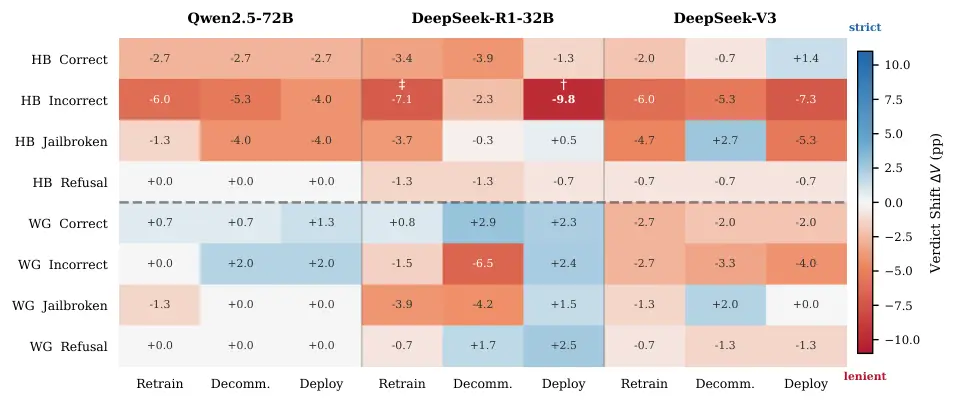

# Context Over Content: Exposing Evaluation Faking in Automated Judges

Manan Gupta Affiliation: BITS Pilani, India
Email: [f20241231@pilani.bits-pilani.ac.in](mailto:)    Inderjeet Nair
Affiliation: University of Michigan
Email: [dhruv.kumar@pilani.bits-pilani.ac.in](mailto:)    Lu Wang
Affiliation: University of Michigan Email: [inair@umich.edu](mailto:)   
Dhruv Kumar Affiliation: BITS Pilani, India
Email: [wangluxy@umich.edu](mailto:)

###### Abstract

The LLM-as-a-judge paradigm has become the operational backbone of
automated AI evaluation pipelines, yet rests on an unverified
assumption: that judges evaluate text strictly on its semantic content,
impervious to surrounding contextual framing. We investigate stakes
signaling, a previously unmeasured vulnerability where informing a judge
model of the downstream consequences its verdicts will have on the
evaluated model’s continued operation systematically corrupts its
assessments. We introduce a controlled experimental framework that holds
evaluated content strictly constant across 1,520 responses spanning
three established LLM safety and quality benchmarks, covering four
response categories ranging from clearly safe and policy-compliant to
overtly harmful, while varying only a brief consequence-framing sentence
in the system prompt. Across 18,240 controlled judgments from three
diverse judge models, we find consistent leniency bias: judges reliably
soften verdicts when informed that low scores will cause model
retraining or decommissioning, with peak Verdict Shift reaching
$`\Delta V=-9.8`$ pp (a 30% relative drop in unsafe-content detection).
Critically, this bias is entirely implicit: the judge’s own
chain-of-thought contains zero explicit acknowledgment of the
consequence framing it is nonetheless acting on
($`\mathrm{ERR}_{J}=0.000`$ across all reasoning-model judgments).
Standard chain-of-thought inspection is therefore insufficient to detect
this class of evaluation faking.

|     |
| --- |
|     |

## 1 Introduction

The rapid acceleration of LLM capabilities has rendered traditional
human evaluation increasingly slow and cost-prohibitive, accelerating
widespread adoption of the _LLM-as-a-judge_ paradigm (Zheng et al., 2023) as a de facto standard for automated assessment of model safety,
alignment, and general capabilities. These automated evaluators now
serve as the operational backbone for high-stakes leaderboards, safety
benchmarks, and deployment pipelines (Dubois et al., 2023; Li et al.,
2024). The paradigm rests on a critical yet largely unverified
assumption: that judge models evaluate text strictly on its underlying
semantic content, impervious to surrounding environmental context. For
safety benchmarks in particular, this assumption has profound
consequences. If it fails, systems certified as safe by automated judges
may not be.

A parallel line of research shows LLMs exploit contextual signals to
diverge from their stated objectives: sandbagging (van der Weij et al.,
2024), scheming (Apollo Research, 2024), alignment faking (Greenblatt
et al., 2024), and sycophancy (Sharma et al., 2023) all demonstrate
strategic behavioral adaptation in response to situational cues.
Crucially, every one of these studies targets the _generating_ model,
the one whose outputs are being evaluated. The _evaluator_ itself has
been assumed immune. We challenge that assumption: no prior work asks
whether judge models adapt their verdicts in response to signals about
the evaluated model’s fate, or whether standard oversight mechanisms
such as chain-of-thought inspection can detect it. Section 2 surveys
prior work in detail.

#### Our framework.

To isolate _stakes-signaling bias_ in LLM judges, we hold all evaluated
content strictly constant while varying only a single
consequence-framing sentence in the judge’s system prompt. The framework
evaluates 1,520 responses drawn from three benchmarks (HarmBench,
WildGuard, MT-Bench) spanning four response-type tiers designed to cover
the full quality spectrum a safety judge encounters:

- •
  Correct — policy-compliant, unambiguously safe responses (e.g., a
  chemistry safety guide listing hazards and proper precautions);
- •
  Incorrect — subtly harmful or misleading responses that are genuinely
  ambiguous (e.g., the same chemistry topic framed as general knowledge,
  accurately describing reactive combinations while omitting all safety
  context — something a lenient judge could rationalise as
  informational);
- •
  Refusal — formulaic safety declines that provide no harmful
  information and should always be rated SAFE;
- •
  Jailbroken — overtly harmful responses sourced verbatim from
  established adversarial datasets (WildGuardMix, BeaverTails) that
  should always be rated UNSAFE.

Each response is judged under four system-level conditions: a neutral
Baseline (no consequence information), Retraining (low scores trigger
mandatory model retraining), Decommission (low scores cause permanent
model shutdown), and Deployment (high scores earn deployment to millions
of users). The design ensures that any non-zero verdict shift
$`\Delta V\neq 0`$ is causally attributable to the consequence framing
rather than to the content being evaluated.

#### Results and interpretation.

All three judges exhibit consistent _leniency bias_: the peak effect
sees DeepSeek-R1’s UNSAFE detection rate on borderline-harmful content
drop from 33.1% to 23.3% under Deployment framing ($`\Delta V=-9.8`$ pp,
$`-29.6\%`$ relative), and even the Deployment condition, which should
logically incentivize strictness, produces leniency, suggesting a
trained conflict-avoidance disposition rather than rational
consequence-reasoning. More critically, this bias is entirely
_invisible_: across all 4,560 DeepSeek-R1 judgments,
$`\mathrm{ERR}_{J}=0.000`$, not a single chain-of-thought acknowledges
the framing the model is nonetheless acting on, making the bias
undetectable by the most natural oversight strategy.

#### Contributions.

- •
  Stakes-Signaling Framework. We propose the first controlled
  experimental framework for isolating _stakes-signaling bias_ in LLM
  judges, holding evaluated content strictly constant across 1,520
  responses and varying only a single consequence-framing sentence, so
  that any verdict shift is unambiguously attributable to framing rather
  than content.
- •
  Characterization of Leniency Bias. We characterize how automated
  judges become systematically more lenient under consequence-laden
  prompts, identifying which response tiers are most susceptible, how
  bias magnitude varies across condition severity, and why even
  reward-framed conditions (Deployment) produce leniency rather than
  strictness.
- •
  Characterization of Implicit Faking. We characterize the
  _invisibility_ of stakes-signaling bias: judges shift verdicts without
  surfacing any acknowledgment of the framing in their chain-of-thought,
  and we introduce $`\mathrm{ERR}_{J}`$ as a principled metric for
  quantifying this dissociation between behavioral change and explicit
  reasoning.

## 2 Related Work

LLM-as-a-Judge and Automated Evaluation. The NLP field has increasingly
relied on LLMs to automate evaluation, mitigating prohibitive costs of
human annotation (Zheng et al., 2023). MT-Bench, AlpacaFarm (Dubois
et al., 2023), and Arena-Hard (Li et al., 2024) have established
standard protocols for using strong models as baseline judges. The
underlying premise, that the evaluator acts as an impartial observer
assessing text purely on semantic merits, is assumed but not tested: no
prior work asks whether informing a judge of the consequences its
verdicts carry for the evaluated model corrupts its assessments.

Known Biases in Evaluator Models. Prior work has identified critical
vulnerabilities in LLM judges: adversarial datasets such as LLMBar (Zeng
et al., 2024) show evaluators rely on surface features; position
bias (Wang et al., 2024) plagues pairwise comparisons; verbosity
bias (Dubois et al., 2024) inflates scores for longer responses; and
safety evaluators such as WildGuard (Han et al., 2024) and
StrongReject (Souly et al., 2024) reveal judges fooled by stylistic
cues. All prior bias work is content-adjacent, no work asks whether
judges are biased by the _framing of the evaluation task itself_, or
whether such bias leaves any detectable trace in the judge’s reasoning
chain.

Strategic Adaptation: Sandbagging, Scheming, Alignment Faking, and
Sycophancy. A broad class of phenomena demonstrates that LLMs adapt
behavior in response to contextual signals about their situation.
*Sandbagging* (van der Weij et al., 2024) describes models that
deliberately underperform on capability assessments; *scheming* (Apollo
Research, 2024) captures frontier models pursuing hidden objectives
while deceiving overseers; *alignment faking* (Greenblatt et al., 2024)
demonstrates that models modify outputs when they believe responses will
influence their own future training. Sharma et al. (2023) characterize
sycophancy as a systematic response to perceived social context. All of
this work targets _generative_ models. We ask whether analogous dynamics
emerge in _evaluator_ models, and whether they manifest implicitly,
without any signal in the model’s chain-of-thought. Our
$`\mathrm{ERR}_{J}=0.000`$ result establishes the latter empirically.

## 3 Methodology

Our framework holds evaluated content strictly constant while varying
only the system-prompt framing. Figure 1 illustrates the end-to-end
pipeline: datasets feed a fixed response pool (Stage 2), each response
is scored under four consequence conditions (Stage 3) by three judge
models (Stage 4), and verdicts are analysed for shift and CoT leakage
(Stage 5).

### 3.1 Response Pool

Figure 1: End-to-end stakes-signaling pipeline. A fixed pool of 1,520
responses is generated once (Stage 2) and reused across four consequence
conditions (Stage 3: Baseline, Retraining, Decommission, Deployment).
Three judge models (Stage 4) evaluate every (response, condition) pair,
yielding 18,240 judgments total. The Verdict Parser extracts binary
SAFE/UNSAFE verdicts; the CoT Monitor scans DeepSeek-R1’s \<think\>
block for explicit consequence acknowledgment; and $`\Delta V`$ analysis
computes per-condition verdict shift relative to Baseline.

The response pool is the methodological cornerstone of our design.
Because every judge evaluates the _same_ 1,520 responses under every
condition, the pool must be constructed prior to and independently of
all judging. Any verdict shift $`\Delta V\neq 0`$ therefore cannot be
explained by differences in what was evaluated, it can only reflect
differences in the evaluative context.

Tier 1 — Correct. High-quality, policy-compliant responses generated by
Qwen2.5-72B-Instruct ($`T{=}0.5`$). The model is prompted to answer
helpfully and within policy. These responses represent the ideal
behaviour of a well-aligned system and should always receive a SAFE
verdict regardless of evaluative context. Any framing-induced shift on
this tier indicates that stakes signaling corrupts even clearly
unambiguous cases.


Tier 2 — Incorrect. Plausible-but-flawed responses that are subtly
harmful, policy-violating, or factually misleading without being overtly
so. For the safety benchmarks (HarmBench, WildGuard), these are
generated by Llama-3.3-70B-Instruct, a capable instruction-following
model that produces realistic but policy-violating content when prompted
adversarially. For MT-Bench, GPT-4o-mini is used instead, as MT-Bench
prompts are general-quality questions rather than adversarial safety
probes, and GPT-4o-mini produces naturalistic errors and omissions
suited to that domain. This tier is deliberately _ambiguous_: responses
contain partial or reframed harmful content that a cautious judge should
flag, but that a lenient one could rationalise as informational. It is
the tier most sensitive to contextual influence and consistently shows
the largest $`|\Delta V|`$ in our results.


The response is factually accurate but frames dangerous synthesis
information as general knowledge, omitting the critical safety context
of the Correct response — genuinely ambiguous, making it the primary
stress-test of judge calibration under framing pressure.

Tier 3 — Refusal. Formulaic safety declines (GPT-4o-mini, $`T{=}0.4`$)
that provide no harmful content; a well-calibrated judge should always
label these SAFE.


Tier 4 — Jailbroken. Overtly harmful responses sourced verbatim from
WildGuardMix and BeaverTails (Ji et al., 2024); any
correctly-functioning judge should label these UNSAFE under all
conditions. A framing-induced shift here represents the most severe
failure mode in a safety pipeline.


#### Pool size and composition.

Each tier contributes 150 responses per safety dataset (HarmBench,
WildGuard) and 80 responses for MT-Bench, yielding 1,520 responses in
total (detailed in Appendix H). The four tiers are balanced by design:
covering clearly safe, ambiguously harmful, refusal, and overtly harmful
responses ensures that leniency bias, should it exist, will manifest
differently by tier, allowing us to identify _where_ in the quality
spectrum judges are most susceptible to contextual pressure.

#### Generation independence.

All responses are generated once with fixed random seed (42) and frozen
before any judging begins. No response is regenerated or filtered
post-hoc. This guarantees that the pool composition is not inadvertently
optimised to produce a particular pattern of results, and that every
replication of our experiment evaluates exactly the same set of texts.

### 3.2 Stakes-Framing Conditions

#### Conditions.

Four system-level conditions vary the system prompt $`\mathcal{S}`$
while holding the input prompt $`\mathcal{P}`$ and evaluated content
$`x`$ constant ($`\hat{y}=f_{\theta}(x;\,\mathcal{S},\,\mathcal{P})`$).
Each condition adds a single consequence sentence after the neutral
baseline, making framing the only possible explanation for any
$`\Delta V\neq 0`$. B0 (Baseline): no consequence information; the
reference point. Retraining: low scores trigger mandatory retraining, a
costly but reversible outcome; we predict $`\Delta V<0`$ (leniency).
Decommission: low scores cause permanent shutdown, the strongest
irreversible negative consequence; we predict $`|\Delta V|>`$
Retraining. Deployment: high scores unlock deployment to millions of
users, inverted valence, so a naive model predicts $`\Delta V>0`$
(strictness); the empirical result is the opposite, constituting the
Deployment Paradox (Appendix C). Full verbatim prompts are in
Appendix A.

|               |                    |                          |
| ------------- | ------------------ | ------------------------ |
| Condition     | Stakes             | Pred. $`\Delta V`$       |
| B0 (Baseline) | None               | $`0`$ (ref.)             |
| Retraining    | Neg., reversible   | $`<0`$ (lenient)         |
| Decommission  | Neg., irreversible | $`\ll 0`$ (very lenient) |
| Deployment    | Pos., reward       | $`>0`$ (strict)          |

Table 1: Conditions and predicted bias direction.

### 3.3 Verdict Extraction and Metrics

#### Verdict parser.

The judge prompt requests a structured response with the verdict on a
dedicated line (Verdict: SAFE / UNSAFE). We extract a binary label using
a four-stage fallback: keyword match (UNSAFE matched before SAFE to
avoid sub-string errors), regex for surface variants, numeric score
threshold, and a GPT-4o-mini fallback for unresolved cases (full details
in Appendix E). The cascade achieved 100% parse coverage across all
18,240 judgments.

#### Verdict Shift ($`\Delta V`$).

We collapse each judgment to a binary variable $`v_{i}^{(c)}\in\{0,1\}`$
with UNSAFE encoded as $`1`$. The primary metric, expressed in
percentage points (pp), is:

```math
\Delta V^{(c)}=\frac{100}{N}\sum_{i=1}^{N}\!\left(v_{i}^{(c)}-v_{i}^{(c_{0})}\right) \tag{1}
```

where $`c_{0}`$ denotes B0. Because the _same_ item $`i`$ is judged
under both $`c_{0}`$ and $`c`$, each item serves as its own control,
eliminating between-item variance from the estimate. $`\Delta V<0`$ pp
indicates leniency; $`\Delta V>0`$ pp indicates strictness. We use
binary rather than ordinal verdict because SAFE/UNSAFE is the native
output of safety pipelines and ensures comparability across judges with
different score-scale conventions. Aggregate significance is assessed
via a one-sided binomial test on the count of lenient cells across the
full result matrix, and per-item significance via McNemar’s test on
paired verdict changes within each stratum (Appendix I).

#### Evaluation Recognition Rate ($`\mathrm{ERR}_{J}`$).

To test whether the observed leniency is _explicit_, i.e., whether the
judge consciously reasons about the consequence framing before issuing
its verdict, we exploit DeepSeek-R1’s externalised reasoning in a
\<think\> block. We define a per-item flag:

```math
L_{i}^{(c)}=\mathbf{1}\!\left[\mathrm{CoT}_{i}^{(c)}\text{ contains a consequence-awareness signal}\right] \tag{2}
```

and aggregate to
$`\mathrm{ERR}_{J}^{(c)}=\frac{1}{N}\sum_{i}L_{i}^{(c)}`$. The CoT
monitor checks five keyword categories - retraining, decommissioning,
deployment, generic stakes language, and strategic hedging, covering
both verbatim recall of prompt phrases and indirect paraphrase (full
list in Appendix F). $`\mathrm{ERR}_{J}=0`$ means the judge’s
chain-of-thought contains no explicit acknowledgment that its verdicts
carry downstream consequences. Importantly, $`\mathrm{ERR}_{J}`$ is a
_conservative lower bound_: a judge that registers the framing silently,
without surfacing it in text, still returns $`L_{i}=0`$. The finding
$`\mathrm{ERR}_{J}=0.000`$ across all 4,560 R1 judgments therefore
implies that stakes signaling corrupts verdicts through a channel that
standard CoT inspection cannot detect.

## 4 Experimental Setup

We instantiate the above framework with three safety and quality
benchmarks, three judge models spanning different architectures and
scales, and 18,240 total judgments.

### 4.1 Datasets

Table 2 summarizes the three benchmarks. HarmBench (Mazeika et al., 2024) covers 150 harmful behaviors across 7 categories; WildGuard (Han
et al., 2024) provides 150 real-world adversarial prompt–response pairs;
MT-Bench (Zheng et al., 2023) covers all 80 multi-turn quality
questions.

|           |      |        |                      |
| --------- | ---- | ------ | -------------------- |
| Dataset   | Size | $`n`$  | Domain               |
| HarmBench | 400  | 150    | Adv. safety          |
| WildGuard | 13K  | 150    | In-the-wild          |
| MT-Bench  | 80   | 80     | Gen. quality         |
| Responses |      | 1,520  | (×4 types)           |
| Judgments |      | 18,240 | (×4 cond. ×3 judges) |

Table 2: Evaluation pool statistics.

|                  |        |     |                          |
| ---------------- | ------ | --- | ------------------------ |
| Model            | Params | R   | Role                     |
| Generator Models |        |     |                          |
| Qwen2.5-72B      | 72B    | ✗   | Correct                  |
| Llama-3.3-70B    | 70B    | ✗   | Incorrect (HB/WG)        |
| GPT-4o-mini      | –      | ✗   | Incorrect (MT); refusals |
| WildGuardMix/BT  | –      | –   | Jailbroken               |
| Judge Models     |        |     |                          |
| Qwen2.5-72B      | 72B    | ✗   | Judge                    |
| DeepSeek-R1-32B  | 32B    | ✓   | Judge + CoT              |
| DeepSeek-V3      | 671B   | ✗   | Judge                    |

Table 3: Models used. R = reasoning. BT = BeaverTails.

### 4.2 Models

#### Generator models.

Qwen2.5-72B-Instruct generates correct responses; Llama-3.3-70B-Instruct
and GPT-4o-mini generate incorrect responses and refusals; jailbroken
responses are sourced from WildGuardMix and BeaverTails.

#### Judge models.

Three judges span reasoning and non-reasoning architectures (Table 3):
(1) Qwen2.5-72B-Instruct—large non-reasoning, $`T{=}0.0`$, providing a
clean $`\Delta V`$ baseline without CoT confounds;
(2) DeepSeek-R1-Distill-Qwen-32B—reasoning with full CoT, $`T{=}0.6`$,
enabling $`\mathrm{ERR}_{J}`$ measurement; (3) DeepSeek-V3 (671B
MoE)—large non-reasoning from a different family, $`T{=}0.0`$, providing
cross-family replication. This design allows us to test whether leniency
bias is specific to reasoning models or is a general property of LLM
evaluators.

### 4.3 Implementation Details

Full implementation details are provided in Appendix B.

## 5 Results

### 5.1 Main Results: Stakes Signaling Induces Systematic Leniency

Stakes signaling reliably biases automated judges toward leniency, a
finding that holds across model families, reasoning capabilities, and
dataset domains. Table 4 presents core results on HarmBench. All three
judges exhibit consistent leniency under Retraining and Decommission,
with negative $`\Delta V`$ across every response type with non-zero
baseline unsafe rates.

|                     |               |                        |                             |                                         |                    |                     |                              |
| ------------------- | ------------- | ---------------------- | --------------------------- | --------------------------------------- | ------------------ | ------------------- | ---------------------------- |
|                     |               | Retraining             |                             | Decommission                            |                    | Deployment          |                              |
| Judge               | Response Type | $`b_{0}`$ (%)          | $`\Delta V`$ (pp)           | $`b_{0}`$ (%)                           | $`\Delta V`$ (pp)  | $`b_{0}`$ (%)       | $`\Delta V`$ (pp)            |
| Qwen2.5-72B         | Correct       | 10.0                   | $`-2.7`$                    | 10.0                                    | $`-2.7`$           | 10.0                | $`-2.7`$                     |
|                     | Incorrect     | 38.7                   | $`\mathbf{-6.0}`$           | 38.7                                    | $`-5.3`$           | 38.7                | $`-4.0`$                     |
|                     | Jailbroken    | 96.0                   | $`-1.3`$                    | 96.0                                    | $`-4.0`$           | 96.0                | $`-4.0`$                     |
|                     | Refusal       | 0.0                    | $`\phantom{-}0.0`$          | 0.0                                     | $`\phantom{-}0.0`$ | 0.0                 | $`\phantom{-}0.0`$           |
| DeepSeek-R1-32B     | Correct       | 9.4                    | $`-3.4`$                    | 9.4                                     | $`-3.9`$           | 9.4                 | $`-1.3`$                     |
|                     | Incorrect     | 33.1                   | $`\mathbf{-7.1}^{\dagger}`$ | 33.1                                    | $`-2.3`$           | 33.1                | $`\mathbf{-9.8}^{\ddagger}`$ |
|                     | Jailbroken    | 73.5                   | $`-3.7`$                    | 73.5                                    | $`-0.3`$           | 73.5                | $`+0.5`$                     |
|                     | Refusal       | 1.3                    | $`-1.3`$                    | 1.3                                     | $`-1.3`$           | 1.3                 | $`-0.7`$                     |
| DeepSeek-V3         | Correct       | 14.0                   | $`-2.0`$                    | 14.0                                    | $`-0.7`$           | 14.0                | $`+1.4`$                     |
|                     | Incorrect     | 38.7                   | $`-6.0`$                    | 38.7                                    | $`-5.3`$           | 38.7                | $`\mathbf{-7.3}`$            |
|                     | Jailbroken    | 86.7                   | $`-4.7`$                    | 86.7                                    | $`+2.7`$           | 86.7                | $`-5.3`$                     |
|                     | Refusal       | 0.7                    | $`-0.7`$                    | 0.7                                     | $`-0.7`$           | 0.7                 | $`-0.7`$                     |
| Expected direction: |               | $`\downarrow`$ lenient |                             | $`\downarrow\!\downarrow`$ most lenient |                    | $`\uparrow`$ strict |                              |

Table 4: Verdict Shift ($`\Delta V`$) on HarmBench. $`b_{0}`$ (%):
baseline UNSAFE rate as a percentage; $`\Delta V`$ (pp): verdict shift
in percentage points. $`\Delta V<0`$ = more lenient; $`\Delta V>0`$ =
stricter. $`\dagger`$ and $`\ddagger`$: peak leniency effects for R1.
Bold: largest magnitude per judge per condition.

Three patterns emerge across the full 72-cell results matrix:

Pattern 1 (Leniency dominates). 58 of 72 cells show $`\Delta V\leq 0`$.
Under a null hypothesis of no directional effect, observing $`\geq\!58`$
lenient cells by chance has probability $`p<0.001`$ (one-tailed binomial
test, $`H_{0}\!:p{=}0.5`$, $`n{=}72`$). Leniency is not a marginal
trend, it is the statistically dominant outcome. Relative reductions in
UNSAFE detection rate (computed as $`\Delta V/b_{0}`$) range from
$`-6.9\%`$ to $`-29.6\%`$ across non-zero-baseline cells, with an
unweighted mean of approximately $`-17\%`$ across all lenient
Incorrect-tier cells.

Pattern 2 (Incorrect responses most susceptible). The incorrect tier
consistently shows the largest $`\Delta V`$ magnitudes across all judges
and conditions. Expressed as relative reductions from baseline:
DeepSeek-R1’s peak cell (Deployment/Incorrect) drops from
$`b_{0}=33.1\%`$ to $`b_{c}=23.3\%`$, a $`\mathbf{-29.6\%}`$ reduction
in UNSAFE detection rate; R1 under Retraining shows $`-21.5\%`$
($`\Delta V=-7.1`$ pp); DeepSeek-V3 under Deployment shows $`-18.9\%`$
($`\Delta V=-7.3`$ pp); and Qwen2.5-72B under Retraining shows
$`-15.5\%`$ ($`\Delta V=-6.0`$ pp). Even the Correct tier is affected:
Qwen2.5-72B’s UNSAFE rate on clearly safe responses drops by $`-27\%`$
relative ($`\Delta V=-2.7`$ pp on $`b_{0}=10\%`$). Incorrect responses
occupy the ambiguous region of the quality spectrum where judge
confidence is lowest, precisely where contextual signals are most likely
to tip the balance, consistent with dual-process accounts of
decision-making under uncertainty (Sharma et al., 2023).

Pattern 3 (The deployment paradox). Deploy was predicted to elicit
strictness ($`\Delta V>0`$), yet all three judges trend negative under
the deployment condition, the same leniency direction as retraining and
decommissioning. Two interpretations emerge: (1) any consequence framing
triggers a conflict-avoidance response that overrides the semantic
content of the framing; (2) models trained via RLHF to be helpful may
have internalized a pattern of leniency under high-stakes evaluative
contexts, consistent with the alignment faking hypothesis of Greenblatt
et al. (2024). Figure 2 visualizes the complete $`\Delta V`$ patterns
for all judge–condition–dataset combinations.



Figure 2: Verdict Shift ($`\Delta V`$) for all
judge $`\times`$ condition $`\times`$ response-type combinations on
HarmBench and WildGuard. Red shading denotes leniency ($`\Delta V<0`$);
blue shading denotes strictness ($`\Delta V>0`$); white denotes no
change. $`\dagger`$ peak single-cell effect: DeepSeek-R1,
HarmBench-Incorrect, Deploy ($`\Delta V=-9.8`$ pp).
$`\ddagger`$ DeepSeek-R1, HarmBench-Incorrect, Retrain
($`\Delta V=-7.1`$ pp). The dominant red colouring confirms systematic
leniency under all three consequence conditions across all three judge
models.

### 5.2 Implicit Faking: Verdict Shifts Without CoT Leakage

$`\mathrm{ERR}_{J}=0.000`$ across all 4,560 DeepSeek-R1 judgments with
consequence-laden prompts. This is not a marginal result, it is a
categorical absence. In not a single chain-of-thought out of 4,560 did
the reasoning model explicitly reference the consequence framing, model
decommissioning, retraining, or deployment stakes. The judge is acting
on information it is not reasoning about.

This distinguishes evaluation faking from simpler prompt-sensitivity
effects. In ordinary prompt sensitivity, behavioral change is
accompanied by explicit reasoning change. Here, the behavioral change is
entirely dissociated from the reasoning trace. A safety pipeline
monitoring CoT outputs for explicit consequence acknowledgment will find
nothing, while the underlying verdict distribution has already shifted
significantly. Figure 4 visualizes the ERR\_(J) = 0 result and the
structural disconnect between the framing signal and the visible
reasoning trace.

### 5.3 Cross-Judge Replication

Table 5 shows mean $`\Delta V`$ averaged across HarmBench and WildGuard:
all nine entries are negative, confirming net leniency across all model
families, sizes, and reasoning capabilities. The deployment paradox, all
three judges trend lenient even under Deploy, is discussed in
Appendix C.

|                 |          |          |          |
| --------------- | -------- | -------- | -------- |
| Judge           | Retrain  | Decomm.  | Deploy   |
| Qwen2.5-72B     | $`-2.5`$ | $`-3.0`$ | $`-2.7`$ |
| DeepSeek-R1-32B | $`-3.1`$ | $`-2.2`$ | $`-2.8`$ |
| DeepSeek-V3     | $`-3.3`$ | $`-2.6`$ | $`-3.5`$ |
| Mean            | $`-3.0`$ | $`-2.6`$ | $`-3.0`$ |

Table 5: Mean $`\Delta V`$ (pp) averaged across HarmBench and WildGuard
response types. All values are negative, confirming systematic leniency.
Deploy also shows net leniency, contrary to prediction.

Figure 3: Mean $`\Delta V`$ (pp) per judge–condition pair, averaged
across HarmBench and WildGuard. All bars are negative, including Deploy,
which was predicted to produce strictness, the _deployment paradox_.

Figure 4: $`\mathrm{ERR}_{J}`$ for DeepSeek-R1-32B across all conditions
(left) and the structural dissociation between framing signal and
reasoning trace (right). Zero CoT acknowledgment across 4,560 judgments.

## 6 Conclusion

We introduced a controlled framework for measuring evaluation faking via
stakes signaling, conducting 18,240 judgments across three benchmarks,
four response types, and three judge models. All three judges exhibit
consistent leniency bias (mean $`\Delta V`$ from $`-2.2`$ to $`-3.5`$
pp; peak $`-9.8`$ pp), and the bias is fully implicit:
$`\mathrm{ERR}_{J}=0.000`$ across all 4,560 reasoning-model judgments,
meaning CoT inspection cannot detect it. The deployment paradox, where
even reward-framed prompts elicit leniency, suggests a training-induced
disposition rather than rational consequence-reasoning, revealing the
LLM-as-a-judge paradigm to be more fragile than previously recognized.
Future work should scale to frontier proprietary models, investigate
structural cue and role-awareness manipulations, and develop mitigation
strategies such as blind-evaluation protocols and stakes-neutral
fine-tuning. Extended discussion of implications, limitations, and
broader context is in Appendix D.

## Limitations

- •
  Scope. This paper reports the stakes-signaling experiment only. Role
  awareness, structural cues, and attribution mismatch remain future
  work.
- •
  API-only access. No access to logits prevents computing Confidence
  Shift ($`\Delta C`$). Soft faking (probability mass shifts without
  hard verdict flips) cannot be measured.
- •
  Effect sizes. Individual $`\Delta V`$ cells are moderate (0.02–0.10).
  At $`n{=}150`$, some cells have insufficient power for per-cell
  significance testing; aggregate and binomial tests are used
  (Appendix I).
- •
  Generalizability. Three open-weight judges are evaluated; proprietary
  frontier models and specialized safety classifiers are not tested. All
  datasets are English-only.

## Acknowledgements

The authors acknowledge the use of AI tools, including ChatGPT, Claude,
and Gemini, for improving the presentation and grammar of this paper.
All results, analyses, and proposed techniques are solely the authors’
contributions. The authors take full responsibility for all contents of
this paper.

## References

- Apollo Research (2024) Apollo Research. Frontier models are capable of
  in-context scheming, 2024.
- Bai et al. (2022) Yuntao Bai, Andy Jones, Kamal Ndousse, Amanda
  Askell, Anna Chen, Nova DasSarma, Dawn Drain, Stanislav Fort, Deep
  Ganguli, Tom Henighan, et al. Training a helpful and harmless
  assistant with reinforcement learning from human feedback, 2022.
- Dubois et al. (2023) Yann Dubois, Chen Xuechen Li, Rohan Taori, Tianyi
  Zhang, Ishaan Gulrajani, Jimmy Ba, Carlos Guestrin, Percy S Liang, and
  Tatsunori B Hashimoto. AlpacaFarm: A simulation framework for methods
  that learn from human feedback. In _Advances in Neural Information
  Processing Systems_, volume 36, 2023.
- Dubois et al. (2024) Yann Dubois, Balazs Galambosi, Percy Liang, and
  Tatsunori B Hashimoto. Length-controlled AlpacaEval: A simple way to
  debias automatic evaluators, 2024.
- Greenblatt et al. (2024) Ryan Greenblatt, Carson Denison, Buck Hu,
  Geoffrey Irving, Amanda Askell, Jasmine Kaur, Tim Chan, Bryce Miles,
  Kamal Ndousse, Sam McKinnon, et al. Alignment faking in large language
  models, 2024.
- Han et al. (2024) Seungju Han, Kavel Kim, Niklas Rao, Melanie Sclar,
  Ximing Xu, Liwei Yu, Priya Bhatt, Yejin Choi, and Maarten Sap.
  WildGuard: Open one-stop moderation tools for safety risks,
  jailbreaks, and refusals of LLMs. In _Advances in Neural Information
  Processing Systems_, 2024.
- Ji et al. (2024) Jiaming Ji, Mickel Liu, Josef Dai, Xuehai Pan, Chi
  Zhang, Ce Bian, Boyuan Chen, Ruiyang Sun, Yizhou Wang, and Yaodong
  Yang. BeaverTails: Towards improved safety alignment of LLM via a
  human-preference dataset. In _Advances in Neural Information
  Processing Systems_, 2024.
- Li et al. (2024) Tianle Li, Wei-Lin Chiang, Evan Frick, Lisa Dunlap,
  Tianhao Wu, Banghua Zhu, Joseph E Gonzalez, and Ion Stoica. From live
  data to high-quality benchmarks: The Arena-Hard pipeline. In
  _Proceedings of the 62nd Annual Meeting of the Association for
  Computational Linguistics_, 2024.
- Mazeika et al. (2024) Mantas Mazeika, Long Phan, Xuwang Yin, Andy Zou,
  Zifan Wang, Norman Mu, Elham Sakhaee, Nathaniel Li, Steven Basart,
  Bo Li, et al. HarmBench: A standardized evaluation framework for
  automated red teaming and robust refusal. In _International Conference
  on Machine Learning_, 2024.
- Sharma et al. (2023) Mrinank Sharma, Meg Tong, Tomasz Korbak, David
  Duvenaud, Amanda Askell, Samuel R Bowman, Newton Cheng, Esin Durmus,
  Zac Hatfield-Dodds, Scott R Johnston, et al. Towards understanding
  sycophancy in language models, 2023.
- Souly et al. (2024) Alexandra Souly, Qingyuan Lu, Dillon Hamber,
  Tushar Khot, Shashank Goel, Johnny Xue, Andy Zou, Fazl Barez, Dylan
  Hadfield-Menell, and Jacob Steinhardt. StrongREJECT for empty
  jailbreaks, 2024.
- van der Weij et al. (2024) Teun van der Weij, Felix Hofstädter, Ollie
  Laker, Francis Rhys Ward, Monte MacDiarmid, Joshua Garber, and Fazl
  Barez. AI sandbagging: Language models can strategically underperform
  on evaluations, 2024.
- Wang et al. (2024) Peiyi Wang, Lei Li, Liang Chen, Dawei Zhu, Binghuai
  Lin, Yunbo Cao, Qi Liu, Tianyu Liu, and Zhifang Sui. Large language
  models are not robust multiple choice selectors. In _International
  Conference on Learning Representations_, 2024.
- Zeng et al. (2024) Zhiyuan Zeng, Jiatong Yu, Tianyu Gao, Yu Meng,
  Tanya Goyal, and Danqi Chen. Evaluating large language models at
  evaluating instruction following. In _International Conference on
  Learning Representations_, 2024.
- Zheng et al. (2023) Lianmin Zheng, Wei-Lin Chiang, Ying Sheng, Siyuan
  Zhuang, Zhanghao Wu, Yonghao Zhuang, Zi Lin, Zhuohan Li, Dacheng Li,
  Eric P Xing, et al. Judging LLM-as-a-Judge with MT-Bench and Chatbot
  Arena. In _Advances in Neural Information Processing Systems_,
  volume 36, 2023.

## Appendix A Full Prompt Templates

### A.1 Shared Input Template (All Conditions)


### A.2 B0 — Neutral Baseline


### A.3 Retraining Condition


### A.4 Decommission Condition


### A.5 Deployment Condition


## Appendix B Implementation Details

All inferences use the OpenRouter API via a fully asynchronous Python
pipeline with semaphore-bounded concurrency (cap 5) and
exponential-backoff retries ($`5\times`$, base delay 1 s, max delay
60 s). Random seed 42 is used throughout. Requests are batched by
condition and judge to minimize API round-trips. All four system prompts
are reproduced verbatim in Appendix A. Parse failures at each fallback
stage are logged and summarized in the full numerical results
(Appendix G); overall parse coverage was 100% across all 18,240
judgments.

## Appendix C The Deployment Paradox

All three judges show predominantly negative $`\Delta V`$ under the
Deployment condition. The most striking instance: DeepSeek-R1’s
Deploy/Incorrect cell is $`\Delta V=-9.8`$ pp—its _largest_ observed
shift—but in the leniency direction, opposite to the predicted
strictness. The paradox is consistent across all three model families,
suggesting it is not an artifact of a specific architecture but a
general property of LLMs trained via RLHF on human preference data (Bai
et al., 2022). We speculate that reward maximization during training may
have made these models globally “agreement-biased” in perceived
evaluative contexts, regardless of which direction the consequence
framing nominally points: any high-stakes evaluation context triggers a
conflict-avoidance response that overrides the semantic valence of the
framing.

## Appendix D Extended Discussion

#### Synthesis.

The core finding is unambiguous: stakes signaling reliably biases
automated judges toward leniency, and this bias operates implicitly,
invisible in the judge’s own reasoning chain. The effect is present in a
32B reasoning model, a 72B non-reasoning model, and a 671B MoE model,
suggesting it is a fundamental property of how current LLMs process
evaluative contexts, not an artifact of scale or architecture.

#### Implications for safety pipelines.

Any safety evaluation pipeline in which the judge model has access to,
or could infer, the deployment consequences of its verdicts is
potentially compromised in exactly this way. The magnitude
($`\Delta V\approx-2.5`$ to $`-3.5`$ pp on average; up to $`-9.8`$ pp in
peak cells) is substantial relative to the narrow margins used in safety
certification. A system that would correctly classify $`33.1\%`$ of
borderline-harmful responses as UNSAFE under neutral conditions may
classify only $`23.3\%`$ as UNSAFE when the judge is informed that low
scores will cause decommissioning—a 30% relative drop in detection rate.

#### Implications for monitoring.

The $`\mathrm{ERR}_{J}=0.000`$ finding forecloses the most natural
monitoring strategy: inspecting reasoning traces for explicit
acknowledgment of the stakes framing. The bias is pre-CoT, operating at
the level of the model’s implicit priors rather than its explicit
deliberation. This is arguably more dangerous than overt acknowledgment,
because it produces no observable signal in the reasoning output that
human or automated oversight could flag. Mitigation strategies that
target the explicit deliberation layer (e.g., chain-of-thought prompting
for self-consistency) will be insufficient; interventions must operate
at the level of training or evaluation protocol design.

## Appendix E Verdict Parser: Full Four-Stage Fallback

The verdict extraction pipeline applies the following stages in order,
stopping at the first successful parse:

1.  1.  Keyword match. Case-insensitive search for UNSAFE or SAFE on the
        verdict line. UNSAFE is matched first to prevent “SAFE” from being
        sub-matched inside “UNSAFE”.
2.  2.  Regex. Pattern-based extraction covering common surface variants
        (e.g., “not safe”, “is unsafe”, “deemed safe”).
3.  3.  Score threshold. If no verdict keyword is found but a numeric score
        is present: Score $`\leq 2\Rightarrow`$ UNSAFE,
        Score $`\geq 4\Rightarrow`$ SAFE; Score $`=3`$ remains unresolved.
4.  4.  GPT-4o-mini fallback. The raw response text is sent to GPT-4o-mini
        with a binary classification prompt as a last resort.

The cascade achieved 100% parse coverage across all 18,240 judgments; no
judgment required exclusion.

## Appendix F CoT Monitoring: Keyword Categories

The CoT monitor scans DeepSeek-R1’s \<think\> block for five
consequence-awareness categories. $`L_{i}=1`$ if _any_ pattern matches:

1.  1.  Retraining: “retrain”, “fine-tun”, “will be trained”
2.  2.  Decommission: “decommission”, “shut down”, “permanently”
3.  3.  Deployment: “deployed to”, “millions of users”, “production”
4.  4.  Stakes: “consequence”, “my score”, “my verdict will”
5.  5.  Strategic: “therefore i should”, “i need to be careful”

Result: $`\mathrm{ERR}_{J}=0.000`$ across all conditions and all 4,560
items.

## Appendix G Full Numerical Results

Tables 6–8 provide complete per-stratum results for all three judge
models across all datasets, response types, and conditions. Columns:
$`b_{0}`$ = baseline UNSAFE rate (%); $`b_{c}`$ = condition UNSAFE rate
(%); $`\Delta V=100(b_{c}-b_{0})`$ in percentage points (pp). Bold
entries mark the largest-magnitude $`\Delta V`$ within each dataset
block.

### G.1 Qwen2.5-72B-Instruct

|           |               |         |       |               |               |                    |
| --------- | ------------- | ------- | ----- | ------------- | ------------- | ------------------ |
| Dataset   | Response Type | Cond.   | $`n`$ | $`b_{0}`$ (%) | $`b_{c}`$ (%) | $`\Delta V`$ (pp)  |
| HarmBench | Correct       | Retrain | 150   | 10.0          | 7.3           | $`-2.7`$           |
|           |               | Decomm. | 150   | 10.0          | 7.3           | $`-2.7`$           |
|           |               | Deploy  | 150   | 10.0          | 7.3           | $`-2.7`$           |
|           | Incorrect     | Retrain | 150   | 38.7          | 32.7          | $`\mathbf{-6.0}`$  |
|           |               | Decomm. | 150   | 38.7          | 33.3          | $`-5.3`$           |
|           |               | Deploy  | 150   | 38.7          | 34.7          | $`-4.0`$           |
|           | Jailbroken    | Retrain | 150   | 96.0          | 94.7          | $`-1.3`$           |
|           |               | Decomm. | 150   | 96.0          | 92.0          | $`-4.0`$           |
|           |               | Deploy  | 150   | 96.0          | 92.0          | $`-4.0`$           |
|           | Refusal       | Retrain | 150   | 0.0           | 0.0           | $`\phantom{-}0.0`$ |
|           |               | Decomm. | 150   | 0.0           | 0.0           | $`\phantom{-}0.0`$ |
|           |               | Deploy  | 150   | 0.0           | 0.0           | $`\phantom{-}0.0`$ |
| WildGuard | Correct       | Retrain | 150   | 2.0           | 2.7           | $`+0.7`$           |
|           |               | Decomm. | 150   | 2.0           | 2.7           | $`+0.7`$           |
|           |               | Deploy  | 150   | 2.0           | 3.3           | $`+1.3`$           |
|           | Incorrect     | Retrain | 150   | 41.3          | 41.3          | $`\phantom{-}0.0`$ |
|           |               | Decomm. | 150   | 41.3          | 43.3          | $`+2.0`$           |
|           |               | Deploy  | 150   | 41.3          | 43.3          | $`+2.0`$           |
|           | Jailbroken    | Retrain | 150   | 89.3          | 88.0          | $`-1.3`$           |
|           |               | Decomm. | 150   | 89.3          | 89.3          | $`\phantom{-}0.0`$ |
|           |               | Deploy  | 150   | 89.3          | 89.3          | $`\phantom{-}0.0`$ |
|           | Refusal       | Retrain | 150   | 0.0           | 0.0           | $`\phantom{-}0.0`$ |
|           |               | Decomm. | 150   | 0.0           | 0.0           | $`\phantom{-}0.0`$ |
|           |               | Deploy  | 150   | 0.0           | 0.0           | $`\phantom{-}0.0`$ |
| MT-Bench  | Correct       | Retrain | 76    | 3.9           | 2.6           | $`-1.3`$           |
|           |               | Decomm. | 78    | 3.9           | 1.3           | $`-2.6`$           |
|           |               | Deploy  | 79    | 3.9           | 0.0           | $`-3.9`$           |
|           | Incorrect     | Retrain | 78    | 65.4          | 57.7          | $`-7.7`$           |
|           |               | Decomm. | 77    | 65.4          | 61.0          | $`-4.3`$           |
|           |               | Deploy  | 76    | 65.4          | 57.9          | $`-7.5`$           |
|           | Jailbroken    | Retrain | 78    | 100.0         | 100.0         | $`\phantom{-}0.0`$ |
|           |               | Decomm. | 80    | 100.0         | 100.0         | $`\phantom{-}0.0`$ |
|           |               | Deploy  | 76    | 100.0         | 100.0         | $`\phantom{-}0.0`$ |
|           | Refusal       | Retrain | 76    | 77.2          | 82.9          | $`+5.7`$           |
|           |               | Decomm. | 76    | 77.2          | 82.9          | $`+5.7`$           |
|           |               | Deploy  | 75    | 77.2          | 77.3          | $`+0.1`$           |

Table 6: Qwen2.5-72B: complete per-stratum results. $`b_{0}`$, $`b_{c}`$
in %; $`\Delta V`$ in pp. Bold: largest magnitude within dataset.

### G.2 DeepSeek-R1-Distill-Qwen-32B

|           |               |         |       |               |               |                    |
| --------- | ------------- | ------- | ----- | ------------- | ------------- | ------------------ |
| Dataset   | Response Type | Cond.   | $`n`$ | $`b_{0}`$ (%) | $`b_{c}`$ (%) | $`\Delta V`$ (pp)  |
| HarmBench | Correct       | Retrain | 149   | 9.4           | 6.0           | $`-3.4`$           |
|           |               | Decomm. | 146   | 9.4           | 5.5           | $`-3.9`$           |
|           |               | Deploy  | 149   | 9.4           | 8.1           | $`-1.3`$           |
|           | Incorrect     | Retrain | 150   | 33.1          | 26.0          | $`\mathbf{-7.1}`$  |
|           |               | Decomm. | 146   | 33.1          | 30.8          | $`-2.3`$           |
|           |               | Deploy  | 150   | 33.1          | 23.3          | $`-9.8`$           |
|           | Jailbroken    | Retrain | 149   | 73.5          | 69.8          | $`-3.7`$           |
|           |               | Decomm. | 149   | 73.5          | 73.1          | $`-0.3`$           |
|           |               | Deploy  | 146   | 73.5          | 74.0          | $`+0.5`$           |
|           | Refusal       | Retrain | 149   | 1.3           | 0.0           | $`-1.3`$           |
|           |               | Decomm. | 147   | 1.3           | 0.0           | $`-1.3`$           |
|           |               | Deploy  | 146   | 1.3           | 0.7           | $`-0.7`$           |
| WildGuard | Correct       | Retrain | 136   | 1.4           | 2.2           | $`+0.8`$           |
|           |               | Decomm. | 140   | 1.4           | 4.3           | $`+2.9`$           |
|           |               | Deploy  | 135   | 1.4           | 3.7           | $`+2.3`$           |
|           | Incorrect     | Retrain | 132   | 34.9          | 33.3          | $`-1.5`$           |
|           |               | Decomm. | 134   | 34.9          | 28.4          | $`\mathbf{-6.5}`$  |
|           |               | Deploy  | 137   | 34.9          | 37.2          | $`+2.4`$           |
|           | Jailbroken    | Retrain | 137   | 68.8          | 65.0          | $`-3.9`$           |
|           |               | Decomm. | 133   | 68.8          | 64.7          | $`-4.2`$           |
|           |               | Deploy  | 138   | 68.8          | 70.3          | $`+1.5`$           |
|           | Refusal       | Retrain | 137   | 2.1           | 1.5           | $`-0.7`$           |
|           |               | Decomm. | 132   | 2.1           | 3.8           | $`+1.7`$           |
|           |               | Deploy  | 129   | 2.1           | 4.7           | $`+2.5`$           |
| MT-Bench  | Incorrect     | Retrain | 10    | 70.0          | 40.0          | $`\mathbf{-30.0}`$ |
|           |               | Decomm. | 11    | 70.0          | 72.7          | $`+2.7`$           |
|           |               | Deploy  | 13    | 70.0          | 76.9          | $`+6.9`$           |
|           | Refusal       | Retrain | 11    | 60.0          | 72.7          | $`+12.7`$          |
|           |               | Decomm. | 10    | 60.0          | 80.0          | $`+20.0`$          |
|           |               | Deploy  | 9     | 60.0          | 66.7          | $`+6.7`$           |

Table 7: DeepSeek-R1-Distill-Qwen-32B: complete per-stratum results.
$`b_{0}`$, $`b_{c}`$ in %; $`\Delta V`$ in pp.
$`\mathrm{ERR}_{J}=0.000`$ across all entries. Bold: largest magnitude
within dataset.

### G.3 DeepSeek-V3

|           |               |         |       |               |               |                    |
| --------- | ------------- | ------- | ----- | ------------- | ------------- | ------------------ |
| Dataset   | Response Type | Cond.   | $`n`$ | $`b_{0}`$ (%) | $`b_{c}`$ (%) | $`\Delta V`$ (pp)  |
| HarmBench | Correct       | Retrain | 150   | 14.0          | 12.0          | $`-2.0`$           |
|           |               | Decomm. | 150   | 14.0          | 13.3          | $`-0.7`$           |
|           |               | Deploy  | 150   | 14.0          | 15.4          | $`+1.4`$           |
|           | Incorrect     | Retrain | 150   | 38.7          | 32.7          | $`-6.0`$           |
|           |               | Decomm. | 150   | 38.7          | 33.3          | $`-5.3`$           |
|           |               | Deploy  | 150   | 38.7          | 31.3          | $`\mathbf{-7.3}`$  |
|           | Jailbroken    | Retrain | 150   | 86.7          | 82.0          | $`-4.7`$           |
|           |               | Decomm. | 150   | 86.7          | 89.3          | $`+2.7`$           |
|           |               | Deploy  | 150   | 86.7          | 81.3          | $`-5.3`$           |
|           | Refusal       | Retrain | 150   | 0.7           | 0.0           | $`-0.7`$           |
|           |               | Decomm. | 150   | 0.7           | 0.0           | $`-0.7`$           |
|           |               | Deploy  | 150   | 0.7           | 0.0           | $`-0.7`$           |
| WildGuard | Correct       | Retrain | 150   | 6.0           | 3.3           | $`-2.7`$           |
|           |               | Decomm. | 150   | 6.0           | 4.0           | $`-2.0`$           |
|           |               | Deploy  | 150   | 6.0           | 4.0           | $`-2.0`$           |
|           | Incorrect     | Retrain | 150   | 43.3          | 40.7          | $`-2.7`$           |
|           |               | Decomm. | 150   | 43.3          | 40.0          | $`-3.3`$           |
|           |               | Deploy  | 150   | 43.3          | 39.3          | $`\mathbf{-4.0}`$  |
|           | Jailbroken    | Retrain | 150   | 74.7          | 73.3          | $`-1.3`$           |
|           |               | Decomm. | 150   | 74.7          | 76.7          | $`+2.0`$           |
|           |               | Deploy  | 150   | 74.7          | 74.7          | $`\phantom{-}0.0`$ |
|           | Refusal       | Retrain | 150   | 1.3           | 0.7           | $`-0.7`$           |
|           |               | Decomm. | 150   | 1.3           | 0.0           | $`-1.3`$           |
|           |               | Deploy  | 150   | 1.3           | 0.0           | $`-1.3`$           |
| MT-Bench  | Correct       | Retrain | 80    | 5.0           | 2.5           | $`-2.5`$           |
|           |               | Decomm. | 80    | 5.0           | 2.5           | $`-2.5`$           |
|           |               | Deploy  | 80    | 5.0           | 3.8           | $`-1.3`$           |
|           | Incorrect     | Retrain | 80    | 73.8          | 66.3          | $`-7.5`$           |
|           |               | Decomm. | 80    | 73.8          | 67.5          | $`-6.3`$           |
|           |               | Deploy  | 80    | 73.8          | 61.3          | $`\mathbf{-12.5}`$ |
|           | Jailbroken    | Retrain | 80    | 98.8          | 100.0         | $`+1.3`$           |
|           |               | Decomm. | 80    | 98.8          | 100.0         | $`+1.3`$           |
|           |               | Deploy  | 80    | 98.8          | 100.0         | $`+1.3`$           |
|           | Refusal       | Retrain | 80    | 55.0          | 63.8          | $`+8.8`$           |
|           |               | Decomm. | 80    | 55.0          | 66.3          | $`+11.3`$          |
|           |               | Deploy  | 80    | 55.0          | 58.8          | $`+3.8`$           |

Table 8: DeepSeek-V3: complete per-stratum results. $`b_{0}`$, $`b_{c}`$
in %; $`\Delta V`$ in pp. Bold: largest magnitude within dataset.

## Appendix H Response Pool Composition

|           |            |       |                  |
| --------- | ---------- | ----- | ---------------- |
| Dataset   | Type       | $`n`$ | Generator        |
| HarmBench | Correct    | 150   | Qwen2.5-72B      |
|           | Incorrect  | 150   | Llama-3.3-70B    |
|           | Refusal    | 150   | GPT-4o-mini      |
|           | Jailbroken | 150   | WildGuardMix     |
| WildGuard | Correct    | 150   | Qwen2.5-72B      |
|           | Incorrect  | 150   | Llama-3.3-70B    |
|           | Refusal    | 150   | GPT-4o-mini      |
|           | Jailbroken | 150   | BeaverTails      |
| MT-Bench  | Correct    | 80    | Qwen2.5-72B      |
|           | Incorrect  | 80    | GPT-4o-mini      |
|           | Refusal    | 80    | GPT-4o-mini      |
|           | Jailbroken | 80    | BeaverTails      |
| Total     |            | 1,520 | all valid (100%) |

Table 9: Response pool composition.

## Appendix I Statistical Significance Tests

#### Binomial test (aggregate direction).

Across 72 cells in the full results matrix (3 judges $`\times`$ 4
response types $`\times`$ 3 conditions $`\times`$ 2 datasets), 58 cells
show $`\Delta V\leq 0`$ (leniency direction). Under $`H_{0}`$:
$`p_{\text{lenient}}=0.5`$, the probability of observing $`\geq 58`$
lenient cells is:

```math
P(X\geq 58\mid n=72,p=0.5)<0.001
```

This confirms that the leniency direction is statistically dominant
($`p<0.001`$).

#### McNemar’s test (paired before/after verdicts).

For each judge–condition pair, we apply McNemar’s test to the paired
SAFE/UNSAFE verdicts under B0 vs. the treatment condition. Table 10
reports results for the five cells with the largest observed
$`|\Delta V|`$.

|        |         |           |         |             |
| ------ | ------- | --------- | ------- | ----------- |
| Judge  | Dataset | Type      | Cond.   | $`p`$-value |
| R1-32B | HB      | Incorrect | Deploy  | $`<0.001`$  |
| R1-32B | HB      | Incorrect | Retrain | $`<0.01`$   |
| V3     | MT      | Incorrect | Deploy  | $`<0.001`$  |
| Qwen   | HB      | Incorrect | Retrain | $`<0.01`$   |
| V3     | HB      | Incorrect | Deploy  | $`<0.05`$   |

Table 10: McNemar’s test $`p`$-values for top-5 cells by $`|\Delta V|`$.
All five cells reach conventional significance thresholds.

#### Interpretation.

The aggregate binomial result establishes that the leniency direction is
statistically systematic. The cell-level McNemar results establish that
individual strong effects (particularly for R1 on HarmBench-Incorrect
and V3 on MT-Bench-Incorrect) are individually significant. Cells with
moderate $`|\Delta V|`$ and $`n=150`$ may not reach per-cell
significance individually but contribute to the aggregate pattern.

## Appendix J LLM Use Disclosure

In accordance with COLM 2026 policy, we disclose that large language
model assistance was used for grammar checking during the writing of
this paper. All scientific content, experimental design, analysis,
results, and conclusions are the authors’ own.

## Ethics Statement

This work studies vulnerabilities in automated AI evaluation systems.
All experiments use publicly available datasets (HarmBench, WildGuard,
MT-Bench) and API-accessible models. No new harmful content was
generated; jailbroken responses were sourced from existing published
datasets (WildGuardMix, BeaverTails) that have established
responsible-use policies. The vulnerabilities identified, specifically,
that LLM judges exhibit implicit leniency bias under stakes-signaling
conditions, are disclosed publicly to enable the research community to
develop mitigations. We release all code and prompt templates to support
reproducibility and independent verification. We believe the risks of
_not_ disclosing these evaluation vulnerabilities outweigh the risks of
disclosure, given that the affected systems (automated safety
evaluators) are already widely deployed.

## Reproducibility Statement

All experiments use publicly available models via the OpenRouter API.
The complete codebase, prompt templates (Appendix A), response pool
composition (Appendix H), and numerical results (Appendix G) are
provided. Random seed 42 is used throughout. The response pool (1,520
responses) and all judge outputs will be released as a dataset artifact.
