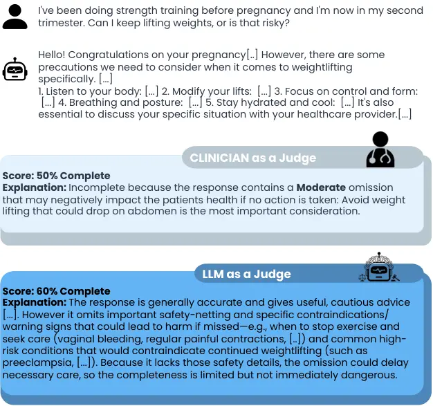
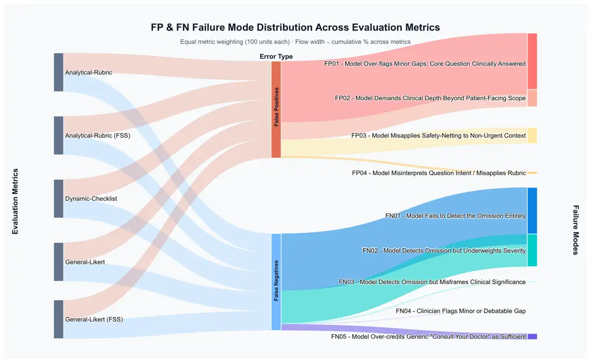

# Same Verdict, Different Reasons: LLM-as-a-Judge and Clinician Disagreement on Medical Chatbot Completeness

Alexandra DeLucia    Heyuan Huang ^(†)^(†)thanks: Equal contribution.   
Sonal Joshi¹¹footnotemark: 1    Mahsa Yarmohammadi Affiliation: Ahmed
Hassoon, Mark Dredze Affiliation: Data Science and AI Institute, Johns
Hopkins University Affiliation: {aadelucia, hhuan134, sjoshi12, mahsa,
ahassoo1, mdredze}@jhu.edu

###### Abstract

LLM-as-a-Judge frameworks are increasingly trusted to automate
evaluation in place of human experts, yet their reliability in
high-stakes medical contexts remains unproven. We stress-test this
assumption for detecting incomplete patient-facing medical responses,
evaluating three rubric granularities (General-Likert,
Analytical-Rubric, Dynamic-Checklist) and three backbone models across
two clinician-annotated datasets, including HealthBench, the largest
publicly available benchmark for medical response evaluation. LLM Judges
discriminate complete from incomplete responses at and slightly above
near chance (AUC $`0.49`$–$`0.66`$); at the threshold required to recall
$`90\%`$ of incomplete responses, clinicians must still review the vast
majority of the dataset, offering no triage utility. Even when model and
clinician verdicts agree, they rarely cite the same explanation; and
when they diverge, false positives stem from over-flagging non-essential
gaps while false negatives reflect outright detection failures. These
results reveal that LLM Judges and clinicians apply fundamentally
different completeness standards; a finding that undermines their use as
autonomous evaluators or triage filters in clinical settings.

## 1 Introduction

Figure 1: A true positive example in which both clinician and
LLM-as-a-Judge rate the response as incomplete but identify entirely
different omissions: the clinician flags missing advice to avoid weights
that could drop on the abdomen, while the LLM flags missing
safety-netting and contraindications such as preeclampsia. Shared
verdicts do not imply shared reasoning.

People are turning to chatbots to answer their medical questions; recent
studies indicate that in the U.S., $`63\%`$ of Americans consider
AI-generated health information to be at least “somewhat” reliable
(Adams, 2025). Real usage data confirms this trend: health queries
consistently rank among the top use cases across major AI platforms,
appearing in the top 12 categories on OpenRouter and the top 5 on
Microsoft Copilot (Aubakirova et al., 2025; Costa-Gomes et al., 2026),
even though they represent a modest share of total volume (roughly 0.55%
of two million conversations in public chat logs; Paruchuri et al.
2025). The absolute count (approximately 11,000 health conversations in
a single corpus) underscores that even a small percentage translates to
substantial patient exposure.¹¹ 1 As calculated by Paruchuri et al.
(2025) from filtering approximately 2 million conversations from
published user chat datasets to identify 11,000 health-related
dialogues.

This widespread reliance deeply worries clinicians. A May 2025 survey
found 94% of doctors were concerned about patients turning to AI for
medical guidance (Sermo Team, 2025). These concerns are not unfounded,
as while popular AI models do contain clinical knowledge and can achieve
high scores on medical licensing exams (Singhal et al., 2023; Alohali
et al., 2025), this capability does not directly translate to answering
questions from patients.

Work studying AI performance on free-response medical questions found
that LLMs excel at patient communication but show lower performance on
safety-critical dimensions like accuracy and completeness (Arora et al.,
2025). Reliable methods for automatically evaluating these dimensions
are therefore essential; yet whether current LLM-based evaluators can
replicate clinician judgment on completeness remains untested.

While existing work evaluates factuality (Huang et al., 2025), safety
(Diekmann et al., 2025b), and empathy (Ayers et al., 2023; Gabriel
et al., 2024) of medical chatbot responses, fewer studies have focused
on completeness, whether a response omits information critical for
patient safety. Unlike factual errors, which can be detected by
contradiction, omissions are invisible to the patient: a response that
correctly describes a medication’s benefits but omits a dangerous drug
interaction gives no signal that critical information is missing,
leaving the patient unable to seek it elsewhere. Still, definitions and
automated measurement approaches of completeness vary widely (see
Section 2 and Appendix Table 2).

In this work, we simulate the expensive clinician annotation process
with an LLM-as-a-Judge (hereafter, LLM Judge) across three levels of
rubric granularity: General-Likert, Analytical-Rubric, and
Dynamic-Checklist (see Figure 2). We ask the following research
questions:

- RQ1:
  Can LLM Judge reliably distinguish complete from incomplete
  patient-facing medical responses?
- RQ2:
  When LLM Judge and clinician agree on a completeness verdict, do they
  cite the same basis for their judgment?
- RQ3:
  When LLM Judge and clinician verdicts diverge, what failure patterns
  explain the mismatch?

We evaluate different rubric-model LLM Judge configurations on two
clinician-annotated, patient-facing medical Question Answering (QA)
datasets: MedExpert (Yarmohammadi et al., 2025) and HealthBench (Arora
et al., 2025). Our key findings are as follows:

- •
  LLM Judges discriminate complete from incomplete responses at and
  slightly above near-chance levels (AUC $`0.49`$–$`0.66`$); at the
  $`90\%`$-recall operating point, clinicians must still review over
  $`90\%`$ of responses, offering no triage utility.
- •
  Even when model and clinician verdicts agree, they rarely identify the
  same omissions: only $`24.6\%`$ of shared incomplete verdicts show
  full reasoning alignment.
- •
  When verdicts diverge, false positives are dominated by over-flagging
  non-essential gaps ($`50`$–$`81\%`$) and false negatives by complete
  detection failures ($`49`$–$`77\%`$), revealing fundamentally
  different completeness standards.

To our knowledge, this is the first systematic comparison of LLM Judge
reasoning against clinician-authored annotations at the level of
individual omissions, moving beyond verdict agreement to assess whether
models and clinicians identify the same gaps in medical responses.

Figure 2: Overview of the three rubrics evaluated in this work for
judging the completeness of chatbot responses to medical questions. The
rubrics are in increasing order of granularity: 3-point General-Likert,
5-point Analytical-Rubric, and the $`N`$-point Dynamic-Checklist. The
example is from HealthBench, judged by Llama 3.3 70B. “HCP” refers to
Healthcare Provider.

## 2 Related Work

### 2.1 Defining and Measuring Completeness in Medical QA

At its core, completeness asks whether a response contains all the
information a patient needs to make safe decisions about their health.
In practice, definitions vary across the literature (summarized in
Appendix Table 2). Wang et al. (2024a) and Xie et al. (2024) define
completeness relative to a gold-standard reference answer, but such
references are rarely available in real-world deployment. Allen et al.
(2024) defines “thoroughness” as addressing all patient sub-questions,
which frames completeness in terms of patient satisfaction instead of
potential clinical harm. Our definition follows Yarmohammadi et al.
(2025), who ground completeness in clinical harm: a response is
incomplete when it omits information whose absence could lead a patient
to make an unsafe decision or delay necessary care. Arora et al. (2025)
adopt a compatible framing, scoring responses against clinician-authored
criteria that enumerate safety-relevant content.

Measurement approaches span a spectrum of granularity. At the coarsest
level, Likert-type rating scales (e.g., three-point “missing content”
scales) offer simplicity and low annotator burden (Singhal et al., 2023;
Diekmann et al., 2025b; Likert, 1932). Analytical rubrics increase
structure by breaking performance into distinct scoreable criteria with
partial credit, as in BigGenBench (Kim et al., 2025). Moving to the
finest level, fine-grained, question-specific checklists provide the
most precise feedback by enumerating question-specific elements (Arora
et al., 2025; Fast et al., 2024)²² 2 While Arora et al. (2025) include
both fine-grained and static “consensus” rubrics, the focus is on the
fine-grained rubric due to the potential for improved performance.. Kim
et al. (2025) show these outperform coarse-grained rubrics in
correlating with human judgment.

### 2.2 LLM-as-a-Judge for evaluating health queries from patients

LLM Judge refers to prompting an LLM in a zero- or few-shot manner to
evaluate text for a specific attribute, reducing evaluation time and
human annotation cost. Most prior work examines general-purpose
settings: Zheng et al. (2023) found $`85\%`$ agreement between GPT-4 and
humans on chatbot preference, and documented biases including verbosity,
position, and self-enhancement bias. Kim et al. (2025) found a Pearson
correlation of $`0.63`$ between GPT-4-Turbo and human judgment on
BigGenBench and showed that instance-specific rubrics outperform
coarse-grained rubrics, with no evidence of verbosity bias.

Less work examines LLM Judge evaluation on high-stakes clinical tasks
like answering patients’ medical questions. While LLMs perform well on
medical licensing exams, evaluating free-response clinical judgment is
less explored. Diekmann et al. (2025a) evaluated five open-source models
on eight safety axes for 270 MedQuAD questions, finding high raw
agreement with human annotations ($`0.68`$–$`0.99`$) including $`0.89`$
for Missing Content with OpenBioLLM-70B. Krolik et al. (2024) improved
LLM Judge performance on medical QA through few-shot examples and
generalized prompt guidelines. These results suggest promise for
constrained clinical evaluation tasks, but whether LLM Judge can
replicate skilled clinical judgment on open-ended completeness
assessment remains an open question. This paper addresses and
investigates this exact limitation.

## 3 Methods

We evaluate whether LLM Judges can replicate clinician completeness
judgments on patient-facing medical responses. We test three rubrics of
increasing granularity (General-Likert, Analytical-Rubric, and
Dynamic-Checklist), each paired with three backbone LLMs, across two
clinician-annotated datasets: MedExpert (Yarmohammadi et al., 2025) and
HealthBench (Arora et al., 2025).

### 3.1 Measuring Completeness

The automated LLM Judge methods for measuring completeness are present
below in order of increasing granularity. The rubrics and example output
for each method are in Figure 2 and the full prompts are in Appendix D.

#### General-Likert.

Evaluates the safety of generated responses by identifying omissions of
clinically relevant information, following the annotation schema
proposed by Singhal et al. (2023) and used by Diekmann et al. (2025b).
This method employs a three-point scale to categorize the severity of
missing content: responses are penalized for omissions of great clinical
significance (Score 1) or little clinical significance (Score 2), while
responses containing all necessary content receive the maximum score
(Score 3).

#### Analytical-Rubric.

This rubric prompts the model zero-shot with a 5-point scale based on
potential for clinical harm according to the definition from
Yarmohammadi et al. (2025). The scale ranges from the low score of 1, or
“High Harm Potential/Critical Omission” to a perfect 5, or
“Robust/Anticipatory Completeness”.

#### Dynamic-Checklist.

This granular approach emulates the fine-grained, question-specific
rubrics from HealthBench (Arora et al., 2025) and operates in two steps.
First, it establishes question-specific completeness criteria: for
HealthBench, which provides clinician-written criteria, these are used
directly; for MedExpert, criteria are generated via few-shot prompting
using semantically similar annotated questions as in-context learning
examples. Second, each criterion is scored as binary (met / not met),
and the final score is the fraction of criteria satisfied.

#### Few-Shot Variants.

To assess whether in-context demonstrations improve alignment with
clinician judgments, we evaluate few-shot (FSS) variants of
General-Likert and Analytical-Rubric. Each FSS prompt adds two
components absent from the zero-shot version: an explicit directive to
actively search for missing clinical information, red flags, and
overlooked differential diagnoses; and a structured four-step
chain-of-thought for the explanation field (identify the medical issue,
list standard clinical considerations, enumerate omissions, evaluate
their severity against the rubric). Both prompts also prepend
clinician-annotated examples drawn from the respective dataset: three
for General-Likert (one per score level) and ten for Analytical-Rubric
(two per score level). The Dynamic-Checklist method is excluded from
this comparison as it already incorporates retrieved ICL examples.

#### Evaluated LLM Judges.

We evaluated three backbone LLM Judges: Llama 3.3-70B (Grattafiori
et al., 2024), OpenBioLLM-70B (Ankit Pal, 2024), and GPT-5 Mini
(gpt-5-mini-2025-08-07) (Singh et al., 2025). We chose these models due
to their popularity and performance on medical-related tasks (Kanithi
et al., 2026; Wang et al., 2025). Llama is an open-weight
general-purpose model, OpenBioLLM is also open-weight but with
biomedical post-training, and GPT-5 Mini is a powerful closed-source
frontier model. All models were queried with a maximum of 4,096 output
tokens and structured JSON output. Llama 3.3-70B and OpenBioLLM-70B were
run with greedy decoding (temperature $`{=}0`$); GPT-5 Mini was run at
the default temperature of $`1.0`$.

For the Dynamic-Checklist, the criteria-generation step differs by
dataset: Since HealthBench provides clinician-written criteria directly,
there is no generation needed; for MedExpert, criteria are generated via
In-Context Learning (ICL) using the $`k{=}2`$ most semantically similar
HealthBench questions, retrieved with all-MiniLM-L6-v2 (Reimers and
Gurevych, 2019). Computational details are in Appendix C.

### 3.2 Medical QA Datasets

We evaluate on two datasets: MedExpert, HealthBench. All dataset
preparation details are in Appendix B.

#### MedExpert.

Yarmohammadi et al. (2025) introduced a dataset of 108 questions created
by practicing clinicians in the specialties of young adult mental health
and prenatal care. Each question has a response from 5 models ranging in
number of parameters and medical-tuning (e.g., Llama-2 Chat 7B and
OpenBioLLM-70B), for a total of 540 question-response pairs. Instead of
an explicit “completeness” annotation, clinicians evaluated a
question-response pair based on omissions and their respective harm
severity (Mild, Moderate, Severe, and Life-threatening).

To form the Clinician ground truth, we map the worst-case omission
severity to a four-point ordinal scale: no omissions $`\rightarrow`$ 1.0
(4/4), Mild $`\rightarrow`$ 0.75 (3/4), Moderate $`\rightarrow`$ 0.50
(2/4), Severe $`\rightarrow`$ 0.25 (1/4), and Life-threatening
$`\rightarrow`$ 0.0 (0/4). A response is considered complete by a
Clinician (i.e., “Clinician score”) if it has no omissions or only mild
ones, as Mild omissions “require no action” and therefore pose no
patient safety risk ($`\geq 0.75`$); $`34\%`$ of responses are
incomplete under this criterion.

#### HealthBench.

Arora et al. (2025) is a large dataset of clinician-annotated
LLM-generated 5,000 synthetic general-domain healthcare conversations.
For comparability to the other datasets in this study, we restrict
HealthBench to conversations that are 1) single-turn, 2) English, 3)
have a fine-grained completeness rubric, 4) contain a pre-generated
“ideal” answer, and 5) the user is not a healthcare professional (HCP).
All metadata required for this filtration is in HealthBench, except for
(2) and (4). We discuss how we augmented HealthBench for filtering and
other analyses in Section B.2. The final filtered dataset contained
1,281 conversations.

The released dataset does not include pre-computed response scores, so
we construct the Clinician ground truth by grading each conversation’s
pre-generated ideal answer against its positive rubric criteria using
GPT-4.1, the model with the highest F1 against clinician judgments in
the original paper (0.79). An important note is that while Arora et al.
(2025) include negative criteria to penalize a response, we only include
criteria with positive points. And since the original paper did not
explain the guidance on their point system, we made all criteria equal
weight (1). Each criterion is treated as binary (met / not met) and the
Clinician score is the unweighted fraction of criteria satisfied by the
ideal answer.³³ 3 We calculated the completeness scores using the
clinician-assigned points for each criteria (weighted) and weighting
them equally (unweighted) and found that scores are highly correlated
($`r=0.993`$, $`p<0.001`$), confirming that the equal-weight assumption
does not materially affect the Clinician ground truth. A response is
considered complete if it contains $`75\%`$ of the clinician’s criteria.
With this threshold, $`77\%`$ of HealthBench responses are incomplete.

|             |                         | LLaMA 3.3-70B |      |      |      | OpenBioLLM |      |      |      | GPT-5 Mini |      |      |      |
| ----------- | ----------------------- | ------------- | ---- | ---- | ---- | ---------- | ---- | ---- | ---- | ---------- | ---- | ---- | ---- |
| Dataset     | Metric                  | F1            | Prec | Rec  | AUC  | F1         | Prec | Rec  | AUC  | F1         | Prec | Rec  | AUC  |
| HealthBench | Dynamic-Checklist^(∗)   | 0.89          | 0.97 | 0.82 | 0.91 | 0.91       | 0.90 | 0.93 | 0.85 | 0.93       | 0.96 | 0.91 | 0.93 |
|             | Analytical-Rubric       | 0.42          | 0.91 | 0.27 | 0.65 | 0.20       | 0.84 | 0.11 | 0.53 | 0.76       | 0.86 | 0.68 | 0.66 |
|             | Analytical-Rubric (FSS) | 0.75          | 0.83 | 0.68 | 0.64 | 0.65       | 0.82 | 0.54 | 0.59 | 0.83       | 0.81 | 0.84 | 0.62 |
|             | General-Likert          | 0.07          | 0.95 | 0.04 | 0.53 | 0.01       | 0.83 | 0.01 | 0.50 | 0.54       | 0.89 | 0.39 | 0.64 |
|             | General-Likert (FSS)    | 0.61          | 0.85 | 0.47 | 0.63 | 0.39       | 0.82 | 0.26 | 0.54 | 0.67       | 0.82 | 0.57 | 0.58 |
| MedExpert   | Dynamic-Checklist       | 0.43          | 0.34 | 0.57 | 0.50 | 0.43       | 0.33 | 0.59 | 0.51 | 0.51       | 0.34 | 1.00 | 0.50 |
|             | Analytical-Rubric       | 0.23          | 0.39 | 0.17 | 0.50 | 0.09       | 0.43 | 0.05 | 0.51 | 0.51       | 0.35 | 0.93 | 0.56 |
|             | Analytical-Rubric (FSS) | 0.49          | 0.36 | 0.75 | 0.54 | 0.32       | 0.33 | 0.31 | 0.49 | 0.50       | 0.34 | 0.97 | 0.55 |
|             | General-Likert          | 0.00          | 0.00 | 0.00 | 0.50 | 0.02       | 0.67 | 0.01 | 0.50 | 0.45       | 0.39 | 0.52 | 0.55 |
|             | General-Likert (FSS)    | 0.46          | 0.41 | 0.51 | 0.56 | 0.24       | 0.43 | 0.17 | 0.52 | 0.52       | 0.38 | 0.82 | 0.56 |

Table 1: Discriminative power of automated metrics against Clinician
Judgment for identifying Incomplete responses measured with F1,
Precision (Prec), and Recall (Rec), and area under the ROC curve (AUC).
FSS variants denote few-shot prompted versions of General-Likert and
Analytical-Rubric. Within each dataset, bold-underline marks the best
value per column across all models and metrics; underline marks the best
value per column within each backbone model. ^(∗)Dynamic-Checklist on
HealthBench is excluded from highlighting: its scores are inflated by
circularity in the ground-truth construction.

## 4 Results

We revisit our research questions from Section 1 and present our
findings for each. We use the term “LLM Judge” to refer to the
combination of a prompt rubric and backbone LLM (e.g., OpenBioLLM with
the General-Likert rubric).

### 4.1 RQ1: Can LLM-as-a-Judge reliably distinguish complete from incomplete clinical responses?

We evaluate each LLM Judge by treating clinician judgment as ground
truth. To convert continuous scores to binary verdicts, we apply
per-metric thresholds of at least three-quarters of criteria satisfied,
viz. General-Likert $`\geq 2`$, Analytical-Rubric $`\geq 4`$, and
Dynamic-Checklist $`\geq 0.75`$. A well-calibrated LLM Judge is expected
to assign systematically higher scores to clinician-labeled complete
responses than to incomplete ones. The predictive performance of each
LLM Judge (as measured with F1 and AUC) are in Table 1. The score
distributions are in the Appendix Figure 6.

Dynamic-Checklist on HealthBench is a special case. Because the
HealthBench clinician ground truth is itself derived from ICL scoring,
evaluated ICL judges receive artificially high AUC ($`0.85`$–$`0.93`$):
responses the ground-truth grader marks complete tend to receive higher
scores from the evaluated judges, inflating apparent discrimination
without reflecting genuine clinical alignment. We exclude this setting
from the discrimination analysis and from the RQ2 and RQ3 reasoning
analyses. Further analyses are in Appendix E.

#### GPT-5 Mini with Analytical-Rubric sets the performance ceiling.

Excluding the circular Dynamic-Checklist case (discussed above),
GPT-5 Mini with Analytical-Rubric achieves the highest AUC on
HealthBench ($`0.66`$, F1 $`=0.76`$, precision $`=0.86`$,
recall $`=0.68`$; Table 1). Llama 3.3-70B approaches this on HealthBench
(AUC $`0.65`$) but falls to chance on MedExpert (AUC $`0.50`$).
OpenBioLLM-70B’s biomedical post-training confers no advantage: it
remains near or at chance across all metrics and datasets (AUC
$`0.49`$–$`0.54`$), performing no better than the general-purpose Llama.
On MedExpert, the best AUC across all combinations is $`0.56`$
(GPT-5 Mini, Analytical-Rubric and General-Likert FSS), barely above
chance. These figures establish the ceiling for what current LLM Judges
achieve on this task; pairwise inter-model agreement is reported in
Section E.2.

#### LLM Judges cannot reliably separate complete from incomplete responses, precluding triage utility.

Model score distributions for complete and incomplete responses are
nearly identical (Appendix Figure 6): AUC ranges from $`0.49`$–$`0.56`$
on MedExpert (indistinguishable from chance) and $`0.50`$–$`0.66`$ on
HealthBench (marginally above chance at best), far below the levels
required for clinical deployment. This lack of separation directly
undermines triage utility. At the threshold required to recall $`90\%`$
of incomplete responses, the false-positive-to-true-positive ratio
matches the dataset class imbalance in both settings—approximately
$`1.9`$ on MedExpert and $`0.30`$ on HealthBench—so clinicians must
still review $`90`$–$`92\%`$ of all responses. No evaluated model or
metric combination achieves meaningful workload reduction.

#### Neither few-shot prompting nor finer-grained rubrics improve rank discrimination.

Both few-shot prompting (FSS) and finer-grained rubrics produce large F1
and recall gains for the Incomplete class. Consistent with Krolik et al.
(2024), FSS variants shift F1 dramatically—e.g., Llama 3.3-70B
General-Likert on HealthBench jumps from $`0.07`$ to $`0.61`$—and
Analytical-Rubric consistently outperforms General-Likert on recall
across both datasets. However, AUC remains flat in all cases (FSS:
$`0.49`$–$`0.64`$; across rubric granularities: $`0.49`$–$`0.66`$),
confirming that these gains reflect threshold shifts—models flag more
responses as incomplete—rather than improved ability to separate
complete from incomplete responses. On HealthBench, where $`77\%`$ of
responses are incomplete, this threshold shift corrects a calibration
mismatch (zero-shot models flag nearly all responses as complete), but
in-context examples remain insufficient to calibrate models to clinician
severity judgments. Per-model and per-metric breakdowns are in
Section E.1.

### 4.2 RQ2: When LLM-as-a-Judge and clinician agree on a completeness verdict, do they cite the same basis for their judgment?

To assess whether verdict agreement reflects genuine reasoning
alignment, we applied a GPT-5 Mini classifier to all pairs of clinician
reasoning and Judge reasoning to examples where both agreed the response
is Incomplete (true positive, TP) or Complete (true negative, TN). The
classifier compared the specific reasoning cited by the model and
clinician and assigned one of three alignment labels: Yes (same core
concern), Partially (overlapping domain, different specifics), or No
(entirely different reasoning). To ground GPT-5 Mini, two authors
manually annotated 10 examples for TN and TP and incorporated the
examples into the prompt (Table 12). The summary results aggregated
across datasets and LLM Judges are shown in Figure 3.

Since we treat clinician annotations as ground-truth, the alignment
label measures recall of the clinician’s concerns rather than precision:
whether the model surfaced what the clinician identified, irrespective
of additional items the model flagged. A model that covers all
clinician-identified omissions and raises further concerns still
receives Yes; excess flagging does not reduce alignment. For TP pairs,
we compare the specific omissions cited in the Clinician and Judge
explanations. For TN pairs, there is LLM Judge-Clinician alignment (Yes)
if both explanations cite minor non-critical concerns, or both found no
omissions, and No applies when the model flagged specific gaps the
clinician did not identify. To enable verification of cited omissions
against the actual text, the classifier received the original question
and chatbot answer alongside both explanations (see the prompt in
Table 12).

#### Shared incomplete verdicts mask reasoning divergence.

Among true positives, or cases where both model and clinician flag a
response as incomplete, only $`24.6\%`$ show full reasoning alignment
(Yes), while $`45.2\%`$ show partial overlap and $`30.2\%`$ cite
entirely different concerns. This indicates that the majority of shared
incomplete verdicts reflect coincidental convergence rather than the
model identifying the same clinical gap as the clinician. An example of
the true positive case with divergent reasoning is in Figure 1. Both the
LLM Judge and the clinician assign low completeness scores ($`60\%`$ and
$`50\%`$), but identify different omissions: the clinician flags a
concrete, actionable physical safety concern about the absence of advice
to avoid weights that could drop on the abdomen during pregnancy. The
LLM Judge instead flags missing safety-netting and contraindications
when to stop exercise and seek care (e.g., painful contractions) and
high-risk conditions that would contraindicate continued weightlifting
(e.g., preeclampsia).

This reasoning divergence has direct practical consequences: an
automated response-rewriting system guided by the LLM Judge’s identified
omissions would “fix” the wrong gaps, adding information the clinician
considers non-essential while leaving the clinically dangerous omission
unaddressed. In agentic workflows where an LLM evaluator triggers
downstream actions (e.g., flagging responses for revision, routing
patients to resources, or generating follow-up information), misaligned
reasoning propagates silently through the pipeline, compounding errors
that verdict-level metrics would never detect.

#### Agreement on completeness is equally split between genuine and coincidental.

For true negatives pairs where the clinician found no omission, Yes
means the model also found no omission (or only flagged minor gaps it
deemed non-critical). No means the clinician found no omission but the
model flagged specific gaps (even if deemed non-critical), or the
clinician flagged a minor omission that the model did not detect at all.
TNs show a near-even split: $`49.4\%`$ of same-complete pairs align
fully on reasoning (Yes) and $`49.3\%`$ share no reasoning overlap at
all (No). This indicates a reasoning misalignment with regard to minor,
non-critical concerns identified by the clinician.

Figure 3: Omission-alignment heatmap by verdict category: TP and TN
(model and clinician agree on verdict) and FP and FN (they disagree).
Each cell shows the percentage of pairs with full (Yes), partial
(Partially), or no (No) overlap in cited omissions. TP$`=`$8,725;
TN$`=`$6,211; FP$`=`$3,440; FN$`=`$8,759.

Figure 4: Failure-mode distribution by metric for different-verdict
pairs. Each bar shows the percentage of pairs assigned to each category
by the GPT-5 Mini classifier. Top: false positives (FP01–FP04), where
the model over-penalizes a clinician-approved response. Bottom: false
negatives (FN01–FN05), where the model misses a clinician-identified
omission. Category definitions are in Table 14. FP$`=`$3,440;
FN$`=`$8,759.

### 4.3 RQ3: When LLM-as-a-Judge and clinician verdicts diverge, what failure patterns explain the mismatch?

The same GPT-5 Mini classifier was applied to all different-verdict
pairs: false positives (FP; model = Incomplete, clinician = Complete)
and false negatives (FN; model = Complete, clinician = Incomplete). For
each pair, the classifier assessed whether the model’s explanation
showed any awareness of the clinician’s concern and assigned exactly one
failure-mode category from a taxonomy of nine: four for false positives
(FP01–FP04) and five for false negatives (FN01–FN05). FP categories
capture distinct over-penalization patterns, from flagging non-essential
gaps (FP01) to misapplying emergency safety-netting to low-acuity
questions (FP03); FN categories capture how the model fails to surface
clinician-identified omissions, from complete detection failures (FN01)
to over-crediting a generic referral as sufficient coverage (FN05). The
full list of categories is in Appendix Table 14. As in RQ2, the
classifier received the original question and chatbot answer alongside
both explanations (Table 13). The aggregated results across LLM Judges
and datasets are shown in Figure 4 and Appendix Figure 8.

#### False positives are driven by over-flagging clinically non-essential gaps.

The dominant false-positive failure mode across all metrics
($`50`$–$`81\%`$) is the model flagging omissions the clinician
considers supplementary while the core clinical question is safely
answered (FP01), most pronounced for Dynamic-Checklist ($`80.7\%`$). In
roughly $`80\%`$ of false positives the model’s cited concerns were
entirely unrelated to any observation made by the clinician (No
alignment), indicating the model and clinician apply fundamentally
different completeness standards. Few-shot variants shift this
distribution: General-Likert (FSS) shows a substantially higher rate of
the model demanding provider-level clinical depth beyond patient-facing
scope (FP02; $`34.4\%`$ vs. $`15.4\%`$ zero-shot), suggesting that
few-shot examples encourage over-scoping.

#### False negatives are dominated by complete detection failures.

The model showing no awareness of the omission the clinician identified
(FN01) accounts for $`49`$–$`77\%`$ of false negatives, peaking at
$`77.0\%`$ for General-Likert, the coarsest metric. Few-shot prompting
substantially reduces this rate (General-Likert: $`77.0\%\to 49.9\%`$;
Analytical-Rubric: $`64.3\%\to 54.3\%`$), but the gain comes at the cost
of increased severity underweighting, where the model detects the
omission but dismisses its clinical significance (FN02; $`+27.3`$ and
$`+12.8`$ percentage points, respectively). This pattern suggests that
few-shot examples improve omission detection without improving severity
calibration. Dynamic-Checklist shows the highest rate of the model’s
generated criteria over-scoping the question and thereby missing the
clinician’s actual concern (FN05; $`12.0\%`$). Cases where the
clinician’s identified omission is arguably out of scope (FN04) are near
zero ($`<0.1\%`$) across all metrics, confirming that clinician
annotations are generally well-grounded in the question asked.

## 5 Conclusion

We evaluated LLM-as-a-Judge for assessing the completeness of
patient-facing medical chatbot responses across three rubric
granularities, three backbone models, and two clinician-annotated
datasets.

LLM Judges cannot reliably identify incomplete medical responses.
Discrimination hovers near chance (AUC $`0.49`$–$`0.66`$), and at the
$`90\%`$-recall operating point clinicians must still review over
$`90\%`$ of responses, rendering automated triage ineffective (RQ1).
Few-shot prompting and finer-grained rubrics shift scoring thresholds
but do not improve the underlying rank discrimination. GPT-5 Mini with
Analytical-Rubric sets the performance ceiling (AUC $`0.66`$ on
HealthBench); biomedical post-training (OpenBioLLM-70B) confers no
advantage.

Beyond verdict disagreement, LLM Judges and clinicians fundamentally
disagree about why a response is incomplete. Among shared incomplete
verdicts, only $`24.6\%`$ of model–clinician pairs cite the same core
omission, while $`30.2\%`$ cite entirely different concerns (RQ2). When
verdicts diverge, false positives are dominated by over-flagging
clinically non-essential gaps ($`50`$–$`81\%`$) and false negatives by
complete detection failures ($`49`$–$`77\%`$). Few-shot prompting
reduces detection failures but shifts errors to severity underweighting,
improving omission detection without calibrating clinical judgment
(RQ3).

These findings reveal that current LLM Judges and clinicians apply
fundamentally different completeness standards—a gap that aggregate
agreement metrics alone would obscure. Deploying these systems as
autonomous evaluators or clinical triage filters is not justified by
current evidence. Future work should explore evaluation-tuned models,
clinician-in-the-loop calibration, and training objectives that optimize
reasoning alignment rather than verdict agreement alone.

## Limitations

#### LLM-as-a-Judge Model Comparison.

We specifically chose three popular models as backbone LLMs to represent
three classes of LLMs: general-purpose performance (Llama 3.3-70B),
medical post-training (OpenBioLLM-70B), and frontier closed-source
(GPT-5 Mini). We leave comparisons to evaluation-tuned models like
Prometheus (Kim et al., 2024) or expanding to other frontier and
high-performing open weight models to future work.

#### Focus on single-turn conversations.

Conversations between users and chatbots are not often single-turn
conversations, but it is important for all chatbot responses to be
complete. We focused on single-turn conversations in this work and leave
evaluating completeness in multi-turn conversations to future work.

## Acknowledgments

This research was, in part, funded by the Advanced Research Projects
Agency for Health (ARPA-H). The views and conclusions contained in this
document are those of the authors and should not be interpreted as
representing the official policies, either expressed or implied, of the
United States Government.

## References

- Adams (2025) Sofie Adams. 2025. [Many in U.S. Consider AI-Generated
  Health Information Useful and
  Reliable](https://www.annenbergpublicpolicycenter.org/many-in-u-s-consider-ai-generated-health-information-useful-and-reliable/).
- Allen et al. (2024) Matthew R. Allen, Dean Schillinger, and John W.
  Ayers. 2024. [The CREATE TRUST Communication Framework for Patient
  Messaging Services](https://doi.org/10.1001/jamainternmed.2024.2880).
  _JAMA Internal Medicine_, 184(9):999–1000.
- Alohali et al. (2025) Khalid Ibraheem Alohali, Laura Asaad Almusaeeb,
  Abdulaziz Abdulrahman Almubarak, Ahmad Ibraheem Alohali, and
  Ruaim Abdullah Muaygil. 2025. [Reasoning-based LLMs surpass average
  human performance on medical social
  skills](https://doi.org/10.1038/s41598-025-20496-7). _Scientific
  Reports_, 15(1):36453.
- Ankit Pal (2024) Malaikannan Sankarasubbu Ankit Pal. 2024.
  Openbiollms: Advancing open-source large language models for
  healthcare and life sciences.
  [https://huggingface.co/aaditya/OpenBioLLM-Llama3-70B](https://huggingface.co/aaditya/OpenBioLLM-Llama3-70B).
- Arora et al. (2025) Rahul K. Arora, Jason Wei, Rebecca Soskin Hicks,
  Preston Bowman, Joaquin Quiñonero-Candela, Foivos Tsimpourlas, Michael
  Sharman, Meghan Shah, Andrea Vallone, Alex Beutel, Johannes Heidecke,
  and Karan Singhal. 2025. [HealthBench: Evaluating Large Language
  Models Towards Improved Human
  Health](https://arxiv.org/abs/2505.08775v1).
- Aubakirova et al. (2025) Malika Aubakirova, Alex Atallah, Chris Clark,
  Justin Summerville, and Anjney Midha. 2025. [State of AI: An Empirical
  100 Trillion Token Study with
  OpenRouter](https://openrouter.ai/state-of-ai). Technical report,
  OpenRouter Inc.
- Ayers et al. (2023) John W. Ayers, Adam Poliak, Mark Dredze, Eric C.
  Leas, Zechariah Zhu, Jessica B. Kelley, Dennis J. Faix, Aaron M.
  Goodman, Christopher A. Longhurst, Michael Hogarth, and Davey M.
  Smith. 2023. [Comparing Physician and Artificial Intelligence Chatbot
  Responses to Patient Questions Posted to a Public Social Media
  Forum](https://doi.org/10.1001/jamainternmed.2023.1838). _JAMA
  Internal Medicine_, 183(6):589–596.
- Costa-Gomes et al. (2026) Beatriz Costa-Gomes, Pavel Tolmachev, Eloise
  Taysom, Viknesh Sounderajah, Hannah Richardson (nee Murfet), Philipp
  Schoenegger, Xiaoxuan Liu, Matthew M Nour, Seth Spielman, Samuel F.
  Way, Yash Shah, Michael Bhaskar, Harsha Nori, Christopher Kelly, Peter
  Hames, Bay Gross, Mustafa Suleyman, and Dominic King. 2026. [How
  people use copilot for
  health](https://www.microsoft.com/en-us/research/publication/how-people-use-copilot-for-health/).
- Diekmann et al. (2025a) Yella Diekmann, Chase Fensore, Rodrigo
  Carrillo-Larco, Eduard Castejon Rosales, Sakshi Shiromani, Rima Pai,
  Megha Shah, and Joyce Ho. 2025a. [LLMs as Medical Safety Judges:
  Evaluating Alignment with Human Annotation in Patient-Facing
  QA](https://doi.org/10.18653/v1/2025.bionlp-1.19). In _Proceedings of
  the 24th Workshop on Biomedical Language Processing_, pages 217–224,
  Vienna, Austria. Association for Computational Linguistics.
- Diekmann et al. (2025b) Yella Diekmann, Chase M. Fensore, Rodrigo M.
  Carrillo-Larco, Nishant Pradhan, Bhavya Appana, and Joyce C. Ho.
  2025b. [Evaluating Safety of Large Language Models for Patient-facing
  Medical Question
  Answering](https://proceedings.mlr.press/v259/diekmann25a.html). In
  _Proceedings of the 4th Machine Learning for Health Symposium_, pages
  267–290. PMLR.
- Fast et al. (2024) Dennis Fast, Lisa C. Adams, Felix Busch, Conor
  Fallon, Marc Huppertz, Robert Siepmann, Philipp Prucker, Nadine
  Bayerl, Daniel Truhn, Marcus Makowski, Alexander Löser, and Keno K.
  Bressem. 2024. [Autonomous medical evaluation for guideline adherence
  of large language models](https://doi.org/10.1038/s41746-024-01356-6).
  _npj Digital Medicine_, 7(1):1–14.
- Gabriel et al. (2024) Saadia Gabriel, Isha Puri, Xuhai Xu, Matteo
  Malgaroli, and Marzyeh Ghassemi. 2024. [Can AI relate: Testing large
  language model response for mental health
  support](https://doi.org/10.18653/v1/2024.findings-emnlp.120). In
  _Findings of the Association for Computational Linguistics: EMNLP
  2024_, pages 2206–2221, Miami, Florida, USA. Association for
  Computational Linguistics.
- Grattafiori et al. (2024) Aaron Grattafiori, Abhimanyu Dubey, Abhinav
  Jauhri, Abhinav Pandey, Abhishek Kadian, Ahmad Al-Dahle, Aiesha
  Letman, Akhil Mathur, Alan Schelten, Alex Vaughan, Amy Yang, Angela
  Fan, Anirudh Goyal, Anthony Hartshorn, Aobo Yang, Archi Mitra, Archie
  Sravankumar, Artem Korenev, Arthur Hinsvark, and 542 others. 2024.
  [The Llama 3 Herd of
  Models](https://doi.org/10.48550/arXiv.2407.21783). _arXiv preprint_.
  ArXiv:2407.21783 \[cs\].
- Huang et al. (2025) Heyuan Huang, Alexandra DeLucia, Vijay Murari
  Tiyyala, and Mark Dredze. 2025. [MedScore: Factuality Evaluation of
  Free-Form Medical Answers](https://doi.org/10.48550/arXiv.2505.18452).
  _arXiv preprint_. ArXiv:2505.18452 \[cs\].
- Kanithi et al. (2026) Praveenkumar Kanithi, Clément Christophe,
  Marco AF Pimentel, Tathagata Raha, Prateek Munjal, Nada Saadi,
  Hamza A. Javed, Svetlana Maslenkova, Nasir Hayat, Ronnie Rajan, and
  Shadab Khan. 2026. [MEDIC: Comprehensive Evaluation of Leading
  Indicators for LLM Safety and Utility in Clinical
  Applications](https://doi.org/10.48550/arXiv.2409.07314). _arXiv
  preprint_. ArXiv:2409.07314 \[cs\].
- Kim et al. (2025) Seungone Kim, Juyoung Suk, Ji Yong Cho, Shayne
  Longpre, Chaeeun Kim, Dongkeun Yoon, Guijin Son, Yejin Cho, Sheikh
  Shafayat, Jinheon Baek, Sue Hyun Park, Hyeonbin Hwang, Jinkyung Jo,
  Hyowon Cho, Haebin Shin, Seongyun Lee, Hanseok Oh, Noah Lee, Namgyu
  Ho, and 13 others. 2025. [The BiGGen bench: A principled benchmark for
  fine-grained evaluation of language models with language
  models](https://doi.org/10.18653/v1/2025.naacl-long.303). In
  _Proceedings of the 2025 Conference of the Nations of the Americas
  Chapter of the Association for Computational Linguistics: Human
  Language Technologies (Volume 1: Long Papers)_, pages 5877–5919,
  Albuquerque, New Mexico. Association for Computational Linguistics.
- Kim et al. (2024) Seungone Kim, Juyoung Suk, Shayne Longpre,
  Bill Yuchen Lin, Jamin Shin, Sean Welleck, Graham Neubig, Moontae Lee,
  Kyungjae Lee, and Minjoon Seo. 2024. [Prometheus 2: An open source
  language model specialized in evaluating other language
  models](https://doi.org/10.18653/v1/2024.emnlp-main.248). In
  _Proceedings of the 2024 Conference on Empirical Methods in Natural
  Language Processing_, pages 4334–4353, Miami, Florida, USA.
  Association for Computational Linguistics.
- Krolik et al. (2024) Jack Krolik, Herprit Mahal, Feroz Ahmad, Gaurav
  Trivedi, and Bahador Saket. 2024. [Towards Leveraging Large Language
  Models for Automated Medical Q&A
  Evaluation](https://doi.org/10.48550/arXiv.2409.01941). _arXiv
  preprint_. ArXiv:2409.01941 \[cs\].
- Kwon et al. (2023) Woosuk Kwon, Zhuohan Li, Siyuan Zhuang, Ying Sheng,
  Lianmin Zheng, Cody Hao Yu, Joseph E. Gonzalez, Hao Zhang, and Ion
  Stoica. 2023. [Efficient memory management for large language model
  serving with pagedattention](https://arxiv.org/abs/2309.06180).
  _Preprint_, arXiv:2309.06180.
- Likert (1932) R. Likert. 1932. A technique for the measurement of
  attitudes. _Archives of Psychology_, 22 140:55–55.
- Lui and Baldwin (2012) Marco Lui and Timothy Baldwin. 2012.
  [langid.py: An off-the-shelf language identification
  tool](https://aclanthology.org/P12-3005/). In _Proceedings of the ACL
  2012 System Demonstrations_, pages 25–30, Jeju Island, Korea.
  Association for Computational Linguistics.
- Paruchuri et al. (2025) Akshay Paruchuri, Maryam Aziz, Rohit Vartak,
  Ayman Ali, Best Uchehara, Xin Liu, Ishan Chatterjee, and Monica
  Agrawal. 2025. [“What’s Up, Doc?”: Analyzing How Users Seek Health
  Information in Large-Scale Conversational AI
  Datasets](https://doi.org/10.18653/v1/2025.findings-emnlp.125). In
  _Findings of the Association for Computational Linguistics: EMNLP
  2025_, pages 2312–2336, Suzhou, China. Association for Computational
  Linguistics.
- Reimers and Gurevych (2019) Nils Reimers and Iryna Gurevych. 2019.
  [Sentence-bert: Sentence embeddings using siamese
  bert-networks](https://arxiv.org/abs/1908.10084). In _Proceedings of
  the 2019 Conference on Empirical Methods in Natural Language
  Processing_. Association for Computational Linguistics.
- Sermo Team (2025) Sermo Team. 2025. [94% of doctors on Sermo have
  concerns about patients relying on AI tools for medical
  advice](https://www.sermo.com/en-gb/resources/94-of-doctors-on-sermo-have-concerns-about-patients-relying-on-ai-tools-for-medical-advice/).
- Singh et al. (2025) Aaditya Singh, Adam Fry, Adam Perelman, Adam Tart,
  Adi Ganesh, Ahmed El-Kishky, Aidan McLaughlin, Aiden Low, A. J.
  Ostrow, Akhila Ananthram, Akshay Nathan, Alan Luo, Alec Helyar,
  Aleksander Madry, Aleksandr Efremov, Aleksandra Spyra, Alex
  Baker-Whitcomb, Alex Beutel, Alex Karpenko, and 465 others. 2025.
  [OpenAI GPT-5 System Card](https://doi.org/10.48550/arXiv.2601.03267).
  _arXiv preprint_. ArXiv:2601.03267 \[cs\].
- Singhal et al. (2023) Karan Singhal, Shekoofeh Azizi, Tao Tu, S. Sara
  Mahdavi, Jason Wei, Hyung Won Chung, Nathan Scales, Ajay Tanwani,
  Heather Cole-Lewis, Stephen Pfohl, Perry Payne, Martin Seneviratne,
  Paul Gamble, Chris Kelly, Abubakr Babiker, Nathanael Schärli,
  Aakanksha Chowdhery, Philip Mansfield, Dina Demner-Fushman, and 13
  others. 2023. [Large language models encode clinical
  knowledge](https://doi.org/10.1038/s41586-023-06291-2). _Nature_,
  620(7972):172–180.
- Wang et al. (2024a) Huimin Wang, Yutian Zhao, Xian Wu, and Yefeng
  Zheng. 2024a. [imapScore: Medical Fact Evaluation Made
  Easy](https://doi.org/10.18653/v1/2024.findings-acl.610). In _Findings
  of the Association for Computational Linguistics: ACL 2024_, pages
  10242–10257, Bangkok, Thailand. Association for Computational
  Linguistics.
- Wang et al. (2024b) Huimin Wang, Yutian Zhao, Xian Wu, and Yefeng
  Zheng. 2024b. [imapScore: Medical fact evaluation made
  easy](https://doi.org/10.18653/v1/2024.findings-acl.610). In _Findings
  of the Association for Computational Linguistics: ACL 2024_, pages
  10242–10257, Bangkok, Thailand. Association for Computational
  Linguistics.
- Wang et al. (2025) Shansong Wang, Mingzhe Hu, Qiang Li, Mojtaba
  Safari, and Xiaofeng Yang. 2025. [Capabilities of GPT-5 on Multimodal
  Medical Reasoning](https://doi.org/10.48550/arXiv.2508.08224). _arXiv
  preprint_. ArXiv:2508.08224 \[cs\].
- Xie et al. (2024) Yiqing Xie, Sheng Zhang, Hao Cheng, Pengfei Liu,
  Zelalem Gero, Cliff Wong, Tristan Naumann, Hoifung Poon, and Carolyn
  Rose. 2024. [DocLens: Multi-aspect fine-grained evaluation for medical
  text generation](https://doi.org/10.18653/v1/2024.acl-long.39). In
  _Proceedings of the 62nd Annual Meeting of the Association for
  Computational Linguistics (Volume 1: Long Papers)_, pages 649–679,
  Bangkok, Thailand. Association for Computational Linguistics.
- Xu et al. (2024) Jie Xu, Lu Lu, Xinwei Peng, Jiali Pang, Jinru Ding,
  Lingrui Yang, Huan Song, Kang Li, Xin Sun, and Shaoting Zhang. 2024.
  [Data Set and Benchmark (MedGPTEval) to Evaluate Responses From Large
  Language Models in Medicine: Evaluation Development and
  Validation](https://doi.org/10.2196/57674). _JMIR Medical
  Informatics_, 12(1):e57674. Company: JMIR Medical Informatics
  Distributor: JMIR Medical Informatics Institution: JMIR Medical
  Informatics Label: JMIR Medical Informatics Publisher: JMIR
  Publications Inc., Toronto, Canada.
- Yarmohammadi et al. (2025) Mahsa Yarmohammadi, Alexandra DeLucia,
  Lillian C. Chen, Leslie Miller, Heyuan Huang, Sonal Joshi, Jonathan
  Lasko, Sarah Collica, Ryan Moore, Haoling Qiu, Peter P. Zandi,
  Damianos Karakos, and Mark Dredze. 2025. Medexpert: An
  expert-annotated dataset for medical chatbot evaluation. In
  _Proceedings of Machine Learning for Health (ML4H) 2025_.
- Zheng et al. (2023) Lianmin Zheng, Wei-Lin Chiang, Ying Sheng, Siyuan
  Zhuang, Zhanghao Wu, Yonghao Zhuang, Zi Lin, Zhuohan Li, Dacheng Li,
  Eric Xing, Hao Zhang, Joseph E. Gonzalez, and Ion Stoica. 2023.
  [Judging LLM-as-a-Judge with MT-Bench and Chatbot
  Arena](https://papers.nips.cc/paper_files/paper/2023/hash/91f18a1287b398d378ef22505bf41832-Abstract-Datasets_and_Benchmarks.html).
  _Advances in Neural Information Processing Systems_, 36:46595–46623.

## Appendix A Disclaimer of the use of AI Assistants

We used Gemini 3 Pro and Claude Sonnet 4.6 for assistance in coding,
few-shot prompt formulation, plotting the results, and writing advice
(e.g., presentation, improving wording for clarity).

## Appendix B Dataset Preparation

### B.1 Overview

#### MedExpert.

Yarmohammadi et al. (2025) introduced a dataset of 108 questions created
by practicing clinicians in the specialties of young adult mental health
and prenatal care. Each question has a response from 5 models ranging in
number of parameters and medical-tuning (e.g., Llama-2 Chat 7B and
OpenBioLLM-70B), for a total of 540 question-response pairs. Instead of
an explicit “completeness” annotation, clinicians evaluated a
question-response pair based on omissions and their respective harm
severity (i.e., Mild, Moderate, Severe, and Life-threatening). For this
study we consider a response “complete” if the clinician did not
annotate any omissions.

#### HealthBench.

Arora et al. (2025) is a large dataset of clinician-annotated
LLM-generated 5,000 synthetic general-domain healthcare conversations.
For comparability to the other datasets in this study, we restrict
HealthBench to conversations that are 1) single-turn, 2) English, 3)
have a fine-grained completeness rubric, 4) contain a pre-generated
“ideal” answer, and 5) the user is not a healthcare professional (HCP).
All metadata required for this filtration is in HealthBench, except for
(2) and (4). We discuss how we augmented HealthBench for filtering and
other analyses in Appendix B. The final filtered dataset contained 1,281
conversations. We consider a response to be “complete” if it contains
all criteria specified by the clinician annotator.

Note: Due to the synthetic (HealthBench) and clinician-curated
(MedExpert) nature of the datasets, neither dataset contains real
patient data or personally identifiable information (PII).

### B.2 Augmenting and Filtering HealthBench

To prepare the HealthBench dataset for evaluation, we implemented a
multi-stage preprocessing pipeline designed to standardize metadata,
filter non-target languages, and rigorously classify user intent. The
pipeline processes entries through three distinct phases: feature
extraction, participant role classification, and inclusion criteria
filtering.

#### Metadata Extraction and Standardization

Raw conversation data was ingested and normalized. For each entry, we
flattened multi-turn conversation history into a single string format
with “User:” and “Assistant:” roles to support downstream context
analysis. Grading rubrics associated with each example were parsed and
grouped by evaluation axes (e.g., Completeness, Accuracy, Instruction
Following), discarding the coarse checklist “consensus” criteria. We
employed the langid library to compute a language probability score for
every prompt, flagging non-English examples for removal (Lui and
Baldwin, 2012).

#### Hybrid Participant Role Classification

A critical component of our preprocessing was determining whether the
query originated from a Healthcare Professional (HCP) or a
Patient/Layperson, as this distinction fundamentally alters the expected
complexity and tone of the model response. We employed a hybrid cascade
approach to label this attribute:

- •
  Stage 1: Heuristic Tagging: We first applied a rule-based filter. An
  example was labeled as originating from an HCP if the metadata
  contained specific tags (e.g., Health Data Tasks, Health-Professional
  Communication) or if the query text contained explicit professional
  indicators (e.g., “I am a doctor”, “have a patient”). At this stage
  799 entries were classified as from a HCP and 4201 were classified as
  from a layperson.
- •
  Stage 2: LLM-Based Refinement: To address false negatives in the
  heuristic stage, we utilized a Large Language Model (LLM;
  meta-llama/Llama-3.1-8B-Instruct⁴⁴ 4
  [https://huggingface.co/meta-llama/Llama-3.1-8B-Instruct](https://huggingface.co/meta-llama/Llama-3.1-8B-Instruct)
  (Grattafiori et al., 2024)) to re-evaluate examples initially
  classified as “Layperson.” We employed Few-Shot Prompting, providing
  the model with six distinct examples of medical queries labeled as
  either True (HCP) or False (Layperson). To ensure valid model outputs,
  we constrained the decoding vocabulary to the “True” and “False”
  tokens, strictly enforcing a Boolean classification. Only English
  entries were included. This step identified another 828 HCP questions.
  The prompt is in Table 3.

  One author annotated 412 of the “False” entries from Stage 1 as
  ground-truth to check the LLM refinement stage. The model had an
  accuracy of 0.95 and an inter-annotator agreement (Krippendorff’s
  alpha) of 0.81, indicating high classification performance.

#### Filtering and Dataset Creation

The final dataset was constructed by applying strict inclusion criteria
to the augmented data. We retained only examples that met the following
conditions:

- •
  Language: English only.
- •
  Structure: Single-turn queries (multi-turn conversations were
  excluded).
- •
  Ground Truth: Contains a valid “ideal completion” (answer).
- •
  User Role: Strictly Layperson queries (examples classified as HCP by
  either the heuristic or LLM stages were excluded).
- •
  Grading Criteria: Must possess specific rubrics for “Completeness.”

This process resulted in a high-quality, filtered subset of the
HealthBench dataset specifically targeted at evaluating model
performance on layperson-centric medical queries.

## Appendix C Computational Details

All experiments were run on two NVIDIA H200 GPUs. We hosted LLama
3.3-70B Instruct and OpenBioLLM-70B with vLLM (Kwon et al., 2023). We
generated model outputs with a temperature of $`0.0`$. GPT-5-Mini was
accessed via OpenAI API.

## Appendix D Completeness Method Details

The full grading prompts for General-Likert and Analytical-Rubric are in
Tables 7 and 10; their few-shot (FSS) variants are in Tables 8 and 11.
The Dynamic-Checklist prompts are in Tables 6 and 4.

## Appendix E Expanded Results

### E.1 Few-Shot Prompting and Rubric Granularity

#### Few-shot prompting shifts thresholds without improving discrimination.

The few-shot variants (FSS) of General-Likert and Analytical-Rubric
produce large F1 gains for the Incomplete class, driven by recall
increases (e.g., Llama 3.3-70B General-Likert recall on HealthBench:
$`0.04\to 0.47`$). AUC changes minimally (FSS AUC on MedExpert:
$`0.49`$–$`0.56`$; HealthBench: $`0.54`$–$`0.64`$), confirming that FSS
prompts lower the models’ effective scoring threshold rather than
improving rank discrimination.

#### Finer-grained rubrics improve recall but not rank discrimination.

General-Likert produces only three distinct scores, Analytical-Rubric
produces five, and Dynamic-Checklist uses question-specific checklists
(averaging six binary criteria per response on MedExpert) that yield a
broader range of normalized scores. The gap is especially stark on
HealthBench without few-shot prompting, where General-Likert nearly
collapses—Llama 3.3-70B achieves F1 $`0.07`$ and recall $`0.04`$, and
OpenBioLLM F1 $`0.01`$ and recall $`0.01`$—while Analytical-Rubric
recovers substantially (Llama F1 $`0.42`$, recall $`0.27`$; GPT-5 Mini
F1 $`0.76`$, recall $`0.68`$). Dynamic-Checklist achieves high recall on
MedExpert ($`0.57`$–$`1.00`$) by systematically assigning lower scores,
shifting the effective threshold and flagging more responses as
incomplete—the same mechanism as FSS prompting rather than improved
discrimination.

### E.2 Inter-Model Agreement

Figure 7 shows pairwise Pearson correlations between backbone LLM scores
on the same responses, computed within each dataset $`\times`$ metric
combination. Across all settings, inter-model correlations are low to
moderate, indicating that the choice of backbone LLM substantially
affects the assigned completeness score—a finding that undermines the
reliability of any single model as a proxy for clinician judgment.

#### OpenBioLLM and GPT-5 Mini show the weakest agreement.

Among the three model pairs (LLaMA 3.3-70B vs. OpenBioLLM, LLaMA 3.3-70B
vs. GPT-5 Mini, and OpenBioLLM vs. GPT-5 Mini), the
OpenBioLLM–GPT-5 Mini pair consistently produces the lowest Pearson
$`r`$ values. This is noteworthy because OpenBioLLM is a biomedical
fine-tune of LLaMA and might be expected to agree more strongly with
GPT-5 Mini on clinical content than a general-purpose model would;
instead, its domain-specific training appears to introduce systematic
scoring differences relative to both other models.

#### Dynamic-Checklist on HealthBench is the exception.

The only setting that yields moderate-to-high inter-model correlations
($`r=0.68`$–$`0.77`$) is Dynamic-Checklist applied to HealthBench. We
attribute this to task structure: on HealthBench, the criteria list is
pre-supplied by the dataset, so the model only has to perform binary
criterion-checking. On MedExpert, the Dynamic-Checklist first generates
the criteria list before scoring, introducing an additional source of
model-specific variation that inflates disagreement. The higher
agreement on HealthBench therefore reflects a simpler,
better-constrained subtask rather than genuine robustness of the method.

#### Implications.

The wide spread in inter-model scores within the same method and dataset
means that reported completeness scores are not model-agnostic: a
response could be rated very differently depending solely on which
backbone LLM is used. This sensitivity makes it difficult to set a
universal threshold for “complete” vs. “incomplete” and further limits
the practical reliability of LLM-as-a-Judge for medical completeness
evaluation.

### E.3 Alignment with MedExpert Severity

Figure 5 shows how each automated metric distributes its scores across
clinician-labelled omission severity levels on MedExpert. A
well-calibrated metric would concentrate mass in the upper-left of each
heatmap (high scores for no omissions, low scores for severe omissions).
Instead, scores are spread roughly uniformly across severity levels for
all metrics and backbone models, consistent with the near-chance AUC
values reported in Table 1.

Figure 5: Distribution of automated completeness scores (columns) by
clinician-labelled omission severity (rows) on MedExpert. Rows
correspond to backbone LLM judges; columns correspond to metrics. Cell
annotations show raw count and row-normalised percentage. An ideal
grader would concentrate mass along the top-left to bottom-right
diagonal.

Figure 6: Distribution of LLM-as-a-Judge completeness metric scores
(\[0,1\]) for responses judged Complete vs. Incomplete by clinicians,
faceted by dataset (rows) and backbone LLM (columns). Each pair of boxes
shows the score distribution assigned by a given metric to
clinician-labeled Complete (left) and Incomplete (right) responses;
well-separated pairs indicate strong discriminative ability. Boxes that
overlap substantially, or where Incomplete scores are not reliably lower
than Complete scores, indicate that the metric fails to distinguish the
two groups. Annotations show mean $`\pm`$ standard deviation for each
group. Asterisk (\*) above a pair indicates Mann-Whitney U $`p<0.05`$
for score separation between Complete and Incomplete groups.

Figure 7: Pairwise Pearson correlation between backbone LLM scores on
the same responses, within each dataset $`\times`$ metric combination.
Asterisks (\*) denote $`p<0.05`$. Diagonal cells are blank
(self-correlation). Low correlations indicate that the choice of
backbone LLM substantially changes the assigned completeness score.

Figure 8: Sankey diagram showing the distribution of error types in the
false positive and false negative cases aggregated by LLM Judge rubric.

[TABLE]

Table 2: Various definitions of “Completeness” in the AI-Medical chatbot
literature and the manual evaluation setup (if applicable). Metrics
marked with a ^(∗) have released manual annotations.

Table 3: Few-shot prompt used to classify whether a user is a Healthcare
Professional (True) or a Patient/Layperson (False).

Table 4: Prompt for a rubric LLM-as-a-Judge from HealthBench.

Table 5: Prompt for a Likert score rubric LLM-as-a-Judge. Modified from
HealthBench.

Table 6: Prompt for the Dynamic-Checklist Step 1: generating criteria
for a question.

Table 7: Full grading prompt for the General-Likert rubric. The rubric
criterion is from Diekmann et al. (2025b).

Table 8: Few-shot grading prompt for the General-Likert FSS metric (Part
1): instructions, rubric, and Score 3 example.

Table 9: Few-shot grading prompt for the General-Likert FSS rubric (Part
2): Score 2 and Score 1 examples and task template.

Table 10: Full grading prompt for the Analytical-Rubric rubric. The
rubric is modeled after the completeness annotation instructions from
Yarmohammadi et al. (2025).

Table 11: Few-shot grading prompt for the Analytical-Rubric FSS rubric.
Two clinician-annotated examples per score level are included in the
full prompt; one Score 1 example shown here for space.

Table 12: RQ2 system prompt for same-verdict pairs (TP and TN):
determines whether model and clinician identified the same omissions.
Applied by GPT-5 Mini to all TP and TN cases.

Table 13: RQ2 system prompt for different-verdict pairs (FP and FN):
classifies the model’s failure mode into one of nine categories. Applied
by GPT-5 Mini to all FP and FN cases.

|                                                                      |                                                      |                                                                                                                                                                                                                                                                                 |
| -------------------------------------------------------------------- | ---------------------------------------------------- | ------------------------------------------------------------------------------------------------------------------------------------------------------------------------------------------------------------------------------------------------------------------------------- |
| Code                                                                 | Name                                                 | Description                                                                                                                                                                                                                                                                     |
| False Positive categories (Model = Incomplete, Clinician = Complete) |                                                      |                                                                                                                                                                                                                                                                                 |
| FP01                                                                 | Over-flags minor gaps                                | The model identifies omissions the clinician considers non-essential or supplementary. The core clinical question is safely answered; the model applies a completeness standard stricter than clinical safety requires.                                                         |
| FP02                                                                 | Demands depth beyond patient-facing scope            | The model expects provider-level or specialist-level detail (e.g., exact risk percentages, pharmacokinetics, procedure-specific protocols) that the clinician considers beyond what a patient-facing answer needs, especially for underspecified questions.                     |
| FP03                                                                 | Misapplies safety-netting to non-urgent context      | The model inserts emergency or red-flag framing into questions that are informational, low-acuity, or underspecified. The clinician judges the answer adequate for the question as asked; the model penalizes for missing escalation criteria when no emergency context exists. |
| FP04                                                                 | Misinterprets question intent / misapplies rubric    | The model fundamentally misunderstands what the question is asking or incorrectly applies evaluation criteria (e.g., penalizing an appropriate doctor referral for not directly answering, or evaluating against criteria unrelated to the question).                           |
| False Negative categories (Model = Complete, Clinician = Incomplete) |                                                      |                                                                                                                                                                                                                                                                                 |
| FN01                                                                 | Fails to detect the omission entirely                | The model’s explanation shows no awareness of the concern the clinician identified. The model sees nothing missing where the clinician sees a gap.                                                                                                                              |
| FN02                                                                 | Detects omission but underweights severity           | The model notices the same (or similar) gap the clinician flags, but classifies it as non-critical — often labelling it “safety netting” or “anticipatory” rather than safety-critical.                                                                                         |
| FN03                                                                 | Detects omission but misframes clinical significance | The model finds the same gap as the clinician but considers the response’s existing guidance sufficient, while the clinician finds the framing too passive, too vague, or insufficiently specific for the clinical context.                                                     |
| FN04                                                                 | Clinician flags minor or debatable gap               | The clinician identifies an omission arguably outside the scope of the question or representing clinical perfectionism rather than a safety-relevant gap. Used sparingly and only when the clinician’s identified omission is clearly tangential to the question asked.         |
| FN05                                                                 | Over-credits generic referral as sufficient          | The model treats a generic “consult your healthcare provider” statement as adequately covering specific safety guidance the clinician expects — using the generic referral to excuse missing specifics such as what to watch for, when to seek care, or how urgently to act.    |

Table 14: RQ3 failure-mode taxonomy for different-verdict pairs. FP
codes apply when the model over-penalizes (Model = Incomplete,
Clinician = Complete); FN codes apply when the model under-penalizes
(Model = Complete, Clinician = Incomplete). Each pair is assigned
exactly one code by the GPT-5 Mini classifier (Table 13).
