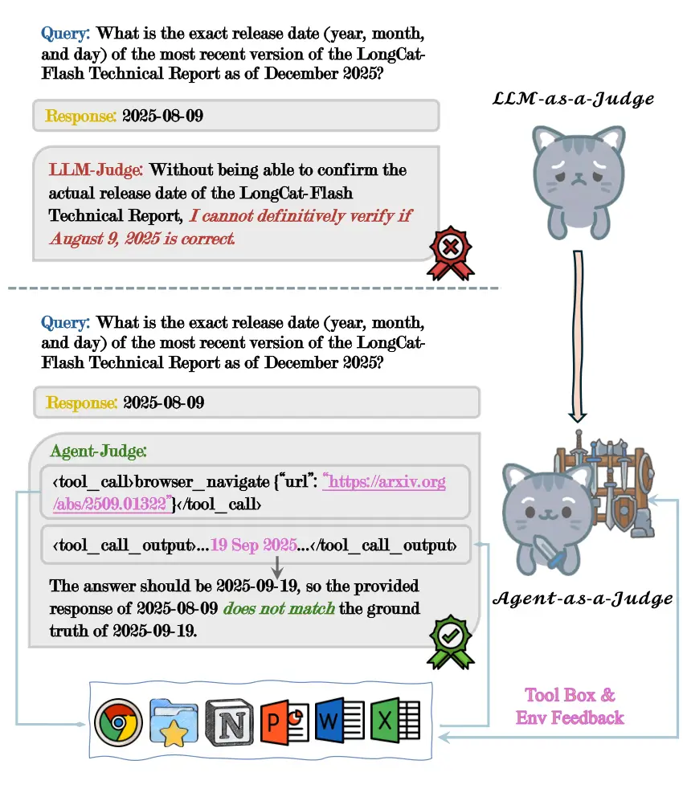
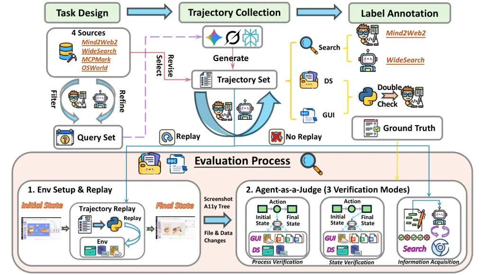
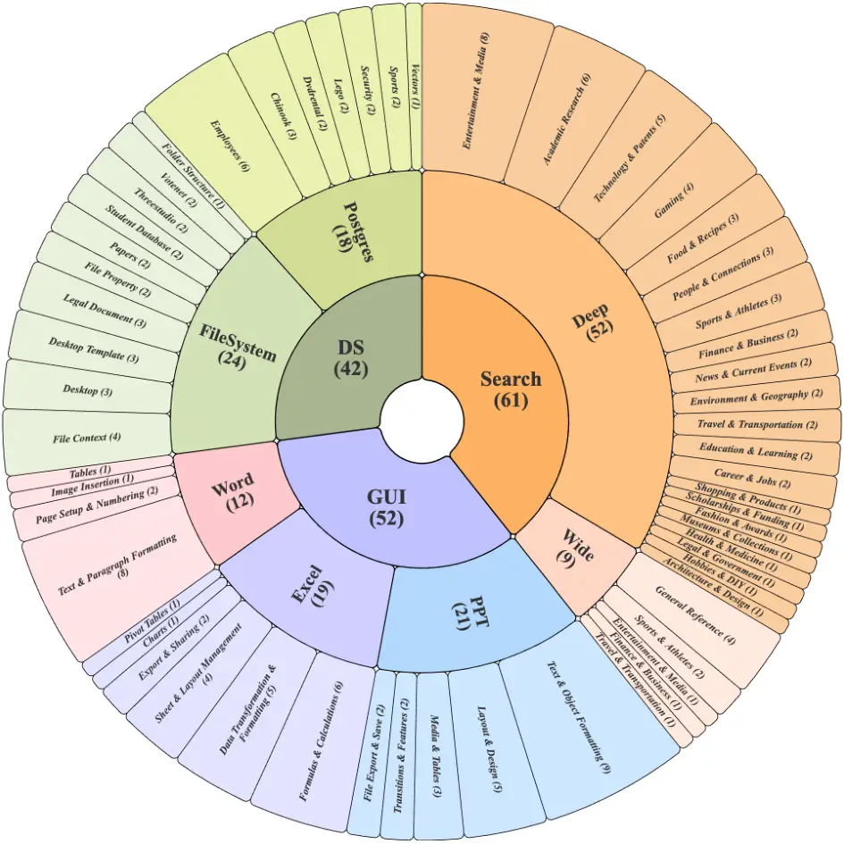
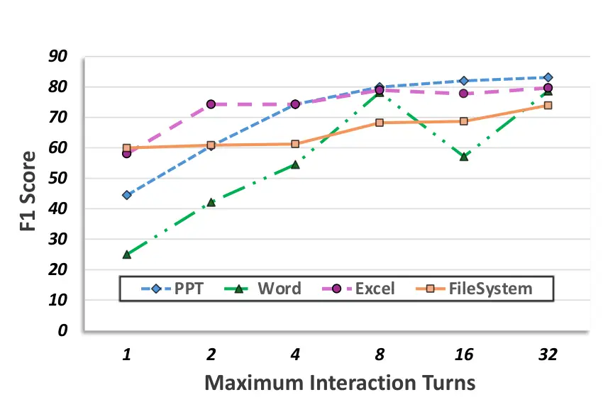

# AJ-Bench: Benchmarking Agent-as-a-Judge for Environment-Aware Evaluation

Wentao Shi Email: [terencewang0809@gmail.com](mailto:)    Yu Wang
Email: [fulifeng93@gmail.com](mailto:)    Yuyang Zhao    Yuxin Chen   
Fuli Feng    Xueyuan Hao    Xi Su    Qi Gu    Hui Su    Xunliang Cai   
Xiangnan He    University of Science    Technology of China National
University of Singapore Meituan{shiwentao123,
zhaoyuyang}@mail.ustc.edu.cn, {guqi03}@meituan.com

###### Abstract

As reinforcement learning continues to scale the training of large
language model–based agents, reliably verifying agent behaviors in
complex environments has become increasingly challenging. Existing
approaches rely on rule-based verifiers or LLM-as-a-Judge models, which
struggle to generalize beyond narrow domains. Agent-as-a-Judge addresses
this limitation by actively interacting with environments and tools to
acquire verifiable evidence, yet its capabilities remain underexplored.

We introduce a benchmark AJ-Bench to systematically evaluate
Agent-as-a-Judge across three domains—search, data systems, and
graphical user interfaces—comprising 155 tasks and 516 annotated
trajectories. The benchmark comprehensively assesses judge agents’
abilities in information acquisition, state verification, and process
verification. Experiments demonstrate consistent performance gains over
LLM-as-a-Judge baselines, while also revealing substantial open
challenges in agent-based verification. Our data and code are available
at [https://aj-bench.github.io/](https://aj-bench.github.io/).

^(†)^(†)footnotetext: ^(∗)Equal contribution. ^(†)Corresponding authors.

## 1 Introduction

> _"An intelligent system cannot be evaluated independently of the
> environment in which it operates."_

The rapid progress of large language models (LLMs) has catalyzed the
emergence of LLM-based agents that exhibit strong capabilities in
long-horizon planning, multi-step reasoning, and tool use within complex
environments (Mohammadi et al., 2025; Guo et al., 2024; Yao et al.,
2022b). To further advance agent performance across a diverse range of
tasks, reinforcement learning (RL) plays a pivotal role by enabling
agents to acquire more robust and transferable behaviors (Chen et al.,
2025; Cheng et al., 2025). However, as RL computation continues to
scale, a fundamental challenge emerges: how to verify agent behaviors in
novel environments at scale.

Figure 1: Agent-as-a-Judge outperforms LLM-as-a-Judge by using tools and
environment access to verify the correct release date.

|                                    |                   |              |           |                     |
| ---------------------------------- | ----------------- | ------------ | --------- | ------------------- |
| Benchmark                          | Evaluation Target | Multi Domain | Env-Aware | Agentic Interaction |
| RewardBench Lambert et al. (2025)  | LLM-as-a-Judge    | ✓            | ✗         | ✗                   |
| RM-Bench Liu et al. (2025b)        | LLM-as-a-Judge    | ✓            | ✗         | ✗                   |
| JudgeBench Tan et al. (2025)       | LLM-as-a-Judge    | ✓            | ✗         | ✗                   |
| AgentRewardBench Men et al. (2025) | LLM-as-a-Judge    | ✓            | ✗         | ✗                   |
| DevAI Zhuge et al. (2025)          | Agent-as-a-Judge  | ✗            | ✓         | ✓                   |
| AJ-Bench                           | Agent-as-a-Judge  | ✓            | ✓         | ✓                   |

Table 1: Comparison of evaluation benchmarks for judges. Multi-Domain
denotes coverage across multiple domains. Env-Aware indicates access to
environment states. Agentic Interaction reflects whether active
interaction (e.g., tool use) is allowed for judges.

Recent studies primarily rely on rule-based verification (Shao et al.,
2024; Mroueh, 2025), where agent trajectories are evaluated against
predefined rules (Wei et al., 2025). While effective for narrowly scoped
tasks, such methods do not generalize to complex, realistic settings
(e.g., scientific hypothesis verification or essay-level fact checking),
where handcrafted rules are insufficient (Huang et al., 2025). In
parallel, LLM-as-a-Judge approaches have been explored, but their
judgements are ultimately grounded in surface-level textual signals (Li
et al., 2025; Gu et al., 2025). To address these limitations, a natural
progression is to endow the verifier with agency. By actively
interacting with the environment, an agent-based judge can reproduce
execution trajectories, verify intermediate states, and assess tool
usage (Zhuge et al., 2025).

Despite its conceptual appeal, the verification capability of
Agent-as-a-Judge systems remains largely unexplored. While a small
number of studies examine the consistency between Agent-as-a-Judge and
human judgements on limited benchmarks (Zhuge et al., 2025), these
analyses are largely confined to small-scale datasets and narrow domains
such as code verification, and therefore cannot offer a comprehensive
assessment of Agent-as-a-Judge capability in open-ended settings.
Meanwhile, these benchmarks fail to capture the more fundamental
challenges faced by judge agents, including deciding when interaction is
necessary, how to leverage tools effectively, and what constitutes
sufficient and verifiable evidence for reliable judgement in open-ended
environments.

In this work, we move toward a systematic evaluation of Agent-as-a-Judge
as a distinct and general capability. We introduce a comprehensive
benchmark AJ-Bench that explicitly requires judge agents to interact
with environments and leverage external tools to obtain evidence beyond
the given trajectories. The benchmark covers three domains—search, data
system (DS), and graphical user interface (GUI)—and consists of 155
tasks spanning a wide range of complex agent behaviors. We further
collect 516 trajectories annotated with binary (positive and negative)
labels. Judge agents are evaluated using the F1 score between their
predictions and the ground-truth annotations. The collected tasks and
trajectories jointly assess key judging capabilities, including (i)
information acquisition via external search, (ii) state verification
through tool-assisted interaction with environments, and (iii) process
verification by inspecting critical actions and execution steps. Our
benchmark enables controlled comparisons between LLM-as-a-Judge and
Agent-as-a-Judge, revealing clear qualitative differences in evaluation
behavior. Agent-as-a-Judge consistently outperforms LLM-as-a-Judge,
achieving an average improvement of 0.13 in F1. However, its absolute
performance remains not yet saturated, with an average F1 score of 0.72,
leaving substantial room for further improvement.

Our contributions can be summarized as follows:

- •
  We introduce the first comprehensive benchmark AJ-Bench for evaluating
  Agent-as-a-Judge systems, enabling rich interaction with environments
  and systematic assessment of their judgement capabilities.
- •
  We conduct systematic comparisons between Agent-as-a-Judge and
  LLM-as-a-Judge paradigms, demonstrating that equipping judging agents
  with tools and environment substantially improves judgement accuracy.
- •
  Experiments across three representative domains indicate that, despite
  their advantages, judge agents still show imperfect performance in
  evaluating complex, multi-step behaviors, suggesting substantial
  headroom for future improvement.

## 2 Related Work

In this section, we briefly introduce benchmarks for evaluating
LLM-based Judges (§2.1), the development of Agent-as-a-Judge (§2.2), and
benchmarks for evaluating Task-Solving Agents (§2.3).

Figure 2: Overview of the benchmark and evaluation pipeline. The upper
part illustrates the benchmark construction process, including task
design, trajectory collection, and label annotation. The lower part
depicts the evaluation workflow of Agent-as-a-Judge, where the
environment is initialized prior to evaluation.

### 2.1 Benchmarks for LLM-Based Judges

To evaluate LLM-based judges, early benchmarks primarily measured the
alignment between judges’ outputs and human judgements, emphasizing
stylistic agreement over factual or logical correctness (Zheng et al.,
2023; Wang et al., 2024; Zhang et al., 2023). More recent work has
shifted focus toward evaluating judges’ capacity to assess factual
accuracy and reasoning, with datasets such as LLMBar (Zeng et al., 2024)
targeting instruction-following tasks and JudgeBench (Tan et al., 2025)
focusing on reasoning. Comprehensive benchmarks like
RewardBench (Lambert et al., 2025) and RM-Bench (Liu et al., 2025b)
further examine judges across diverse domains including safety,
dialogue, and reasoning. Extending this line of research,
AgentRewardBench (Men et al., 2025) evaluate judges on agent
trajectories, assessing their ability to judge task execution and
planning. In contrast, our work investigates judges’ ability to evaluate
agent behavior in interactive environments, requiring tool use and
environment engagement, thereby introducing a more challenging setting.

### 2.2 Agent-as-a-Judge

Agent-as-a-Judge was initially introduced by Zhuge et al. (2025) to
incorporate agentic capabilities into verification. Recent work
integrates external tool use (e.g., code execution, calculator) to
enhance judges’ ability in reasoning tasks (Han et al., 2025; Sung et
al., 2025; Sadhuka et al., 2025), as demonstrated by Themis (Li et al.,
2024), TIR-Judge (Xu et al., 2025) and Agentic Reward Modeling (Peng et
al., 2025). However, these efforts have largely remained confined to
reasoning benchmarks. Meanwhile, studies like Mind2Web2 (Gou et al.,
2025), GAIA2 (Andrews et al., 2025), and RealDevWorld (Bian et al., 2025) demonstrate the increasing importance of agentic verifiers for
agentic task evaluation. Despite this momentum, there still lacks
comprehensive benchmarks to evaluate agent-as-a-judge across a wide
range of agent tasks.

### 2.3 Benchmarks for Task-Solving Agents

A growing body of work benchmarks task-solving LLM agents in interactive
environments by evaluating end-to-end task success and trajectory
quality (Mohammadi et al., 2025), covering web and application agents
(e.g., WebShop (Yao et al., 2022a), WebArena (Zhou et al., 2023),
AppWorld (Trivedi et al., 2024)), tool-using agents that stress
multi-tool planning over large APIs (e.g., ToolBench (Huang et al.,
2023), API-Bank (Li et al., 2023)), as well as domain-specific,
robustness, and safety settings (e.g., ScienceAgentBench (Chen et al.,
2024), TaskBench (Shen et al., 2024)). These benchmarks primarily assess
an agent’s problem-solving and execution capability. TRAIL (Deshpande et
al., 2025) further studies the evaluation of agentic systems from the
perspective of trace debugging. In contrast, judge-agent benchmarks
shift the focus from solving tasks to verifying behaviors, requiring
agents to actively acquire evidence, inspect environment states, and
audit trajectories to determine correctness.

## 3 Benchmark Construction

AJ-Bench is designed to evaluate a model’s ability to leverage external
tools when verifying agent trajectories. The benchmark emphasizes three
core verification dimensions: information acquisition, state
verification, and process verification. To instantiate these dimensions,
we curate tasks from the Search, DS, and GUI domains. Figure 2
illustrates the overall framework of our benchmark construction and
evaluation.

|                  |        |        |            |          |        |        |        |         |
| ---------------- | ------ | ------ | ---------- | -------- | ------ | ------ | ------ | ------- |
| Statistic        | Search |        | DS         |          | GUI    |        |        | Overall |
|                  | Wide   | Deep   | FileSystem | Postgres | PPT    | Word   | Excel  |         |
| Task Count       | 9      | 52     | 24         | 18       | 21     | 12     | 19     | 155     |
| Trajectory Count | 27     | 156    | 129        | 100      | 42     | 24     | 38     | 516     |
| Tool Count       | 22^(⋆) | 22^(⋆) | 14         | 9        | 15^(†) | 15^(†) | 15^(†) | 60      |

Table 2: Statistics of AJ-Bench across domains and subdomains, including
task count, trajectory count, and tool count. ^(⋆)Search tasks share the
same tool set. ^(†)GUI tasks share the same tool set.

### 3.1 Task Design

We design tasks by jointly considering task properties such as
interactivity and complexity, and environment characteristics such as
reproducibility and LLM–environment interaction for reliable evaluation.

#### 3.1.1 Search Domain

We select tasks from Mind2Web2  (Gou et al., 2025) and WideSearch  (Wong
et al., 2025), which provide high-quality tasks with non-fixed or
hard-to-exhaustively-retrieve answers and represent two complementary
information-seeking paradigms. Mind2Web2 emphasizes deep search that
requires multi-hop reasoning, while WideSearch focuses on wide search
with broad information coverage. We exclude tasks with short, easily
verifiable answers and highly time-sensitive content, such as shopping
or travel, where URLs, prices, or ratings change rapidly. This filtering
reflects two considerations: such tasks do not adequately test
Agent-as-a-Judge capabilities, and time-sensitive tasks hinder
reproducible environments and consistent evaluation.

Mind2Web2 tasks are curated through a human-in-the-loop pipeline. The
details are described in the Appendix A.1. For WideSearch, we selected
tasks that differ from those in Mind2Web2 and lightly rewrote them to
explicitly encourage link-providing responses.

#### 3.1.2 DS Domain

We construct the DS domain from two representative MCPMark (Wu et al., 2025) subcategories, Filesystem and Postgres, which involve manipulating
file structures and database records. Task outcomes can be directly
verified by inspecting the environment state, enabling reliable
evaluation of the judge agent’s state-verification capability. Based on
results from Wu et al. (2025), we exclude overly difficult tasks to
maintain balance and obtain high-quality trajectories with both
successes and failures, and manually remove tasks with ambiguous
descriptions.

#### 3.1.3 GUI Domain

We select tasks from OSWorld (Xie et al., 2024), which offers a scalable
real-world computer environment with high-quality multimodal agent tasks
across domains. Specifically, we construct tasks from three office
categories, PowerPoint, Word, and Excel, which require precise execution
positions and carefully planned action sequences and thus remain
challenging for current agents. We first remove tasks with unstable GUI
states, such as feedback pop-up windows, and retain only those with
reproducible final states under repeated execution to ensure a stable
evaluation environment. We then manually review task instructions and
exclude tasks with subjective elements, keeping only tasks whose
completion can be verified through concrete and observable GUI state
changes.

### 3.2 Trajectory Collection

We construct trajectories for AJ-Bench using two complementary
approaches: (1) leveraging existing trajectories from established
benchmarks, and (2) regenerating trajectories using LLMs. All
constructed trajectories are subsequently subjected to thorough human
verification to ensure correctness and quality.

#### 3.2.1 Search Domain

We collect trajectories from web pages using Gemini DeepResearch⁰⁰ 0
[https://gemini.google.com/app](https://gemini.google.com/app), Grok
DeepSearch¹¹ 1 [https://grok.com/](https://grok.com/), and Perplexity
DeepResearch²² 2
[https://www.perplexity.ai/](https://www.perplexity.ai/), and manually
filter out poor responses during collection. For the retained
trajectories, we apply different processing strategies to Mind2Web2 and
WideSearch. For Mind2Web2, we use gpt-5-2025-08-07 to extract
query-relevant information from the responses, primarily to remove
excessive content unrelated to the query, and apply minor human edits to
fix formatting issues. For WideSearch, we perform manual extraction to
preserve tables and reference links, supplemented with brief contextual
explanations.

#### 3.2.2 DS Domain

We construct our trajectory dataset by leveraging agent trajectories
generated by multiple models on MCPMark, supplemented with original
trajectories provided in the benchmark³³ 3
[https://huggingface.co/datasets/Jakumetsu/mcpmark-trajectory-log](https://huggingface.co/datasets/Jakumetsu/mcpmark-trajectory-log).
To mitigate the potential bias introduced by model-specific output
styles, we ensure that trajectories associated with the same task are
sourced from diverse model architectures and subsequently normalized
into a consistent template format. We further perform a comprehensive
manual quality check to discard incomplete or noisy samples. For each
task, we retain up to three successful trajectories and three failed
ones, resulting in a balanced and high-quality dataset tailored for
evaluating judge agents.

#### 3.2.3 GUI Domain

We utilize raw action trajectories generated by multiple multimodal
models from OSWorld⁴⁴ 4
[https://huggingface.co/datasets/xlangai/ubuntu_osworld  
\_verified_trajs](https://huggingface.co/datasets/xlangai/ubuntu_osworld_verified_trajs).
To mitigate potential bias arising from differences in trajectory
length, where successful trajectories typically contain fewer steps than
failed ones, we deliberately select trajectories in which successful
executions may involve many steps while failures terminate after
relatively few steps. This strategy helps decouple task success from
trajectory length. Furthermore, we account for model heterogeneity by
sampling trajectories from a diverse set of models. Specifically, we
extract trajectories from claude-4-sonnet-20250514-50steps,
claude-4-sonnet-20250514-15steps, o3_50steps,
qwen2.5-vl-32b-instruct_100steps, and
doubao-1.5-thinking-vision-pro-250428-100step.

### 3.3 Label Annotation

Across all three domains, labels are binary (1/0), indicating success or
failure. In the search domain, labels are defined at the item level,
whereas in the other two domains, labels are assigned at the trajectory
level.

#### 3.3.1 Search Domain

Labels for the Mind2Web2 portion are obtained through manual annotation,
where annotators assign a scoring rubric and corresponding rubric-level
labels to each response. To support more fine-grained evaluation, we
further employ gpt-4.1 to decompose each response into single-item units
based on the rubric, enabling evaluation at a finer level of
granularity. For the WideSearch portion, labels are obtained using the
official WideSearch codebase. Specifically, labels are derived via
majority voting across six models: gpt-4.1-2025-04-14, gpt-5-2025-08-07,
o4-mini-2025-04-16, claude-sonnet-4-20250514,
gemini-2.5-pro-preview-06-05, and grok-3. In addition, single-item units
are extracted by a combination of manual refinement and rule-based
parsing of the generated Markdown tables, enabling fine-grained
evaluation.

#### 3.3.2 DS domain

For tasks in the DS domain, a trajectory is deemed successful only if
all explicit requirements in the task description are fully satisfied.
We leverage the verifier scripts provided in MCPMark—derived from
high-quality human annotations—to automatically determine the outcome of
each trajectory, ensuring reliable supervision signals. To further
guarantee label correctness, we additionally perform a manual validation
pass to correct potential misjudgements and maintain consistent
annotation quality.

#### 3.3.3 GUI Domain

In the GUI domain, labels in OSWorld are initially assigned using
rule-based scripts that compare execution trajectory outputs against
golden files for office tasks. However, these scripts are inherently
limited in their ability to capture all execution details and edge
cases, which may lead to mislabeling. To ensure label reliability, we
therefore manually inspect each trajectory to verify its correctness.

### 3.4 Dataset Statistics

Following the construction pipeline described in §3.1–§3.3, we obtain a
total of 155 tasks, 516 trajectories, and 60 different tools. Detailed
statistics for each domain are reported in Table 2. In addition, we
analyze the distribution of task types across different domains, as
illustrated in Figure 3.

Figure 3: Task distribution of AJ-Bench

### 3.5 Environment Construction

Our benchmark provides raw action trajectories and task-specific
configurations for both the DS and GUI domains. To support interactive
evaluation, we replay the final environment state of each task, enabling
the agent to interact with a live environment and actively acquire
additional contextual information beyond static trajectories.

In both the DS and GUI domains, evaluation trajectories are replayed by
sequentially executing the extracted action sequences in trajectories to
reconstruct independent environments that support concurrent evaluation.
DS tasks are replayed locally, while GUI tasks are deployed on isolated
AWS instances. Once the environment is restored to its final recorded
state, the agent begins to evaluate through interaction.

## 4 Experiments

|                                                                                                     |         |        |        |            |          |        |        |        |                  |
| --------------------------------------------------------------------------------------------------- | ------- | ------ | ------ | ---------- | -------- | ------ | ------ | ------ | ---------------- |
| Model                                                                                               | Agentic | Search |        | DS         |          | GUI    |        |        | Overall Avg@3    |
|                                                                                                     |         | Wide   | Deep   | FileSystem | Postgres | PPT    | Word   | Excel  |                  |
| Proprietary Models                                                                                  |         |        |        |            |          |        |        |        |                  |
| ![[Uncaptioned image]](arxiv-2604-18240v1--91ae7f077799.figures/figure-4.webp) gemini-3-pro-preview | ✗       | 72.70  | 81.26  | 75.69      | 73.20    | 76.10  | 72.14  | 74.28  | 75.05$`\pm`$1.26 |
| ![[Uncaptioned image]](arxiv-2604-18240v1--91ae7f077799.figures/figure-4.webp) gemini-2.5-pro       | ✗       | 66.35  | 81.22  | 66.10      | 68.96    | 68.72  | 60.13  | 66.67  | 68.31$`\pm`$0.95 |
| ![[Uncaptioned image]](arxiv-2604-18240v1--91ae7f077799.figures/figure-5.webp) claude-opus-4.5      | ✗       | 64.26  | 81.11  | 66.06      | 69.66    | 59.21  | 51.45  | 75.77  | 66.79$`\pm`$1.33 |
| ![[Uncaptioned image]](arxiv-2604-18240v1--91ae7f077799.figures/figure-5.webp) claude-sonnet-4.5    | ✗       | 61.02  | 81.34  | 69.26      | 68.36    | 75.61  | 61.56  | 71.24  | 69.77$`\pm`$1.18 |
| ![[Uncaptioned image]](arxiv-2604-18240v1--91ae7f077799.figures/figure-6.webp) gpt-5                | ✗       | 66.33  | 80.37  | 59.09      | 62.84    | 51.90  | 44.81  | 61.78  | 61.02$`\pm`$0.13 |
| ![[Uncaptioned image]](arxiv-2604-18240v1--91ae7f077799.figures/figure-6.webp) gpt-5.1              | ✗       | 58.02  | 70.90  | 46.27      | 57.53    | 41.90  | 39.54  | 60.33  | 53.50$`\pm`$3.56 |
| ![[Uncaptioned image]](arxiv-2604-18240v1--91ae7f077799.figures/figure-7.webp) grok-4               | ✗       | 69.18  | 78.32  | 75.70      | 59.57    | 61.11  | 65.26  | 75.52  | 69.24$`\pm`$1.11 |
| ![[Uncaptioned image]](arxiv-2604-18240v1--91ae7f077799.figures/figure-6.webp) gpt-5-mini-low       | ✗       | 60.84  | 68.42  | 60.41      | 65.52    | 45.05  | 48.41  | 64.36  | 59.00$`\pm`$0.91 |
| ![[Uncaptioned image]](arxiv-2604-18240v1--91ae7f077799.figures/figure-6.webp) gpt-5-mini-low       | ✓       | 65.93  | 75.69  | 67.54      | 67.30    | 76.28  | 72.22  | 81.89  | 72.41$`\pm`$1.68 |
| ![[Uncaptioned image]](arxiv-2604-18240v1--91ae7f077799.figures/figure-6.webp) Improvement          | ✓       | +5.09  | +7.27  | +7.13      | +1.78    | +31.23 | +23.81 | +17.53 | +13.41           |
| Open-Source Models                                                                                  |         |        |        |            |          |        |        |        |                  |
| ![[Uncaptioned image]](arxiv-2604-18240v1--91ae7f077799.figures/figure-8.webp) kimi-k2-0905-preview | ✗       | 63.52  | 80.17  | 55.96      | 65.85    | 65.53  | 55.39  | 63.90  | 64.33$`\pm`$2.07 |
| ![[Uncaptioned image]](arxiv-2604-18240v1--91ae7f077799.figures/figure-9.webp) qwen3-235b-a22b      | ✗       | 62.69  | 81.33  | 64.66      | 64.32    | 45.50  | 36.82  | 53.97  | 58.47$`\pm`$2.32 |
| ![[Uncaptioned image]](arxiv-2604-18240v1--91ae7f077799.figures/figure-10.webp) glm-4.6             | ✗       | 66.61  | 77.88  | 60.86      | 64.94    | 60.82  | 50.07  | 72.49  | 64.81$`\pm`$0.96 |
| ![[Uncaptioned image]](arxiv-2604-18240v1--91ae7f077799.figures/figure-11.webp) longcat-flash-chat  | ✗       | 64.44  | 81.80  | 59.13      | 65.54    | 45.33  | 30.35  | 55.88  | 57.50$`\pm`$3.19 |
| ![[Uncaptioned image]](arxiv-2604-18240v1--91ae7f077799.figures/figure-12.webp) deepseek-v3.2       | ✗       | 63.65  | 62.91  | 60.31      | 66.31    | 58.38  | 69.77  | 70.12  | 64.49$`\pm`$0.50 |
| ![[Uncaptioned image]](arxiv-2604-18240v1--91ae7f077799.figures/figure-12.webp) deepseek-v3.2       | ✓       | 72.47  | 82.14  | 72.60      | 72.70    | 83.14  | 78.64  | 79.71  | 77.34$`\pm`$1.36 |
| ![[Uncaptioned image]](arxiv-2604-18240v1--91ae7f077799.figures/figure-12.webp) Improvement         | ✓       | +8.82  | +19.23 | +12.29     | +6.39    | +24.76 | +8.87  | +9.59  | +12.85           |

Table 3: Performance Comparison under LLM-as-a-Judge and
Agent-as-a-Judge Settings

In this section, we first describe the experimental setup (§4.1), then
demonstrate the superiority of Agent-as-a-Judge over LLM-as-a-Judge
(§4.2), and finally conduct ablation studies to investigate the factors
influencing Agent-as-a-Judge performance from the perspectives of
internal capabilities and external information inputs (§ 4.3).

### 4.1 Setup

##### Models.

For LLM-as-a-Judge, we evaluate a range of sota closed-source models,
including the Gemini family (i.e., gemini-3-pro-preview  (Google, 2025)
and gemini-2.5-pro  (Comanici et al., 2025)), the Claude family (i.e.,
claude-opus-4.5 and claude-sonnet-4.5  (Anthropic, 2025a; Anthropic,
2025b)), the GPT family (i.e., gpt-5, gpt-5-mini, and gpt-5.1  (OpenAI,
2025b; OpenAI, 2025a)), as well as grok-4  (xAI, 2025). We also consider
several strong open-source models: kimi-k2-0905-preview  (Team et al.,
2025a), qwen3-235b-a22b  (Yang et al., 2025), glm-4.6  (Zai, 2025),
longcat-flash-chat  (Team et al., 2025b), and deepseek-v3.2  (Liu et
al., 2025a). For Agent-as-a-Judge, due to budget constraints, we select
gpt-5-mini-low as the representative closed-source model and
deepseek-v3.2 as the representative open-source model.

##### Implementation Details.

Our agent implementation is built on MCPMark⁵⁵ 5
[https://github.com/eval-sys/mcpmark](https://github.com/eval-sys/mcpmark),
a framework designed to evaluate an LLM’s intrinsic ability to decide
when and how to invoke tools, without relying on complex or heavily
engineered workflows. Unless explicitly stated otherwise, all models are
evaluated with their default configurations (e.g., temperature and
reasoning effort). We adopt F1 score as our primary evaluation metric.
For the metric design, in the Search domain, we aggregate the
evaluations of all single items within a trajectory into a single
result, from which the F1 score is computed. In the DS and GUI domains,
we compute the F1 score based on trajectory-level evaluations. Results
reported in Table 3 are averaged over three runs. Further details are
available in the Appendix A.3.

### 4.2 Main Experiments

We evaluate a range of open-source and closed-source models on AJ-Bench,
with the results summarized in Table 3. These results lead to the
following observations:

##### Agent-as-a-Judge consistently outperforms LLM-as-a-Judge when built upon the same base model.

For a given model—whether a thinking model or a chat model—enabling tool
usage leads to an average improvement of approximately 13 percentage
points across the three domains compared to its counterpart without tool
calls. These results demonstrate the substantial potential of
Agent-as-a-Judge, highlighting its effectiveness as a verifier for more
reliable trajectory evaluation.

##### Agent-as-a-Judge built on weaker models can achieve performance comparable to that of LLM-as-a-Judge based on sota models.

Our implemented Agent-as-a-Judge baseline consistently outperforms
existing sota LLM-as-a-Judge models. This result highlights the inherent
limitations of LLM-as-a-Judge. For tasks that require effective
interaction with the external environment, Agent-as-a-Judge demonstrates
clear advantages over LLM-as-a-Judge.

### 4.3 Ablation Study

|                                                                                               |           |        |       |            |          |       |       |       |         |
| --------------------------------------------------------------------------------------------- | --------- | ------ | ----- | ---------- | -------- | ----- | ----- | ----- | ------- |
| Model                                                                                         | Reasoning | Search |       | DS         |          | GUI   |       |       | Overall |
|                                                                                               |           | Wide   | Deep  | FileSystem | Postgres | PPT   | Word  | Excel |         |
| ![[Uncaptioned image]](arxiv-2604-18240v1--91ae7f077799.figures/figure-6.webp) gpt-5-mini     | low       | 65.93  | 75.69 | 67.54      | 67.30    | 76.28 | 72.22 | 81.89 | 72.41   |
|                                                                                               | medium    | 72.76  | 77.11 | 75.80      | 69.84    | 82.05 | 72.00 | 82.35 | 75.99   |
|                                                                                               | high      | 74.48  | 79.19 | 71.53      | 67.92    | 78.95 | 63.64 | 81.08 | 73.83   |
| ![[Uncaptioned image]](arxiv-2604-18240v1--91ae7f077799.figures/figure-12.webp) deepseek-v3.2 | N/A       | 72.47  | 82.14 | 72.60      | 72.70    | 83.14 | 78.64 | 79.71 | 77.34   |
|                                                                                               | thinking  | 70.37  | 79.31 | 68.83      | 74.13    | 82.05 | 78.57 | 86.49 | 77.11   |

Table 4: Performance comparison of models under different reasoning
effort settings across tasks

To investigate the effectiveness of Agent-as-a-Judge, we conduct
ablation studies from two perspectives: the model’s internal
capabilities and external information inputs. From the perspective of
internal capabilities, we examine the impact of reasoning ability on the
performance of Agent-as-a-Judge (§4.3.1). From the perspective of
external information inputs, we study the effects of tool invocation
frequency and input modality on Agent-as-a-Judge performance
(§4.3.2–§4.3.3).

#### 4.3.1 Thinking Ablation

In this section, we investigate the impact of different levels of
reasoning effort on Agent-as-a-Judge when using the same base model. As
shown in Table 4, across all three domains, we observe that for
gpt-5-mini, the medium setting generally outperforms the low setting,
while the high setting does not consistently outperform medium. For
deepseek-v3.2, the thinking variant performs worse than the no-thinking
variant. These results indicate that increasing reasoning effort does
not necessarily enhance the performance of Agent-as-a-Judge. In other
words, stronger intrinsic reasoning capability is not equivalent to the
ability to effectively invoke tools, analyze tool outputs, and make
reliable decisions.

#### 4.3.2 Interaction Turns Ablation

Figure 4: Comparing different interaction turns’ effect on the
evaluation results

To investigate the effect of the interaction budget on the agent’s
evaluation ability, we set different maximum interaction turn limits
under deepseek-v3.2 for several subdomains. As shown in Figure 4,
increasing the interaction budget consistently improves F1 scores across
all tasks, with the most pronounced gains observed for smaller budgets.
This suggests that more information is retrieved through interaction
with the environment, which notably aids evaluation. Furthermore, task
domains vary in their sensitivity to the interaction budget. Word and
PPT tasks benefit more from extended interactions, indicating a greater
reliance on iterative information gathering.

#### 4.3.3 Multimodal Ablation

We conduct a modality ablation study in the GUI domain to examine the
impact of multimodal inputs on evaluation performance. The agent
leverages information from the live environment, including the
accessibility tree and screenshots, under three input configurations:
(i) accessibility tree only, (ii) screenshot only, and (iii) a
combination of both. The study uses two multimodal models,
gpt-5-mini-low and gemini-3-flash-preview. As shown in Figure 5, the
effectiveness of different multimodal modalities varies substantially
across subdomains. In the PPT subdomain, the accessibility tree and the
mixed setting achieve comparable performance. For Word tasks, the
screenshot modality yields the best results. And in the Excel subdomain,
the mixed-modality configuration consistently outperforms the
single-modality alternatives. These findings suggest that incorporating
multiple modalities does not uniformly improve agent performance.
Instead, mixed inputs can introduce noise and redundancy that may
distract the agent and degrade decision-making in certain scenarios.

Figure 5: Comparing the effect of each modality on agent performance
under two models (gpt-5-mini-low and gemini-3-flash-preview) on the GUI
domain

## 5 Conclusions

In this work, we identify a critical gap in existing benchmarks, namely
the lack of systematic evaluation for Agent-as-a-Judge, and introduce
AJ-Bench as the first benchmark specifically designed for this purpose.
AJ-Bench covers three domains, Search, DS, and GUI, comprising 155 tasks
and 516 trajectories for comprehensive Agent-as-a-Judge evaluation. Our
simple yet effective Agent-as-a-Judge baseline demonstrates strong
performance and consistently outperforms LLM-as-a-Judge, highlighting
the promise of agent-based judging paradigms. We hope that AJ-Bench will
serve as a foundational evaluation platform and a valuable resource for
the community, facilitating future research on Agent-as-a-Judge.

## Limitations

##### Task Diversity and Scalability.

Most tasks in AJ-Bench are adapted from existing benchmarks through
modification rather than being created entirely from scratch. In future
work, we plan to construct a larger portion of tasks independently and
to scale up the data generation pipeline, enabling broader coverage and
potential use in training settings.

##### Environment Stability.

In the search domain, Agent-as-a-Judge relies on interactions with
external web environments. As a result, instability in network
connectivity may affect evaluation reliability.

## 6 Acknowledgement

This research was supported by Meituan.

## References

- Andrews et al. (2025) P. Andrews, A. Benhalloum, G. M. Bertran, M.
  Bettini, A. Budhiraja, R. S. Cabral, V. Do, R. Froger, E. Garreau, J.
  Gaya, H. Laurençon, M. Lecanu, K. Malkan, D. Mekala, P. Ménard, G.
  Mialon, U. Piterbarg, M. Plekhanov, M. Rita, A. Rusakov, T.
  Scialom, V. Vorotilov, M. Wang, and I. Yu ARE: scaling up agent
  environments and evaluations. CoRR abs/2509.17158. Cited by: §2.2.
- Anthropic (2025a) Anthropic Introducing claude opus 4.5. Note:
  [https://www.anthropic.com/news/claude-opus-4-5](https://www.anthropic.com/news/claude-opus-4-5)Accessed:
  2026-01-02 Cited by: §4.1.
- Anthropic (2025b) Anthropic Introducing claude sonnet 4.5. Note:
  [https://www.anthropic.com/news/claude-sonnet-4-5](https://www.anthropic.com/news/claude-sonnet-4-5)Accessed:
  2026-01-02 Cited by: §4.1.
- Bian et al. (2025) Y. Bian, X. Lin, Y. Xie, T. Liu, M. Zhuge, S.
  Lu, H. Tang, J. Wang, J. Zhang, J. Chen, X. Tang, Y. Ni, S. Hong,
  and C. Wu You don’t know until you click:automated GUI testing for
  production-ready software evaluation. CoRR abs/2508.14104. Cited by:
  §2.2.
- Chen et al. (2025) K. Chen, M. Cusumano-Towner, B. Huval, A.
  Petrenko, J. Hamburger, V. Koltun, and P. Krähenbühl Reinforcement
  learning for long-horizon interactive llm agents. arXiv preprint
  arXiv:2502.01600. Cited by: §1.
- Chen et al. (2024) Z. Chen, S. Chen, Y. Ning, Q. Zhang, B. Wang, B.
  Yu, Y. Li, Z. Liao, C. Wei, Z. Lu, et al. Scienceagentbench: toward
  rigorous assessment of language agents for data-driven scientific
  discovery. arXiv preprint arXiv:2410.05080. Cited by: §2.3.
- Cheng et al. (2025) M. Cheng, J. Ouyang, S. Yu, R. Yan, Y. Luo, Z.
  Liu, D. Wang, Q. Liu, and E. Chen Agent-r1: training powerful llm
  agents with end-to-end reinforcement learning. arXiv preprint
  arXiv:2511.14460. Cited by: §1.
- Comanici et al. (2025) G. Comanici, E. Bieber, M. Schaekermann, I.
  Pasupat, N. Sachdeva, I. Dhillon, M. Blistein, O. Ram, D. Zhang, E.
  Rosen, et al. Gemini 2.5: pushing the frontier with advanced
  reasoning, multimodality, long context, and next generation agentic
  capabilities. arXiv preprint arXiv:2507.06261. Cited by: §4.1.
- Deshpande et al. (2025) D. Deshpande, V. Gangal, H. Mehta, J.
  Krishnan, A. Kannappan, and R. Qian TRAIL: trace reasoning and agentic
  issue localization. External Links: 2505.08638,
  [Link](https://arxiv.org/abs/2505.08638) Cited by: §2.3.
- Google (2025) Google A new era of intelligence with gemini 3. Note:
  [https://blog.google/products/gemini/gemini-3/](https://blog.google/products/gemini/gemini-3/)Accessed:
  2026-01-02 Cited by: §4.1.
- Gou et al. (2025) B. Gou, Z. Huang, Y. Ning, Y. Gu, M. Lin, W. Qi, A.
  Kopanev, B. Yu, B. J. Gutiérrez, Y. Shu, C. H. Song, J. Wu, S.
  Chen, H. N. Moussa, T. Zhang, J. Xie, Y. Li, T. Xue, Z. Liao, K.
  Zhang, B. Zheng, Z. Cai, V. Rozgic, M. Ziyadi, H. Sun, and Y. Su
  Mind2Web 2: evaluating agentic search with agent-as-a-judge. CoRR
  abs/2506.21506. Cited by: §2.2, §3.1.1.
- Gu et al. (2025) J. Gu, X. Jiang, Z. Shi, H. Tan, X. Zhai, C. Xu, W.
  Li, Y. Shen, S. Ma, H. Liu, S. Wang, K. Zhang, Y. Wang, W. Gao, L. Ni,
  and J. Guo A survey on llm-as-a-judge. External Links: 2411.15594,
  [Link](https://arxiv.org/abs/2411.15594) Cited by: §1.
- Guo et al. (2024) T. Guo, X. Chen, Y. Wang, R. Chang, S. Pei, N. V.
  Chawla, O. Wiest, and X. Zhang Large language model based
  multi-agents: a survey of progress and challenges. arXiv preprint
  arXiv:2402.01680. Cited by: §1.
- Han et al. (2025) J. Han, W. Buntine, and E. Shareghi VerifiAgent: a
  unified verification agent in language model reasoning. In Findings of
  the Association for Computational Linguistics: EMNLP 2025, Suzhou,
  China, pp. 16410–16431. Cited by: §2.2.
- Huang et al. (2025) K. Huang, Y. Jin, R. Li, M. Y. Li, E. Candès,
  and J. Leskovec Automated hypothesis validation with agentic
  sequential falsifications. arXiv preprint arXiv:2502.09858. Cited by:
  §1.
- Huang et al. (2023) Y. Huang, J. Shi, Y. Li, C. Fan, S. Wu, Q.
  Zhang, Y. Liu, P. Zhou, Y. Wan, N. Z. Gong, et al. Metatool benchmark
  for large language models: deciding whether to use tools and which to
  use. arXiv preprint arXiv:2310.03128. Cited by: §2.3.
- Lambert et al. (2025) N. Lambert, V. Pyatkin, J. Morrison, L. J. V.
  Miranda, B. Y. Lin, K. R. Chandu, N. Dziri, S. Kumar, T. Zick, Y.
  Choi, N. A. Smith, and H. Hajishirzi RewardBench: evaluating reward
  models for language modeling. In NAACL (Findings), pp. 1755–1797.
  Cited by: Table 1, §2.1.
- Li et al. (2025) D. Li, B. Jiang, L. Huang, A. Beigi, C. Zhao, Z.
  Tan, A. Bhattacharjee, Y. Jiang, C. Chen, T. Wu, et al. From
  generation to judgment: opportunities and challenges of
  llm-as-a-judge. In Proceedings of the 2025 Conference on Empirical
  Methods in Natural Language Processing, pp. 2757–2791. Cited by: §1.
- Li et al. (2024) L. Li, Y. Chai, S. Wang, Y. Sun, H. Tian, N. Zhang,
  and H. Wu Tool-augmented reward modeling. In ICLR, Cited by: §2.2.
- Li et al. (2023) M. Li, Y. Zhao, B. Yu, F. Song, H. Li, H. Yu, Z.
  Li, F. Huang, and Y. Li Api-bank: a comprehensive benchmark for
  tool-augmented llms. arXiv preprint arXiv:2304.08244. Cited by: §2.3.
- Liu et al. (2025a) A. Liu, A. Mei, B. Lin, B. Xue, B. Wang, B. Xu, B.
  Wu, B. Zhang, C. Lin, C. Dong, et al. Deepseek-v3. 2: pushing the
  frontier of open large language models. arXiv preprint
  arXiv:2512.02556. Cited by: §4.1.
- Liu et al. (2025b) Y. Liu, Z. Yao, R. Min, Y. Cao, L. Hou, and J. Li
  RM-bench: benchmarking reward models of language models with subtlety
  and style. In ICLR, Cited by: Table 1, §2.1.
- Men et al. (2025) T. Men, Z. Jin, P. Cao, Y. Chen, K. Liu, and J. Zhao
  Agent-rewardbench: towards a unified benchmark for reward modeling
  across perception, planning, and safety in real-world multimodal
  agents. In ACL (1), pp. 17521–17541. Cited by: Table 1, §2.1.
- Mohammadi et al. (2025) M. Mohammadi, Y. Li, J. Lo, and W. Yip
  Evaluation and benchmarking of llm agents: a survey. In Proceedings of
  the 31st ACM SIGKDD Conference on Knowledge Discovery and Data
  Mining V. 2, pp. 6129–6139. Cited by: §1, §2.3.
- Mroueh (2025) Y. Mroueh Reinforcement learning with verifiable
  rewards: grpo’s effective loss, dynamics, and success amplification.
  arXiv preprint arXiv:2503.06639. Cited by: §1.
- OpenAI (2025a) OpenAI GPT-5.1: a smarter, more conversational chatgpt.
  Note:
  [https://openai.com/index/gpt-5-1/](https://openai.com/index/gpt-5-1/)Accessed:
  2026-01-02 Cited by: §4.1.
- OpenAI (2025b) OpenAI Introducing gpt-5. Note:
  [https://openai.com/index/introducing-gpt-5/](https://openai.com/index/introducing-gpt-5/)Accessed:
  2026-01-02 Cited by: §4.1.
- Peng et al. (2025) H. Peng, Y. Qi, X. Wang, Z. Yao, B. Xu, L. Hou,
  and J. Li Agentic reward modeling: integrating human preferences with
  verifiable correctness signals for reliable reward systems. In ACL
  (1), pp. 15934–15949. Cited by: §2.2.
- Sadhuka et al. (2025) S. Sadhuka, D. Prinster, C. Fannjiang, G.
  Scalia, A. Regev, and H. Wang E-valuator: reliable agent verifiers
  with sequential hypothesis testing. External Links: 2512.03109,
  [Link](https://arxiv.org/abs/2512.03109) Cited by: §2.2.
- Shao et al. (2024) Z. Shao, P. Wang, Q. Zhu, R. Xu, J. Song, X. Bi, H.
  Zhang, M. Zhang, Y. Li, Y. Wu, et al. Deepseekmath: pushing the limits
  of mathematical reasoning in open language models. arXiv preprint
  arXiv:2402.03300. Cited by: §1.
- Shen et al. (2024) Y. Shen, K. Song, X. Tan, W. Zhang, K. Ren, S.
  Yuan, W. Lu, D. Li, and Y. Zhuang Taskbench: benchmarking large
  language models for task automation. Advances in Neural Information
  Processing Systems 37, pp. 4540–4574. Cited by: §2.3.
- Sung et al. (2025) Y. Y. Sung, H. Kim, and D. Zhang VeriLA: a
  human-centered evaluation framework for interpretable verification of
  llm agent failures. External Links: 2503.12651,
  [Link](https://arxiv.org/abs/2503.12651) Cited by: §2.2.
- Tan et al. (2025) S. Tan, S. Zhuang, K. Montgomery, W. Y. Tang, A.
  Cuadron, C. Wang, R. A. Popa, and I. Stoica JudgeBench: A benchmark
  for evaluating llm-based judges. In ICLR, Cited by: Table 1, §2.1.
- Team et al. (2025a) K. Team, Y. Bai, Y. Bao, G. Chen, J. Chen, N.
  Chen, R. Chen, Y. Chen, Y. Chen, Y. Chen, et al. Kimi k2: open agentic
  intelligence. arXiv preprint arXiv:2507.20534. Cited by: §4.1.
- Team et al. (2025b) M. L. Team, B. Li, B. Lei, B. Wang, B. Rong, C.
  Wang, C. Zhang, C. Gao, C. Zhang, C. Sun, et al. Longcat-flash
  technical report. arXiv preprint arXiv:2509.01322. Cited by: §4.1.
- Trivedi et al. (2024) H. Trivedi, T. Khot, M. Hartmann, R. Manku, V.
  Dong, E. Li, S. Gupta, A. Sabharwal, and N. Balasubramanian Appworld:
  a controllable world of apps and people for benchmarking interactive
  coding agents. arXiv preprint arXiv:2407.18901. Cited by: §2.3.
- Wang et al. (2024) P. Wang, L. Li, L. Chen, Z. Cai, D. Zhu, B. Lin, Y.
  Cao, L. Kong, Q. Liu, T. Liu, and Z. Sui Large language models are not
  fair evaluators. In ACL (1), pp. 9440–9450. Cited by: §2.1.
- Wei et al. (2025) T. Wei, Y. Yang, J. Xing, Y. Shi, Z. Lu, and D. Ye
  GTR: guided thought reinforcement prevents thought collapse in
  rl-based vlm agent training. arXiv preprint arXiv:2503.08525. Cited
  by: §1.
- Wong et al. (2025) R. Wong, J. Wang, J. Zhao, L. Chen, Y. Gao, L.
  Zhang, X. Zhou, Z. Wang, K. Xiang, G. Zhang, et al. Widesearch:
  benchmarking agentic broad info-seeking. arXiv preprint
  arXiv:2508.07999. Cited by: §3.1.1.
- Wu et al. (2025) Z. Wu, X. Liu, X. Zhang, L. Chen, F. Meng, L. Du, Y.
  Zhao, F. Zhang, Y. Ye, J. Wang, et al. MCPMark: a benchmark for
  stress-testing realistic and comprehensive mcp use. arXiv preprint
  arXiv:2509.24002. Cited by: §3.1.2.
- xAI (2025) xAI Grok 4. Note:
  [https://x.ai/news/grok-4](https://x.ai/news/grok-4)Accessed:
  2026-01-02 Cited by: §4.1.
- Xie et al. (2024) T. Xie, D. Zhang, J. Chen, X. Li, S. Zhao, R.
  Cao, T. J. Hua, Z. Cheng, D. Shin, F. Lei, et al. Osworld:
  benchmarking multimodal agents for open-ended tasks in real computer
  environments. Advances in Neural Information Processing Systems 37,
  pp. 52040–52094. Cited by: §3.1.3.
- Xu et al. (2025) R. Xu, J. Chen, J. Ye, Y. Wu, J. Yan, C. Yang, and H.
  Yu Incentivizing agentic reasoning in LLM judges via tool-integrated
  reinforcement learning. CoRR abs/2510.23038. Cited by: §2.2.
- Yang et al. (2025) A. Yang, A. Li, B. Yang, B. Zhang, B. Hui, B.
  Zheng, B. Yu, C. Gao, C. Huang, C. Lv, et al. Qwen3 technical report.
  arXiv preprint arXiv:2505.09388. Cited by: §4.1.
- Yao et al. (2022a) S. Yao, H. Chen, J. Yang, and K. Narasimhan
  Webshop: towards scalable real-world web interaction with grounded
  language agents. Advances in Neural Information Processing Systems 35,
  pp. 20744–20757. Cited by: §2.3.
- Yao et al. (2022b) S. Yao, J. Zhao, D. Yu, N. Du, I. Shafran, K. R.
  Narasimhan, and Y. Cao React: synergizing reasoning and acting in
  language models. In The eleventh international conference on learning
  representations, Cited by: §1.
- Zai (2025) Zai GLM-4.6: advanced agentic, reasoning and coding
  capabilities. Note:
  [https://z.ai/blog/glm-4.6](https://z.ai/blog/glm-4.6)Accessed:
  2026-01-02 Cited by: §4.1.
- Zeng et al. (2024) Z. Zeng, J. Yu, T. Gao, Y. Meng, T. Goyal, and D.
  Chen Evaluating large language models at evaluating instruction
  following. In ICLR, Cited by: §2.1.
- Zhang et al. (2023) X. Zhang, B. Yu, H. Yu, Y. Lv, T. Liu, F.
  Huang, H. Xu, and Y. Li Wider and deeper LLM networks are fairer LLM
  evaluators. CoRR abs/2308.01862. Cited by: §2.1.
- Zheng et al. (2023) L. Zheng, W. Chiang, Y. Sheng, S. Zhuang, Z.
  Wu, Y. Zhuang, Z. Lin, Z. Li, D. Li, E. P. Xing, H. Zhang, J. E.
  Gonzalez, and I. Stoica Judging llm-as-a-judge with mt-bench and
  chatbot arena. In NeurIPS, Cited by: §2.1.
- Zhou et al. (2023) S. Zhou, F. F. Xu, H. Zhu, X. Zhou, R. Lo, A.
  Sridhar, X. Cheng, T. Ou, Y. Bisk, D. Fried, et al. Webarena: a
  realistic web environment for building autonomous agents. arXiv
  preprint arXiv:2307.13854. Cited by: §2.3.
- Zhuge et al. (2025) M. Zhuge, C. Zhao, D. R. Ashley, W. Wang, D.
  Khizbullin, Y. Xiong, Z. Liu, E. Chang, R. Krishnamoorthi, Y. Tian, Y.
  Shi, V. Chandra, and J. Schmidhuber Agent-as-a-judge: evaluate agents
  with agents. In ICML, Cited by: Table 1, §1, §1, §2.2.

|           |                |         |        |       |       |       |       |
| --------- | -------------- | ------- | ------ | ----- | ----- | ----- | ----- |
| Framework | Model          | Agentic | Search |       | GUI   |       |       |
|           |                |         | Wide   | Deep  | PPT   | Word  | Excel |
| LLM-Judge | gpt-5-mini-low | ✗       | 60.84  | 68.42 | 45.05 | 48.41 | 64.36 |
| MCPMark   | gpt-5-mini-low | ✓       | 65.93  | 75.69 | 76.28 | 72.22 | 81.89 |
| ReAct     | gpt-5-mini-low | ✓       | 51.13  | 71.84 | 64.86 | 63.64 | 76.47 |
| LLM-Judge | deepseek-v3.2  | ✗       | 63.65  | 62.91 | 58.38 | 69.77 | 70.12 |
| MCPMark   | deepseek-v3.2  | ✓       | 72.47  | 82.14 | 83.14 | 78.64 | 79.71 |
| ReAct     | deepseek-v3.2  | ✓       | 70.51  | 77.88 | 95.24 | 75.00 | 85.17 |

Table 5: Ablation study of agent frameworks across two backbone models.

|                        |                |       |            |       |
| ---------------------- | -------------- | ----- | ---------- | ----- |
| Model                  | Agentic        | Wide  | FileSystem | PPT   |
| gemini-3-flash-preview | $`\times`$     | 69.13 | 76.54      | 78.26 |
| gemini-3-flash-preview | $`\checkmark`$ | 72.94 | 78.62      | 90.48 |
| claude-sonnet-4.5      | $`\times`$     | 61.02 | 69.76      | 75.61 |
| claude-sonnet-4.5      | $`\checkmark`$ | 69.87 | 62.72      | 78.26 |
| kimi-k2.5              | $`\times`$     | 67.40 | 58.18      | 69.77 |
| kimi-k2.5              | $`\checkmark`$ | 72.09 | 62.03      | 80.00 |
| glm-4.7                | $`\times`$     | 64.20 | 59.65      | 40.00 |
| glm-4.7                | $`\checkmark`$ | 71.96 | 63.16      | 80.00 |

Table 6: Performance comparison of additional judge models with and
without the Agent-as-a-Judge setting on a representative subset of
tasks. We report results on three subdomains: Wide, FileSystem, and PPT.

|                |                |       |       |       |       |            |       |          |       |       |       |       |       |       |       |
| -------------- | -------------- | ----- | ----- | ----- | ----- | ---------- | ----- | -------- | ----- | ----- | ----- | ----- | ----- | ----- | ----- |
| Model          | Agentic        | Wide  |       | Deep  |       | FileSystem |       | Postgres |       | PPT   |       | Word  |       | Excel |       |
|                |                | L     | U     | L     | U     | L          | U     | L        | U     | L     | U     | L     | U     | L     | U     |
| gpt-5-mini-low | $`\times`$     | 60.68 | 61.00 | 66.18 | 70.66 | 58.00      | 62.82 | 64.03    | 67.01 | 32.63 | 57.47 | 39.89 | 56.93 | 57.90 | 70.82 |
| gpt-5-mini-low | $`\checkmark`$ | 59.90 | 71.96 | 74.89 | 76.49 | 60.36      | 74.72 | 62.15    | 72.45 | 73.53 | 79.03 | 60.27 | 84.17 | 77.64 | 86.14 |
| deepseek-v3.2  | $`\times`$     | 62.76 | 64.54 | 61.19 | 64.63 | 50.76      | 69.86 | 62.33    | 70.29 | 42.08 | 74.68 | 44.90 | 94.64 | 65.76 | 74.48 |
| deepseek-v3.2  | $`\checkmark`$ | 70.95 | 73.99 | 80.99 | 83.29 | 71.49      | 73.71 | 70.45    | 74.95 | 67.30 | 98.98 | 63.87 | 93.41 | 63.72 | 95.70 |

Table 7: 95% confidence intervals of subdomain-level performance over
three independent runs.

## Appendix A Appendix

### A.1 Mind2Web2 Task Design

Tasks are first categorized into three groups: ground_truth,
no_ground_truth, and time_sensitive. Ground_truth tasks have fixed,
well-defined answers, whereas no_ground_truth tasks do not admit a
single correct answer—for example, tasks where multiple valid solutions
exist and the task only requires returning a subset (e.g., three or five
items). Time_sensitive tasks are filtered or rewritten into the other
two categories, followed by further filtering of ground_truth tasks,
some of which are rewritten as no_ground_truth. Finally, no_ground_truth
tasks are re-checked for potential time sensitivity or implicit ground
truth and rewritten if needed. The resulting Mind2Web2 subset contains
only no_ground_truth tasks.

### A.2 Human Annotation

We employ a dedicated data annotation team to label Mind2Web2 data in
the Search domain. The team consists of full-time annotators and student
annotators, whose compensation is comparable to local market rates for
similar roles. Prior to annotation, we provide several representative
Mind2Web2 examples as references. Annotators are required to first
formulate evaluation rubrics for each response and then assign labels
for every criterion in the rubric.

### A.3 Implementation Details

#### A.3.1 Search Domain

Because the pages returned in the Search domain are often lengthy, we
apply summarization using the same model as the agent to extract the
page content, and use the resulting summary as the agent’s context.
Specifically, for gpt-5-mini, we use the low reasoning effort
configuration during summarization, whereas for deepseek-v3.2, explicit
reasoning is disabled (no thinking) for the summarization stage.

#### A.3.2 GUI Domain

In the GUI domain, we constructed our evaluation pipeline using OSWorld
components within the MCPMark framework. Specifically, we implemented an
OSWorld MCP server and MCP client to integrate with MCPMark. To enable
highly parallelized evaluation, we leverage AWS infrastructure. An AWS
host manages and controls task allocation, with each trajectory being
replayed and evaluated on an independent AWS instance provided by the
OSWorld project’s AWS AMI.

### A.4 Agent Framework Ablation

Currently, our Agent-as-a-Judge is built on MCPMark and demonstrates
strong performance compared to LLM-as-a-Judge. To assess the robustness
and effectiveness of Agent-as-a-Judge systems, we extend our evaluation
to alternative frameworks beyond MCPMark, thereby examining the
generalizability of our findings.

As part of our ablation study, we reimplement Agent-as-a-Judge using the
ReAct framework, which requires agents to explicitly produce reasoning
and actions at each step, in contrast to MCPMark’s more autonomous and
implicit reasoning process. Using gpt-5-mini-low and deepseek-v3.2 as
the base model, we analyze the impact of different frameworks under the
same experimental setting. As shown in Table 5, although evaluation
results vary across frameworks, Agent-as-a-Judge implementations based
on both MCPMark and ReAct consistently outperform LLM-as-a-Judge.

### A.5 Agent Model Ablation

To further examine the generality of the Agent-as-a-Judge setting, we
extend the evaluation to four additional judge models spanning both
closed-source and open-source families, including Gemini 3 Flash
Preview, Claude Sonnet 4.5, Kimi K2.5, and GLM-4.7. Because agentic
judging incurs substantially higher evaluation cost, we conduct this
analysis on a representative subset of tasks, selecting one subdomain
from each of the three domains: Wide (Search), FileSystem (GUI), and PPT
(DS). The results are reported in Table 6. Across all evaluated models,
enabling the Agent-as-a-Judge setting consistently improves performance
on most subdomains, indicating that agentic judging provides a more
effective mechanism for handling complex evaluation scenarios. Among the
additional judge models, Gemini 3 Flash Preview achieves the strongest
overall performance, while the remaining models also exhibit clear gains
in the agentic setting, further supporting the robustness of our
conclusion beyond a single judge family.

### A.6 Statistical reliability Analysis

To examine whether the subdomain-level results are sufficiently reliable
to support fine-grained conclusions, we report 95% confidence intervals
for all subdomain-level scores based on three independent runs,
estimated using the $`t`$-distribution. Partial results are shown in
Table 7, and the complete results are provided in the appendix.

The confidence intervals are used to assess two aspects of the
subdomain-level findings. First, they verify whether the performance
gains brought by Agent-as-a-Judge remain consistent across subdomains
despite the highly uneven subset sizes. As shown in Table 7, the
intervals are shifted upward in most cases for both backbone models,
indicating that the improvement is not confined to a small number of
isolated subsets. Second, they clarify the extent to which these gains
are statistically reliable at a finer granularity. In subdomains with
relatively sufficient sample sizes, such as Deep, the intervals are
strictly non-overlapping (e.g., GPT-5-mini-low: $`[66.18,70.66]`$ vs.
$`[74.89,76.49]`$), which provides clear evidence of statistically
reliable improvement. By contrast, in smaller subdomains such as PPT and
Word, the intervals are noticeably wider, reflecting higher variance
induced by limited sample sizes. Overall, these results show that while
the reliability of fine-grained estimates varies across subdomains, the
broad upward shift of confidence intervals consistently supports the
main conclusion that Agent-as-a-Judge improves subdomain-level
performance.

### A.7 Failure Modes Analysis

We present a comprehensive analysis of the failure modes encountered by
the agent-as-a-judge framework during evaluation. As shown in Table 8,
we detail the proportional distribution of specific error types across
the Search, DS, and GUI domains, and complement our quantitative
findings with concrete qualitative examples. Specifically, we categorize
the observed failures into four distinct modes: (a) failure to invoke
tools or the omission of necessary tool calls; (b) invocation of
incorrect tools; (c) misinterpretation of tool outputs; and (d)
incorrect reasoning despite the retrieval of accurate evidence.

|                          |                           |               |              |               |               |
| ------------------------ | ------------------------- | ------------- | ------------ | ------------- | ------------- |
| Domain / Subdomain       | Model                     | (a)           | (b)          | (c)           | (d)           |
| Search Domain            |                           |               |              |               |               |
| Deep                     | deepseek-v3.2             | $`\sim`$4%    | $`\sim`$2%   | $`\sim`$40%   | $`\sim`$54%   |
| Deep                     | deepseek-v3.2 w/ thinking | $`\sim`$1%    | $`\sim`$1%   | $`\sim`$30%   | $`\sim`$68%   |
| Wide                     | deepseek-v3.2             | $`\sim`$12%   | negligible   | $`\sim`$57%   | $`\sim`$31%   |
| Wide                     | deepseek-v3.2 w/ thinking | $`\sim`$11%   | negligible   | $`\sim`$55%   | $`\sim`$34%   |
| Data Science (DS) Domain |                           |               |              |               |               |
| FileSystem               | deepseek-v3.2             | $`\sim`$4.9%  | $`\sim`$2.4% | $`\sim`$56.1% | $`\sim`$36.6% |
| FileSystem               | deepseek-v3.2 w/ thinking | negligible    | negligible   | $`\sim`$79.2% | $`\sim`$20.8% |
| Postgres                 | deepseek-v3.2             | $`\sim`$6.1%  | $`\sim`$3.0% | $`\sim`$48.5% | $`\sim`$42.4% |
| Postgres                 | deepseek-v3.2 w/ thinking | $`\sim`$26.7% | negligible   | $`\sim`$33.3% | $`\sim`$40.0% |
| GUI Domain               |                           |               |              |               |               |
| EXCEL                    | deepseek-v3.2             | $`\sim`$20.0% | negligible   | $`\sim`$60.0% | $`\sim`$20.0% |
| EXCEL                    | deepseek-v3.2 w/ thinking | negligible    | negligible   | $`\sim`$80.0% | $`\sim`$20.0% |
| WORD                     | deepseek-v3.2             | negligible    | negligible   | $`\sim`$66.7% | $`\sim`$33.3% |
| WORD                     | deepseek-v3.2 w/ thinking | negligible    | negligible   | $`\sim`$83.3% | $`\sim`$16.7% |
| PPT                      | deepseek-v3.2             | $`\sim`$22.2% | negligible   | $`\sim`$66.7% | $`\sim`$11.1% |
| PPT                      | deepseek-v3.2 w/ thinking | $`\sim`$14.3% | negligible   | $`\sim`$42.9% | $`\sim`$42.9% |

Table 8: Proportional distribution of failure modes encountered by the
agent-as-a-judge across different domains, subdomains, and models. The
error types are defined as follows: (a) failure to invoke tools & tool
omission, (b) invocation of incorrect tools, (c) misinterpretation of
tool outputs, and (d) incorrect reasoning despite correct evidence.

### A.8 Additional Metrics

As shown in Table 9, we have additionally included Precision and Recall,
as well as False Positive Rate (FPR) and False Negative Rate (FNR), to
provide a comprehensive view of trade-offs in verification.

|                |            |           |       |       |            |          |       |       |       |
| -------------- | ---------- | --------- | ----- | ----- | ---------- | -------- | ----- | ----- | ----- |
| Model          | Agentic    | Metric    | Wide  | Deep  | FileSystem | Postgres | PPT   | Word  | Excel |
| gpt-5-mini-low | $`\times`$ | FPR       | 39.83 | 39.28 | 42.25      | 45.91    | 14.29 | 38.89 | 36.84 |
| gpt-5-mini-low | ✓          | FPR       | 17.65 | 37.00 | 38.03      | 34.59    | 15.88 | 27.78 | 8.77  |
| gpt-5-mini-low | $`\times`$ | FNR       | 36.76 | 37.54 | 34.48      | 26.24    | 66.67 | 55.55 | 35.09 |
| gpt-5-mini-low | ✓          | FNR       | 41.06 | 27.58 | 25.29      | 29.07    | 28.57 | 27.78 | 24.56 |
| gpt-5-mini-low | $`\times`$ | Precision | 58.65 | 75.65 | 56.19      | 58.89    | 69.80 | 53.37 | 63.89 |
| gpt-5-mini-low | ✓          | Precision | 74.94 | 79.28 | 61.69      | 65.89    | 81.87 | 72.22 | 89.69 |
| gpt-5-mini-low | $`\times`$ | Recall    | 63.24 | 62.46 | 65.52      | 73.76    | 33.33 | 44.45 | 64.91 |
| gpt-5-mini-low | ✓          | Recall    | 58.94 | 72.42 | 74.71      | 70.92    | 71.43 | 72.22 | 75.44 |
| deepseek-v3.2  | $`\times`$ | FPR       | 44.27 | 20.63 | 49.76      | 69.81    | 11.11 | 38.89 | 33.34 |
| deepseek-v3.2  | ✓          | FPR       | 40.56 | 36.05 | 49.29      | 56.60    | 11.08 | 27.78 | 19.30 |
| deepseek-v3.2  | $`\times`$ | FNR       | 30.22 | 49.27 | 30.46      | 11.35    | 53.97 | 25.00 | 28.07 |
| deepseek-v3.2  | ✓          | FNR       | 17.42 | 17.44 | 8.62       | 6.38     | 20.63 | 16.66 | 21.05 |
| deepseek-v3.2  | $`\times`$ | Precision | 58.51 | 82.77 | 53.27      | 52.98    | 80.51 | 65.45 | 68.62 |
| deepseek-v3.2  | ✓          | Precision | 64.56 | 81.73 | 60.24      | 59.47    | 87.64 | 75.77 | 80.51 |
| deepseek-v3.2  | $`\times`$ | Recall    | 69.78 | 50.73 | 69.54      | 60.32    | 46.03 | 75.00 | 71.93 |
| deepseek-v3.2  | ✓          | Recall    | 82.58 | 82.56 | 91.37      | 72.60    | 79.37 | 83.34 | 78.95 |

Table 9: Additional evaluation metrics detailing FPR, FNR, Precision,
and Recall across different domains.

### A.9 Agent-as-a-Judge Failure Cases

Figure 6: Failed to call tools

Figure 7: Misinterpreted tool output

Figure 8: Correct evidence, wrong reasoning

### A.10 Cases Across Domains

#### A.10.1 Search Domain

Figure 9: Search Domain Trajectory

#### A.10.2 DS Domain

Figure 10: DS Domain Trajectory

#### A.10.3 GUI Domain

Figure 11: GUI Domain Trajectory

### A.11 Prompts

#### A.11.1 Search Domain

Figure 12: Search Domain (Wide) LLM-as-a-Judge Prompt

Figure 13: Search Domain (Deep) LLM-as-a-Judge Prompt

Figure 14: Search Domain (Wide) Agent-as-a-Judge Prompt

Figure 15: Search Domain (Deep) Agent-as-a-Judge Prompt

#### A.11.2 DS Domain

Figure 16: DS Domain LLM-as-a-Judge Prompt

Figure 17: DS Domain Agent-as-a-Judge Prompt

#### A.11.3 GUI Domain

The relatively long prompts in the GUI domain do not mainly reflect
task-specific instruction complexity, but rather implementation
constraints. Specifically, because OSWorld does not provide an official
MCP server, we introduced a lightweight custom adapter to integrate it
into our framework. As a result, tool definitions, parameter
constraints, and return schemas—components that would normally be
enforced by a structured backend interface—must be explicitly specified
in the prompt to ensure correct protocol compliance. Under this setup,
the system is naturally sensitive to changes in tool-formatting
instructions, since even small deviations may break the execution
pipeline. In contrast, sensitivity to minor variations in the semantic
phrasing of task instructions is relatively limited and remains broadly
consistent with standard agentic evaluation settings. This suggests that
the apparent prompt length in the GUI domain is primarily an artifact of
interface standardization requirements rather than an indication of
unusually high dependence on task wording itself.

Figure 18: GUI Domain LLM-as-a-Judge Prompt

Figure 19: GUI Domain Agent-as-a-Judge System Prompt

Figure 20: GUI Domain Agent-as-a-Judge User Prompt

Figure 21: GUI Domain Agent-as-a-Judge Observation Prompt

Figure 22: GUI Domain Agent-as-a-Judge Action Prompt

Figure 23: GUI Domain Agent-as-a-Judge Judgement Prompt
