# From Program Slices to Causal Clarity: Evaluating Faithful, Actionable LLM-Generated Failure Explanations via Context Partitioning and LLM-as-a-Judge

DOI: [10.1145/3816483.3816622](https://doi.org/10.1145/3816483.3816622)ISBN: 979-8-4007-2348-3/2026/06Conference: International
Conference on Evaluation and Assessment in Software Engineering; June
09–12, 2026; Glasgow, United KingdomInternational Conference on
Evaluation and Assessment in Software Engineering (EASE ’26), June
09–12, 2026, Glasgow, United KingdomCCS: Software and its
engineering Software testing and debugging

Julius Porbeck
[](https://orcid.org/0009-0007-7998-0951)
email: <julius.porbeck@student.hpi.de> Affiliation: Hasso Plattner
Institute, University of Potsdam, Potsdam, Germany , Christian Medeiros
Adriano
[](https://orcid.org/0000-0003-2588-9937)
email: <christian.adriano@hpi.de> Affiliation: Hasso Plattner Institute,
University of Potsdam, Potsdam, Germany and Holger Giese
[](https://orcid.org/0000-0002-4723-730X)
email: <holger.giese@hpi.de> Affiliation: Hasso Plattner Institute,
University of Potsdam, Potsdam, Germany

© cc

###### Abstract.

Large language model (LLM)-based debugging systems can generate failure
explanations, but these explanations may be incomplete or incorrect.
Misleading explanations are harmful for downstream tasks (e.g., bug
triage, bug fixing). We investigate how explanation quality is affected
by various LLM context configurations. Existing work predominantly
treats LLM-generated failure explanations as an ad hoc by-product of
debugging or repair workflows, using generic prompting over
undifferentiated artifacts such as code, tests, and error messages
rather than targeting explanations as a first-class output with
dedicated quality assessment. Consequently, existing approaches provide
limited support for assessing whether these explanations capture the
underlying fault–error–failure mechanism and for actionable next steps,
and most techniques instead prioritize task success (e.g., patch
correctness or review quality) over the explicit causal explanation
quality. We systematically vary the debugging information to study how
distinct context compositions affect the quality of LLM-generated
failure explanations. Across 93 context configurations on real bugs and
three economically viable models (gpt-5-mini, DeepSeek-V3.2, and
Grok-4.1-fast), we evaluate explanations with six criteria and validate
the LLM-as-a-judge scores against human ratings in a user study. Our
results indicate that explanation quality is causally affected by
context composition. Evidence-rich, failure-specific artifacts improve
causal and action-oriented quality, whereas overly large contexts tend
to yield vague explanations. Higher explanation-score quartiles are
associated with higher downstream repair pass rates and, for some
models, with fixes that are closer to the reference minimal fixes. In
contrast, low-score quartiles can even underperform the no-explanation
baseline. Reproduction package is publicly available.¹¹ 1
[https://doi.org/10.5281/zenodo.19556994](https://doi.org/10.5281/zenodo.19556994)

###### Keywords: 

Automated Program Repair, Failure Explanation, Context Partition

^(†)^(†)cc-license: by

## 1. Introduction

Context – Software failures demand a precise understanding. While large
language models (LLMs) can expedite the explanation of various types of
software failures, these can still be incomplete or vague. This can
mislead downstream tasks such as bug triage and bug fixing, even when
these tasks are automated. Hence, a lack of explanation quality more
than an interpretability issue, it becomes a validation problem for the
LLM-based bug-fixing pipeline.

Current Limitations – Current work predominantly treats LLM-generated
failure explanations as an ad hoc by-product of code review, debugging,
or repair workflows. These workflows typically rely on generic prompting
over entire undifferentiated artifacts such as code, tests, error
messages, or pull-requests (Holloway and Elenberg, 2024; Aðalsteinsson
et al., 2025; Mariotto et al., 2025). In practice, current LLM-based
solutions have retained the automated program repair (APR) (Monperrus,
2014; Qi et al., 2015) approach by prioritizing task success (e.g.,
patch correctness or review quality) over the quality of the
accompanying explanations. Consequently, existing approaches provide
limited support for assessing whether these explanations capture the
underlying fault–error–failure mechanism and for actionable next steps.

Insights – Explanation quality is partly subjective, yet it must capture
causal knowledge about which program elements and conditions made the
failure occur and what would need to change for it to disappear. We
hypothesize that the reasons for incomplete or vague explanations arise
from ad hoc context compositions that ignore trade-offs between criteria
that can subjective (readability, conciseness), objective (faithfulness
to artifacts), or actionable (conducive to valid fixes). In addition,
conditioning LLMs on long token sequences – such as undifferentiated
free-text and large code dumps – is known to dilute attention (An et
al., 2025; Liu et al., 2023a).

Approach – We systematically investigate how manipulating the context
affects the quality, faithfulness, and actionability of LLM-generated
failure explanations (Woodward, 1989). We vary context composition using
debugging artifacts across 93 configurations on real bugs from popular
open-source projects and three economically viable models (gpt-5-mini,
DeepSeek-V3.2, and Grok-4.1-fast), assess explanation quality along six
criteria, and validate LLM-as-a-judge ratings against human ratings in a
user study. This paper builds on and extends the first author’s Master’s
thesis (Porbeck, 2026).

Results – The strongest gains come from executable, failure-specific
artifacts such as CODE and TEST; in contrast, adding broad or
prose-heavy context can make explanations vaguer. Higher
explanation-score quartiles also show higher downstream repair pass
rates and, for some models, fixes closer to the reference minimal fixes,
while low explanation-score quartiles can underperform with respect to
the no-explanation baseline.

Contributions are threefold:

1.  (1)
    A context-module catalog and context-partitioning pipeline. We
    define context as composable modules and implement a pipeline that
    generates and evaluates explanations and downstream fixes under
    varied context compositions.
2.  (2)
    A failure-explanation-specific evaluation framework with six quality
    criteria. We operationalize explanation quality as a
    multi-dimensional construct and validate judge-based criteria
    against human judgments in a user study.
3.  (3)
    An empirical study of context partitioning and downstream repair
    precision. We quantify how context composition shapes explanation
    quality and relate explanation quality to downstream repair success
    and repair precision (similarity to a reference minimal fix).

## 2. Foundations and Related Work

The automation of failure explanations overlaps with dependability
theory, cognitive debugging, program analysis, and, more recently, LLM
context management. We review how these areas define fault–error–failure
chains, how developers actually search for causes, how program slicing
and context partitioning can isolate failure-relevant evidence, and how
existing evaluation work falls short of a failure-explanation–specific
framework. Two trends stand out: (1) context work is shifting from “more
is better” toward selective, multi-source workflows for LLM-based
software engineering, and (2) evaluation work increasingly treats
developer-facing text as a multi-dimensional object with distinct
criteria for usefulness, grounding, and surface factors (readability and
brevity). However, these trends are rarely unified for failure
explanations, leaving a gap of a dedicated quality framework paired with
a principled method for composing context.

### 2.1. Explanation Failure Role in Debugging

A failure explanation answers “Why did this failure happen?” by linking
an observed failure (e.g., a failing test) to the program elements and
conditions that caused it, including relevant inputs and configurations
 (Medeiros Adriano, 2022; Widyasari et al., 2024). It should go beyond
symptoms by identifying what must change for the failure to disappear,
recognizing that a fault becomes an observable failure only if it is
executed, produces an incorrect state, and that state propagates to the
output  (Avizienis et al., 2004; Voas and Miller, 1995). Because
developers rely on multiple sources—code, inputs, and environment
configurations—explanations often arise from ad hoc mental models that
can be technically correct yet unhelpful for downstream tasks (Layman et
al., 2013; Li and Coblenz, 2026).

Existing work has begun to add natural-language explanations to fault
localization, but with different goals and granularity than ours. Yan et
al. (Yan et al., 2024) combines static analysis and LLMs to generate
explainable, fault-localization reports that explain crashes and
evaluates them primarily through user satisfaction, without a
multi-dimensional explanation-quality framework or explicit
fault–error–failure chains. Widyasari et al. (Widyasari et al., 2024)
and Salmon et al. (Salmon et al., 2025) study LLM-generated explanations
using criteria such as usefulness, correctness, and verbosity, but focus
on step-by-step reasoning or novice error feedback for single-artifact
programs rather than system-level, multi-source failure explanations.
Our work contributes to this literature by adding software failures with
distributed evidence, judged against a set of idealized quality criteria
and causal-effect on bug-fix success.

### 2.2. Context Windows and Context Partitioning

For an LLM, the _context_ is the sequence of tokens provided at
inference time, and the _context window_ is the model-specific limit on
the length of this sequence (Wang et al., 2024; An et al., 2025).
Because the model conditions its output on this context, what we omit,
include, and order has a causal-effect²² 2 Assuming that manipulating
context corresponds to an intervention (Woodward, 1989). on the
resulting outcome (Guan et al., 2025). In LLM-based software
engineering (Rando et al., 2025), it might be tempting to assume that
more context always enables better reasoning and to paste entire files,
long traces, and supplementary documentation into a single prompt.
However, likely due in part to how attention and learned inductive
biases scale with length, long inputs can remain difficult even when
they fit within the nominal window (An et al., 2025). Empirically, these
limitations give rise to a lost-in-the-middle effect: information in the
middle of long inputs is used less reliably than information near the
beginning or end (Liu et al., 2023a).

Context partitioning addresses this by treating the prompt as a composed
object rather than a single text blob. We use it to split large
information sources into parts and construct prompts that maximize
semantic signal under a context budget by carefully selecting,
structuring, and composing failure-relevant evidence. For failure
explanations, quality depends on how the debugging evidence is selected
and placed within the context window, and program slicing can act as a
context-selection mechanism by extracting statements likely to influence
a failure observation and augmenting them with minimal surrounding
code (Soremekun et al., 2021). This reduces irrelevant tokens and makes
relevant evidence easier for the model to attend to, without assuming it
will reliably find relevance in a noisy prompt. Prior work on LLM-driven
program repair reports a trade-off between broad and targeted contexts:
broader contexts can improve aggregate success but risk semantic
dilution, whereas more focused contexts can improve precision by
concentrating attention on relevant snippets (Holloway and Elenberg,
2024). Similarly, workflow-level approaches to LLM-assisted code review
that combine multiple artifacts in a retrieval-augmented setup motivate
treating context as an object assembled from modules, which we adopt for
the context-partitioning pipeline (Aðalsteinsson et al., 2025).

### 2.3. Evaluating LLMs Beyond Task Success

Automated program repair (APR) systems propose patches, apply them, and
accept patches that pass test suite (Monperrus, 2014). This loop is
operationally efficient, but passing tests does not guarantee semantic
correctness, because APR systems can produce _plausible_ patches that
overfit the test (Qi et al., 2015). If we claim that one explanation is
better than another, we therefore need a way to measure quality beyond
task success. Reference-based similarity metrics are a common starting
point, but they are weak proxies for failure explanations, since correct
explanations can differ substantially in wording and surface overlap can
still miss or distort the underlying causal link. This motivates
evaluation methods that assess faithfulness and usefulness more
directly, especially for explanations that are meant to support
debugging decisions.

LLM-as-a-judge evaluation uses an LLM to score or rank candidate outputs
according to an explicit rubric, offering judgments at scale  (Zheng et
al., 2023; Liu et al., 2023b). However, judge models can be biased—for
example, by favoring verbosity or applying criteria inconsistently—so
they must be treated as measurement instruments with threats to
validity. Conceptual safeguards include precise criteria and separation
of judgment dimensions, randomized presentation to reduce position
effects, calibration on examples, and consistency checks. Various work
have investigated multi-dimensional quality frameworks for
developer-facing artifacts (He et al., 2026), for instance, DeepCRCEval
introduces nine criteria for evaluating code review comments (Lu et al.,
2025), and an explanation taxonomy for fault prediction distinguishes
Descriptive, Contextual, and Actionable explanations (Adejumo and
Johnson, 2025). However, failure explanations are still overlooked
regarding judgement criteria that evaluates both causal clarity (why the
failure happened) and actionability (what to inspect or change). This is
a methodological gap we aim to bridge.

## 3. Problem and Research Questions

### 3.1. Task Definition and Setting

We consider a localized, reproducible software failure triggered by a
unit test. The system has access to artifacts that are typically
available during debugging, including source code, the failing test, the
resulting error message, documentation, and program-analysis-derived
evidence. The desired output is a _causal_ explanation: an account of
what program elements and conditions made the failure occur, and what
would need to change for the failure to disappear.

We treat available evidence as composable _context modules_ and study
how context composition influences explanation quality. Concretely, let
$`M`$ denote the fixed set of modules available for each defect. It
comprises four direct artifacts (CODE, ERROR, TEST, and DOCSTRING, where
DOCSTRING may be empty) and four slicing-derived modules (SLICE*BLOCK,
SLICE_BACKWARD, SLICE_FORWARD, SLICE_UNION). A context configuration is
a subset $`c\subseteq M`$ (possibly all modules); BASELINE corresponds
to $`c=M`$. Given a defect instance $`d`$ and configuration $`c`$, an
LLM $`f*{\theta}`$ generates a failure explanation
$`e=f\_{\theta}(d,c)`$. To operationalize downstream _utility_, we
additionally compare repairs generated (i) without an explanation and
(ii) with the generated explanation appended, validating fixes by
re-running the failing test and, for passing fixes, comparing against a
defect-specific reference minimal fix.

### 3.2. Explanation Quality as a Multi-Dimensional Construct

Before we can optimize context, we must define what it means for an
explanation to be of _high quality_. This is difficult because
explanations are multi-dimensional and partly subjective: two
explanations can be phrased very differently and still be correct, while
a fluent explanation can contain subtle mistakes. Unlike code
generation, their semantic correctness cannot be automatically
validated.

We therefore treat explanation quality as a _multi-dimensional
construct_ and operationalize it via six binary criteria (C1–C6). At a
high level, the criteria capture (i) causal understanding (C2: correct
problem identification; C3: coherent causal chain), (ii) actionability
(C4: concrete, developer-usable next steps), (iii) grounding in the
provided artifacts (C5), and (iv) surface factors (C1: readability; C6:
brevity). Because large-scale human evaluation is expensive, we use an
automated _LLM-as-a-judge_ protocol for the judgment-based criteria and
complement it with deterministic checks for criteria that can be
evaluated directly. We treat judge-based criteria as a measurement
instrument that must be validated against human judgment.

For an explanation $`e`$, let $`\mathbf{C}(e)\in\{0,1\}^{6}`$ denote the
per-criterion outcomes and let

```math
q(e)=\sum_{i=1}^{6}C_{i}(e)
```

denote the total explanation quality score. We analyze per-criterion
rates and $`q(e)`$ (e.g., via stratification into score quartiles) to
relate context composition and intermediate explanation quality to
downstream repair outcomes.

### 3.3. Research Questions

We address four research questions:

1.  (1)
    RQ1: Do automated LLM-as-a-judge and humans produce similar
    evaluations of failure explanations?
2.  (2)
    RQ2: Are certain evaluation criteria more discriminative than
    others?
3.  (3)
    RQ3: Is the quality of failure explanations sensitive to context
    prompting?
4.  (4)
    RQ4: Do higher explanation-quality quartiles show generated fixes
    that better match a reference minimal fix (i.e., minimal,
    non-spurious code changes)?

To operationalize RQ1 (human vs. LLM-as-a-judge), we decompose it into
four complementary agreement analyses (AQ1–AQ4), each answered by one
results table or figure in Section 5.

## 4. Methodology and Experimental Design


Figure 1. Study overview: from 12 Defects4J defects translated from Java
to Python (contamination control: Java NO_EXPLANATION baseline; manual
inspection), we vary context composition (8 modules; 93 configurations),
generate failure explanations (3 models $`\times`$ 3 runs; temperature
$`=0`$ where possible), score them via deterministic checks and
LLM-as-a-judge, analyze criterion discriminativeness (RQ2) and context
sensitivity (RQ3), validate judge ratings via a separate human user
study (RQ1), and assess downstream utility via fix generation and fix
validation with and without explanations (RQ4).A two-lane overview
diagram. A database-shaped node labeled \`\`12 Defects4J'' notes a
Java-to-Python translation and includes bugs and tests. It feeds into a
context-modules-and-configurations box listing eight context modules and
noting 93 configurations. The top lane shows LLM explanation generation,
automated scoring via deterministic checks and an LLM-as-a-judge rubric,
and an explanation-results box labeled RQ2 and RQ3. A separate
user-study box labeled RQ1 is connected via dashed arrows to indicate
that humans rate \texttt{BASELINE} explanations and their ratings are
compared against judge labels; another dashed arrow indicates that
explanation scoring informs repair analyses. The bottom lane shows a
fix-generation experiment (RQ4), a fix-validation step that reruns the
triggering unit test, and repair outcomes including pass rate and
similarity to reference minimal fixes. A dashed arrow from explanation
generation to fix generation indicates the
\texttt{WITH\\\allowbreak{}EXPLANATION} condition.

### 4.1. Dataset and Defect Selection

Figure 1 summarizes our study scenario: from a $`12`$-defect dataset, we
validate LLM-as-a-judge ratings against human ratings via a separate
user study (RQ1), score explanations via C1–C6 and analyze criterion
discriminativeness (RQ2), vary context composition (RQ3), and assess
downstream utility via fix generation and fix validation with and
without explanations (RQ4).

We construct the dataset by selecting function-local Defects4J defects
(Just et al., 2014) that are reproducible with a unit test in one to two
steps; this filter reduces repair-scope confounds and keeps the
93-configuration, three-model experiment tractable. To reduce
contamination risk and direct memorization from pretraining, we manually
ported each selected Java defect to Python and packaged it with its
triggering unit test. The porting preserved the localized failing
behavior and adapted only language- and library-specific details needed
to make the Python artifact executable. We checked each translated
defect by running the packaged triggering test and retained only cases
where the expected failure reproduced in one to two steps. The dataset
contains $`12`$ translated Python defects. As a contamination control,
we additionally run a Java NO_EXPLANATION baseline on the original
Defects4J defects and assess Java fixes by manual inspection. Across
models, the Java NO_EXPLANATION baseline achieves $`72`$–$`78\%`$ pass
rate, whereas on the translated Python defects the same baseline
achieves only $`31`$–$`50\%`$ validated pass rate, which is consistent
with the translation process reducing contamination risk.

### 4.2. Context Modules and Composition Strategy

For each defect, we treat available evidence as composable _context
modules_ and systematically vary which modules are provided to the
model. We use the fixed set $`M`$ of eight modules introduced in
Section 3: four direct artifacts (CODE, ERROR, TEST, DOCSTRING) and four
slicing-derived modules (SLICE_BLOCK, SLICE_BACKWARD, SLICE_FORWARD,
SLICE_UNION). The derived BASELINE configuration contains all eight
modules and serves as a reference point.

Our evaluation covers 93 unique context configurations, spanning
isolated modules, pairwise and three-way combinations, and the BASELINE
configuration. This includes $`8`$ isolated configurations,
$`\binom{8}{2}=28`$ pairwise configurations, $`\binom{8}{3}=56`$
three-way configurations, and BASELINE. In the execution protocol, runs
are organized into three batches (isolated, two-way, three-way), each
including BASELINE as a reference point; thus each defect/run evaluates
$`(8+1)+(28+1)+(56+1)=95`$ configuration instances, with BASELINE
repeated once per batch. For each trial, the explanation prompt is
assembled by concatenating one labeled section per included module with
fixed ordering and formatting; slice modules are rendered as original
source lines annotated with absolute line numbers.

#### Slicing-based modules (SLICE\_\*).

Slice-based context modules provide failure-local code evidence by
selecting subsets of source lines from the buggy module based on the
triggering test. We seed slicing by executing the test while tracing the
buggy module and using the first exception line inside that module
(fallback: last executed line). SLICE_BLOCK returns the innermost
enclosing AST block containing the seed line. SLICE_BACKWARD
approximates dynamic backward slicing by combining executed-line
information with use/def tracking and a syntactic approximation of
control dependence. SLICE_FORWARD is a scoped forward slice within the
smallest enclosing function to capture potential downstream impact
without uncontrolled growth. SLICE_UNION is the set union of backward
and forward slice line sets.

### 4.3. Models, Prompts, and Generation

All LLM-mediated stages of the pipeline (explanation generation,
LLM-as-a-judge scoring, and fix generation) use a single selected model
per experimental sweep. We evaluate three economically viable models:
gpt-5-mini (OpenRouter, 2026a), DeepSeek-V3.2 (DeepSeek-AI, 2026), and
Grok-4.1-fast (OpenRouter, 2026b). To improve reproducibility, we use
the lowest possible reasoning settings supported by each provider and
set temperature $`=0`$ where configurable. Nevertheless, strict
determinism is not guaranteed due to service-level factors.

A _trial_ is one complete pipeline execution for a specific combination
of defect, context configuration, model, and run identifier. We execute
three repeated runs per model with $`\textit{run\_id}\in\{1,2,3\}`$
under identical inputs. To simplify automated processing and reduce
ambiguity in downstream evaluation, we request structured outputs for
explanations, judge scores, and fixes. Transient backend errors are
handled via retry with exponential backoff.

### 4.4. Evaluation Framework (Deterministic Metrics + LLM-as-a-Judge)

We evaluate generated explanations with the hybrid framework introduced
in Section 3 and operationalized here, scoring explanations on six
binary criteria (C1–C6) and using both per-criterion rates and the total
score $`q(e)`$. Criteria with direct signals are computed
deterministically, while judgment-based criteria are evaluated with an
_LLM-as-a-judge_ rubric (Zheng et al., 2023; Liu et al., 2023b).
Concretely, we compute readability (C1) using Flesch–Kincaid grade level
and set $`C1{=}1`$ iff the grade level is $`\leq 12`$ (Kincaid et al.,
1975); this threshold is a pragmatic readability heuristic for
developer-facing prose rather than a universally validated cutoff for
program explanations. We compute contextual adequacy (C5) by counting
explicit code references in the explanation (e.g., line references such
as L42 or function/method names) and set $`C5{=}1`$ iff the count is
$`\geq 2`$, treating the threshold as a lightweight proxy for artifact
grounding. We then apply LLM-as-a-judge scoring for problem
identification (C2), causal-chain clarity (C3), actionability (C4), and
brevity (C6) under structured JSON outputs.

### 4.5. Human Study for Judge Validation (RQ1)

To validate whether LLM-as-a-judge labels approximate human judgment
(RQ1), we conduct a user study with $`12`$ participants with a software
engineering background (primarily graduate CS students, many with prior
industry experience). All participants provided informed consent prior
to the study. The study objects are _failure explanations_. To limit
participant workload, we evaluate a fixed subset of $`8`$ Python
defects, sampled once from the $`12`$-defect dataset. For each defect,
participants label three independently generated BASELINE explanations
produced under identical prompts and inputs (three runs of gpt-5-mini
with $`\textit{run\_id}=1\ldots 3`$). This yields $`8\times 3=24`$
explanation items. We then obtain LLM-as-a-judge labels for these same
items by scoring them with each of the three judge models (gpt-5-mini,
DeepSeek-V3.2, Grok-4.1-fast) under the same rubric, calling each judge
once per participant-evaluation row, yielding $`288`$ judge calls per
model ($`12`$ repeated labels per explanation item). For each defect,
participants are shown the defect identifier, a short reference
root-cause description, and the three explanations displayed
side-by-side. These descriptions were derived during dataset curation
from the original failure behavior, translated triggering test, and
reference minimal fix. Participants label each explanation as pass/fail
on the four judgment-based criteria (C2/C3/C4/C6) and additionally rate
labeling difficulty on a 5-point Likert scale. To counterbalance order
effects, the study randomizes defect order, the mapping from
explanations to labels A/B/C, and the left-to-right column order.
Randomization is participant-specific and deterministically seeded to
support the resumption without changing assignments.

### 4.6. Downstream Repair: Utility of Explanations

To quantify downstream utility, we generate repairs in two conditions:
(i) NO_EXPLANATION, where the model receives the defect context only,
and (ii) WITH_EXPLANATION, where the generated explanation is appended
to the same defect context. Fix generation returns a function-only
snippet, which we splice into the original module using AST location
information so that only the target function body is replaced. We
functionally validate each candidate fix by executing the triggering
test in isolation; an attempt passes if the test process exits with code
$`0`$. This validation checks whether the observed failure is removed,
but it does not establish full regression correctness over the complete
project test suite.

For passing fixes, we compare generated repairs against defect-specific
reference minimal fixes using AST normalization to reduce superficial
differences (e.g., local variable names) and compute diff-based
similarity (line deviation and normalized Levenshtein
distance (Levenshtein, 1966)), change-localization measures, and
Halstead delta-volume change (Halstead, 1977). This comparison is a
proxy for repair minimality and similarity to one accepted fix, not
evidence that the reference is the only valid repair. We relate repair
outcomes to intermediate explanation quality by stratifying attempts by
$`q(e)`$ (and by individual criteria), testing whether higher
explanation-score quartiles show higher repair success and more
reference-like fixes, and whether low explanation-score quartiles can
underperform relative to NO_EXPLANATION.

## 5. Results

Unless stated otherwise, we emphasize effect sizes and uncertainty where
available and use $`p`$-values as descriptive support. For RQ3, we
assess normality via Shapiro–Wilk and compare non-baseline two-way vs.
three-way configuration-score distributions using a one-sided Welch’s
$`t`$-test (unequal variances); for RQ4, we report deltas with
defect-bootstrap CIs.

### 5.1. RQ1: Do Automated LLM-as-a-judge and Humans Produce Similar Evaluations of Failure Explanations?

Answer: Partially yes – LLM-as-a-judge is a reliable proxy for the
causal and action-oriented criteria (C2–C4), but agreement drops for the
more subjective brevity criterion (C6). We validate the protocol by
benchmarking judge labels against human ratings from the RQ1 user study
($`n=24`$ explanation items; $`12`$ participants; four criteria
C2/C3/C4/C6) via four complementary agreement analyses (AQ1–AQ4). AQ1
measures direct label agreement, AQ2 compares pass-rate prevalence, AQ3
checks repeated-rating consistency, and AQ4 captures perceived human
labeling difficulty.

#### AQ1.

_Partially yes._ Agreement is high for the causal and action-oriented
criteria (C2–C4, Acc $`0.74`$–$`0.88`$; Table 1), but only moderate for
brevity (C6, Acc $`\approx 0.58`$).

#### AQ2.

_Yes._ All three judges are more pass-prone (i.e., more likely to assign
a pass label) than humans, especially on C6 (LLM pass share
$`\approx 0.90`$ vs. human pass share $`0.58`$; Table 2).

#### AQ3.

_Yes._ LLM judges reach near-perfect unanimity on C2–C4 (up to $`1.0`$),
whereas human unanimity is lower, particularly on C6 ($`0.0`$; Table 3).

#### AQ4.

_Yes._ Brevity (C6) is rated hardest by humans (mean $`2.82`$; Table 4),
corroborating the lower agreement observed in AQ1–AQ3.

Across analyses, agreement is high for the causal and action-oriented
criteria (C2–C4), while brevity (C6) shows lower agreement and higher
human disagreement. LLM judges are also more pass-prone on C6,
consistent with brevity being more subjective. Overall, LLM-as-a-judge
provides a scalable proxy for C2–C4, but subjective criteria such as C6
require calibration. RQ1 results on the strong human–LLM agreement on
causal and actionable criteria extend prior debugging studies on
explanation usefulness (Yan et al., 2024; Widyasari et al., 2024; Salmon
et al., 2025). This suggests that our criteria could allow
LLM-as-a-judge to scale reliably as a human approximation.

|                           |            |               |                |            |
| ------------------------- | ---------- | ------------- | -------------- | ---------- |
| Criterion                 | gpt-5-mini | DeepSeek-V3.2 | Grok- 4.1-fast | LLM (avg.) |
| C2 Problem identification | 0.816      | 0.875         | 0.896          | 0.862      |
| C3 Explanation clarity    | 0.708      | 0.753         | 0.767          | 0.743      |
| C4 Actionability          | 0.847      | 0.875         | 0.903          | 0.875      |
| C6 Brevity                | 0.587      | 0.573         | 0.576          | 0.579      |

Table 1. AQ1: Agreement between individual human labels and
LLM-as-a-judge labels for C2–C4 and C6 ($`n=288`$ labels per criterion
and model). Model columns report accuracy (Acc); “LLM (avg.)” is the
macro-average across the three models.

|                           |                  |            |               |                |            |
| ------------------------- | ---------------- | ---------- | ------------- | -------------- | ---------- |
| Criterion                 | Human pass share | gpt-5-mini | DeepSeek-V3.2 | Grok- 4.1-fast | LLM (avg.) |
| C2 Problem identification | 0.910            | 0.872      | 0.944         | 0.958          | 0.925      |
| C3 Explanation clarity    | 0.781            | 0.878      | 0.944         | 0.979          | 0.934      |
| C4 Actionability          | 0.903            | 0.903      | 0.965         | 1.000          | 0.956      |
| C6 Brevity                | 0.583            | 0.837      | 0.878         | 0.993          | 0.903      |

Table 2. AQ2: Pass prevalence for individual human and LLM-as-a-judge
labels for C2–C4 and C6 ($`n=288`$ labels per criterion and model). The
human column reports the human pass share, model columns report LLM pass
shares, and “LLM (avg.)” is the macro-average across the three models.

|                           |                           |                           |                           |                           |                           |
| ------------------------- | ------------------------- | ------------------------- | ------------------------- | ------------------------- | ------------------------- |
| Criterion                 | Human                     | gpt-5-mini                | DeepSeek-V3.2             | Grok- 4.1-fast            | LLM (avg.)                |
| C2 Problem identification | Unanim 0.417 Extrem 0.910 | Unanim 0.375 Extrem 0.913 | Unanim 0.917 Extrem 0.979 | Unanim 0.917 Extrem 0.965 | Unanim 0.736 Extrem 0.953 |
| C3 Explanation clarity    | Unanim 0.167 Extrem 0.781 | Unanim 0.375 Extrem 0.906 | Unanim 0.917 Extrem 0.979 | Unanim 0.917 Extrem 0.979 | Unanim 0.736 Extrem 0.955 |
| C4 Actionability          | Unanim 0.375 Extrem 0.903 | Unanim 0.375 Extrem 0.910 | Unanim 0.917 Extrem 0.965 | Unanim 1.000 Extrem 1.000 | Unanim 0.764 Extrem 0.958 |
| C6 Brevity                | Unanim 0.000 Extrem 0.667 | Unanim 0.333 Extrem 0.899 | Unanim 0.833 Extrem 0.962 | Unanim 0.917 Extrem 0.993 | Unanim 0.694 Extrem 0.951 |

Table 3. AQ3: Rating consistency for the same explanation item ($`n=24`$
items; 12 human votes and 12 repeated judge calls per model each).
“Unanim.” is the fraction of unanimous items; “Extrem.” is
$`\mathrm{mean}(\max(p,1-p))`$, where $`p`$ is the pass vote share.

|                           |                 |
| ------------------------- | --------------- |
| Criterion                 | Mean difficulty |
| C2 Problem identification | 2.24            |
| C3 Explanation clarity    | 2.49            |
| C4 Actionability          | 2.04            |
| C6 Brevity                | 2.82            |

Table 4. AQ4: Per-criterion difficulty ratings from the user study
(5-point Likert; 1 = easiest, 5 = hardest). Ratings are per participant
and defect ($`n=96`$ participant$`\times`$defect cases). Values report
the mean.

### 5.2. RQ2: Are Certain Evaluation Criteria More Discriminative Than Others?

Answer: Yes – We operationalize failure-explanation quality via six
binary criteria (C1–C6). They cover presentation (C1 readability, C6
brevity), causal understanding (C2 problem identification, C3
explanation clarity), debugging support (C4 actionability), and
grounding (C5 contextual adequacy). To answer whether the criteria
provide a discriminative signal, we link intermediate explanation
quality to downstream repair success. For each explanation we compute
the total quality score $`q(e)=\sum_{i=1}^{6}C_{i}`$ (range $`0`$–$`6`$)
and stratify repair attempts into quartiles (Q1 lowest, Q4 highest)
within each model and configuration batch (isolated, two-way,
three-way). Each batch pools attempts across all context configurations
in that batch. Table 5 shows that higher-scoring explanations
consistently yield higher fix pass rates (Q4 $`>`$ Q1), while
low-scoring explanations can underperform relative to NO_EXPLANATION
(e.g., DeepSeek-V3.2 in three-way: Q1 $`0.341`$ vs. $`0.500`$), and
high-scoring explanations outperform it (Q4 $`0.891`$ vs. $`0.500`$).
Across models, the Q4–Q1 differences are statistically significant in
the composed settings (two-way/three-way; all $`p<0.001`$), but not in
the isolated setting at $`\alpha=0.05`$ ($`p=0.072`$–$`0.154`$). The
observed pass-rate gaps are larger in the composed settings (18.0–55.0
percentage points) than in the isolated setting (11.1–13.6 percentage
points). Overall, the discrimination signal is strongest in the causal
and action-oriented dimensions (C2–C4), while presentation and grounding
criteria (C1/C6 and C5) are weaker indicators of downstream utility. The
RQ2 results extends previous work by showing that certain criteria are
more discriminative for downstream repair success than
presentation-focused criteria, reinforcing evidence that content-related
dimensions drive usefulness (Lu et al., 2025; Yan et al., 2024;
Widyasari et al., 2024; Salmon et al., 2025).

|               |                |        |                          |                        |                        |                  |
| ------------- | -------------- | ------ | ------------------------ | ---------------------- | ---------------------- | ---------------- |
| Model         | Context batch  | Expl.? | Pass rate (passed/total) | Q1 pass (passed/total) | Q4 pass (passed/total) | $`p`$ (Q4 vs Q1) |
| gpt-5-mini    | NO_EXPLANATION | No     | 0.306 (11/36)            | —                      | —                      | —                |
|               | isolated       | Yes    | 0.435 (141/324)          | 0.296 (24/81)          | 0.432 (35/81)          | $`0.072`$        |
|               | two-way        | Yes    | 0.472 (493/1044)         | 0.337 (88/261)         | 0.517 (135/261)        | $`<0.001`$       |
|               | three-way      | Yes    | 0.512 (1051/2052)        | 0.352 (180/512)        | 0.578 (297/514)        | $`<0.001`$       |
| DeepSeek-V3.2 | NO_EXPLANATION | No     | 0.500 (18/36)            | —                      | —                      | —                |
|               | isolated       | Yes    | 0.448 (145/324)          | 0.420 (34/81)          | 0.543 (44/81)          | $`0.116`$        |
|               | two-way        | Yes    | 0.500 (522/1044)         | 0.360 (94/261)         | 0.789 (206/261)        | $`<0.001`$       |
|               | three-way      | Yes    | 0.553 (1134/2052)        | 0.341 (175/513)        | 0.891 (457/513)        | $`<0.001`$       |
| Grok-4.1-fast | NO_EXPLANATION | No     | 0.417 (15/36)            | —                      | —                      | —                |
|               | isolated       | Yes    | 0.444 (144/324)          | 0.383 (31/81)          | 0.494 (40/81)          | $`0.154`$        |
|               | two-way        | Yes    | 0.451 (471/1044)         | 0.433 (113/261)        | 0.628 (164/261)        | $`<0.001`$       |
|               | three-way      | Yes    | 0.499 (1024/2052)        | 0.376 (193/513)        | 0.710 (364/513)        | $`<0.001`$       |

Table 5. Downstream fix pass rates by explanation-quality quartile (Q1
vs. Q4) across models and context batches. Pass rates are shown as
proportions with counts (passed/total). $`p`$ reports a two-sided
two-proportion $`z`$-test comparing Q4 against Q1 (uncorrected); it
indicates statistical significance rather than the size of the Q4–Q1
pass-rate gap. NO_EXPLANATION is the no-explanation baseline.

### 5.3. RQ3: Is the Quality of Failure Explanations Sensitive to Context Prompting?

Answer: Yes – We vary context configurations over eight modules (CODE,
ERROR, TEST, DOCSTRING, and four slicing-based SLICE\_\* modules) and
score explanations on C1–C6. We summarize quality as the expected total
score $`E[\sum_{i=1}^{6}C_{i}]`$ (range $`0`$–$`6`$). We compute
per-defect expected scores as the sum of per-criterion pass rates (means
of binary C1–C6) over replicated runs; configuration-level scores pooled
across defects and runs.

Figure 2 shows score distributions for each model’s top-3 isolated
context modules (ranked by mean $`E[\sum C_{i}]`$) and BASELINE (all
modules); the full isolated set is omitted for space.

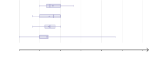

(a) gpt-5-mini

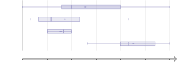

(b) DeepSeek-V3.2

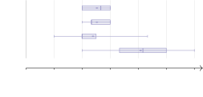

(c) Grok-4.1-fast

Figure 2. Distributions of expected total explanation scores
$`E[\sum C_{i}]`$ across defects for each model’s top-3 isolated context
modules (ranked by mean $`E[\sum C_{i}]`$) and BASELINE. Boxes show the
IQR; center lines show the median; dots show the mean; whiskers show
min/max. Abbreviations: ERR=ERROR, DOC=DOCSTRING, BLK=SLICE_BLOCK,
BWD=SLICE_BACKWARD, FWD=SLICE_FORWARD, UNI=SLICE_UNION,
BASE=BASELINE.Three side-by-side boxplot panels showing the distribution
of expected total explanation scores across defects for each model's
top-3 isolated context modules and BASELINE.

In isolated settings (Figure 2), BASELINE (all modules) yields the
highest quality for DeepSeek-V3.2 ($`4.528`$) and Grok-4.1-fast
($`4.082`$). gpt-5-mini performs best with the atomic ERROR module
($`1.640`$) and remains low even under BASELINE ($`1.361`$). Slice
modules achieve their isolated scores primarily by improving grounding
(C5).

Moving beyond isolated settings, Figure 3 summarizes the distribution of
configuration-level expected total explanation scores across the
isolated, two-way, and three-way batches. For DeepSeek-V3.2 and
Grok-4.1-fast, composed batches shift upward relative to isolated, with
three-way typically exceeding two-way. In contrast, gpt-5-mini remains
low across batches and shows only limited gains from composition.
Because the isolated batch contains only eight non-baseline
configurations ($`n=8`$), we treat the isolated distributions in
Figure 3 descriptively and do not conduct hypothesis tests for that
condition. We restrict inference to the two-way vs. three-way comparison
and test this contrast separately per model. Since this is one planned
test per model ($`m=1`$), we report uncorrected $`p`$-values. A
Shapiro–Wilk test does not indicate significant departures from
normality for any of the six non-baseline two-way and three-way
configuration-score distributions (all $`p>0.2`$). Across non-baseline
configuration-level scores (two-way: $`n=28`$ configurations; three-way:
$`n=56`$), we compare two-way vs. three-way distributions per model
using the unequal-variance one-sided Welch’s $`t`$-test
($`H_{1}:\mu_{\text{two-way}}<\mu_{\text{three-way}}`$). This confirms
higher mean scores in three-way than two-way batches for DeepSeek-V3.2
($`p=2.9\times 10^{-4}`$) and Grok-4.1-fast ($`p=8.1\times 10^{-4}`$),
but not for gpt-5-mini ($`p=0.165`$). These conclusions are unchanged
under a Bonferroni correction across the three model-level tests.

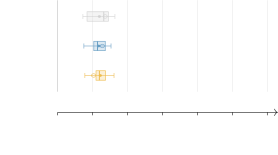

(a) gpt-5-mini

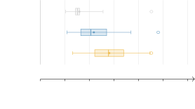

(b) DeepSeek-V3.2

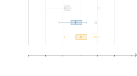

(c) Grok-4.1-fast

Figure 3. Distributions of configuration-level expected total
explanation scores $`E[\sum C_{i}]`$ in isolated, two-way, and three-way
batches. Open circles mark the BASELINE score for each batch. Boxes show
the IQR; center lines show the median; dots show the mean; whiskers show
min/max.Three side-by-side boxplot panels of configuration-level
expected total explanation scores for gpt-5-mini, DeepSeek-V3.2, and
Grok-4.1-fast in isolated, two-way, and three-way batches. Open circles
mark the BASELINE score for each batch.

To interpret composed settings, we report marginal effects $`\Delta`$ of
including each atomic module in two-way and three-way compositions;
positive values indicate higher-scoring explanations when the module is
included. For DeepSeek-V3.2, the largest positive effects come from
adding CODE and TEST ($`\Delta\approx+1.18`$ and $`+0.97`$ in two-way;
$`+0.99`$ and $`+0.80`$ in three-way), while DOCSTRING consistently has
negative marginal effects ($`\Delta\approx-0.44`$ to $`-0.61`$). For
Grok-4.1-fast, CODE/TEST remain beneficial and SLICE_UNION is the
strongest slice factor in two-way compositions ($`\Delta\approx+0.47`$).
In contrast, gpt-5-mini benefits mainly from slices (especially
SLICE_UNION). RQ3 results add confirmatory evidence on the sensitivity
of LLM output to causal context manipulation (Holloway and Elenberg,
2024; Guan et al., 2025; Rando et al., 2025).

### 5.4. RQ4: Do Higher Explanation-Quality Quartiles Show Generated Fixes That Better Match a Reference Minimal Fix?

Answer: Partially yes – We relate explanation quality to fix minimality
and similarity to the defect-specific reference minimal fix. For each
model and configuration batch, we sort scored attempts by total
explanation score $`q(e)`$, split them into quartiles, and report
metrics over _passing_ fixes (Q1 vs. Q4). Figure 4 summarizes minimality
effect sizes ($`\Delta=`$ Q4–Q1) for the composed batches. We omit
isolated because it contains only eight configurations and yields
noisier deltas. Subsequent comparisons focus on two-way vs. three-way.

Results are model-dependent, and evidence for a clear minimality effect
is limited: across all models and composed batches, the
Bonferroni-adjusted defect-bootstrap CIs in Figure 4 overlap $`0`$.
Point estimates improve for DeepSeek-V3.2 (e.g., $`0.238\to 0.430`$ in
three-way), change only slightly for Grok-4.1-fast (e.g.,
$`0.443\to 0.483`$), and trend downward for gpt-5-mini (e.g.,
$`0.379\to 0.191`$), but all remain uncertain.

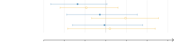

Figure 4. Minimality effect sizes ($`\Delta=`$ Q4–Q1) for passing fixes
in composed batches. Blue filled circles denote two-way batches; orange
open circles denote three-way batches. Whiskers show Bonferroni-adjusted
defect-bootstrap CIs ($`m=2`$ per model). Positive values indicate that
higher-quality explanations coincide with a higher minimal-fix
rate.Effect-size plot (Q4–Q1) of minimal-fix rate by model for two-way
(blue filled circles) and three-way (orange open circles) composed
batches, with whiskers showing Bonferroni-adjusted defect-bootstrap
confidence intervals.

Beyond exact minimality, higher-quality explanations can coincide with
smaller diffs to the reference fix and fewer spurious edits for
DeepSeek-V3.2 and Grok-4.1-fast (Figure 5), while gpt-5-mini shows more
spurious changes. Figure 5 reports Q4–Q1 effect sizes for diff-based
similarity ($`\Delta`$Line dev., $`\Delta`$Lev.), change localization
($`\Delta`$Spurious), and complexity ($`\Delta\Delta`$Vol.) on passing
fixes in composed batches. Whiskers show Bonferroni-adjusted
defect-bootstrap CIs across the two composed batches per model
($`m=2`$); we conservatively highlight effects whose CI excludes $`0`$.
Clear similarity improvements are limited to DeepSeek-V3.2 in the
three-way batch, where CIs are below $`0`$ for $`\Delta`$Line dev. and
$`\Delta`$Lev.; $`\Delta`$Spurious remains inconclusive for all models,
and the only complexity increase with a CI above $`0`$ occurs for
Grok-4.1-fast in two-way. Overall, similarity/noise effects are model-
and batch-dependent and often uncertain. The RQ4 results partially
corroborate prior evidence that explanations can improve fix
accuracy (Medeiros Adriano, 2022), but add that quality gains translate
into more reference-like fixes only conditionally across models and
context batches.

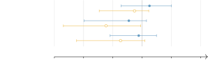

(a) $`\Delta`$Line dev.

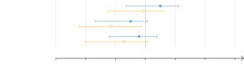

(b) $`\Delta`$Lev.

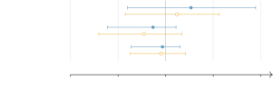

(c) $`\Delta`$Spurious

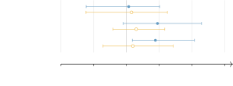

(d) $`\Delta\Delta`$Vol.

Figure 5. Effect sizes comparing high- vs. low-quality explanations on
passing fixes in composed batches ($`\Delta=`$ Q4–Q1). Blue filled
circles denote two-way batches; orange open circles denote three-way
batches. Whiskers show Bonferroni-adjusted defect-bootstrap CIs ($`m=2`$
per model). Negative values for line deviation, normalized Levenshtein,
and spurious changed lines indicate more reference-like fixes; positive
$`\Delta\Delta`$Vol. indicates a larger complexity increase (Fix $`-`$
Baseline).Four-panel effect-size plot (Q4–Q1) of fix similarity (line
deviation and normalized Levenshtein), spurious changed lines, and
complexity increase (Halstead delta volume) by model. Two-way batches
are shown with blue filled circles; three-way batches are shown with
orange open circles. Whiskers show Bonferroni-adjusted defect-bootstrap
confidence intervals.

## 6. Discussion: Implications and Limitations

Failure-explanation quality emerges from the interaction between model
behavior, context composition, and evaluation criteria. Our results show
that models often exploit the same evidence in different ways. Causal
and action-oriented criteria matter more for downstream repair than
surface-level factors. LLM-as-a-judge can approximate human judgments on
these dimensions, but this raises questions about how far context
engineering and judge calibration can push explanation quality without
additional model training.

### 6.1. Implications

Failure explanations must be grounded in actionable evidence. In our
study, CODE and TEST most strongly support causal and action-oriented
criteria for DeepSeek-V3.2 and Grok-4.1-fast, while gpt-5-mini benefits
more from slice-derived modules (e.g., SLICE_UNION) that primarily
strengthen grounding (C5). In composed settings, DOCSTRING often has
negative marginal effects, suggesting it can add noise relative to
evidence that constrains the failure mechanism. Context partitioning
makes these tradeoffs explicit, enabling systems to compose multi-source
evidence under a context budget instead of assuming
more-context-is-better (Liu et al., 2023a).

These observations imply that context selection should be explicit:
systems should prioritize executable artifacts, then add slices when
they contribute relevant signals. Because the best strategy is
model-dependent, context composition should remain configurable and
potentially learnable.

Similarly, evaluators should not collapse explanation quality into a
single proxy metric. Reporting should separate causal understanding,
actionability, grounding, and presentation, and treat LLM-as-a-judge as
a measurement instrument that must be validated against humans.

### 6.2. Limitations: Threats to Validity

Internal Validity – Observed effects may partly reflect execution
variance, service-level effects, and backend differences in
structured-output enforcement rather than configuration content; LLM
outputs also remain non-deterministic despite our determinism controls
and three repeated runs per model. Our repair protocol is applied
uniformly, but function-only splicing and triggering-test validation can
still introduce measurement noise, so rankings among similar
configurations should be interpreted with these threats in mind.

External Validity – Our defect set is intentionally narrow: 12
localized, reproducible Python defects translated from Defects4J.
Translation can introduce artifacts that affect context extraction and
model behavior, so observed effects should be interpreted as directional
and not assumed to transfer unchanged to native Python projects or back
to the original Java defects. Larger benchmarks are needed to assess
stability across projects, failure types, model families, and context
taxonomies.

Construct Validity – Our six binary criteria (C1–C6) separate causal
understanding, actionability, grounding, and presentation, but
binarization compresses nuance, C1/C5 are heuristic proxies, and the
unweighted sum treats all criteria as equally important. LLM-as-a-judge
criteria (C2/C3/C4/C6) inherit judge-model biases and show weaker
agreement with humans for brevity (C6). Downstream repair is also an
imperfect utility proxy because validation reruns only the triggering
test and reference-minimal-fix comparison depends on a single reference
patch plus AST normalization.

Statistical Conclusion Validity – Statistical conclusion validity is
limited by the structure and size of the configuration batches,
especially the isolated batch with only eight non-baseline
configurations per model. We therefore treat isolated results
descriptively; larger configuration sets and more repetitions would be
needed for finer-grained inference.

## 7. Conclusion and Future Work

Conclusion – We systematically evaluate LLM-generated failure
explanations via _context partitioning_, treating available artifacts as
composable context modules. We operationalize explanation quality
through six criteria (C1–C6) and find that LLM-as-a-judge aligns closely
with human judgment on causal and action-oriented criteria (C2–C4), but
less so on brevity (C6). Across three LLMs, executable evidence
(especially CODE and TEST) strengthens quality for DeepSeek-V3.2 and
Grok-4.1-fast, while gpt-5-mini benefits more from slice-derived modules
and DOCSTRING often adds noise. Higher explanation-score quartiles show
higher downstream repair pass rates and, for some models, more
reference-like fixes; low explanation-score quartiles can underperform
the no-explanation baseline. These results support model-aware
context-selection strategies.

Future Work – We plan to automate per-failure context selection, handle
multi-file defects, calibrate low-agreement criteria and judge bias,
study developer-centric utility, examine ordering and formatting
effects, and strengthen robustness across additional model families and
deployment settings

## References

- Adejumo and Johnson (2025) E. K. Adejumo and B. Johnson Explaining
  code risk in oss: towards llm-generated fault prediction
  interpretations. External Links: 2510.06104 Cited by: §2.3.
- An et al. (2025) C. An, J. Zhang, M. Zhong, L. Li, S. Gong, Y. Luo, J.
  Xu, and L. Kong Why does the effective context length of LLMs fall
  short?. In The Thirteenth International Conference on Learning
  Representations, External Links:
  [Link](https://openreview.net/forum?id=eoln5WgrPx) Cited by: §1, §2.2.
- Avizienis et al. (2004) A. Avizienis, J. Laprie, B. Randell, and C.
  Landwehr Basic concepts and taxonomy of dependable and secure
  computing. IEEE transactions on dependable and secure computing 1 (1),
  pp. 11–33. Cited by: §2.1.
- Aðalsteinsson et al. (2025) F. S. Aðalsteinsson, B. B. Magnússon, M.
  Milicevic, A. N. Davidsson, and C. Cheng Rethinking code review
  workflows with llm assistance: an empirical study. In 2025 ACM/IEEE
  International Symposium on Empirical Software Engineering and
  Measurement (ESEM), pp. 488–497. Cited by: §1, §2.2.
- DeepSeek-AI (2026) DeepSeek-AIDeepSeek-V3.2(Website) Note: Hugging
  Face model card External Links:
  [Link](https://huggingface.co/deepseek-ai/DeepSeek-V3.2) Cited by:
  §4.3.
- Guan et al. (2025) B. Guan, M. Rezagholizadeh, T. G. Roosta, and P.
  Passban The order effect: investigating prompt sensitivity to input
  order in LLMs. In First International KDD Workshop on Prompt
  Optimization, 2025, External Links:
  [Link](https://openreview.net/forum?id=QcYyYvrPNU) Cited by: §2.2,
  §5.3.
- Halstead (1977) M. H. Halstead Elements of software science. Operating
  and Programming Systems Series, Elsevier North-Holland, New York, NY.
  External Links: ISBN 0-444-00205-7 Cited by: §4.6.
- He et al. (2026) J. He, J. Shi, T. Y. Zhuo, C. Treude, J. Sun, Z.
  Xing, X. Du, and D. Lo LLM-as-a-judge for software engineering:
  literature review, vision, and the road ahead. ACM Transactions on
  Software Engineering and Methodology. Cited by: §2.3.
- Holloway and Elenberg (2024) T. Holloway and E. R. Elenberg On the
  role of context granularity in LLM-driven program repair. In Machine
  Learning for Systems Workshop, NeurIPS ’24 Workshop, Vancouver, BC,
  Canada. Note: Workshop paper External Links:
  [Link](https://neurips.cc/virtual/2024/103609) Cited by: §1, §2.2,
  §5.3.
- Just et al. (2014) R. Just, D. Jalali, L. Inozemtseva, M. D. Ernst, R.
  Holmes, and G. Fraser Defects4J: a database of existing faults to
  enable controlled testing studies for java programs. In Proceedings of
  the 23rd ACM SIGSOFT International Symposium on Software Testing and
  Analysis (ISSTA 2014), pp. 312–315. External Links:
  [Document](https://dx.doi.org/10.1145/2610384.2628055),
  [Link](https://doi.org/10.1145/2610384.2628055) Cited by: §4.1.
- Kincaid et al. (1975) J. P. Kincaid, R. P. Fishburne, R. L. Rogers,
  and B. S. Chissom Derivation of new readability formulas (automated
  readability index, fog count and flesch reading ease formula) for navy
  enlisted personnel. Technical report Technical Report Research Branch
  Report 8-75, Naval Technical Training Command. External Links:
  [Link](https://stars.library.ucf.edu/istlibrary/56/) Cited by: §4.4.
- Layman et al. (2013) L. Layman, M. Diep, M. Nagappan, J. Singer, R.
  Deline, and G. Venolia Debugging revisited: toward understanding the
  debugging needs of contemporary software developers. In 2013 ACM/IEEE
  international symposium on empirical software engineering and
  measurement, pp. 383–392. Cited by: §2.1.
- Levenshtein (1966) V. I. Levenshtein Binary codes capable of
  correcting deletions, insertions and reversals. Soviet Physics Doklady
  10 (8), pp. 707–710. Cited by: §4.6.
- Li and Coblenz (2026) H. Li and M. Coblenz A grounded theory of
  debugging in professional software engineering practice. External
  Links: 2602.11435 Cited by: §2.1.
- Liu et al. (2023a) N. F. Liu, K. Lin, J. Hewitt, A. Paranjape, M.
  Bevilacqua, F. Petroni, and P. Liang Lost in the middle: how language
  models use long contexts. External Links: 2307.03172 Cited by: §1,
  §2.2, §6.1.
- Liu et al. (2023b) Y. Liu, D. Iter, Y. Xu, S. Wang, R. Xu, and C. Zhu
  G-eval: nlg evaluation using gpt-4 with better human alignment. In
  Proceedings of the 2023 conference on empirical methods in natural
  language processing, pp. 2511–2522. Cited by: §2.3, §4.4.
- Lu et al. (2025) J. Lu, X. Li, Z. Hua, L. Yu, S. Cheng, L. Yang, F.
  Zhang, and C. Zuo Deepcrceval: revisiting the evaluation of code
  review comment generation. In International Conference on Fundamental
  Approaches to Software Engineering, pp. 43–64. Cited by: §2.3, §5.2.
- Mariotto et al. (2025) L. Mariotto, C. M. Adriano, D. Burgstahler, R.
  Eichhorn, and H. Giese From assessment to enhancement of pull requests
  at scale: aligning code reviews with developer competencies using
  large language models. Note: To appear Cited by: §1.
- Medeiros Adriano (2022) C. Medeiros Adriano Microtasking software
  failure resolution: early results. ACM SIGSOFT Software Engineering
  Notes 44 (1), pp. 36–39. Cited by: §2.1, §5.4.
- Monperrus (2014) M. Monperrus A critical review of “automatic patch
  generation learned from human-written patches”: essay on the problem
  statement and the evaluation of automatic software repair. In
  Proceedings of the 36th International Conference on Software
  Engineering, ICSE ’14, pp. 234–242. External Links:
  [Document](https://dx.doi.org/10.1145/2568225.2568324),
  [Link](http://dx.doi.org/10.1145/2568225.2568324) Cited by: §1, §2.3.
- OpenRouter (2026a) OpenRouteropenai/gpt-5-mini(Website) Note: Model
  route page External Links:
  [Link](https://openrouter.ai/openai/gpt-5-mini) Cited by: §4.3.
- OpenRouter (2026b) OpenRouterx-ai/grok-4.1-fast(Website) Note: Model
  route page External Links:
  [Link](https://openrouter.ai/x-ai/grok-4.1-fast) Cited by: §4.3.
- Porbeck (2026) J. Porbeck From program slices to causal clarity:
  evaluating faithful, actionable llm-generated failure explanations via
  context partitioning and llm-as-a-judge. Master’s thesis, Hasso
  Plattner Institute. Cited by: §1.
- Qi et al. (2015) Z. Qi, F. Long, S. Achour, and M. Rinard An analysis
  of patch plausibility and correctness for generate-and-validate patch
  generation systems. pp. . External Links:
  [Document](https://dx.doi.org/10.1145/2771783.2771791) Cited by: §1,
  §2.3.
- Rando et al. (2025) S. Rando, L. Romani, A. Sampieri, L. Franco, J.
  Yang, Y. Kyuragi, F. Galasso, and T. Hashimoto LongCodeBench:
  evaluating coding LLMs at 1m context windows. In Second Conference on
  Language Modeling, External Links:
  [Link](https://openreview.net/forum?id=GFPoM8Ylp8) Cited by: §2.2,
  §5.3.
- Salmon et al. (2025) A. Salmon, K. Hammer, E. A. Santos, and B. A.
  Becker Debugging without error messages: how llm prompting strategy
  affects programming error explanation effectiveness. External Links:
  2501.05706 Cited by: §2.1, §5.1, §5.2.
- Soremekun et al. (2021) E. Soremekun, L. Kirschner, M. Böhme, and A.
  Zeller Locating faults with program slicing: an empirical analysis.
  Empirical Software Engineering 26 (3), pp. 51. Cited by: §2.2.
- Voas and Miller (1995) J.M. Voas and K.W. Miller Software testability:
  the new verification. IEEE Software 12 (3), pp. 17–28. External Links:
  [Document](https://dx.doi.org/10.1109/52.382180) Cited by: §2.1.
- Wang et al. (2024) X. Wang, M. Salmani, P. Omidi, X. Ren, M.
  Rezagholizadeh, and A. Eshaghi Beyond the limits: a survey of
  techniques to extend the context length in large language models. In
  Proceedings of the Thirty-Third International Joint Conference on
  Artificial Intelligence, pp. 8299–8307. Cited by: §2.2.
- Widyasari et al. (2024) R. Widyasari, J. W. Ang, T. G. Nguyen, N.
  Sharma, and D. Lo Demystifying faulty code: step-by-step reasoning for
  explainable fault localization. In 2024 IEEE International Conference
  on Software Analysis, Evolution and Reengineering (SANER),
  pp. 568–579. Cited by: §2.1, §2.1, §5.1, §5.2.
- Woodward (1989) J. Woodward The causal mechanical model of
  explanation. Philosophy of Science 56 (2), pp. 345–363. Note: Review
  of Wesley C. Salmon, _Scientific Explanation and the Causal Structure
  of the World_ External Links:
  [Link](https://conservancy.umn.edu/bitstreams/f470d3c2-57fc-4764-8c0a-88c8747acc36/download)
  Cited by: §1, footnote 2.
- Yan et al. (2024) J. Yan, J. Huang, C. Fang, J. Yan, and J. Zhang
  Better debugging: combining static analysis and llms for explainable
  crashing fault localization. External Links: 2408.12070 Cited by:
  §2.1, §5.1, §5.2.
- Zheng et al. (2023) L. Zheng, W. Chiang, Y. Sheng, S. Zhuang, Z.
  Wu, Y. Zhuang, Z. Lin, Z. Li, D. Li, E. Xing, et al. Judging
  llm-as-a-judge with mt-bench and chatbot arena. Advances in neural
  information processing systems 36, pp. 46595–46623. Cited by: §2.3,
  §4.4.
