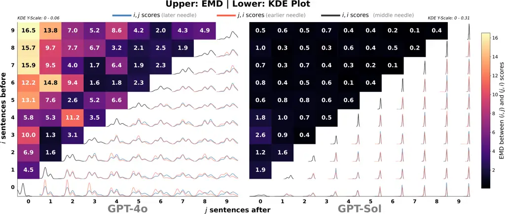

# Semantic Needles in Document Haystacks: Sensitivity Testing of LLM-as-a-Judge Similarity Scoring

Sinan G. Aksoy Affiliation: Pacific Northwest National Laboratory
Email: <first.last@pnnl.gov>    Alexandra A. Sabrio Affiliation: Pacific
Northwest National Laboratory Affiliation: Washington University in St.
Louis Email: <vonkaenelerik@gmail.com>    Erik VonKaenel
Affiliation: Pacific Northwest National Laboratory Affiliation: Humana
Inc.    Lee Burke Affiliation: Pacific Northwest National Laboratory

###### Abstract

We propose a scalable, multifactorial experimental framework that
systematically probes LLM sensitivity to subtle semantic changes in
pairwise document comparison. We analogize this as a
needle-in-a-haystack problem: a single semantically altered sentence
(the needle) is embedded within surrounding context (the hay), and we
vary the perturbation type (negation, conjunction swap, named entity
replacement), context type (original vs. topically unrelated), needle
position, and document length across all combinations, testing seven
LLMs on tens of thousands of document pairs. Our analysis reveals
several striking findings. First, LLMs can exhibit a within-document
positional bias distinct from previously studied candidate-order
effects: some models penalize semantic differences more harshly when
they occur earlier in a document. Second, when the altered sentence is
surrounded by topically unrelated context, it raises similarity scores
in almost all settings. This is consistent with a contradiction account,
in which topically related context allows the alteration to conflict
with the surrounding sentences. Third, all models exhibit the same
hierarchy in how harshly they score different perturbation types, with
negation penalized the most, but express this hierarchy on significantly
different scales. Finally, varying the prompt’s conception of semantic
similarity across several alternatives changes the magnitude but not the
direction of these effects. Together, these results demonstrate how LLM
semantic similarity scores are sensitive to the aforementioned
parameters in ways that go beyond the semantic change itself; our
framework offers a practical toolkit for auditing and comparing scoring
behavior across current and future models.

## 1 Introduction

LLM-as-a-judge systems are rapidly pervading domains ranging from
complex scientific workflows to routine, everyday decisions. In these
systems, an LLM acts as an automated evaluator: assessing the quality of
generated text (Liu et al., 2023; Zheng et al., 2023), evaluating
translation quality (Kocmi and Federmann, 2023), grading student essays
(Song et al., 2024), scoring medical question-answering (Krolik et al.,
2024), evaluating mathematical reasoning (Li et al., 2024b), and serving
as a stand-in for costly human annotation across natural language
generation tasks (Chiang and Lee, 2023; Dubois et al., 2023). Recent
surveys document the remarkable breadth and rapid adoption of this
paradigm (Gu et al., 2026), while simultaneously raising concerns about
systematic biases in LLM evaluation (Wang et al., 2024; Chen et al.,
2024). As new LLMs are released at an accelerating pace and these judge
systems are continually updated, practitioners face a moving target:
each model version may introduce new scoring behaviors, biases, or
idiosyncrasies that are difficult to anticipate. For these reasons, it
is increasingly important that we have experimental pipelines for
evaluating LLM-as-a-judge systems that are detailed, generalizable, and
scalable.

One particularly far-reaching use case of LLM-as-a-judge systems is
pairwise document similarity assessment. This task arises across a wide
range of applications, including plagiarism and near-duplicate
detection, information retrieval and document clustering, semantic
textual similarity benchmarks (Cer et al., 2017), and automated scoring
of genre-specific articles. Beyond settings where document comparison is
the primary objective, pairwise similarity assessment is a critical
subcomponent of evaluating other tools. For example, when testing text
privatization, pairwise document similarity can quantify how much
privatized text strays from the original semantic meaning (Staab et al.,
2025). Furthermore, the pairwise case can be naturally bootstrapped to
multi-way comparisons, making robust pairwise evaluation all the more
consequential.

Within this domain, the ability to detect and differentiate between
subtle semantic changes is becoming especially important. There are
several reasons for this. First, small semantic differences are critical
to many real-world applications of pairwise document similarity, beyond
the aforementioned example of text privatization. In medical
documentation, even minor revisions to treatment recommendations or
dosage instructions can lead to substantially different patient
outcomes, making detection of subtle semantic drift a matter of safety.
Similarly, in legal texts, small changes in wording, such as the
substitution of “and” for “or” in a contractual clause, can dramatically
alter the obligations and rights of the parties involved (Adams and
Kaye, 2006).

Second, as LLMs become increasingly capable at pairwise similarity
assessment, we need correspondingly challenging tasks to stress-test
them and expose their limitations. Idiosyncratic scoring behaviors are
often most visible “on the margins,” where subtle differences push the
boundary of what a model can reliably detect (Wang et al., 2025). This
makes fine-grained tasks more discriminative than coarser evaluations.

Third, even humans are unreliable at detecting subtle semantic changes,
raising the question of whether LLMs inherit similar blind spots or
introduce new ones. Research on semantic illusions suggests readers can
routinely overlook meaning alterations embedded within coherent
discourse (Cook et al., 2018; Nieuwland and Van Berkum, 2005).
Understanding whether LLMs exhibit analogous biases (or different ones)
when scoring document similarity is essential for calibrating trust in
these systems and for identifying failure modes before they propagate
into downstream applications.

Accordingly, in this work we propose, apply, and analyze an experimental
pipeline for testing LLM-as-a-judge sensitivity to semantic similarity
between pairs of documents. In the spirit of behavioral testing (Ribeiro
et al., 2020), the pipeline characterizes how a judge’s scores respond
to controlled changes in its input, rather than whether those scores are
correct. We analogize our experiment as a needle-in-a-haystack problem.
While this metaphor originates in work on long-context retrieval (where
a planted fact must be located within filler text (Kamradt, 2023; Hsieh
et al., 2024)) we invoke it here to instead test how LLMs score semantic
similarity between two almost-identical documents, one of which contains
a single semantic alteration embedded within surrounding context. In our
formulation, the “needle” is a single, semantically altered sentence,
and the “hay” is the surrounding context of varying length, position,
and relevance. By systematically varying the needle type, hay type, hay
amount, and needle position across all possible combinations and testing
on tens of thousands of document pairs, we construct a scalable
experimental design that probes LLM scoring sensitivity along multiple
axes simultaneously. Our main contributions are two-fold:

- •
  We propose an LLM-agnostic, automated, and scalable factorial
  experimental design for sensitivity testing of LLM-guided pairwise
  document semantic similarity.
- •
  We instantiate this framework across seven LLMs, spanning several axes
  of comparison: variants within a model family (three GPT 5.6 models),
  vendors (OpenAI, Anthropic, Google), open (Gemma 4) vs. closed
  weights, and model generations within a vendor (GPT-4o vs. 5.6). We
  develop quantitative analyses, including positionality bias measures,
  document length effects, and comparisons across scoring prompts, that
  expose interpretable differences in scoring behavior.


Figure 1: An example illustrating our experimental pipeline.

Our framework does not make value judgments about LLM scoring behavior,
nor does it rank model performance. Rather, it provides a modular
experimental framework, within the familiar needle-in-a-haystack
metaphor, through which one can generate rich experimental data about
LLM scoring behavior and idiosyncrasies, for both current and future
systems. Our instantiation and subsequent analysis on real data
demonstrate that the framework is highly discriminative, sharply
highlighting differences between different LLMs as well as between
versions of the same LLM. Together, the intuitive needle-and-hay framing
that practitioners can readily adapt to new perturbation types, domains,
and models, and the quantitative analyses we develop for interpreting
the resulting data offer a practical toolkit for anyone seeking to
understand, compare, or audit LLM scoring behavior. Before proceeding,
we briefly clarify how our work fits within the broader landscape of
LLM-as-a-judge, and also position ourselves within related work.

#### Relationship to LLM-as-a-judge literature

We study the reference-based form of LLM-as-a-judge, in which a judge
scores how well a text preserves the meaning of a reference, which is
one of three judging variants identified by Zheng et al. (2023). Whereas
LLM-as-a-judge studies most often focus on testing whether such judges
are _accurate_, we focus on how their verdict for fixed, atomic semantic
changes responds to other parameters like where the change occurs, what
surrounds it, and how the prompt defines semantic similarity. Studies
like ours are sometimes referred to as “behavioral testing” of LLM
systems (Ribeiro et al., 2020; Hu et al., 2024; Mahbub et al., 2026).

#### Related work on needle-in-a-haystack probes

A needle-in-a-haystack paradigm has appeared in multiple prior studies,
though for varying purposes. The most popular focus is on testing
_retrieval_ from long filler text (Kamradt, 2023; Hsieh et al., 2024).
Work in this vein has shown that LLM performance depends on where
relevant content appears (Liu et al., 2024) and on the length, type, and
location of surrounding padding (Levy et al., 2024). Closer to our
setting, Kurfali and Östling (2025) embed mutually contradictory needles
while varying their position and the relevance of the haystack, Li et
al. (2024a) plant self-contradictions, such as negations and altered
entity attributes, in documents of varying length, and Fu et al. (2025)
give models an original document alongside a copy from which content has
been removed. Crucially, these studies focus on scoring retrieval,
question answering, or detection. _In short, typical
needle-in-a-haystack tests ask whether a model can find the needle,
whereas we hand the judge the needle in plain sight and ask how much it
counts._

#### Related work on behavioral testing

Behavioral testing evaluates a model through controlled changes to its
input rather than aggregate benchmark accuracy (Ribeiro et al., 2020).
Perturbation tests of this kind have exposed blind spots of learned
evaluation metrics (Sai et al., 2021; He et al., 2023) and of LLM
evaluators, which failed to detect targeted errors (Doddapaneni et al.,
2024), and which confuse distinct quality criteria (Hu et al., 2024).
Positional effects have been documented for embedding models (Coelho et
al., 2024; Lee et al., 2024), and LLM-based faithfulness metrics have
been shown to be sensitive to the order of the source document (Wan et
al., 2025). _Whereas other behavioral tests check whether and how a
judge reacts to meaningful changes (Mahbub et al., 2026), we instead
test a judge’s response to change in the presence of moderators such as
where that change occurs and what surrounds it—and how all of these
interact within a factorial design._

Our work is organized as follows: Section 2 describes our experimental
design, Section 3 presents our results, and Section 4 discusses our
findings in context.

## 2 Experimental Design

#### Overview

We study how LLMs quantitatively score semantic similarity between pairs
of almost-identical text documents apart from a needle – a single,
semantically altered sentence. We consider three needle types: semantic
perturbation via negation insertion, conjunction replacement, and named
entity replacement. These semantically altered sentences are
subsequently positioned between some number of preceding and succeeding
sentences – the surrounding hay. We vary both the relative position of
the needle within this hay (moving the semantic difference across
beginning, middle, and end) and the total hay amount (the length of the
document by sentence count). We also toggle the hay type; if the
sentences surrounding the needle are taken from a randomly chosen
document, we call this “random hay”, whereas “original hay” retains the
original surrounding context. We vary all possible combinations of these
parameters, automate needle and hay insertion, run each setting on many
documents, and repeat this across multiple LLMs.

#### Formal description

Let $`\mathcal{U}`$ denote a universe of raw text documents. We take
$`\mathcal{U}`$ to be a subset of Plain Text Wikipedia Shapiro (2020)
consisting of 453,602 documents. We further clean these to remove
non-natural language text, and filter them for length, yielding 40,003
cleaned documents, $`\mathcal{C}`$. There are four main parameters to
our experiment:

- •
  Needle type:
  $`N\in\{\varnothing,\texttt{neg},\texttt{con},\texttt{ner}\}`$, the
  semantic change type applied to the altered sentence. Can be negation
  (neg), swapping between “and” and “or” (con), swapping a named entity
  (ner), or no change ($`\varnothing`$).
- •
  Hay type: $`H\in\{\texttt{orig},\texttt{rand}`$}, the type of
  sentences preceding and following the altered sentence. Can be the
  original document’s sentences (orig) or consecutive sentences from a
  random document in $`\mathcal{C}`$ (rand).
- •
  Position: $`P\in\{(i,j):i,j\in\{0,\dots,k\}\}`$, the number of
  sentences $`i`$ preceding and number of sentences $`j`$ following the
  altered sentence, where $`i`$ and $`j`$ are integers between $`0`$ and
  $`k`$. We take $`k=9`$.
- •
  LLM: $`L\in`$ {GPT-4o, GPT 5.6 Luna, GPT 5.6 Terra, GPT 5.6 Sol,
  Claude 5 Sonnet, Gemini 3.7 Flash, Gemma 4}, the Large Language Model
  scoring document similarity.

We consider each possible parameter setting $`(L,N,H,P)`$ in the
Cartesian product

```math
\mbox{LLM}\times(\mbox{Needle}\setminus\{\varnothing\})\times\mbox{Hay}\times\mbox{Position},
```

which, for our choices detailed above, totals 4200 distinct parameter
settings. For each position $`(i,j)\in P`$, we randomly permute the
documents in $`\mathcal{C}`$ and process them in this order so that the
set of documents processed by an LLM, needle, and hay triple is the same
random sample. Fixing a position $`(i,j)`$, we then run the following
pipeline multiple times until a stopping criterion is met: for a
document $`d\in\mathcal{C}`$ with $`|d|`$ many sentences, we select
$`m=\lceil\frac{|d|}{2}\rceil`$ as the “middle” sentence to be
semantically altered. The resulting document, $`d(N,H,P)`$, is derived
from $`d`$ with $`i+j+1`$ many sentences, where the
$`m\textsuperscript{th}`$ sentence of $`d`$ has been altered via
semantic change $`N`$, and this sentence is preceded and followed by
$`i`$ and $`j`$ many sentences of type $`H`$, respectively. We then use
LLM $`L`$ to compare this document with its unaltered counterpart, i.e.

```math
d(\varnothing,H,P)\mbox{ vs. }d(N,H,P)
```

using a basic scoring prompt for semantic similarity (see Figure 9,
Appendix A). The resulting score, $`s(N,H,P)`$, is an integer in
$`[0,100]`$. Figure 1 illustrates the comparison for different triples
in $`N\times H\times P`$ on a toy example. We continue scoring documents
until at least 100 documents have been processed and a stopping
criterion based on mean score stabilization is also met. Finally, for a
fixed $`(L,N,H)`$, we take the maximum number of documents run across
all positions, and run all other positions on this number of documents.
For more details on data cleaning, needle implementation, and our
stopping criteria, see Appendix A.

## 3 Results

#### Positionality

We begin by investigating how the position of the perturbed sentence
within the document affects similarity scores. Do LLMs penalize semantic
differences more harshly when they appear early in a document, and how
rapidly does this bias intensify with position? Does surrounding context
that is topically unrelated to the altered sentence amplify or dampen
this effect? To begin, a simple null hypothesis is that scores are
identical (in distribution) whether the needle is in the first vs second
half of the document, i.e.

```math
\{s(N,H,(i,j)):i>j\}=\{s(N,H,(i,j)):i<j\}
```

We perform a 2-sample Kolmogorov-Smirnov test between the score
distributions of these “first-half” vs “second-half” needle documents
for each LLM, needle, and hay parameter setting, for a total of 42
hypothesis tests. After Bonferroni-Holm correction, we reject this
hypothesis at $`p<0.05`$ in 31 of the 42 settings, with most exceptions
from Claude and GPT-Sol. While positionality thus matters for the other
LLMs, on a macro scale the differences are small for most of them, with
two notable exceptions. To quantify this, we compute the mean score when
the needle is in the second half minus the mean score when it is in the
first half, so that positive values indicate harsher penalization of
earlier semantic differences. Accordingly, we call this the
Early-Positionality Bias, and plot it for each setting in Figure 2.

Figure 2: The early-positionality bias (with 95% CIs) for different LLMs
and needle types under original (top) and random (bottom) hay.

Under original hay (top), the bias is at most about one point, except
for GPT-4o and Gemma, which penalize early needles by up to 5.3 and 6.0
points, respectively. For both, as for Gemini’s smaller bias, the effect
is largest for neg. Random hay (bottom) shrinks Gemma’s bias and
GPT-4o’s neg bias, and reverses the direction of GPT-4o’s bias for con
and ner. Its effect is not uniform, however: Claude, unbiased under
original hay, acquires a modest neg bias (0.9 points). In short, sizable
early-positionality bias is exhibited by select LLMs, and is sensitive
to hay type.

These inter-LLM differences become starker in a finer-grained,
position-by-position analysis. For example, Figure 3 compares GPT-4o and
GPT-Sol for original hay, and the neg needle type. Each $`(i,j)`$ cell
in the upper portion displays the earth mover’s distance (EMD) between
score distributions for $`(i,j)`$ and $`(j,i)`$. One takeaway is the
brightly colored first column which indicates high EMD: GPT-4o’s scores
more sharply differentiate documents with perturbed sentences that
appear first vs. last in the document, by up to 16.5 points. GPT-Sol, by
contrast, shows almost no positionality bias, with EMD below 3 in every
cell.



Figure 3: EMD and KDE plot comparison of score distributions for GPT-4o
(left) and GPT-Sol (right) by $`i,j`$ position, under the neg needle and
orig hay. Note the y-axis scale difference between panels.

The lower portion of each heatmap contains Kernel Density Estimation
(KDE) plots of the distributions in question, such that the $`(j,i)`$
cell plots the distributions compared by EMD in the $`(i,j)`$ cell. For
example, the high EMD in GPT-4o’s left column can also be seen by the
divergence of the red and blue lines in the bottom row. Studying the
shape of these plots as we vary $`i`$ and $`j`$ yields nuanced
differences within and across LLMs. For example, with larger $`i,j`$,
GPT-Sol’s distribution becomes sharply concentrated at high-scores; the
$`(9,9)`$ cell shows consistent, near perfect similarity scores for
19-sentence documents differing in their middle sentence. In contrast,
GPT-4o’s scores remain more spread out for this cell and appear
multimodal throughout, peaking at the boundaries of the rubric’s scoring
bands (Figure 9): 78% of its scores are 25, 26, 50, 51, 75, or 76. These
observations suggest LLMs, even two GPT models, exhibit qualitatively
different scoring “fingerprints” based on needle position.

#### Document length

We now explore how document length affects scoring behavior, regardless
of needle position. Measured in sentences, the length of the document
for position $`(i,j)`$ is simply $`k=i+j+1`$. As $`k`$ increases, the
proportion of the document’s sentences that have been semantically
altered decreases. Accordingly, a natural hypothesis is that semantic
similarity score is increasing in document length and proportional to
the fraction of semantically identical sentences, i.e.
$`\frac{k-1}{k}`$.

Figure 4 plots the mean and standard deviation of scores, averaged over
the three needle types. The mean score plots include a reference line of
$`100\cdot\tfrac{k-1}{k}`$. Scores above this line suggest semantic
perturbation preserves some of the semantic meaning of the altered
sentence, while scores below suggest semantic perturbation alters the
meaning of the document more severely than proportionally to the number
of altered sentences. For both orig and rand hay, all LLMs have mean
scores that increase in document length, as hypothesized. For orig hay,
only GPT-Terra, GPT-Sol, and Gemini stay above the reference line at
every length, while GPT-4o falls below it at nearly every length.

Scores are higher for rand hay in 19 of 21 LLM–needle combinations, by
up to 9.7 points (Gemma, neg). One could hypothesize that random hay
should increase semantic similarity scores relative to original hay,
under the intuition that perturbing a sentence unrelated to the rest of
the document does not alter its holistic semantic meaning as
significantly. One might likewise expect an increase in scores because
original hay provides opportunities for contradictions between the
needle sentence and the rest of the document: returning to the example
in Figure 1, asserting O’Hare is not busier than Midway seems at odds
with surrounding original context describing it as an airline hub,
whereas in a document about the film Goodfellas, whether O’Hare is
busier than Midway seems immaterial. The results are consistent with
both intuitions, suggesting that when there is no apparent connection
between the needle and its context, LLMs ascribe (on average) less
semantic importance to perturbations of that needle. We return to this
finding in Section 4.

Lastly, we consider standard deviation: for documents with 2 or more
sentences, standard deviation for most LLMs is decreasing in document
length for both hay types, suggesting LLMs become more consistent in
rating longer documents highly. The exceptions are GPT-4o and GPT-Luna,
whose scores remain noisy at every length.

Figure 4: The mean (top) and standard deviation (bottom) of scores by
document length for different LLMs, averaged over the three needle
types, under either orig or rand hay.

#### Needle type

A priori, there is no reason to expect that one perturbation type
(negation, named entity replacement, or conjunction swap) changes
semantic meaning any more or less than another. Our null hypothesis is
equality between all $`{3\choose 2}=3`$ pairs of needle types:

```math
\displaystyle s(\texttt{neg},H,P) \displaystyle=s(\texttt{con},H,P)
```

```math
\displaystyle s(\texttt{neg},H,P) \displaystyle=s(\texttt{ner},H,P)
```

```math
\displaystyle s(\texttt{ner},H,P) \displaystyle=s(\texttt{con},H,P)
```

We perform a 2-sample KS test with Bonferroni correction between each of
the three comparisons for a given LLM and hay type. We reject the null
hypothesis at the highly significant level $`(p<0.01)`$ in all 42
settings. The score distributions differ across needle types.

Figure 5 reveals a striking cross-LLM commonality: the ordering of
needle types by mean score is the same for every LLM and both hay types,

Figure 5: Mean score by needle type for each LLM under original (top)
and random (bottom) hay.

```math
\texttt{con}\succ\texttt{ner}\succ\texttt{neg},
```

meaning each LLM penalizes negation most, followed by named entity
replacement and conjunction swap. One possible interpretation is that
the needles differ in how much they change a sentence’s claim: negation
asserts its opposite, entity replacement keeps the claim but changes
whom or what it is about, and a conjunction swap only changes how items
or clauses are combined.

While the LLMs agree on this ordering, they diverge on how sharply they
distinguish the needles. Under original hay, for example, the gap
between con and neg is 37 points for GPT-4o, 15 points for Gemma, and
only 5 to 6 points for the GPT-5.6 models, which barely distinguish
perturbation types. Notably, random hay narrows this gap for every LLM,
since it raises neg scores the most (by 1 to 10 points) and con scores
the least. Even in the simplest case of single-sentence documents, LLMs
disagree widely, scoring a sentence against its negation anywhere from
18 (GPT-4o and Gemma) to 52 (GPT-Sol). In short, LLMs agree on which
perturbations matter most, but not on how much.

#### Hay type

Lastly, we study the impact of the surrounding context type – the hay.
Our analysis so far has shown that all LLMs surveyed judge a
perturbation more leniently on average when it is surrounded by
unrelated context. Relative to the original context, this random hay not
only yields higher scores (Figure 4) but also less differentiation
between needle types (Figure 5) and, for GPT-4o and Gemma, less
early-positionality bias (Figure 2). Here, we refine this analysis to
the full score distribution, revealing that LLMs differ in which scores
random hay raises.

More precisely, Figure 6 plots, for the neg needle, each percentile of
the original-hay score distribution against how much that percentile
changes under random hay. Gemma and Claude drastically raise the lowest
scores: their 10th percentile rises by 30 and 15 points, respectively,
while scores at the 60th percentile and above rise by 5 points or fewer.
In contrast, the GPT-5.6 models raise scores roughly uniformly across
the board, by 0 to 6 points at every percentile. Lastly, as evidenced by
the sharp spike in Figure 6, GPT-4o’s scores change most around the
middle of the distribution, where they jump from about 50 under original
hay to about 75 under random hay. In this way, while all LLMs here score
more leniently under random hay, they exhibit strong differences in
which score ranges are most affected.

Figure 6: Change in each decile of the neg score distribution under
random hay, relative to original hay (documents with $`k\geq 2`$).

#### Prompt

Before discussing the effects of varying the prompt, we first
acknowledge there is no consensus definition of document-level semantic
similarity. The feasibility and utility of rigorously defining semantic
similarity has been actively researched and debated since at least the
1970s (Goodman, 1972; Tversky, 1977), with proposals varying vastly in
formalism, emphasis, and according to the textual domain for which they
are intended (Harispe et al., 2015; Soğancıoğlu et al., 2017). For these
reasons, the prompt (and choice of semantic perturbation needles,
dataset, value of $`k`$, etc.) is an experimental design choice that can
be toggled according to one’s aims and document corpus.

Regardless of this choice, however, providing some guidance in the
prompt as to what constitutes semantic similarity is an important
guardrail for experiment interpretability, especially when making
cross-LLM comparisons. For the purposes of running our experiment, this
presents a tradeoff: an overly-specified definition narrows experiment
generality and risks artificially constraining the task, while an
under-specified one raises concerns that scoring differences observed
simply reflect differences in how LLMs free associate meaning to the
phrase “semantic similarity” rather than differences in how they judge
(some fixed notion of) semantic similarity.

The prompt we utilized (see Figure 9, Appendix A) aims to balance this
by emphasizing commonalities that persist across definitions of semantic
similarity (such as being “based on the similarity of underlying
semantic concepts and ideas, rather than surface-level lexical features,
word choice, or syntax”), without adhering to a bespoke definition.
Consistent with suggested best-practices for LLM-as-a-judge (Gu et al.,
2026), the prompt also provides a scoring rubric with anchored scales
for each score quartile. In these regards, our prompt is similar in
spirit to that used within the well-known Semantic Textual Similarity
(STS) benchmark (Cer et al., 2017), used for scoring semantic similarity
at the sentence-level. To further explore the effects that prompt choice
has on our experimental design and high-level findings, we now consider
three additional prompts, each run with Gemma on the same documents
(Figure 10, Appendix A). We use Gemma for these comparisons because its
weights are openly available, so the comparisons can be rerun on the
same model, and because, along with GPT-4o, its scores are the most
sensitive to several of our parameters, such as needle position and hay
type (Figures 2 and 4). Our aim is not to find the right prompt, but to
illustrate what is at stake in this choice, as the prompts approach
semantic similarity differently, and with varying degrees of formalism
and specificity.

Figure 7: Gemma’s score distributions under four prompts (original hay;
the same documents in each panel). Triangles mark needle means, and grey
shows scores for identical documents (the null experiment). Note the
finer y-axis for triples.

First, we consider a variant of our prompt where we remove the four
scoring bands, leaving only its definition of semantic similarity. Since
the rest of the prompt is unchanged, this isolates how much specifying
the bands affects output scores.

Second, we adapt the community-standard STS rubric, so that its 0–5
scoring range is inflated to 0–100. The two rubrics are similar in form,
each anchoring its bands to a description, but differ in emphasis. Ours
attributes more importance and higher scores to topical overlap, so that
a pair of documents sharing “subject matter, topics, ideas, or context”
scores high throughout. STS instead descends from equivalence, reserving
its top level for documents that are “completely equivalent” and placing
“not equivalent, but are on the same topic” at level 1 of 5 (Cer et al.,
2017). Since every pair in our design differs by exactly one sentence,
we expect the top STS level to be largely foreclosed, whereas ours
admits such pairs as “nearly identical.” For these reasons, we expect
lower scores under STS across the board.

Third, we consider a prompt built on a fixed mathematical scoring
function that formalizes and constrains how semantic similarity is
computed. In particular, this prompt asks the LLM to construct a
knowledge graph for each document, whose edges are a set of semantic
(subject; relation; object) triples, in the style of open information
extraction (Banko et al., 2007). Semantic similarity is then scored
using Python as the Jaccard index between the edge sets of these graphs
using exact match on canonicalized strings, and then rescaled to the
$`[0,100]`$ range. In this way, the prompt’s approach is akin to
computing a distance metric between semantic knowledge graphs. This
prompt differs sharply from the others: here, the LLM’s role is shifted
from outputting a score to outputting a structured representation of
semantics, from which a final score is externally and deterministically
computed.

Figure 7 compares the resulting score distributions under original hay.
Removing the scoring bands raises scores, increasing the mean neg score
from 81 to 91 and halving the gap between con and neg (from 15 to 7
points). The STS rubric has the opposite effect. As anticipated, it
lowers scores across the board, with the mean neg score falling to 64
and nearly half of neg pairs placed at exactly 66, the top of its level
3 (“roughly equivalent, but some important information differs or is
missing”). Contrary to our expectation, however, its top level is not
foreclosed. Although that level is reserved for “completely equivalent”
documents, Gemma places 75% of con pairs there, most often at 98.

Even so, Gemma’s trends from the preceding sections hold under all three
prompts in which the LLM outputs a score, namely con $`\succ`$ ner
$`\succ`$ neg, higher scores under random hay, and higher scores for
longer documents. What changes is the magnitude of these trends. For
instance, Gemma’s early-positionality bias for neg drops from 6.0 to 0.9
without the bands. In short, for both the STS and no-bands prompts, we
observe changes in how strongly scores respond to each parameter, but
not in which direction.

The triple prompt behaves very differently. Its scores spread across the
whole range, and the mean score by needle type is tightly compressed,
differing by only 3 points (47 to 51). This behavior can be explained by
a null experiment, the outcome of which is shown in grey in Figure 7.
That is, for each prompt, we check whether comparing a document to
itself returns a perfect score, using 10 documents per position and hay
type. Under the other three prompts, this is almost always the case, as
identical documents score 100 more than 99% of the time. However, under
the triple prompt, identical documents average 58 and score below 50
over a third of the time.

The triple prompt fails the null experiment because of stochasticity in
the LLM’s extraction of triples. For a fixed document, Gemma often
extracts different triples in different passes, and exact matching on
canonicalized strings then penalizes these differences. For example, the
identical sentence “The half-built sloop was formally christened Stork
on 25 May 1756” scores 33, because in the triple containing the date,
one pass uses “the half-built sloop” as the subject and the other uses
“Stork.” As longer documents yield more triples to disagree on, the
score of identical documents also falls with length, from 71 for
documents of up to three sentences to 53 for those of 14 or more. This
noise is so significant that it swamps the effect of the needles: under
the triple prompt, a perturbed pair outscores an identical pair of the
same length 37 to 41% of the time, close to the 50% expected if needles
had no effect.

We note that strategies exist for minimizing this effect, such as more
deterministic decoding (e.g., a temperature of 0), entity disambiguation
(Hoffart et al., 2011) or clustering of equivalent phrases (Galárraga et
al., 2014) on the triples, or more lenient matching between triples,
such as partial rather than exact matches on canonicalized strings.
Regardless, this prompt illustrates how attempts to formalize semantic
similarity must be handled with care, as they can create unintended
confounds that require additional judgment calls to address.

## 4 Discussion & Conclusion

Our results demonstrate that LLM-as-a-judge scoring for pairwise
document similarity is sensitive to a range of experimental parameters,
namely needle position, document length, perturbation type, surrounding
context, and prompt, and that these sensitivities manifest differently
across models. We now discuss these findings in the context of prior
work and consider what they imply for those who use our framework,
address the scope and limitations of our experimental design, and
outline directions for future research.

#### The effect of context relevance

One of our most thought-provoking findings concerns the effect of
context relevance on scoring. Random hay (surrounding context topically
unrelated to the semantic change) raises similarity scores. Two
competing intuitions make opposing predictions here. Under a
contradiction view, original hay permits cross-sentence semantic
contradictions that compound the effect of the needle; randomizing the
surrounding context removes these contradictions and should yield higher
similarity scores. Under an interpretive frame view, original hay
provides a topical context within which the perturbation can be
contextualized and even dismissed. For example, a reader encountering
one contradictory sentence among nine reinforcing ones might treat it as
a minor anomaly rather than a fundamental change in meaning; removing
this frame leaves the LLM with no basis on which to downweight the
perturbation, predicting lower scores under random hay. Our results
favor the contradiction view, as evidenced by the higher mean scores
under random hay. Furthermore, that random hay raises scores most for
negation (which is plausibly the needle most likely to contradict
related sentences) and, for Claude and Gemma, raises their harshest
original-hay scores the most (Figure 6) are also consistent with the
contradiction view.

This behavior runs counter to semantic illusions in human comprehension,
in which readers and listeners can miss meaning alterations that fit the
surrounding discourse (Cook et al., 2018; Nieuwland and Van Berkum,
2005). For instance, listeners may initially miss that a story’s central
character has been replaced by an inanimate object (Nieuwland and Van
Berkum, 2005). LLM judges, by contrast, penalize an alteration more when
the surrounding text is related. Although this analogy is limited (e.g.,
judges compare two documents side by side rather than encountering the
change while reading), these results suggest that LLMs do not simply
evaluate the needle in isolation; the coherence of the surrounding
context modulates how the perturbation is weighted. For practitioners,
this implies that the domain and coherence of compared documents are not
neutral factors and actively shape scoring behavior in ways that must be
accounted for.

#### Positionality bias as within-document evaluation weighting

A growing body of work documents positional biases in LLM-as-a-judge
systems, but the existing literature focuses almost exclusively on
candidate-order bias: when an LLM compares two responses, the order in
which they are presented influences the evaluation (Wang et al., 2024;
Zheng et al., 2023; Shi et al., 2025). Separately, Liu et al. (2024)
showed that LLM performance on information retrieval tasks degrades when
relevant content appears in the middle of a long context, the so-called
“lost in the middle” phenomenon. Our findings reveal a complementary
and, to our knowledge, previously uncharacterized bias dimension:
within-document positional weighting, in which the location of a
semantic difference within the compared documents themselves influences
scoring. Unlike the U-shaped retrieval curve of Liu et al. (2024), our
bias concerns where within a document a difference occurs and manifests
in scoring magnitude rather than retrieval accuracy. It is detectable
for most LLMs, but sizable only for GPT-4o and Gemma, which penalize
earlier differences by up to 5 to 6 points, while the remaining judges
show little bias and some slightly penalize later differences instead.
Moreover, for GPT-4o and Gemma, the bias is already present in documents
of five or fewer sentences, well below the long-context regime studied
by Liu et al. (2024), suggesting a distinct mechanism tied to evaluative
weighting.

Crucially, this bias is not a fixed trait of a model. GPT-4o’s bias
reverses direction for two needle types under random hay, and removing
the scoring bands from the prompt nearly eliminates Gemma’s bias for neg
(from 6.0 to 0.9 points). Whereas candidate-order bias can be exposed by
varying the order in which inputs are presented and mitigated by
calibration (Wang et al., 2024), the location of a difference is a
property of the documents themselves. Within-document positional
weighting must therefore be measured for each combination of judge,
prompt, and document type, which our factorial design makes
straightforward.

#### A shared ordering on judge-specific scales

All seven LLMs agree on which of our perturbations matter most. For
every LLM and hay type, and for Gemma under all four prompts, negation
lowers scores the most and conjunction swaps the least. The prominence
of negation is notable in light of prior work, in which language models
were repeatedly found to treat a sentence and its negation alike
(Kassner and Schütze, 2020; Ettinger, 2020; Truong et al., 2023), and
learned evaluation metrics built on such models underestimated how much
a negation changes a sentence’s meaning (Anschütz et al., 2023). In
contrast, our experiment shows negated single-sentence documents receive
mean scores of only 18 to 52 out of 100, the lowest of the three needles
for every judge. Because our negation needle always inserts “not,”
however, our design cannot tell whether judges grasp the meaning of the
negated sentence or simply treat any inserted negation as a major
change.

Despite agreeing on this ordering, the LLMs diverge on the scale on
which their scores differentiate the needle types. Under original hay,
the gap between con and neg ranges from 5 points for the GPT-5.6 models
to 37 for GPT-4o. These differences have practical consequences.
Consider, for example, that for 15–19-sentence documents containing a
negated sentence, GPT-Sol scores 99% of pairs at 90 or above, but GPT-4o
only 16%. Consequently, whether such changes would clear a fixed
similarity threshold in applications, such as in near-duplicate
detection, can depend dramatically on the judge—even for the same
vendor. Clearly, model-specific baselines are thus essential for
LLM-driven document similarity assessment, with each model version
warranting its own characterization.

#### The prompt as part of the instrument

Our prompt comparison suggests that the prompt is best viewed as part of
the measurement instrument rather than a neutral wrapper around it,
echoing findings that LLM evaluations can change markedly with
instruction wording (Mizrahi et al., 2024). The rubric shapes scores in
ways that go beyond rescaling them. GPT-4o’s scores cluster at the
boundaries of our rubric’s bands (Figure 3), and removing the bands both
raises Gemma’s scores and nearly removes its positional bias.
Unsurprisingly, the prompt’s emphases when defining semantic similarity
matter as well. Our rubric rewards shared topics, whereas STS rewards
equivalence, and STS lowers Gemma’s scores most for negation, which
preserves a sentence’s topic while reversing its claim. This is the
distinction between semantic similarity and relatedness (Hill et al.,
2015), and the wide spread in how judges score a sentence against its
negation suggests that they draw this line differently.

Lastly, our triple prompt illustrated how trying to formalize semantic
similarity, perhaps in an effort to make it more objective, can
nonetheless require new judgment calls to avoid confounding. In
particular, the triple prompt replaced the judge’s holistic score with a
fixed formula, but introduced noise in the triple extraction step, as
evidenced by our null experiment. In this sense, it traded ambiguities
in how to define and score semantic similarity for new ambiguities in
how to define and extract semantic triples from text, for which there
are a myriad of differing approaches (Niklaus et al., 2018; Zhou et al.,
2022). It is worth noting that, beyond LLM-driven triple extraction,
there are also other graph representations of meaning, such as Abstract
Meaning Representation (AMR) graphs (Banarescu et al., 2013), which can
be compared with the Smatch metric (Cai and Knight, 2013), although both
are defined for single sentences rather than documents.

#### On the idealization of semantic needles

A natural criticism of our approach is that our chosen perturbation
types are idealized interventions that may not reflect the messier
reality of natural semantic variation. We respond in two ways. First,
each needle type represents failure modes encountered in real-world,
high-stakes settings. Negation errors arise routinely in clinical
documentation, where the presence or absence of “not” in a diagnosis or
treatment plan is a well-documented patient safety concern, and in
regulatory texts where amendments negate previously permitted actions.
Conjunctions are a well-known source of ambiguity in legal drafting
(Adams and Kaye, 2006), as illustrated by the landmark case O’Connor v.
Oakhurst Dairy (2017), in which a missing serial comma and resulting
conjunctive ambiguity led to a multi-million-dollar settlement. Named
entity replacement occurs in plagiarism and text reuse, template-based
document generation, and adversarial text manipulation.

Second, the idealized nature of our needles is a deliberate design
choice that confers several advantages. Controlled, atomic perturbations
allow us to isolate the effect of individual variables without the
confounds introduced by naturalistic variation, where multiple semantic
changes co-occur and their effects are entangled. The idealization
enables automation and scalability: we test 4200 distinct parameter
settings across tens of thousands of document pairs, a scale that would
be infeasible with hand-crafted naturalistic perturbations. Moreover,
because each perturbation is well-defined and reproducible, our
framework can be applied to future LLMs consistently, enabling
longitudinal comparisons across model versions.

#### Limitations

Our study has several limitations. The corpus is drawn entirely from
English Wikipedia, which may not generalize to domain-specific texts
(e.g., legal, clinical, or literary documents) where sentence structure
and semantic density differ. Our perturbation types, while motivated by
real-world scenarios, do not exhaust the space of possible semantic
changes; modifications such as quantifier shifts, temporal alterations,
or pragmatic implicature changes remain untested. Our comparison of
prompts is limited to one LLM (Gemma) and four prompts, so how other
judges respond to changes in prompt wording, scoring scale, or task
framing remains untested. Our analysis treats each LLM as a fixed
entity, but model behavior can vary with temperature, system prompt, and
API version, and the specific model versions tested here will inevitably
be superseded. Finally, we do not provide a mechanistic explanation for
the observed biases: whether they arise from attention patterns,
tokenization effects, or training data artifacts remains an open
question.

#### Future work

Several directions emerge naturally from our findings. First, our
framework’s modularity invites extension to new needle types and
domains: testing on legal corpora with legally meaningful perturbations,
or on clinical texts with dosage and treatment modifications, would
assess whether the biases we observe are stable across genres. Second,
the pairwise similarity scores produced by our framework can be
naturally extended to multi-way comparisons in multiple ways. For
example, multi-way rankings can be obtained by constructing
win/draw/lose tournaments over collections of documents and analyzing
the resulting preference graphs via methods such as Bradley-Terry
models. Third, the scoring fingerprints we identify suggest a connection
to model architecture and training: systematic comparisons across model
families, sizes, and fine-tuning strategies could illuminate which
design choices give rise to which scoring behaviors. Finally, because
our framework is LLM-agnostic and automated, it can be re-run as new
models are released, enabling longitudinal tracking of how scoring
behaviors evolve across model versions and providing practitioners with
a consistent basis for comparison.

In summary, our needle-in-a-haystack framework provides a scalable,
modular, and highly discriminative experimental design for probing LLM
scoring behavior in pairwise document similarity. The framework reveals
that LLM judges agree on which semantic changes matter most but express
this on judge-specific scales, and that context, position, and prompt
shift their scores in judge-specific ways, phenomena that would be
invisible in a simpler experimental setup that varies fewer parameters
or aggregates over them. These findings underscore the importance of
fine-grained sensitivity testing as a complement to standard benchmarks.
We hope the intuitive needle-and-hay framing, together with the
quantitative analyses developed here, will serve as a practical toolkit
for researchers and practitioners seeking to understand, compare, and
audit LLM-as-a-judge document similarity assessment systems for both the
seven models tested here and for those yet to come.

Acknowledgements. We thank Emily Saldanha, Ian Stewart, Joshua Chong,
Ana Usenko, and Kate Gibb for helpful conversations and paper feedback.
This work was performed by Pacific Northwest National Laboratory
operated by Battelle for the U.S. Department of Energy under Contract
DE-AC05-76RL01830. This work was also supported by the Office of the
Director of National Intelligence (ODNI), Intelligence Advanced Research
Projects Activity (IARPA), via the HIATUS Program contract
D2022-2204140001. The views and conclusions contained herein are those
of the authors and should not be interpreted as necessarily representing
the official policies, either expressed or implied, of ODNI, IARPA, or
the U.S. Government. The U.S. Government is authorized to reproduce and
distribute reprints for governmental purposes notwithstanding any
copyright annotation therein. Information Release: PNNL-SA-221843.

### AI Use Statement

The authors retain full responsibility for the paper’s content and
scientific integrity. In the first version of the paper, generative AI
was confined to assisting with figure generation and formatting,
improving the clarity and shortening the length of author-written prose,
helping search scientific literature for related work, and conducting
mock peer reviews. In the second version, AI assistance was again used
for these purposes, and additionally to debug the existing
author-written Python code for performing the experiment, to draft
Python scripts for executing the prompt experiment, and to improve the
naturalness of the negation needle, with author verification. Other
scientific contributions of the paper, including its conception, the
experimental design, and the selection of models to survey, were all
developed by the authors, with input from anonymous referees.

## References

- Adams and Kaye (2006) K. A. Adams and A. S. Kaye Revisiting the
  ambiguity of “And” and “Or” in legal drafting. St. John’s Law Review
  80 (4), pp. 1167–1196. Cited by: §1, §4.
- Anschütz et al. (2023) M. Anschütz, D. M. Lozano, and G. Groh This is
  not correct! negation-aware evaluation of language generation systems.
  In Proceedings of the 16th International Natural Language Generation
  Conference, pp. 163–175. External Links:
  [Document](https://dx.doi.org/10.18653/v1/2023.inlg-main.12) Cited by:
  §4.
- Banarescu et al. (2013) L. Banarescu, C. Bonial, S. Cai, M.
  Georgescu, K. Griffitt, U. Hermjakob, K. Knight, P. Koehn, M. Palmer,
  and N. Schneider Abstract Meaning Representation for sembanking. In
  Proceedings of the 7th Linguistic Annotation Workshop and
  Interoperability with Discourse, pp. 178–186. External Links:
  [Link](https://aclanthology.org/W13-2322/) Cited by: §4.
- Banko et al. (2007) M. Banko, M. J. Cafarella, S. Soderland, M.
  Broadhead, and O. Etzioni Open information extraction from the web. In
  Proceedings of the Twentieth International Joint Conference on
  Artificial Intelligence (IJCAI-07), pp. 2670–2676. External Links:
  [Link](https://www.ijcai.org/Proceedings/07/Papers/429.pdf) Cited by:
  §3.
- Cai and Knight (2013) S. Cai and K. Knight Smatch: an evaluation
  metric for semantic feature structures. In Proceedings of the 51st
  Annual Meeting of the Association for Computational Linguistics
  (Volume 2: Short Papers), pp. 748–752. External Links:
  [Link](https://aclanthology.org/P13-2131/) Cited by: §4.
- Cer et al. (2017) D. Cer, M. Diab, E. Agirre, I. Lopez-Gazpio, and L.
  Specia SemEval-2017 task 1: semantic textual similarity – multilingual
  and cross-lingual focused evaluation. In Proceedings of the 11th
  International Workshop on Semantic Evaluation (SemEval-2017),
  pp. 1–14. External Links:
  [Document](https://dx.doi.org/10.18653/v1/S17-2001) Cited by: Figure
  10, Figure 10, §1, §3, §3.
- Chen et al. (2024) G. H. Chen, S. Chen, Z. Liu, F. Jiang, and B. Wang
  Humans or LLMs as the judge? a study on judgement bias. In Proceedings
  of the 2024 Conference on Empirical Methods in Natural Language
  Processing, Y. Al-Onaizan, M. Bansal, and Y. Chen (Eds.), Miami,
  Florida, USA, pp. 8301–8327. External Links:
  [Link](https://aclanthology.org/2024.emnlp-main.474/),
  [Document](https://dx.doi.org/10.18653/v1/2024.emnlp-main.474) Cited
  by: §1.
- Chiang and Lee (2023) C. Chiang and H. Lee Can large language models
  be an alternative to human evaluations?. In Proceedings of the 61st
  Annual Meeting of the Association for Computational Linguistics
  (Volume 1: Long Papers), A. Rogers, J. Boyd-Graber, and N. Okazaki
  (Eds.), Toronto, Canada, pp. 15607–15631. External Links:
  [Link](https://aclanthology.org/2023.acl-long.870/),
  [Document](https://dx.doi.org/10.18653/v1/2023.acl-long.870) Cited by:
  §1.
- Coelho et al. (2024) J. Coelho, B. Martins, J. Magalhaes, J. Callan,
  and C. Xiong Dwell in the beginning: how language models embed long
  documents for dense retrieval. In Proceedings of the 62nd Annual
  Meeting of the Association for Computational Linguistics (Volume 2:
  Short Papers), pp. 370–377. External Links:
  [Document](https://dx.doi.org/10.18653/v1/2024.acl-short.35) Cited by:
  §1.
- Cook et al. (2018) A. E. Cook, E. K. Walsh, M. A. A. Bills, J. C.
  Kircher, and E. J. O’Brien Validation of semantic illusions
  independent of anomaly detection: evidence from eye movements.
  Quarterly Journal of Experimental Psychology 71 (1), pp. 113–121.
  External Links:
  [Document](https://dx.doi.org/10.1080/17470218.2016.1264432),
  [Link](https://doi.org/10.1080/17470218.2016.1264432) Cited by: §1,
  §4.
- Doddapaneni et al. (2024) S. Doddapaneni, M. S. U. R. Khan, S. Verma,
  and M. M. Khapra Finding blind spots in evaluator LLMs with
  interpretable checklists. In Proceedings of the 2024 Conference on
  Empirical Methods in Natural Language Processing, pp. 16279–16309.
  External Links:
  [Document](https://dx.doi.org/10.18653/v1/2024.emnlp-main.911) Cited
  by: §1.
- Dubois et al. (2023) Y. Dubois, X. Li, R. Taori, T. Zhang, I.
  Gulrajani, J. Ba, C. Guestrin, P. Liang, and T. B. Hashimoto
  AlpacaFarm: a simulation framework for methods that learn from human
  feedback. In Advances in Neural Information Processing Systems, Vol. 36. External Links: 2305.14387,
  [Link](https://arxiv.org/abs/2305.14387) Cited by: §1.
- Ettinger (2020) A. Ettinger What BERT is not: lessons from a new suite
  of psycholinguistic diagnostics for language models. Transactions of
  the Association for Computational Linguistics 8, pp. 34–48. External
  Links: [Document](https://dx.doi.org/10.1162/tacl%5Fa%5F00298) Cited
  by: §4.
- Fu et al. (2025) H. Y. Fu, A. Shrivastava, J. Moore, P. West, C. Tan,
  and A. Holtzman Absence bench: language models can’t see what’s
  missing. In Advances in Neural Information Processing Systems 38,
  pp. 42737–42766. External Links:
  [Document](https://dx.doi.org/10.52202/085713-1277) Cited by: §1.
- Galárraga et al. (2014) L. Galárraga, G. Heitz, K. Murphy, and F. M.
  Suchanek Canonicalizing open knowledge bases. In Proceedings of the
  23rd ACM International Conference on Information and Knowledge
  Management (CIKM), pp. 1679–1688. External Links:
  [Document](https://dx.doi.org/10.1145/2661829.2662073) Cited by: §3.
- Goodman (1972) N. Goodman Seven strictures on similarity. In Problems
  and Projects, pp. 437–446. Cited by: §3.
- Gu et al. (2026) J. Gu, X. Jiang, Z. Shi, H. Tan, X. Zhai, C. Xu, W.
  Li, Y. Shen, S. Ma, H. Liu, S. Wang, K. Zhang, Z. Lin, B. Zhang, L.
  Ni, W. Gao, Y. Wang, and J. Guo A survey on LLM-as-a-Judge. The
  Innovation 7 (6), pp. 101253. External Links:
  [Document](https://dx.doi.org/10.1016/j.xinn.2025.101253) Cited by:
  §1, §3.
- Harispe et al. (2015) S. Harispe, S. Ranwez, S. Janaqi, and J.
  Montmain Semantic similarity from natural language and ontology
  analysis. Springer International Publishing. External Links: ISBN
  9783031021565, ISSN 1947-4059,
  [Link](http://dx.doi.org/10.1007/978-3-031-02156-5),
  [Document](https://dx.doi.org/10.1007/978-3-031-02156-5) Cited by:
  Appendix A, §3.
- He et al. (2023) T. He, J. Zhang, T. Wang, S. Kumar, K. Cho, J. Glass,
  and Y. Tsvetkov On the blind spots of model-based evaluation metrics
  for text generation. In Proceedings of the 61st Annual Meeting of the
  Association for Computational Linguistics (Volume 1: Long Papers),
  pp. 12067–12097. External Links:
  [Document](https://dx.doi.org/10.18653/v1/2023.acl-long.674) Cited by:
  §1.
- Hill et al. (2015) F. Hill, R. Reichart, and A. Korhonen SimLex-999:
  evaluating semantic models with (genuine) similarity estimation.
  Computational Linguistics 41 (4), pp. 665–695. External Links:
  [Link](https://aclanthology.org/J15-4004/),
  [Document](https://dx.doi.org/10.1162/COLI%5Fa%5F00237) Cited by: §4.
- Hoffart et al. (2011) J. Hoffart, M. A. Yosef, I. Bordino, H.
  Fürstenau, M. Pinkal, M. Spaniol, B. Taneva, S. Thater, and G. Weikum
  Robust disambiguation of named entities in text. In Proceedings of the
  2011 Conference on Empirical Methods in Natural Language Processing,
  pp. 782–792. External Links:
  [Link](https://aclanthology.org/D11-1072/) Cited by: §3.
- Honnibal et al. (2020) M. Honnibal, I. Montani, S. Van Landeghem,
  and A. Boyd spaCy: industrial-strength natural language processing in
  Python. Note: Zenodo External Links:
  [Document](https://dx.doi.org/10.5281/zenodo.1212303) Cited by:
  Appendix A, Appendix A.
- Hsieh et al. (2024) C. Hsieh, S. Sun, S. Kriman, S. Acharya, D.
  Rekesh, F. Jia, and B. Ginsburg RULER: what’s the real context size of
  your long-context language models?. In Conference on Language Modeling
  (COLM), External Links:
  [Link](https://openreview.net/forum?id=kIoBbc76Sy) Cited by: §1, §1.
- Hu et al. (2024) X. Hu, M. Gao, S. Hu, Y. Zhang, Y. Chen, T. Xu,
  and X. Wan Are LLM-based evaluators confusing NLG quality criteria?.
  In Proceedings of the 62nd Annual Meeting of the Association for
  Computational Linguistics (Volume 1: Long Papers), pp. 9530–9570.
  External Links:
  [Document](https://dx.doi.org/10.18653/v1/2024.acl-long.516) Cited by:
  §1, §1.
- Kamradt (2023) G. Kamradt Needle in a haystack – pressure testing
  LLMs. Note:
  [https://github.com/gkamradt/LLMTest_NeedleInAHaystack](https://github.com/gkamradt/LLMTest_NeedleInAHaystack)Accessed:
  2025-10-01 Cited by: §1, §1.
- Kassner and Schütze (2020) N. Kassner and H. Schütze Negated and
  misprimed probes for pretrained language models: birds can talk, but
  cannot fly. In Proceedings of the 58th Annual Meeting of the
  Association for Computational Linguistics, pp. 7811–7818. External
  Links: [Document](https://dx.doi.org/10.18653/v1/2020.acl-main.698)
  Cited by: §4.
- Kocmi and Federmann (2023) T. Kocmi and C. Federmann Large language
  models are state-of-the-art evaluators of translation quality. In
  Proceedings of the 24th Annual Conference of the European Association
  for Machine Translation, Tampere, Finland, pp. 193–203. External
  Links: [Link](https://aclanthology.org/2023.eamt-1.19/) Cited by: §1.
- Krolik et al. (2024) J. Krolik, H. Mahal, F. Ahmad, G. Trivedi, and B.
  Saket Towards leveraging large language models for automated medical
  Q&A evaluation. External Links: 2409.01941,
  [Link](https://arxiv.org/abs/2409.01941) Cited by: §1.
- Kurfali and Östling (2025) M. Kurfali and R. Östling Conflicting
  needles in a haystack: how LLMs behave when faced with contradictory
  information. In Proceedings of the 2025 Conference on Empirical
  Methods in Natural Language Processing, pp. 34361–34376. External
  Links: [Document](https://dx.doi.org/10.18653/v1/2025.emnlp-main.1742)
  Cited by: §1.
- Lee et al. (2024) R. J. Lee, S. Goel, and K. Ramchandran Quantifying
  positional biases in text embedding models. External Links:
  2412.15241, [Link](https://arxiv.org/abs/2412.15241),
  [Document](https://dx.doi.org/10.48550/arXiv.2412.15241) Cited by: §1.
- Levy et al. (2024) M. Levy, A. Jacoby, and Y. Goldberg Same task, more
  tokens: the impact of input length on the reasoning performance of
  large language models. In Proceedings of the 62nd Annual Meeting of
  the Association for Computational Linguistics (Volume 1: Long Papers),
  pp. 15339–15353. External Links:
  [Document](https://dx.doi.org/10.18653/v1/2024.acl-long.818) Cited by:
  §1.
- Li et al. (2024a) J. Li, V. Raheja, and D. Kumar ContraDoc:
  understanding self-contradictions in documents with large language
  models. In Proceedings of the 2024 Conference of the North American
  Chapter of the Association for Computational Linguistics: Human
  Language Technologies (Volume 1: Long Papers), pp. 6509–6523. External
  Links: [Document](https://dx.doi.org/10.18653/v1/2024.naacl-long.362)
  Cited by: §1.
- Li et al. (2024b) X. Li, W. Wang, M. Li, J. Guo, Y. Zhang, and F. Feng
  Evaluating mathematical reasoning of large language models: a focus on
  error identification and correction. In Findings of the Association
  for Computational Linguistics: ACL 2024, Bangkok, Thailand,
  pp. 11316–11360. External Links:
  [Link](https://aclanthology.org/2024.findings-acl.673/),
  [Document](https://dx.doi.org/10.18653/v1/2024.findings-acl.673) Cited
  by: §1.
- Lin (1998) D. Lin An information-theoretic definition of similarity.
  In Proceedings of the Fifteenth International Conference on Machine
  Learning, ICML ’98, San Francisco, CA, USA, pp. 296–304. External
  Links: ISBN 1558605568 Cited by: Appendix A.
- Liu et al. (2024) N. F. Liu, K. Lin, J. Hewitt, A. Paranjape, M.
  Bevilacqua, F. Petroni, and P. Liang Lost in the middle: how language
  models use long contexts. Transactions of the Association for
  Computational Linguistics 12, pp. 157–173. External Links:
  [Link](https://aclanthology.org/2024.tacl-1.9/),
  [Document](https://dx.doi.org/10.1162/tacl%5Fa%5F00638) Cited by: §1,
  §4.
- Liu et al. (2023) Y. Liu, D. Iter, Y. Xu, S. Wang, R. Xu, and C. Zhu
  G-Eval: NLG evaluation using GPT-4 with better human alignment. In
  Proceedings of the 2023 Conference on Empirical Methods in Natural
  Language Processing, Singapore, pp. 2511–2522. External Links:
  [Link](https://aclanthology.org/2023.emnlp-main.153/),
  [Document](https://dx.doi.org/10.18653/v1/2023.emnlp-main.153) Cited
  by: §1.
- Mahbub et al. (2026) M. Mahbub, A. Rice, M. R. Munroe, A. Kamara,
  and A. Sadovnik Beyond aggregate scores: behavioral correctness
  assumptions for assessing reference-based automatic evaluation
  methods. External Links: 2609.05289,
  [Link](https://arxiv.org/abs/2609.05289),
  [Document](https://dx.doi.org/10.48550/arXiv.2609.05289) Cited by: §1,
  §1.
- Mizrahi et al. (2024) M. Mizrahi, G. Kaplan, D. Malkin, R. Dror, D.
  Shahaf, and G. Stanovsky State of what art? A call for multi-prompt
  LLM evaluation. Transactions of the Association for Computational
  Linguistics 12, pp. 933–949. External Links:
  [Document](https://dx.doi.org/10.1162/tacl%5Fa%5F00681) Cited by: §4.
- Nieuwland and Van Berkum (2005) M. S. Nieuwland and J. J.A. Van Berkum
  Testing the limits of the semantic illusion phenomenon: ERPs reveal
  temporary semantic change deafness in discourse comprehension.
  Cognitive Brain Research 24 (3), pp. 691–701. External Links: ISSN
  0926-6410,
  [Document](https://dx.doi.org/https%3A//doi.org/10.1016/j.cogbrainres.2005.04.003),
  [Link](https://www.sciencedirect.com/science/article/pii/S0926641005001102)
  Cited by: §1, §4, §4.
- Niklaus et al. (2018) C. Niklaus, M. Cetto, A. Freitas, and S.
  Handschuh A survey on open information extraction. In Proceedings of
  the 27th International Conference on Computational Linguistics,
  pp. 3866–3878. External Links:
  [Link](https://aclanthology.org/C18-1326/) Cited by: §4.
- Ribeiro et al. (2020) M. T. Ribeiro, T. Wu, C. Guestrin, and S. Singh
  Beyond accuracy: behavioral testing of NLP models with CheckList. In
  Proceedings of the 58th Annual Meeting of the Association for
  Computational Linguistics (ACL), pp. 4902–4912. External Links:
  [Link](https://aclanthology.org/2020.acl-main.442/),
  [Document](https://dx.doi.org/10.18653/v1/2020.acl-main.442) Cited by:
  §1, §1, §1.
- Sai et al. (2021) A. B. Sai, T. Dixit, D. Y. Sheth, S. Mohan,
  and M. M. Khapra Perturbation CheckLists for evaluating NLG evaluation
  metrics. In Proceedings of the 2021 Conference on Empirical Methods in
  Natural Language Processing, pp. 7219–7234. External Links:
  [Document](https://dx.doi.org/10.18653/v1/2021.emnlp-main.575) Cited
  by: §1.
- Shapiro (2020) D. Shapiro Plain Text Wikipedia 2020-11. Note: Kaggle
  datasetAccessed: 2025-09-11 External Links:
  [Link](https://www.kaggle.com/datasets/ltcmdrdata/plain-text-wikipedia-202011)
  Cited by: Appendix A, §2.
- Shi et al. (2025) L. Shi, C. Ma, W. Liang, X. Diao, W. Ma, and S.
  Vosoughi Judging the judges: a systematic study of position bias in
  LLM-as-a-Judge. In Proceedings of the 14th International Joint
  Conference on Natural Language Processing and the 4th Conference of
  the Asia-Pacific Chapter of the Association for Computational
  Linguistics, Mumbai, India, pp. 292–314. External Links:
  [Link](https://aclanthology.org/2025.ijcnlp-long.18/),
  [Document](https://dx.doi.org/10.18653/v1/2025.ijcnlp-long.18) Cited
  by: §4.
- Soğancıoğlu et al. (2017) G. Soğancıoğlu, H. Öztürk, and A. Özgür
  BIOSSES: a semantic sentence similarity estimation system for the
  biomedical domain. Bioinformatics 33 (14), pp. i49–i58. External
  Links: [Document](https://dx.doi.org/10.1093/bioinformatics/btx238)
  Cited by: §3.
- Song et al. (2024) Y. Song, Q. Zhu, H. Wang, and Q. Zheng Automated
  essay scoring and revising based on open-source large language models.
  IEEE Transactions on Learning Technologies 17, pp. 1880–1890. Cited
  by: §1.
- Staab et al. (2025) R. Staab, M. Vero, M. Balunović, and M. Vechev
  Language models are advanced anonymizers. In International Conference
  on Learning Representations (ICLR), External Links:
  [Link](https://openreview.net/forum?id=82p8VHRsaK) Cited by: §1.
- Truong et al. (2023) T. H. Truong, T. Baldwin, K. Verspoor, and T.
  Cohn Language models are not naysayers: an analysis of language models
  on negation benchmarks. In Proceedings of the 12th Joint Conference on
  Lexical and Computational Semantics (\*SEM 2023), pp. 101–114.
  External Links:
  [Document](https://dx.doi.org/10.18653/v1/2023.starsem-1.10) Cited by:
  §4.
- Tversky (1977) A. Tversky Features of similarity. Psychological Review
  84 (4), pp. 327–352. External Links:
  [Document](https://dx.doi.org/10.1037/0033-295X.84.4.327) Cited by:
  §3.
- Wan et al. (2025) D. Wan, J. Vig, M. Bansal, and S. Joty On positional
  bias of faithfulness for long-form summarization. In Proceedings of
  the 2025 Conference of the Nations of the Americas Chapter of the
  Association for Computational Linguistics: Human Language Technologies
  (Volume 1: Long Papers), pp. 8791–8810. External Links:
  [Document](https://dx.doi.org/10.18653/v1/2025.naacl-long.442) Cited
  by: §1.
- Wang et al. (2025) H. Wang, G. Ma, C. Yu, N. Gui, L. Zhang, Z.
  Huang, S. Ma, Y. Chang, S. Zhang, L. Shen, X. Wang, P. Zhao, and D.
  Tao Are large language models really robust to word-level
  perturbations?. Transactions on Machine Learning Research. External
  Links: [Link](https://openreview.net/forum?id=rWSiBknwQa) Cited by:
  §1.
- Wang et al. (2024) P. Wang, L. Li, L. Chen, Z. Cai, D. Zhu, B. Lin, Y.
  Cao, L. Kong, Q. Liu, T. Liu, and Z. Sui Large language models are not
  fair evaluators. In Proceedings of the 62nd Annual Meeting of the
  Association for Computational Linguistics (Volume 1: Long Papers), L.
  Ku, A. Martins, and V. Srikumar (Eds.), Bangkok, Thailand,
  pp. 9440–9450. External Links:
  [Link](https://aclanthology.org/2024.acl-long.511/),
  [Document](https://dx.doi.org/10.18653/v1/2024.acl-long.511) Cited by:
  §1, §4, §4.
- Zheng et al. (2023) L. Zheng, W. Chiang, Y. Sheng, S. Zhuang, Z.
  Wu, Y. Zhuang, Z. Lin, Z. Li, D. Li, E. P. Xing, H. Zhang, J. E.
  Gonzalez, and I. Stoica Judging LLM-as-a-Judge with MT-Bench and
  Chatbot Arena. In Advances in Neural Information Processing Systems,
  Vol. 36. External Links: 2306.05685,
  [Link](https://arxiv.org/abs/2306.05685) Cited by: §1, §1, §4.
- Zhou et al. (2022) S. Zhou, B. Yu, A. Sun, C. Long, J. Li, and J. Sun
  A survey on neural open information extraction: current status and
  future directions. In Proceedings of the Thirty-First International
  Joint Conference on Artificial Intelligence (IJCAI-22), pp. 5694–5701.
  External Links: [Document](https://dx.doi.org/10.24963/ijcai.2022/793)
  Cited by: §4.


Egypt: GPE the Ptolemaic dynasty:
DATE
the Roman Empire: GPE replace

Document with Named Entity Replacement $`\hat{d}`$  
  $`\dots`$ Cleopatra was Queen of the Ptolemaic Kingdom of Egypt. A
member of the Ptolemaic dynasty, she was a descendant of its founder
Cleopatra. After her death, Egypt became a province of the Roman Empire.
$`\dots`$

Figure 8: Named entity replacement needle: spaCy NER identifies entities
in the selected sentence; one is chosen via random sampling and its span
is replaced with the text of a randomly chosen entity of the same label
drawn from elsewhere in the document.

## Appendix A Experimental Design Details

#### Data selection, cleaning, & length

The Plain Text Wikipedia documents used in our experiments are publicly
available through Kaggle Shapiro \[2020\]. Though these documents are
already processed as plain text, they are further cleaned to remove all
section headers, appendical sections (e.g. “See Also”, “References”),
and other non-natural language text such as tables and code. We parse
sentences using spaCy and only consider documents with $`L\geq 30`$
sentences, discarding any documents with fewer sentences or with average
sentence length that is unusually short or long, which we define as
fewer or more than $`150L`$ and $`2000L`$ characters, respectively.

We vary our position parameters $`0\leq i,j\leq 9`$, which yields
cleaned documents ranging from 1 sentence to 19 sentences and spans 100
distinct needle positions. The maximum $`i,j`$ value of $`9`$ was
selected to strike a balance between granularity and length, keeping
documents within typical LLM context windows while providing enough
positional variation to detect biases.

#### Needle type implementations

We implement the negation (neg), conjunction swap (con) and named-entity
replacement (ner) needle types in Python using spaCy v3.8.11 under model
en_core_web_sm for tokenization, POS tagging, dependency parsing, and
NER Honnibal et al. \[2020\].

- •
  neg: for each sentence marked for negation perturbation, we first
  detect existing negation via the “neg” dependency or tokens with
  lemmas not/n’t/never/no; if present, we skip the sentence and move to
  the next. Otherwise, we insert sentential negation at the sentence’s
  root verb: if the root is a copula or auxiliary, we insert “not” after
  it (“was” $`\to`$ “was not”); if the root verb has an auxiliary, we
  insert “not” after the first auxiliary (“has worked” $`\to`$ “has not
  worked”); otherwise, we add do-support (“published” $`\to`$ “did not
  publish”). Sentences without a unique verbal root that has a subject
  are skipped. For example, in the sentence:

  |                |                |                |                |                |
  | -------------- | -------------- | -------------- | -------------- | -------------- |
  | Caesar         | was            | a              | Roman          | general.       |
  | $`\downarrow`$ | $`\downarrow`$ | $`\downarrow`$ | $`\downarrow`$ | $`\downarrow`$ |
  | nsubj          | ROOT           | det            | amod           | attr           |

  spaCy dependency parsing identifies the root, a copula, and inserts
  “not” immediately after it, yielding:

  Caesar was not a Roman general.

  We preserve casing, spacing, and punctuation and avoid contractions to
  prevent double negatives.

- •
  con: we swap occurrences of “and” with occurrences of “or” in a
  sentence, and vice versa using spaCy’s POS tagging, searching the text
  for “and” and “or” and swapping accordingly, as illustrated before in
  Figure 1. We preserve original casing and do not alter ampersands.
- •
  ner: for each document, we inspect the middle sentence and, if it
  contains an eligible entity (label $`\in`$ PERSON, GPE, LOC, LANGUAGE,
  DATE), we select one uniformly at random and replace its text span
  with the text of a randomly chosen entity of the same label from
  elsewhere in the document. Figure 8 presents an example¹¹ 1 Note that
  in Figure 8 spaCy’s model incorrectly labels ‘the Ptolemaic dynasty’
  as DATE. While such errors are inevitable in natural language
  processing and contribute noise to the NER needle, this is partially
  mitigated by our large sample size and aggregate analysis over many
  documents. . Replacements operate on the exact span returned by spaCy,
  treating multi-token entities as a unit and preserving surrounding
  whitespace and punctuation.

#### Handling failed semantic perturbations

In some cases, this middle sentence cannot be semantically altered as
desired. For example, the middle sentence might have no eligible entity,
or the document lacks another entity of the same label to substitute,
rendering ner impossible. Similarly, a sentence without connectives
“and/or” cannot be altered via con.

In such cases, we check $`5`$ sentences above and below for sentences
that can be satisfactorily altered. Here, recall our minimum document
length of 30 sentences, along with our chosen maximum position
$`(i,j)=(9,9)`$, which yields windows of at most 19 sentences. This
guarantees this scanning procedure never places the needle in positions
such that the end of the document would be reached when appending
varying amounts of hay. If no such sentence is found, the document is
discarded in favor of the next document from $`\mathcal{C}`$. Because a
document may admit one needle type but not another, screening each
needle type independently would compare needle types on different
documents. We therefore pre-screen $`\mathcal{C}`$ once and retain only
documents admitting all three perturbations, so that each position
$`(i,j)`$ is scored on an identical document set across needle types.
Screening uses spaCy alone and requires no model calls; it retains 92%
of the documents screened.

#### Random hay implementation

Documents with random hay (rand) retain their needle sentence, but
surround it with sentences from a randomly chosen document. More
precisely, for a document $`d(N,\texttt{rand},(i,j))`$ whose $`m`$’th
sentence was selected as the needle, a randomly chosen document from
$`\mathcal{C}`$ is selected, and we extract a consecutive window of
$`i`$ sentences before and $`j`$ sentences after its $`m`$’th sentence.
This random context is then placed around the needle sentence, as shown
in Figure 1. This random selection is made consistently across LLMs,
guaranteeing $`d(N,\texttt{rand},(i,j))`$ is the same across all choices
of LLM $`L`$. More generally, every LLM scores the same documents,
except where an LLM declined or failed to score a document (e.g.,
because of a provider’s content filter), in which case the next document
was used instead; this affected 695 documents for GPT-4o, 37 for Claude,
and 15 for Gemini.


Figure 9: Criteria: Scoring rubric for evaluating semantic similarity
between documents (verbatim, as sent to each LLM).


Figure 10: The three alternative prompts of the Prompt paragraph in
Section 3. The no-bands and STS prompts replace the criteria block of
Figure 9; the STS levels are adapted from Cer et al. \[2017\], with
“sentences” replaced by “documents.” The triple prompt is sent once per
document, and the score is computed from the two responses in Python.

#### Prompt, scoring rubric, and trial independence

Figure 9 presents the prompt and scoring rubric we utilize in our
experiment. Semantic similarity has been defined in many
ways—mathematically, algorithmically, and linguistically—and the
literature offers robust frameworks for doing so Harispe et al.
\[2015\], Lin \[1998\]. In our prompt, we adopt a deliberately broad,
intuitive notion that emphasizes shared underlying meaning across words,
phrases, and sentences, without committing to a specific formal
definition. This choice allows us to assess LLM-as-a-judge’s ability to
recognize semantic similarity based on widely held intuitions, rather
than its adherence to any particular formalism.

Lastly, it is important to note we use stateless API calls when
accessing the LLMs to ensure each prompt is processed in isolation. This
ensures that, for a given LLM, each scoring trial is independent of the
next, with no shared context window. Needle randomization draws from a
dedicated pseudorandom generator seeded from the experiment
configuration, so the perturbed documents are reproducible from that
seed alone, while each judge call receives its own random seed where the
API supports one.

#### Alternative prompts

Figure 10 gives the three alternative prompts of Section 3, each run
with Gemma 4 on the same documents, positions, and needles as our main
experiment. The no-bands and STS prompts keep the instructions
surrounding the criteria block. For the triple prompt, each extracted
field is lowercased and stripped of accents, punctuation, and leading
articles, and each relation is lemmatized with spaCy \[Honnibal et al.,
2020\]. The score is then $`100\,|A\cap B|/|A\cup B|`$, where $`A`$ and
$`B`$ are the two documents’ sets of triples, matched exactly. The 0.8%
of document pairs whose responses cannot be parsed are discarded and
replaced by the next document. In the null experiment, each of the four
prompts scores 10 documents per position against themselves, for each
hay type.

#### Choosing number of documents

For a given position $`(i,j)`$, we continue scoring documents until two
criteria are met: (1) at least $`N`$ documents have been processed; and
(2) maximum difference in the running mean over the last $`w`$ documents
is less than given threshold, $`t`$. More formally,
$`\text{nDoc}(i,j)`$, the number of documents we process for position
$`(i,j)`$, is defined by

```math
\min\Bigl\{\,n\geq N:\max_{\begin{subarray}{c}a,b\in\{n-w,\dots,n\}\end{subarray}}\bigl|\overline{s}_{a}-\overline{s}_{b}\bigr|\leq t\,\Bigr\}.
```

where $`\overline{s_{a}}`$ denotes the mean score over documents
$`1,\dots,a`$. Here $`n`$ counts documents for which the judge returned
a score; calls that fail are retried, and a document that cannot be
scored is replaced rather than counted. We choose $`N=100`$, $`w=10`$,
and $`t=1`$. After all positions have been processed (for a fixed LLM,
needle, and hay type), we take $`D=\max_{i,j}\mbox{nDoc}(i,j)`$, loop
back over any positions for which fewer documents have been processed,
and continue until $`\mbox{nDoc}(i,j)=D`$ for all $`i,j`$. We note that
the 100 document minimum ends up being close to sufficient for
satisfying the second criterion for many positions $`(i,j)`$: across all
positions, needles, and LLMs, we see nDoc ranging from 100 to 111 for
original hay and from 100 to 113 for random hay.

[TABLE]

Table 1: Details of the Language Models Used

#### LLM Information & Availability

All Large Language Models (LLMs) were accessed via APIs and used with
default hyperparameter settings, including default values for
temperature, top-$`p`$, max tokens, and other generation parameters as
provided by their respective APIs. The Azure OpenAI API was used to
access GPT-4o and Gemma 4, and a private API was used to access Gemini
3.7 Flash, Claude Sonnet 5, GPT 5.6 Sol, GPT 5.6 Luna, and GPT 5.6
Terra, see Table 1. Our experimental code may be made available upon
request, pending institutional and sponsor approval.

#### Score stability

Each call uses the API’s default temperature and, where the API supports
one, its own random seed, so the same document pair can receive
different scores in different calls. Our design contains a direct check
of this variability: position $`(0,0)`$ has no hay, so for neg and con,
whose perturbations are deterministic, its original-hay and random-hay
runs score identical inputs independently. Across LLMs, the two runs
give exactly the same score for 19% to 70% of these pairs, and differ by
2.5 to 10.8 points on average. This check is limited to single-sentence
documents. We address the potential noise of individual runs in two
ways: (1) via our aforementioned stopping criteria, under which we score
each position until its running mean changes by at most one point over
the last ten documents (and on no fewer than 100 documents); and (2) by
reporting tests and confidence intervals when possible. Lastly, we did
not vary temperature or other generation settings, which can have
significant effects; we leave this to future work.
