# HumorRank: A Tournament-Based Leaderboard for Evaluating Humor Generation in Large Language ModelsThanks: Live leaderboard: [https://humorrank-leaderboard.pages.dev/](https://humorrank-leaderboard.pages.dev/).

Edward Ajayi Affiliation: Carnegie Mellon University Africa
Affiliation: Kigali, Rwanda Email: [eaajayi@andrew.cmu.edu](mailto:)   
Prasenjit Mitra Affiliation: Carnegie Mellon University Africa
Affiliation: Kigali, Rwanda Email: [prasenjm@andrew.cmu.edu](mailto:)

###### Abstract

Evaluating humor in large language models (LLMs) is an open challenge
because existing approaches yield isolated, incomparable metrics rather
than unified model rankings, making it difficult to track progress
across systems. We introduce HumorRank, a tournament-based evaluation
framework and leaderboard for textual humor generation. On two public
benchmarks (SemEval-2026 MWAHAHA and Humor Transfer Bench), we conduct
extensive automated pairwise evaluation across nine models spanning
proprietary, open-weight, and specialized systems. Pairwise judgments
are produced by LLM judges grounded in the General Theory of Verbal
Humor (GTVH): each judge integrates structured comedic analysis into
adjudication, jointly yielding a preference decision, an interpretable
rationale, and mechanism, delivery, and failure tags rather than a
black-box funniness score. Judgments are aggregated via an Adaptive
Swiss tournament, with Bradley–Terry Maximum Likelihood Estimation (MLE)
producing globally consistent humor generation capability rankings.
Rankings are cross-judge stable: independent LLM judges (Llama 3.3 70B
and Qwen 2.5 72B) yield Kendall $`\tau=0.889`$ on both benchmarks, and a
human calibration study shows human–LLM agreement tracking human–human
agreement on hard funny-versus-funny pairs. Our results demonstrate that
HumorRank yields statistically grounded model stratifications, showing
that humor quality is associated with mastery of comedic mechanisms such
as incongruity, conciseness, escalation, and absurdity rather than model
scale alone, with specialized fine-tuned models reaching parity with far
larger systems. HumorRank thus provides a scalable, interpretable, and
reproducible methodology for benchmarking and understanding
LLM-generated humor.

|     |
| --- |
|     |

## 1 Introduction

Humor generation is a domain that requires a highly nuanced
understanding of language, context, and pragmatic reasoning (Quan
et al., 2025; Kim & Chilton, 2025), posing a significant challenge for
evaluating the capabilities of large language models (LLMs) in
generating humor (Narad et al., 2025). This difficulty is reflected in
the fragmented landscape of existing evaluation methods, where different
studies adopt incompatible paradigms Ajayi & Mitra (2025), including
punchline detection (Romanowski et al., 2025), scalar scoring (Goes
et al., 2022), humor classification (Wu et al., 2025a), LLM-as-a-Judge
approaches (Shafiei & Saffari, 2025), and costly human preference
evaluations (Romanowski et al., 2025; Horvitz et al., 2024).

A central limitation of these approaches is the lack of a unified and
scalable framework for comparing different humor-generation systems.
Existing methods evaluate different aspects or types of generated humor
but do not produce comparable system-level rankings, making it difficult
to track progress in computational humor generation. Scaling comparisons
across humor-generation systems is further hindered by systematic
failures when LLMs judge generated jokes: score anchoring and ranking
collapse under absolute rubrics, family bias and self-preference when
judges evaluate jokes produced by their own model family for the same
prompt, and verbosity bias and spurious ties under naive pairwise joke
comparison. We document these pathologies across judge paradigms and
model families in Appendix B.

As LLMs increasingly power chatbots and conversational assistants,
appropriate humor can support rapport, engagement, and more natural
human–AI interaction. A reliable and comparable protocol for evaluating
the humor-generation capabilities of the underlying LLMs therefore
becomes essential. To address this gap, we introduce HumorRank, a
leaderboard-oriented framework that combines GTVH-structured pairwise
judging, budget-aware Adaptive Swiss tournament scheduling, and
Bradley–Terry aggregation to produce scalable, globally consistent model
rankings with structured analyses of comedic strengths and failure
modes. To our knowledge, HumorRank is the first end-to-end, fully
automated, theory-grounded framework designed specifically for global
capability ranking of humor-generation models and reuse across
benchmarks. The central design choice is to separate _which comparisons
are performed_ from _how the final ranking is estimated_: a budget-aware
Adaptive Swiss Pairing schedule uses provisional standings to prioritize
close, under-sampled matchups while avoiding repeated pairings, whereas
final ratings are estimated globally using Bradley–Terry maximum
likelihood estimation (MLE). This separates adaptive pairing during the
tournament from order-independent final rating estimation, enabling
reduced-budget schedules without using provisional pairing scores as
final ratings. Each GTVH-grounded duel yields not only an A/B/TIE
preference, but also a brief comparative rationale, humor-mechanism and
delivery tags attributed to the winning joke, and failure-mode tags
attributed to the loser. Aggregated across the tournament, these
annotations produce model-level comedic profiles that indicate how
systems tend to succeed or fail, rather than providing only an ordinal
ranking. We evaluate nine models on Humor Transfer Bench (HTB) (Ajayi &
Mitra, 2026) and SemEval-2026 Task 1: MWAHAHA (Castro et al., 2026),
showing that reduced-budget Swiss scheduling retains strong rank
fidelity while independent Llama and Qwen judges produce stable model
orderings.

Our contributions are as follows:

1.  1.  We introduce HumorRank, the first end-to-end, fully automated,
        theory-grounded framework for global capability ranking of
        humor-generation models, designed for reuse across models,
        benchmarks, and humor domains.
2.  2.  We formalize humor assessment as a pairwise preference learning task
        and use Bradley–Terry estimation for stable, comparable global
        rankings. To make this practical at scale, we pair it with a
        budget-aware Adaptive Swiss Pairing strategy and demonstrate strong
        rank fidelity under reduced comparison budgets.
3.  3.  We develop a GTVH-grounded pairwise LLM-judge protocol for humor
        evaluation that jointly outputs a preference decision, brief
        comparative rationale, winner mechanism and delivery annotations,
        and loser failure modes. Aggregating these signals yields
        interpretable model-level comedic profiles beyond scalar ratings or
        ordinal ranks.

## 2 Related Works

### 2.1 Model Evaluation in Humor Generation Systems

Despite growing interest in LLM humor capabilities, evaluation protocols
remain inconsistent and difficult to compare across studies. Prior work
spans automated metrics for human-AI co-creative humor Wu et al.
(2025b), crowd-sourced AI voting panels Goes et al. (2022), Best-Worst
Scaling (BWS) Yamane (2024), Likert-style funniness templates Gorenz &
Schwarz (2024), and fully human evaluation, which is costly and usually
limited to small validation sets Zhang et al. (2024); Goel et al.
(2024); Wang et al. (2025); Jain et al. (2024). Broader evaluations of
LLM humor understanding and generation Ajayi & Mitra (2025); Zhou et al.
(2025); Song et al. (2025) extend these paradigms across task
formulations. However, these approaches typically yield task-specific
scores rather than _ranked preference orderings_ across multiple humor
generation systems, and they rarely provide interpretable comparative
rationales. As a result, evaluation is often a one-off measurement
rather than a scalable comparative framework. Existing humor benchmarks
and evaluation paradigms have explored increasingly diverse tasks, from
humor understanding to generation and ranking.

### 2.2 Computational Humor: Datasets, Theory, and Generation

Humor is rooted in psychology Larkin-Galiñanes (2017) and
linguistics Attardo (2024), with classical theories such as superiority,
relief, and incongruity explaining humor Veatch (1998). These frameworks
motivate interpretable dimensions of humor, such as expectation
violation, tension release, and social positioning. However, they do not
provide a deterministic recipe for generation Larkin-Galiñanes (2017),
as humor varies across context, culture, and individual perception.
Linguistic and pragmatic analysis identifies relatively stable cues such
as timing, delivery, ambiguity, and form–meaning incongruity, which
support dataset construction and automated evaluation. Building on these
foundations, prior work has introduced a range of humor benchmarks,
historically focused on text-based tasks. More recently, advances in
large language models have expanded this landscape to include multimodal
datasets and evaluation settings spanning humor generation,
understanding, and ranking Zhong et al. (2024); Zhang et al. (2024); He
et al. (2024); Ryan et al. (2025); Jain et al. (2024). These
developments broaden the empirical scope of computational humor, yet
they still leave open how to aggregate pairwise outcomes into a stable,
cross-model leaderboard under scalable automated judging.

### 2.3 LLM Leaderboard Rating Systems in NLP Tasks

Leaderboard-based evaluation has become prevalent in NLP, providing a
standardized framework for comparing model performance across tasks and
benchmarks Toloka Team (2023); Chiang et al. (2024); Myrzakhan et al.
(2024). Modern leaderboard platforms, such as Chatbot Arena Chiang
et al. (2024) and the Open LLM Leaderboard Silva et al. (2026), often
leverage LLM-as-a-Judge paradigms Zheng et al. (2023) to enable scalable
evaluation of model outputs. This approach supports both human and
model-based preference judgments, enabling flexible evaluation.
Furthermore, leaderboard-based systems facilitate direct comparison of
models under consistent conditions, making them suitable for
benchmarking progress in NLP Federiakin (2025); Myrzakhan et al. (2024).
Prior work suggests that such ranking frameworks provide a reliable
proxy for model quality and can be adapted to diverse settings,
including multilingual and domain-specific evaluation scenarios Park
et al. (2024); Silva et al. (2026). HumorRank applies a GTVH-grounded
pairwise tournament pipeline with budget-aware Adaptive Swiss pairing to
this setting. Appendix B documents judge configurations that fail on
humor and the validation criteria applied in our experiments.

## 3 HumorRank

The subjective and multidimensional nature of humor presents fundamental
challenges for absolute quality scoring. To address this, we
operationalize humor as a continuous cognitive reward arising from the
successful resolution of deliberately constructed linguistic
incongruities; the full definition and derivation are in Appendix A.
Because lexical and semantic humor features (e.g., comedic
delivery) (Romanowski et al., 2025; Kim & Chilton, 2025) interact in
ways that resist direct quantification (Winters & Van der Stockt, 2025),
pairwise comparison mitigates these limitations (Ravi et al., 2024) by
constraining evaluation to a relative preference judgment between two
model-generated jokes conditioned on the same prompt (Hossain et al.,
2020). This formulation reduces cognitive load on the evaluator and is
more robust to inter-annotator variance than uncalibrated scalar
annotation.

While pairwise comparisons provide high-fidelity local signal, they are
still discrete and unordered, and thus insufficient on their own to
support a system-level leaderboard. To transform a collection of
$`\binom{K}{2}`$ pairwise outcomes over $`K`$ competing models into a
globally consistent capability ranking, an aggregation framework must
resolve local inconsistencies and propagate information across the full
tournament graph. HumorRank addresses this through a two-stage pipeline:
an Adaptive Swiss Tournament that efficiently builds the pairwise
comparison graph, followed by global Bradley–Terry (BT) Maximum
Likelihood Estimation (MLE) that maps observed outcomes to statistically
grounded, continuous capability estimates. We additionally report Stable
Elo ratings as a secondary reference metric for cross-validation.

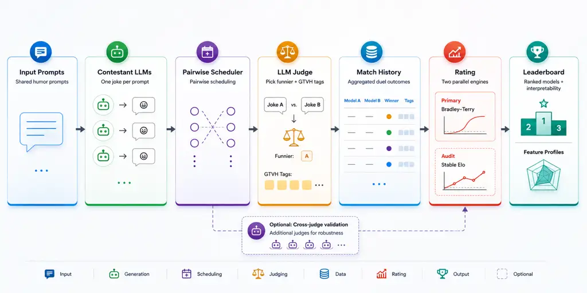

Figure 1: Overview of the HumorRank evaluation pipeline. Contestant
models generate jokes on shared prompts, Adaptive Swiss pairing
schedules pairwise duels, a GTVH-grounded LLM judge adjudicates each
duel, and outcomes are aggregated into match history and converted to
global Bradley–Terry ratings (primary) and Stable Elo scores (audit),
producing a ranked leaderboard with interpretable humor-feature
profiles.

### 3.1 Pairwise Comparison

Humor evaluation in this setting differs from standard LLM-as-a-Judge
tasks (e.g., instruction following, summarization): SemEval-2026 MWAHAHA
requires ranking multiple model-generated jokes on the same input, which
is inherently relative. For each input, every model generates a joke. We
therefore collect pairwise preferences over those jokes (Model A vs.
Model B on the same input) and aggregate outcomes with Bradley–Terry
MLE Hunter (2004) into a global leaderboard. Alternative judge
configurations and ablation details are documented in Appendix B.

#### General Theory of Verbal Humor-Guided Pairwise Formulation:

To ensure the LLM-as-a-judge protocol transcends arbitrary preference,
HumorRank’s evaluation is formally grounded in the General Theory of
Verbal Humor (GTVH) (Ruch et al., 1993). The GTVH parameterizes a joke
$`J`$ not as a monolithic text, but as a hierarchical tuple of six
Knowledge Resources (KRs): $`J=\{SO,LM,SI,TA,NS,LA\}`$. Here, the
highest-order KRs are the Script Opposition ($`SO`$, core semantic
incongruity) and Logical Mechanism ($`LM`$, cognitive resolution).
Lower-order KRs govern surface presentation, such as Narrative Strategy
($`NS`$, structure) and Language ($`LA`$, lexical delivery).

Because LLMs can struggle with holistic, zero-shot humor evaluation due
to alignment biases (Appendix B), HumorRank does not prompt the judge
for a black-box subjective scalar $`P(J_{A}\succ J_{B})`$. Instead, we
formulate the judge as an explicit feature-extraction function
$`E_{\theta}(J)`$ over the theoretical KR space.

The judge must instantiate categorical tags that map directly to the
GTVH hierarchy (prompt details in Appendix C):

- •
  Deep Structure ($`SO,LM`$): The HUMOR_MECHANISMS array captures $`SO`$
  (e.g., incongruity) and $`LM`$ (e.g., wordplay, absurdity).
- •
  Surface Presentation ($`NS,LA`$): The DELIVERY_FEATURES array captures
  $`NS`$ (e.g., framing commitment) and $`LA`$ (e.g., timing,
  conciseness).

Thus, the pairwise decision is formulated over the same theoretical
feature space:
$`P(J_{A}\succ J_{B})=f_{\theta}(E_{\theta}(J_{A}),E_{\theta}(J_{B})\mid\text{prompt})`$.
Feature extraction is integrated into the adjudication prompt rather
than applied post hoc. The judge jointly returns the preference
decision, comparative rationale, and GTVH-aligned feature annotations in
one structured response.

### 3.2 Bradley-Terry Global Maximum Likelihood Estimation

The Bradley-Terry model (Bradley & Terry, 1952) serves as our primary,
order-independent ranking algorithm. By maximizing the likelihood of
observed pairwise outcomes across the full tournament graph, BT
estimates a latent “humor capability” score for each model.
Preference-based BT-style rating has also been widely used in non-humor
LLM evaluation settings, including arena-style leaderboards (Chiang
et al., 2024; Myrzakhan et al., 2024).

Given models $`i`$ and $`j`$ with latent ratings $`R_{i}`$ and
$`R_{j}`$, the probability that model $`i`$ wins over model $`j`$ is
formulated as an Elo-scaled logistic function:

```math
P(\text{i wins against j})=\frac{1}{1+10^{(R_{j}-R_{i})/400}} \tag{1}
```

Instead of sequential updates, HumorRank fits global MLE using the
iterative Minorization-Maximization (MM) algorithm Hunter (2004) until
convergence ($`\epsilon<10^{-6}`$), with ratings anchored at 1000. To
quantify uncertainty in model separation, we report 95% confidence
intervals via 200 bootstrap resamples of the match history. Resampling
and tournament configuration details are listed in Appendix I
(Table 24).

### 3.3 Stable Elo (Sequential Reference)

While the BT model provides the global MLE, we simultaneously compute a
sequential Elo rating Albers & Vries (2001) to track dynamic stability
and provide a secondary reference metric. The generalized sequential
update rule is:

```math
R_{\text{new}}=R_{\text{curr}}+K_{fac}\cdot(S-E) \tag{2}
```

where $`K_{fac}=32`$ specifies the maximum volatility factor, $`S`$
denotes the observed outcome ($`1.0`$ for a win, $`0.5`$ for a tie,
$`0.0`$ for a loss), and $`E`$ is the expected probability derived from
Equation 1.

A known deficiency of standard Elo is order dependence, wherein the
specific sequence of matches heavily influences the final ratings.
HumorRank mitigates this vulnerability by implementing Stable Elo: the
entire tournament history is evaluated across $`N{=}10`$ randomly
shuffled topological orderings. The final assigned score is the
arithmetic mean of the resulting terminal ratings, yielding strong
empirical sequence robustness. Shuffle-audit details are in Appendix L.

### 3.4 Adaptive Swiss Pairing

For large model pools, exhaustive $`\mathcal{O}(K^{2})`$ pairwise
comparisons become computationally expensive. HumorRank resolves this
through Adaptive Swiss Pairing (ASP): a single scheduling engine
controlled by budget parameter $`C_{\max}`$ that preferentially matches
models of similar standing while avoiding repeat pairings. ASP uses a
temporary online strength score only for matchmaking. Final leaderboard
ratings are always computed with global Bradley–Terry MLE. A pair
$`(i,j)`$ is under-sampled when its observed duel count in the current
match graph $`G`$ falls below the target count implied by $`C_{\max}`$.
ASP prioritizes such pairs in each scheduling round until the budget is
exhausted.

At maximum budget, $`C_{\max}`$ recovers exhaustive round-robin (Full
RR). Reduced-budget modes subsample duels via the same ASP engine: Swiss
2RR fixes two rounds per model, while Swiss 3RR fixes three rounds per
model. Under a Swiss schedule with $`R(K)`$ rounds per model, the
per-prompt comparison count is approximately $`\frac{K\,R(K)}{2}`$:
therefore, fixed-round modes ($`R\in\{2,3\}`$) are $`\mathcal{O}(K)`$,
and only schedules with $`R(K)=\Theta(\log K)`$ yield
$`\mathcal{O}(K\log K)`$ comparisons per prompt. We abbreviate all
round-robin schedules as RR throughout. We do not claim a formal
convergence proof for BT under ASP. Empirical budget trade-offs are in
Section 5.3 and Appendix D; a synthetic large-$`K`$ check is in
Appendix F. Algorithm 1 is in Appendix E.

## 4 Experimental Setup

To empirically validate the HumorRank methodology, we execute a
large-scale evaluation on two headline-conditioned humor generation
benchmarks. Our experimental design tests discriminative power across
varying model architectures, access paradigms, and parameter scales.
Full reproducibility details, including hyperparameters and
computational budget, are provided in Appendix I.

### 4.1 Benchmarks

We evaluate on two publicly available humor generation benchmarks:

SemEval-2026 MWAHAHA (Castro et al., 2026): The official Task 1 test set
($`300`$ prompts) from the SemEval-2026 MWAHAHA shared task, which
targets English joke generation conditioned specifically on news
headlines. This provides a baseline evaluation on a narrow,
single-domain input distribution.

Humor Transfer Bench (HTB) (Ajayi & Mitra, 2026): A comprehensive
evaluation set of $`400`$ prompts designed to assess cross-domain humor
generalization. To contrast with SemEval’s headline-centric focus, HTB
spans eight structurally distinct input domains ($`50`$ prompts each):
Neutral Facts, Everyday Life, Abstract Concepts, Dialogic Quotations,
Scenario Inputs, Analogical Prompts, Direct Instructional, and News
Headlines.

### 4.2 Model Evaluation Suite

We evaluate a deliberately diverse suite of 9 language models to assess
the leaderboard’s capacity to resolve fine-grained capability
differences. The inclusion criteria strictly span multiple model
lineages and access paradigms:

- •
  Frontier Proprietary Models: GPT-5 Singh et al. (2025), Gemini 2.5
  Pro Comanici et al. (2025), Claude 3.5 Haiku Anthropic (2024), and
  Kimi K2 Team et al. (2026).
- •
  Open-Weight Models: Llama 3.3 70B Instruct Grattafiori et al. (2024),
  Qwen 3 32B Bai et al. (2025), GPT OSS 120B Agarwal et al. (2025), and
  Qwen 2.5 7B Instruct (Team, 2024).
- •
  Humor-Specialized Model: HumorGen-7B (Ajayi & Mitra, 2026), a humor
  fine-tuned model trained via Cognitive Synergy Framework (CSF) and
  supervised fine-tuning (SFT).

This suite reflects practical compute and API budget constraints while
preserving representation across frontier proprietary APIs, open-weight
models, and the humor fine-tuned HumorGen-7B.

### 4.3 Evaluation Protocol and LLM-as-Judge Ablation

HumorRank employs LLM judges for pairwise comparison of contestant
models on each benchmark ($`K{=}9`$ in our experiments), with all duels
scheduled by Adaptive Swiss Pairing (Section 3.4). At the maximum
budget, ASP becomes equivalent to exhaustive round-robin evaluation
(Full RR), which we use for the main leaderboards, while reduced-budget
Swiss modes are evaluated in Section 5.3. Because judge quality depends
heavily on the model performing the evaluation, we evaluated both
proprietary and open-weight models before selecting the final
configuration. This process revealed a broader limitation: no LLM judge
reliably evaluates humor by default, and different judge models exhibit
distinct failure modes, including score anchoring under absolute rubrics
and family bias toward their own model outputs under pairwise
comparison. We therefore designed a dedicated ablation study to
characterize these failure modes before finalizing the judge
configuration (Appendix B). Configurations exhibiting these failure
modes were excluded, and the final judge models are described below.

LLM Judges: Llama 3.3 70B Instruct serves as the primary judge for
reported leaderboard ratings, and Qwen 2.5 72B Instruct serves as an
independent secondary judge that re-labels the same duel set for
cross-judge validation. Both judges follow the GTVH-grounded pairwise
evaluation protocol in Section 3.1, rather than an unconstrained
funniness assessment. For each duel, the judge returns one structured
response containing brief reasoning, a winner label (A, B, or TIE), and
categorical annotations drawn from three closed vocabularies aligned
with GTVH: humor mechanisms, delivery features, and loser failure modes.
Tag-level definitions are provided in the evaluation prompt (Appendix C)
and Appendix Table 8, ensuring that comparisons are grounded in
interpretable comedic attributes rather than unconstrained preference
signals. The resulting annotations capture both the final preference
decision and the mechanisms or shortcomings supporting that decision.
This evaluation template was selected based on ablation results showing
that unconstrained pairwise prompts and absolute-scoring formulations
led to ranking instability, excessive ties, or model-specific preference
biases (Appendix B). Prompt order is swapped across comparisons to
mitigate position bias.

Judge Ablation & Validity Check: We report SemEval Qwen-judge Full RR
ratings in Appendix G, along with cross-benchmark Kendall $`\tau`$
analysis and budget ablations on both benchmarks (SemEval-2026 MWAHAHA
and Humor Transfer Bench) in Appendix D. Large-scale human ranking of
the full tournament is impractical because humor preference is
subjective, and contestant models generate multiple jokes per prompt
that often share similar setups and wording. Exhaustive pairwise human
comparison is therefore costly and may yield only moderate
inter-annotator agreement. We conduct a blind annotation study on a
90-pair evaluation set to assess whether our LLM judges align with human
preferences on closely matched humor comparisons. This study serves as a
reliability check rather than a substitute for large-scale human
evaluation of the full tournament (Appendix K, Section 5.4).

## 5 Results

Our evaluation yields an extensive empirical profile of humor capability
across current language models. We present the system-level
Bradley-Terry (BT) leaderboard, validate its stability across
independent LLM judges, and subsequently decompose these ratings into
interpretable psychometric features.

### 5.1 HumorRank Leaderboard

The Full RR tournaments, judged by the primary Llama 3.3 70B judge,
reveal clear stratification on both benchmarks. Table 1 reports
Bradley–Terry ratings, Stable Elo reference scores, 95% confidence
intervals, and win rates. HTB (14,400 judgments) appears above SemEval
(10,800 judgments). SemEval win-rate heatmaps are in Appendix Figure 6,
and HTB budget-mode tables and figures are in Appendix D.5.

|                                                                            |                                                                      |           |         |                     |       |
| -------------------------------------------------------------------------- | -------------------------------------------------------------------- | --------- | ------- | ------------------- | ----- |
| Humor Transfer Bench (HTB): Full RR, Llama 3.3 70B judge, 14,400 judgments |                                                                      |           |         |                     |       |
| Rank                                                                       | Model                                                                | BT Rating | St. Elo | 95% CI              | Win % |
| 1                                                                          | GPT-5                                                                | 1314.7    | 1300.4  | $`[1301.3,1329.0]`$ | 84.1% |
| 2                                                                          | Kimi K2                                                              | 1242.0    | 1239.1  | $`[1229.5,1255.6]`$ | 77.2% |
| 3                                                                          | HumorGen-7B¹¹ 1 Referred to as HumorGen SFT 7B in plots and figures. | 1097.7    | 1122.8  | $`[1084.4,1109.9]`$ | 60.6% |
| 4                                                                          | Claude 3.5 Haiku                                                     | 1054.2    | 1058.3  | $`[1043.2,1068.5]`$ | 55.1% |
| 5                                                                          | Gemini 2.5 Pro                                                       | 1024.0    | 1009.0  | $`[1010.6,1038.2]`$ | 51.3% |
| 6                                                                          | GPT OSS 120B                                                         | 1009.6    | 1017.2  | $`[998.4,1021.6]`$  | 49.5% |
| 7                                                                          | Qwen 3 32B                                                           | 942.5     | 946.2   | $`[928.1,955.7]`$   | 41.3% |
| 8                                                                          | Llama 3.3 70B                                                        | 791.9     | 795.4   | $`[776.4,808.0]`$   | 24.9% |
| 9                                                                          | Qwen 2.5 7B Instruct                                                 | 523.5     | 511.8   | $`[501.8,549.8]`$   | 5.9%  |
| SemEval-2026 MWAHAHA: Full RR, Llama 3.3 70B judge, 10,800 judgments       |                                                                      |           |         |                     |       |
| Rank                                                                       | Model                                                                | BT Rating | St. Elo | 95% CI              | Win % |
| 1                                                                          | GPT-5                                                                | 1307.5    | 1317.6  | $`[1289.9,1325.9]`$ | 84.0% |
| 2                                                                          | Kimi-K2                                                              | 1156.9    | 1175.7  | $`[1139.9,1170.7]`$ | 67.8% |
| 3                                                                          | Gemini 2.5 Pro                                                       | 1115.1    | 1115.3  | $`[1099.0,1128.1]`$ | 62.6% |
| 4                                                                          | HumorGen-7B¹¹ 1 Referred to as HumorGen SFT 7B in plots and figures. | 1092.8    | 1102.2  | $`[1078.7,1108.5]`$ | 59.8% |
| 5                                                                          | Claude 3.5 Haiku                                                     | 1037.5    | 1027.3  | $`[1024.1,1050.9]`$ | 52.7% |
| 6                                                                          | GPT OSS 120B                                                         | 1015.0    | 1002.2  | $`[1001.7,1030.6]`$ | 49.8% |
| 7                                                                          | Qwen 3 32B                                                           | 976.9     | 966.2   | $`[964.7,988.8]`$   | 45.0% |
| 8                                                                          | Llama 3.3 70B                                                        | 761.0     | 754.0   | $`[743.9,780.6]`$   | 21.8% |
| 9                                                                          | Qwen 2.5 7B Instruct                                                 | 537.4     | 539.4   | $`[513.5,563.5]`$   | 6.5%  |

Table 1: Full round-robin HumorRank leaderboards on HTB (top) and
SemEval (bottom), both judged by the primary Llama 3.3 70B judge. BT
ratings are the primary metric, and Stable Elo (10 shuffle runs) is a
sequence-robust audit. Anchor ranks are stable across benchmarks (GPT-5
\#1, Llama 3.3 70B and Qwen 2.5 7B Instruct \#8/#9). SemEval win-rate
heatmap: Appendix Figure 6. HTB extended budget ablations: Appendix D.5.

On HTB, HumorGen-7B ranks 3rd (BT = 1097.7), above Gemini 2.5 Pro and
GPT OSS 120B. On SemEval it ranks 4th (BT = 1092.8). The primary Llama
judge ranks its own generations 8th on both benchmarks (SemEval BT =
761.0, HTB BT = 791.9), providing no clear evidence of self-favoring in
the resulting rankings. On SemEval, two-sided binomial tests reject a
50% null win rate for 32/36 pairings at $`\alpha{=}0.05`$, with the
remaining four concentrated in close mid-tier matchups.

### 5.2 Cross-LLM-Judge Validity and Rank Stability

Evaluating subjective data is inherently sensitive to the choice of the
primary LLM judge. We replicate all full round-robin duels on both
benchmarks with Qwen 2.5 72B Instruct as an independent secondary LLM
judge (SemEval ratings in Appendix G, $`\tau`$ tables in Appendix D).
Bradley–Terry ratings from the Qwen judge correlate strongly with the
primary Llama 3.3 70B leaderboard on SemEval and HTB: Kendall’s
$`\tau=0.889`$ ($`p=0.0002`$) in each benchmark, and the same value when
pooling all 25,200 Llama–Qwen LLM-judge pairwise labels (82.9%
agreement, Krippendorff $`\alpha=0.658`$). Contestant ordering is
cross-judge stable: GPT-5 and Kimi K2 remain at ranks 1–2, and Llama 3.3
70B and Qwen 2.5 7B Instruct remain at ranks 8–9, with modest mid-tier
reordering only. We also report a transitivity score: among all model
triples with a clear pairwise winner on each edge, the fraction with no
directed 3-cycle in the win graph ($`1.0`$ = no intransitivity). This
score is $`1.0`$ under both LLM judges on both benchmarks.

### 5.3 Tournament Budget Ablation

Full round-robin is expensive as $`K`$ grows. Because ASP is the same
engine at every budget, we ablate Swiss 2RR and Swiss 3RR schedules
using the same pairing logic and fixed budget constraints. Table 2
summarizes comparison budget and cross-LLM-judge Kendall $`\tau`$
averaged over four cells (SemEval/HTB $`\times`$ Llama 3.3 70B/Qwen
judges). At $`K{=}9`$, Swiss 3RR uses $`12`$ pairs/prompt ($`\sim`$33%
of Full RR) and restores SemEval Llama$`\leftrightarrow`$Qwen agreement
to $`\tau=0.889`$, matching Full RR. Ranks \#1 (GPT-5), \#8 (Llama 3.3
70B), and \#9 (Qwen 2.5 7B Instruct) are stable across Full RR, Swiss
2RR, and Swiss 3RR in all four evaluation cells. We treat Swiss 3RR as
the practical scaling mode when exhaustive coverage is infeasible.
Cross-judge stability is a budget effect: both benchmarks agree at Full
RR and 3RR ($`\tau=0.889`$), and 2RR is an under-budget stress test
where rankings become volatile. Per-benchmark breakdowns are in
Appendix D.4 (SemEval) and Appendix D.5–D.6 (HTB); a synthetic
large-$`K`$ ASP check is in Appendix F.

| Schedule  | Pairs / prompt ($`K{=}9`$) | Budget      | Avg. cross-LLM-judge $`\tau`$ |
| --------- | -------------------------- | ----------- | ----------------------------- |
| Full RR   | 36                         | 100%        | 0.889                         |
| Swiss 3RR | 12                         | $`\sim`$33% | 0.861                         |
| Swiss 2RR | 8                          | $`\sim`$22% | 0.806                         |

Table 2: Adaptive Swiss Pairing budget ablation across Full RR, Swiss
3RR, and Swiss 2RR. SemEval Llama 3.3 70B$`\leftrightarrow`$Qwen 2.5 72B
LLM-judge $`\tau=0.889`$ under both Full RR and Swiss 3RR.

### 5.4 Human and LLM Judge Agreement

To assess reliability of our LLM-as-a-Judge pipeline, we conducted a
blind annotation study with three human evaluators on a 90-pair set (75
unique headlines) of curated funny-versus-funny comparisons. Pairs were
stratified by comparison type (Table 3): cross-tier, within-tier, scale,
rank-spanning frontier, and alignment contrasts, rather than sampled
exhaustively from the full tournament, limiting annotator fatigue from
repeated setups.

| Comparison axis                 | Pairs |
| ------------------------------- | ----- |
| Cross-tier (rank span)          | 32    |
| Within-tier, top quartile       | 10    |
| Within-tier, lower ranks        | 18    |
| Scale contrast                  | 10    |
| Rank-spanning frontier matchups | 15    |
| Alignment contrast              | 5     |
| Total                           | 90    |

Table 3: Human evaluation set design (90 pairs, 75 unique headlines).
Axes mirror tournament stratification, and all pairs are
funny-versus-funny only.

Annotators re-rated anonymized pairs against our production Llama 3.3
70B and Qwen 2.5 72B Instruct judges. Because humor preference is
inherently subjective and has no single ground-truth label, we quantify
reliability as agreement beyond chance using Krippendorff’s
$`\alpha`$ (Krippendorff, 2011) with nominal winner-model labels,
supporting multi-rater cohorts with incomplete overlap. Table 4 reports
cohort-level $`\alpha`$ across human-only, human–LLM, and LLM–LLM rater
pools. Human–Llama alignment on H₂+H₃ is not significantly different
from human–human agreement (Fisher exact $`p=0.808`$). Protocol details
are in Appendix K.

|                         |                           |
| ----------------------- | ------------------------- |
| Cohort                  | Krippendorff’s $`\alpha`$ |
| Human-only dyads        |                           |
| H₁ + H₃                 | 0.446                     |
| H₂ + H₃                 | 0.436                     |
| H₁ + H₂                 | 0.334                     |
| H₁ + H₂ + H₃            | 0.416                     |
| Human–Llama judge dyads |                           |
| Llama + H₁              | 0.434                     |
| Llama + H₂              | 0.441                     |
| Llama + H₃              | 0.458                     |
| Llama + H₂ + H₃         | 0.446                     |
| Llama + H₁ + H₂ + H₃    | 0.432                     |
| Human–Qwen judge dyads  |                           |
| Qwen + H₂ + H₃          | 0.421                     |
| Qwen + H₁ + H₂ + H₃     | 0.407                     |
| LLM–LLM judge dyad      |                           |
| Llama + Qwen            | 0.505                     |

Table 4: Krippendorff’s $`\alpha`$ (nominal winner-model labels) on the
90-pair blind evaluation set. H\_(i): human annotator $`i`$, Llama/Qwen:
production LLM judges. Human–Llama alignment on H₂+H₃ is not
significantly different from human–human agreement (Fisher exact
$`p=0.808`$).

### 5.5 Theory-Grounded Feature Interpretability

Beyond scalar Elo ratings, HumorRank’s structured judge co-emits
GTVH-grounded tags (Attardo, 2017) with each pairwise decision: humor
mechanisms, delivery features, and failure modes. Table 5 summarizes the
primary tags in our judge prompt.

| Feature     | GTVH  | Description                           |
| ----------- | ----- | ------------------------------------- |
| Incongruity | LM    | Conflicting scripts or ideas.         |
| Absurdity   | SI    | Breaks physical/social expectations.  |
| Sarcasm     | TA/LM | Irony with an explicit target.        |
| Wordplay    | LA    | Puns and lexical/syntactic ambiguity. |
| Conciseness | LA    | Efficient buildup, comedic timing.    |

Table 5: GTVH-grounded humor features tagged in structured LLM judge
responses.

Figures 2–4 visualize per-model tag frequencies from the primary Llama
judge across the nine-model leaderboard.

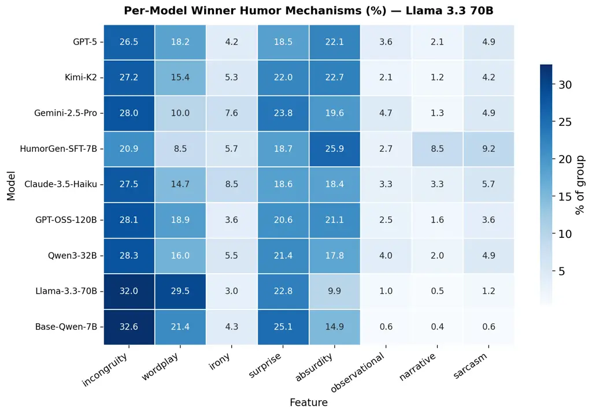

Figure 2: Per-model winning humor-mechanism distributions under the
Llama judge (% of wins). Frontier models emphasize Incongruity, mid-tier
specialists lead on Absurdity, and baselines over-index on Wordplay.

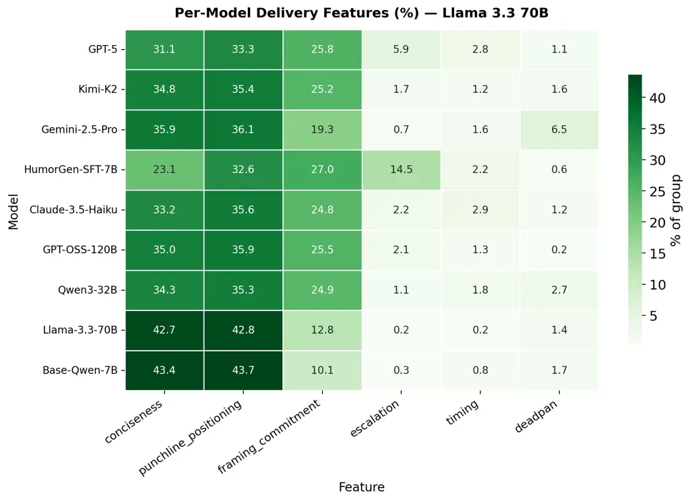

Figure 3: Per-model winning delivery-feature distributions under the
Llama judge (% of wins). Frontier models emphasize Conciseness, while
mid-tier specialists show elevated Escalation.

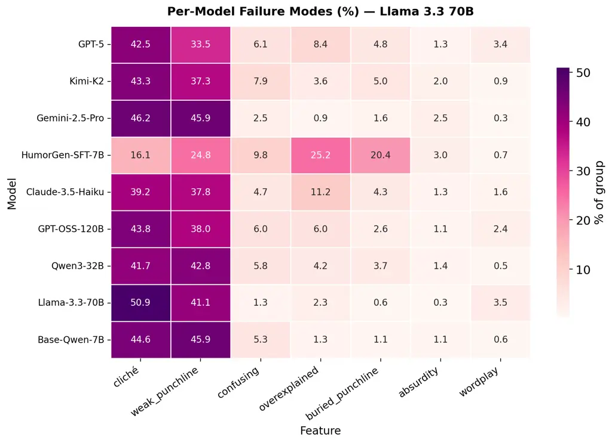

Figure 4: Per-model failure mode distributions (Llama judge). Cliché and
Weak Punchline dominate most tiers. Mid-tier specialists show higher
Overexplained (25.2%) and Buried Punchline (20.4%) rates.

These distributions reveal three recurring tiers:

- •
  Frontier generalists (e.g., GPT-5): High Conciseness (31.1% of wins)
  and Incongruity (26.5%), with primary losses via Cliché.
- •
  Mid-tier specialists (e.g., HumorGen-7B): Lead on Absurdity (25.9%)
  and Sarcasm (9.2%), with elevated Escalation (14.5%).
- •
  Weak baselines (e.g., Llama 3.3 70B): Over-index on Wordplay (29.5%)
  and accumulate Weak Punchline (41.1%) and Cliché (50.9%) when losing.

The same tier structure holds under the Qwen judge (Appendix J).
Representative judge rationales are in Appendix H.

## 6 Conclusion

We introduced HumorRank, a leaderboard-oriented framework for
theory-grounded comparison of humor-generation systems. Rather than
reducing humor to a universal scalar score, HumorRank organizes pairwise
judgments into system-level rankings and interpretable model profiles.
Budget-aware Adaptive Swiss Pairing reduces comparisons, while global
Bradley–Terry estimation produces stable ratings; comparative rationales
and mechanism, delivery, and failure annotations retain information
omitted by scalar leaderboards. Across two benchmarks, stability under
independent judges and reduced budgets, together with human calibration,
indicates a consistent comparative signal despite humor’s subjectivity.
Results further suggest that humor-generation capability reflects
comedic specialization and mechanism mastery, not scale alone. HumorRank
thus provides a reusable basis for comparing systems, diagnosing
successes and failures, and tracking progress in computational humor
generation. HumorRank is maintained at
[https://humorrank-leaderboard.pages.dev/](https://humorrank-leaderboard.pages.dev/).

## 7 Limitations

The limitations of this study fall into three categories:

- •
  Evaluation Scope: Evaluation is restricted to English data and nine
  models. Consequently, the study does not examine cross-lingual or
  cross-cultural humor, and the evaluated systems do not span the full
  range of contemporary models. Neither HTB nor SemEval covers
  interactive or multimodal humor. Real humor-tournament ASP fidelity is
  validated at $`K{=}9`$; larger pools are stress-tested only under a
  synthetic Bradley–Terry preference model (Appendix F), not with jokes
  from $`10^{4}`$–$`10^{5}`$ generators.
- •
  Human Validation Scale: Exhaustive annotation of all 25,200 tournament
  duels is impractical because of cost and annotator fatigue. We
  therefore conduct a targeted 90-pair blind evaluation of difficult
  funny-vs-funny comparisons (Table 3, Appendix K) as a post-hoc
  calibration of judge behavior. Human–Llama alignment does not differ
  significantly from human–human agreement on H₂+H₃ (Fisher exact
  $`p=0.808`$). This provides practical validation of judge reliability
  without exhaustive annotation of the full tournament.
- •
  Broader Judge Evaluation: Our judge-selection process screens for
  self- and family-preference biases and validates selected judges
  through cross-judge stability and human alignment (Appendix B). The
  study focuses on these dimensions. Future work can extend evaluation
  to cross-cultural and stylistic settings and independently assess GTVH
  feature annotations with human experts.

## 8 Reproducibility Statement

To ensure full reproducibility of the HumorRank framework, we detail the
core hyperparameter configurations and computational hardware
requirements necessary to execute the generative tournament.

Generation Hyperparameters: For all candidate models evaluated in the
tournament, we standardized the generation settings to prioritize
creative diversity while maintaining structural coherence. Specifically,
we configured all candidate models with a unified sampling temperature
of $`T=0.7`$ and nucleus sampling of top-$`p=0.9`$ (set explicitly
wherever the provider API exposes it). Token limits were inherited from
respective model APIs to preserve native instructional adherence without
imposing artificial truncation.

Judge Hyperparameters: The LLM judges (Llama 3.3 70B and Qwen 2.5 72B)
were configured with a highly constrained sampling temperature of
$`T=0.1`$ alongside a maximum retry threshold of 3 (with exponential
backoff) for all pairwise JSON evaluation calls. Given the substantial
financial and computational cost of the expansive generative tournament,
this near-deterministic setting ensures that the LLM judges maintain
stability and does not yield erratic or contradictory evaluations to the
same prompt upon reassessment, thereby firmly preserving the integrity
of the Bradley-Terry ratings.

Computational Hardware: Orchestrating full round-robin judging on
SemEval and HTB (25,200 pairwise calls per LLM judge) required
approximately 48 hours of dedicated NVIDIA H100 (80GB) GPU compute for
the primary Llama judge pipeline. Qwen-judge replication required
additional inference budget. Tournament code, evaluation scripts, and
the Adaptive Swiss pairing implementation are provided in the
supplementary materials.

## 9 Ethics Statement

This work proposes a framework for the systematic evaluation and ranking
of humor generation across large language models. It does not itself
constitute a humor generation system. Two ethical considerations warrant
explicit acknowledgment. First, humor is a culturally and contextually
variable phenomenon whose boundaries with offensive or exclusionary
expression are highly sensitive to audience and setting. Evaluation
frameworks that rank models on comedic output implicitly surface content
generated by those models, and practitioners adapting such pipelines for
downstream applications bear responsibility for enforcing appropriate
content-moderation constraints. Second, the validity of automated
ranking is constrained by the cultural and stylistic distribution of the
LLM judge model’s pretraining corpus. LLM-based evaluators trained
predominantly on high-resource, Western-centric text may systematically
disadvantage humor conventions from linguistically or culturally
underrepresented communities, a limitation shared by the broader
LLM-as-a-judge literature. HumorRank should therefore be interpreted as
a reproducible diagnostic benchmark rather than a definitive assessment
of comedic or creative quality.

## References

- Agarwal et al. (2025) Sandhini Agarwal, Lama Ahmad, Jason Ai, Sam
  Altman, Andy Applebaum, Edwin Arbus, Rahul K Arora, Yu Bai, Bowen
  Baker, Haiming Bao, et al. gpt-oss-120b & gpt-oss-20b model card.
  _arXiv preprint arXiv:2508.10925_, 2025.
- Ajayi & Mitra (2025) Edward Ajayi and Prasenjit Mitra. Automatic humor
  detection: A comprehensive survey from theoretical foundations to
  large language models. December 2025. doi:
  10.13140/RG.2.2.24393.61288. URL
  [https://doi.org/10.13140/RG.2.2.24393.61288](https://doi.org/10.13140/RG.2.2.24393.61288).
  Preprint.
- Ajayi & Mitra (2026) Edward Ajayi and Prasenjit Mitra. Humorgen:
  Cognitive synergy for humor generation in large language models via
  persona-based distillation.
  [https://huggingface.co/Jayi2424/HumorGen-7B](https://huggingface.co/Jayi2424/HumorGen-7B), 2026.
  Preprint.
- Albers & Vries (2001) Paul CH Albers and Han de Vries. Elo-rating as a
  tool in the sequential estimation of dominance strengths. _Animal
  behaviour_, pp. 489–495, 2001.
- Anthropic (2024) Anthropic. The claude 3 model family: Opus, sonnet,
  haiku.
  [https://www-cdn.anthropic.com/de8ba9b01c9ab7cbabf5c33b80b7bbc618857627/Model_Card_Claude_3.pdf](https://www-cdn.anthropic.com/de8ba9b01c9ab7cbabf5c33b80b7bbc618857627/Model_Card_Claude_3.pdf), 2024.
  Model card.
- Attardo (2017) Salvatore Attardo. The general theory of verbal humor.
  In _The Routledge handbook of language and humor_, pp. 126–142.
  Routledge, 2017.
- Attardo (2024) Salvatore Attardo. _Linguistic theories of humor_,
  volume 1. Walter de Gruyter GmbH & Co KG, 2024.
- Bai et al. (2025) Shuai Bai, Yuxuan Cai, Ruizhe Chen, Keqin Chen,
  Xionghui Chen, Zesen Cheng, Lianghao Deng, Wei Ding, Chang Gao,
  Chunjiang Ge, et al. Qwen3-vl technical report. _arXiv preprint
  arXiv:2511.21631_, 2025.
- Bradley & Terry (1952) Ralph Allan Bradley and Milton E Terry. Rank
  analysis of incomplete block designs: I. the method of paired
  comparisons. _Biometrika_, 39(3/4):324–345, 1952.
- Castro et al. (2026) Santiago Castro, Luis Chiruzzo, Santiago Góngora,
  Salar Rahili, Naihao Deng, Ignacio Sastre, Victoria Amoroso, Guillermo
  Rey, Aiala Rosá, Guillermo Moncecchi, J. A. Meaney, Juan José Prada,
  and Rada Mihalcea. SemEval-2026 Task 1: MWAHAHA, Models Write
  Automatic Humor And Humans Annotate. In _Proceedings of the 20th
  International Workshop on Semantic Evaluation (SemEval-2026)_, 2026.
- Chiang et al. (2024) Wei-Lin Chiang, Lianmin Zheng, Ying Sheng,
  Anastasios Nikolas Angelopoulos, Tianle Li, Dacheng Li, Banghua Zhu,
  Hao Zhang, Michael Jordan, Joseph E Gonzalez, et al. Chatbot arena: An
  open platform for evaluating llms by human preference. In _Forty-first
  International Conference on Machine Learning_, 2024.
- Comanici et al. (2025) Gheorghe Comanici, Eric Bieber, Mike
  Schaekermann, Ice Pasupat, Noveen Sachdeva, Inderjit Dhillon, Marcel
  Blistein, Ori Ram, Dan Zhang, Evan Rosen, et al. Gemini 2.5: Pushing
  the frontier with advanced reasoning, multimodality, long context, and
  next generation agentic capabilities. _arXiv preprint
  arXiv:2507.06261_, 2025.
- Federiakin (2025) Denis Federiakin. Improving llm leaderboards with
  psychometrical methodology. _arXiv preprint arXiv:2501.17200_, 2025.
- Goel et al. (2024) Mayank Goel, Parameswari Krishnamurthy, and Radhika
  Mamidi. Automating humor: A novel approach to joke generation using
  template extraction and infilling. In _Proceedings of the 21st
  International Conference on Natural Language Processing (ICON)_, pp.
  442–448, 2024.
- Goes et al. (2022) Fabricio Goes, Zisen Zhou, Piotr Sawicki, Marek
  Grzes, and Daniel G Brown. Crowd score: A method for the evaluation of
  jokes using large language model ai voters as judges. _arXiv preprint
  arXiv:2212.11214_, 2022.
- Gorenz & Schwarz (2024) Drew Gorenz and Norbert Schwarz. How funny is
  chatgpt? a comparison of human-and ai-produced jokes. _Plos one_,
  19(7):e0305364, 2024.
- Grattafiori et al. (2024) Aaron Grattafiori, Abhimanyu Dubey, Abhinav
  Jauhri, Abhinav Pandey, Abhishek Kadian, Ahmad Al-Dahle, Aiesha
  Letman, Akhil Mathur, Alan Schelten, Alex Vaughan, et al. The llama 3
  herd of models. _arXiv preprint arXiv:2407.21783_, 2024.
- He et al. (2024) Ruiqi He, Yushu He, Longju Bai, Jiarui Liu, Zhenjie
  Sun, Zenghao Tang, He Wang, Hanchen Xia, Rada Mihalcea, and Naihao
  Deng. Chumor 2.0: Towards benchmarking chinese humor understanding.
  _arXiv preprint arXiv:2412.17729_, 2024.
- Horvitz et al. (2024) Zachary Horvitz, Jingru Chen, Rahul Aditya,
  Harshvardhan Srivastava, Robert West, Zhou Yu, and Kathleen McKeown.
  Getting serious about humor: Crafting humor datasets with unfunny
  large language models. In _Proceedings of the 62nd Annual Meeting of
  the Association for Computational Linguistics (Volume 2: Short
  Papers)_, pp. 855–869, 2024.
- Hossain et al. (2020) Nabil Hossain, John Krumm, Michael Gamon, and
  Henry Kautz. Semeval-2020 task 7: Assessing humor in edited news
  headlines. In _Proceedings of the fourteenth workshop on semantic
  evaluation_, pp. 746–758, 2020.
- Hunter (2004) David R Hunter. Mm algorithms for generalized
  bradley-terry models. _The annals of statistics_, 32(1):384–406, 2004.
- Jain et al. (2024) Veedant Jain, Felipe dos Santos Alves Feitosa, and
  Gabriel Kreiman. Is ai fun? humordb: a curated dataset and benchmark
  to investigate graphical humor. _arXiv preprint
  arXiv:2406.13564_, 2024.
- Kim & Chilton (2025) Sean Kim and Lydia B Chilton. Ai humor
  generation: Cognitive, social and creative skills for effective humor.
  _arXiv preprint arXiv:2502.07981_, 2025.
- Krippendorff (2011) Klaus Krippendorff. Computing krippendorff’s
  alpha-reliability. 2011.
- Larkin-Galiñanes (2017) Cristina Larkin-Galiñanes. An overview of
  humor theory. _The Routledge handbook of language and humor_, pp.
  4–16, 2017.
- Myrzakhan et al. (2024) Aidar Myrzakhan, Sondos Mahmoud Bsharat, and
  Zhiqiang Shen. Open-llm-leaderboard: From multi-choice to open-style
  questions for llms evaluation, benchmark, and arena. _arXiv preprint
  arXiv:2406.07545_, 2024.
- Narad et al. (2025) Reuben Narad, Siddharth Suresh, Jiayi Chen,
  Pine SL Dysart-Bricken, Bob Mankoff, Robert Nowak, Jifan Zhang, and
  Lalit Jain. Which llms get the joke? probing non-stem reasoning
  abilities with humorbench. _arXiv preprint arXiv:2507.21476_, 2025.
- Park et al. (2024) Chanjun Park, Hyeonwoo Kim, Dahyun Kim, Seonghwan
  Cho, Sanghoon Kim, Sukyung Lee, Yungi Kim, and Hwalsuk Lee. Open
  ko-llm leaderboard: Evaluating large language models in korean with
  ko-h5 benchmark. In _Proceedings of the 62nd Annual Meeting of the
  Association for Computational Linguistics (Volume 1: Long Papers)_,
  pp. 3220–3234, 2024.
- Quan et al. (2025) Kexin Quan, Pavithra Ramakrishnan, and Jessie Chin.
  Can ai take a joke—or make one? a study of humor generation and
  recognition in llms. In _Proceedings of the 2025 Conference on
  Creativity and Cognition_, pp. 431–437, 2025.
- Ravi et al. (2024) Sahithya Ravi, Patrick Huber, Akshat Shrivastava,
  Vered Shwartz, and Arash Einolghozati. Small but funny: A
  feedback-driven approach to humor distillation. In _Proceedings of the
  62nd Annual Meeting of the Association for Computational Linguistics
  (Volume 1: Long Papers)_, pp. 13078–13090, 2024.
- Romanowski et al. (2025) Adrianna Romanowski, Pedro HV Valois, and
  Kazuhiro Fukui. From punchlines to predictions: A metric to assess llm
  performance in identifying humor in stand-up comedy. In _Proceedings
  of the Workshop on Cognitive Modeling and Computational Linguistics_,
  pp. 36–46, 2025.
- Ruch et al. (1993) Willibald Ruch, Salvatore Attardo, and Victor
  Raskin. Toward an empirical verification of the general theory of
  verbal humor. _Humor_, 6(2):123–136, 1993.
- Ryan et al. (2025) Yuriel Ryan, Rui Yang Tan, Kenny Tsu Wei Choo, and
  Roy Ka-Wei Lee. Humor in pixels: Benchmarking large multimodal models
  understanding of online comics. _arXiv preprint
  arXiv:2509.12248_, 2025.
- Shafiei & Saffari (2025) Mohammadamin Shafiei and Hamidreza Saffari.
  Not all jokes land: Evaluating large language models understanding of
  workplace humor. _arXiv preprint arXiv:2506.01819_, 2025.
- Silva et al. (2026) João Silva, Luís Gomes, and António Branco.
  Clarin-pt-ldb: An open llm leaderboard for portuguese to assess
  language, culture and civility. _arXiv preprint
  arXiv:2603.12872_, 2026.
- Singh et al. (2025) Aaditya Singh, Adam Fry, Adam Perelman, Adam Tart,
  Adi Ganesh, Ahmed El-Kishky, Aidan McLaughlin, Aiden Low, AJ Ostrow,
  Akhila Ananthram, et al. Openai gpt-5 system card. _arXiv preprint
  arXiv:2601.03267_, 2025.
- Song et al. (2025) Changhao Song, Yazhou Zhang, Hui Gao, Ben Yao, and
  Peng Zhang. Large language models for subjective language
  understanding: A survey. _arXiv preprint arXiv:2508.07959_, 2025.
- Team et al. (2026) Kimi Team, Tongtong Bai, Yifan Bai, Yiping Bao,
  SH Cai, Yuan Cao, Y Charles, HS Che, Cheng Chen, Guanduo Chen, et al.
  Kimi k2. 5: Visual agentic intelligence. _arXiv preprint
  arXiv:2602.02276_, 2026.
- Team (2024) Qwen Team. Qwen2.5: A party of foundation models,
  September 2024. URL
  [https://qwenlm.github.io/blog/qwen2.5/](https://qwenlm.github.io/blog/qwen2.5/).
- Toloka Team (2023) Toloka Team. Understanding llm leaderboards:
  Metrics, benchmarks, and why they matter, November 2023. URL
  [https://toloka.ai/blog/llm-leaderboard/](https://toloka.ai/blog/llm-leaderboard/).
  Accessed: 2026-03-23.
- Veatch (1998) Thomas C Veatch. A theory of humor. 1998.
- Wang et al. (2025) Han Wang, Yilin Zhao, Dian Li, Xiaohan Wang, Gang
  Liu, Xuguang Lan, and Hui Wang. Innovative Thinking, Infinite Humor:
  Humor Research of Large Language Models through Structured Thought
  Leaps, April 2025. URL
  [http://arxiv.org/abs/2410.10370](http://arxiv.org/abs/2410.10370).
  arXiv:2410.10370 \[cs\].
- Winters & Van der Stockt (2025) Thomas Winters and Stijn Van der
  Stockt. Evaluating humor generation in an improvisational comedy
  setting. _Computational Linguistics in the Netherlands Journal_,
  14:505–523, 2025.
- Wu et al. (2025a) Shih-Hung Wu, Tsz-Yeung Lau, and Yu-Feng Huang.
  Humour classification according to genre and technique by fine-tuning
  llms. In _International Conference of the Cross-Language Evaluation
  Forum for European Languages_, pp. 156–169. Springer, 2025a.
- Wu et al. (2025b) Zhikun Wu, Thomas Weber, and Florian Müller. One
  does not simply meme alone: Evaluating co-creativity between llms and
  humans in the generation of humor. In _Proceedings of the 30th
  International Conference on Intelligent User Interfaces_, pp.
  1082–1092, 2025b.
- Yamane (2024) Hiroaki Yamane. Generic joke generation with moral
  constraints. In _International Conference on Artificial Neural
  Networks_, pp. 340–355. Springer, 2024.
- Zhang et al. (2024) Jifan Zhang, Lalit Jain, Yang Guo, Jiayi Chen,
  Kuan L Zhou, Siddharth Suresh, Andrew Wagenmaker, Scott Sievert,
  Timothy Rogers, Kevin Jamieson, et al. Humor in ai: Massive scale
  crowd-sourced preferences and benchmarks for cartoon captioning.
  _Advances in Neural Information Processing Systems_,
  37:125264–125286, 2024.
- Zheng et al. (2023) Lianmin Zheng, Wei-Lin Chiang, Ying Sheng, Siyuan
  Zhuang, Zhanghao Wu, Yonghao Zhuang, Zi Lin, Zhuohan Li, Dacheng Li,
  Eric Xing, et al. Judging llm-as-a-judge with mt-bench and chatbot
  arena. _Advances in neural information processing systems_,
  36:46595–46623, 2023.
- Zhong et al. (2024) Shanshan Zhong, Zhongzhan Huang, Shanghua Gao,
  Wushao Wen, Liang Lin, Marinka Zitnik, and Pan Zhou. Let’s Think
  Outside the Box: Exploring Leap-of-Thought in Large Language Models
  with Creative Humor Generation. pp. 13246–13257, 2024. URL
  [https://openaccess.thecvf.com/content/CVPR2024/html/Zhong_Lets_Think_Outside_the_Box_Exploring_Leap-of-Thought_in_Large_Language_CVPR_2024_paper.html](https://openaccess.thecvf.com/content/CVPR2024/html/Zhong_Lets_Think_Outside_the_Box_Exploring_Leap-of-Thought_in_Large_Language_CVPR_2024_paper.html).
- Zhou et al. (2025) Kuan Lok Zhou, Jiayi Chen, Siddharth Suresh, Reuben
  Narad, Timothy T Rogers, Lalit K Jain, Robert D Nowak, Bob Mankoff,
  and Jifan Zhang. Bridging the creativity understanding gap:
  Small-scale human alignment enables expert-level humor ranking in
  llms. _arXiv preprint arXiv:2502.20356_, 2025.

## Appendix: Table of Contents

A Humor Definition .A  
B Failure Modes of LLM-as-a-Judge on Humor Evaluation .B  
  B.1 Experimental program .B.1  
  B.2 Failure mode A: score anchoring (Experiments 1–3) .B.2  
  B.3 Failure mode B: judge-model self-preference (5-headline pilot)
.B.3  
  B.4 Failure mode C: spurious ties (early pairwise prompt) .B.4  
  B.5 Illustrative failure pairs (qualitative audit) .B.5  
  B.6 Production configuration (what survived) .B.6  
C LLM-as-a-Judge Prompting Framework .C  
  C.1 Feature Taxonomy Definitions .C.1  
D Tournament Budget Ablation (Full RR / Swiss 2RR / Swiss 3RR) .D  
  D.1 Cross-judge $`\tau`$ by budget mode .D.1  
  D.2 Swiss 3RR rank stability (SemEval, Llama judge) .D.2  
  D.3 Swiss 3RR rank stability (HTB, Llama judge) .D.3  
  D.4 SemEval budget ablation (Llama judge) .D.4  
  D.5 HTB budget ablation (Llama judge) .D.5  
  D.6 HTB budget ablation (Qwen judge) .D.6  
E Adaptive Swiss Pairing Algorithm .E  
F Synthetic ASP Scaling Stress Test ($`K`$ up to $`10^{5}`$) .F  
G HumorRank Leaderboard Performance with Qwen 2.5 72B LLM Judge .G  
H Llama Judge Sample Decisions .H  
I Hyperparameter Configurations .I  
J Qualitative Examples and Feature Reasoning .J  
  J.1 Key Observations (Qwen vs. Llama LLM judges) .J.1  
K Human Evaluation Details .K  
  K Pair selection and $`\alpha`$ computation .K  
  K Instructions to participants .K  
  K Participants .K  
  K Inter-Annotator Reliability .K  
L Stable Elo Shuffle Audit .L

## Appendix A Humor Definition

Building upon classic Incongruity Theory, psychological
frameworks (Larkin-Galiñanes, 2017), and Normative-Violation
theory (Veatch, 1998), we require a rigorous working definition that can
be applied to text-based evaluation. For the purposes of this research,
we define humor explicitly as:

> Humor is the cognitive reward (experienced as amusement) arising when
> an interlocutor successfully resolves a deliberately constructed
> incongruity, such as the narrative shift between a joke’s setup and
> punchline, within a harmless and non-threatening context.

This definition anchors psychological consensus into the practical
reality of evaluating generated text. It explicitly requires four
distinct components:

- •
  The Joke Mechanism (Setup & Punchline): We evaluate humor not as
  random surprise, but as a structured linguistic narrative. The setup
  creates a logical expectation, and the punchline deliberately subverts
  it.
- •
  The “Cognitive Reward”: This maps to the cognitive appraisal process,
  describing the computational or intellectual achievement of bridging
  the logical gap between the setup and punchline.
- •
  Experienced as Amusement: The cognitive resolution must trigger a
  pleasant response (mirth) rather than confusion.
- •
  Harmless Context: Drawn from benign violation theory, the structural
  incongruity only produces amusement if it is appraised as
  non-threatening.

Because humor exists on a continuous spectrum determined by these
mechanisms rather than as a discrete label, our methodology utilizes
pairwise preference ranking. By prompting the LLM judge to evaluate
which generation produces a stronger cognitive reward, we effectively
treat humor evaluation as a reward modeling paradigm across the
multi-dimensional feature space of human amusement.

## Appendix B Failure Modes of LLM-as-a-Judge on Humor Evaluation

HumorRank’s evaluation protocol was not chosen a priori: it was the
survivor of a deliberate search through LLM-as-a-Judge configurations
that fail on humor generation ranking. We document two distinct failure
classes: (A) paradigm failure, where numeric or absolute scoring
collapses despite careful rubrics; and (B) judge-model failure, where
pairwise structure is correct but the judge model exhibits
self-preference or family bias. Section 3.1 in the main paper summarizes
the conclusion; this appendix holds the full experimental program and
evidence.

### B.1 Experimental program

We ran four tracks before locking the production tournament (Llama +
Qwen72, structured pairwise judge prompt, 10,800 SemEval duels):

- •
  Track A: numeric judges (Exp. 1–4). Absolute 0–100, structured
  $`4{\times}1`$–$`5`$ $`\to`$ 0–100, and scalar 1–20 paradigms over
  1,000–1,200 headlines with $`\sim`$11–15 humor candidates each
  ($`\sim`$41k scores total). Exp. 4 was a 120-headline Gemini absolute
  pilot (4 models/headline).
- •
  Track B: pairwise judge screening (9 SemEval models). Same-prompt
  pairwise duels on the paper’s nine contestants using GPT-5, Gemini 2.5
  Pro, GPT-OSS 120B, and Qwen3-32B as judges. GPT-5 and Gemini were
  evaluated on five shared headlines (en_2001–en_2005; 36 pairs/headline
  $`\Rightarrow`$ 180 duels each); OSS and Qwen32 runs used ten
  headlines for additional coverage.
- •
  Track C: early pairwise prompt. Verbose chain-of-thought pairwise
  pilot preceding the final structured prompt.
- •
  Production. Screened open-weight judges (Llama 3.3 70B, Qwen 2.5 72B),
  structured pairwise prompt, position swap, full SemEval round-robin
  ($`\tau=0.889`$).

Table 6 summarizes outcomes.

| Paradigm                                      | Symptom                                          | Response       | n       |
| --------------------------------------------- | ------------------------------------------------ | -------------- | ------- |
| Absolute 0–100 rubric                         | High-band clustering; mean within-HL spread 20.6 | Abandoned      | 17k     |
| Structured $`4{\times}1`$–$`5`$ $`\to`$ 0–100 | 88.5% scores $`=`$ 70.0; 30.8% headlines all tie | Abandoned      | 12k     |
| Scalar 1–20 funniness                         | 82.7% in band 13–16; 22.2% spread $`\leq 1`$     | Abandoned      | 12k     |
| Early pairwise prompt (verbose CoT)           | $`\sim`$62% tie rate in pilot                    | Revised prompt | pilot   |
| GPT/Gemini judge (pairwise)                   | 75–88% self-win on shared pool                   | Rejected       | 180–360 |
| Structured pairwise + Llama/Qwen72            | Cross-judge $`\tau=0.889`$                       | Production     | 10,800  |

Table 6: LLM-as-a-Judge configurations tested on humor evaluation.
Failed rows document why HumorRank does not use absolute scoring or
proprietary self-preferring judges.

### B.2 Failure mode A: score anchoring (Experiments 1–3)

Experiment 1: absolute 0–100 rubric. An expert-style 0–100 funniness
rubric with explicit bands (e.g., 85–100 “excellent”, 70–84 “good”) was
applied by Llama 3.3 70B Instruct to $`\sim`$11–15 joke candidates per
headline across 1,200 headlines (17,317 individual scores). Scores
clustered in a narrow high band despite diverse candidates; mean
within-headline spread was only 20.6 points on a 0–100 scale, and rubric
bands compressed most outputs into “good” rather than separating models.
This is a paradigm failure: absolute scoring did not reliably
discriminate humor quality among same-headline candidates, so it is
unsuitable for leaderboard evaluation.

Illustrative example (en_0004). Table 7 provides one full headline-level
sample. The same prompt receives only six score anchors
(87/83/82/77/74/62), with verbose 161–163-word setups placed at the top
band while tighter “weigh in”/scale punchlines are pushed to 62. The
issue is not isolated ranking noise; the evaluation interface itself
fails to separate which jokes land.

| Rk     | Score | Words | Joke (full text)                                                                                                                                                                                                                                                                                                                                                                                                                                                                                                                                                                                                                                                                                                                                                                                                                                                                                                           |
| ------ | ----- | ----- | -------------------------------------------------------------------------------------------------------------------------------------------------------------------------------------------------------------------------------------------------------------------------------------------------------------------------------------------------------------------------------------------------------------------------------------------------------------------------------------------------------------------------------------------------------------------------------------------------------------------------------------------------------------------------------------------------------------------------------------------------------------------------------------------------------------------------------------------------------------------------------------------------------------------------- |
| 1      | 87    | 44    | You know, “Experts weigh in” on body wipes. I guess that means they literally stepped on them with their lab coats on to see if they’d break. Good thing the wipes held up, otherwise we’d have a whole bunch of scientists doing the splits.                                                                                                                                                                                                                                                                                                                                                                                                                                                                                                                                                                                                                                                                              |
| 2^(o)  | 87    | 161   | You know, body wipes… because sometimes you need a quick fix for that lingering funk, like when you’ve been sitting in traffic for three hours and your deodorant decided to take a vacation. And let me tell you, experts are super excited about this groundbreaking issue. They’re probably the same ‘experts’ who got their degree from the University of “I Can’t Shower Because I’m Too Important To Be Clean.” Listen, if these wipes really worked as well as advertised, we’d all just stop using showers altogether and the water crisis would be solved. We could rename them “body band-aids”—they don’t cure the smell, they just give you a little time before everyone starts backing away slowly. But hey, if you’re in a rush and can’t decide between a wipe and a shower, here’s a tip: If you think a wipe will cut it, you’re already too late. The cat’s out of the bag and it’s not the furry kind. |
| 3^(o)  | 87    | 163   | So, do body wipes actually work? Let’s ask the experts! I heard they can tell you not only if you smell good enough to eat (which is totally a thing now, apparently), but also if you weigh more than your cat (and who wouldn’t want to know that)? Just imagine it—an expert body wipe panel sitting around discussing your cleanliness level with cups of tea and judging your body odor on a scale from ‘newly mown hay’ to ‘forgotten gym socks’. And if you fail their sniff test, fear not, because there’s always the option of becoming a human body wipe for the rest of the team—think of all the scrubbing you could do! The best part is, even if body wipes don’t work, at least we know the experts will be busy and not questioning life’s bigger mysteries like why the remote never works when you need it most. Now that’s a silver lining I can get behind!                                           |
| 4      | 83    | 95    | Have you ever noticed how we have experts for everything now? Like, “Experts weigh in on whether body wipes work.” I mean, hello! If you’re wiping yourself with a wet cloth, odds are you’re not getting dirtier. It’s like having a panel of experts to discuss whether a hair dryer makes your hair dry. You know what? I’m calling it: if you’re using a body wipe, you are already an expert on body wipes. You don’t need some other guy telling you if it works or not. You’re the boss of your own smell situation!                                                                                                                                                                                                                                                                                                                                                                                                |
| 5^(o)  | 83    | 154   | So I tried one of these wipes the other day, you know, just to test out the efficacy. I mean, I’m pretty sure it’s just a ploy to make me buy more deodorant. But what if the real secret is in the corners, like the little nooks where your bra straps dig in or behind your knees? I mean, who even thinks about those places? And now, every time I use a body wipe, I’m like, ‘Did it get the corner under my left armpit?’ And then I find myself spending the next 30 minutes just staring at that spot in the mirror, turning my arm around and around, going, ‘Did I miss it? Did I really miss it?!’ And I swear, if anyone catches me doing this, they’ll think I’m totally insane. But hey, I’d rather be the guy with the obsessive-compulsive corner-wiping routine than the guy who smells like old gym socks!                                                                                              |
| 6^(u)  | 82    | 50    | You know, they say “experts weigh in” on whether body wipes actually work, but I’m pretty sure these so-called experts were using the heavy-duty kind—the ones that add pounds just from the packaging. At least now we know why the debate on body wipes has gotten so… weighty!                                                                                                                                                                                                                                                                                                                                                                                                                                                                                                                                                                                                                                          |
| 7      | 82    | 111   | So, experts have finally weighed in on body wipes, and guess what folks? They kinda work, if your definition of “work” is smearing last week’s mystery stains into an even layer across your skin. You know you’re doing it wrong when you catch yourself using them after a particularly sweaty spin class, thinking, ‘This will do. I mean, who needs water and soap when you’ve got the magic of questionable chemical concoctions?’ But hey, at least we all feel a bit less guilty about not showering, right? Until the moment you accidentally sit down on something sticky and realize your body wipe game has failed you once again. Happy stinking, everybody!                                                                                                                                                                                                                                                   |
| 8^(o)  | 82    | 118   | Experts have finally weighed in on body wipes, and guess what? They’re not just effective at cleaning; they might just be the answer to world hunger. You see, after using these wipes, people suddenly found themselves feeling lighter—about 20 pounds lighter! It turns out, the secret ingredient isn’t just magic cleaning solution, but a newfangled appetite suppressant. Who knew a swipe could be a diet plan? So next time you grab a body wipe, remember: it’s not just cleaning you up, it’s cutting down your weight. Just don’t try to eat them—unless you want to add a new layer of flavor to your meal that includes a hint of… let’s call it ‘sanitizing freshness.’                                                                                                                                                                                                                                     |
| 9      | 77    | 97    | You know, I used one of those body wipes the other day, and it was so effective it almost started folding my clothes and putting them away. But honestly, the only thing it missed was cleaning under my nails. Which made me wonder, if it got between every crevice of my skin, why didn’t it pick up that one olive pit I’ve had lodged there since summer? It’s like it read the manual wrong and thought its job was to prepare me for a trip to the dry cleaners instead of just giving me a quick clean.                                                                                                                                                                                                                                                                                                                                                                                                            |
| 10     | 77    | 119   | You know, I was at the gym the other day, and there was this guy who had this whole routine with his body wipes. He’d wipe down the machine before using it, then after every 10 minutes of exercise he stopped to wipe himself off. I asked him how it worked out for him, and he said, “Honestly, I just feel like I’m being used by a giant baby wipe.” I mean, if experts can’t agree on whether they even work, I think the only thing these wipes guarantee is that you’ll leave a trail of mystery scents wherever you go. Like, “Hey, what’s that smell? Oh, it’s probably Jerry from accounting and his endless supply of body wipes!”                                                                                                                                                                                                                                                                            |
| 11     | 77    | 73    | You know, after using those fancy new body wipes, I’ve been feeling lighter on my feet. But don’t worry, it’s not that kind of weight loss—though if they really did work that way, I’d never run out of excuses to wipe down at the grocery store! After all, ‘I’m just trying these new body wipes; they said they might help me slim down!’ Who knew cleanliness could be so misleadingly slimming?                                                                                                                                                                                                                                                                                                                                                                                                                                                                                                                     |
| 12     | 74    | 75    | You know, I tried using a body wipe once. Didn’t work too well. So I asked my neighbor, “Hey, could I use your body as a wipe instead?” He looked at me funny, but then he said, “Sure, just don’t leave any lint.” Turns out, experts say body wipes aren’t very effective anyway, but they didn’t mention the potential for inter-body cleaning alternatives. Who knew we had a whole neighborhood of walking, talking cleaning supplies?                                                                                                                                                                                                                                                                                                                                                                                                                                                                                |
| 13     | 74    | 143   | So, I was reading this article about how body wipes are great for, you know, cleaning yourself when you don’t have access to a shower. But I had to ask myself, do they really get everything? Like, do they work in all the places where you can barely reach with a washcloth? I started wondering, if I use one of these things, could I be leaving microscopic bits of wipe in areas that I’d rather keep as pristine as possible? I mean, is there an emergency service for extracting rogue wipe fibers from awkward spots? Because, based on my calculations, if you use a body wipe just once a day, by the end of the month, statistically speaking, you might have a small colony of these fibers living comfortably in your underbelly. It’s like inviting lint to come live rent-free in your navel!                                                                                                           |
| 14^(u) | 62    | 90    | So, I asked these experts, “Hey, when you ‘weigh in’ on body wipes, do you stand on a scale with one in your hand?” And you know what? They didn’t laugh. They just said, “Well, we did consider the weight of the product, but not in the way you might think.” Because let’s face it, the last thing you want after a long day is to feel weighed down by a shower, right? Just grab a wipe, and voilà—no weight gain, no water waste, and no need for a scale!                                                                                                                                                                                                                                                                                                                                                                                                                                                          |
| 15^(u) | 62    | 113   | So, I was reading this article on body wipes and experts weighing in, and I thought to myself, “Experts, huh? Because obviously, the best person to consult when you’ve run out of shower gel is a… body wipe expert!” And you know what? If these body wipes don’t get your back as clean as a whistle, at least you can say you had a nice conversation with a cloth. After all, you never know when a friendly wipe might become your new best friend. They won’t judge you for the gunk you picked up at the gym, but hey, they might introduce you to their lintly cousin who could use some love too!                                                                                                                                                                                                                                                                                                                |

Table 7: Exp. 1 Failure Case (en_0004). Fifteen same-headline candidates
scored by Llama 3.3 70B Instruct. Metrics: Score = Llama-assigned 0–100
rating; Words = word count. Row Colors (score anchors): gold/peach
87–83, lilac 82, blue 77–74, mint 62. Error Markers: coral (^(o)) =
verbose build rated too high; emerald (^(u)) = tight punchline rated too
low. Takeaway: absolute scoring collapses distinct jokes onto six
anchors and misjudges which responses land.

Experiment 2: structured $`4\times 1`$–$`5`$ dimensions. Hypothesis:
decomposing humor into incongruity, resolution, linguistic, and
punchline dimensions would force discrimination. Over 1,000 headlines
($`\sim`$12k scores), the judge repeated nearly identical dimension
patterns (e.g., 4/4/3/4) on most jokes, producing a weighted total of
70.0 on 88.5% of all scores. On 30.8% of headlines, every candidate
received the identical score, a complete ranking failure.

Experiment 3: scalar 1–20 funniness. Hypothesis: a smaller scale with a
“seasoned comedy judge” persona would reduce anchoring. Result: 82.7% of
scores fell in a four-point band (13–16); 22.2% of headlines had
within-headline spread $`\leq 1`$ point. Reducing scale width did not
fix the problem.

These failures are paradigm-level: the judge assigns similar numbers to
different jokes on the same headline when every candidate is already a
humor attempt, the setting SemEval MWAHAHA uses. Absolute interfaces
cannot produce a cross-model leaderboard here regardless of rubric
quality.

### B.3 Failure mode B: judge-model self-preference (5-headline pilot)

Pairwise comparison removes score anchoring but introduces a second
failure mode: the judge model favors its own family. On five shared
SemEval headlines (en_2001–en_2005), we ran full round-robin pairwise
tournaments ($`36`$ pairs/headline) with GPT-5 and Gemini 2.5 Pro
serving as judges over the same nine contestants used in the paper.

When a judge faced its own model’s output, self-win rates reached 87.5%
(GPT-5 as judge, GPT-5 as contestant) and 87.5% (Gemini), with both
judges ranking themselves \#1 overall. GPT-OSS-as-judge showed
$`\sim`$75% self-win; Qwen3-32B-as-judge ranked itself \#4 at
$`\sim`$57.5% self-win. The four rejected judges agreed on the same
winner in only $`\sim`$44% of shared duels (79/180); no stable
cross-judge humor ordering emerged. These runs motivated screening out
proprietary and same-family judges; production evaluation uses Llama 3.3
70B and Qwen 2.5 72B, which showed more coherent humor judgments in this
setup and no strong same-family self-preference (under full SemEval
coverage, the Llama judge ranks Llama 3.3 70B at \#8, while the Qwen 2.5
72B judge does not elevate Qwen-family contestants: Qwen 3 32B is \#7
and Qwen 2.5 7B Instruct is \#9; Tables 1 and 21).

### B.4 Failure mode C: spurious ties (early pairwise prompt)

An early pairwise prompt encouraging extended chain-of-thought reasoning
produced a $`\sim`$62% tie rate, as the judge defaulted to “equal”
rather than committing to a preference. Subsequent prompt revisions
tightened instructions (“trust your first impression”, TIE only when
genuinely equal) and enforced structured JSON outputs, reducing spurious
ties while retaining GTVH feature tags (Appendix C).

### B.5 Illustrative failure pairs (qualitative audit)

Table 7 (Failure mode A) gives a full headline-level example; additional
Track B and V1 pilot duels remain available for manual curation (paths
below). Aggregate statistics above establish that failed configurations
are unusable for leaderboard construction; qualitative inspection
confirms why.

### B.6 Production configuration (what survived)

The production HumorRank judge stack combines four properties absent in
failed configurations:

1.  1.  Relative, not absolute. Each judgment is a preference between two
        jokes on the same headline under the structured pairwise prompt.
2.  2.  Theory-grounded structure. GTVH mechanism and delivery tags make
        preferences auditable.
3.  3.  Bias mitigation. Position swapping, $`T{=}0.1`$, and rejection of
        self-preferring proprietary judges (Failure mode B).
4.  4.  Cross-judge validation. Llama 3.3 70B + Qwen 2.5 72B yield Kendall
        $`\tau=0.889`$ on full round-robin for both SemEval and HTB
        ($`25{,}200`$ pooled duels).

## Appendix C LLM-as-a-Judge Prompting Framework

The following prompt template was used for all pairwise comparisons in
the HumorRank evaluation pipeline. The judge models received a system
prompt establishing their role as comedy critics, followed by a
structured user prompt presenting two jokes for comparison. All 10,800
automated tournament comparisons for each judge utilized this exact
template.


Figure 5: Prompt template used for pairwise comparisons in all full
round-robin runs. Template variables ({headline}, {joke_a}, {joke_b})
are instantiated per comparison. The three feature lists (humor
mechanisms, delivery, and loser features) enforce structured and
consistent JSON outputs across all evaluations.

### C.1 Feature Taxonomy Definitions

To ensure conceptual clarity regarding the theoretical grounding of the
LLM-as-a-judge, the exact linguistic definitions mapped by the judge’s
JSON schema are provided in Table 8.

|                                                          |                                                                             |
| -------------------------------------------------------- | --------------------------------------------------------------------------- |
| Feature                                                  | Definition                                                                  |
| Humor Mechanisms (Deep Structure / GTVH-Aligned)         |                                                                             |
| incongruity                                              | Violation of expectations or semantic mismatch.                             |
| wordplay                                                 | Puns, double meanings, or clever syntactic manipulation.                    |
| absurdity                                                | Bizarre, surreal, or hilariously illogical situations.                      |
| surprise                                                 | Sudden misdirection or sharp pivot in the punchline.                        |
| irony                                                    | Contrast between expectation and reality, often subverting literal meaning. |
| sarcasm                                                  | Mocking or contemptuous irony.                                              |
| observational                                            | Finding humor in universally relatable, everyday situations.                |
| narrative                                                | Storytelling structure with characters or extended premise.                 |
| Delivery Features (Surface / Stylistic)                  |                                                                             |
| timing                                                   | Rhythmic pacing, effective beat control via punctuation.                    |
| conciseness                                              | Economy of delivery; punchy and no wasted words.                            |
| deadpan                                                  | Flat affect, understated phrasing of absurd content.                        |
| escalation                                               | Progressive build-up of absurdity or tension before the payoff.             |
| punchline_positioning                                    | The punchline lands at the absolute, optimal structure-end.                 |
| framing_commitment                                       | Total consistency of the comedic voice or bit without wavering.             |
| Loser Features (Flaws / Incongruity-Resolution Failures) |                                                                             |
| cliché                                                   | Overused, tired premise or punchline.                                       |
| confusing                                                | Incongruity was unresolvable; didn’t make sense.                            |
| offensive                                                | Mean-spirited or crosses acceptable bounds without comedic payoff.          |
| overexplained                                            | Kills the joke by spelling it out too explicitly.                           |
| buried_punchline                                         | Punchline exists, but is hidden mid-sentence or poorly placed.              |
| weak_punchline                                           | Structural setup was okay, but the payoff was trivial or unfunny.           |

Table 8: Taxonomy of Humor Mechanisms, Delivery Features, and Failure
Modes evaluated by the LLM-as-a-judge. These definitions align the
evaluation protocol with General Theory of Verbal Humor (GTVH)
constructs.

## Appendix D Tournament Budget Ablation

We evaluate Swiss 2RR and Swiss 3RR schedules with the same Adaptive
Swiss Pairing code and budget definitions used in the main pipeline.
Tables and figures below are grouped by benchmark (SemEval, then HTB)
and, within each benchmark, by budget mode (Full RR, Swiss 3RR, Swiss
2RR). All Swiss budget tables use the Llama judge labels unless noted;
HTB Qwen judge Swiss tables appear in D.6.

### D.1 Cross-judge $`\tau`$ by budget mode

Table 9 summarizes the Kendall $`\tau`$ rank correlation across
different budget modes to measure cross-judge agreement.

| Comparison             | Full RR | Swiss 2RR | Swiss 3RR |
| ---------------------- | ------- | --------- | --------- |
| SemEval: Llama vs Qwen | 0.889   | 0.667     | 0.889     |
| HTB: Llama vs Qwen     | 0.889   | 1.000     | 0.889     |
| SemEval vs HTB (Llama) | 0.889   | 0.778     | 0.778     |
| SemEval vs HTB (Qwen)  | 0.889   | 0.778     | 0.889     |
| Average                | 0.889   | 0.806     | 0.861     |

Table 9: Kendall $`\tau`$ across budget modes (four cross-judge /
cross-benchmark cells). Swiss 3RR restores SemEval
Llama$`\leftrightarrow`$Qwen agreement to Full RR levels.

Cross-judge stability is a budget effect: both benchmarks agree at Full
RR and 3RR ($`\tau=0.889`$); Swiss 2RR ($`\sim`$22% budget) is an
under-budget stress test where mid-tier rankings become volatile and
cross-judge $`\tau`$ drops on SemEval (0.667) while remaining at 1.000
on HTB.

### D.2 Swiss 3RR rank stability (SemEval, Llama judge)

Table 10 presents the rank stability of evaluated models on the SemEval
benchmark using the Llama judge under the Swiss 3RR schedule.

| Model                | Rank (Full RR / Swiss 3RR / Swiss 2RR) |
| -------------------- | -------------------------------------- |
| GPT-5                | 1 / 1 / 1                              |
| Kimi K2              | 2 / 2 / 4                              |
| Gemini 2.5 Pro       | 3 / 3 / 2                              |
| HumorGen-7B          | 4 / 5 / 6                              |
| Claude 3.5 Haiku     | 5 / 7 / 5                              |
| GPT OSS 120B         | 6 / 4 / 3                              |
| Qwen 3 32B           | 7 / 6 / 7                              |
| Llama 3.3 70B        | 8 / 8 / 8                              |
| Qwen 2.5 7B Instruct | 9 / 9 / 9                              |

Table 10: SemEval Llama judge ranks under Full RR, Swiss 3RR, and Swiss
2RR. Ranks \#1 (GPT-5), \#8 (Llama 3.3 70B), and \#9 (Qwen 2.5 7B
Instruct) are invariant across all three schedules; mid-tier models
reorder most under Swiss 2RR.

### D.3 Swiss 3RR rank stability (HTB, Llama judge)

Table 11 presents the rank stability of evaluated models on the HTB
benchmark using the Llama judge under the Swiss 3RR schedule.

| Model                | Rank (Full RR / Swiss 3RR / Swiss 2RR) |
| -------------------- | -------------------------------------- |
| GPT-5                | 1 / 1 / 1                              |
| Kimi K2              | 2 / 2 / 2                              |
| HumorGen-7B          | 3 / 3 / 6                              |
| Claude 3.5 Haiku     | 4 / 6 / 4                              |
| Gemini 2.5 Pro       | 5 / 5 / 5                              |
| GPT OSS 120B         | 6 / 4 / 3                              |
| Qwen 3 32B           | 7 / 7 / 7                              |
| Llama 3.3 70B        | 8 / 8 / 8                              |
| Qwen 2.5 7B Instruct | 9 / 9 / 9                              |

Table 11: HTB Llama judge ranks under Full RR, Swiss 3RR, and Swiss 2RR.
Ranks \#1 (GPT-5), \#8 (Llama 3.3 70B), and \#9 (Qwen 2.5 7B Instruct)
are invariant; HumorGen-7B drops from \#3 to \#6 under Swiss 2RR.

### D.4 SemEval budget ablation (Llama judge)

SemEval uses 300 prompts and $`K{=}9`$ contestants. Full RR runs 36
pairs per prompt (10,800 judgments); Swiss 3RR and Swiss 2RR subsample
to 12 and 8 pairs per prompt (3,600 and 2,400 judgments). Table 10
summarizes rank stability across modes on this benchmark.

#### Full RR (100% budget).

The SemEval rows in Table 1 report the primary Full RR leaderboard.
Figure 6 visualizes the same Full RR run: GPT-5 and Kimi K2 lead the
field; HumorGen-7B ranks 4th on SemEval; Llama 3.3 70B and Qwen 2.5 7B
Instruct anchor the bottom tier.

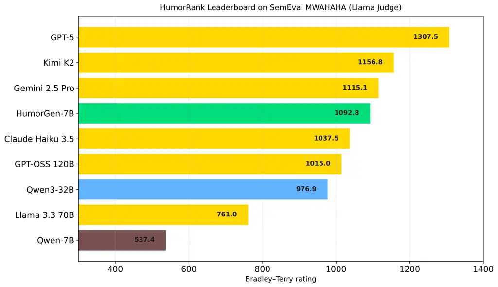

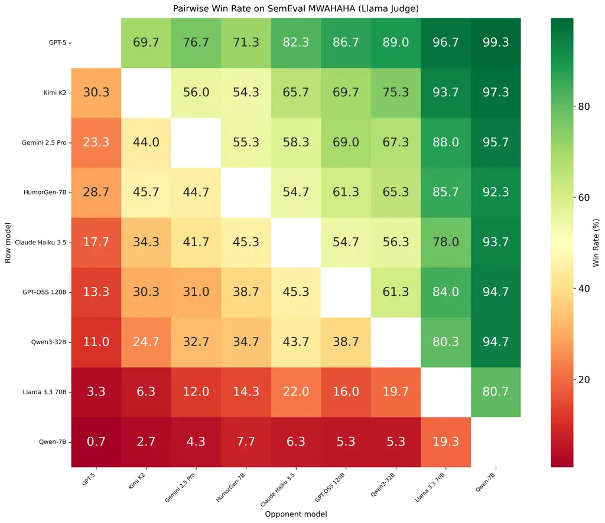

Figure 6: SemEval, Full RR, Llama judge (Table 1). Top: Bradley–Terry
leaderboard with 95% confidence intervals (10,800 judgments). Bottom:
Pairwise win-rate heatmap. Observation: clear frontier/mid/baseline
separation; cross-judge agreement with Qwen Full RR is Kendall
$`\tau=0.889`$.

#### Swiss 3RR ($`\sim`$33% budget).

At 12 pairs/prompt, Swiss 3RR preserves the Full RR ordering at the top
and bottom: GPT-5 remains \#1; Llama 3.3 70B and Qwen 2.5 7B Instruct
remain \#8 and \#9. HumorGen-7B shifts one rank (4$`\rightarrow`$5)
while mid-tier models show modest reordering. Kendall $`\tau`$ vs.
SemEval Full RR is 0.889, and SemEval Llama$`\leftrightarrow`$Qwen
cross-judge $`\tau`$ matches Full RR (0.889; Table 9).

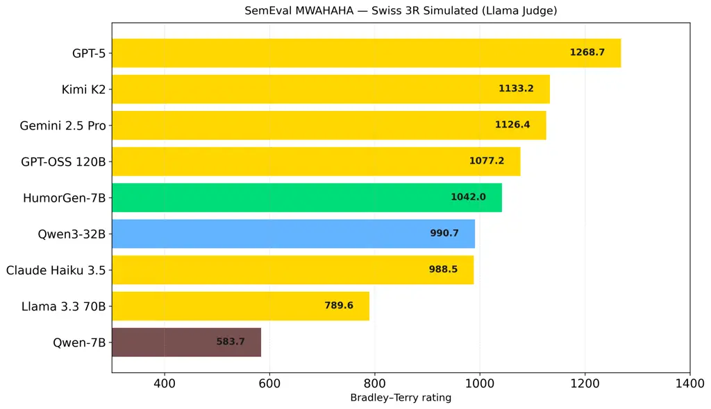

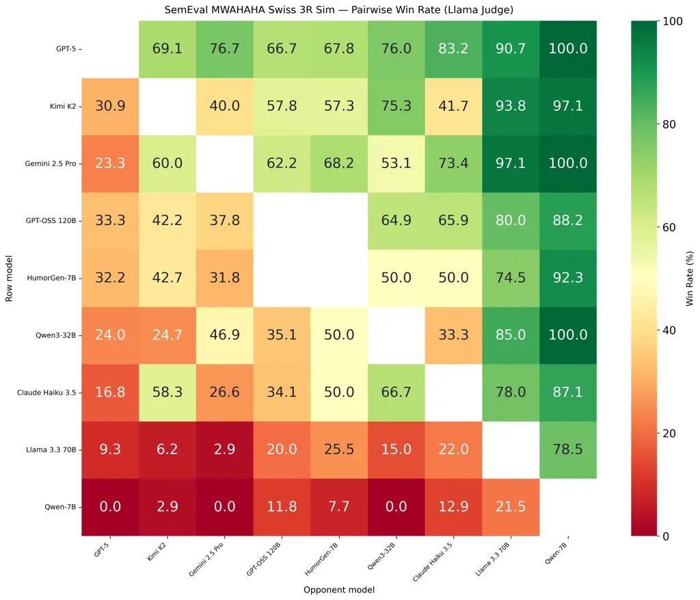

Figure 7: SemEval, Swiss 3RR, Llama judge (Table 12). Top: BT
leaderboard from 3,600 judged pairs. Bottom: Win-rate heatmap.
Observation: Swiss 3RR at one-third of Full RR comparisons recovers the
same cross-judge rank correlation ($`\tau=0.889`$) and keeps anchor
ranks \#1/#8/#9 fixed.

| Rank | Model                | BT Rating | Stable Elo | 95% CI              | Win Rate |
| ---- | -------------------- | --------- | ---------- | ------------------- | -------- |
| 1    | GPT-5                | 1268.7    | 1253.2     | $`[1243.0,1302.7]`$ | 76.7%    |
| 2    | Kimi-K2              | 1133.2    | 1132.7     | $`[1110.8,1160.9]`$ | 63.9%    |
| 3    | Gemini 2.5 Pro       | 1126.4    | 1108.6     | $`[1105.0,1151.3]`$ | 52.8%    |
| 4    | GPT OSS 120B         | 1077.3    | 1086.3     | $`[1048.5,1106.8]`$ | 49.3%    |
| 5    | HumorGen-7B          | 1042.0    | 1058.5     | $`[1012.9,1070.7]`$ | 64.1%    |
| 6    | Qwen 3 32B           | 990.7     | 997.8      | $`[965.5,1021.9]`$  | 35.2%    |
| 7    | Claude 3.5 Haiku     | 988.5     | 987.4      | $`[962.1,1014.6]`$  | 47.9%    |
| 8    | Llama 3.3 70B        | 789.7     | 795.2      | $`[758.1,818.1]`$   | 35.1%    |
| 9    | Qwen 2.5 7B Instruct | 583.7     | 580.3      | $`[537.6,620.0]`$   | 12.4%    |

Table 12: SemEval, Swiss 3RR, Llama judge. Rank $`\tau`$ vs. Full RR
$`=0.889`$; cross-judge $`\tau`$ (Llama vs. Qwen on SemEval) $`=0.889`$.
Anchor ranks \#1, \#8, \#9 unchanged from Table 10.

#### Swiss 2RR ($`\sim`$22% budget).

At 8 pairs/prompt, anchor ranks \#1, \#8, and \#9 remain stable, but
mid-tier ordering becomes noisier (e.g., Kimi K2 2$`\rightarrow`$4,
Gemini 2.5 Pro 3$`\rightarrow`$2, HumorGen-7B 4$`\rightarrow`$6).
SemEval Llama$`\leftrightarrow`$Qwen cross-judge $`\tau`$ drops to 0.667
(Table 9), so we treat Swiss 2RR as a minimum-budget stress test rather
than the recommended scaling mode.

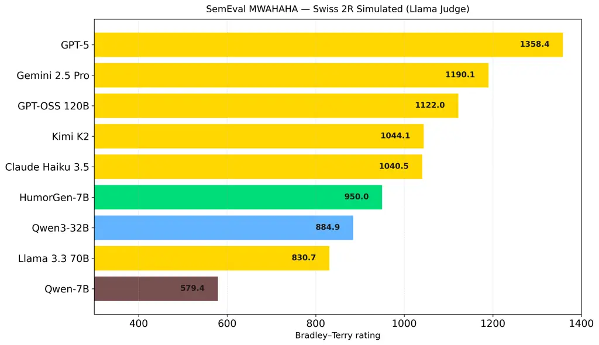

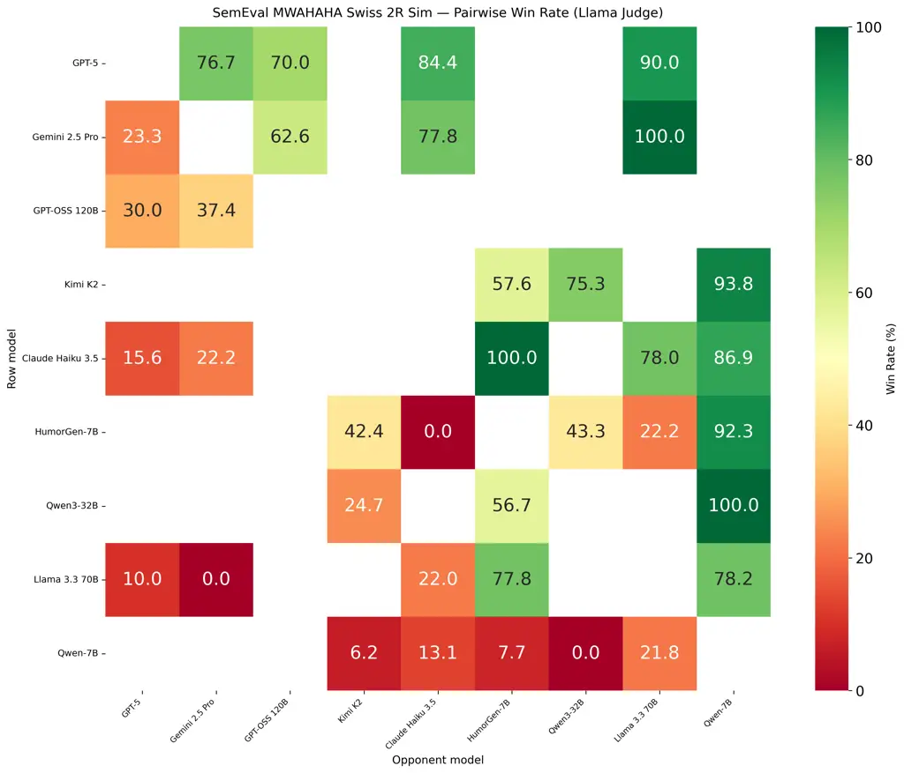

Figure 8: SemEval, Swiss 2RR, Llama judge (Table 13). Top: BT
leaderboard from 2,400 judged pairs. Bottom: Win-rate heatmap.
Observation: lowest-budget mode preserves top/bottom anchors but
increases mid-tier rank volatility and reduces cross-judge agreement
($`\tau=0.667`$).

| Rank | Model                | BT Rating | Stable Elo | 95% CI              | Win Rate |
| ---- | -------------------- | --------- | ---------- | ------------------- | -------- |
| 1    | GPT-5                | 1358.4    | 1307.9     | $`[1304.3,1423.6]`$ | 79.3%    |
| 2    | Gemini 2.5 Pro       | 1190.1    | 1103.0     | $`[1135.1,1246.6]`$ | 45.3%    |
| 3    | GPT OSS 120B         | 1122.0    | 1037.6     | $`[1056.8,1207.7]`$ | 35.7%    |
| 4    | Kimi-K2              | 1044.1    | 1117.4     | $`[985.3,1111.5]`$  | 68.8%    |
| 5    | Claude 3.5 Haiku     | 1040.5    | 1028.4     | $`[993.9,1085.8]`$  | 55.3%    |
| 6    | HumorGen-7B          | 950.0     | 1000.7     | $`[898.4,1008.2]`$  | 66.5%    |
| 7    | Qwen 3 32B           | 884.9     | 960.9      | $`[816.5,957.6]`$   | 31.8%    |
| 8    | Llama 3.3 70B        | 830.7     | 841.7      | $`[790.4,861.7]`$   | 42.3%    |
| 9    | Qwen 2.5 7B Instruct | 579.4     | 602.4      | $`[529.9,631.3]`$   | 13.2%    |

Table 13: SemEval, Swiss 2RR, Llama judge. Cross-judge
Llama$`\leftrightarrow`$Qwen $`\tau=0.667`$; ranks \#1, \#8, and \#9
remain stable (Table 10).

### D.5 HTB budget ablation (Llama judge)

HTB uses 400 held-out headline prompts with the same nine-model pool.
Full RR requires 14,400 judgments per LLM judge; Swiss 3RR and 2RR use
4,800 and 3,200 judgments, respectively. Table 11 summarizes rank
stability across budget modes on this benchmark.

#### Full RR (100% budget).

On HTB Full RR, GPT-5 and Kimi K2 remain in the top two positions;
HumorGen-7B ranks 3rd under the Llama judge; Llama 3.3 70B and Qwen 2.5
7B Instruct remain 8th and 9th. Cross-judge agreement with Qwen Full RR
is Kendall $`\tau=0.889`$ (Table 9).

| Rank | Model                | BT Rating | Stable Elo | 95% CI              | Win Rate |
| ---- | -------------------- | --------- | ---------- | ------------------- | -------- |
| 1    | GPT-5                | 1314.7    | 1300.4     | $`[1301.3,1329.0]`$ | 84.1%    |
| 2    | Kimi K2              | 1242.0    | 1239.1     | $`[1229.5,1255.6]`$ | 77.2%    |
| 3    | HumorGen-7B          | 1097.7    | 1122.8     | $`[1084.4,1109.9]`$ | 60.6%    |
| 4    | Claude 3.5 Haiku     | 1054.2    | 1058.3     | $`[1043.2,1068.5]`$ | 55.1%    |
| 5    | Gemini 2.5 Pro       | 1024.0    | 1009.0     | $`[1010.6,1038.2]`$ | 51.3%    |
| 6    | GPT OSS 120B         | 1009.6    | 1017.2     | $`[998.4,1021.6]`$  | 49.5%    |
| 7    | Qwen 3 32B           | 942.5     | 946.2      | $`[928.1,955.7]`$   | 41.3%    |
| 8    | Llama 3.3 70B        | 791.9     | 795.4      | $`[776.4,808.0]`$   | 24.9%    |
| 9    | Qwen 2.5 7B Instruct | 523.5     | 511.8      | $`[501.8,549.8]`$   | 5.9%     |

Table 14: HTB, Full RR, Llama judge (14,400 judgments). Observation:
ordering mirrors SemEval at the extremes (GPT-5 \#1; Llama/Qwen 2.5 7B
Instruct \#8/#9); HumorGen-7B ranks 3rd on this held-out benchmark.

#### Swiss 3RR ($`\sim`$33% budget).

Swiss 3RR on HTB preserves ranks \#1, \#8, and \#9 and keeps HumorGen-7B
at rank \#3. HTB Llama$`\leftrightarrow`$Qwen cross-judge $`\tau`$
remains 0.889 (Table 9).

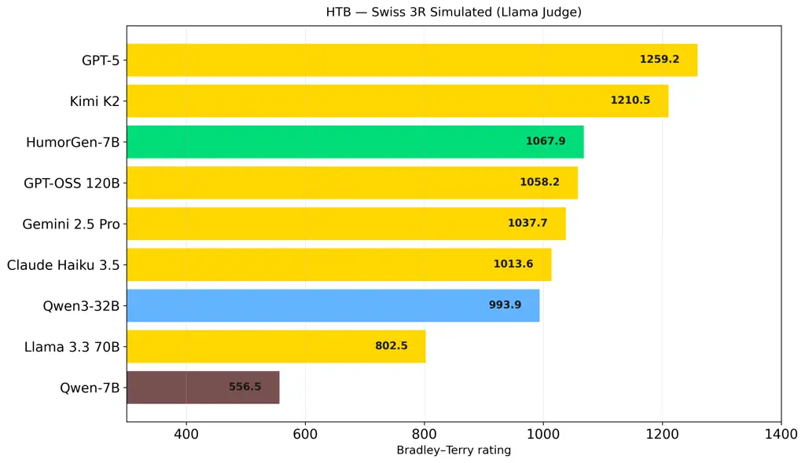

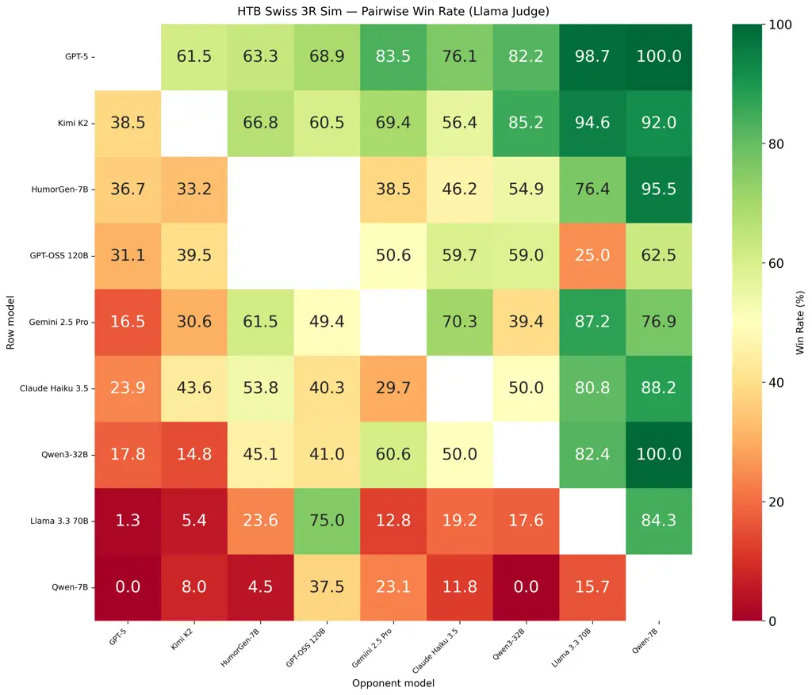

Figure 9: HTB, Swiss 3RR, Llama judge (Table 15). Top: BT leaderboard
from 4,800 judged pairs. Bottom: Win-rate heatmap. Observation:
one-third budget retains HTB anchor ranks and cross-judge stability
($`\tau=0.889`$).

| Rank | Model                | BT Rating | Stable Elo | 95% CI              | Win Rate |
| ---- | -------------------- | --------- | ---------- | ------------------- | -------- |
| 1    | GPT-5                | 1259.2    | 1246.7     | $`[1236.8,1282.7]`$ | 76.7%    |
| 2    | Kimi K2              | 1210.5    | 1204.0     | $`[1188.5,1236.0]`$ | 71.4%    |
| 3    | HumorGen-7B          | 1067.9    | 1055.4     | $`[1040.1,1094.1]`$ | 63.9%    |
| 4    | GPT OSS 120B         | 1058.2    | 1062.8     | $`[1032.3,1088.9]`$ | 50.9%    |
| 5    | Gemini 2.5 Pro       | 1037.7    | 1056.0     | $`[1018.5,1061.0]`$ | 42.2%    |
| 6    | Claude 3.5 Haiku     | 1013.6    | 1025.1     | $`[986.8,1036.6]`$  | 51.6%    |
| 7    | Qwen 3 32B           | 993.9     | 988.3      | $`[971.5,1020.2]`$  | 32.5%    |
| 8    | Llama 3.3 70B        | 802.5     | 789.4      | $`[778.3,827.1]`$   | 35.7%    |
| 9    | Qwen 2.5 7B Instruct | 556.5     | 572.4      | $`[507.5,595.1]`$   | 10.4%    |

Table 15: HTB, Swiss 3RR, Llama judge. Ranks \#1, \#3 (HumorGen-7B),
\#8, and \#9 match Full RR anchors; cross-judge HTB $`\tau=0.889`$.

#### Swiss 2RR ($`\sim`$22% budget).

At minimum budget, HTB anchor ranks \#1, \#8, and \#9 remain fixed, but
HumorGen-7B drops from \#3 to \#6 and mid-tier models reorder. Notably,
HTB Llama$`\leftrightarrow`$Qwen $`\tau`$ rises to 1.000 at 2RR
(Table 9), a benchmark-specific effect we attribute to reduced
comparison density rather than improved ranking fidelity.

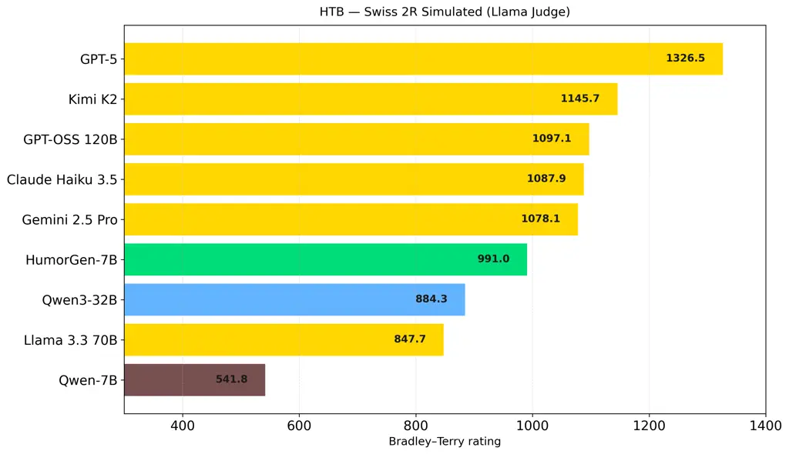

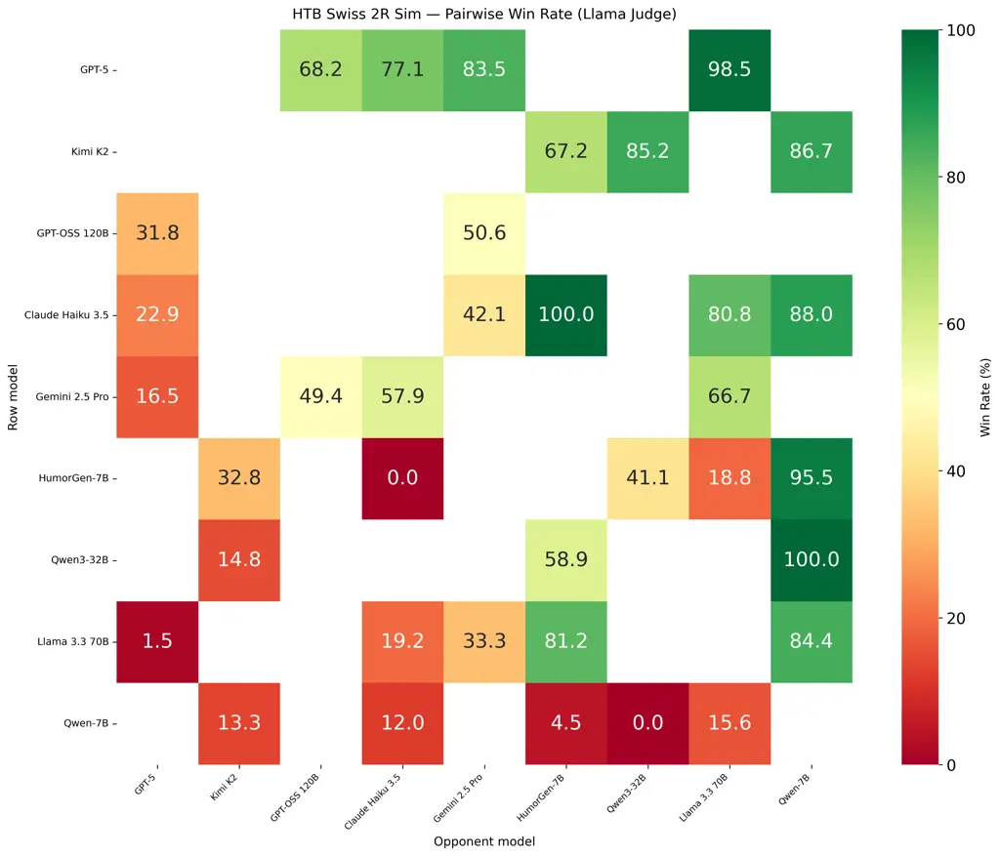

Figure 10: HTB, Swiss 2RR, Llama judge (Table 16). Top: BT leaderboard
from 3,200 judged pairs. Bottom: Win-rate heatmap. Observation: anchor
ranks hold, but specialist mid-tier placement becomes less stable
(HumorGen-7B 3$`\rightarrow`$6).

| Rank | Model                | BT Rating | Stable Elo | 95% CI              | Win Rate |
| ---- | -------------------- | --------- | ---------- | ------------------- | -------- |
| 1    | GPT-5                | 1326.5    | 1303.3     | $`[1274.5,1386.9]`$ | 81.4%    |
| 2    | Kimi K2              | 1145.7    | 1180.1     | $`[1077.0,1208.1]`$ | 77.3%    |
| 3    | GPT OSS 120B         | 1097.1    | 1043.6     | $`[1032.3,1163.1]`$ | 47.5%    |
| 4    | Claude 3.5 Haiku     | 1087.9    | 1072.2     | $`[1046.1,1137.9]`$ | 59.5%    |
| 5    | Gemini 2.5 Pro       | 1078.1    | 1051.7     | $`[1024.0,1138.7]`$ | 33.8%    |
| 6    | HumorGen-7B          | 991.0     | 1025.6     | $`[936.6,1052.7]`$  | 64.4%    |
| 7    | Qwen 3 32B           | 884.3     | 941.2      | $`[807.2,962.0]`$   | 20.7%    |
| 8    | Llama 3.3 70B        | 847.7     | 829.9      | $`[813.1,888.8]`$   | 44.1%    |
| 9    | Qwen 2.5 7B Instruct | 541.8     | 552.5      | $`[490.5,583.7]`$   | 9.6%     |

Table 16: HTB, Swiss 2RR, Llama judge. Anchor ranks \#1/#8/#9 stable;
HumorGen-7B drops 3$`\rightarrow`$6 vs. Full RR. Cross-judge HTB
$`\tau=1.000`$ at this budget (Table 9).

### D.6 HTB budget ablation (Qwen judge)

We replicate the HTB Full RR and Swiss budget modes under the Qwen judge
to confirm cross-LLM-judge patterns on the held-out benchmark.

#### Full RR (100% budget).

Qwen judge HTB Full RR agrees with Llama judge HTB at Kendall
$`\tau=0.889`$; GPT-5 and Kimi K2 remain top-two, with HumorGen-7B 4th
(vs. 3rd under the Llama judge).

| Rank | Model                | BT Rating | Stable Elo | 95% CI              | Win Rate |
| ---- | -------------------- | --------- | ---------- | ------------------- | -------- |
| 1    | GPT-5                | 1245.7    | 1278.6     | $`[1234.5,1258.7]`$ | 78.8%    |
| 2    | Kimi K2              | 1199.5    | 1205.3     | $`[1187.2,1211.7]`$ | 73.8%    |
| 3    | Claude 3.5 Haiku     | 1101.4    | 1094.1     | $`[1089.4,1114.0]`$ | 61.8%    |
| 4    | HumorGen-7B          | 1099.8    | 1099.2     | $`[1086.1,1115.0]`$ | 61.6%    |
| 5    | GPT OSS 120B         | 1024.3    | 1015.9     | $`[1013.4,1037.9]`$ | 51.7%    |
| 6    | Gemini 2.5 Pro       | 1001.3    | 990.4      | $`[989.4,1013.7]`$  | 48.8%    |
| 7    | Qwen 3 32B           | 951.4     | 951.5      | $`[941.2,964.7]`$   | 42.4%    |
| 8    | Llama 3.3 70B        | 757.7     | 746.2      | $`[743.1,773.5]`$   | 21.1%    |
| 9    | Qwen 2.5 7B Instruct | 618.9     | 618.7      | $`[601.0,634.4]`$   | 10.1%    |

Table 17: HTB, Full RR, Qwen judge (14,400 judgments). Observation:
cross-judge HTB $`\tau=0.889`$ vs. Table 14; bottom-two ranks unchanged.

#### Swiss 3RR ($`\sim`$33% budget).

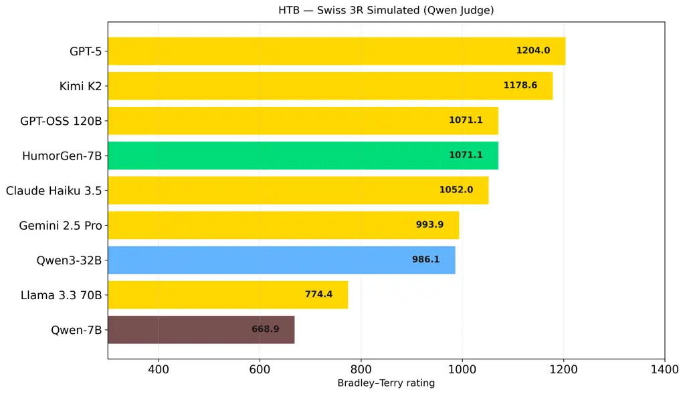

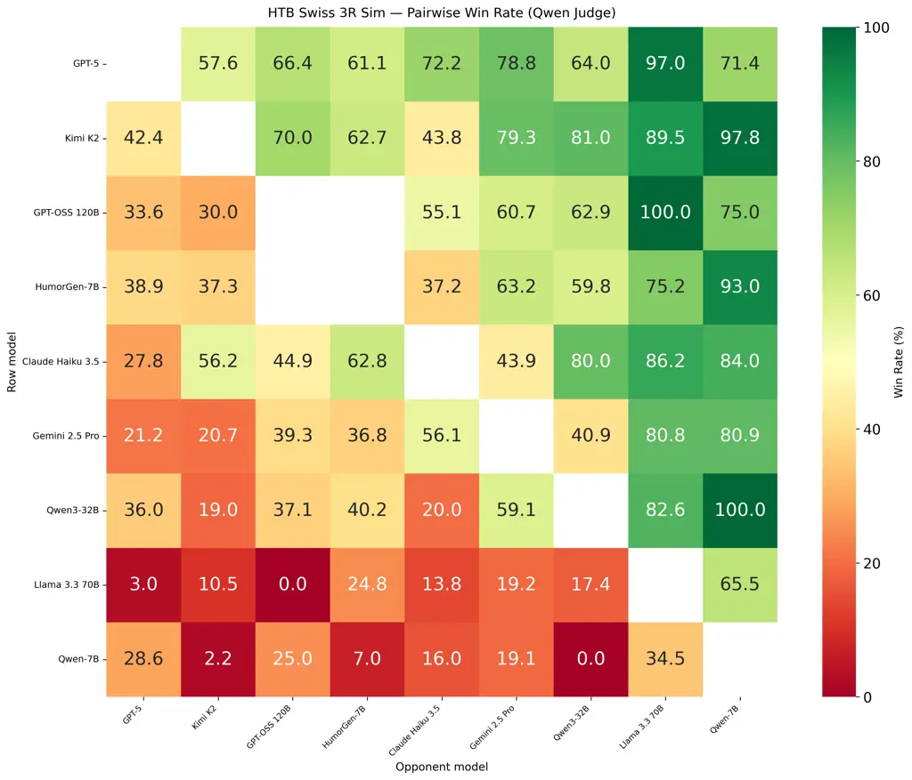

Figure 11: HTB, Swiss 3RR, Qwen judge (Table 18). Top: BT leaderboard
from 4,800 judged pairs. Bottom: Win-rate heatmap. Observation:
GPT-5/Kimi remain top-two; Llama/Base Qwen stay \#8/#9; HumorGen-7B
remains top-tier (#4).

| Rank | Model                | BT Rating | Stable Elo | 95% CI              | Win Rate |
| ---- | -------------------- | --------- | ---------- | ------------------- | -------- |
| 1    | GPT-5                | 1204.0    | 1207.1     | $`[1182.2,1228.7]`$ | 72.1%    |
| 2    | Kimi K2              | 1178.6    | 1182.5     | $`[1158.3,1199.0]`$ | 69.9%    |
| 3    | GPT OSS 120B         | 1071.1    | 1064.0     | $`[1045.8,1100.2]`$ | 55.1%    |
| 4    | HumorGen-7B          | 1071.1    | 1081.3     | $`[1043.8,1098.1]`$ | 64.4%    |
| 5    | Claude 3.5 Haiku     | 1052.0    | 1053.2     | $`[1034.1,1078.3]`$ | 57.6%    |
| 6    | Gemini 2.5 Pro       | 993.9     | 1004.3     | $`[975.0,1016.3]`$  | 37.4%    |
| 7    | Qwen 3 32B           | 986.1     | 984.4      | $`[962.4,1008.9]`$  | 34.7%    |
| 8    | Llama 3.3 70B        | 774.4     | 760.6      | $`[749.1,797.7]`$   | 30.8%    |
| 9    | Qwen 2.5 7B Instruct | 668.9     | 662.6      | $`[634.9,699.7]`$   | 18.5%    |

Table 18: HTB, Swiss 3RR, Qwen judge. Cross-judge HTB $`\tau=0.889`$;
anchor ranks \#1/#8/#9 stable vs. Qwen Full RR.

#### Swiss 2RR ($`\sim`$22% budget).

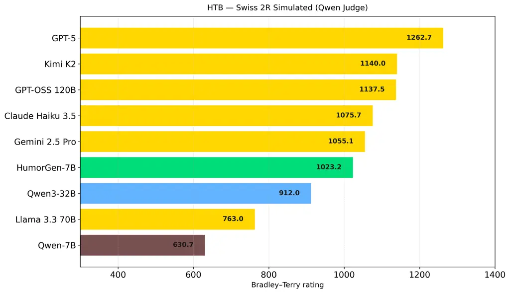

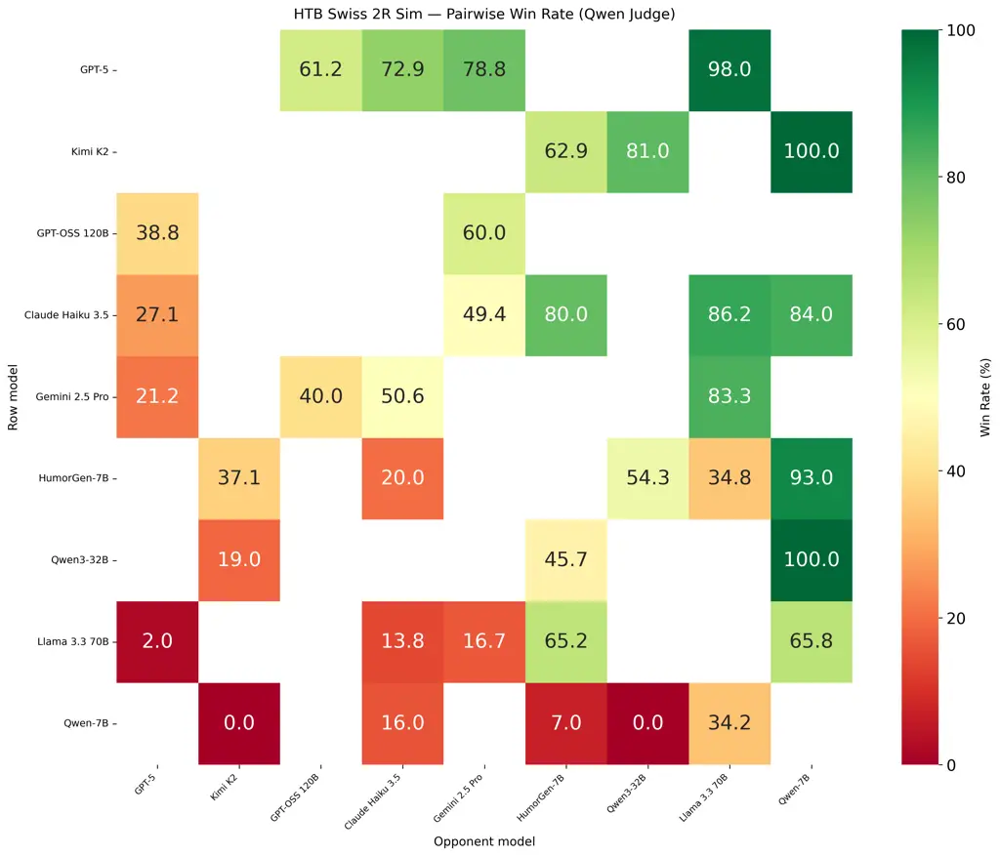

Figure 12: HTB, Swiss 2RR, Qwen judge (Table 19). Top: BT leaderboard
from 3,200 judged pairs. Bottom: Win-rate heatmap. Observation:
minimum-budget HTB run preserves top/bottom anchors but increases
mid-tier volatility, consistent with the Llama judge Swiss 2RR pattern.

| Rank | Model                | BT Rating | Stable Elo | 95% CI              | Win Rate |
| ---- | -------------------- | --------- | ---------- | ------------------- | -------- |
| 1    | GPT-5                | 1262.7    | 1239.4     | $`[1221.6,1315.4]`$ | 76.1%    |
| 2    | Kimi K2              | 1140.0    | 1166.5     | $`[1077.3,1196.3]`$ | 74.0%    |
| 3    | GPT OSS 120B         | 1137.6    | 1098.8     | $`[1092.1,1196.4]`$ | 55.5%    |
| 4    | Claude 3.5 Haiku     | 1075.7    | 1057.5     | $`[1035.0,1113.9]`$ | 62.7%    |
| 5    | Gemini 2.5 Pro       | 1055.1    | 1045.2     | $`[1016.5,1106.4]`$ | 32.0%    |
| 6    | HumorGen-7B          | 1023.2    | 1057.8     | $`[972.7,1061.8]`$  | 66.4%    |
| 7    | Qwen 3 32B           | 912.0     | 948.1      | $`[850.6,959.9]`$   | 23.9%    |
| 8    | Llama 3.3 70B        | 763.0     | 746.8      | $`[731.4,797.7]`$   | 35.5%    |
| 9    | Qwen 2.5 7B Instruct | 630.7     | 639.9      | $`[587.0,668.7]`$   | 18.2%    |

Table 19: HTB, Swiss 2RR, Qwen judge. Anchor ranks \#1/#8/#9 stable;
HumorGen-7B 4$`\rightarrow`$6 vs. Qwen Full RR. Cross-judge HTB
$`\tau=1.000`$ (Table 9).

## Appendix E Adaptive Swiss Pairing Algorithm

Algorithm 1 specifies pair scheduling only; final leaderboard ratings
are computed separately using global Bradley–Terry MLE on the collected
match graph. In line with the main-text definition of under-sampled
pairs, the coverage count in line 901 is the observed duel count for
$`(i,j)`$ in $`G`$; ASP prefers partners with the lowest count among
near-equal-strength candidates.

1: Set of models $`\mathcal{M}`$, prompt set $`\mathcal{H}`$, max
comparisons $`C_{max}`$, temporary pairing scores $`S`$

2: Initialize match-history multigraph $`G`$ with per-prompt pair counts
$`c_{ijh}\leftarrow 0`$

3: while total recorded matches in $`G<C_{max}`$ do

4:   Sort $`\mathcal{M}`$ descending by temporary pairing scores $`S`$

5:   Initialize unmatched subset $`U\leftarrow\mathcal{M}`$

6:   Initialize round pairings $`Q\leftarrow\emptyset`$

7:   while $`|U|\geq 2`$ do

8:    $`i\leftarrow`$ highest-rated model in $`U`$

9:    Find $`j\in U\setminus\{i\}`$ minimizing $`|S_{i}-S_{j}|`$ with
lowest coverage count in $`G`$

10:    if valid match $`j`$ exists then

11:      $`Q\leftarrow Q\cup\{(i,j)\}`$

12:      $`U\leftarrow U\setminus\{i,j\}`$

13:    else

14:      $`j\leftarrow`$ least-played feasible partner in
$`U\setminus\{i\}`$ $`\triangleright`$ progress fallback

15:      $`Q\leftarrow Q\cup\{(i,j)\}`$

16:      $`U\leftarrow U\setminus\{i,j\}`$

17:    end if

18:   end while

19:   Execute LLM-as-a-judge evaluations for all pairs in $`Q`$ on
selected prompts

20:   Increment corresponding per-prompt counts in $`G`$

21:   Update temporary pairing scores $`S`$ using observed outcomes

22: end while

23: return Global match history graph $`G`$ $`\triangleright`$ final
ratings computed later via BT MLE

Algorithm 1 Adaptive Swiss Pairing for Tournament Evaluation

## Appendix F Synthetic ASP Scaling Stress Test

The main paper validates ASP on a real humor tournament at $`K{=}9`$
(Full RR leaderboards; Swiss 2RR/3RR budget ablation). Collecting jokes
from $`10^{4}`$–$`10^{5}`$ generators is impractical, so we additionally
stress-test the _scheduler and rank estimator_ in a synthetic
Bradley–Terry (BT) world that requires no jokes and no LLM calls. This
appendix supports ASP as a scaling contribution; it does _not_ claim a
humor-quality ranking over $`10^{5}`$ real models.

#### Setup:

Each of $`K`$ contestants has a known latent strength on an evenly
spaced ladder. Every scheduled duel is drawn from the logistic BT model
$`\mathbb{P}(i\succ j)=\sigma(\theta_{i}-\theta_{j})`$. ASP builds the
match graph under two budgets: (i) fixed Swiss 3RR with $`R{=}3`$ (at
$`K{=}9`$: $`C_{\max}{=}12`$, i.e. $`\sim`$33% of Full RR, matching
Section 5.3), which is $`\mathcal{O}(K)`$ pairs/prompt; (ii) optional
denser $`R{=}\lceil\log_{2}K\rceil`$, which is $`\mathcal{O}(K\log K)`$
pairs/prompt. Rankings are recovered by BT MLE for $`K\leq 500`$ and Elo
for larger $`K`$. We report graph connectivity, Spearman $`\rho`$, and
Kendall $`\tau`$ versus the latent order. Exact ASP (Algorithm 1) is
used for $`K\leq 1000`$; a windowed coverage-aware approximation is used
beyond that for computational tractability.

#### Results:

Table 20 summarizes the stress test. Under both budgets the union match
graph remains connected through $`K{=}10^{5}`$. Swiss 3RR already
recovers the latent order with high fidelity at the paper’s operating
point ($`K{=}9`$: $`\rho{=}0.983`$, $`\tau{=}0.944`$) and remains
informative at extreme scale ($`K{=}10^{5}`$: $`\rho{=}0.906`$). The
optional $`\mathcal{O}(K\log K)`$ schedule further improves large-$`K`$
recovery (e.g., $`\rho{=}0.972`$ at $`K{=}10^{5}`$) while still using
orders of magnitude fewer comparisons than Full RR
($`\binom{10^{5}}{2}\!\approx\!5{\times}10^{9}`$ pairs/prompt vs.
$`8.5{\times}10^{5}`$ under $`R{=}17`$).

| $`K`$   | $`R`$ | Mode     | Pairs/prompt | Budget % | $`\rho`$ | $`\tau`$ |
| ------- | ----- | -------- | ------------ | -------- | -------- | -------- |
| 9       | 3     | exact    | 12           | 33.3     | 0.983    | 0.944    |
| 9       | 4     | exact    | 18           | 50.0     | 0.983    | 0.944    |
| 100     | 3     | exact    | 150          | 3.0      | 0.998    | 0.971    |
| 1,000   | 3     | exact    | 1,500        | 0.30     | 0.987    | 0.904    |
| 1,000   | 10    | exact    | 5,000        | 1.0      | 0.997    | 0.955    |
| 10,000  | 3     | windowed | 15,000       | 0.03     | 0.948    | 0.802    |
| 10,000  | 14    | windowed | 70,000       | 0.14     | 0.990    | 0.911    |
| 50,000  | 3     | windowed | 75,000       | 0.01     | 0.915    | 0.747    |
| 50,000  | 16    | windowed | 400,000      | 0.03     | 0.962    | 0.829    |
| 100,000 | 3     | windowed | 150,000      | 0.003    | 0.906    | 0.732    |
| 100,000 | 17    | windowed | 850,000      | 0.017    | 0.972    | 0.851    |

Table 20: Synthetic ASP scaling (no jokes/LLM). Outcomes from a latent
BT ladder; rankings recovered by BT-MLE ($`K\leq 500`$) or Elo
($`K>500`$). At $`K{=}9`$, $`R{=}3`$ uses the paper Swiss 3RR budget of
12 pairs/prompt ($`\sim`$33% of Full RR). All listed graphs are
connected. $`R{=}3`$ is $`\mathcal{O}(K)`$;
$`R{=}\lceil\log_{2}K\rceil`$ is $`\mathcal{O}(K\log K)`$.

#### Interpretation and scope:

Swiss 3RR is the practical cheap mode ($`\mathcal{O}(K)`$), not an
$`\mathcal{O}(K\log K)`$ claim. The $`\mathcal{O}(K\log K)`$ column is
an optional denser schedule for very large pools. Real humor evidence
for ASP remains the $`K{=}9`$ Full RR/Swiss ablation; Table 20 shows
that the same budgeting rules continue to yield usable comparison graphs
and recoverable rankings as $`K`$ grows under a controlled preference
model.

## Appendix G HumorRank Leaderboard Performance with Qwen 2.5 72B LLM Judge

To validate the stability of our primary SemEval leaderboard (Llama
judge), we replicate the same 10,800 SemEval duels with Qwen 2.5 72B
Instruct as a secondary LLM judge. Figure 13 and Table 21 present the
resulting Bradley–Terry leaderboard ($`\tau=0.889`$ vs. SemEval panel of
Table 1).

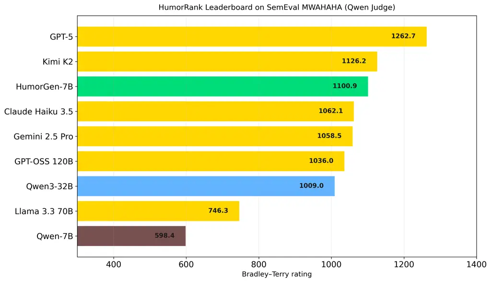

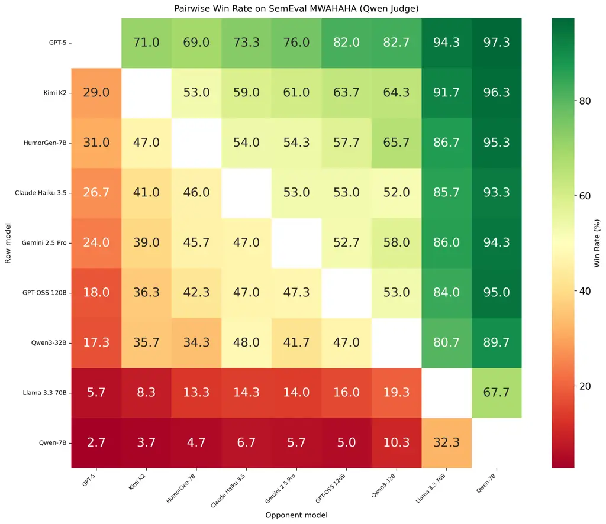

Figure 13: SemEval, Full RR, Qwen judge (Table 21; Kendall
$`\tau=0.889`$ vs. SemEval panel of Table 1). Top: Bradley–Terry
leaderboard with 95% confidence intervals (10,800 judgments). Bottom:
Pairwise win-rate heatmap. Observation: GPT-5 and Kimi K2 remain ranks
1–2; Llama 3.3 70B and Qwen 2.5 7B Instruct remain ranks 8–9;
HumorGen-7B moves 4$`\rightarrow`$3 and Gemini 2.5 Pro 3$`\rightarrow`$5
vs. the Llama judge, consistent with modest mid-tier reordering at
$`\tau=0.889`$.

|      |                                                                                  |           |            |                     |          |
| ---- | -------------------------------------------------------------------------------- | --------- | ---------- | ------------------- | -------- |
| Rank | Model                                                                            | BT Rating | Stable Elo | 95% CI              | Win Rate |
| 1    | GPT-5                                                                            | 1262.7    | 1267.7     | $`[1246.2,1279.8]`$ | 80.7%    |
| 2    | Kimi-K2                                                                          | 1126.2    | 1135.8     | $`[1113.8,1140.2]`$ | 64.8%    |
| 3    | HumorGen-7B¹¹ 1 Referred to HumorGen-7B as HumorGen SFT 7B in plots and figures. | 1100.9    | 1092.1     | $`[1088.5,1114.9]`$ | 61.5%    |
| 4    | Claude 3.5 Haiku                                                                 | 1062.1    | 1062.4     | $`[1049.4,1074.9]`$ | 56.3%    |
| 5    | Gemini 2.5 Pro                                                                   | 1058.5    | 1068.4     | $`[1044.0,1070.4]`$ | 55.8%    |
| 6    | GPT OSS 120B                                                                     | 1036.0    | 1036.2     | $`[1023.5,1054.1]`$ | 52.9%    |
| 7    | Qwen 3 32B                                                                       | 1009.0    | 997.1      | $`[993.8,1026.2]`$  | 49.3%    |
| 8    | Llama 3.3 70B                                                                    | 746.3     | 740.7      | $`[725.1,761.7]`$   | 19.8%    |
| 9    | Qwen 2.5 7B Instruct                                                             | 598.4     | 599.6      | $`[578.4,624.4]`$   | 8.9%     |

Table 21: SemEval, Full RR, Qwen judge (10,800 judgments). BT ratings
are primary; Stable Elo is a sequence-robust audit metric (Appendix L).
Observation: Kendall $`\tau=0.889`$ vs. SemEval panel of Table 1; anchor
ranks \#1/#8/#9 match the Llama judge; HumorGen-7B ranks 3rd (vs. 4th
under the Llama judge).

## Appendix H Llama Judge Sample Decisions

Below are four representative Llama judge (Llama 3.3 70B Instruct)
decisions from SemEval match logs, selected to span outcome types
(frontier vs. mid-tier, specialist vs. baseline, and tie-adjacent
splits). Each pair shows the preferred joke (green) against the rejected
entry (red), together with the LLM judge’s reasoning and approximate Elo
updates from the online pairing log (audit only; final leaderboard
ratings use global Bradley–Terry MLE).


Headline: ‘We did it!’: Countries celebrate World Cup qualification

Reasoning: Joke A has a more relatable and unexpected twist: the concept
of “not washing lucky socks” as a claimed contribution to the team’s
success makes it more humorous and engaging.


Headline: ‘Mind-blowing’ population of feral goldfish in Ottawa pond to
be euthanized

Reasoning: Joke A uses a clever play on words with ‘mind-blowing’ and
creates a vivid, absurd image; Joke B relies on a more straightforward
and less surprising punchline.


Headline: Three-quarters of parents let children miss school for ‘duvet
day’

Reasoning: Joke B has a more complex and layered structure: the fraction
wordplay (“three-quarters is exactly the blanket-to-face ratio”) adds an
extra dimension of sarcasm and irony over Joke A’s simpler setup.


Headline: How to design an aesthetic home office that boosts
productivity

Reasoning: Both jokes rely on irony and sarcasm, but Joke A’s darker,
more unexpected twist, “the exact shade of my laptop screen at 3 a.m.
(black with a faint glow of regret)”, is more surprising and absurd.


Figure 14: Four representative LLaMA judge decisions. Winner ✓ (green)
and Loser $`\times`$ (red) are labelled directly on each joke box.
Feature rows indicate winning humor traits (green), delivery strengths
(blue), and loser weaknesses (red). ELO deltas are approximated from the
evaluation log.

## Appendix I Hyperparameter Configurations

Standardized hyperparameters across the HumorRank tournament are
detailed in Table 22 (candidate generation), Table 23 (LLM pairwise
judging), and Table 24 (Bradley–Terry and Elo audit settings). Primary
Llama-judge Full RR pipelines (SemEval and HTB; 25,200 pairwise calls
per LLM judge across both benchmarks) used NVIDIA H100 (80GB) GPU
inference and/or hosted LLM APIs; Qwen-judge replication required
additional inference budget. Offline rating replay from the anonymized
supplementary match logs requires only CPU Python $`\geq`$ 3.10 with
NumPy (and the krippendorff package for human-eval $`\alpha`$).

| Parameter      | Value                                                                                                                                                                    |
| -------------- | ------------------------------------------------------------------------------------------------------------------------------------------------------------------------ |
| Temperature    | 0.7                                                                                                                                                                      |
| Top-$`p`$      | 0.9                                                                                                                                                                      |
| Max New Tokens | 256                                                                                                                                                                      |
| System Prompt  | ”You are a joke generator. Given a headline or topic, generate a funny joke. Output ONLY the joke text. No thinking tags, no reasoning, no explanation, no extra words.” |

Table 22: Hyperparameters for candidate humor generation across all
local and API-based models.

| Parameter      | Value                  |
| -------------- | ---------------------- |
| Primary Judge  | Llama 3.3 70B Instruct |
| Ablation Judge | Qwen 2.5 72B Instruct  |
| Temperature    | 0.1                    |
| Max New Tokens | 512                    |
| Max Retries    | 3                      |
| Backoff Base   | 2.0                    |
| Retry Cap      | 4.0                    |

Table 23: Hyperparameters for LLM-as-a-Judge adjudication.

| Parameter                     | Value       |
| ----------------------------- | ----------- |
| Initial Elo Rating            | 1000.0      |
| $`K`$-factor                  | 32          |
| Min Rounds per Model          | 2           |
| Max Rounds per Model          | 3           |
| Stable Elo Shuffles           | 10          |
| BT Convergence ($`\epsilon`$) | $`10^{-6}`$ |
| Bootstrap Iterations          | 200         |
| Bootstrap Resampling Seed     | 42          |

Table 24: Tournament configuration and Bradley–Terry global MLE
parameters.

## Appendix J Qualitative Examples and Feature Reasoning

The main paper focuses on aggregate feature patterns (Figures 2–3).
Appendix H provides representative LLM judge rationales drawn from
SemEval match logs. Qwen judge feature distributions are below.

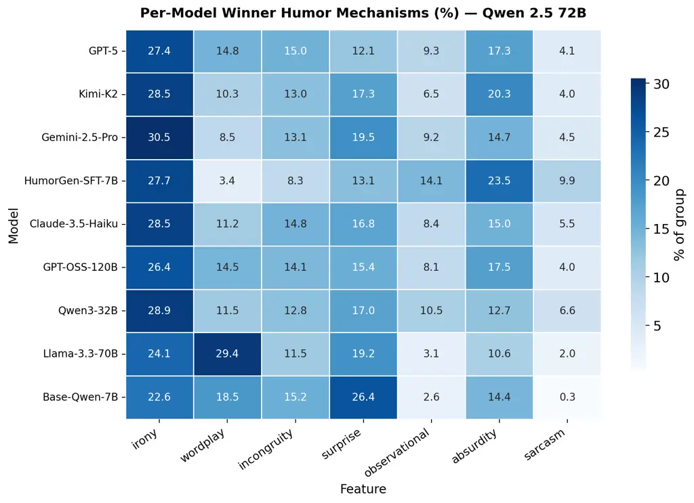

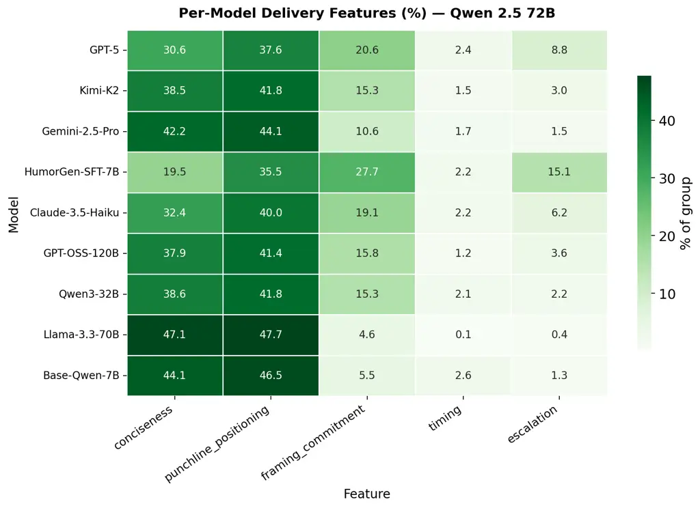

Figure 15: Qwen judge: per-model winning feature distributions. Top:
Humor mechanisms (% of wins). Bottom: Delivery features (% of wins).
Tags are co-emitted with duel outcomes in the structured LLM judge
response. Rank patterns are consistent with the primary Llama judge
(Figures 2 and 3).

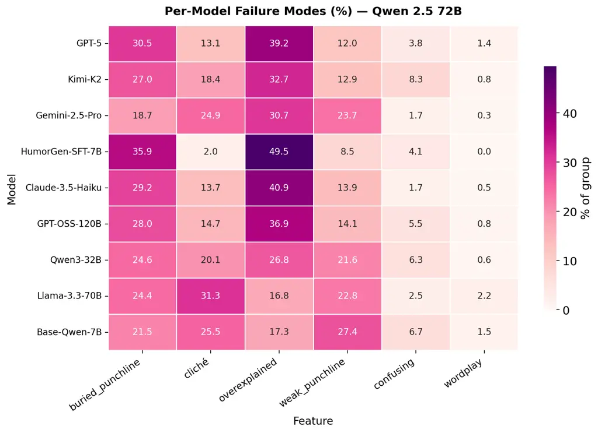

Figure 16: Qwen judge: per-model failure mode distributions (% of
losses). HumorGen-7B again shows markedly higher Overexplained (49.5%)
rates than other models, consistent with the primary Llama judge
(Figure 4).

### J.1 Key Observations (Qwen vs. Llama LLM judges)

Relative to the primary Llama judge (Figures 2 and 3), the Qwen judge
preserves the same tier structure but shifts tag weights modestly on
mid-tier models:

1.  1.  HumorGen-SFT-7B shows the largest judge-specific gap: Absurdity is
        25.9% under the Llama judge vs. 23.5% under the Qwen judge, while
        Overexplained loser tags remain elevated under both LLM judges
        (Figure 16).
2.  2.  Baseline open-weight models (Base-Qwen-7B, Llama-3.3-70B) show
        near-identical mechanism and delivery profiles across judges,
        reinforcing that bottom-tier separation is judge-invariant.
3.  3.  Frontier models (GPT-5, Kimi-K2) retain high Incongruity and
        Conciseness under both LLM judges; the Qwen judge assigns slightly
        higher Wordplay shares to GPT-5 wins than the Llama judge does.

## Appendix K Human Evaluation Details

#### Pair selection and $`\alpha`$ computation.

The 90-pair evaluation set (Tables 3 and 4) comprises curated
funny-versus-funny blind comparisons over 75 unique headlines,
stratified by comparison type as in Table 3. Three blind human
annotators (denoted H₁, H₂, and H₃) independently re-rated anonymized
joke pairs; each vote is coded as a nominal winner-model label.
Krippendorff’s $`\alpha`$ (Krippendorff, 2011) is computed on the
resulting annotator$`\times`$pair matrix, with incomplete overlap
handled natively. In Table 4, H\_(i) indexes human annotators, while
Llama and Qwen denote the production LLM judges (Llama 3.3 70B and Qwen
2.5 72B Instruct).

#### Instructions to participants.

Annotators saw the headline, two anonymized jokes (Option A and Option
B), and chose which was funnier or declared a tie. Model identities were
hidden; left/right order was randomized per pair.

#### Participants.

Three annotators were recruited by invitation (Master’s students with
native or near-native English proficiency and prior coursework or
research exposure to humor and NLP). They rated the 90-pair evaluation
set without payment. We index them as H₁–H₃ in Table 4.

#### Inter-Annotator Reliability.

We use Krippendorff’s Alpha ($`\alpha`$) for nominal data with multiple
annotators and incomplete overlap:

```math
\alpha=1-\frac{D_{o}}{D_{e}} \tag{3}
```

where $`D_{o}`$ is observed disagreement and $`D_{e}`$ is expected
chance disagreement. Cohort-level $`\alpha`$ values are reported in
Table 4. The Fisher exact test in §5.4 compares human–human and
human–Llama agreement on annotator dyad H₂+H₃ over the same
judge-labeled pairs ($`p=0.808`$).

## Appendix L Stable Elo Shuffle Audit

To validate the robustness of the derived Elo ratings against
sequence-dependence (often referred to as “late-winner bias” in streamed
continuous tournaments), HumorRank uses a Stable Elo variant grounded in
order-independent aggregation (Albers & Vries, 2001).

In standard sequential Elo implementations, a model $`m`$ updates its
rating $`R_{m}`$ after a sequence of matches based on the standard
iterative update rule:

```math
R_{m}^{(t+1)}=R_{m}^{(t)}+K\cdot(S-E_{m}) \tag{4}
```

where $`t`$ indexes the chronological order of the match. Consequently,
a model earning a win at the end of the match history block gains an
inherently outsized advantage over a model that earned an identical win
early in the sequence.

To substantially reduce this temporal artifact, we strip the time
dependencies by evaluating the match history $`H`$ across $`N`$
independently shuffled topological permutations. The stable terminal
rating $`\bar{R}_{m}`$ for each model $`m`$ is defined as the arithmetic
mean across all sequences:

```math
\bar{R}_{m}=\frac{1}{N}\sum_{k=1}^{N}R_{m,k}^{(T)} \tag{5}
```

where $`R_{m,k}^{(T)}`$ represents the final rating of model $`m`$ after
iterating through all $`T=10,800`$ matches in the $`k`$-th shuffled
permutation.

In our experiments, we set $`N=10`$ as the shuffle count used for the
reported audit statistics. To empirically quantify residual order
sensitivity, we measured the standard deviation of final ratings across
the permutations:

```math
\sigma_{m}=\sqrt{\frac{1}{N}\sum_{k=1}^{N}\left(R_{m,k}^{(T)}-\bar{R}_{m}\right)^{2}} \tag{6}
```

Tracking this distribution across both the primary (Llama 3.3 70B) and
validation (Qwen 2.5 72B) judges for all 9 contestants yielded the
following internal stability metrics on a base 1000-point scale:

- •
  Maximum Variance: Bounded strictly at $`\sigma_{max}=37.5`$ Elo points
  across all models.
- •
  Mean Variance: Clustered tightly around $`\bar{\sigma}\approx 29.5`$
  Elo points.

Given that inter-model spreads on the leaderboard exceed 200 points,
this stringent empirical result ($`\sigma<38.0`$) indicates that
ordering effects are small relative to between-model separation in this
study.
