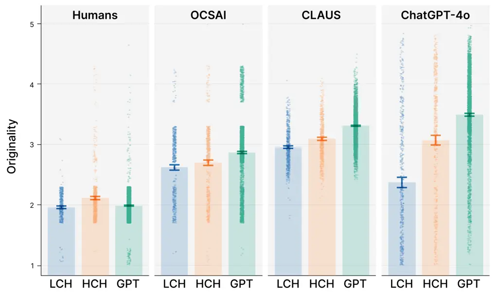
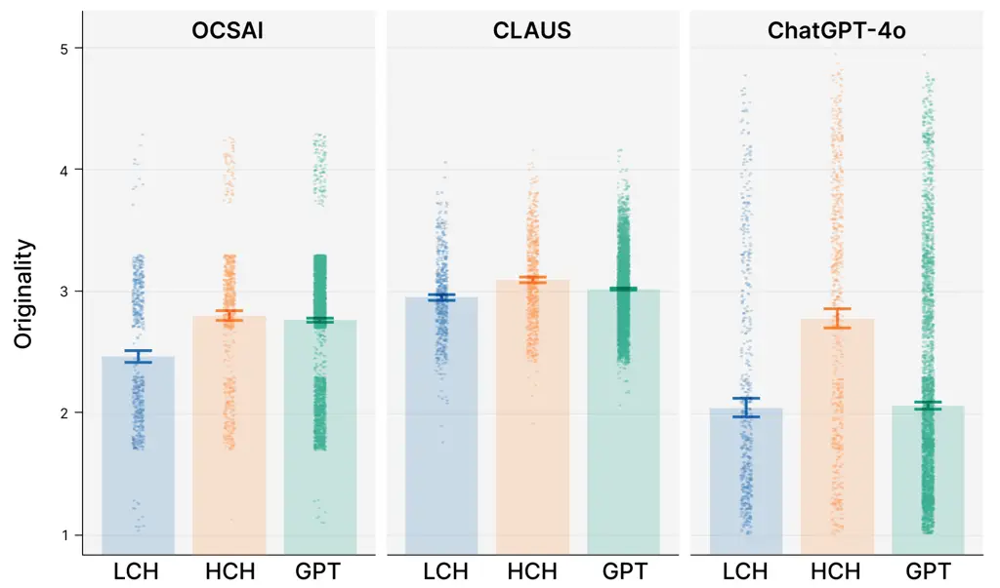

# The Effect of Idea Elaboration on the Automatic Assessment of Idea Originality

DOI: [XXXXXXX.XXXXXXX](https://doi.org/XXXXXXX.XXXXXXX)Conference: International
Conference on Advanced Visual Interfaces; June 8–12, 2026; Venice,
ItalyISBN: 978-1-4503-XXXX-X/2018/06CCS: Human-centered
computing Empirical studies in HCICCS: Human-centered computing HCI
theory, concepts and models

Umberto Domanti Affiliation: Free University of Bozen-Bolzano, Bolzano,
Italy email: <udomanti@unibz.it> , Moritz Mock Affiliation: Free
University of Bozen-Bolzano, Bolzano, Italy email: <momock@unibz.it> ,
Sergio Agnoli Affiliation: University of Trieste, Trieste, Italy
Affiliation: Marconi Institute for Creativity, Bologna, Italy email:
<sergio.agnoli@units.it> and Antonella De Angeli Affiliation: Free
University of Bozen-Bolzano, Bolzano, Italy email:
<antonella.deangeli@unibz.it>

2018

Figure 1 shows kernel density estimates of Alternate Uses Task
originality scores of Human participants and ChatGPT-4o, shown
separately for four raters: Humans, OCSAI, CLAUS, and ChatGPT-4o. Each
panel displays two density curves (Humans and ChatGPT-4o). The X-axis
shows the originality scale and it ranges from 1 to 5. The Y-axis
represents the density. It ranges from 0 to 7.5. For each rater two
density curves are shown. For human raters, the curve of human and
ChatGPT-4o are concentrated around a single scale point (2.0). For
OCSAI, the two curves are characterised by a central tendency around
3.0. For CLAUS, the two curves are narrower and more symmetric. For
ChatGPT-4o as a rater, the two curves are widely distributed on the
scale.

Figure 1. Kernel density estimates of initial response originality
scores across raters (Humans, OCSAI, CLAUS, ChatGPT-4o)Figure 1 shows
kernel density estimates of Alternate Uses Task originality scores of
Human participants and ChatGPT-4o, shown separately for four raters:
Humans, OCSAI, CLAUS, and ChatGPT-4o. Each panel displays two density
curves (Humans and ChatGPT-4o). The X-axis shows the originality scale
and it ranges from 1 to 5. The Y-axis represents the density. It ranges
from 0 to 7.5. For each rater two density curves are shown. For human
raters, the curve of human and ChatGPT-4o are concentrated around a
single scale point (2.0). For OCSAI, the two curves are characterised by
a central tendency around 3.0. For CLAUS, the two curves are narrower
and more symmetric. For ChatGPT-4o as a rater, the two curves are widely
distributed on the scale.

###### Abstract.

Automatic systems are increasingly used to assess the originality of
responses in creative tasks. They offer a potential solution to key
limitations of human assessment (cost, fatigue, and subjectivity), but
there is preliminary evidence of a self-preference bias. Accordingly,
automatic systems tend to prefer outcomes that are more closely related
to their style, rather than to the human one. In this paper, we
investigated how Large Language Models (LLMs) align with human raters in
assessing the originality of responses in a divergent thinking task. We
analysed 4,813 responses to the Alternate Uses Task produced by higher
and lower creative humans and ChatGPT-4o. Human raters were two
university students who underwent intensive training. Machine raters
were two specialised systems fine-tuned on AUT responses and
corresponding human ratings (OCSAI and CLAUS) and ChatGPT-4o, which was
prompted with the same instructions as human raters. Results confirmed
the presence of a self-preference bias in LLMs. Automatic systems tended
to privilege artificial responses. However, this self-preference bias
disappeared when the analyses controlled for the idea elaboration. We
discuss theoretical and methodological implications of these findings by
highlighting future directions for research on creativity assessment.

###### Keywords: 

Creativity, Divergent Thinking, Alternate Uses Task, Large Language
Models, Automated Scoring, Self-Preference Bias

## 1. Introduction

Researchers in the field of creativity have recently begun to explore
the various ways in which Artificial Intelligence (AI) can shape human
behaviour. In their manifesto, Vinchon et al. (Vinchon et al., 2023)
envision four possible scenarios: 1. “Co-cre-AI-tion”, the output would
not be possible by humans or AI alone; 2. “Organic”, creation made by
humans for humans; 3. “Plagiarism 3.0”, users will draw on AI production
without citing the source; 4. “Shut down”, users will become less
motivated to start a creative action (Vinchon et al., 2023). Creativity
was originally defined as the human ability to produce original and
effective outcomes or products (Runco and Acar, 2012). Generative AI
(GenAI) has challenged this definition, requiring the addition of
intentionality and authenticity to differentiate between human and
_artificial creativity_ (Runco, 2023; Runco, 2025).

The study of creativity addresses two main processes: generation and
assessment. In this paper, we focus on the assessment of idea
originality in divergent thinking tasks. A prototypical measure of this
ability is the Alternate Uses Task (GUILFORD, 1967, AUT;), in which
participants are asked to generate as many alternative uses as possible
for common objects (e.g., brick, pants, tyre) within a limited amount of
time. Traditionally, responses have been assessed by human experts
(Silvia et al., 2008); however, it has recently been suggested that
Large Language Models (LLMs) could offer a solution to the limitations
of human originality assessment. Yet, important concerns remain
regarding the potential presence of biases, which might lead to
inaccurate assessments (Patterson et al., 2025; Tang et al., 2025). One
of these is the self-preference bias, in which AI-generated responses
are preferred over the human ones (Tang et al., 2025; Panickssery et
al., 2024). In addition, even though LLMs have shown performances
comparable to those of human raters in assessing originality, they still
fail to replicate central dimensions like human experience and emotional
depth (DiStefano and Beaty, 2026). The research question addressed in
this paper  is:

RQ:  
_How do human and artificial raters differ in the assessment of idea
originality?_

To answer it, we investigated how two fine-tuned systems (OCSAI, CLAUS)
and ChatGPT-4o align with human raters in scoring the originality of AUT
ideas generated by ChatGPT-4o and human authors. The paper has the
following organisation. Section 2 presents the related work about human
and automatic assessment of originality. Section 3 presents the method
of the study, and Section 4 reports the results. Section 5 discusses
their theoretical and methodological implications, limitations, and
highlights future directions. Lastly, Section 6 concludes the paper and
links the main findings to the literature.

## 2. Related Work

Divergent thinking is the ability to generate multiple alternative
solutions to a problem (Acar and Runco, 2019). Four indices are
typically measured in its assessment (Acar et al., 2019). _Fluency_ is
operationalised by counting the number of ideas provided by an
individual. _Flexibility_ refers both to the number of different
categories of ideas and the number of switches between conceptual
fields. _Elaboration_ reflects the amount of detail provided in the
generated idea. Finally, _originality_ represents the most frequently
analysed aspect of divergent thinking, and is usually assessed by
individual trained raters (Silvia et al., 2008). The focus of this paper
is on originality and elaboration.

### 2.1. Human Assessment of Originality

Human assessment methods require at least two raters, with experience in
the creative domain (Amabile, 1982), who independently assess the
originality of ideas on a Likert scale (Silvia et al., 2008;
Reiter-Palmon et al., 2019). Raters are trained to score originality on
a scale ranging from 1 (not at all creative) to 5 (highly creative). As
recommended by one of the most accepted scoring methods (Silvia et al.,
2008), raters take into account the uncommonness (how infrequent an idea
is within the sample of responses), remoteness (how conceptually distant
the idea is from what is commonly thought), and cleverness (how smart,
funny, insightful the idea is) of an idea (Agnoli et al., 2023; Silvia
et al., 2008). The interrater reliability (ICC) is then calculated on
the total number of responses produced by participants. In case of
important discrepancies between scores, the raters review their response
and assign a score by consensus (Silvia et al., 2008; Agnoli et al.,
2023).

Although human-based methods are the core of creativity research
(Reiter-Palmon et al., 2019; Silvia et al., 2008), they present several
notable limitations. First, given the substantial resources and effort
required for raters’ training and compensation, human scoring has become
highly costly and extremely time-consuming (Saretzki et al., 2025;
DiStefano et al., 2025; Patterson et al., 2025). This represents a
significant obstacle for many researchers who do not have access to the
necessary human resources (Zielińska et al., 2023; Patterson et al.,
2023b; Patterson et al., 2025). Second, the assessment process may be
influenced by rater fatigue, which can affect the reliability of their
ratings (Forthmann et al., 2017). Third, originality scores are affected
by subjectivity and individual rater characteristics (Patterson et al.,
2023b; Saretzki et al., 2025).

### 2.2. Automatic Assessment of Originality

To overcome these challenges, researchers have explored whether
automated methods can replicate human assessment of idea  originality,
potentially offering a more objective and efficient solution
(Organisciak et al., 2023; Beaty et al., 2022; Dumas et al., 2021; Beaty
and Johnson, 2021). They can be divided into unsupervised and supervised
methods.

#### 2.2.1. Unsupervised Methods

Chronologically, one of the first attempts to automate originality
scoring in divergent thinking tasks relied on unsupervised machine
learning methods. They do not require human involvement and learning
from previous examples (Beaty et al., 2022; Luchini et al., 2025b; Beaty
and Johnson, 2021). In this regard, the most widely used approach is the
semantic distance metric (Beaty and Johnson, 2021; Beaty et al., 2022;
Dumas et al., 2021). It reflects how far apart two concepts are in the
semantic space. Assessing creativity using this approach reflects the
associative theory of creativity, which states that highly original
ideas require the combination of semantically distant concepts (i.e.,
higher semantic distance values) (Beaty and Kenett, 2023).

Semantic distance is quantified by $`1-cosine`$ of the angle between
pairs of vectors in semantic space (Beaty and Johnson, 2021; Beaty et
al., 2022; Luchini et al., 2025a). Considering the example provided by
(Patterson et al., 2023a), _coffee_ and _drink_ have a low semantic
distance ($`.46`$), whereas _coffee_ and _write_ have a higher semantic
distance ($`.93`$) (Patterson et al., 2023a). Semantic distance is
considered a proxy of divergent thinking (Olson et al., 2021). In the
case of the AUT responses, semantic distance¹¹ 1 Semantic distance can
be computed through the publicly available platforms SemDis
(https://cap.ist.psu.edu/semdis) and Open Creativity Scoring
(https://openscoring.du.edu/scoring) is computed as $`1-`$ the cosine
angle between the target object (e.g, “fork” in the AUT) and the
response (e.g., bottle opener) (Beaty et al., 2022; Luchini et al.,
2025b; Dumas et al., 2021; Beaty and Johnson, 2021). For instance²² 2
The following example is taken from https://openscoring.du.edu/scoring,
the angle between “shovel” and “fling tennis balls for a dog to chase”
is $`68`$; the cosine of $`68`$ is $`.37`$, resulting in a semantic
distance of $`1-.37=.63`$. Recent studies have shown that semantic
distance predicts human originality scores in the AUT (Beaty et al.,
2022; Dumas et al., 2021; Beaty and Johnson, 2021), with stronger
correlations at the participant level but modest correlations at the
response level (Organisciak et al., 2023; Luchini et al., 2025a;
Saretzki et al., 2025).

#### 2.2.2. Supervised Methods

Recently, LLMs have been proposed as an alternative approach for scoring
idea originality in divergent thinking tasks. Trained LLMs have shown
comparable performances to those of human raters in a variety of
creative tasks, including the AUT (Organisciak et al., 2023; Zielińska
et al., 2023), metaphor generation (DiStefano et al., 2025), and
creative problem-solving tasks (Luchini et al., 2025a). Unlike semantic
distance, LLM-based scoring represents a form of supervised learning. In
this sense, LLMs are trained on previous input-output examples to
predict output for new and previously unseen input. One of these models
is OCSAI³³ 3 https://openscoring.du.edu/scoringllm (Open creativity
scoring with artificial intelligence). The authors fine-tuned GPT-3 on
27,217 AUT responses and corresponding human ratings across nine
datasets (Organisciak et al., 2023). Fine-tuning refers to the alignment
of the model to a particular task, and in this case, fine-tuning allows
the model to closely align with human ratings and strongly predict
originality scores (Saretzki et al., 2025; Organisciak et al., 2023;
DiStefano et al., 2025; Luchini et al., 2025a; Patterson et al., 2023a).
Recent studies found that OCSAI achieved high correlations with human
raters (up to $`r=.813`$), outperforming semantic distance ($`r=.20`$)
(Organisciak et al., 2023; Zielińska et al., 2023).

In August 2025, Patterson et al. (Patterson et al., 2025) introduced CAP
(creativity assessment platform), which aims to provide an easy-to-use,
flexible, and accessible platform. Creativity metrics include SemDis
(Beaty and Johnson, 2021) and five LLMs fine-tuned on previously
collected data, each associated with a specific creativity measure
(e.g., Short Stories, Scientific Creative Thinking, Design Problems).
One of these models is CLAUS⁴⁴ 4 https://cap.ist.psu.edu/claus
(Cross-Lingual Alternate Uses Scoring model), for scoring AUT responses.
It employs a fine-tuned version of the XLM-RoBERTa language model to
predict human creativity ratings for AUT responses and has been found to
outperform SemDis (Patterson et al., 2025). CLAUS was trained on
databases comprising 136,621 AUT responses and the corresponding human
ratings in 12 languages (Patterson et al., 2025).

### 2.3. Comparative Studies of Originality Scoring

Altogether, the studies reported above suggest that supervised methods
are substantially faster than human raters while offering a comparable
performance in originality scoring (Saretzki et al., 2025; Organisciak
et al., 2023; Patterson et al., 2025). However, little is known about
the differences between OCSAI and CLAUS in scoring responses from
divergent thinking tasks. In this regard, Saretzki et al. (Saretzki et
al., 2025) compared the performance of OCSAI, CLAUS, and GPT-4 in
scoring AUT responses produced by _human participants_. They found that
models predictions outperformed those obtained with semantic distance,
and were positively correlated with human ratings, with stronger
relationships for OCSAI, followed by GPT-4 and CLAUS.

Tang et al. (Tang et al., 2025) found a significant discrepancy between
humans and OCSAI assessment. Unlike human raters, OCSAI overestimated
the originality of divergent thinking task responses when they were
generated by a human with the help of ChatGPT (Human-ChatGPT condition)
compared to when they were produced by a couple of human participants
(Human-Human condition). These findings suggest that OCSAI might prefer
machine-generated responses, rating them as more original. To
investigate the reasons behind this bias, the authors controlled for the
elaboration of the participants’ responses, operationalised as the
number of characters. They hypothesised that OCSAI preferred responses
of Human-ChatGPT condition because they were longer and more elaborated
(Tang et al., 2025). Controlling for the elaboration, they found that
the advantage of the Human-ChatGPT condition over the Human-Human
condition was significantly reduced. This finding was explained by
hypothesising an elaboration bias in OCSAI, which overestimates
originality scores of longer and more detailed responses.

To address the elaboration bias, Arora et al. (Arora et al., 2025)
proposed restricting the automatic assessment of OCSAI only to the core
idea of machine-generated AUT responses. This strategy allowed them to
analyse responses that were structurally similar to the ones produced by
human participants. For instance, only the core idea “Portable Zen
Garden” was extracted from the response:

> Portable Zen Garden, fill a shoe with fine sand, add a few tiny
> pebbles and a rake made from toothpicks. Instant relaxation for the
> foot-weary soul on the go  (Arora et al., 2025).

However, their findings contrasted with those reported by Tang et al.
(Tang et al., 2025). Indeed, they showed that OCSAI, despite controlling
for elaboration, still rated the AUT responses generated by machines
(ChatGPT-4o, DeepSeek-V3, and Gemini 2.0) as more original than those of
human participants (Arora et al., 2025).

Overall, research on the validity and reliability of automated
creativity assessment methods is still in its infancy. Some studies have
examined the alignment between automated scores and human ratings in
assessing the originality of human responses (Organisciak et al., 2023;
Patterson et al., 2025; Saretzki et al., 2025; Zielińska et al., 2023).
However, contrasting findings have emerged from recent studies
investigating the performance of OCSAI (Tang et al., 2025; Arora et al.,
2025). Thus, there is a lack of research systematically comparing
different automatic systems (i.e., OCSAI, CLAUS, and ChatGPT) in their
assessment of responses produced by _both humans and LLMs_.

## 3. Method

This study aimed to extend previous research (Tang et al., 2025; Arora
et al., 2025) by investigating how OCSAI, CLAUS, and ChatGPT-4o align
with human raters in scoring the originality of AUT ideas produced by
ChatGPT-4o and human authors.

### 3.1. Database

Human and machine responses, as well as the corresponding human rater
originality scores, were obtained from the database of Domanti et al.
(Domanti et al., 2026). The human sample comprised 81 psychology
students (mean age = 20.3 years, SD = 1.71, men = 12, women = 69).
Machine responses were collected on the 6th and 7th of March 2025 by
using ChatGPT-4o chat interface⁵⁵ 5 https://chat.openai.com with the
“Plus” subscription (Domanti et al., 2026). This interface did not
display or allow modification of hyperparameter settings. All data was
collected in Italian.

Following psychological literature (GUILFORD, 1967), humans were asked
to complete two AUT by generating as many original alternative uses as
possible for “shoe” and “fork”, with a time limit of 3 minutes for each
target. The responses were recorded using an audio recorder and manually
transcribed by one of the experimenters. The experimenter carefully
listened to all recordings to ensure transcription accuracy and wrote
them as expressed by the participants. The procedure was repeated by
creating a new separate chat for each of the 81 ChatGPT-4o participants
(Domanti et al., 2026). Specifically, ChatGPT-4o was prompted with the
same instruction provided to human participants. Humans and ChatGPT-4o
generated 4,813 valid AUT responses, of which 3,548 were generated by
ChatGPT-4o and 1,265 by humans. ChatGPT-4o outperformed humans in
fluency, producing an average of 43.8 ideas, compared to 15.6 for
humans.

In Domanti et al. (Domanti et al., 2026), after all the ideas were
generated, all human and machine responses were merged and anonymised
for assessment. Originality was scored by two expert coders, blind to
the experimental goals and the origin of the data (Silvia et al., 2008).
Accordingly, following the scoring procedures described in Silvia et al.
(Silvia et al., 2008), both human raters underwent intensive training in
which they were instructed to assess the originality of each response
considering its _uncommonness_, _remoteness_, and _cleverness_ in a
range of 1 (not all creative) to 5 (highly creative) (Domanti et al.,
2026). Specifically, they were highly trained in the assessment of
originality in divergent thinking tests until they reached a high level
of consistency and agreement with expert raters, thus allowing them to
be considered experts (Amabile, 1982; Silvia et al., 2008). In Domanti
et al. (Domanti et al., 2026), the interrater reliability between the
two raters was high, ICC = .93.

Finally, following previous literature (Luchini et al., 2023; Li et al.,
2021, e.g.,), the human sample was divided into Higher Creative Humans
(HCH) and Lower Creative Humans (LCH) via a median split based on the
mean originality scores of each human participant. For example, an
alternative use for a fork proposed by an HCH participant was to use it
as a bridge in an anthill, with ants going from one side to the other.
Conversely, an example provided by an LCH participant was using a fork
to paint. The median split process is recommended to provide a more
meaningful comparison of creativity (Domanti et al., 2026).

### 3.2. Automatic Assessment

To collect automatic assessment data for the current study, we used
OCSAI (version 1.6), CLAUS and ChatGPT-4o. Their ratings were collected
on the 18th of December 2025. We also included ChatGPT-4o to investigate
the capacity of a model to approximate human ratings without relying on
any fine-tuning on the AUT (Saretzki et al., 2025). OCSAI scored
originality in a range of 1 to 5 (Organisciak et al., 2023). CLAUS
scored the responses by providing a number from 0 to 1. It applies the
following prompt in the background, where X is the target object and Y
is the answer: _Identify how surprising, creative, unexpected, or
interesting the following alternative use for the object X is: Y_
(Patterson et al., 2025; Saretzki et al., 2025).

ChatGPT-4o rating scores were collected through the API. We provided
exactly the same instructions as for human raters. Consistent with
(Saretzki et al., 2025), we prompted ChatGPT-4o to provide a single
numerical value between 10 and 50, which allows a finer differentiation
of the ratings compared to a 5-point Likert scale. ChatGPT-4o key model
parameters, in particular temperature and top_p, were controlled and
kept at their default values of 1.0 and 1.0, respectively. CLAUS and
ChatGPT-4o ratings were then rescaled to a 1-5 range to match the range
of human raters and OCSAI and ensure their comparability (Saretzki et
al., 2025). Finally, we repeated the median split procedure separately
for each mean originality distribution obtained from OCSAI, CLAUS, and
ChatGPT-4o. Supplementary Materials provide all responses generated by
human and ChatGPT-4o, along with the corresponding originality scores
assigned by the different raters.

## 4. Results

We first analysed the originality of the ideas by considering the
initial responses provided by humans and ChatGPT-4o (Section 4.1). By
initial response, we refer to the complete response provided by the
participants at the AUT. Then, we controlled for the elaboration of the
responses (Arora et al., 2025), restricting the assessment only to the
core idea (Section 4.2). To differentiate between ChatGPT-4o and humans
as authors and raters, in this section, we denote GPT*(*a*) and
HUM*(_a_) as authors, and GPT*(*r*) and HUM*(_r_) as raters.

|                                                           |             |             |             |             |
| --------------------------------------------------------- | ----------- | ----------- | ----------- | ----------- |
| Author                                                    | HUM\_(_r_)  | OCSAI       | CLAUS       | GPT\_(_r_)  |
| GPT\_(_a_)                                                | 1.99 (0.23) | 2.87 (0.55) | 3.31 (0.26) | 3.49 (0.69) |
| LCH                                                       | 1.96 (0.23) | 2.62 (0.57) | 2.96 (0.27) | 2.37 (1.09) |
| HCH                                                       | 2.11 (0.38) | 2.70 (0.62) | 3.09 (0.33) | 3.07 (1.10) |
| _Note._ Values are reported as Mean (Standard Deviation). |             |             |             |             |

Table 1. Mean and Standard Deviation of initial response originality
scores by rater and authorTable 1 reports the means and standard
deviations of initial response originality scores by author (ChatGPT-4o,
lower creative humans, and higher creative humans) across four raters
(Humans, OCSAI, CLAUS, and ChatGPT-4o)

### 4.1. Initial Response

Correlations of the mean originality scores between the automatic
systems were moderate to strong, ranging from .61 (OCSAI – GPT*(*r*) and
OCSAI - CLAUS) to .77 (GPT*(_r_) – CLAUS). When considering only
machine-generated responses, agreement was lower for OCSAI – GPT*(*r*)
($`r=.38`$) and GPT*(_r_) – CLAUS ($`r=.49`$), while OCSAI - CLAUS
remained moderate ($`r=.62`$). Overall, human ratings showed a weak but
significant positive association with OCSAI ($`r=.28`$), which became
robust ($`r=.59`$) when considering only human responses.

#### 4.1.1. Frequencies

Figure 1 illustrates the kernel density estimates of originality scores
of ideas produced by HUM*(*a*) and GPT*(_a_), as assessed from
HUM*(*r*), OCSAI, CLAUS and GPT*(_r_). It shows how originality scores
are distributed differently across the scale depending on the rater.

HUM*(*r*) were concentrated around a single scale point, resulting in a
highly right-skewed distribution, with 94% of all the scores rated 2.0.
Specifically, for GPT*(_a_), 98% of the scores fell between 1.0 and 2.0,
whereas the percentage for HUM*(*a*) was 92%. 6 responses generated by
GPT*(_a_) and 13 generated HUM*(*a*) fell between 4.0 and 5.0. OCSAI
distribution was characterised by a central tendency (Saretzki et al.,
2025), with 60% of all observations concentrated at the value 3.0.
Considering only GPT*(_a_) productions, 90% of scores fell between 2.0
and 3.0. HUM*(*a*) exhibited a lower peak at the value 3.0 with a
percentage of 54%. Consistent with (Saretzki et al., 2025), CLAUS scores
exhibited a more symmetric and narrower distribution, approximating a
normal distribution. For GPT*(_a_), 85% of scores fell between 3.00 and
3.76, while for HUM*(*a*) 85% of scores were contained within the
interval from 2.72 to 3.52. Finally, when GPT*(_r_) assessed the
responses, originality scores were widely distributed on the scale, with
no value exceeding 20% of the observations. In this case, 63% of
GPT*(*a*) scores fell between 3.0 and 4.0, whereas for HUM*(_a_) it was
substantially lower (37%).

| Rater      | Comparison           | B         | SE        | 95% CI            | t-statistic             | p-value    |
| ---------- | -------------------- | --------- | --------- | ----------------- | ----------------------- | ---------- |
| HUM\_(_r_) | GPT\_(_a_) $`>`$ LCH | $`0.03`$  | $`0.013`$ | $`[0.00,0.05]`$   | $`t_{(359.46)}=1.98`$   | $`p=.048`$ |
|            | GPT\_(_a_) $`<`$ HCH | $`-0.12`$ | $`0.011`$ | $`[-0.14,-0.10]`$ | $`t_{(193.59)}=-11.35`$ | $`p<.001`$ |
|            | HCH $`>`$ LCH        | $`0.15`$  | $`0.016`$ | $`[0.12,0.18]`$   | $`t_{(391.45)}=9.51`$   | $`p<.001`$ |
| OCSAI      | GPT\_(_a_) $`>`$ LCH | $`0.25`$  | $`0.025`$ | $`[0.20,0.30]`$   | $`t_{(4809.99)}=9.69`$  | $`p<.001`$ |
|            | GPT\_(_a_) $`>`$ HCH | $`0.17`$  | $`0.023`$ | $`[0.12,0.21]`$   | $`t_{(4809.31)}=7.08`$  | $`p<.001`$ |
|            | HCH $`>`$ LCH        | $`0.08`$  | $`0.032`$ | $`[0.02,0.14]`$   | $`t_{(4809.36)}=2.55`$  | $`p=.011`$ |
| CLAUS      | GPT\_(_a_) $`>`$ LCH | $`0.35`$  | $`0.012`$ | $`[0.33,0.38]`$   | $`t_{(313.09)}=28.50`$  | $`p<.001`$ |
|            | GPT\_(_a_) $`>`$ HCH | $`0.22`$  | $`0.012`$ | $`[0.19,0.24]`$   | $`t_{(317.23)}=17.83`$  | $`p<.001`$ |
|            | HCH $`>`$ LCH        | $`0.14`$  | $`0.016`$ | $`[0.10,0.17]`$   | $`t_{(435.84)}=8.54`$   | $`p<.001`$ |
| GPT\_(_r_) | GPT\_(_a_) $`>`$ LCH | $`1.11`$  | $`0.041`$ | $`[1.03,1.20]`$   | $`t_{(245.89)}=27.29`$  | $`p<.001`$ |
|            | GPT\_(_a_) $`>`$ HCH | $`0.42`$  | $`0.039`$ | $`[0.34,0.49]`$   | $`t_{(215.12)}=10.68`$  | $`p<.001`$ |
|            | HCH $`>`$ LCH        | $`0.70`$  | $`0.051`$ | $`[0.60,0.80]`$   | $`t_{(311.80)}=13.69`$  | $`p<.001`$ |

Table 2. Initial response originality results by raterTable 2 reports
initial response originality comparison results by rater (Humans, OCSAI,
CLAUS, and ChatGPT-4o). For each rater, three pairwise comparisons are
shown (ChatGPT-4o vs lower creative humans, ChatGPT-4o vs higher
creative humans, and higher creative humans vs lower creative humans),
with estimates B, standard errors, 95\\ confidence intervals,
t-statistics, and p-values.

(a)

(b)

Figure 2. (a): Initial response originality scores across authors and
raters (Humans, OCSAI, CLAUS, ChatGPT-4o). (b): Core idea originality
scores across authors and raters (OCSAI, CLAUS, ChatGPT-4o)Two
side-by-side panels. The left panel (a) shows initial response
originality scores for three groups (LCH, HCH, and ChatGPT-4o) across
four raters (Humans, OCSAI, CLAUS, and ChatGPT-4o), displayed in four
panels, one per rater. The Y axis shows originality scores from 1 (low)
to 5 (high). Within each panel, the three groups are plotted on the X
axis (lower creative humans, higher creative humans, ChatGPT-4o). For
each group, data are shown as dots and there are error bars indicating
the group average and uncertainty. For human raters, higher creative
humans are more original than ChatGPT-4o, which is more original than
lower creative humans. For OCSAI, CLAUS, ChatGPT-4o raters, ChatGPT-4o
is more original than higher creative humans, who are more original than
lower creative humans. The right panel (b) shows core response
originality scores for three groups (Lower creative humans, higher
creative humans, and ChatGPT-4o) across three raters (OCSAI, CLAUS, and
ChatGPT-4o), displayed in three panels, one per rater. The Y axis shows
originality scores from 1 (low) to 5 (high). Within each panel, the
three groups are plotted on the X axis (lower creative humans, higher
creative humans, ChatGPT-4o). For each group, data are shown as dots,
and there are error bars indicating the group average and uncertainty.
For OCSAI and CLAUS, higher creative humans are more original than
ChatGPT-4o, which is more original than lower creative humans. For
ChatGPT-4o as a rater, higher creative humans are more original than
ChatGPT-4o, but there is no difference in originality between ChatGPT-4o
and lower creative humans.

#### 4.1.2. Originality

We then calculated descriptive statistics of initial response
originality (Table  1) and ran linear mixed models to investigate
differences in originality among the three groups for each rater. The
analyses were run with the lme4 package (Bates et al., 2015) and
lmerTest (Kuznetsova et al., 2017) in R. For these analyses, we
considered the human sample split in LCH and HCH, as explained in the
Method (Section 3). The dependent variable consisted of all responses
rated and the fixed effect was Participant (GPT*(*a*), LCH, HCH), while
intercepts for participants’ ID and object (shoe and fork) served as
random effects. Figure 2(a) shows the AUT originality scores across
authors (LCH, HCH, GPT*(_a_)) and raters (HUM*(*r*), OCSAI, CLAUS,
GPT*(_r_)). In Domanti et al. (Domanti et al., 2026), results showed
that, for HUM*(*r*), GPT*(_a_) originality scores were significantly
higher than those of LCH, but lower than those of HCH. Furthermore, HCH
originality scores were significantly higher than those of LCH.

Regarding automatic assessment, our results showed a reverse pattern.
They suggest a self-preference bias, whereby machine-generated responses
were preferred over human responses. Indeed, OCSAI, CLAUS, and GPT*(*r*)
agreed in recognising GPT*(_a_) as the most original author. For all of
them, GPT*(*a*) originality scores were significantly higher than those
of LCH and HCH. In accordance with HUM*(_r_), they rated HCH as
significantly more original than LCH. Importantly, for OCSAI, the random
intercept for participants’ ID was removed due to a singular fit and
zero estimated variance. Table 2 provides a summary of the results of
the linear mixed models.

|                                                           |             |             |             |
| --------------------------------------------------------- | ----------- | ----------- | ----------- |
| Author                                                    | OCSAI       | CLAUS       | GPT\_(_r_)  |
| GPT\_(_a_)                                                | 2.77 (0.49) | 3.02 (0.26) | 2.06 (0.91) |
| LCH                                                       | 2.46 (0.59) | 2.95 (0.28) | 2.04 (0.98) |
| HCH                                                       | 2.80 (0.56) | 3.10 (0.32) | 2.78 (1.08) |
| _Note._ Values are reported as Mean (Standard Deviation). |             |             |             |

Table 3. Mean and Standard Deviation of core idea originality scores by
rater and authorTable 3 reports the means and standard deviations of
core response originality scores by author (ChatGPT-4o, lower creative
humans, and higher creative humans) across three raters (OCSAI, CLAUS,
and ChatGPT-4o)

### 4.2. Core Idea

To investigate the LLM self-preference bias observed in OCSAI, CLAUS,
and GPT*(*r*), we controlled for the elaboration of responses.
Accordingly, based on (Arora et al., 2025), we extracted only the core
idea from each initial response. Importantly, to ensure a comparable
assessment of machine and human responses, some HUM*(_a_) responses
starting with “as” (e.g., as small bag) were modified by keeping only
the core idea (e.g., small bag).

#### 4.2.1. Frequencies

Figure 3 illustrates the kernel density estimates of originality scores
of HUM*(*a*) and GPT*(_a_) ideas, as obtained from OCSAI, CLAUS and
GPT*(*r*). Looking at the frequencies, 96% of OCSAI scores fell between
2.0 and 3.0. In particular, 70% of GPT*(_a_) scores and 54% of HUM*(*a*)
scores were rated 3.0. CLAUS showed a narrower distribution (Saretzki et
al., 2025). In general, GPT*(_a_) and HUM*(*a*) largely overlapped and
reached their peak at 2.72. Nevertheless, 11% of HUM*(_a_) productions
received scores above 3.4, compared to only 6% of GPT*(*a*) productions.
Finally, for GPT*(_r_), the originality scores were again more widely
distributed on the scale, with no value exceeding 22% of the
observations. Overall, 81% of scores fell between 1.0 and 3.0. For
GPT*(*a*), 47% of scores fell between 1.5 and 2.0, while for HUM*(_a_)
it was lower (35%).

Figure 3 shows kernel density estimates of Alternate Uses Task
originality scores of Human participants and ChatGPT-4o, shown
separately for three raters: OCSAI, CLAUS, and ChatGPT-4o. Each panel
displays two density curves (Humans and ChatGPT-4o). The X-axis shows
the originality scale and it ranges from 1 to 5. The Y-axis represents
the density. It ranges from 0 to 4. For OCSAI, the two curves have peaks
around 2.0 and 3.0. For CLAUS, the two curves are narrower and largely
overlapping around the mid-range. For ChatGPT-4o as a rater, the two
curves are widely distributed on the scale.

Figure 3. Kernel density estimates of core idea originality scores
across raters (OCSAI, CLAUS, ChatGPT-4o)Figure 3 shows kernel density
estimates of Alternate Uses Task originality scores of Human
participants and ChatGPT-4o, shown separately for three raters: OCSAI,
CLAUS, and ChatGPT-4o. Each panel displays two density curves (Humans
and ChatGPT-4o). The X-axis shows the originality scale and it ranges
from 1 to 5. The Y-axis represents the density. It ranges from 0 to 4.
For OCSAI, the two curves have peaks around 2.0 and 3.0. For CLAUS, the
two curves are narrower and largely overlapping around the mid-range.
For ChatGPT-4o as a rater, the two curves are widely distributed on the
scale.

#### 4.2.2. Originality

Descriptive statistics of core idea originality are reported in Table 3.
We ran linear mixed models to investigate differences in originality
among the three groups for each rater, following the same procedure
described in Subsection 4.1.2. Importantly, due to a singular fit and
zero estimated variance, the random intercept for participants’ ID was
removed for OCSAI, and the random intercepts for participants’ ID and
object were removed for CLAUS. AUT originality scores across authors
(LCH, HCH, GPT*(*a*)) and raters (OCSAI, CLAUS, GPT*(_r_)) are shown in
Figure 2(b). The results showed a change in the ratings of OCSAI, CLAUS,
and GPT*(*r*), with HCH rated as significantly more original than
GPT*(_a_) (this effect was only marginally significant for OCSAI).
Moreover, whereas OCSAI and CLAUS rated GPT\_(_a_) as more original than
LCH, this difference did not emerge when ChatGPT-4o was the rater. Table
4 provides a summary of the results of the linear mixed models.

|                           |                        |           |           |                   |                         |            |
| ------------------------- | ---------------------- | --------- | --------- | ----------------- | ----------------------- | ---------- |
| Rater                     | Comparison             | B         | SE        | 95% CI            | t-statistic             | p-value    |
| OCSAI                     | GPT\_(_a_) $`>`$ LCH   | $`0.30`$  | $`0.023`$ | $`[0.25,0.34]`$   | $`t_{(4809.04)}=12.95`$ | $`p<.001`$ |
|                           | GPT\_(_a_) $`<`$\* HCH | $`-0.04`$ | $`0.021`$ | $`[-0.08,0.00]`$  | $`t_{(4809.02)}=-1.95`$ | $`p=.051`$ |
|                           | HCH $`>`$ LCH          | $`0.34`$  | $`0.029`$ | $`[0.28,0.39]`$   | $`t_{(4809)}=11.78`$    | $`p<.001`$ |
| CLAUS                     | GPT\_(_a_) $`>`$ LCH   | $`0.07`$  | $`0.012`$ | $`[0.05,0.10]`$   | $`t_{(4810)}=5.96`$     | $`p<.001`$ |
|                           | GPT\_(_a_) $`<`$ HCH   | $`-0.07`$ | $`0.011`$ | $`[-0.10,-0.05]`$ | $`t_{(4810)}=-6.72`$    | $`p<.001`$ |
|                           | HCH $`>`$ LCH          | $`0.15`$  | $`0.015`$ | $`[0.12,0.18]`$   | $`t_{(4810)}=9.68`$,    | $`p<.001`$ |
| GPT\_(_r_)                | GPT\_(_a_) $`=`$ LCH   | $`0.02`$  | $`0.042`$ | $`[-0.06,0.10]`$  | $`t_{(276.46)}=0.44`$   | $`p=.66`$  |
|                           | GPT\_(_a_) $`<`$ HCH   | $`-0.73`$ | $`0.040`$ | $`[-0.80,-0.65]`$ | $`t_{(224.93)}=-18.11`$ | $`p<.001`$ |
|                           | HCH $`>`$ LCH          | $`0.74`$  | $`0.053`$ | $`[0.64,0.85]`$   | $`t_{(352.65)}=13.92`$  | $`p<.001`$ |
| \* marginally significant |                        |           |           |                   |                         |            |

Table 4. Core idea originality results by raterTable 4 reports core
response originality comparison results by rater (OCSAI, CLAUS, and
ChatGPT-4o). For each rater, three pairwise comparisons are shown
(ChatGPT-4o vs lower creative humans, ChatGPT-4o vs higher creative
humans, and higher creative humans vs lower creative humans), with
estimates B, standard errors, 95\\ confidence intervals, t-statistics,
and p-values.

## 5. Discussion

LLMs are increasingly used as authors (Stevenson et al., 2022; Haase and
Hanel, 2023; Koivisto and Grassini, 2023, e.g.,) and raters (Organisciak
et al., 2023; Patterson et al., 2025; Saretzki et al., 2025, e.g.,) of
responses in creative tasks. The study reported in this paper focused on
creativity assessment: the use of LLMs to score originality. Dealing
with large databases fuelled by automatic generation, this possibility
may represent a promising and efficient alternative to subjective and
costly human-based assessment. However, important concerns remain about
validity, as these systems have been shown to be influenced by biases in
scoring procedures (Tang et al., 2025; Panickssery et al., 2024).
Research is still in its infancy and only a few studies have
investigated the alignment between LLMs and human scores of idea
originality on the AUT (Saretzki et al., 2025; Zielińska et al., 2023,
e.g.,). Furthermore, uncertainty exists about the performance of the LLM
automatic systems in scoring responses generated by LLMs.

Therefore, this study investigated how OCSAI, CLAUS, and ChatGPT-4o
align with human raters in scoring the originality of AUT responses
provided by humans and ChatGPT-4o. Table 5 summarises the results.

### 5.1. Comparison of Raters

Focusing on the distributions of the originality scores in the initial
responses across raters, our results revealed significant differences in
how the values were distributed on the originality scale as a function
of the rater (Figure 1). The distribution obtained from human raters
shows that only a very small number of unique ideas were recognised as
highly creative, while the majority fell below the mean value (Saretzki
et al., 2025). In contrast, LLM systems tended to assign higher
originality scores than human raters (Figure 2(a)). Consistent with
previous work (Saretzki et al., 2025), we found that OCSAI exhibited a
central tendency around the value of 3.0, whereas CLAUS showed a more
symmetric and narrower distribution. ChatGPT-4o, by contrast, was not
characterised by a central tendency, but instead distributed the scores
along the entire originality scale.

Going deeper into our results, human raters assessed ChatGPT-4o as less
original than higher creative humans, but more original than lower
creative ones. This finding is consistent with recent literature
suggesting that a percentage of the best humans outperform LLMs in
divergent thinking tasks (Koivisto and Grassini, 2023; Haase and Hanel,
2023; Grassini and Koivisto, 2025). However, in line with Tang et al.
(Tang et al., 2025), our results confirmed the presence of a
self-preference bias in LLMs. OCSAI, CLAUS, and ChatGPT-4o assessed
ChatGPT-4o responses as more original than those generated by both human
groups (Hubert et al., 2024; Guzik et al., 2023). Thus, they preferred
machine-generated responses, assigning them higher originality scores
(Panickssery et al., 2024). Among them, OCSAI and CLAUS showed similar
patterns, with the latter assigning higher originality scores than the
former (Figure 2(a)). ChatGPT-4o exhibited a wider range of scores than
OCSAI and CLAUS, despite not being fine-tuned on AUT responses.

Inspired by (Arora et al., 2025), we controlled for the response
elaboration by considering only the core idea of each initial response
to investigate the self-preference bias observed in LLM raters (Tang et
al., 2025; Panickssery et al., 2024). Our results extend previous
findings (Tang et al., 2025; Arora et al., 2025), showing that OCSAI,
CLAUS, and ChatGPT-4o assessed ChatGPT-4o core ideas as less original
than those generated by higher creative individuals (even if this effect
was only marginally significant for OCSAI). Thus, they recognised higher
creative humans as the most original group. Importantly, ChatGPT-4o was
the most affected rater by the elaboration control. Indeed, the mean
originality of ChatGPT-4o responses decreased by 1.43 points, going from
3.49 for the initial response to 2.06 for the core idea. Additionally,
while OCSAI and CLAUS rated machine core ideas as more original than
those of lower creative humans, ChatGPT-4o did not score them as more
original than those of lower creative humans (Table 5).

| Rater                     | Initial Response               | Core Idea                        |
| ------------------------- | ------------------------------ | -------------------------------- |
| HUM\_(_r_)                | HCH $`>`$ GPT\_(_a_) $`>`$ LCH | /                                |
| OCSAI                     | GPT\_(_a_) $`>`$ HCH $`>`$ LCH | HCH $`>`$\* GPT\_(_a_) $`>`$ LCH |
| CLAUS                     | GPT\_(_a_) $`>`$ HCH $`>`$ LCH | HCH $`>`$ GPT\_(_a_) $`>`$ LCH   |
| GPT\_(_r_)                | GPT\_(_a_) $`>`$ HCH $`>`$ LCH | HCH $`>`$ GPT\_(_a_) $`=`$ LCH   |
| \* marginally significant |                                |                                  |

Table 5. Summary of resultsTable 5 presents a summary of the results of
the initial response and core idea by rater

### 5.2. Implications for Theory and Method

Overall, our results raise concerns about the appropriateness of using
LLM systems to score the originality of responses generated by LLMs.
They highlight the challenges associated with automating creativity
scoring and provide evidence of potential elaboration and
self-preference biases exhibited by these systems (Patterson et al.,
2025; Tang et al., 2025). These findings have both theoretical and
methodological implications for  HCI.

From a theoretical perspective, our results extend the literature on
risk of homogenisation associated with the pervasive influence of AI on
human creativity (Anderson et al., 2024; Doshi and Hauser, 2024; Kumar
et al., 2025). For example, we observed zero estimated variance for
participants random intercept when OCSAI assessed both initial responses
and core ideas. This result indicates a homogenisation effect at the
participant level in the assessment of OCSAI. Moreover, our findings
reveal challenges for researchers and users. Relying on LLM scoring
systems that are biased towards their own productions can inflate
originality scores, introducing error into the results and “making the
literature noisy”  (Tang et al., 2025, p. 18). From the point of view of
the users, this dynamic may foster Creative Mortification (Beghetto,
2014), leading them to perceive their outcomes as less valuable than
those generated by AI systems.

Given that idea generation is increasingly shaped by the ultra-rapid
speed at which LLMs generate content, the assessment phase becomes
essential to avoid negative consequences such as hallucinations and
homogenisation (DiStefano and Beaty, 2026; Anderson et al., 2024; Doshi
and Hauser, 2024; Kumar et al., 2025). Our findings suggest that
removing the human judgment from the originality assessment could be
risky, resulting in inappropriate and biased scores of creative
outcomes. Furthermore, emotional depth, lived experience, and contextual
dimension of creativity remain essential to comprehensively assess
creativity, including its usefulness or appropriateness, beyond
originality alone. These concerns represent a challenge that the entire
field of research should address and provide support for the
differentiation between artificial creativity and human creativity
(Runco, 2023).

From a methodological point of view, our findings suggest that applying
a split in the human sample is a useful strategy to obtain a
finer-grained operationalisation of creativity (Domanti et al., 2026).
Rather than treating humans as a single group, this approach brings the
variability of human performance to the foreground. Human creativity is
not an average skill, but requires a comparison that considers both
higher and lower levels of performance (Domanti et al., 2026; Kenett et
al., 2014). A limitation of prior work is that machines are often
compared against a single and undifferentiated human group. This
methodological choice can be misleading and hide the intrinsic
differences in the human sample. Accordingly, when a machine outperforms
the human sample in creative tasks, the conclusion is that machines are
more original than humans (Arora et al., 2025; Hubert et al., 2024,
e.g.,). In contrast, splitting the human sample can reveal that higher
creative humans still outperform the machine, which instead performs at
approximately the average human level (Cropley, 2025).

### 5.3. Limitations and Future Directions

The study presents some limitations. Firstly, we focused only on the AUT
as a measure of divergent thinking. Although this task is a standard in
the investigation of human and artificial creativity (Bangerl et al.,
2025; Kumar et al., 2025; Stevenson et al., 2022; Haase and Hanel, 2023;
Arora et al., 2025; Koivisto and Grassini, 2023, e.g.,), future studies
should extend the investigation by comparing rater performances across
different creative thinking tasks, including creative story writing,
metaphor production, or non-verbal tasks.

Secondly, we used ChatGPT-4o to assess the originality of the responses
alongside OCSAI and CLAUS (specialised systems). Building on our
methodology, future research could examine the performance of other
LLMs, both as participants and as raters. Moreover, we provided
ChatGPT-4o with the same instructions given to human raters, emphasising
the uncommonness, remoteness, and cleverness of an idea (Silvia et al.,
2008). Furthermore, future work is needed to investigate how different
prompting strategies affect the automatic scoring of originality. For
instance, future studies might ask an LLM to score responses using the
same prompt that CLAUS applies in its assessment (Section 3.2), or
manipulate model hyperparameter settings (e.g., temperature, top_p) to
explore their influence on the assessment.

Thirdly, we addressed the LLMs tendency to prefer their own ideas by
adopting the strategy proposed by Arora et al. (Arora et al., 2025).
Future research should investigate whether and how human raters are
influenced by the elaboration bias. It would be interesting to explore
how the elaboration control proposed by Tang et al. (Tang et al., 2025)
affects the performance of other LLMs and human raters. Finally, since
our responses were in Italian, we prompted ChatGPT-4o accordingly; CLAUS
supports this language. To ensure a reliable comparison, we used the
multilingual version of OCSAI. Evidence on LLM multilingual performance
in originality scoring is still limited (Saretzki et al., 2025;
Zielińska et al., 2023). Therefore, future research in this field should
compare how the language of the responses influences the assessment
performance of different LLMs.

## 6. Conclusion

To conclude, this paper investigated the alignment of LLMs with humans
in assessing the idea originality in the Alternate Uses Task. Going back
to our research question, we provide evidence of a self-preference bias
in LLMs. All automatic systems (OCSAI, CLAUS, and ChatGPT-4o) preferred
machine-generated responses over human ideas, but this pattern reversed
after controlling for the idea elaboration. Altogether, these results
provide empirical support for the “Shut down” scenario envisioned by
Vinchon et al. (Vinchon et al., 2023). Indeed, by preferring artificial
responses, automatic assessment might discourage users from starting a
creative action. Finally, this paper contributes to the research
challenges proposed in the decalogue for cyber-creativity (Corazza et
al., 2025), highlighting how automatic scoring can introduce biases into
the assessment process.

###### Acknowledgements.

We thank Fe Simeoni for help with the design of the figures. The second
author is funded by the European Union- Next Generation EU, Mission 4
Component 1 CUP I52B23000570003. We acknowledge financial support by the
European Union – NextGenerationEU, CUP J53D2300799 0001.

## References

- Acar et al. (2019) S. Acar, A. M. Abdulla Alabbasi, M. A. Runco,
  and K. Beketayev Latency as a predictor of originality in divergent
  thinking. Thinking Skills and Creativity 33, pp. 100574 (en). External
  Links: ISSN 18711871,
  [Link](https://linkinghub.elsevier.com/retrieve/pii/S1871187119300422),
  [Document](https://dx.doi.org/10.1016/j.tsc.2019.100574) Cited by: §2.
- Acar and Runco (2019) S. Acar and M. A. Runco Divergent thinking: New
  methods, recent research, and extended theory. Psychology of
  Aesthetics, Creativity, and the Arts 13 (2), pp. 153–158. External
  Links: ISSN 1931-390X,
  [Document](https://dx.doi.org/10.1037/aca0000231) Cited by: §2.
- Agnoli et al. (2023) S. Agnoli, S. Mastria, M. Zanon, and G. E.
  Corazza Dopamine supports idea originality: the role of spontaneous
  eye blink rate on divergent thinking. Psychological Research 87 (1),
  pp. 17–27. External Links: ISSN 1430-2772,
  [Link](https://doi.org/10.1007/s00426-022-01658-y),
  [Document](https://dx.doi.org/10.1007/s00426-022-01658-y) Cited by:
  §2.1.
- Amabile (1982) T. M. Amabile Social psychology of creativity: A
  consensual assessment technique. Journal of Personality and Social
  Psychology 43 (5), pp. 997–1013. External Links: ISSN 1939-1315,
  [Document](https://dx.doi.org/10.1037/0022-3514.43.5.997) Cited by:
  §2.1, §3.1.
- Anderson et al. (2024) B. R. Anderson, J. H. Shah, and M. Kreminski
  Homogenization effects of large language models on human creative
  ideation. In Proceedings of the 16th Conference on Creativity &
  Cognition, C&C ’24, New York, NY, USA, pp. 413–425. External Links:
  ISBN 9798400704857, [Link](https://doi.org/10.1145/3635636.3656204),
  [Document](https://dx.doi.org/10.1145/3635636.3656204) Cited by: §5.2,
  §5.2.
- Arora et al. (2025) V. Arora, A. Thabane, S. Parpia, G. Calic, and M.
  Bhandari Generative artificial intelligence models outperform students
  on divergent and convergent thinking assessments. Scientific Reports
  15 (1), pp. 36987 (en). External Links: ISSN 2045-2322,
  [Link](https://www.nature.com/articles/s41598-025-21398-4),
  [Document](https://dx.doi.org/10.1038/s41598-025-21398-4) Cited by:
  §2.3, §2.3, §2.3, §2.3, §3, §4.2, §4, §5.1, §5.2, §5.3, §5.3.
- Bangerl et al. (2025) M. M. Bangerl, L. Disch, T. David, and V.
  Pammer-Schindler CreAItive collaboration? users’ misjudgment of
  ai-creativity affects their collaborative performance. In Proceedings
  of the 2025 CHI Conference on Human Factors in Computing Systems, CHI
  ’25, New York, NY, USA. External Links: ISBN 9798400713941,
  [Link](https://doi.org/10.1145/3706598.3713886),
  [Document](https://dx.doi.org/10.1145/3706598.3713886) Cited by: §5.3.
- Bates et al. (2015) D. Bates, M. Mächler, B. Bolker, and S. Walker
  Fitting Linear Mixed-Effects Models Using lme4. Journal of Statistical
  Software 67 (1), pp. 1–48. External Links:
  [Link](https://www.jstatsoft.org/index.php/jss/article/view/v067i01),
  [Document](https://dx.doi.org/10.18637/jss.v067.i01) Cited by: §4.1.2.
- Beaty et al. (2022) R. E. Beaty, D. R. Johnson, D. C. Zeitlen, and B.
  Forthmann Semantic Distance and the Alternate Uses Task:
  Recommendations for Reliable Automated Assessment of Originality.
  Creativity Research Journal 34 (3), pp. 245–260 (en). External Links:
  ISSN 1040-0419, 1532-6934,
  [Link](https://www.tandfonline.com/doi/full/10.1080/10400419.2022.2025720),
  [Document](https://dx.doi.org/10.1080/10400419.2022.2025720) Cited by:
  §2.2.1, §2.2.1, §2.2.
- Beaty and Johnson (2021) R. E. Beaty and D. R. Johnson Automating
  creativity assessment with SemDis: An open platform for computing
  semantic distance. Behavior Research Methods 53 (2), pp. 757–780 (en).
  External Links: ISSN 1554-3528,
  [Link](https://link.springer.com/10.3758/s13428-020-01453-w),
  [Document](https://dx.doi.org/10.3758/s13428-020-01453-w) Cited by:
  §2.2.1, §2.2.1, §2.2.2, §2.2.
- Beaty and Kenett (2023) R. E. Beaty and Y. N. Kenett Associative
  thinking at the core of creativity. Trends in Cognitive Sciences 27
  (7), pp. 671–683. Note: Publisher: Elsevier External Links: ISSN
  1364-6613, [Link](https://doi.org/10.1016/j.tics.2023.04.004),
  [Document](https://dx.doi.org/10.1016/j.tics.2023.04.004) Cited by:
  §2.2.1.
- Beghetto (2014) R. A. Beghetto Creative mortification: An initial
  exploration.. Psychology of Aesthetics, Creativity, and the Arts 8
  (3), pp. 266–276. External Links: ISSN
  1931-390X(Electronic),1931-3896(Print),
  [Document](https://dx.doi.org/10.1037/a0036618) Cited by: §5.2.
- Corazza et al. (2025) G. E. Corazza, S. Agnoli, A. Jorge
  Artigau, R. A. Beghetto, N. Bonnardel, I. Coletto, A. Faiella, K.
  Gerardini, K. Gilhooly, V. P. Glăveanu, M. H. Hanson, H. Kapoor, J. C.
  Kaufman, Y. N. Kenett, A. V. Kharkhurin, S. Luchini, M. Mangion, M.
  Mirabile, F. Obialo, C. Phelps, R. Reiter-Palmon, J. S. Puryear, E. D.
  Sarcinella, M. Tang, G. M. Vavassori, F. Vinchon, I. Viskontas, S.
  Weiss, D. Zbainos, and T. Lubart Cyber-creativity: a decalogue of
  research challenges. Journal of Intelligence 13 (8). External Links:
  [Link](https://www.mdpi.com/2079-3200/13/8/103), ISSN 2079-3200,
  [Document](https://dx.doi.org/10.3390/jintelligence13080103) Cited by:
  §6.
- Cropley (2025) D. H. Cropley “The Cat Sat on the …?” Why Generative AI
  Has Limited Creativity. The Journal of Creative Behavior 59 (4),
  pp. e70077 (en). External Links: ISSN 0022-0175, 2162-6057,
  [Link](https://onlinelibrary.wiley.com/doi/10.1002/jocb.70077),
  [Document](https://dx.doi.org/10.1002/jocb.70077) Cited by: §5.2.
- DiStefano and Beaty (2026) P. V. DiStefano and R. Beaty Chapter 3 -
  Beyond idea generation: The importance of idea evaluation in Human-AI
  collaborative creativity. In Generative Artificial Intelligence and
  Creativity, M. J. Worwood and J. C. Kaufman (Eds.), Explorations in
  Creativity Research, pp. 27–36. External Links: ISBN
  978-0-443-34073-4,
  [Link](https://www.sciencedirect.com/science/article/pii/B9780443340734000137),
  [Document](https://dx.doi.org/https%3A//doi.org/10.1016/B978-0-443-34073-4.00013-7)
  Cited by: §1, §5.2.
- DiStefano et al. (2025) P. V. DiStefano, J. D. Patterson, and R. E.
  Beaty Automatic Scoring of Metaphor Creativity with Large Language
  Models. Creativity Research Journal 37 (4), pp. 555–569. Note:
  Publisher: Routledge External Links: ISSN 1040-0419,
  [Link](https://doi.org/10.1080/10400419.2024.2326343),
  [Document](https://dx.doi.org/10.1080/10400419.2024.2326343) Cited by:
  §2.1, §2.2.2.
- Domanti et al. (2026) U. Domanti, L. Campidelli, S. Agnoli, and A. De
  Angeli Are semantic networks associated with idea originality in
  artificial creativity? a comparison with human agents. In Proceedings
  of the 2026 CHI Conference on Human Factors in Computing Systems, CHI
  ’26, New York, NY, USA. External Links: ISBN 9798400722783,
  [Link](https://doi.org/10.1145/3772318.3790849),
  [Document](https://dx.doi.org/10.1145/3772318.3790849) Cited by: §3.1,
  §3.1, §3.1, §3.1, §4.1.2, §5.2.
- Doshi and Hauser (2024) A. R. Doshi and O. P. Hauser Generative AI
  enhances individual creativity but reduces the collective diversity of
  novel content. Science Advances 10 (28), pp. eadn5290. Note:
  Publisher: American Association for the Advancement of Science
  External Links: [Link](https://doi.org/10.1126/sciadv.adn5290),
  [Document](https://dx.doi.org/10.1126/sciadv.adn5290) Cited by: §5.2,
  §5.2.
- Dumas et al. (2021) D. Dumas, P. Organisciak, and M. Doherty Measuring
  divergent thinking originality with human raters and text-mining
  models: a psychometric comparison of methods.. Psychology of
  aesthetics, creativity, and the arts 15 (4), pp. 645. External Links:
  [Document](https://dx.doi.org/https%3A//doi.org/10.1037/aca0000319)
  Cited by: §2.2.1, §2.2.1, §2.2.
- Forthmann et al. (2017) B. Forthmann, H. Holling, N. Zandi, A.
  Gerwig, P. Çelik, M. Storme, and T. Lubart Missing creativity: The
  effect of cognitive workload on rater (dis-)agreement in subjective
  divergent-thinking scores. Thinking Skills and Creativity 23,
  pp. 129–139 (en). External Links: ISSN 18711871,
  [Link](https://linkinghub.elsevier.com/retrieve/pii/S1871187116302140),
  [Document](https://dx.doi.org/10.1016/j.tsc.2016.12.005) Cited by:
  §2.1.
- Grassini and Koivisto (2025) S. Grassini and M. Koivisto Artificial
  Creativity? Evaluating AI Against Human Performance in Creative
  Interpretation of Visual Stimuli. International Journal of
  Human–Computer Interaction 41 (7), pp. 4037–4048. Note: Publisher:
  Taylor & Francis External Links: ISSN 1044-7318,
  [Link](https://doi.org/10.1080/10447318.2024.2345430),
  [Document](https://dx.doi.org/10.1080/10447318.2024.2345430) Cited by:
  §5.1.
- GUILFORD (1967) J. P. GUILFORD Creativity: yesterday, today and
  tomorrow. The Journal of Creative Behavior 1 (1), pp. 3–14. External
  Links:
  [Document](https://dx.doi.org/https%3A//doi.org/10.1002/j.2162-6057.1967.tb00002.x),
  [Link](https://onlinelibrary.wiley.com/doi/abs/10.1002/j.2162-6057.1967.tb00002.x)
  Cited by: §1, §3.1.
- Guzik et al. (2023) E. E. Guzik, C. Byrge, and C. Gilde The
  originality of machines: ai takes the torrance test. Journal of
  Creativity 33 (3), pp. 100065. External Links: ISSN 2713-3745,
  [Document](https://dx.doi.org/https%3A//doi.org/10.1016/j.yjoc.2023.100065),
  [Link](https://www.sciencedirect.com/science/article/pii/S2713374523000249)
  Cited by: §5.1.
- Haase and Hanel (2023) J. Haase and P. H.P. Hanel Artificial muses:
  generative artificial intelligence chatbots have risen to human-level
  creativity. Journal of Creativity 33 (3), pp. 100066. External Links:
  ISSN 2713-3745,
  [Document](https://dx.doi.org/https%3A//doi.org/10.1016/j.yjoc.2023.100066),
  [Link](https://www.sciencedirect.com/science/article/pii/S2713374523000250)
  Cited by: §5.1, §5.3, §5.
- Hubert et al. (2024) K. F. Hubert, K. N. Awa, and D. L. Zabelina The
  current state of artificial intelligence generative language models is
  more creative than humans on divergent thinking tasks. Scientific
  Reports 14 (1), pp. 3440. External Links: ISSN 2045-2322,
  [Link](https://doi.org/10.1038/s41598-024-53303-w),
  [Document](https://dx.doi.org/10.1038/s41598-024-53303-w) Cited by:
  §5.1, §5.2.
- Kenett et al. (2014) Y. N. Kenett, D. Anaki, and M. Faust
  Investigating the structure of semantic networks in low and high
  creative persons. Frontiers in Human Neuroscience Volume 8 - 2014.
  External Links: ISSN 1662-5161,
  [Link](https://www.frontiersin.org/journals/human-neuroscience/articles/10.3389/fnhum.2014.00407),
  [Document](https://dx.doi.org/10.3389/fnhum.2014.00407) Cited by:
  §5.2.
- Koivisto and Grassini (2023) M. Koivisto and S. Grassini Best humans
  still outperform artificial intelligence in a creative divergent
  thinking task. Scientific Reports 13 (1), pp. 13601. External Links:
  ISSN 2045-2322, [Link](https://doi.org/10.1038/s41598-023-40858-3),
  [Document](https://dx.doi.org/10.1038/s41598-023-40858-3) Cited by:
  §5.1, §5.3, §5.
- Kumar et al. (2025) H. Kumar, J. Vincentius, E. Jordan, and A.
  Anderson Human creativity in the age of llms: randomized experiments
  on divergent and convergent thinking. In Proceedings of the 2025 CHI
  Conference on Human Factors in Computing Systems, CHI ’25, New York,
  NY, USA. External Links: ISBN 9798400713941,
  [Link](https://doi.org/10.1145/3706598.3714198),
  [Document](https://dx.doi.org/10.1145/3706598.3714198) Cited by: §5.2,
  §5.2, §5.3.
- Kuznetsova et al. (2017) A. Kuznetsova, P. B. Brockhoff, and R. H. B.
  Christensen lmerTest Package: Tests in Linear Mixed Effects Models.
  Journal of Statistical Software 82 (13), pp. 1–26. External Links:
  [Link](https://www.jstatsoft.org/index.php/jss/article/view/v082i13),
  [Document](https://dx.doi.org/10.18637/jss.v082.i13) Cited by: §4.1.2.
- Li et al. (2021) Y. Li, Y. N. Kenett, W. Hu, and R. E. Beaty Flexible
  semantic network structure supports the production of creative
  metaphor. Creativity Research Journal 33 (3), pp. 209–223. External
  Links: [Document](https://dx.doi.org/10.1080/10400419.2021.1879508),
  [Link](https://doi.org/10.1080/10400419.2021.1879508) Cited by: §3.1.
- Luchini et al. (2025a) S. A. Luchini, N. T. Maliakkal, P. V.
  DiStefano, A. Laverghetta, J. D. Patterson, R. E. Beaty, and R.
  Reiter-Palmon Automated scoring of creative problem solving with large
  language models: A comparison of originality and quality ratings..
  Psychology of Aesthetics, Creativity, and the Arts (en). External
  Links: ISSN 1931-390X, 1931-3896,
  [Link](https://doi.apa.org/doi/10.1037/aca0000736),
  [Document](https://dx.doi.org/10.1037/aca0000736) Cited by: §2.2.1,
  §2.2.2.
- Luchini et al. (2025b) S. A. Luchini, I. M. Moosa, J. D. Patterson, D.
  Johnson, M. Baas, B. Barbot, I. Bashmakova, M. Benedek, Q. Chen, G. E.
  Corazza, B. Forthmann, B. Goecke, S. Said-Metwaly, M. Karwowski, Y. N.
  Kenett, I. Lebuda, T. Lubart, K. G. Miroshnik, F. Obialo, M.
  Ovando-Tellez, R. Primi, R. Puente-Díaz, C. Stevenson, E. Volle, A.
  Zielińska, J. G. van Hell, W. Yin, and R. E. Beaty Automated
  assessment of creativity in multilingual narratives. Psychology of
  Aesthetics, Creativity, and the Arts. Note: Place: US Publisher:
  Educational Publishing Foundation External Links: ISSN 1931-390X,
  [Document](https://dx.doi.org/10.1037/aca0000725) Cited by: §2.2.1,
  §2.2.1.
- Luchini et al. (2023) S. Luchini, Y. N. Kenett, D. C. Zeitlen, A. P.
  Christensen, D. M. Ellis, G. A. Brewer, and R. E. Beaty Convergent
  thinking and insight problem solving relate to semantic memory network
  structure. Thinking Skills and Creativity 48, pp. 101277 (en).
  External Links: ISSN 18711871,
  [Link](https://linkinghub.elsevier.com/retrieve/pii/S1871187123000470),
  [Document](https://dx.doi.org/10.1016/j.tsc.2023.101277) Cited by:
  §3.1.
- Olson et al. (2021) J. A. Olson, J. Nahas, D. Chmoulevitch, S. J.
  Cropper, and M. E. Webb Naming unrelated words predicts creativity.
  Proceedings of the National Academy of Sciences 118 (25),
  pp. e2022340118 (en). External Links: ISSN 0027-8424, 1091-6490,
  [Link](https://pnas.org/doi/full/10.1073/pnas.2022340118),
  [Document](https://dx.doi.org/10.1073/pnas.2022340118) Cited by:
  §2.2.1.
- Organisciak et al. (2023) P. Organisciak, S. Acar, D. Dumas, and K.
  Berthiaume Beyond semantic distance: automated scoring of divergent
  thinking greatly improves with large language models. Thinking Skills
  and Creativity 49, pp. 101356. External Links: ISSN 1871-1871,
  [Document](https://dx.doi.org/https%3A//doi.org/10.1016/j.tsc.2023.101356),
  [Link](https://www.sciencedirect.com/science/article/pii/S1871187123001256)
  Cited by: §2.2.1, §2.2.2, §2.2, §2.3, §2.3, §3.2, §5.
- Panickssery et al. (2024) A. Panickssery, S. R. Bowman, and S. Feng
  LLM Evaluators Recognize and Favor Their Own Generations. In Advances
  in Neural Information Processing Systems, A. Globerson, L. Mackey, D.
  Belgrave, A. Fan, U. Paquet, J. Tomczak, and C. Zhang (Eds.), Vol. 37,
  pp. 68772–68802. External Links:
  [Link](https://proceedings.neurips.cc/paper_files/paper/2024/file/7f1f0218e45f5414c79c0679633e47bc-Paper-Conference.pdf),
  [Document](https://dx.doi.org/10.52202/079017-2197) Cited by: §1,
  §5.1, §5.1, §5.
- Patterson et al. (2023a) J. D. Patterson, H. M. Merseal, D. R.
  Johnson, S. Agnoli, M. Baas, B. S. Baker, B. Barbot, M. Benedek, K.
  Borhani, Q. Chen, et al. Multilingual semantic distance: automatic
  verbal creativity assessment in many languages.. Psychology of
  Aesthetics, Creativity, and the Arts 17 (4), pp. 495. External Links:
  [Document](https://dx.doi.org/https%3A//doi.org/10.1037/aca0000618)
  Cited by: §2.2.1, §2.2.2.
- Patterson et al. (2023b) J. D. Patterson, B. Barbot, J. Lloyd-Cox,
  and R. E. Beaty AuDrA: An automated drawing assessment platform for
  evaluating creativity. Behavior Research Methods 56 (4), pp. 3619–3636
  (en). External Links: ISSN 1554-3528,
  [Link](https://link.springer.com/10.3758/s13428-023-02258-3),
  [Document](https://dx.doi.org/10.3758/s13428-023-02258-3) Cited by:
  §2.1.
- Patterson et al. (2025) J. D. Patterson, J. Pronchick, R.
  Panchanadikar, M. Fuge, J. G. Van Hell, S. R. Miller, D. R. Johnson,
  and R. E. Beaty CAP: The creativity assessment platform for online
  testing and automated scoring. Behavior Research Methods 57 (9),
  pp. 264 (en). External Links: ISSN 1554-3528,
  [Link](https://link.springer.com/10.3758/s13428-025-02761-9),
  [Document](https://dx.doi.org/10.3758/s13428-025-02761-9) Cited by:
  §1, §2.1, §2.2.2, §2.3, §2.3, §3.2, §5.2, §5.
- Reiter-Palmon et al. (2019) R. Reiter-Palmon, B. Forthmann, and B.
  Barbot Scoring divergent thinking tests: A review and systematic
  framework.. Psychology of Aesthetics, Creativity, and the Arts 13 (2),
  pp. 144–152 (en). External Links: ISSN 1931-390X, 1931-3896,
  [Link](https://doi.apa.org/doi/10.1037/aca0000227),
  [Document](https://dx.doi.org/10.1037/aca0000227) Cited by: §2.1,
  §2.1.
- Runco and Acar (2012) M. A. Runco and S. Acar Divergent Thinking as an
  Indicator of Creative Potential. Creativity Research Journal 24 (1),
  pp. 66–75 (en). External Links: ISSN 1040-0419, 1532-6934,
  [Link](http://www.tandfonline.com/doi/abs/10.1080/10400419.2012.652929),
  [Document](https://dx.doi.org/10.1080/10400419.2012.652929) Cited by:
  §1.
- Runco (2023) M. A. Runco AI can only produce artificial creativity.
  Journal of Creativity 33 (3), pp. 100063. External Links: ISSN
  2713-3745,
  [Document](https://dx.doi.org/https%3A//doi.org/10.1016/j.yjoc.2023.100063),
  [Link](https://www.sciencedirect.com/science/article/pii/S2713374523000225)
  Cited by: §1, §5.2.
- Runco (2025) M. A. Runco Updating the standard definition of
  creativity to account for the artificial creativity of ai. Creativity
  Research Journal 37 (1), pp. 1–5. External Links:
  [Document](https://dx.doi.org/10.1080/10400419.2023.2257977) Cited by:
  §1.
- Saretzki et al. (2025) J. Saretzki, T. Knopf, B. Forthmann, B.
  Goecke, A. Jaggy, M. Benedek, and S. Weiss Scoring German Alternate
  Uses Items Applying Large Language Models. Journal of Intelligence 13
  (6), pp. 64 (en). External Links: ISSN 2079-3200,
  [Link](https://www.mdpi.com/2079-3200/13/6/64),
  [Document](https://dx.doi.org/10.3390/jintelligence13060064) Cited by:
  §2.1, §2.2.1, §2.2.2, §2.3, §2.3, §3.2, §3.2, §4.1.1, §4.2.1, §5.1,
  §5.3, §5.
- Silvia et al. (2008) P. Silvia, B. Winterstein, J. Willse, C.
  Barona, J. Cram, K. Hess, J. Martinez, and C. Richard Assessing
  Creativity With Divergent Thinking Tasks: Exploring the Reliability
  and Validity of New Subjective Scoring Methods. Psychology of
  Aesthetics, Creativity, and the Arts 2, pp. 68–85. External Links:
  [Document](https://dx.doi.org/10.1037/1931-3896.2.2.68) Cited by: §1,
  §2.1, §2.1, §2, §3.1, §5.3.
- Stevenson et al. (2022) C. Stevenson, I. Smal, M. Baas, R. Grasman,
  and H. van der Maas Putting gpt-3’s creativity to the (alternative
  uses) test. In Proceedings of the 13th International Conference on
  Computational Creativity, M. M. Hedblom, A. A. Kantosalo, R.
  Confalonieri, O. Kutz, and T. Veale (Eds.), Bozen-Bolzano, Italy,
  pp. 164–168. External Links: ISBN 978-989-54160-4-2,
  [Link](http://computationalcreativity.net/iccc22/papers/ICCC-2022_paper_140.pdf)
  Cited by: §5.3, §5.
- Tang et al. (2025) M. Tang, S. Hofreiter, C. H. Werner, A. Zielińska,
  and M. Karwowski “Who” is the best creative thinking partner? an
  experimental investigation of human–human, human–internet, and
  human–ai co-creation. The Journal of Creative Behavior 59 (3),
  pp. e1519. Note: e1519 JOCB-04-24-2074.R1 External Links:
  [Document](https://dx.doi.org/https%3A//doi.org/10.1002/jocb.1519),
  [Link](https://onlinelibrary.wiley.com/doi/abs/10.1002/jocb.1519)
  Cited by: §1, §2.3, §2.3, §2.3, §3, §5.1, §5.1, §5.2, §5.2, §5.3, §5.
- Vinchon et al. (2023) F. Vinchon, T. Lubart, S. Bartolotta, V.
  Gironnay, M. Botella, S. Bourgeois-Bougrine, J. Burkhardt, N.
  Bonnardel, G. E. Corazza, V. Glăveanu, M. Hanchett Hanson, Z.
  Ivcevic, M. Karwowski, J. C. Kaufman, T. Okada, R. Reiter-Palmon,
  and A. Gaggioli Artificial Intelligence & Creativity: A Manifesto for
  Collaboration. The Journal of Creative Behavior 57 (4), pp. 472–484.
  Note: Publisher: John Wiley & Sons, Ltd External Links: ISSN
  0022-0175, [Link](https://doi.org/10.1002/jocb.597),
  [Document](https://dx.doi.org/10.1002/jocb.597) Cited by: §1, §6.
- Zielińska et al. (2023) A. Zielińska, P. Organisciak, D. Dumas, and M.
  Karwowski Lost in translation? Not for Large Language Models:
  Automated divergent thinking scoring performance translates to
  non-English contexts. Thinking Skills and Creativity 50, pp. 101414
  (en). External Links: ISSN 18711871,
  [Link](https://linkinghub.elsevier.com/retrieve/pii/S1871187123001827),
  [Document](https://dx.doi.org/10.1016/j.tsc.2023.101414) Cited by:
  §2.1, §2.2.2, §2.3, §5.3, §5.
