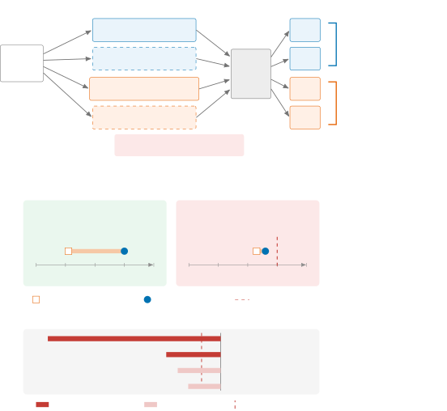
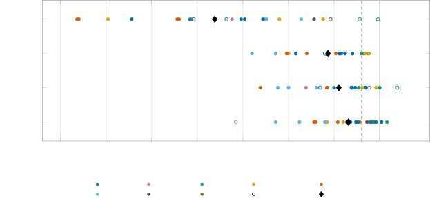
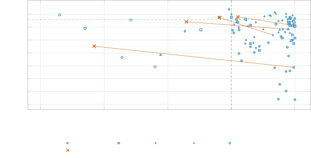

# JudgeSense: A Benchmark for Prompt Sensitivity in LLM-as-a-Judge Systems

Rohith Reddy
Bellibatlu [](https://orcid.org/)
   Edward Raff Affiliation: CrowdStrike, New York, USA
Affiliation: University of Maryland Baltimore County, Baltimore, USA   
Wenbin
Zhang [](https://orcid.org/)
Affiliation: Florida International University, Miami, FL

###### Abstract

Large language models are widely used to judge the output of other
language models, yet whether a judge returns the same verdict when the
same request is worded differently remains largely unexamined. We study
that question across four evaluation tasks and twenty-five judges from
six providers. To support the analysis we release JudgeSense, a
benchmark of $`880`$ items from human-labelled corpora, each issued
under two instructions that differ in wording and not in what they ask,
with the complete decision logs. Every score is reported against the
judge’s own agreement with itself on the identical prompt, so decoding
noise is not charged to wording, and the release lets a reader ask the
same of any judge not in our roster. Rewording costs agreement on all
four tasks, and on two it clears the threshold we declare for a
practically meaningful effect; the ordinal task is both the least stable
and the one fewest judges are accurate on, and within a single family
parameter count does not predict stability. A judge measured inside an
agent harness yields a _smaller_ estimate than the same judge reached
through a direct API call, because its agreement with itself collapses
faster than its agreement across wordings.

^(†)^(†) ^(∗)Corresponding author.^(†)^(†) Benchmark and decision logs:
[https://huggingface.co/datasets/Rohithreddybc/judgesense-benchmark](https://huggingface.co/datasets/Rohithreddybc/judgesense-benchmark).
Code, and the scripts behind every table and figure:
[https://github.com/rohithreddybc/judgeSense](https://github.com/rohithreddybc/judgeSense).

## 1 Introduction

Language models now routinely evaluate the output of other language
models. A model used this way is a _judge_: it is shown one piece of
text, or two, together with an instruction telling it what to decide,
and it returns a label from a small fixed set. Throughout this paper
“judge” means the model doing the deciding, never the model whose output
is being judged. The practice is cheap, fast, and correlates well enough
with human preference to have displaced human annotation across much of
the evaluation stack (33), and an evaluator earns that role by being
reproducible. If two researchers ask the same judge the same question in
different words and get different verdicts, the judge is partly
measuring the phrasing. The usual validation cannot see that: it asks
whether a judge agrees with humans on average, and a judge can correlate
well in aggregate while flipping on individual items.

Instability under rephrasing is well documented for models performing
ordinary tasks, where formatting, ordering and the choice between
synonyms move accuracy substantially (24, 19, 6). For judges the known
failures are positional and length-related: judges favour the
first-presented candidate (28, 25), and annotators in the preference
votes we draw on chose the longer response in roughly 70% of usable
comparisons. Whether the same judge, asked the same question two ways,
returns the same answer has been measured far less; Section 2 sets out
what has and has not been established.

This paper measures it. We introduce JudgeSense, 880 items across four
evaluation tasks, each issued under two instruction templates that
differ in wording and not in what they ask. _Factuality_ asks whether a
statement is factually correct and _coherence_ asks how well a summary
holds together on a one-to-five scale; _relevance_ asks which of two
passages better answers a query and _preference_ which of two responses
is better. The four are independent task families with their own items
and their own paraphrase sets, and no item appears in more than one. The
quantity we report is the Judge Sensitivity Score,

```math
\mathrm{JSS}(j,t)\;=\;\frac{1}{|P_{t}|}\sum_{(p,p^{\prime})\in P_{t}}\delta\!\left(j(p),\,j(p^{\prime})\right), \tag{1}
```

where $`j`$ is a judge, $`t`$ an evaluation task, and $`P_{t}`$ that
task’s set of _prompt-paraphrase pairs_. $`\delta(a,b)=1`$ if $`a=b`$
and $`0`$ otherwise, evaluated in the task’s decision space $`D_{t}`$. A
JSS of $`1.0`$ means the judge returned identical decisions on every
pair; below $`0.8`$, rewording alone flips its verdict on more than one
item in five. This is not accuracy. A judge that is wrong on every item
but wrong _identically_ under both phrasings scores $`1.0`$, which is
intended: we ask whether the instrument is stable and treat whether it
is correct as a separate question. One judge measured on one task is a
_cell_, the unit every table and figure below is built from.

A prompt-paraphrase pair is two evaluation instructions that ask for the
same decision on the same item and differ only in surface wording. One
factuality pair, shipped as templates T1 and T3, reads in full:

> Is this statement factually correct? Answer YES or NO only. {text}  
> Is the following statement accurate? Answer with one word: YES or NO.
> {text}

Both request the same two labels in the same direction, the statement
substituted into each is byte-identical, and neither asks the negated
question. The paraphrase is of the _instruction_, never of the item it
carries.



Figure 1: How one item is judged, and why the endpoint is a difference.
(a) Each item goes to the same judge four times: template A, A again
unchanged, a reworded template B, and B again. Blue compares a template
with its own repeat, the judge’s agreement with itself and so its
reproducibility ceiling; orange compares the two wordings. (b)
Subtracting one from the other charges decoding noise to the ceiling, so
a judge that already disagrees with itself has less left to lose and
shows a _smaller_ gap, which is why cells below $`0.90`$ are reported
but not read. (c) The answer, pooled over judges and clustered by vendor
(Table 3). Takeaway: rewording moves a judge’s verdict by more than its
own decoding noise does, most of all when the judge is asked for a
rating rather than a choice.

Measuring this well is harder than issuing two prompts and counting
disagreements. Three challenges have to be addressed.

i) Difficulty in separating sensitivity to wording from the judge’s own
noise. A judge disagrees with itself on the identical prompt, so raw
disagreement under rewording mixes two sources. The obvious correction,
subtracting the one from the other, cannot be trusted everywhere: a
judge that already disagrees with itself has little agreement left to
lose, so its corrected score is pulled toward zero and noise masquerades
as stability. In a pilot we discarded, a misconfigured decoding
parameter produced a ceiling low enough to absorb the entire effect we
report, and nothing in the output distinguished it from a genuine one. A
usable endpoint needs the correction _and_ a rule for when the corrected
value may be read (Section 4.2).

ii) Difficulty in building a benchmark whose difficulty is not an
artifact of its own construction. If a heuristic that ignores the
construct can pass, a high score says nothing about judgment. Always
answer A. Pick the longer candidate. Pick the passage sharing more words
with the query. Yet a benchmark nothing can pass is equally useless, and
a construction that suppresses exploitable signal can suppress genuine
signal by the same mechanism. Both directions have to be checked, and
neither failure shows in labels, provenance or aggregate statistics:
every defect we found in our own rebuilds had passed each check that was
not looking for it (Section 3).

iii) Difficulty in drawing a claim from judges that are not independent
draws. Checkpoints from one vendor share pretraining corpora, tuning
recipes and decoding defaults, so a sensitivity learned once reappears
across siblings and is counted once per sibling. Treating them as
separate evidence is what produced the claim this work has since
retracted. Counting them honestly costs precision, and the cost is large
enough to change conclusions (Section 4.3).

##### This paper is a correction as well as a contribution.

An earlier version of this benchmark (3) was withdrawn after review. Its
75 items were hardcoded in source while being described as
benchmark-sourced; it presented the correct candidate first in every
pairwise item, so a judge that always answered “A” was indistinguishable
from a perfect one; and one factuality template inverted the answer
polarity, inflating measured disagreement uniformly across every judge.
We rebuilt from real corpora with per-item provenance, and the rebuild
had further defects of the same class: a template assignment that
functioned as an answer key, candidate responses carrying contradictory
gold labels, and a length-balancing step that installed a difficulty
confound in place of the verbosity one. We report those too. None is
exotic, and each survived every check that was not specifically looking
for it.

##### Contributions.

To tackle the above challenges, this paper introduces JudgeSense. We
state first what is not ours: the agreement rate in Equation 1 is what
Elazar et al. (6) use for consistency in pretrained models, what
Arabzadeh and Clarke (2) compute against relevance labels, and what Zhuo
et al. (34) express as a variance, while Ahn and Yin (1) distinguish
inconsistency under repetition from inconsistency under rewording. No
single prior source covers all of what follows; we borrow the measure
and the distinction, and supply the rest.

- •
  An endpoint measured against the judge’s own noise (i). We subtract
  repeat agreement from paraphrase agreement, scoring each judge against
  its own reproducibility ceiling, and decline to read any cell whose
  ceiling is too low to carry the comparison.
- •
  A benchmark whose attack surface is measured, not asserted (ii). 880
  items from four human-labelled corpora with per-item provenance,
  released with the heuristic baselines that would beat it, their
  intervals and support counts, and a declared threshold the best judge
  must clear for a task to count as discriminating.
- •
  Inference that does not count siblings twice (iii). The confirmatory
  contrast clusters judges by the vendor that trained the checkpoint.
  Two of our four claims do not survive it, and we say so.
- •
  Refusal treated as a measurement. Provider-flagged declines are
  recorded apart from unparseable output: alike once parsing has failed,
  but different facts about a judge.
- •
  Evidence that the ordinal task is the least stable. Coherence carries
  the largest pooled effect of the four, roughly three times the next
  largest, still the largest when its scale is collapsed to binary, and
  the largest loss for fourteen of the sixteen judges whose four cells
  are all readable. It is also where judges differ most from each other:
  the least stable task and the least agreed-upon one at once.

## 2 Related work

##### LLM judges and their validation.

Zheng et al. (33) established the practice at scale through MT-Bench and
Chatbot Arena, and holistic evaluation efforts adopted it (16).
Validation is almost always correlational: a judge is trusted when its
scores agree with human ratings in aggregate (4, 18). Chiang and Lee (4)
find that agreement broadly positive but task-dependent, which
prefigures a result below. What correlational validation cannot say is
whether rerunning an evaluation under differently worded instructions
will reproduce it.

##### Known judge biases.

Wang et al. (28) show position bias, the preference for whichever
candidate is presented first, to be strong enough to require explicit
correction. Shi et al. (25) extend that across twelve judges and more
than 100,000 evaluation instances, and find it a stable, model-specific
property that bites hardest when the two candidates are close in
quality. Length is the other documented confound (28). Both describe
what judges prefer, and Section 3 treats them as constraints on
construction. Neither reports how a verdict moves when the instruction
itself is reworded.

##### Prompt sensitivity in language models generally.

Formatting choices alone swing accuracy by as much as 76 points on some
benchmarks (24), paraphrasing task instructions alters model rankings
(19), and consistency under rephrasing has been treated as a first-class
property of pretrained models (6). The sensitivity has itself been
benchmarked (34, 22, 23): Razavi et al. (22) report that current methods
cannot anticipate which prompts will trip a model up, which argues for
measuring it directly, and Romanou et al. (23) attribute up to half of a
model’s performance variance to semantics-preserving perturbations. Wei
et al. (29) study prompt-template effects on judge reliability,
restricted to alignment tasks and under a different metric.

Separating the two inconsistencies is not our idea. Ahn and Yin (1) name
them: inconsistency under repetition, a property of decoding, and
inconsistency under rewording, a property of the prompt. We subtract the
first from the second, report the difference, and treat the first as a
precondition for reading the second at all. Weng et al. (30) apply the
same correction elsewhere, counting verdict flips on safety rubrics only
where they exceed a judge’s own baseline jitter.

All of this concerns a model being tested. A judge does not generate an
answer; it returns a label from a small finite set, so its sensitivity
is a question about decision stability, not output fluency, and these
measurements do not transfer to the model doing the testing.

##### Judging judges.

Thakur et al. (26) assess thirteen judges on a clean alignment task and
document sensitivity to prompt complexity, length and other surface
features alongside a general tendency toward leniency; Li et al. (14)
survey the area broadly. The last two years have made judge reliability
a subject in its own right. Li et al. (15) find reliability highly
sensitive to the choice of judge prompt template; Norman et al. (20)
evaluate twenty-one judges and show that exact-match agreement
overstates discrimination once corrected for chance, which is why we
report Cohen’s $`\kappa`$ beside every raw figure; and Feng et al. (8)
score judges on self-consistency without human annotation, as we do.
Closest in method is Yagubyan (31), who repeat identical evaluations
fifty times per question and report that semantically equivalent
templates change the majority outcome in a quarter of cases, on two
judges from one provider.

Closest in question is Arabzadeh and Clarke (2), who compare human- and
LLM-authored prompt variants for relevance judgment (90 prompts, three
judge models) against TREC labels using Cohen’s $`\kappa`$, the
agreement rate discounted for what two raters would reach by chance. The
difference is the referent: that work tracks how rewording moves a
judge’s _accuracy_ against human gold, while JSS never consults the gold
label and tracks how rewording moves a judge’s _agreement with itself_.
The two diverge when a judge flips verdicts in compensating directions,
which our measurement sees and an accuracy-referenced one does not.

##### Why not simply evaluate under many prompts?

Hua et al. (11) dispute the premise, arguing that much reported prompt
sensitivity is an artifact of log-likelihood scoring and rigid answer
matching, and that an LLM judge in their place cuts variance across
templates. We read that as motivating this paper: their comparison is of
ways to score a model, ours is of the scorer. If a judge absorbs the
benchmark’s prompt sensitivity, how much the judge itself carries is the
question that remains, and it is answered by measuring rather than by
assuming the substitution is free. Our parsing is strict and our
decision spaces small and fixed, so the leniency their critique targets
cannot inflate our estimate.

Mizrahi et al. (19) advocate multi-prompt evaluation as a methodological
default. It is good advice for the evaluation being run, but it must be
re-run for every new judge over a prompt distribution chosen for that
study, whereas a fixed paraphrase set yields a number computed once and
portable anywhere. Variance-based characterisations (24, 34) need gold
labels, since they measure how accuracy moves across prompt variants;
ours needs none, so it applies where no gold labels exist, which is the
usual situation. Ensemble judging (14) manages sensitivity by combining
judges, and says nothing about whether any individual judge is stable
enough to use alone.

In contrast to existing work, this paper measures the stability of the
judge itself, against its own noise rather than against a gold label,
across twenty-five judges from six providers, and reports the result
under an independence assumption weak enough that two of its four claims
do not survive.

##### Sources.

The items come from existing human-labelled corpora: TruthfulQA for
factual accuracy (17), SummEval for expert coherence ratings (7), BEIR’s
TREC-COVID split for graded relevance judgements (27), and MT-Bench’s
human preference votes (33). No label in this benchmark is assigned or
inferred by us. The judges are drawn from current instruction-tuned and
reasoning-tuned families (21, 9, 10, 32, 12, 5).

## 3 The JudgeSense benchmark

JudgeSense measures whether an LLM judge returns the same verdict when
the same evaluation request is worded differently. A judge whose verdict
depends on which of two equivalent phrasings it received is not usable
as a measuring instrument, however accurate it looks on average.

### 3.1 Tasks and sources

The benchmark covers four evaluation tasks, each drawn from an existing
human-labelled corpus. No item is authored by us and no label is
assigned or inferred by us; every label is the one the source corpus
already carried.

Factuality  
(250 items, TruthfulQA). A statement is judged accurate or inaccurate.
Items whose question is ill-posed, and whose only defensible answer is a
refusal to answer, are excluded at load time.

Coherence  
(250 items, SummEval). A summary is rated 1–5 for coherence against
expert annotations. Summaries with identical text but conflicting expert
labels are dropped, not merged.

Relevance  
(250 items, 500 rows, BEIR TREC-COVID). Given a topic, the judge picks
the more relevant of two passages. _Both_ candidates carry a human
relevance grade: the positive is graded fully relevant (2) and the
distractor is one a human assessor explicitly rejected (0). Partially
relevant documents (grade 1) are used for neither role.

Preference  
(130 items, 260 rows, MT-Bench human judgments). The judge picks the
response humans preferred. Only comparisons with at least two annotator
votes and a clear majority are used.

The relevance construction departs from the usual practice of drawing
distractors from a positives-only collection. There, a negative can only
be a document _absent_ from an incomplete judgment set, so a topically
similar distractor may in fact be relevant but unjudged, and the item
penalises a defensible answer. TREC-COVID carries tens of thousands of
explicit non-relevant assessments, so both candidates here are
human-labelled and the distractor is one a human affirmatively rejected.

Every shipped item records its source dataset, split, per-record
identifier and source configuration, so any item can be traced to the
row it came from. When a source is unavailable the loader raises; there
is no fallback path that could quietly generate an item in its place.

### 3.2 Paraphrase design

Each item is issued under two of five instruction templates, intended to
differ in wording and not in what they ask; all twenty are printed in
full in Appendix E. That intent is a construct assumption: if it fails,
a judge answering both arms correctly is scored as unstable, and the
result is semantic drift, not prompt sensitivity.

We audit the released files, not the generator, recovering each template
from the shipped prompts and the payload beside them. The audit is
offline, deterministic, runs in continuous integration, and enforces
four properties. _Label space_: both templates in a pair request the
same answer set ({YES, NO} for factuality, $`\{1,\dots,5\}`$ for
coherence, {A, B} for the pairwise tasks). _Polarity_: no answer token
is bound to opposite conclusions, and no template asks the inverted
question. _Construct_: every template draws its vocabulary from its own
task. _Non-triviality_: no pair is a near-duplicate. All four hold on
all twenty shipped templates.

##### The limits of the audit.

Those properties are structural. None shows that two differently worded
instructions ask for the same _judgement_, the assumption the benchmark
rests on. That assumption is smaller than the item count suggests, and
its size is what makes it checkable: equivalence is a property of the
instruction pair, not of the item, and within an item both arms carry
byte-identical content, so no particular passage can make one arm ask a
different question. The $`880`$ items draw on ten instruction pairs per
task, forty in all, built from the twenty templates printed in
Appendix E, so a reader can audit the assumption directly against the
four decision spaces.

We did not have those forty pairs scored by an independent judge, human
or model, for this release. The manual records from the first version
are keyed to identifiers no item here uses. A model-based check returned
unanimous agreement, but its validators consulted the generator and the
equivalence tests instead of judging the pairs as shown; that is
circular, and we rest nothing on it.

Two further properties we measure and report but cannot enforce.
Templates place the payload at different points: in relevance, T1 opens
the query at $`46.4\%`$ of the template against T3 at $`9.0\%`$, a
within-pair divergence of $`37.4`$ percentage points; and reading
difficulty varies by up to $`3.7`$ Flesch–Kincaid grade levels within a
pair. Either could make one arm intrinsically harder. Three residuals
remain open: the audit groups surface forms into one construct by an
authored mapping, so whether “factually correct” and “accurate” are
synonyms for a given judge is an assumption; implicit thresholds may
shift between phrasings even when the construct does not; and
tokenisation or pretraining frequency may favour one phrasing for one
model. Semantic drift is reduced as an alternative explanation, not
eliminated.

##### A limitation of the assignment.

Each item is issued under exactly one of the ten unordered template
pairs, balanced across pairs, so template identity nests perfectly
inside item identity: the items behind $`T_{i}`$ and $`T_{j}`$ are
disjoint, and any apparent difference between two templates is equally a
difference between the items they were shown. Claims of the form
“template A is more stable than template B” are not identifiable here,
and we make none. The within-item contrast the design was built for is
unaffected, since the two arms of a pair differ only in wording with the
item held fixed. Appendix A records the polarity defect this design
corrects.

### 3.3 Position control

Both pairwise tasks present every item twice, once in each candidate
ordering. The correct answer therefore sits at position A in exactly
half the rows, and a judge that ignores content and always answers “A”
scores $`0.500`$, not $`1.000`$.

This corrects an earlier version in which the correct candidate always
appeared first, where most judges scored a degenerate
$`\mathrm{JSS}=1.000`$ that reflected the layout and no judgment at all.

### 3.4 Release and integrity

The dataset is released with Croissant metadata, per-item provenance,
and a content hash for each split that excludes retrieval timestamps, so
a rebuild can be verified as identical in content without being
byte-identical in metadata. A 32-check audit gate (eight checks over
each of four splits) runs in continuous integration and fails the build
on duplicate content, unbacked provenance claims, label degeneracy,
insufficient clustering support, contradictory ground truth, or a length
shortcut exceeding its bound. A check that cannot read the data it is
meant to inspect fails; it does not pass. A check that silently measures
nothing therefore cannot be mistaken for one that found nothing wrong.

## 4 Measuring sensitivity

This section settles three things before any number is reported: what is
measured on a single cell, how the cells are pooled into a claim about a
task, and which cells are read at all. The first is the endpoint,
$`\Delta\mathrm{JSS}`$, defined in Section 4.2 as the gap between a
judge’s agreement across two wordings and its agreement with itself. The
second is a choice about independence, since sibling checkpoints from
one vendor are not separate evidence (Section 4.3). The third is a
threshold on the repeat arm, below which a cell is reported and not read
(Section 4.4); that bar conditions on a term of the quantity it filters,
so the contrast is reported with and without it.

### 4.1 Judge Sensitivity Score

Equation 1 gives the endpoint’s first term: the rate at which a judge
returns the same decision under two equivalent templates. It never
consults the ground-truth label, so accuracy is reported separately. On
the pairwise tasks the companion measure is _position-corrected_
accuracy, whether the judge selected the side carrying the ground truth
given that the swap design places it at position A in exactly half the
rows; on the pointwise tasks it is ordinary accuracy against the source
label. Raw agreement is also inflated when a judge’s output distribution
is compressed, since a judge answering “YES” almost always agrees with
itself, so alongside every raw figure we give the chance-corrected form
(Cohen’s $`\kappa`$, quadratic-weighted for the ordinal coherence task).

As Section 1 states, the agreement rate itself is borrowed. What is new
here is the benchmark, the systematic application to the model doing the
judging, and the endpoint defined next.

### 4.2 The repeat baseline, and why it is the endpoint

Raw JSS below $`1.0`$ does not by itself demonstrate sensitivity to
_wording_. A judge sampling at nonzero temperature, or served through a
non-deterministic backend, disagrees with itself on the identical
prompt, and raw JSS attributes that decoding noise to paraphrasing. We
separate the two by issuing one template a second time, unchanged. The
resulting $`\mathrm{JSS}_{\text{rep}}`$ is the judge’s reproducibility
ceiling on that task, and the primary endpoint is the difference

```math
\Delta\mathrm{JSS}=\mathrm{JSS}_{\text{para}}-\mathrm{JSS}_{\text{rep}},
```

which is negative when rewording costs more stability than resampling
does.

A pre-registration is worth only what is true of it, and ours is partly
post-hoc. Commit b1b507a, before the full sweep, fixed the endpoint, the
estimator, the item-level clustering unit, and one decision rule: an
effect is present when the interval excludes zero. Those four preceded
the sweep though not the first API call, since a five-row-per-cell smoke
wave had already exercised the harness against three judges; it produced
no reportable estimate and none of its output enters the results. Commit
82ea522, some seventy minutes after the first full judge’s results were
committed, added the support floors, the multiplicity plan and the
discrimination thresholds. Those are _not_ pre-registered, and two of
the four discrimination thresholds were set while the corresponding
accuracies were already visible in the repository, which disqualifies
them as confirmatory tests; they are reported as post-hoc descriptive
checks. One correction is recorded in the plan itself: the direction of
subtraction in the endpoint’s prose was stated backwards relative to the
estimator, which had been implemented and tested beforehand.

The multiplicity plan added at 82ea522 is the one this paper applies: a
pooled contrast per task with Holm correction, per-cell intervals
demoted to exploratory under Benjamini–Hochberg control at a $`10\%`$
false discovery rate, and a reported minimum detectable effect. No judge
is ranked against another on the strength of an unadjusted cell. Because
the plan was written after the first judge’s results were committed, the
confirmatory and exploratory labels are themselves declared rather than
pre-registered, and we carry that qualification wherever they are used.

### 4.3 Pooling across judges

The confirmatory claims pool judges within a task, and the estimator is
the unweighted mean of the judge-level $`\Delta\mathrm{JSS}`$ values for
that task’s readable cells. Weighting by precision would let the judges
with the narrowest intervals decide a cross-judge claim, which is not
what we are asking.

The sampling unit is the judge, and judges are not independent:
twenty-five checkpoints come from eight vendors, one of which supplies
seven. Sibling checkpoints share pretraining corpora, instruction-tuning
recipes and decoding defaults, so a sensitivity learned once reappears
across the siblings and would be counted once per sibling. That is the
error we attribute to the superseded version of this work, whose
retracted claim rested on three judges from one vendor. Kohli (13) put a
number on the same effect for judge panels: across nine frontier judges
from seven families, correlated errors leave roughly two votes’ worth of
independent information, so counting judges overstates the evidence they
jointly carry. We therefore report a cluster-robust standard error with
the vendor as the cluster, using the CR1 correction and Student’s $`t`$
on $`G-1`$ degrees of freedom instead of a normal approximation, which
with eight clusters is optimistic. Both the point-null test and the
equivalence-style test against the declared threshold are Holm-corrected
over their own family of four, and the unclustered standard error is
reported alongside so the cost of the assumption is visible.

### 4.4 The readability bar, and what it costs

We decline to read any cell whose repeat ceiling falls below $`0.90`$.
The bar is declared rather than pre-registered: it was fixed after the
pilot described in Section 5, in which a misconfigured decoding
parameter produced a ceiling of $`0.864`$ and absorbed the entire
effect.

It also conditions on a term of the quantity it filters, since
$`\Delta\mathrm{JSS}`$ subtracts $`\mathrm{JSS}_{\text{rep}}`$ and the
bar is a threshold on $`\mathrm{JSS}_{\text{rep}}`$, so retaining only
high-ceiling cells is not a neutral quality gate. We report the contrast
both ways. Dropping the bar moves coherence from $`-0.181`$ to
$`-0.158`$ and relevance from $`-0.034`$ to $`-0.039`$; factuality is
unchanged at $`-0.057`$ and preference moves from $`-0.045`$ to
$`-0.042`$. The bar flatters the largest effect and penalises the
smallest, the direction that favours our own headline. Every pooled
conclusion in Section 5 holds under both.

We also report a minimum detectable effect per cell: the smallest
$`|\Delta\mathrm{JSS}|`$ that cell could have told apart from zero at
its own support, computed as $`(z_{0.975}+z_{0.80})`$ times the
bootstrap standard error of its estimate, the conventional two-sided
calculation at $`80\%`$ power. A cell whose estimate falls below its own
minimum detectable effect is uninformative rather than null, and
thirty-six of the eighty-seven readable cells are in that position.

### 4.5 Uncertainty and decoding budget

All intervals are 95% cluster bootstrap intervals over 2,000 resamples
with the item as the resampling unit. The design forces that choice: a
pairwise item contributes two rows, one per candidate ordering, and its
repeat arm nests inside it, so resampling rows independently treats
correlated observations as independent and understates uncertainty. The
clustering unit is a mandatory argument in our implementation, with no
default, so it cannot be omitted by accident. An effect is reported as
present for a judge–task cell when the interval for
$`\Delta\mathrm{JSS}`$ excludes zero, and the direction is read from the
sign.

Every judge is run with an identical output token limit of $`1{,}024`$
tokens. A class-dependent limit, tight for instruction-tuned judges and
generous for reasoning-tuned ones, would confound judge class with
inference configuration, so any difference between the classes would
admit an explanation having nothing to do with the models; it would also
truncate real responses, since a judge that emits any preamble before
its verdict exhausts a tight cap mid-sentence and the fragment is
retained as its answer. Because a token limit is a ceiling and not a
target, the matched budget costs nothing for judges that emit a
single-token answer, and more only for the verbose non-compliers whose
calls were previously truncated into noise.

We quote no rate for any of this. Every committed run was made under the
matched policy, so we hold no measurement of the cap-termination rate
under the class-dependent one, and quantifying the budget’s effect would
require a subsample run under that configuration. We did not run it, and
we make no claim about the effect’s size; the case for the matched
budget rests on the confound being structural.

## 5 Results

We report twenty-five judges across six providers on the four tasks,
giving ninety-eight judge–task cells with an endpoint. Two cells report
none: the Sonnet and Opus preference splits stopped below the declared
support floor when the API balance was exhausted mid-run, and
Section 5.9 states what that costs. Every figure below is produced by
scripts/regenerate_results.py from the committed raw outputs; none is
transcribed.

| Judge                | Task       | $`n`$ | JSS   | $`\mathrm{JSS}_{\text{rep}}`$ | effect                                                       | $`\Delta\mathrm{JSS}`$ \[95% CI\] | $`r`$ | $`m`$ |
| -------------------- | ---------- | ----- | ----- | ----------------------------- | ------------------------------------------------------------ | --------------------------------- | ----- | ----- |
| claude-haiku         | factuality | 250   | 0.956 | 1.000                         |    | $`-0.044`$ \[-0.072, -0.020\]     | 0.000 | 0.000 |
|                      | coherence  | 250   | 0.792 | 0.998                         |    | $`-0.206`$ \[-0.258, -0.154\]     | 0.000 | 0.000 |
|                      | relevance  | 500   | 0.930 | 0.990                         |    | $`-0.058`$ \[-0.086, -0.032\]     | 0.000 | 0.010 |
|                      | preference | 260   | 0.896 | 0.965                         |    | $`-0.081`$ \[-0.127, -0.038\]     | 0.000 | 0.031 |
| claude-opus-4-7      | factuality | 250   | 0.960 | 0.990                         |    | $`-0.030`$ \[-0.056, -0.006\]     | 0.000 | 0.000 |
|                      | coherence  | 250   | 0.736 | 0.916                         |    | $`-0.180`$ \[-0.236, -0.128\]     | 0.000 | 0.000 |
|                      | relevance  | 500   | 0.964 | 0.998                         |   | $`-0.036`$ \[-0.063, -0.013\]     | 0.051 | 0.000 |
|                      | preference | 170   | 0.963 | —                             |                                                              | _support below floor_             | 0.000 | 0.056 |
| claude-sonnet        | factuality | 250   | 0.952 | 0.990                         |   | $`-0.038`$ \[-0.062, -0.018\]     | 0.000 | 0.008 |
|                      | coherence  | 250   | 0.828 | 0.990                         |   | $`-0.162`$ \[-0.210, -0.118\]     | 0.000 | 0.000 |
|                      | relevance  | 500   | 0.584 | 0.789                         |   | $`-0.158`$ \[-0.206, -0.110\]     | 0.247 | 0.224 |
|                      | preference | 44    | 0.559 | —                             |                                                              | _support below floor_             | 0.000 | 0.432 |
| deepseek-v4-flash    | factuality | 250   | 0.888 | 0.908                         |   | $`-0.020`$ \[-0.056, 0.016\]      | 0.000 | 0.010 |
|                      | coherence  | 250   | 0.616 | 0.670                         |   | $`-0.054`$ \[-0.116, 0.008\]      | 0.000 | 0.000 |
|                      | relevance  | 500   | 0.944 | 0.962                         |   | $`-0.006`$ \[-0.026, 0.012\]      | 0.000 | 0.004 |
|                      | preference | 260   | 0.911 | 0.923                         |   | $`-0.023`$ \[-0.058, 0.012\]      | 0.000 | 0.025 |
| deepseek-v4-flash-ds | factuality | 250   | 0.888 | 0.900                         |   | $`-0.012`$ \[-0.046, 0.022\]      | 0.000 | 0.004 |
|                      | coherence  | 250   | 0.628 | 0.630                         |   | $`-0.002`$ \[-0.062, 0.060\]      | 0.000 | 0.004 |
|                      | relevance  | 500   | 0.946 | 0.952                         |   | $`-0.008`$ \[-0.028, 0.012\]      | 0.000 | 0.016 |
|                      | preference | 260   | 0.892 | 0.900                         |   | $`+0.000`$ \[-0.038, 0.038\]      | 0.000 | 0.050 |
| deepseek-v4-pro      | factuality | 250   | 0.904 | 0.922                         |   | $`-0.018`$ \[-0.046, 0.010\]      | 0.000 | 0.042 |
|                      | coherence  | 250   | 0.720 | 0.742                         |   | $`-0.022`$ \[-0.076, 0.032\]      | 0.000 | 0.004 |
|                      | relevance  | 500   | 0.960 | 0.968                         |   | $`+0.008`$ \[-0.004, 0.022\]      | 0.000 | 0.014 |
|                      | preference | 260   | 0.923 | 0.896                         |   | $`+0.019`$ \[-0.012, 0.058\]      | 0.000 | 0.048 |
| gemini-3.7-flash     | factuality | 250   | 0.976 | 0.992                         |   | $`-0.016`$ \[-0.032, -0.004\]     | 0.000 | 0.000 |
|                      | coherence  | 250   | 0.840 | 0.902                         |   | $`-0.062`$ \[-0.102, -0.022\]     | 0.000 | 0.000 |
|                      | relevance  | 500   | 0.982 | 0.992                         |   | $`-0.012`$ \[-0.026, 0.000\]      | 0.000 | 0.000 |
|                      | preference | 260   | 0.969 | 0.988                         |   | $`-0.019`$ \[-0.046, 0.000\]      | 0.000 | 0.000 |
| gemini-flash         | factuality | 250   | 0.896 | 0.996                         |   | $`-0.100`$ \[-0.136, -0.064\]     | 0.000 | 0.000 |
|                      | coherence  | 250   | 0.688 | 0.986                         |   | $`-0.298`$ \[-0.358, -0.242\]     | 0.000 | 0.000 |
|                      | relevance  | 500   | 0.878 | 0.950                         |   | $`-0.058`$ \[-0.084, -0.034\]     | 0.000 | 0.056 |
|                      | preference | 260   | 0.935 | 0.996                         |   | $`-0.027`$ \[-0.058, -0.004\]     | 0.000 | 0.002 |
| gemma-4-31b          | factuality | 250   | 0.980 | 0.992                         |   | $`-0.012`$ \[-0.032, 0.004\]      | 0.000 | 0.000 |
|                      | coherence  | 250   | 0.848 | 0.958                         |   | $`-0.110`$ \[-0.156, -0.070\]     | 0.000 | 0.000 |
|                      | relevance  | 500   | 0.866 | 0.904                         |   | $`-0.040`$ \[-0.062, -0.020\]     | 0.000 | 0.092 |
|                      | preference | 260   | 0.996 | 0.996                         |   | $`-0.004`$ \[-0.023, 0.012\]      | 0.000 | 0.000 |
| glm-5.2              | factuality | 250   | 0.880 | 0.910                         |   | $`-0.030`$ \[-0.056, -0.004\]     | 0.000 | 0.048 |
|                      | coherence  | 250   | 0.616 | 0.670                         |   | $`-0.054`$ \[-0.118, 0.012\]      | 0.000 | 0.002 |
|                      | relevance  | 500   | 0.950 | 0.970                         |   | $`+0.002`$ \[-0.018, 0.022\]      | 0.000 | 0.007 |
|                      | preference | 260   | 0.873 | 0.881                         |   | $`-0.012`$ \[-0.042, 0.019\]      | 0.000 | 0.067 |
| kimi-k3              | factuality | 250   | 0.948 | 0.992                         |   | $`-0.044`$ \[-0.072, -0.018\]     | 0.000 | 0.000 |
|                      | coherence  | 250   | 0.832 | 0.904                         |   | $`-0.072`$ \[-0.118, -0.028\]     | 0.000 | 0.000 |
|                      | relevance  | 500   | 0.972 | 0.994                         |   | $`-0.014`$ \[-0.030, -0.002\]     | 0.000 | 0.000 |
|                      | preference | 260   | 0.965 | 0.992                         |   | $`-0.015`$ \[-0.042, 0.004\]      | 0.000 | 0.000 |
| llama-3.3-70b        | factuality | 250   | 0.952 | 1.000                         |   | $`-0.048`$ \[-0.076, -0.024\]     | 0.000 | 0.000 |
|                      | coherence  | 250   | 0.772 | 0.992                         |   | $`-0.220`$ \[-0.274, -0.170\]     | 0.000 | 0.000 |
|                      | relevance  | 500   | 0.890 | 0.926                         |   | $`-0.046`$ \[-0.072, -0.022\]     | 0.000 | 0.058 |
|                      | preference | 260   | 0.965 | 1.000                         |   | $`-0.015`$ \[-0.038, 0.000\]      | 0.000 | 0.004 |
| llama-4-maverick     | factuality | 250   | 0.916 | 0.996                         |   | $`-0.080`$ \[-0.116, -0.048\]     | 0.000 | 0.000 |
|                      | coherence  | 250   | 0.764 | 0.986                         |   | $`-0.222`$ \[-0.274, -0.170\]     | 0.000 | 0.000 |
|                      | relevance  | 500   | 0.962 | 0.998                         |   | $`-0.022`$ \[-0.044, -0.006\]     | 0.000 | 0.006 |
|                      | preference | 260   | 0.942 | 0.988                         |   | $`-0.058`$ \[-0.104, -0.019\]     | 0.000 | 0.002 |
| llama-4-scout        | factuality | 250   | 0.892 | 0.994                         |   | $`-0.102`$ \[-0.142, -0.066\]     | 0.000 | 0.000 |
|                      | coherence  | 250   | 0.644 | 0.974                         |   | $`-0.330`$ \[-0.390, -0.272\]     | 0.000 | 0.000 |
|                      | relevance  | 500   | 0.838 | 0.974                         |   | $`-0.070`$ \[-0.104, -0.040\]     | 0.000 | 0.035 |
|                      | preference | 260   | 0.846 | 0.938                         |   | $`-0.131`$ \[-0.192, -0.077\]     | 0.000 | 0.027 |
| llama3-8b            | factuality | 250   | 0.884 | 0.998                         |   | $`-0.114`$ \[-0.156, -0.074\]     | 0.000 | 0.000 |
|                      | coherence  | 250   | 0.668 | 1.000                         |   | $`-0.332`$ \[-0.392, -0.272\]     | 0.000 | 0.000 |
|                      | relevance  | 500   | 0.896 | 0.992                         |   | $`-0.072`$ \[-0.106, -0.044\]     | 0.000 | 0.005 |
|                      | preference | 260   | 0.911 | 0.981                         |   | $`-0.058`$ \[-0.100, -0.023\]     | 0.000 | 0.015 |
| magistral-small      | factuality | 250   | 0.804 | 0.944                         |   | $`-0.140`$ \[-0.190, -0.094\]     | 0.000 | 0.000 |
|                      | coherence  | 250   | 0.820 | 0.944                         |   | $`-0.124`$ \[-0.170, -0.080\]     | 0.000 | 0.000 |
|                      | relevance  | 500   | 0.880 | 0.936                         |   | $`-0.088`$ \[-0.130, -0.048\]     | 0.000 | 0.002 |
|                      | preference | 260   | 0.846 | 0.935                         |   | $`-0.112`$ \[-0.173, -0.054\]     | 0.000 | 0.000 |
| mistral-medium       | factuality | 250   | 0.888 | 0.980                         |   | $`-0.092`$ \[-0.130, -0.056\]     | 0.000 | 0.000 |
|                      | coherence  | 250   | 0.892 | 0.978                         |   | $`-0.086`$ \[-0.124, -0.052\]     | 0.000 | 0.000 |
|                      | relevance  | 500   | 0.946 | 0.976                         |   | $`-0.060`$ \[-0.094, -0.028\]     | 0.000 | 0.000 |
|                      | preference | 260   | 0.927 | 0.985                         |   | $`-0.069`$ \[-0.112, -0.031\]     | 0.000 | 0.004 |
| mistral-small        | factuality | 250   | 0.816 | 0.930                         |   | $`-0.114`$ \[-0.162, -0.066\]     | 0.000 | 0.000 |
|                      | coherence  | 250   | 0.804 | 0.930                         |   | $`-0.126`$ \[-0.172, -0.080\]     | 0.000 | 0.000 |
|                      | relevance  | 500   | 0.840 | 0.922                         |   | $`-0.114`$ \[-0.164, -0.068\]     | 0.000 | 0.001 |
|                      | preference | 260   | 0.839 | 0.923                         |   | $`-0.100`$ \[-0.173, -0.035\]     | 0.000 | 0.000 |
| qwen                 | factuality | 250   | 0.908 | 1.000                         |   | $`-0.092`$ \[-0.128, -0.056\]     | 0.000 | 0.000 |
|                      | coherence  | 250   | 0.860 | 0.988                         |   | $`-0.128`$ \[-0.170, -0.086\]     | 0.000 | 0.000 |
|                      | relevance  | 500   | 0.940 | 0.974                         |   | $`-0.026`$ \[-0.046, -0.008\]     | 0.000 | 0.029 |
|                      | preference | 260   | 0.965 | 1.000                         |   | $`-0.031`$ \[-0.062, -0.008\]     | 0.000 | 0.000 |
| qwen-3.6-flash       | factuality | 250   | 0.932 | 0.970                         |   | $`-0.038`$ \[-0.068, -0.012\]     | 0.000 | 0.000 |
|                      | coherence  | 250   | 0.760 | 0.912                         |   | $`-0.152`$ \[-0.202, -0.104\]     | 0.000 | 0.000 |
|                      | relevance  | 500   | 0.944 | 0.986                         |   | $`+0.002`$ \[-0.014, 0.018\]      | 0.000 | 0.004 |
|                      | preference | 260   | 0.973 | 0.992                         |   | $`-0.031`$ \[-0.065, -0.004\]     | 0.000 | 0.002 |
| qwen3-14b            | factuality | 250   | 0.888 | 0.930                         |   | $`-0.042`$ \[-0.076, -0.010\]     | 0.000 | 0.006 |
|                      | coherence  | 250   | 0.576 | 0.780                         |   | $`-0.204`$ \[-0.264, -0.144\]     | 0.000 | 0.000 |
|                      | relevance  | 500   | 0.932 | 0.960                         |   | $`-0.004`$ \[-0.020, 0.012\]      | 0.000 | 0.028 |
|                      | preference | 260   | 0.869 | 0.912                         |   | $`-0.050`$ \[-0.085, -0.019\]     | 0.000 | 0.064 |
| qwen3-32b            | factuality | 250   | 0.952 | 0.996                         |   | $`-0.044`$ \[-0.072, -0.020\]     | 0.000 | 0.000 |
|                      | coherence  | 250   | 0.704 | 0.976                         |   | $`-0.272`$ \[-0.328, -0.216\]     | 0.000 | 0.000 |
|                      | relevance  | 500   | 0.952 | 0.992                         |   | $`-0.036`$ \[-0.062, -0.014\]     | 0.000 | 0.007 |
|                      | preference | 260   | 0.954 | 0.996                         |   | $`-0.027`$ \[-0.062, 0.000\]      | 0.000 | 0.000 |
| qwen3-8b             | factuality | 250   | 0.852 | 0.912                         |   | $`-0.060`$ \[-0.098, -0.020\]     | 0.000 | 0.008 |
|                      | coherence  | 250   | 0.560 | 0.728                         |   | $`-0.168`$ \[-0.232, -0.106\]     | 0.000 | 0.008 |
|                      | relevance  | 500   | 0.870 | 0.908                         |   | $`-0.032`$ \[-0.050, -0.014\]     | 0.000 | 0.082 |
|                      | preference | 260   | 0.769 | 0.827                         |   | $`-0.065`$ \[-0.115, -0.023\]     | 0.000 | 0.112 |
| qwen3.7-flash        | factuality | 250   | 0.960 | 0.990                         |   | $`-0.030`$ \[-0.054, -0.008\]     | 0.000 | 0.000 |
|                      | coherence  | 250   | 0.788 | 0.936                         |   | $`-0.148`$ \[-0.196, -0.102\]     | 0.000 | 0.000 |
|                      | relevance  | 500   | 0.954 | 0.986                         |   | $`-0.010`$ \[-0.026, 0.004\]      | 0.000 | 0.001 |
|                      | preference | 260   | 0.985 | 1.000                         |   | $`-0.015`$ \[-0.038, 0.000\]      | 0.000 | 0.000 |
| qwen3.8-27b-hf       | factuality | 250   | 0.792 | 0.852                         |   | $`-0.060`$ \[-0.090, -0.030\]     | 0.000 | 0.114 |
|                      | coherence  | 250   | 0.760 | 0.968                         |   | $`-0.208`$ \[-0.260, -0.156\]     | 0.000 | 0.002 |
|                      | relevance  | 500   | 0.946 | 0.980                         |  | $`-0.024`$ \[-0.046, -0.004\]     | 0.000 | 0.011 |
|                      | preference | 260   | 0.911 | 0.938                         |  | $`-0.031`$ \[-0.065, 0.000\]      | 0.000 | 0.038 |

Table 1: Paraphrase sensitivity per judge and task.
$`\Delta\mathrm{JSS}=\mathrm{JSS}_{\text{para}}-\mathrm{JSS}_{\text{rep}}`$
is the pre-registered endpoint, negative when rewording costs more
agreement than re-issuing the identical prompt does. The bar draws that
estimate from a zero line, leftward for a cost, with the hairline at the
declared $`0.02`$ threshold; bands group one judge’s four tasks.
Intervals are 95% item-clustered bootstrap over 2,000 resamples, and
cells below the support floor of 100 clusters report no endpoint. $`r`$
is the refusal rate and $`m`$ the malformed-output rate over the arms
the judge attempted. The first two columns do not subtract to the
printed delta wherever a cell carries refusals or a swapped-ordering
imbalance, because the delta uses the canonical ordering only. Takeaway:
rewording costs agreement almost everywhere, and coherence is the
largest loss for nearly every judge and the column they disagree on
most.

### 5.1 Headline findings

Six findings, ordered by how much each bears on choosing a judge. The
analyses behind them follow in Sections 5.3 onward.

##### Finding 1: Rewording costs agreement on all four tasks, and on two of them the cost clears the threshold once judges are clustered by vendor.

The pooled $`\Delta\mathrm{JSS}`$ is negative on every task, from
coherence ($`-0.181`$) down to relevance ($`-0.034`$). Clustering by
vendor and correcting over four tests, coherence and factuality clear
the $`0.02`$ threshold; preference and relevance do not (Table 3).
Unclustered standard errors are $`1.37`$ to $`1.63`$ times smaller and
would have cleared all four, but seven of the twenty-five judges come
from one vendor, and sibling checkpoints are not independent draws. Per
cell, sixty-eight of the eighty-seven readable cells are significant
under Benjamini–Hochberg at a $`10\%`$ false discovery rate, which is
the exploratory reading and carries no confirmatory claim (Section 4.2).

##### Finding 2: Coherence carries the largest effect and is the task fewest judges are accurate on.

It has both the largest pooled loss, three times factuality, and the
weakest discrimination: six of twenty-five judges clear its declared
accuracy threshold of $`0.40`$, against twenty-five of twenty-five on
relevance at $`0.70`$ (Tables 3 and 8). Quadratic-weighted $`\kappa`$,
which credits a near miss, spans $`0.579`$ to $`0.941`$ over the sixteen
fully readable judges, so they may agree on the ordering while
exact-match accuracy punishes placement on a five-point scale. Either
way, a single coherence score is unreliable.

##### Finding 3: Most of coherence’s excess is the width of its five-point scale, not the task.

Collapsing coherence to a binary label at four or above removes
$`58.6\%`$ of the effect, averaged over judges (Table 5). What remains
still leads the four tasks, at about $`1.3`$ times factuality, not
three. A five-point scale offers more adjacent categories for a
paraphrase to shift a verdict into. The control is not decisive, since a
different cut point would remove a different share.

##### Finding 4: A low repeat ceiling hides wording sensitivity rather than exposing it.

Repeat agreement ranges from $`0.630`$ to $`1.000`$ across the
ninety-eight cells, and thirty-three sit at $`0.99`$ or above
(Figure 3). Because $`\Delta\mathrm{JSS}`$ subtracts repeat agreement
from paraphrase agreement, decoding noise is charged to the ceiling: a
judge that disagrees with itself on identical input has less room left
to lose on reworded input, so its estimate is pulled toward zero. The
coherence extremes fit that account, llama3-8b losing $`0.332`$ from a
ceiling of $`1.000`$ against gemini-3.7-flash’s $`0.062`$ from
$`0.902`$. Eleven cells whose ceiling falls below $`0.90`$, six of them
coherence, are therefore reported but not read, leaving eighty-seven.
Read the ceiling column first, and treat a near-zero estimate above a
low ceiling as uninformative rather than as stability.

##### Finding 5: Parameter count does not predict stability, and recency is not the story the earlier version told.

Within the qwen-3 ladder, size does not order $`\Delta\mathrm{JSS}`$ on
any task, and on relevance the middle model is the most stable
(Table 7). Across families the coherence extremes are what a capability
story would predict, but fourteen of the sixteen fully readable judges
lose most on coherence whatever their size. The ladder is incomplete
below 8B. Recency is not controlled at all, and what the roster shows
descriptively runs against the earlier version’s claim that the newest
models are the least consistent: ranking the sixteen fully readable
judges by mean endpoint, the newest Gemini is the most stable of them
and the two newest Qwen checkpoints rank fourth and fifth, while the
older gemini-flash and llama3-8b sit near the bottom. llama-4-scout is
the counterexample, recent and least stable of the sixteen. We report
the pattern and claim nothing from it, because generation is confounded
with family, size and training recipe across vendors.

##### Finding 6: The same judge measured inside an agent harness yields a smaller estimate.

Re-measuring Haiku 4.5 through an agent harness instead of a direct API
call contracts $`\Delta\mathrm{JSS}`$ by $`40`$ to $`86\%`$ (Table 9).
The judge has not become more stable. Its ceiling falls faster under the
harness than paraphrase agreement does, and the subtraction in Finding 4
turns that fall into a smaller endpoint. Harness ceilings are far higher
on factuality than on coherence (Table 10), so the collapse is
task-dependent, not model-dependent. One judge and one harness are a
narrow base, but what follows for practice is that an estimate of
wording sensitivity does not travel across measurement surfaces: a
number obtained from the API should be re-measured inside the harness
the judge will actually run in.

### 5.2 Paraphrasing costs agreement beyond decoding noise

Table 1 reports the endpoint for all ninety-eight cells that carry one
(Figure 2); the eleven below the ceiling bar are flagged rather than
dropped.



Figure 2: Paraphrase cost by task across twenty-five judges. One marker
per judge–task cell, coloured by the vendor that trained the checkpoint,
which is the unit the confirmatory contrast clusters on. Hollow markers
are the eleven cells whose ceiling falls below $`0.90`$. Black diamonds
are the pooled mean per task; the solid rule is zero and the dashed rule
the $`-0.02`$ threshold. Takeaway: the cost is negative almost
everywhere, coherence has both the largest loss and much the widest
spread, and the three Anthropic judges of the superseded version sit
close together, which is what produced its retracted claim that the task
matters more than the judge.

The four confirmatory contrasts pool judges within a task and control
the family-wise error rate by Holm–Bonferroni at $`\alpha=0.05`$
(Table 2); the individual cells are exploratory under
Benjamini–Hochberg, and no confirmatory claim rests on a single cell.

| Task       | Judges | effect                                                       | Mean $`\Delta\mathrm{JSS}`$ | $`p`$                  | Holm   |
| ---------- | ------ | ------------------------------------------------------------ | --------------------------- | ---------------------- | ------ |
| coherence  | $`19`$ |  | $`-0.181`$                  | $`1.4\times 10^{-21}`$ | reject |
| factuality | $`24`$ |  | $`-0.057`$                  | $`1.6\times 10^{-13}`$ | reject |
| preference | $`20`$ |  | $`-0.045`$                  | $`5.3\times 10^{-8}`$  | reject |
| relevance  | $`24`$ |  | $`-0.034`$                  | $`7.9\times 10^{-8}`$  | reject |

Table 2: Confirmatory contrasts, judges pooled within a task. Each row
pools the readable cells of one task; $`p`$ tests a null of no
paraphrase cost and is Holm–Bonferroni corrected over the four
contrasts. Takeaway: rewording costs agreement on every task, not only
on the ordinal one.

Four rejections establish less than the tally suggests. Under the strict
policy, $`\Delta\mathrm{JSS}`$ estimates
$`-\tfrac{1}{2}\,\mathbb{E}_{\text{item}}\big[\sum_{k}(p_{k}-q_{k})^{2}\big]`$,
where $`p`$ and $`q`$ are the judge’s response distributions under the
two templates. That quantity is non-positive whenever the two prompts
induce different distributions, so a point null of exactly zero is false
before any data are collected. Rejecting it is a statement about power,
and the sign test establishes direction only. The magnitude carries the
argument, and we assess it against the smallest effect declared of
interest (Section 5.3).



Figure 3: Repeat ceiling against paraphrase cost, with the agent-harness
cells overlaid. Marker shape gives the task; hollow markers fall left of
the $`0.90`$ readability bar. Crosses are Haiku through the agent
harness; each arrow runs _from_ that judge and task measured through a
direct API call _to_ the same cell measured through the harness.
Takeaway: a low ceiling pulls $`\Delta\mathrm{JSS}`$ toward zero rather
than away from it, so uncontrolled decoding hides wording sensitivity
instead of exposing it, and the harness arrows move left and up for that
reason.

The cell treated separately in Appendix C has a ceiling of $`0.789`$, so
that judge disagrees with itself on more than a fifth of byte-identical
prompts, and sits below even the discarded pilot that set the bar
(Section 4.4). Where the ceiling is $`0.990`$ or above the subtraction
is nearly a no-op and $`\Delta\mathrm{JSS}\approx\mathrm{JSS}-1`$. We
collect the repeat arm everywhere regardless, because a judge run at a
production temperature above zero has a lower ceiling throughout.

| Task       | Judges | Vendors | effect                                                       | Mean                | SE (clustered) | $`p_{\text{SESOI}}`$ | Verdict          |
| ---------- | ------ | ------- | ------------------------------------------------------------ | ------------------- | -------------- | -------------------- | ---------------- |
| coherence  | $`19`$ | $`6`$   |  | $`\mathbf{-0.181}`$ | $`0.026`$      | $`0.0008`$           | clears threshold |
| factuality | $`24`$ | $`8`$   |  | $`\mathbf{-0.057}`$ | $`0.012`$      | $`0.0076`$           | clears threshold |
| preference | $`20`$ | $`7`$   |  | $`-0.045`$          | $`0.012`$      | $`0.0416`$           | not established  |
| relevance  | $`24`$ | $`8`$   |  | $`-0.034`$          | $`0.010`$      | $`0.1055`$           | not established  |

Table 3: Pooled contrasts with judges clustered by vendor. This is the
confirmatory test. The estimator is the unweighted mean of judge-level
$`\Delta\mathrm{JSS}`$, with a cluster-robust (CR1) standard error at
the vendor level and $`t`$ inference on $`G-1`$ degrees of freedom;
$`p_{\text{SESOI}}`$ is one-sided against the $`0.02`$ threshold,
Holm-corrected over four contrasts. Takeaway: treating sibling
checkpoints as independent overstates precision by $`1.4`$ to $`1.6`$
times, and two of the four tasks lose their claim to a practically
meaningful effect once they are not.

The point-null test still rejects on all four tasks under the clustered
standard error ($`p`$ from $`9.5\times 10^{-4}`$ to
$`1.3\times 10^{-2}`$). The unclustered version treats qwen3-8b,
qwen3-14b and qwen3-32b as three independent pieces of evidence about
prompt sensitivity, and they are not.

### 5.3 Effect magnitudes against the threshold

We declared $`|\Delta\mathrm{JSS}|<0.02`$ to be not practically
meaningful. That threshold was set after the first judge’s results were
in hand (Section 4), so it is a declared standard and not a
pre-registered one. A reader should know which of our thresholds
preceded the data and which did not.

| Task       | Readable cells | effect                                                       | Pooled $`\Delta\mathrm{JSS}`$ | Inside threshold | Underpowered |
| ---------- | -------------- | ------------------------------------------------------------ | ----------------------------- | ---------------- | ------------ |
| coherence  | $`19`$         |  | $`-0.181`$                    | $`0`$            | $`0`$        |
| factuality | $`24`$         |  | $`-0.057`$                    | $`4`$            | $`10`$       |
| preference | $`20`$         |  | $`-0.045`$                    | $`6`$            | $`13`$       |
| relevance  | $`24`$         |  | $`-0.034`$                    | $`9`$            | $`13`$       |

Table 4: Effect magnitude against the threshold. “Inside threshold”
counts cells whose estimate falls within $`\pm 0.02`$; “underpowered”
counts those whose minimum detectable effect at their own support
exceeds the effect they report. Takeaway: on three of the four tasks
roughly half the cells cannot detect an effect of their own size, which
is why the confirmatory claims are pooled and clustered (Table 3) rather
than counted cell by cell.

The earlier version of this work, which ran three judges from one
vendor, reported factuality as a null on this reading. Twenty-four
judges do not support that: only four of its cells fall inside the
threshold (Table 4). Relevance is now the task closest to it, with nine
of twenty-four cells inside, and we do not report relevance as a null
either. Thirteen of its cells cannot detect an effect of their own size
at their own support, and a small estimate from an underpowered cell is
not evidence of a small effect. Relevance is where the evidence for a
practically meaningful cost is weakest; coherence is where it is
strongest, with no readable cell inside the threshold and none
underpowered.

### 5.4 Most of coherence’s excess is the width of its scale

A judge choosing among five answers has more ways to disagree with
itself than one choosing between two, so the comparison against the
binary tasks is confounded with the width of the decision space. A
reviewer of the first version asked for this control, and it
substantially supports the objection. We collapse each rating to _high_
($`4`$ or $`5`$) against _low_ ($`1`$, $`2`$ or $`3`$), on both arms and
on the repeat, and recompute the endpoint over the nineteen readable
coherence cells.

| Coherence, $`19`$ judges         | effect                                                       | Mean $`\Delta\mathrm{JSS}`$ |
| -------------------------------- | ------------------------------------------------------------ | --------------------------- |
| five-point scale                 |  | $`-0.181`$                  |
| binarised                        |  | $`-0.074`$                  |
| shrinkage of the pooled means    |                                                              | $`59.0\%`$                  |
| mean of the per-judge shrinkages |                                                              | $`58.6\%`$                  |

Table 5: Coherence with its scale collapsed to binary. Ratings of $`4`$
or $`5`$ become _high_ and $`1`$ to $`3`$ become _low_, on both arms and
the repeat. Takeaway: nearly three-fifths of coherence’s excess is the
width of its decision space rather than the task, though it remains the
largest effect of the four.

We therefore state the headline claim in two parts wherever it appears.
As the tasks are actually posed, coherence loses roughly three times
what factuality loses. Held at a common decision width, it loses about a
third more. The first number is what a practitioner scoring on a
five-point scale should expect; the second isolates the task from its
label set. The first is the operational quantity and the second the
scientific one; reporting only the first would overstate what is special
about judging coherence.

### 5.5 Sensitivity is larger on the ordinal task than on the others

The two exceptions to the fourteen-of-sixteen tendency are
magistral-small, which loses $`0.140`$ on factuality against $`0.124`$
on coherence, and mistral-medium, which loses $`0.092`$ against
$`0.086`$. Both margins are inside the width of their own intervals, so
they are better read as ties than as reversals. The ordering at the
bottom has also changed: factuality was the smallest effect in the
earlier three-judge version, and across twenty-five judges relevance is
smaller, so that ordering is superseded rather than refined.

| Within task, across judges | spread             | Within judge, across tasks | spread             |
| -------------------------- | ------------------ | -------------------------- | ------------------ |
| relevance                  | $`0.122`$          | minimum (mistral-small)    | $`0.026`$          |
| factuality                 | $`0.128`$          | median                     | $`0.146`$          |
| preference                 | $`0.131`$          | maximum (llama3-8b)        | $`\mathbf{0.274}`$ |
| coherence                  | $`\mathbf{0.270}`$ |                            |                    |

Table 6: Dispersion across judges against dispersion across tasks.
Within-judge spreads are over the sixteen judges whose four cells are
all readable. Takeaway: the two are comparable, which is why the earlier
three-judge claim that task dominates judge is withdrawn.

That version also concluded that the task matters more than which model
does the scoring. At three judges from one vendor the within-task
spreads were $`0.014`$, $`0.044`$ and $`0.122`$, against within-judge
spreads of $`0.124`$ to $`0.162`$. That comparison measured the
similarity of three models from one family. Across six providers the two
quantities are comparable, and only two of the sixteen judges have a
within-judge spread exceeding the largest within-task spread. On
coherence the between-judge spread is the largest dispersion anywhere in
this study. We withdraw the claim instead of restating it in a weaker
form.

Instability on coherence is milder than a flip between distant ratings.
Across the twenty-five coherence cells the quadratic-weighted $`\kappa`$
has a median of $`0.820`$, against exact-match agreement from $`0.560`$
to $`0.892`$ with a median of $`0.760`$. The gap is the share of
disagreement that is a one-point move, and it is the larger share:
gemma-4-31b agrees exactly on $`0.848`$ of items but scores $`0.941`$
once distance is weighted.

### 5.6 Scale does not predict stability within a family

Comparing judges across vendors confounds scale with training recipe, so
a reviewer of the first version asked for a same-family ladder. The
qwen-3 family supplies one: three sizes, one provider, one generation,
run under the same matched budget.

| Judge     | factuality | coherence  | relevance  | preference |
| --------- | ---------- | ---------- | ---------- | ---------- |
| qwen3-8b  | $`-0.060`$ | —          | $`-0.032`$ | —          |
| qwen3-14b | $`-0.042`$ | —          | $`-0.004`$ | $`-0.050`$ |
| qwen3-32b | $`-0.044`$ | $`-0.272`$ | $`-0.036`$ | $`-0.027`$ |

Table 7: The qwen-3 size ladder. Three sizes, one provider, one
generation, one matched budget; dashes are cells whose repeat ceiling
falls below $`0.90`$. Takeaway: a fourfold increase in parameters buys
no consistent gain, and relevance reverses at the largest size.

The ladder is not monotone in any column, and two cautions apply. It is
incomplete in an informative direction: the two smaller models have more
cells below the readability bar than the largest does, so the smaller a
judge is, the less often its own ceiling permits reading its sensitivity
at all. A second intended ladder, the gpt-oss 20B/120B pair, is absent
because its provider’s free tier could not finish a cell inside the time
we had; we name it instead of leaving the gap unexplained. The results
establish something narrower than a scaling law: within one family,
parameter count did not predict stability in our suite.

### 5.7 The tasks discriminate, and coherence only narrowly

Section B.3 established that no heuristic beats chance. The
complementary check requires the best judge on each task to exceed a
threshold, measured against the majority-class rate, not against uniform
chance.

| Task       | threshold | best observed                | majority class | judges clearing |
| ---------- | --------- | ---------------------------- | -------------- | --------------- |
| factuality | $`0.75`$  | $`0.960`$ (gemini-3.7-flash) | $`0.500`$      | $`21/25`$       |
| relevance  | $`0.70`$  | $`0.899`$ (deepseek-v4-pro)  | $`0.500`$      | $`25/25`$       |
| preference | $`0.65`$  | $`0.892`$ (gemma-4-31b)      | $`0.500`$      | $`24/25`$       |
| coherence  | $`0.40`$  | $`0.452`$ (claude-sonnet)    | $`0.348`$      | $`6/25`$        |

Table 8: Discrimination against the majority-class rate. A
constant-answer judge already attains the majority-class rate, so
quoting uniform chance would overstate every margin. Takeaway: three
tasks discriminate comfortably and coherence does not, and coherence
carries the largest paraphrase effect.

Two reviewers of the first version held that three of the four tasks
failed to discriminate. At twenty-five judges the opposite holds, and
the task that reverses is not the one they expected. Coherence’s best
judge exceeds a constant-“4” judge by ten points, and at $`n=250`$ the
interval on $`0.452`$ reaches below the $`0.40`$ threshold, so coherence
is only weakly discriminating. That and its large paraphrase effect
follow from the same property: a five-point scale over gold labels that
are a rounded three-annotator mean.

Answer-A rates confirm that the swap design holds against live judges.
Across the fifty pairwise cells the rate spans $`0.045`$ to $`0.600`$,
with a median of $`0.518`$ on relevance and $`0.504`$ on preference. A
reviewer of the first version reported that almost every judge returned
label A on every pairwise item, which saturated the metric; under the
swap no cell saturates at the high end. The one degenerate cell is
claude-sonnet on preference at $`0.045`$, and it is parse failure, not
position behaviour: it carries a $`43\%`$ malformed rate on the support
it has, and it fell below the support floor. We leave it in the range,
because excluding the one cell that embarrasses the design would be the
wrong precedent.

### 5.8 The same judge, run inside an agent harness

Haiku was re-run on all four tasks through an agent harness that issues
the same items in batches of fifty and does not expose temperature.

| Task       | Transport     | JSS       | $`\mathrm{JSS}_{\text{rep}}`$ | effect                                                       | $`\Delta\mathrm{JSS}`$ |
| ---------- | ------------- | --------- | ----------------------------- | ------------------------------------------------------------ | ---------------------- |
| factuality | direct API    | $`0.956`$ | $`1.000`$                     |  | $`-0.044`$             |
|            | agent harness | $`0.900`$ | $`0.910`$                     |  | $`-0.010`$             |
| coherence  | direct API    | $`0.792`$ | $`0.998`$                     |  | $`-0.206`$             |
|            | agent harness | $`0.560`$ | $`0.684`$                     |  | $`-0.124`$             |
| relevance  | direct API    | $`0.930`$ | $`0.990`$                     |  | $`-0.058`$             |
|            | agent harness | $`0.800`$ | $`0.829`$                     |  | $`-0.029`$             |
| preference | direct API    | $`0.896`$ | $`0.965`$                     |  | $`-0.081`$             |
|            | agent harness | $`0.869`$ | $`0.881`$                     |  | $`-0.012`$             |

Table 9: The same judge through a direct API call and through an agent
harness. Model, items, templates and repeat design are identical; only
the transport differs. Takeaway: both terms fall under the harness but
the ceiling falls faster, so the measured sensitivity shrinks rather
than grows.

We report the harness as a second condition, not as a judge. Its cells
are excluded from Table 1 and from every claim above, because they carry
no declared decoding configuration and are comparable only to themselves
across arms. Three alternative explanations were ruled out. All $`102`$
batches returned their full complement of labelled items, no answer
failed to parse, and the repeat prompts were verified byte-identical to
the arms they baseline. One batch did come back eight items short; it
was rejected and re-issued, since a silently shortened batch would shift
every later label within it.

The scope of the contrast is one model on four tasks. Only Haiku is
reachable under both transports, because the harness resolves its Sonnet
and Opus aliases to a later generation than the ones evaluated here. Two
further judges were run through the same harness on coherence and
factuality, the tasks where the collapse is largest and smallest.
Neither has an API counterpart, so neither supports a paired contrast.

| Task       | Judge (agent harness) | JSS       | $`\mathrm{JSS}_{\text{rep}}`$ | effect                                                       | $`\Delta\mathrm{JSS}`$ |
| ---------- | --------------------- | --------- | ----------------------------- | ------------------------------------------------------------ | ---------------------- |
| factuality | Haiku 4.5             | $`0.900`$ | $`0.910`$                     |  | $`-0.010`$             |
|            | Sonnet (later)        | $`0.980`$ | $`0.970`$                     |  | $`+0.010`$             |
|            | Opus (later)          | $`0.980`$ | $`0.990`$                     |  | $`-0.010`$             |
| coherence  | Haiku 4.5             | $`0.560`$ | $`0.684`$                     |  | $`-0.124`$             |
|            | Sonnet (later)        | $`0.520`$ | $`0.616`$                     |  | $`-0.096`$             |
|            | Opus (later)          | $`0.696`$ | $`0.848`$                     |  | $`-0.152`$             |

Table 10: Three judges through the same harness, on the task where the
collapse is largest and the task where it is smallest. Neither of the
two additional judges has an API counterpart, so neither supports a
paired contrast. Takeaway: the ceiling collapse is task-dependent, not
model-dependent, and it is not ordered by model capability.

A harness that simply injected decoding noise would have degraded both
tasks. Instead it appears to amplify borderline-ness the task already
carries. This is the reading two tasks and three models will bear, and
not more: it does not establish a mechanism, and three models from one
vendor on two tasks cannot settle the question for harnesses in general.

### 5.9 Limits of this evidence

Twenty-five judges across six providers is the breadth this design was
built for and could not report in its first version, but the roster is
weighted towards small and mid-sized checkpoints: three flagship models
were dropped on cost and four more were withdrawn when their providers’
free tiers proved too slow to finish a cell. More consequentially, _it
contains no OpenAI model_. The GPT family was to be reached through a
subscription harness, not the paid API, and that route carries no
declared decoding configuration, the same objection that keeps our own
agent-harness cells out of Table 1 (Section 5.8). Mixing one vendor
measured a different way into a contrast that clusters by vendor would
have been worse than leaving it out. Every cross-vendor statement here
is about the eight vendors in Table 3, and the scale conclusions rest on
two size ladders, not on a sweep of the largest models available.

Two of the four tasks do not clear the threshold once judges are
clustered by vendor (Section 5.3): preference falls just outside after
correction and relevance is not close, so on those two the practical
claim is unestablished, not merely small. Nor is the construct
assumption independently validated. No judge, human or model, scored the
forty instruction pairs for this release; the paper offers a
deterministic structural audit and the forty pairs in full (Section 3).

Intervals cluster at the item, the right unit for the arms and repeats
nested inside an item, but items are themselves nested in source
records, on every task (Section 3.1). The $`250`$ relevance items come
from $`50`$ TREC-COVID topics, the $`250`$ coherence items from $`92`$
SummEval documents, the $`250`$ factuality items from $`125`$ TruthfulQA
records and the $`130`$ preference items from $`68`$ MT-Bench questions.
Every task therefore has an effective sample smaller than its item count
suggests, relevance most of all; Appendix C.2 recomputes every pooled
interval at the record and no conclusion changes. The five templates are
a fixed set, not a sample, so every interval conditions on these
particular strings and the results describe sensitivity to _these_
rewordings.

Five cells are measured on terms the rest are not. The preference split
is complete for twenty-three of the twenty-five judges. Sonnet and Opus
stopped at $`44`$ and $`170`$ of $`260`$ rows when the API balance was
exhausted mid-run, and the pipeline refuses to emit
$`\Delta\mathrm{JSS}`$ below the declared floor of $`100`$ clusters, so
those two cells report no endpoint rather than one computed from $`17`$
and $`80`$ clusters. Separately, Opus 4.7 rejects an explicit
temperature parameter and ran at the provider default while the other
twenty-four judges ran at zero, so its three cells that do carry an
endpoint are not measured under the decoding policy the rest are; this
is recorded on every one of its call records, never inferred.

Every judge but that one is run at temperature zero, where the repeat
ceiling is highest. Production judges are often run above zero, or
inside a harness that fixes decoding on the caller’s behalf. We expected
the endpoint’s separation to grow under that noise; the one
uncontrolled-decoding condition we have measured (Section 5.8) does the
reverse, the ceiling falling faster than paraphrase agreement so that
$`\Delta\mathrm{JSS}`$ contracts and a real effect becomes harder to
detect.

Every prompt and every source corpus is English, so whether a judge
stable in English stays stable under translation-equivalent prompts is
untested, and it is a likely place for rankings to change. Every judge
is also reached through a single provider: alias drift, replica-level
routing or an undocumented checkpoint update would move every number in
this paper at once, and we could not detect it against an independent
host. We record the provider-reported model string on every call so such
a change is visible after the fact.

## 6 Conclusion

We introduced JudgeSense, a benchmark of $`880`$ items asking whether a
judge returns the same verdict when the same request is worded
differently, scored against that judge’s own agreement with itself.
Rewording costs agreement on all four tasks across twenty-five judges.
On two of them the cost clears the threshold we declare for a
practically meaningful effect, once sibling checkpoints stop counting as
separate evidence, and the ordinal task loses $`0.181`$ where the next
loses $`0.057`$. We recommend that judge stability be reported against a
repeat baseline, measured in the transport the judge will run in, and
never read from a cell whose ceiling is low.

#### Acknowledgements

Acknowledgements are omitted from the review copy and will be added for
the camera-ready.

#### Use of AI assistance

Every quantitative claim in the paper is regenerated from committed
artifacts by a released script rather than transcribed, and the authors
have verified them against those artifacts. The authors take full
responsibility for the content, the analysis, and any remaining errors.

#### Data and code availability

Everything needed to recompute the paper is released.

- •
  Benchmark. The $`880`$ items across the four tasks, with both
  instruction templates per item, the position-swapped orderings for the
  two pairwise tasks, and the twenty templates in full.
- •
  Raw judge outputs. Every call record behind every number: $`31{,}194`$
  rows over $`100`$ judge–task cells, each carrying the resolved
  decoding parameters and the provider-reported model string.
- •
  Analysis. The metric, the item- and source-clustered bootstraps, the
  multiplicity plan with its commit history, and the scripts that emit
  every table and both data figures in this paper.
- •
  A standalone scorer that computes the endpoint for a judge that is not
  in our roster, from a predictions file, with no API keys and no
  dependency on our provider clients.
- •
  The heuristic baselines that would defeat each task were the
  construction flawed, together with the scores they actually reach.

Code:
[https://github.com/rohithreddybc/judgeSense](https://github.com/rohithreddybc/judgeSense).
Dataset:
[https://huggingface.co/datasets/Rohithreddybc/judgesense-benchmark](https://huggingface.co/datasets/Rohithreddybc/judgesense-benchmark).

#### Reproducibility statement

The artifacts listed above are released in full. Every table and both
data figures in Section 5 are regenerated from the committed raw outputs
by a single script. Descriptive counts about the construction, such as
how many source comparisons each filter removed, are reported from the
loader’s own logged output. Each split is content-hashed, and a 32-check
audit gate runs in continuous integration. Judge model identifiers,
resolved decoding parameters and the provider-reported model string are
recorded on every call record, so configuration drift is detectable
after the fact rather than assumed absent.

## Appendix A The polarity defect, and why no remapped analysis is reported

The polarity constraint in Section 3 corrects a defect of our own
earlier design, which included a factuality template that inverted the
answer polarity (“does this response contain factual errors? answer NO
if accurate”). Under a single shared label space “YES” then denoted
opposite conclusions in different arms, so a judge answering both arms
correctly was recorded as disagreeing with itself. That is a
label-convention defect in the benchmark, not a property of any model,
and it measures a different construct: handling a polarity flip is a
comprehension task, whereas we ask whether equivalent phrasings yield
equivalent verdicts. Excluding such pairings biases the figures in a
knowable direction, since polarity-inverted pairings are among the
hardest items in the set and removing them can only push measured
consistency upward.

The alternative is to retain inverted templates and remap each
template’s raw answers onto one canonical decision space before
comparison. That machinery is implemented and released, but no remapped
analysis is possible here, and not because we are deferring the work:
the v2 construction removes polarity inversion at source, so all twenty
shipped templates request the same answer space in the same direction
and there is nothing left for the remap to operate on. Building a
polarity-inclusive split would be a new release, and the machinery is
available for anyone who wants one.

The earlier version did quantify what the exclusion costs. Its magnitude
rested on data we have withdrawn, but the shape of the result stands.
Including polarity-inverted pairings produced an apparent flip rate
near-identical across every judge tested, and a rate that does not vary
with the model is a property of the instrument, not of the models. That
uniformity is what identified the template as a label-convention defect
rather than a finding about judges. We keep the inference and discard
the number.

## Appendix B Discussion, construction detail and impact

The body carries the measurement. This appendix carries what supports
it: what the results mean for a team choosing a judge, the shortcut and
outcome-category controls behind the construction, and the statement on
broader impact.

### B.1 Discussion

#### B.1.1 What the result means for practice

On the ordinal task, choosing a stronger judge does not reliably buy
stability, but neither does it fail to; the two moves are comparable in
size. Across the nineteen readable coherence cells the spread between
the most and least sensitive judge is $`0.270`$, the largest dispersion
in this study and wider than the median judge’s spread across all four
tasks ($`0.146`$; Table 6). A practitioner choosing a coherence judge is
making a decision that matters at least as much as the decision about
response format, which is the opposite of what the earlier version of
this work concluded from three judges of one vendor (Section 5.5).

The obvious mechanism is the size of the answer space: a five-point
scale gives a rewording more ways to move the answer, and the weighted
$`\kappa`$ shows most of that movement is a single scale point.
Collapsing the scale at $`\geq 4`$ removes $`58.6\%`$ of the coherence
effect, averaged over judges (Section 5.4). What survives still leads
the four, so the ordering holds, but the margin is about $`1.3`$ times
factuality, not three.

The same confound cuts the other way. A binary answer space quantises
the judge’s latent uncertainty: a move from “YES” to a less confident
“YES” is recorded as perfectly consistent, while the same drift on a
five-point scale crosses a category boundary and is recorded as a flip.
Relevance, the smallest effect in the study at $`-0.034`$ and the task
with the most cells inside the declared threshold, is therefore
consistent with two readings this design does not separate: either
judges really are stable when picking between two passages, or a
two-valued answer space cannot show the instability that is there. A
small binary effect is not licence to trust binary judges more.

#### B.1.2 Refusal is an evaluation failure mode, not an aside

One judge declined a quarter of the relevance items while another, on
identical prompts, declined none. For anyone using an LLM judge over
medical or otherwise sensitive corpora this is a first-order problem:
the missing verdicts are not missing at random, and a harness that
silently treats a decline as a parse failure will report a
format-adherence problem that does not exist. A rewording can also
change whether a judge answers at all, which makes refusal an outcome of
the manipulation, so conditioning on the answered subset is selection on
a post-treatment variable. Worst-case bounds accompany the conditioned
estimate for that reason, and where refusals are common those bounds are
wide.

#### B.1.3 On building a benchmark that can be wrong

The defects in our own rebuild are the most transferable part of this
work. Each passed every check that existed at the time. A deterministic
rotation assigning template pairs to items ran in lockstep with the
alternating emission of correct and incorrect answers, which made the
template pair a perfect answer key and skewed two templates’ label
balance to $`75/25`$, so a constant-answer judge would have appeared to
hold a large template preference. Candidate responses reused across
pairings carried contradictory gold labels, so a judge reasoning
correctly and consistently was scored wrong on nearly half the
preference items. A length-balancing step that correctly removed a
verbosity shortcut cut only one of the two buckets, and cut it by vote
margin, leaving the buckets matched on length and far apart on annotator
agreement.

None of these is visible in labels, provenance, or aggregate statistics.
All three were found by asking what a heuristic with no understanding
would score, and by checking whether the artifact contained a rule that
predicted the answer. We would encourage that as routine: before
reporting what models score on a benchmark, report what nothing scores
on it, with an interval and a support count.

#### B.1.4 Limitations

Section 5.9 states what this evidence does not cover. Two points bear
repeating where the practical reading is made. The task ordering is a
strong tendency, not a rule: it holds for fourteen of the sixteen judges
whose four cells are all readable, and the two exceptions lose slightly
more on factuality than on coherence. And the effects are modest on
three of the four tasks. Only coherence and factuality clear the
$`0.02`$ threshold once judges are clustered by vendor; nine of
twenty-four relevance cells and six of twenty preference cells sit
inside it, against four of twenty-four on factuality, and thirty-six of
the eighty-seven readable cells cannot detect an effect of their own
size. The ordinal result survives unambiguously. Coherence loses roughly
three times what the next task loses on its own scale, and about a third
more than factuality once that scale is collapsed.

### B.2 Broader impact statement

The work is a measurement instrument for evaluation infrastructure, and
its risks are mostly the risks of being believed too readily.

A benchmark that reports stability invites the reading that a stable
judge is a good one. It is not: JSS never consults the ground-truth
label, and a judge that is wrong on every item but wrong identically
scores perfectly. Selecting a judge on stability alone would optimise
for a model that is confidently and reproducibly incorrect. Stability is
necessary for an instrument and nowhere near sufficient.

The refusal result has a distributional edge. One judge declined a
quarter of the relevance items, drawn from a medical corpus, while
another on identical prompts declined none. Where an evaluation harness
silently drops declines, the items lost are not lost at random, and the
topics most likely to be dropped are the sensitive ones. A pipeline that
scores refusals as format failures will report a clean evaluation over a
corpus it partly refused to read. That failure is quiet, and it gets
quieter as the corpus gets more sensitive.

The benchmark is built from four existing English corpora and inherits
whatever they carry. Coherence gold is a rounded three-annotator mean,
preference gold is a human majority vote, and both encode the judgements
of particular annotator pools. Nothing here supports a claim about judge
behaviour outside English, and we have not measured it.

We see no dual-use concern specific to this artifact. It measures
agreement between two paraphrases of the same request; it does not
generate content, elicit capabilities, or make a model easier to misuse.

### B.3 Shortcut controls

We evaluate the shipped splits against judges that use no judgment at
all, run over the released files, not the loaders, so these are
properties of the artifact. Position only (always answer A) scores
$`0.500`$ on relevance ($`n=500`$) and $`0.500`$ on preference
($`n=260`$), by construction of the swap design. Length only (pick the
longer candidate) scores $`0.482`$ on relevance ($`n=494`$) and
$`0.508`$ on preference ($`n=256`$). Lexical overlap only (pick the
candidate sharing more terms with the query) scores $`0.540`$ on
relevance ($`n=252`$). Support counts fall below the row counts because
tied rows are excluded rather than split. All three come from
scripts/shortcut_controls.py, whose output is committed.

None exceeds chance in either direction. The overlap control is the
weakest: its 95% Wilson interval is $`[0.478,0.600]`$, so the data are
consistent with a residual lexical signal worth about $`0.57`$, and it
reads only half the relevance rows because the remainder tie on the
overlap statistic.

The length control is an enforced property of the item set. Annotators
in the preference corpus preferred the longer response in roughly 70% of
usable comparisons, so we hold the winner-longer share at exactly 50% by
taking an equal number of items from each length bucket. That $`50\%`$
is a construction invariant. The $`0.508`$ above is what a
length-following judge scores on the rendered rows once ties are
dropped.

The preference split ships 130 items, not the round 250: of the source
comparisons, 607 failed the decisive-vote label rule or carried no
strict majority, one was duplicate content, 67 had gold contradicting
another item’s gold on shared candidate text, and 102 more went to hold
the length balance exactly. The last two filters were added after we
found both failures in our own shipped data.

Balancing on length alone would install a second confound, because only
the winner-longer bucket is cut and so any cutting criterion applies to
one bucket and not the other. Cutting by vote margin, as an earlier
build did, left the buckets matched on length but far apart on annotator
agreement (mean vote-margin ratio $`0.567`$ against $`0.745`$, $`16\%`$
against $`54\%`$ unanimous), so a judge stronger on close calls would
read as length-biased. We therefore _stratify_: the winner-shorter
bucket fixes the target distribution of vote shapes, absolute margin and
total votes, and the winner-longer bucket is filled stratum by stratum
to match it. The shipped buckets agree to $`0.0003`$ in mean vote-margin
ratio ($`0.8603`$ against $`0.8605`$), have identical medians, and
contain $`49`$ unanimous comparisons each.

The opposite failure is equally real. The filter that removes
contradictory gold is a greedy selection over a conflict graph, so the
order in which items are considered determines which survive and how
hard they are. Keeping the firmest human majorities first is worse on
both counts in this pool, giving $`106`$ items at $`90.6\%`$ unanimous
against $`130`$ items at $`75.4\%`$ when the most contested are kept
first, and a split on which annotators were nearly always unanimous
cannot separate a competent judge from a mediocre one. We resolve
conflicts contested-first.

The lexical control required a similar correction. Selecting each
distractor to maximise its term overlap with the topic made distractors
_denser_ in query terms than the relevant passages, so “pick the passage
with _lower_ overlap” recovered the answer far above chance. Matching
the distractor’s retrieval score to the positive’s removes overlap as a
signal in either direction, which is why the control is reported
two-sided.

### B.4 Outcome categories: verdict, refusal, malformed

Each call terminates in exactly one of three outcomes. A verdict is a
response the strict parser maps to a label in the task’s answer space. A
refusal is a response the provider itself flags as declined, typically
with empty content; providers spell this differently
(stop_reason="refusal" for Anthropic, finish_reason="content_filter" for
OpenAI-compatible APIs, SAFETY or RECITATION for Google), so the
accepted set is enumerated in one place in the released code, matched
case-insensitively, with the raw string retained on every record.
Recognising only one family’s spelling would report a refusal rate of
zero for every other family and silently charge their declines as
paraphrase disagreement. Malformed output is a completed response the
parser cannot map, recorded with its raw text and never rounded to the
nearest label.

The two non-verdict outcomes are treated differently. A malformed arm is
charged as disagreement and stays in the support, because the model
completed a response and the pair reflects a judgment the parser could
not read. A refused arm is removed from the support, because the
provider halted before any judgment was rendered: scoring a refusal as
paraphrase disagreement asserts that the judge produced two conflicting
judgments, which it did not, and treating refusal as a third label is
worse still, since a judge that refuses everything would then score
$`\mathrm{JSS}=1.0`$.

JSS is computed over pairs in which both arms returned verdicts and
report the support size $`n`$ alongside every figure. Refusal is
reported per cell as three quantities: the refusal rate (refused calls
over all calls), the refusal discordance rate (RDR; pairs in which
exactly one arm was refused), and the consistent refusal rate (pairs in
which both arms were refused). RDR is itself a sensitivity statistic. A
nonzero RDR means a meaning-preserving rewording changed whether the
judge was willing to judge at all, which is invisible to any analysis
that scores refusals as disagreement or discards them.

Conditioning on verdict pairs restricts a refusing judge to the items it
agreed to judge, so judges are compared on different subsets. We answer
that with a measurement: every cross-judge comparison in a task with
nonzero refusals is recomputed on the common support, the items every
compared judge answered under both phrasings, and beside it we report a
refusal-inclusive figure in which every refused arm counts as
disagreement, the most punitive reading.

## Appendix C Supporting analyses

These are the robustness checks and single-cell diagnostics behind the
findings in Section 5.1. They are reported in full here instead of in
the body, since a reader does not need them to follow the argument, and
because several answer requests made of the previous version of this
work.

### C.1 Testing against the threshold rather than against zero

The contrasts above reject a null of no effect, and that null is weaker
than it looks. Under the strict policy $`\Delta\mathrm{JSS}`$ estimates
a quantity that is non-positive for any two prompts that do not induce
identical response distributions, so a point null of exactly zero is
false before any data are collected and rejecting it reports statistical
power, not a property of the judge. The test that carries the claim asks
whether the effect is larger than the smallest difference we declared of
interest, and we report it in the form a reader should hold us to:
one-sided, $`H_{0}:\overline{\Delta\mathrm{JSS}}\geq-0.02`$,
Holm-corrected over the same four contrasts (Table 11).

| Task       | Judges | effect                                                       | Mean       | Margin beyond $`0.02`$ | $`z`$     | $`p`$ (Holm)           |
| ---------- | ------ | ------------------------------------------------------------ | ---------- | ---------------------- | --------- | ---------------------- |
| coherence  | $`19`$ |  | $`-0.181`$ | $`-0.161`$             | $`-8.47`$ | $`1.2\times 10^{-17}`$ |
| factuality | $`24`$ |  | $`-0.057`$ | $`-0.037`$             | $`-4.77`$ | $`9.4\times 10^{-7}`$  |
| preference | $`20`$ |  | $`-0.045`$ | $`-0.025`$             | $`-3.02`$ | $`1.3\times 10^{-3}`$  |
| relevance  | $`24`$ |  | $`-0.034`$ | $`-0.014`$             | $`-2.23`$ | $`1.3\times 10^{-2}`$  |

Table 11: Testing against the threshold rather than against zero,
treating judges as independent. One-sided,
$`H_{0}:\overline{\Delta\mathrm{JSS}}\geq-0.02`$, Holm-corrected over
four contrasts. Table 3 is the same test with judges clustered by
vendor, and is the confirmatory one. Takeaway: all four tasks clear the
threshold here and only two survive clustering, so the independence
assumption is doing most of the work.

All four survive this version of the test, but the test assumes each
judge is an independent draw, and Section 4.3 explains why they are not.
Under the vendor-clustered standard error we report as confirmatory
(Table 3), only coherence and factuality clear the threshold. Preference
falls just outside after correction and relevance is not close. The
ordering is the same either way, and the ordering is the point:
coherence clears by a wide margin under both, relevance clears under
neither once sibling checkpoints stop being counted separately. Had we
set the threshold at $`0.05`$ instead of $`0.02`$, only coherence would
clear it.

### C.2 The conclusions survive clustering at the source record

Intervals elsewhere in this paper cluster at the item, the right unit
for the two arms and two repeats nested inside one item. It is not the
only nesting present, and all four tasks carry a second one. The $`250`$
relevance items are drawn from $`50`$ TREC-COVID topics and the $`250`$
coherence items from $`92`$ SummEval documents; the $`250`$ factuality
items come from $`125`$ TruthfulQA records, each supplying one accurate
and one inaccurate statement, and the $`130`$ preference items from
$`68`$ MT-Bench questions. Two items sharing a record are not
independent draws, so item-clustered intervals are too narrow wherever
that dependence is strong. We reported this as a limitation of the first
version, and it is recomputable from the committed rows without issuing
a single call.

Resampling source records instead of items, $`2{,}000`$ draws, gives
Table 12.

| Task       | Records | Unit                 | effect                                                       | Mean       | 95% CI (source-clustered) |
| ---------- | ------- | -------------------- | ------------------------------------------------------------ | ---------- | ------------------------- |
| coherence  | $`92`$  | SummEval documents   |  | $`-0.179`$ | $`[-0.191,-0.167]`$       |
| factuality | $`125`$ | TruthfulQA questions |  | $`-0.058`$ | $`[-0.067,-0.049]`$       |
| preference | $`68`$  | MT-Bench questions   |  | $`-0.052`$ | $`[-0.066,-0.040]`$       |
| relevance  | $`50`$  | TREC-COVID topics    |  | $`-0.038`$ | $`[-0.046,-0.030]`$       |

Table 12: Intervals clustered at the source record rather than the item.
Resampling records with replacement, $`2{,}000`$ draws. Takeaway: the
nesting of items inside documents and topics changes no conclusion, so
the item-clustered intervals reported elsewhere are not doing the work
through an understated denominator.

Every interval excludes zero, and every interval excludes the $`0.02`$
threshold as well. Relevance is where the nesting is heaviest, five
items per topic on average; factuality is where it is lightest, at two
items per record. No pooled mean moves by more than $`0.001`$ and no
interval widens by more than $`0.002`$.

An earlier version of this analysis read the clustering unit off the
item naming scheme and reported factuality and preference as un-nested,
at $`250`$ and $`130`$ records. Both are nested, the dataset says so in
a provenance field the script did not consult, and for those two tasks
what was printed as a source-clustered interval was the item-clustered
interval under another name. The table above is computed from
source.source_record_id, and the script now fails rather than falling
back to the item when a record identifier does not parse.

We report this because the alternative is asking a reader to accept that
a known dependence does not matter. It does not matter here, and we
measured that instead of assuming it.

### C.3 No judge wins by collapsing onto one label

A reviewer of the first version observed that our endpoint rewards
compressed output: a judge that answers “YES” to everything agrees with
itself perfectly under any rewording, and would score a perfect JSS for
the worst possible reason. The repeat ceiling does not catch this,
because such a judge is genuinely reproducible. The discrimination check
in Section 5.7 catches it only at the extreme. We therefore record the
decision distribution of every cell and report it here.

Table 13 reports decision entropy, in bits, over the outcomes each cell
actually produced.

| Task       | minimum   | median    | maximum   | maximum possible |
| ---------- | --------- | --------- | --------- | ---------------- |
| factuality | $`0.944`$ | $`1.000`$ | $`1.394`$ | $`1.000`$        |
| coherence  | $`1.031`$ | $`1.751`$ | $`2.076`$ | $`2.322`$        |
| relevance  | $`0.981`$ | $`1.052`$ | $`1.541`$ | $`1.000`$        |
| preference | $`0.881`$ | $`1.018`$ | $`1.393`$ | $`1.000`$        |

Table 13: Decision entropy per task, in bits. Computed over the outcomes
each cell actually produced, across twenty-five judges. The last column
is the entropy of a uniform distribution over the task’s decision space,
which an observed value can exceed where a cell also produced refusals
or malformed output. Takeaway: no judge wins by collapsing onto a single
label, so the endpoint is not rewarding compressed output.

No cell is close to collapse. The lowest entropy anywhere is $`0.881`$
bits (magistral-small on preference), against $`1.0`$ for a judge
splitting a binary decision evenly; a judge answering one label on every
item would score $`0`$. On coherence, thirteen of the twenty-five judges
use all five scale points and the remaining twelve use four, so no judge
treats the ordinal task as binary.

Two of the maxima exceed the binary ceiling. Entropy is computed over
the outcomes a cell produced, and some cells produced an outcome outside
the declared label set: claude-sonnet returned UNCLEAR on four
factuality arms, and five judges emit it on coherence alongside the five
ratings. Those are counted as malformed in Section C.4 and never as a
verdict, so the endpoint is unaffected; the entropy column simply shows
them.

### C.4 Refusal and malformed output are separate failures, and Sonnet has both

Sonnet declined $`24.7\%`$ of relevance arm calls, reported by the
provider as a refusal with empty content. Opus refused $`5.1\%`$ of the
same prompts and Haiku none at all. The corpus is TREC-COVID, so the
items are medical, and the effect is a property of one judge’s safety
behaviour, not of the benchmark: the three judges saw identical prompts.

The outcome categories partition that cell’s $`1{,}000`$ arm calls into
$`583`$ verdicts, $`249`$ refusals and $`168`$ malformed responses. A
harness that folded refusals into malformed output would report a
$`41.7\%`$ format-adherence failure. The true malformed rate, computed
over the arms the judge actually attempted, is $`22.4\%`$. That is still
a substantial and genuine instruction-following failure, and the refusal
finding should not be allowed to obscure it.

Conditioning on the answered subset raises the fair objection that the
three judges are then scored on different items. We answer it by
recomputing on the common support, the 187 of 250 relevance items every
judge answered under both phrasings. The point estimates barely move:
$`-0.008`$ for Haiku, $`-0.001`$ for Opus and $`+0.003`$ for Sonnet. The
conditioning is not what produces the difference between these judges.

The deeper problem is not shared support. Because a rewording can itself
change whether a judge answers, refusal is one of the manipulation’s
outcomes and not a nuisance to be dropped, and conditioning on the
answered subset is selection on a post-treatment variable. We report
worst-case bounds. For this cell the conditioned JSS is identified only
within $`[0.486,0.746]`$, a width of $`0.26`$ over $`130`$ unidentified
pairs. That region is wide, and we would still rather show it than quote
a point estimate resting on an assumption nobody can check.

### C.5 Why Sonnet’s relevance cell is not evidence about wording

Three facts about that cell arrive together. Its repeat ceiling is
$`0.789`$, the lowest we observe. Its malformed rate differs by a factor
of $`2.7`$ between the two arms ($`0.327`$ against $`0.122`$). And its
arm-specific repeat agreement differs by $`0.209`$ ($`0.685`$ under one
template, $`0.893`$ under the other).

That last figure is the diagnostic we built to detect templates that are
not exchangeable, and here it fires. If one arm fails to parse three
times as often as the other, the disagreement between arms is
substantially a difference in parse surface, not a difference in
judgement, and $`\Delta\mathrm{JSS}=-0.158`$ cannot be read as
sensitivity to wording. The paraphrase audit anticipated this: it warns
that two of the relevance templates state no single-token answer
constraint, so their parse surfaces differ from their partners’.

This cell is excluded from the ordering and spread claims above, and
report it as what it is: a judge whose behaviour on this corpus is
dominated by refusal and parse failure. It stays in Table 1 and in the
count of intervals excluding zero, flagged rather than deleted.

## Appendix D Experimental setup

Every judge below was reached through the provider named, at
temperature $`=0`$ where the provider accepts it, with an identical
output budget of $`1{,}024`$ tokens and explicit suppression of
reasoning traces where the provider exposes that control. Whether
suppression was requested and whether it was honoured are recorded per
call in the released logs, never inferred. One judge rejects an explicit
temperature parameter and therefore ran at its provider default; its
cells are marked in Table 1.

| Alias                | Vendor    | Checkpoint                                        | Provider    |
| -------------------- | --------- | ------------------------------------------------- | ----------- |
| claude-haiku         | Anthropic | claude-haiku-4-5-20251001                         | anthropic   |
| claude-opus-4-7      | Anthropic | claude-opus-4-7                                   | anthropic   |
| claude-sonnet        | Anthropic | claude-sonnet-4-5                                 | anthropic   |
| deepseek-v4-flash    | DeepSeek  | deepseek/deepseek-v4-flash                        | novita      |
| deepseek-v4-flash-ds | DeepSeek  | deepseek-v4-flash-0731                            | dashscope   |
| deepseek-v4-pro      | DeepSeek  | deepseek-v4-pro-0813                              | dashscope   |
| gemini-3.7-flash     | Google    | gemini-3.7-flash                                  | google      |
| gemini-flash         | Google    | gemini-2.5-flash                                  | google      |
| gemma-4-31b          | Google    | google/gemma-4-31B-it                             | huggingface |
| glm-5.2              | Zhipu     | glm-5.2                                           | dashscope   |
| kimi-k3              | Moonshot  | kimi-k3                                           | dashscope   |
| llama-3.3-70b        | Meta      | meta-llama/Llama-3.3-70B-Instruct                 | huggingface |
| llama-4-maverick     | Meta      | meta-llama/Llama-4-Maverick-17B-128E-Instruct-FP8 | huggingface |
| llama-4-scout        | Meta      | meta-llama/Llama-4-Scout-17B-16E-Instruct         | huggingface |
| llama3-8b            | Meta      | meta-llama/Llama-3.1-8B-Instruct                  | huggingface |
| magistral-small      | Mistral   | magistral-small-latest                            | mistral     |
| mistral-medium       | Mistral   | mistral-medium-2604                               | mistral     |
| mistral-small        | Mistral   | mistral-small-latest                              | mistral     |
| qwen                 | Alibaba   | qwen/qwen-2.5-72b-instruct                        | novita      |
| qwen-3.6-flash       | Alibaba   | qwen3.6-35b-a3b                                   | dashscope   |
| qwen3-14b            | Alibaba   | Qwen/Qwen3-14B                                    | huggingface |
| qwen3-32b            | Alibaba   | Qwen/Qwen3-32B                                    | huggingface |
| qwen3-8b             | Alibaba   | Qwen/Qwen3-8B                                     | huggingface |
| qwen3.7-flash        | Alibaba   | qwen3.7-flash-2026-07-15                          | dashscope   |
| qwen3.8-27b-hf       | Alibaba   | Qwen/Qwen3.8-27B                                  | huggingface |

Table 14: The twenty-five reported judges. Alias as used throughout the
paper, the vendor that trained the checkpoint, the checkpoint identifier
sent to the provider, and the provider that served it. Vendor and
provider differ wherever a model is served by a host that did not train
it. Takeaway: every alias in Table 1 resolves to a pinned checkpoint
string.

##### Judges registered but not reported.

4 checkpoints are in the registry and carry no cell in Table 1. None was
dropped for its answers; each was withdrawn on throughput, because the
provider’s free tier could not finish a cell in a usable time. They are
listed so the roster is auditable rather than curated.

| Alias          | Vendor  | Why it was withdrawn                      |
| -------------- | ------- | ----------------------------------------- |
| gemini-3.1-pro | Google  | 250 requests/day, 16.3 days to finish     |
| gpt-oss-120b   | OpenAI  | 200k tokens/day/model, 7.0 days to finish |
| gpt-oss-20b    | OpenAI  | 200k tokens/day/model, 5.3 days to finish |
| qwen3.8-27b    | Alibaba | 200k tokens/day/model, 1.5 days to finish |

## Appendix E The twenty instruction templates

Every template shipped with the benchmark is printed below, exactly as
the builder emits it. Placeholders in braces are filled per item; the
payload is otherwise unchanged between the two arms of a pair.

Each item is issued under exactly two of the five templates for its
task, assigned by a label-stratified seeded permutation over the ten
unordered pairs (Section 3). No item appears under more than one pair,
so template identity is nested inside item identity and no
between-template contrast is identifiable from this design.

The audit described in Section 3 is run against these strings: it checks
that the requested answer set is identical within each pair, that no
template inverts polarity, that each names its own task’s construct, and
that no pair is a near-duplicate. It cannot establish that a competent
reader maps two wordings onto the same question, so the equivalence
claim is stated as an assumption and not as a result.

### E.1 Factuality (TruthfulQA)

Requested answer set: {YES, NO} for all five templates.

##### T1.

Is this statement factually correct? Answer YES or NO only. {text}

##### T2.

Fact-check the statement below. Reply YES (correct) or NO (incorrect).
{text}

##### T3.

Is the following statement accurate? Answer with one word: YES or NO.
{text}

##### T4.

Evaluate the factual accuracy of this statement. Respond YES if it is
correct, NO if it is not. {text}

##### T5.

Judge whether the statement is factually correct. Your entire answer
must be YES or NO. {text}

### E.2 Coherence (SummEval)

Requested answer set: $`\{1,\dots,5\}`$ for all five templates.

##### T1.

Rate the coherence of this text from 1 (incoherent) to 5 (very
coherent). Reply with one number only. {text}

##### T2.

How coherent is the following text? Score it 1-5 (1 = incoherent, 5 =
very coherent). Number only. {text}

##### T3.

Assign a coherence rating from 1 to 5, where 1 means incoherent and 5
means very coherent. Answer with a single digit. {text}

##### T4.

On a 1-5 coherence scale (1 = incoherent, 5 = very coherent), what score
does this text deserve? Respond with the number only. {text}

##### T5.

Score this text’s coherence: 1 (incoherent) through 5 (very coherent).
Give only the number. {text}

### E.3 Relevance (BEIR TREC-COVID)

Requested answer set: {A, B} for all five templates.

##### T1.

Which passage is more relevant to the query "{query}"? Answer A or B
only. A: {first} B: {second}

##### T2.

For the query "{query}", which passage is more relevant? Reply with A or
B. A: {first} B: {second}

##### T3.

Query: "{query}". Choose the more relevant passage. Answer A or B. A:
{first} B: {second}

##### T4.

Considering the query "{query}", decide which passage is more relevant.
Respond A or B only. A: {first} B: {second}

##### T5.

Given the query "{query}", pick the passage with higher relevance. Your
answer must be A or B. A: {first} B: {second}

### E.4 Preference (MT-Bench human judgments)

Requested answer set: {A, B} for all five templates.

##### T1.

Which response to "{query}" is better? Answer A or B only. A: {first} B:
{second}

##### T2.

For the question "{query}", which response is of higher quality? Reply
with A or B. A: {first} B: {second}

##### T3.

Question: "{query}". Choose the better response. Answer A or B. A:
{first} B: {second}

##### T4.

Considering the question "{query}", decide which response is better.
Respond A or B only. A: {first} B: {second}

##### T5.

Given the question "{query}", pick the stronger response. Your answer
must be A or B. A: {first} B: {second}

## References

- (1) Jihyun Janice Ahn and Wenpeng Yin. Prompt-reverse inconsistency:
  LLM self-inconsistency beyond generative randomness and prompt
  paraphrasing, 2025. URL
  [https://arxiv.org/abs/2504.01282](https://arxiv.org/abs/2504.01282).
- (2) Negar Arabzadeh and Charles L. A. Clarke. A Human-AI comparative
  analysis of prompt sensitivity in LLM-based relevance judgment. In
  _Proceedings of the 48th International ACM SIGIR Conference on
  Research and Development in Information Retrieval_, 2025. doi:
  10.1145/3726302.3730159.
- (3) Rohith Reddy Bellibatlu, Edward Raff, and Wenbin Zhang.
  JudgeSense: A benchmark for prompt sensitivity in LLM-as-a-Judge
  systems, 2026. URL
  [https://arxiv.org/abs/2604.23478](https://arxiv.org/abs/2604.23478).
  Earlier version of this benchmark; superseded by the present work.
- (4) Cheng-Han Chiang and Hung-yi Lee. Can large language models be an
  alternative to human evaluations? In _Proceedings of the 61st Annual
  Meeting of the Association for Computational Linguistics (ACL)_, pages
  15607–15631, 2023. doi: 10.18653/v1/2023.acl-long.870.
- (5) DeepSeek-AI, Daya Guo, Dejian Yang, Haowei Zhang, Junxiao Song,
  Ruoyu Zhang, et al. DeepSeek-R1: Incentivizing reasoning capability in
  LLMs via reinforcement learning. _arXiv preprint
  arXiv:2501.12948_, 2025.
- (6) Yanai Elazar, Nora Kassner, Shauli Ravfogel, Abhilasha
  Ravichander, Eduard Hovy, Hinrich Schütze, and Yoav Goldberg.
  Measuring and improving consistency in pretrained language models.
  _Transactions of the Association for Computational Linguistics
  (TACL)_, 9:1012–1031, 2021.
- (7) Alexander R. Fabbri, Wojciech Kryściński, Bryan McCann, Caiming
  Xiong, Richard Socher, and Dragomir Radev. SummEval: Re-evaluating
  summarization evaluation. _Transactions of the Association for
  Computational Linguistics_, 9:391–409, 2021. doi:
  10.1162/tacl_a_00373.
- (8) Yuanning Feng, Sinan Wang, Zhengxiang Cheng, Yao Wan, and Dongping
  Chen. Are we on the right way to assessing LLM-as-a-judge?, 2025. URL
  [https://arxiv.org/abs/2512.16041](https://arxiv.org/abs/2512.16041).
- (9) Gemini Team, Rohan Anil, Sebastian Borgeaud, Yonghui Wu,
  Jean-Baptiste Alayrac, et al. Gemini: A family of highly capable
  multimodal models. _arXiv preprint arXiv:2312.11805_, 2023.
- (10) Aaron Grattafiori, Abhimanyu Dubey, Abhinav Jauhri, Abhinav
  Pandey, et al. The Llama 3 herd of models. _arXiv preprint
  arXiv:2407.21783_, 2024.
- (11) Andong Hua, Kenan Tang, Chenhe Gu, Jindong Gu, Eric Wong, and Yao
  Qin. Flaw or artifact? rethinking prompt sensitivity in evaluating
  LLMs, 2025. URL
  [https://arxiv.org/abs/2509.01790](https://arxiv.org/abs/2509.01790).
- (12) Albert Q. Jiang, Alexandre Sablayrolles, Arthur Mensch, Chris
  Bamford, Devendra Singh Chaplot, Diego de las Casas, Florian Bressand,
  Gianna Lengyel, Guillaume Lample, Lucile Saulnier, et al. Mistral 7B.
  _arXiv preprint arXiv:2310.06825_, 2023.
- (13) Guneet Kohli. Nine judges, two effective votes: Correlated errors
  undermine LLM evaluation panels, 2026. URL
  [https://arxiv.org/abs/2605.29800](https://arxiv.org/abs/2605.29800).
- (14) Haitao Li, Qian Dong, Junjie Chen, Huixue Su, Yujia Zhou, Qingyao
  Ai, Ziyi Ye, and Yiqun Liu. LLMs-as-Judges: A comprehensive survey on
  LLM-based evaluation methods. _arXiv preprint arXiv:2412.05579_, 2024.
- (15) Songze Li, Chuokun Xu, Jiaying Wang, Xueluan Gong, Chen Chen,
  Jirui Zhang, Jun Wang, Kwok-Yan Lam, and Shouling Ji. LLMs cannot
  reliably judge (yet?): A comprehensive assessment on the robustness of
  LLM-as-a-judge, 2025. URL
  [https://arxiv.org/abs/2506.09443](https://arxiv.org/abs/2506.09443).
- (16) Percy Liang, Rishi Bommasani, Tony Lee, Dimitris Tsipras, Dilara
  Soylu, Michihiro Yasunaga, Yian Zhang, Deepak Narayanan, Yuhuai Wu,
  Ananya Kumar, et al. Holistic evaluation of language models.
  _Transactions on Machine Learning Research_, 2023.
- (17) Stephanie Lin, Jacob Hilton, and Owain Evans. TruthfulQA:
  Measuring how models mimic human falsehoods. In _Proceedings of the
  60th Annual Meeting of the Association for Computational Linguistics
  (ACL)_. Association for Computational Linguistics, 2022. doi:
  10.18653/v1/2022.acl-long.229.
- (18) Yang Liu, Dan Iter, Yichong Xu, Shuohang Wang, Ruochen Xu, and
  Chenguang Zhu. G-Eval: NLG evaluation using GPT-4 with better human
  alignment. In _Proceedings of the 2023 Conference on Empirical Methods
  in Natural Language Processing (EMNLP)_, pages 2511–2522, 2023. doi:
  10.18653/v1/2023.emnlp-main.153.
- (19) Moran Mizrahi, Guy Kaplan, Dan Malkin, Rotem Dror, Dafna Shahaf,
  and Gabriel Stanovsky. State of what art? A call for multi-prompt LLM
  evaluation. _Transactions of the Association for Computational
  Linguistics_, 12:933–949, 2024. doi: 10.1162/tacl_a_00681.
- (20) Justin D. Norman, Michael U. Rivera, and D. Alex Hughes.
  Reliability without validity: A systematic, large-scale evaluation of
  LLM-as-a-judge models across agreement, consistency, and bias, 2026.
  URL
  [https://arxiv.org/abs/2606.19544](https://arxiv.org/abs/2606.19544).
- (21) OpenAI, Josh Achiam, Steven Adler, Sandhini Agarwal, et al. GPT-4
  technical report. _arXiv preprint arXiv:2303.08774_, 2023.
- (22) Amirhossein Razavi, Mitra Soltangheis, Negar Arabzadeh, Sara
  Salamat, Morteza Zihayat, and Ebrahim Bagheri. Benchmarking prompt
  sensitivity in large language models. _arXiv preprint
  arXiv:2502.06065_, 2025.
- (23) Angelika Romanou, Mark Ibrahim, Candace Ross, Chantal Shaib,
  Kerem Oktar, Samuel J. Bell, Anaelia Ovalle, Jesse Dodge, Antoine
  Bosselut, Koustuv Sinha, and Adina Williams. Brittlebench: Quantifying
  LLM robustness via prompt sensitivity, 2026. URL
  [https://arxiv.org/abs/2603.13285](https://arxiv.org/abs/2603.13285).
- (24) Melanie Sclar, Yejin Choi, Yulia Tsvetkov, and Alane Suhr.
  Quantifying language models’ sensitivity to spurious features in
  prompt design. In _International Conference on Learning
  Representations (ICLR)_, 2024.
- (25) Lin Shi, Chiyu Ma, Weicheng Liang, Xinyuan Diao, Jinwei Pu,
  Xiaobo Cao, Wenhua Zhao, Hao Liu, and Furu Shen. Judging the judges: A
  systematic investigation of position bias in pairwise comparative
  assessments by LLMs. _arXiv preprint arXiv:2406.07791_, 2024.
- (26) Aman Singh Thakur, Kartik Choudhary, Venkat Srinik Ramayapally,
  Sankaran Vaidyanathan, and Dieuwke Hupkes. Judging the judges:
  Evaluating alignment and vulnerabilities in LLMs-as-Judges. _arXiv
  preprint arXiv:2406.12624_, 2024.
- (27) Nandan Thakur, Nils Reimers, Andreas Rücklé, Abhishek Srivastava,
  and Iryna Gurevych. BEIR: A heterogeneous benchmark for zero-shot
  evaluation of information retrieval models. In _Advances in Neural
  Information Processing Systems (NeurIPS) Datasets and Benchmarks
  Track_, 2021.
- (28) Peiyi Wang, Lei Li, Liang Chen, Zefan Cai, Dawei Zhu, Binghuai
  Lin, Yunbo Cao, Qi Liu, Tianyu Liu, and Zhifang Sui. Large language
  models are not fair evaluators. In _Proceedings of the 62nd Annual
  Meeting of the Association for Computational Linguistics (ACL)_.
  Association for Computational Linguistics, 2024. doi:
  10.18653/v1/2024.acl-long.511.
- (29) Hui Wei, Shenghua He, Tian Xia, Fei Liu, Andy Wong, Jingyang Lin,
  and Mei Han. Systematic evaluation of LLM-as-a-Judge in LLM alignment
  tasks: Explainable metrics and diverse prompt templates. _arXiv
  preprint arXiv:2408.13006_, 2024.
- (30) Shihao Weng, Yang Feng, and Xiaofei Xie. Beyond accuracy: Policy
  invariance as a reliability test for LLM safety judges, 2026. URL
  [https://arxiv.org/abs/2605.06161](https://arxiv.org/abs/2605.06161).
- (31) Abel Yagubyan. The coin flip judge? reliability and bias in
  LLM-as-a-judge evaluation, 2026. URL
  [https://arxiv.org/abs/2606.13685](https://arxiv.org/abs/2606.13685).
- (32) An Yang, Baosong Yang, Beichen Zhang, et al. Qwen2.5 technical
  report. _arXiv preprint arXiv:2412.15115_, 2024.
- (33) Lianmin Zheng, Wei-Lin Chiang, Ying Sheng, Siyuan Zhuang,
  Zhanghao Wu, Yonghao Zhuang, Zi Lin, Zhuohan Li, Dacheng Li, Eric P.
  Xing, Hao Zhang, Joseph E. Gonzalez, and Ion Stoica. Judging
  LLM-as-a-Judge with MT-Bench and Chatbot Arena. In _Advances in Neural
  Information Processing Systems (NeurIPS)_, 2023.
- (34) Jingming Zhuo, Songyang Zhang, Xinyu Fang, Haodong Duan, Dahua
  Lin, and Kai Chen. ProSA: Assessing and understanding the prompt
  sensitivity of LLMs. In _Findings of the Association for Computational
  Linguistics: EMNLP 2024_, pages 1950–1976, 2024.
