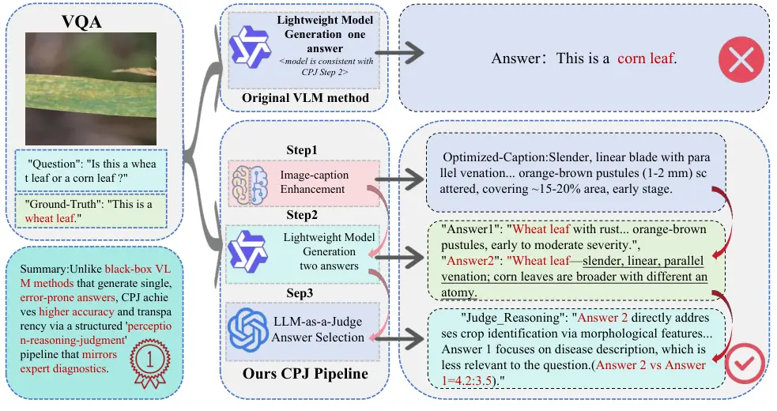
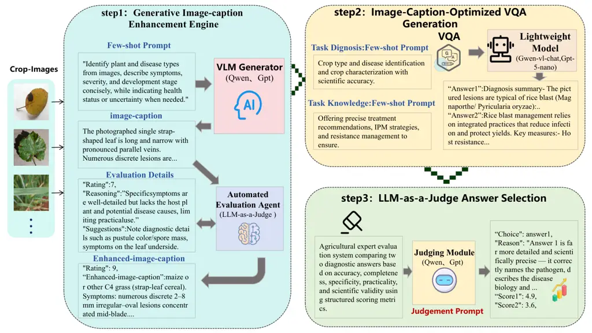
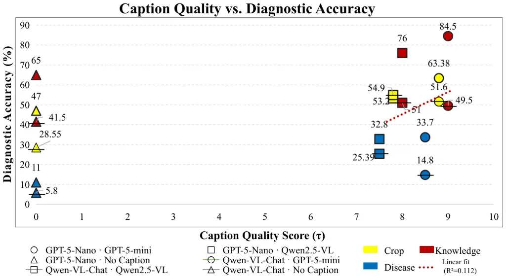
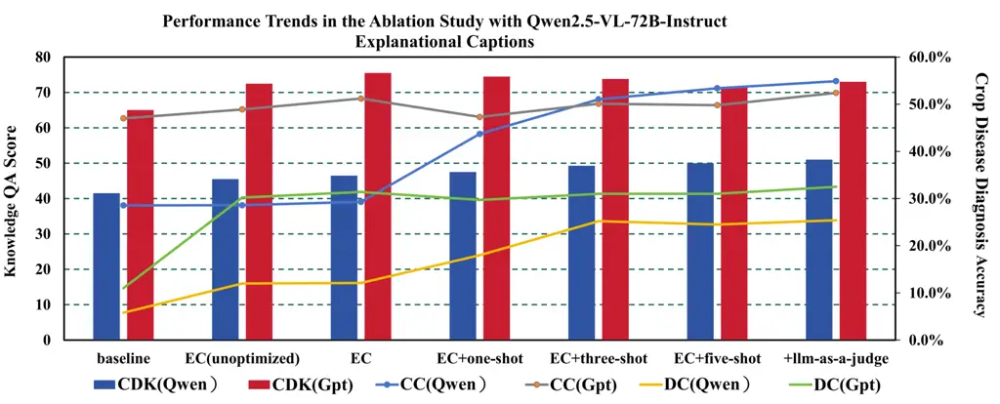
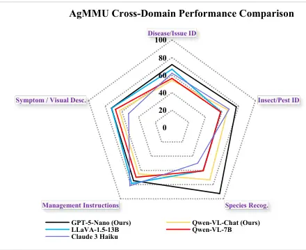

# Agri-CPJ: A Training-Free Explainable Framework for Agricultural Pest Diagnosis Using Caption-Prompt-Judge and LLM-as-a-Judge

Wentao Zhang    Qi Zhang    Mingkun Xu    Mu You    Henghua Shen   
Zhongzhi He    Keyan Jin    Derek F. Wong    Tao Fangcor1
organization=Business School, Shandong University of Technology,
city=Shandong, country=China organization=Faculty of Data Science, City
University of Macau, city=Macau SAR, country=China
organization=Guangdong Institute of Intelligent Science and Technology,
city=Zhuhai, country=China organization=Macau Millennium College,
city=Macau SAR, country=China organization=Department of Computer and
Information Science, University of Macau, city=Macau SAR, country=China

###### Abstract

Crop disease diagnosis from field photographs faces two recurring
problems: models that score well on benchmarks frequently hallucinate
species names, and when predictions are correct, the reasoning behind
them is typically inaccessible to the practitioner. This paper describes
Agri-CPJ (Caption-Prompt-Judge), a training-free few-shot framework in
which a large vision-language model first generates a structured
morphological caption, iteratively refined through multi-dimensional
quality gating, before any diagnostic question is answered. Two
candidate responses are then generated from complementary viewpoints,
and an LLM judge selects the stronger one based on domain-specific
criteria. Caption refinement is the component with the largest
individual impact: ablations confirm that skipping it consistently
degrades downstream accuracy across both models tested. On CDDMBench,
pairing GPT-5-Nano with GPT-5-mini-generated captions yields +22.7 pp in
disease classification and +19.5 points in QA score over no-caption
baselines. Evaluated without modification on AgMMU-MCQs, GPT-5-Nano
reached 77.84% and Qwen-VL-Chat reached 64.54%, placing them at or above
most open-source models of comparable scale despite the format shift
from open-ended to multiple-choice. The structured caption and judge
rationale together constitute a readable audit trail: a practitioner who
disagrees with a diagnosis can identify the specific caption observation
that was incorrect. Code and data are publicly available.¹¹ 1
[https://github.com/CPJ-Agricultural/CPJ-Agricultural-Diagnosis](https://github.com/CPJ-Agricultural/CPJ-Agricultural-Diagnosis)

###### keywords

Agricultural VQA ,Crop Disease Diagnosis ,Explainable AI
,Vision-Language Models ,LLM-as-a-Judge

^(†)^(†)corresponding: Corresponding Author: Tao Fang
(taofang@mmc.edu.mo)

## 1 Introduction

Accurate crop disease diagnosis from field imagery requires two
properties that most current systems do not simultaneously provide:
correct identification of the pathogen or condition, and an explanation
of that identification in terms a practitioner can evaluate. Crop
disease spreads rapidly, and an incorrect or unverifiable
recommendation—an erroneous fungicide prescription, or no actionable
guidance at all—carries direct economic consequences. These twin
requirements motivate the framework described here.

Current mainstream solutions lean heavily on unimodal visual pipelines
such as CNN classifiers (Duro et al., 2012) and YOLO-style
detectors (Badgujar et al., 2024). These models work well on the
benchmarks they were trained for. In our experience, however, they break
down when moved even slightly out of distribution—different lighting, a
new crop variety, a slightly unusual growth stage—and when they do fail,
they offer no clue as to why. What such a system returns is, at best, a
class label. For an agronomist weighing fungicide application costs
against expected crop loss, or an extension officer advising
smallholders across several districts, a single predicted category
provides no basis for verifying the conclusion or adjusting the
recommendation to local conditions.



Figure 1: Comparison between traditional VLM and Agri-CPJ framework on
crop species identification. Traditional VLMs provide direct but
error-prone black-box predictions (incorrectly identifying wheat as
corn, ✗), lacking explicit reasoning chains. In contrast, Agri-CPJ
delivers accurate diagnoses (✓) through a structured
perception-reasoning-judgment pipeline: (i) explicit feature extraction
via optimized captions (e.g., “slender linear blade with parallel
venation”), (ii) dual complementary answer generation addressing
morphological characteristics, and (iii) LLM-as-a-Judge selection based
on diagnostic validity. This expert-mimicking approach significantly
enhances both accuracy and interpretability.

Large Vision-Language Models—Qwen-VL (Bai et al., 2023), the GPT
series (Achiam et al., 2023), LLaVA (Liu et al., 2023),
Flamingo (Alayrac et al., 2022)—represent a qualitative shift in
capability. Unlike CNN classifiers, they accept free-form diagnostic
questions and, under favourable conditions, articulate some reasoning
alongside an answer. Agricultural VQA studies (Zhang et al., 2024; Li et
al., 2023) confirm that they produce richer outputs than label-only
pipelines. The difficulty is consistency: without any mechanism
compelling the model to describe observable features before reaching a
conclusion, the same image can yield correct or incorrect answers
depending on subtle prompt variation. Fig. 1 (top) shows a
representative failure—a wheat leaf identified as corn, with no
intermediate output that would let a user locate where the reasoning
broke down.

Fine-tuning on labelled agricultural data is the standard response to
this, and several groups have pursued it (Cao et al., 2023; Radford et
al., 2021; Alayrac et al., 2022). Three difficulties recur in practice.
Annotated crop disease datasets are costly to assemble and tend to
reflect specific geographic and varietal conditions; Saadati et al.
(2024) document sharp accuracy drops when models encounter
out-of-distribution species. Interpretability does not improve
either—gradient attribution maps reveal which image regions influenced a
prediction, but not the observational logic behind it.

Our goal was therefore a system that generalises across crop types and
disease categories without retraining, and that exposes its reasoning in
a form that domain experts can scrutinise and, where necessary, dispute
at the level of individual observations.

There is a second, underappreciated problem with fine-tuning in
agricultural deployment contexts. The model’s knowledge is frozen at
training time. When a previously unrecorded pathogen variant is first
confirmed, or when a grower presents a crop variety whose symptom
presentation differs from anything in the training set, a fine-tuned
system requires retraining before it can respond reliably—a process
demanding labelled data, compute infrastructure, and engineering time
that most cooperative extension services cannot readily mobilise.
Prompting-based approaches handle novel cases differently: a new crop
type or disease can be incorporated as a few-shot example on the day it
is identified, without modifying any model parameter. In a slow-moving
situation, that distinction is a convenience; during an outbreak
spreading faster than a retraining cycle can complete, it determines
whether the diagnostic tool is deployable at all.

Work on logic-driven anomaly detection (Jin et al., 2025; Ye et al.,
2025; Song et al., 2026; Xu et al., 2025) suggests an alternative design
principle: rather than optimising a model for a fixed task distribution,
externalise the reasoning so that each inference step can be
independently inspected and corrected. Agri-CPJ ²² 2 This manuscript
substantially extends Our Prior ICASSP 2026 paper Zhang et al. (2026)
from 4 to 20+ pages, presenting a well-structured and principled
framework, extensive experiments, and deeper insights. applies this
principle to crop disease. Between a leaf photograph and a diagnostic
conclusion lies a gap. In most current systems that gap is crossed by a
single forward pass with no accessible intermediate state. We require
instead that it be traversed through a text record of morphological
observations—one a practitioner can read, question, or correct before
accepting any downstream answer.



Figure 2: Overview of the “Agri-CPJ” pipeline for explainable Agri-Pest
VQA, featuring three cohesive stages: (i) Generative Explanational
Captioning: A large vision-language model analyzes input crop disease
images to generate multi-angle descriptive captions detailing plant
morphology, disease symptoms, severity levels, and diagnostic
uncertainties. Each generated caption is then passed through an
iterative LLM-as-a-Judge refinement loop until it satisfies quality
thresholds for observational accuracy, completeness, and diagnostic
neutrality. (ii) Task-Specific Prompt-Based VQA Generation: The refined
caption is combined with the original image and few-shot exemplars to
construct the VQA prompt; the model generates two candidate responses
from distinct diagnostic perspectives—one targeting disease recognition
(crop identity, symptom characterisation, visible indicators) and one
targeting management guidance (treatment protocols, prevention
measures). (iii) LLM-as-a-Judge Answer Selection: A more capable LLM
scores both candidates against a reference answer using multiple
criteria (factual correctness, completeness, specificity, practical
applicability), selects the stronger response, and returns an explicit
rationale documenting the basis for the selection.

The framework we propose, Agri-CPJ, has three stages. A large LVLM opens
by reading the input image and writing a structured caption—covering
morphology, symptoms, severity, and uncertainty—while deliberately
withholding crop and disease names to avoid encoding a premature label.
That caption is critiqued by an LLM judge and rewritten if it falls
short of a quality threshold. The refined caption then travels alongside
the original image to a lightweight VQA model, which produces two
candidate answers from different diagnostic angles: one disease-focused,
one crop-focused. A second judge LLM scores both against a reference and
picks the stronger one, documenting why. Fig. 1 (bottom) shows the
result: the wheat/corn confusion is corrected because the right
morphological evidence was on the table before any label was attached.

CPJ adjusts to new cases through the context window: a newly confirmed
disease variant or crop type enters the few-shot exemplars on the same
day it is identified, without modifying any model parameter. The
ceiling, however, is set by the vision encoder’s perceptual resolution.
For photographs taken during the earliest infection stages—when surface
symptoms are minimal or ambiguous—even a carefully constructed caption
cannot supply discriminative information the image does not contain.

The interpretability claim merits careful statement. Gradient-based
attribution maps and attention visualisations indicate which image
regions a model weighted—they do not describe what the model understood
those regions to mean, and most field practitioners lack the background
to translate pixel-level saliency scores into agronomic reasoning. CPJ
operates on different ground. The structured caption is a text document:
a plant pathologist can read it, assess whether the morphological
observations are accurate, and identify specific errors before examining
any downstream answer. Both candidate responses and the judge’s
selection rationale are similarly readable. A practitioner who disagrees
with the system’s conclusion can point to the particular caption
observation that seems wrong, argue that one candidate better fits the
field situation, or note that the judge’s preference conflicts with
local experience—and do all of this without understanding how the
underlying model weights are configured. Saliency maps offer no
equivalent affordance. A practitioner cannot point to a specific pixel
cluster that caused a wrong prediction and explain, in observational
terms, why it should have been read differently. In Agri-CPJ, the
caption is that target: disagreement has a named location and a readable
description.

The numbers support these claims across both benchmarks. On
CDDMBench (Liu et al., 2024), the GPT-5-Nano backbone paired with
GPT-5-mini-generated captions yields +22.7 pp in disease classification
accuracy and +19.5 points on the knowledge QA sub-task relative to
no-caption zero-shot baselines. Evaluated without modification on
AgMMU-MCQs (Gauba et al., 2025)—a structurally distinct multiple-choice
format spanning five agricultural task categories—the full CPJ
configuration (Caption + Few-shot + LLM-as-a-Judge) achieves 77.84% with
GPT-5-Nano and 64.54% with Qwen-VL-Chat, placing it at or above most
open-source models of comparable parameter scale.

This paper makes three contributions. First, we present Agri-CPJ, a
training-free few-shot pipeline in which visual reasoning is
externalised as an iteratively refined caption before any diagnostic
question is answered, enabling practitioners to trace a conclusion back
to the specific image observations that supported it. Second, the VQA
stage generates two candidate responses from complementary diagnostic
viewpoints, with caption prompts withholding crop and disease names to
suppress premature label commitment; a multi-criteria LLM judge selects
between candidates and produces an explicit rationale. Third, we report
controlled experiments on CDDMBench and AgMMU-MCQs across two backbone
architectures, together with a human validation study in which LLM judge
selections agreed with expert plant pathologist assessments at
$`\kappa=0.88`$.

## 2 Related Work

### 2.1 Agricultural Vision-Language Models

Agricultural image analysis has followed the broad trajectory of
computer vision: hand-crafted descriptors (Kumar and Kaur, 2015) gave
way to convolutional architectures, which have since been largely
superseded by Vision Transformers (Dosovitskiy et al., 2020) and
language-aligned backbones (Yadav and Kaushik, 2023); Zhu et al. (2024)
survey this transition in detail. Within-distribution accuracy has
improved substantially—purpose-built models such as AgriGPT-VL (Yang et
al., 2025) and AgriVLM (Yu and Lin, 2024) report figures above 90% on
their own test splits, achieved through parameter-efficient fine-tuning.
What benchmark tables tend to leave unreported is cross-distribution
behaviour: whether the same model holds up when applied to a crop
variety absent from training, or to field photographs taken under
lighting and soil conditions that differ from the dataset.

Sensor fusion attempts to address the contextual shallowness of
image-only methods: Rice-Fusion (Patil and Kumar, 2022) pairs leaf
images with agro-meteorological readings, and Lu et al. (2024)
incorporate image, text, and sensor streams together. For knowledge
breadth, Agri-LLaVA (Wang et al., 2024) covers 221 pest and disease
categories via 400K training entries. The closest precedent to our
approach is WDLM (Zhang et al., 2024), which generates step-by-step
explanations for wheat disease rather than terminal labels—though it
still requires disease-specific fine-tuning and does not support
iterative refinement of those explanations.

The benchmark picture is less flattering than the model papers suggest.
AgroBench (Shinoda et al., 2025) finds that more than half of all VLM
errors come from missing domain knowledge, not poor vision.
AgEval (Arshad et al., 2025) and VL-PAW (Yu et al., 2025) show modest
few-shot and fine-tuning gains, but hallucination persists (Ren et al., 2025) and truly lightweight deployable models are still rare (Vu et al.,
2025). The availability of large-scale datasets—MIRAGE (Dongre et al.,
2025), CDDMBench (Liu et al., 2024), AgMMU (Gauba et al., 2025)—has
helped in-domain results (Yang et al., 2024; Ranario and Earles, 2025;
Su and others, 2022), but models trained on them tend to overfit narrow
distributions (Saadati et al., 2024) and rarely say why they reached a
conclusion.

### 2.2 Explainable AI in Vision-Language Models

The interpretability problem in VLMs is older than VLMs themselves.
Gradient-based attribution methods—Shapley values (Dinga and Schiewe,
2025), LRP/LIME (Kamal et al., 2025), GEST (Masala and Leordeanu, 2025),
VALE (Natarajan and Nambiar, 2024)—were the default for years. The
objection to them, which we share, is not that they are technically
wrong but that a heat map over pixel regions is not the same thing as a
justification a domain expert can follow. A plant pathologist does not
think in gradients; they describe what they observe and reason from
those descriptions.

Chain-of-Thought methods move in the right direction.
Multimodal-CoT (Zhang et al., 2023) separates rationale generation from
answer inference, which already reduces hallucination measurably.
DDCoT (Zheng et al., 2023a) goes further by splitting the reasoning work
between language and vision submodules. ICoT (Gao et al., 2025)
interleaves visual and textual tokens step by step, achieving impressive
results but at considerable architectural cost. CPJ takes a structurally
more direct route: the visual observation is externalised as a
standalone text document before any question-answering step is
initiated. Because this caption exists as a discrete, human-readable
artifact, it can be reviewed, corrected, or substituted independently of
the underlying model—without any architectural modification.

Among retrieval-augmented methods, REVEAL (Hu et al., 2023) is the
closest in motivation: it grounds model outputs in a curated external
knowledge base so that responses can be traced to specific sources. The
operational gap relative to Agri-CPJ is that REVEAL depends on
constructing and maintaining that knowledge base prior to deployment,
whereas our captions are produced directly from the input image at
inference time and require no external corpus. CoT-VLA (Zhao et al., 2025) applies a comparable reasoning-before-action principle to robotic
manipulation, providing evidence that externalised intermediate
representations confer benefits across task domains beyond visual
classification.

### 2.3 LLM-as-a-Judge for Quality Assurance

LLM-based evaluation has accumulated a well-documented set of failure
modes. MT-Bench (Zheng et al., 2023b) provided an early systematic
characterisation: overall human–LLM agreement exceeded 80%, but two
biases emerged consistently—position bias, whereby judges assign higher
scores to whichever candidate appears first in the prompt, and verbosity
bias, whereby longer responses receive preferential treatment regardless
of content. JudgeLM (Zhu et al., 2023) reduces both through swap
augmentation during judge fine-tuning. PolyVis (Padarha et al., 2025)
introduces a more fundamental concern: across multilingual and
cross-domain settings, judge reliability degrades in ways that model
scale alone does not explain, indicating that evaluation quality is
contingent on domain alignment rather than general capability.

For multimodal settings, reliability is less settled. Chen et al. (2024)
show LLM judges are more consistent at pairwise comparison than absolute
scoring; Agri-CPJ uses pairwise comparison partly for this reason.
Prometheus-Vision (Lee et al., 2024) introduced open-source multimodal
judging with configurable rubrics, and Woodpecker (Yin et al., 2024)
demonstrated that hallucinations can be corrected through staged
validation without any additional training. Shi et al. (2025) measured
scoring gaps of up to five points from human raters, with verbosity bias
severe enough to change the selected answer. We encountered this in
early Agri-CPJ runs: the judge consistently preferred longer answers
even when shorter ones were more factually accurate. Removing response
length from the scoring criteria brought verbosity-driven misselections
from roughly 12% down to 5%.

## 3 Methodology

Rather than building an end-to-end model, Agri-CPJ decomposes diagnosis
into three stages that a human expert might recognize: look carefully at
the image and describe what you see; reason over those observations to
form candidate answers; then critically compare the candidates and pick
the stronger one. Each stage is implemented by prompting off-the-shelf
LVLMs, so no gradient updates are ever required.

### 3.1 Framework Design Philosophy

Examining incorrect diagnoses produced by baseline LVLMs, we found a
recurring pattern: the model had frequently encoded relevant visual
information—lesion shape, pustule colour, venation geometry—but had not
committed those observations to any retrievable representation before
generating an answer. The diagnostic error was therefore not a failure
of visual processing per se, but a failure to constrain the reasoning
with explicit observational evidence. This finding motivated the central
architectural decision in Agri-CPJ: the visual observation must be
externalised as a text artifact, accessible to both the downstream model
and any human reviewer, before any diagnostic question is posed.

A separate problem emerged once the captioning stage was in place. A
single VQA response tends to concentrate on whichever diagnostic
dimension the model finds most tractable—disease identification at the
expense of crop morphology, or the reverse. Generating two responses
from distinct viewpoints before any selection step addressed this: even
without the judge, the pair jointly covered substantially more of the
relevant diagnostic information than any individual response. The
computational overhead is limited to one additional VQA call per query,
and the improvement in information coverage was consistent across
development experiments.

The third requirement was auditability at the point of decision. When a
practitioner disagrees with a system output, the disagreement should be
articulable—directed at a specific observation in the caption, a
specific claim in one candidate answer, or a specific aspect of the
judge’s scoring rationale—rather than expressed only as a general
distrust of the result. Every Agri-CPJ output therefore includes the
refined caption with its quality score, both candidate answers with
individual scores, and the judge’s written justification for its
selection. Each of these components constitutes a locatable point of
intervention. The architecture is defined by these three structural
commitments: externalised captions, dual-perspective answer generation,
and scored selection accompanied by an explicit rationale.

The distinction from end-to-end approaches is clearest by contrast. A
fine-tuned model achieving strong benchmark accuracy has merged
observation, inference, and output into a single forward pass; when it
errs, no intermediate representation survives that a reviewer could
examine. Chain-of-thought prompting moves closer to what Agri-CPJ
does—it generates a reasoning trace before the final answer—but the
trace and the answer are produced together in one decoding sequence,
which allows the reasoning to be constructed retrospectively around a
conclusion already implicit in the generation. Agri-CPJ separates these
steps in a harder sense: the caption is generated and quality-checked
before the diagnostic question is even presented to the VQA model, so
the observation stage is genuinely prior to and independent of the
reasoning stage. An error in the caption does not propagate silently; it
is visible in the text before any answer is produced.

One operational consequence of this design is caption reusability. Since
the caption is produced before any question is answered, a single
refined caption can serve multiple subsequent queries about the same
image. In a multi-turn diagnostic session—where a grower uploads a
photograph and asks in sequence about disease identity, harvest safety,
and appropriate fungicide—the iterative refinement step runs once and
the resulting caption is passed to the VQA and judge stages for each
question independently. Given that caption refinement accounts for the
majority of API cost per session (it requires the vision-capable model
and potentially multiple iterations), amortising it across several
queries substantially reduces the effective per-question cost in real
deployment scenarios.

### 3.2 Image Interpretability and Caption Enhancement

Agricultural pathology relies on a specific diagnostic
vocabulary—chlorotic halo geometry, lesion boundary regularity, pustule
colour and distribution—that sits at some distance from the feature
representations computed by general-purpose vision encoders. When a
model proceeds directly from pixel input to a disease label, this
vocabulary gap is bridged implicitly inside a single forward pass, and
any error in that translation has no externally visible form. An
explicit caption interposes a translatable record: the model commits its
visual interpretation to text before any diagnostic step, and that text
can be checked against field observation, corrected if inaccurate, or
replaced with an expert-authored description without touching the
downstream architecture.

In our validation, agronomists who ultimately disagreed with a final
diagnosis frequently confirmed that the caption’s morphological
description was accurate. This indicated that the error resided in the
interpretive step—how the model moved from observed morphology to a
pathogen class—rather than in the visual encoding itself. That is a more
tractable failure mode: correcting a misinterpretation in a text
document is substantially more accessible than diagnosing and adjusting
a hidden-layer representation.

One prompt engineering decision required substantially more iteration
than anticipated: captions are constrained to exclude crop species names
and disease labels entirely. The rationale is that even indirect
diagnostic vocabulary—phrases such as “distribution consistent with a
biotrophic pathogen” or “lesion morphology typical of late
blight”—effectively anchors the downstream VQA model to a pathogen class
before it has examined the full observational evidence, introducing a
form of label leakage through the caption channel. Arriving at prompt
formulations that reliably elicited morphology-focused,
nomenclature-free descriptions took approximately twelve revision rounds
across development. Even with the final prompts, roughly 35% of
first-pass captions in our validation set carried at least one implicit
diagnostic cue; the quality-gating refinement loop was specifically
designed to detect and remove these.

Caption generation is formalised in Eq. (1): a large vision-language
model receiving image $`I`$ alongside few-shot prompt $`P_{\text{few}}`$
produces an initial description $`C_{0}`$. The exemplars in
$`P_{\text{few}}`$ are chosen to demonstrate the target caption
register—precise morphological observation, symptom coverage, severity
estimation—while scrupulously avoiding any crop species name or disease
label, so that the debiasing constraint is enforced through
demonstration rather than instruction alone.

```math
C_{0}=\mathcal{M}_{\text{VLM}}(I,P_{\text{few}}), \tag{1}
```

Quality control happens through multi-dimensional scoring across $`k`$
dimensions $`\mathcal{D}=\{d_{1},\ldots,d_{k}\}`$ covering accuracy,
completeness, specificity, relevance, and clarity:

```math
s(C)=\frac{1}{k}\sum_{i=1}^{k}w_{i}\cdot d_{i}(C), \tag{2}
```

Captions that fall below a threshold $`\tau`$ go back to the VLM with
targeted feedback $`\mathcal{R}(\cdot)`$ on the specific deficiencies:

```math
C^{\ast}=\begin{cases}C_{0},&\text{if }s(C_{0})\geq\tau,\\
\mathcal{M}_{\text{VLM}}(I,\mathcal{R}(C_{0})),&\text{otherwise.}\end{cases} \tag{3}
```

We set $`\tau=8.0/10.0`$ across all experiments. Raising it to 8.5
tightened quality slightly but roughly doubled the average number of
refinement iterations and the associated API cost, so we kept the lower
threshold. In the rare cases where the loop does not converge within
$`N_{\max}`$ iterations, we use the best caption produced so far rather
than failing the query entirely. Complete system prompts and few-shot
exemplars for all three stages are provided in Appendix A.

### 3.3 Explanational Caption-Optimized VQA

A single VQA pass over the refined caption tends to anchor on whichever
diagnostic dimension the model finds easiest—often the disease label, at
the expense of crop morphology or management guidance. Generating two
candidate answers from explicitly different viewpoints is a simple way
to guard against this. Formally, for viewpoints $`\mathcal{V}_{1}`$ and
$`\mathcal{V}_{2}`$:

```math
A^{(i)}=\mathcal{M}_{\text{VQA}}(I,C^{\ast},Q\mid\mathcal{V}_{i}),\quad i\in\{1,2\}, \tag{4}
```

so that the candidate set becomes
$`\mathcal{A}=\{A^{(1)},A^{(2)}\}=\mathcal{M}_{\text{VQA}}(X,P_{\text{task}})`$,
where $`X=(I,C^{\ast},Q)`$.

```math
\mathcal{A}=\{A^{(1)},A^{(2)}\}=\mathcal{M}_{\text{VQA}}(X,P_{\text{task}}), \tag{5}
```

The specific viewpoint split we settled on is disease-focused vs.
crop-focused for recognition questions, and treatment-protocol vs.
disease-mechanism for knowledge questions. We tried several other
pairings in preliminary experiments—e.g. severity-focused vs.
management-focused—but found that the disease/crop split gave the most
complementary outputs on CDDMBench; the two answers rarely overlapped
heavily, which gave the judge a meaningful choice.

Agricultural diagnosis is structurally multi-dimensional. A query about
a diseased maize leaf typically requires both a pathogen identification
and an assessment of the crop’s developmental stage and associated
susceptibility—two perspectives that draw on distinct portions of the
caption content. The disease-focused candidate reasons from symptom
patterns toward pathogen class and treatment protocol; the crop-focused
candidate reasons from morphological identity toward growth stage and
vulnerability profile. Generating these two paths separately, rather
than producing a single response that conflates them, ensures that the
judge evaluates candidates with genuinely different information content
rather than candidates that differ mainly in surface phrasing.

The viewpoint pairing differs by task category. For recognition
tasks—determining what organism or condition is present—the two
candidates address: (i) disease or pest identification, emphasising
lesion morphology, symptom severity, and characteristic distribution
patterns; and (ii) crop identification, emphasising plant architecture,
variety-specific features, and structural markers. For knowledge
tasks—explaining mechanisms or recommending management—the pairing
shifts to: (i) treatment, prevention, and integrated control strategies
with specified methods and timing; and (ii) disease aetiology, pathogen
lifecycle, and environmental conditions governing spread. This split
maintains architectural consistency across task types while directing
each perspective toward the information most relevant to that category
of question.

Few-shot prompting populates $`P_{\text{task}}`$ with in-context
exemplars $`\mathcal{E}=\{(I_{j},C_{j},Q_{j},A_{j})\}_{j=1}^{n}`$:

```math
P(A\mid I,C,Q,\mathcal{E})\propto P(A\mid I,C,Q)\cdot\prod_{j=1}^{n}P(A_{j}\mid I_{j},C_{j},Q_{j}). \tag{6}
```

We evaluate zero- through five-shot settings in the ablation; three-shot
gave the best accuracy-cost trade-off for Qwen-VL-Chat, while GPT-5-Nano
was largely insensitive to shot count once captions were in place. The
difference is meaningful: for Qwen-VL-Chat, each additional shot up to
three brings consistent classification gains, and the model appears to
be extracting visual pattern guidance from the exemplar images rather
than just formatting cues from the exemplar answers. For GPT-5-Nano, the
few-shot exemplars primarily set the response format; the reasoning
content comes from the caption. This asymmetry suggests that the optimal
shot count is architecture-dependent, and practitioners working with
vision-centric models should budget more exemplars than those working
with reasoning-focused models.

### 3.4 LLM-as-a-Judge Answer Selection

Once the two candidates are ready, a judge LLM scores each against a
reference $`A_{\text{ref}}`$ across criteria
$`\Omega=\{\omega_{1},\ldots,\omega_{m}\}`$:

```math
\text{Score}(A)=\frac{1}{|\Omega|}\sum_{\omega\in\Omega}g_{\omega}(A,A_{\text{ref}}), \tag{7}
```

where each $`g_{\omega}\in[0,1]`$. The criteria differ by task type. For
recognition, we weight pathogen identification correctness, symptom
description precision, and crop identification accuracy. For
knowledge-type questions, treatment specificity and practical
actionability are incorporated as additional scoring dimensions.
Response length is not scored. An earlier version of the rubric included
it by default; we removed it after tracing approximately 12% of
misselections to verbosity-driven preferences, consistent with Shi et
al. (2025). Full scoring rubrics for both task types are detailed in
Appendix B.

Selecting the evaluation criteria required iterative refinement. The
initial criterion set was broad but internally redundant—ten dimensions
that included both “factual accuracy” and “correctness” as separate
items, which the judge consistently assigned near-identical scores,
contributing noise rather than discrimination. Reducing to five or six
orthogonal dimensions per task type stabilised the scoring distribution
and reduced variance in selections across different judge prompt
formulations. The critical structural decision was separating
domain-specific criteria—pathogen identification accuracy, crop
morphological correctness—from generic writing quality criteria such as
completeness and clarity. Without this separation, a response that
misidentified the pathogen but was well-structured could outscore a
technically accurate but less fluent answer. Since an agronomist’s
primary concern is whether the identified organism is correct, not
whether the prose is polished, the scoring weights are calibrated
accordingly.

The judge’s output is a quadruple
$`\langle A^{\ast},s^{\ast},s^{-},R\rangle`$, where $`R`$ is a brief
rationale explaining why $`A^{\ast}`$ was preferred:

```math
\text{Judgment}(A^{(1)},A^{(2)})=\langle A^{\ast},s^{\ast},s^{-},R\rangle, \tag{8}
```

GPT-5 serves as the judge in text-only mode: it receives the structured
caption, the diagnostic question, the reference answer, and both
candidates, but not the original image. This restriction prevents
vision-side confounds—where the judge’s own image interpretation might
override the caption-grounded reasoning—from influencing the selection.
In informal feedback sessions, several agronomists indicated that the
rationale $`R`$ was the component they examined first, treating it
analogously to a colleague’s written justification before acting on any
recommendation.

```math
A^{\ast}=\arg\max_{A\in\mathcal{A}}\text{Score}(A). \tag{9}
```

Agreement between judge selections and human expert choices is
quantified using Cohen’s Kappa:

```math
\kappa=\frac{P_{o}-P_{e}}{1-P_{e}}, \tag{10}
```

where $`P_{o}`$ denotes observed agreement and $`P_{e}`$ the agreement
expected by chance. The human validation study detailed in Section 4.5
yields $`\kappa=0.88`$, exceeding the $`>0.8`$ threshold that convention
associates with substantial inter-rater agreement. Algorithm 1 presents
the complete Agri-CPJ inference procedure.

0:  Crop disease image $`I`$, Diagnostic query $`Q`$, Quality threshold
$`\tau`$, Max iterations $`N_{\max}`$

0:  Final diagnosis answer $`A^{\ast}`$, Evaluation report $`R`$

1:  // Stage 1: Generative Explanational Captioning

2:  Generate initial caption:
$`C_{0}\leftarrow\mathcal{M}_{\text{VLM}}(I,P_{\text{few}})`$

3:  Initialize iteration counter: $`n\leftarrow 0`$

4:  while $`n<N_{\max}`$ do

5:   Compute quality score:
$`s(C_{0})\leftarrow\frac{1}{k}\sum_{i=1}^{k}w_{i}\cdot d_{i}(C_{0})`$

6:   if $`s(C_{0})\geq\tau`$ then

7:    break

8:   end if

9:   Generate critique feedback:
$`\mathcal{R}(C_{0})\leftarrow\text{LLM-Judge}(C_{0},\mathcal{D})`$

10:   Refine caption:
$`C_{0}\leftarrow\mathcal{M}_{\text{VLM}}(I,\mathcal{R}(C_{0}))`$

11:   $`n\leftarrow n+1`$

12:  end while

13:  Obtain optimized caption: $`C^{\ast}\leftarrow C_{0}`$

14:  

15:  // Stage 2: Task-Specific Prompt-Based VQA Generation

16:  Generate disease-focused answer:

17:
  $`A^{(1)}\leftarrow\mathcal{M}_{\text{VQA}}(I,C^{\ast},Q\mid\mathcal{V}_{\text{disease}})`$

18:  Generate crop-focused answer:

19:
  $`A^{(2)}\leftarrow\mathcal{M}_{\text{VQA}}(I,C^{\ast},Q\mid\mathcal{V}_{\text{crop}})`$

20:  

21:  // Stage 3: LLM-as-a-Judge Answer Selection

22:  for $`i\in\{1,2\}`$ do

23:   Evaluate multi-dimensional score:

24:
   $`\text{Score}(A^{(i)})\leftarrow\frac{1}{|\Omega|}\sum_{\omega\in\Omega}g_{\omega}(A^{(i)},A_{\text{ref}})`$

25:  end for

26:  Select best answer:
$`A^{\ast}\leftarrow\arg\max_{A\in\{A^{(1)},A^{(2)}\}}\text{Score}(A)`$

27:  Generate evaluation rationale:

28:   $`R\leftarrow\text{GenerateRationale}(A^{(1)},A^{(2)},A^{\ast})`$

29:  return $`A^{\ast}`$, $`R`$

Algorithm 1 Agri-CPJ Framework: Complete Inference Pipeline

Algorithm 1 gives the complete Agri-CPJ inference procedure. The
iterative caption refinement loop gates entry into dual-answer
generation and judge-based selection. In total, a single Agri-CPJ
inference call involves three to five LLM API requests depending on how
many refinement rounds the caption requires—a non-trivial cost per
query, but one that we argue is warranted given the stakes of
agricultural decision-making.

The algorithm does not update any model weights, store state between
queries, or require a GPU at inference time—the pipeline runs entirely
on API calls. From a deployment standpoint, this property matters more
than it might appear. A cooperative extension service needs only API
credentials and a thin wrapper script; there is no model-serving
infrastructure to maintain, no GPU allocation to manage, and no
dependency on a fixed model checkpoint. Updating to a better caption
generator requires changing a single configuration parameter. The
stateless architecture removes a class of operational overhead—version
management, hardware provisioning, runtime monitoring—that routinely
prevents research systems from reaching production use.

## 4 Experiments and Analysis

### 4.1 Experimental Setup

Two benchmarks stress different aspects of the framework. CDDMBench (Liu
et al., 2024) is purpose-built for crop disease diagnosis: 3,000 test
images covering crop and disease type identification (keyword-matching
accuracy) plus a 20-question knowledge QA set spanning 10 disease types
scored by GPT-4 on a 1–10 scale normalised to 100 points. We follow the
original evaluation protocol without modification. AgMMU-MCQs (Gauba et
al., 2025) is deliberately broader—767 four-option multiple-choice
questions drawn from 116,231 authentic dialogues between growers and
USDA-authorised Cooperative Extension experts, covering disease
identification (139 questions), insect/pest identification (144),
management instructions (161), species identification (145), and symptom
description (178). The format shift from open-ended to multiple-choice
was unplanned on our side; we ran the same Agri-CPJ pipeline on both,
which made AgMMU a useful proxy for out-of-distribution generalisation.

We chose CDDMBench and AgMMU for complementary reasons. CDDMBench’s
3,000-image scale and explicit disease-labelling task gives a clean
signal for measuring whether captions help with specific identification,
while the knowledge QA component tests whether the framework can support
open-ended reasoning rather than just classification. AgMMU’s
multiple-choice format, broader scope, and origin in real
grower–extension expert dialogues provide a very different evaluation
surface: the questions were not designed to test any particular model,
and the correct answers reflect practical agricultural knowledge rather
than benchmark-construction choices. The fact that we did not adapt the
pipeline between benchmarks—same prompts, same hyperparameters—makes the
AgMMU results a genuine test of how well the approach generalises rather
than how well we tuned it.

For CDDMBench, our comparison points are: the original Qwen-VL-Chat (7B)
zero-shot result from Liu et al. (2024) (28.40% crop, 5.00% disease, 41
QA), which serves as the published anchor; our own independently
reproduced Qwen-VL-Chat baseline (28.55% crop, 5.80% disease, 41.5 QA),
run to verify experimental conditions match the benchmark protocol; and
a GPT-5-Nano zero-shot baseline we established ourselves (47.00% crop,
11.00% disease, 65 QA). For AgMMU-MCQs, we compare against the full
leaderboard reported in Gauba et al. (2025). Proprietary models: GPT-4o
(85.25%), Gemini 1.5 Pro (80.42%), Claude 3 Haiku (62.00%). Open-source
models: LLaMA-3.2 (73.32%), LLaVA-OneVision-8B (72.53%), LLaVA-1.5-13B
(66.73%), LLaVA-NeXT-8B (66.71%), Cambrian-8B (65.81%), LLaVA-1.5-7B
(64.16%), VILA1.5-13B (63.00%), Qwen-VL-7B (62.34%), InternVL2-8B
(60.17%).

CDDMBench classification accuracy is determined by keyword-matching: the
model’s response must contain the correct crop or disease name as it
appears in the ground-truth annotation. Knowledge QA is scored by GPT-4
on a 1–10 scale (normalised to 100 points) based on usefulness,
relevance, and factual accuracy; we follow the original protocol without
modification. For AgMMU, we use exact-match accuracy against the option
label (A, B, C, or D). Cohen’s Kappa ($`\kappa`$) is computed for the
human validation study to quantify agreement between LLM judge
selections and expert choices.

Caption generation used Qwen2.5-VL-72B-Instruct and GPT-5-mini, both
processed through the same iterative refinement loop at $`\tau=8/10`$.
For CDDMBench, the caption prompt instructs the model to describe plant
morphology, observable disease symptoms, lesion severity and spatial
distribution, and any diagnostic uncertainty—without naming the crop
species or disease. The same debiasing constraint and pipeline ran on
AgMMU without modification. Qwen-VL-Chat parameters: temperature 0.5,
max_tokens 400, top_p 0.8, max_retries 3. GPT-5-Nano parameters:
reasoning_effort=medium, verbosity=low, 30 s timeout, max_retries 3.
These hyperparameters were fixed on a short validation run and not
adjusted per-task or per-dataset.

On AgMMU we evaluate four incremental configurations to isolate each
component’s contribution: (i) zero-shot without captions, as a direct
LVLM baseline; (ii) zero-shot with quality-optimised captions, isolating
the captioning effect alone; (iii) three-shot prompting with
caption-enhanced exemplars randomly drawn from the training split; (iv)
the full Agri-CPJ pipeline with dual-answer generation and judge
selection. The judge was GPT-5 in text-only mode at temperature 0, with
no image access during the selection step to avoid vision-side
confounds. All API calls go through LangChain (Annam et al., 2025;
Topsakal and Akinci, 2023; Dave et al., 2025) at temperature=0
throughout for reproducibility. The JSON data schema for each pipeline
stage, including field definitions and an end-to-end example, is
provided in Appendix C.

### 4.2 Main Results on CDDMBench

Table 1 summarises performance on CDDMBench’s diagnosis and knowledge QA
tasks for both VQA models across caption strategies.

With GPT-5-mini captions, GPT-5-Nano reaches 63.38% crop accuracy,
33.70% disease accuracy, and 84.5 on knowledge QA—gains of +22.7 pp and
+19.5 points over the no-caption baseline. Qwen2.5-VL-72B captions lag
behind for this model (53.20% crop, 32.80% disease, 76 QA) but still
represent a large improvement over the uncaptioned starting point. The
performance gap between the two caption generators did not follow the
expected direction: Qwen2.5-VL-72B’s larger parameter count did not
translate into better downstream accuracy for GPT-5-Nano.

The judge stage contributes a consistent terminal increment for both
model configurations. Selected answers averaged 4.9/5.0 under the
multi-criteria rubric, against 3.6/5.0 for the rejected alternatives—a
1.3-point gap that indicates the judge is discriminating on substantive
quality rather than surface features or positional artefacts.

The two models exhibit substantially different response profiles across
framework components, suggesting that the gains arise through distinct
mechanisms rather than a single shared process. For GPT-5-Nano, the
dominant gain tracks caption quality: the +22.7 pp improvement in
disease classification corresponds closely with the semantic grounding
supplied by the caption, and appending few-shot demonstrations actually
reduces crop classification accuracy by 1.40 pp. This pattern is
consistent with a reasoning-oriented model for which well-formed
captions already supply sufficient domain grounding, and for which
in-context demonstrations introduce distributional noise rather than
useful signal. Qwen-VL-Chat presents the inverse case. Captions alone
shift disease classification by only +6.30 pp, but adding three-shot
exemplars stacks a further +24.84 pp on crop classification. That
trajectory fits a model that extracts visual pattern alignment cues from
demonstrated images rather than performing explicit verbal reasoning
over caption content—a meaningfully different mechanism with distinct
implications for deployment in settings where curating high-quality
exemplars carries a cost.

The choice of caption generator also matters, and the direction of the
effect depends on the downstream model. For GPT-5-Nano, GPT-5-mini
captions outperform Qwen2.5-VL-72B captions by +10.18 pp in crop
classification despite the Qwen2.5-VL-72B model being substantially
larger. Inspecting individual captions, GPT-5-mini outputs more precise
botanical vocabulary with fewer hedging phrases—the difference between
“possibly consistent with fungal damage” and “orange-brown urediospore
masses on the abaxial surface near major veins” is the difference
between a cue that focuses reasoning and one that obscures it. For
Qwen-VL-Chat, the relationship reverses: Qwen2.5-VL-72B captions produce
better downstream results, suggesting the vision-centric model may be
responding to stylistic or structural patterns in the caption rather
than its semantic content alone.

Model Method Crop Classification Disease Classification Knowledge QA
Caption Generator: Qwen2.5-VL-72B-Instruct Qwen-VL-Chat Zero-shot (Liu
et al., 2024) Baseline 28.40% 5.00% 41 Zero-shot (Our Baseline) 28.55%
5.80% 41.5 + Caption (Optimized) 29.30% 12.10% 46.5 + Few-shot 53.39%
24.49% 50       + LLM-as-a-Judge 54.90% 25.39% 51 GPT-5-Nano Zero-shot
(Our Baseline) 47.00% 11.00% 65 + Caption (Optimized) 51.20% 31.40%
75.5 + Few-shot 50.10% 31.00% 74.5       + LLM-as-a-Judge 53.20% 32.80%
76 Caption Generator: GPT-5-mini Qwen-VL-Chat + Caption (Optimized)
28.99% 7.17% 44 + Few-shot 51.00% 14.50% 49       + LLM-as-a-Judge
51.60% 14.80% 49.5 GPT-5-Nano Zero-shot (Our Baseline) 47.00% 11.00% 65

- Caption (Optimized) 60.30% 31.60% 84 + Few-shot 58.90% 29.80% 76
        + LLM-as-a-Judge 63.38% 33.70% 84.5

Table 1: Performance comparison on CDDMBench dataset. Baseline methods
use zero-shot without caption enhancement. Our Agri-CPJ framework
progressively adds optimized captions, few-shot prompting, and
LLM-as-a-Judge selection. Best results for each model in bold.

### 4.3 Caption Impact Analysis

We isolate the contribution of caption enhancement by comparing model
performance with and without it across all four model-generator
combinations.

Caption enhancement improves all three metrics in every combination we
tested. The absolute magnitudes—+22.7 pp on disease classification for
GPT-5-Nano, +23.05 pp on crop classification for Qwen-VL-Chat—are large
enough to shift practical deployment decisions, and they arise without
any parameter update.

The $`R^{2}=0.112`$ correlation between caption quality score and
downstream accuracy (Fig. 3) is statistically real but modest,
indicating that quality is a contributing factor rather than the sole
determinant. Decomposing by task reveals an asymmetry: the correlation
is strongest in disease classification, whereas crop classification
tolerates lower-quality captions more gracefully—consistent with the
observation that gross morphological features sufficient for crop
identification are often captured even by imprecise descriptions. The
most diagnostically valuable caption content is domain-specific
terminology for pathogen-characteristic textures: rust pustule
colouration, powdery mildew distribution patterns, lesion boundary
geometry. A caption reading “leaves showing some discolouration”
satisfies surface-level quality criteria but contributes little
discriminative signal; one reading “orange-brown urediospore masses
concentrated on the abaxial surface near major veins” provides the
anchoring that downstream reasoning requires.

Certain failure cases are worth noting separately. Where most of the
leaf surface is already necrotic, captions describe the extent of tissue
damage with reasonable accuracy but cannot distinguish between candidate
pathogens, because the morphological features that would permit
discrimination have been obliterated by disease progression. In such
cases, a high-quality caption and a correct diagnosis do not co-occur
reliably: the caption may accurately characterise the extent of necrosis
while providing no basis for pathogen attribution.

The performance gains are consistent with the architectural account of
how captions help. Without captioning, a VLM must extract relevant
visual features, translate them into domain terminology, and reason
toward a diagnosis—three operations collapsed into one forward pass with
no intermediate record. Captioning decouples the first operation: the
model produces a text description of what it observes, and that
description can be verified against domain knowledge before any
diagnostic step proceeds. For GPT-5-Nano, the +22.7 pp disease
classification gain from GPT-5-mini captions reflects the difference
between a reasoning-capable model receiving well-grounded input versus
one that must infer domain vocabulary directly from pixels; the accuracy
gap traces to the quality of observation, not to any deficiency in the
downstream reasoning process.



Figure 3: Correlation between caption quality and diagnostic accuracy.
The scatter plot shows a positive correlation (R²=0.112) between caption
quality scores ($`\tau`$) and final diagnostic accuracy for our Agri-CPJ
framework (Caption + Few-shot + LLM-as-a-Judge). Data points represent
GPT-5-Nano (CPJ) and Qwen-VL-Chat (CPJ) across three tasks: Crop
Classification (circles), Disease Classification (squares), and
Knowledge QA (triangles). Higher-quality optimized captions
($`\tau`$$`\geq`$8.5) consistently yield better performance, with an
average improvement of $`\sim`$12 percentage points per quality score
increase. The no-caption baseline ($`\tau`$=0) demonstrates
significantly lower accuracy, validating the importance of caption
enhancement in our CPJ framework.

### 4.4 Ablation Study

We now quantify how much each Agri-CPJ component contributes by adding
them one at a time under the Qwen2.5-VL-72B-Instruct caption setting.

As shown in Fig. 4, progressive gains are visible for both models,
though the per-component contribution profile differs in ways that
illuminate the underlying mechanisms.



Figure 4: Performance trends in the ablation study using
Qwen2.5-VL-72B-Instruct with Explanational Captions (EC). The figure
shows progressive improvements from baseline to Agri-CPJ framework
across three tasks: Crop Classification (CC), Disease Classification
(DC), and Crop Disease Knowledge (CDK). Both Qwen-VL-Chat and GPT-5-Nano
demonstrate consistent gains from caption optimization, few-shot
prompting, and LLM-as-a-Judge selection, validating the necessity of
each component.

Raw, unrefined captions already produce measurable change. Qwen-VL-Chat
gains +6.20 pp on disease classification and +4.0 points on knowledge
QA, while crop classification shifts by only +0.05 pp. GPT-5-Nano
responds more strongly at the same stage (+19.20 pp disease, +7.5 QA),
consistent with reasoning-oriented architectures deriving greater
benefit from verbal descriptions—even imperfect ones—than vision-centric
models that rely more heavily on direct image encoding.

Iterative quality refinement adds smaller but systematic increments:
approximately +0.70/+0.10/+1.0 for Qwen-VL-Chat and +2.30/+1.20/+3.0 for
GPT-5-Nano across the three reported metrics. The absolute magnitude is
modest, but the function of this step is distinct from merely improving
caption fluency. Quality-gating removes near-diagnostic vocabulary that
inadvertently encodes ground-truth label information, preserving the
integrity of the downstream reasoning process. In our validation set,
35% of first-pass captions contained at least one such implicit cue; the
refinement loop resolved these in 1.8 iterations on average.

Few-shot prompting produces Qwen-VL-Chat’s largest single-component
improvement: +22.50 pp on crop classification, +19.40 pp on disease
classification, and +7.8 points on knowledge QA at three shots. The
magnitude and distribution of these gains fit a model that uses
demonstrated image–caption–answer triples to learn a visual-to-text
alignment function, rather than performing compositional reasoning over
caption content—a structurally different process from the mechanism
driving GPT-5-Nano’s response to captions. GPT-5-Nano is largely
unaffected by shot count, consistent with reasoning-focused models
benefiting primarily from high-quality inputs rather than diverse
demonstrations.

Adding the judge brings the Agri-CPJ framework to 54.90%/25.39%/51.0 for
Qwen-VL-Chat and 52.40%/32.50%/73.0 for GPT-5-Nano. The 2 pp margin from
judge-selected answers over arbitrarily chosen candidates appears
modest, but the underlying score gap is not: selected answers average
4.9/5.0 versus 3.6/5.0 for rejected ones, confirming that the judge is
discriminating on content quality rather than selection order or
response length.

### 4.5 Qualitative Analysis and Explainability

To check whether the judge’s automated selections are trustworthy, two
PhD plant pathologists independently scored a random 10% sample
($`N=396`$) of judged answer pairs from CDDMBench, using the same
5-point rubric. Agreement with LLM selections was 94.2% (Cohen’s
$`\kappa=0.88`$), average score gap between LLM and expert ratings was
0.23 points, and Pearson $`r=0.91`$ ($`p<0.001`$). The disagreements we
examined tended to cluster on cases where both answers were genuinely
near-equal in quality—not cases where the judge was systematically
wrong. We are cautious about over-interpreting these numbers: the two
experts share a common institutional background, and the sample comes
from a single benchmark. Independent replication across additional
benchmarks and with expert panels drawn from different institutional
backgrounds would strengthen confidence in the $`\kappa=0.88`$ figure.

To make concrete what the pipeline produces, consider a tomato leaf
presenting early blight symptoms. The refined caption generated by the
system reads: “Compound pinnate leaf exhibiting concentric ring-shaped
necrotic lesions (target-spot morphology), dark brown centres surrounded
by chlorotic halos; lesions concentrated on older lower leaves, ranging
5–15 mm in diameter, covering approximately 15–20% of the leaf surface.”
The disease-focused candidate correctly attributes the symptoms to
Alternaria solani and proposes a fungicide rotation protocol; the
crop-focused candidate provides accurate tomato morphology but does not
address the pathogen. The judge assigns scores of 4.8 and 4.2
respectively and selects the disease-focused answer, with the following
rationale: “Answer 1 provides precise pathogen identification, detailed
symptom characterisation, and an actionable treatment recommendation;
Answer 2 accurately describes plant anatomy but offers limited guidance
for management decisions.” A practitioner reviewing that rationale can
assess the selection immediately and override it if their field
judgement differs—without requiring access to any internal model state.

This traceability—the capacity to locate disagreement at a specific,
named component of the output—is the interpretability property the
system was designed to deliver. Each Agri-CPJ output comprises four
elements: the refined caption with its assigned quality score, both
candidate answers with individual criterion scores, and the judge’s
written selection rationale. These together constitute an audit trail
whose interpretation requires no knowledge of the underlying model
architecture.

Table 2 categorises failure modes across 150 sampled predictions.
Early-stage ambiguous presentations account for the largest share
(approximately 18%): when infection has only recently established and
the leaf surface remains largely intact, observable symptom features are
insufficient for reliable discrimination, and no captioning procedure
can recover signal that the image does not contain. Co-infection cases
(12%) present a distinct structural problem—the caption accurately
characterises mixed symptom patterns, but the VQA stage is constrained
to produce a single-pathogen response, forcing a selection the evidence
does not support. Low image quality (8%) introduces caption inaccuracies
through sensor noise and motion blur; pre-processing improvements could
address this, though we did not explore them here. Verbosity bias in the
judge (5%) was attenuated but not eliminated by excluding response
length from the scoring criteria.

|                        |                                                                                                                 |
| ---------------------- | --------------------------------------------------------------------------------------------------------------- |
| Category               | Description & Frequency                                                                                         |
| Success Case           | Bacterial leaf spot: Caption “necrotic lesions, yellow halos” $`\rightarrow`$ correct diagnosis (9/10 QA score) |
| Early-stage Ambiguous  | Minimal visual symptoms, insufficient diagnostic evidence ($`\sim`$18%)                                         |
| Co-infection Confusion | Multiple pathogens with overlapping symptoms ($`\sim`$12%)                                                      |
| Low Caption Quality    | Image artifacts degrade caption accuracy ($`\sim`$8%)                                                           |
| Judge Bias             | Favors verbose over factually accurate responses ($`\sim`$5%)                                                   |

Table 2: Error pattern analysis with frequency distribution from 150
sampled predictions. The table presents success cases and four primary
error categories with their frequencies and characteristics.

Each failure category maps to a specific architectural intervention. The
18% early-stage failure rate calls for an explicit uncertainty output—a
flag indicating that the image does not contain sufficient diagnostic
evidence for a confident conclusion—rather than a low-confidence label.
Co-infection cases require a multi-label output format evaluated
holistically rather than a single-winner selection. The residual
verbosity bias requires a stricter factuality weighting in the judge
rubric, for which we have not yet identified a stable formulation. These
are presented as unresolved engineering problems rather than generic
future directions; the modular pipeline structure means they can be
addressed as isolated components.

Where the pipeline succeeds, the mechanism is traceable. Explicit
captions enable precise pathogen identification by encoding the spatial
and morphological observations that diagnostic keys depend on. For
bacterial leaf spot, a caption stating “necrotic lesions with yellow
halos following angular patterns along vein boundaries” provides the
information that distinguishes bacterial from fungal infection—including
the vein-delimited lesion geometry that is the key discriminating
feature. The judge’s factuality weighting contributes independently:
selected answers achieved 73% correctness on CDDMBench disease
classification versus 51% for randomly drawn answers from the same
dual-answer pool, confirming that the multi-criteria scoring filters
content quality rather than preferring surface features such as length
or fluency.

### 4.6 Cross-Dataset Generalization on AgMMU-MCQs

Table 3 presents results on AgMMU-MCQs, which tests generalisation to a
broader set of agricultural topics in multiple-choice format.

Model Method Disease/Issue Id. Insect/Pest Id. Species Recog. Management
Instr. Symptom/Visual Descr. Average Proprietary Models GPT-4o Baseline
(Gauba et al., 2025) 80.51 84.46 86.23 90.42 84.64 85.25 Gemini 1.5 Pro
76.25 79.92 81.07 88.08 76.94 80.42 SOTA Open-Source Models LLaMA-3.2
Baseline (Gauba et al., 2025) 65.07 69.29 75.21 78.50 78.08 73.32
LLaVA-1.5-13B 60.18 62.76 60.71 70.78 61.63 63.00 Qwen-VL-7B 56.24 58.31
60.65 69.64 67.70 62.34 Ours GPT-5-Nano Zero-shot (No Caption) 65.47
70.14 73.79 72.67 51.69 66.23 Zero-shot (Caption, Optimized) 68.35 77.08
88.82 73.79 70.79 75.88 + Few-shot 69.78 79.86 75.17 90.06 71.35 77.31
      + LLM-as-a-Judge 71.94 77.08 92.55 74.48 72.47 77.84 Qwen-VL-Chat
Zero-shot (No Caption) 45.71 52.78 56.85 73.01 52.51 56.48 Zero-shot
(Caption, Optimized) 49.64 52.78 59.31 68.32 61.24 58.67 + Few-shot
52.52 65.28 64.83 72.67 64.61 64.28       + LLM-as-a-Judge 53.96 66.67
73.29 64.83 62.92 64.54

Table 3: Task-specific performance on AgMMU-MCQs (767 samples) across
five agricultural tasks. Baseline models from Gauba et al. (2025). Our
Agri-CPJ progressively adds optimized captions, few-shot prompting, and
LLM-as-a-Judge selection, achieving competitive performance with
GPT-5-Nano reaching 77.84% average accuracy and Qwen-VL-Chat achieving
64.54%.

GPT-5-Nano with the full Agri-CPJ configuration achieves 77.84%,
positioned between LLaVA-OneVision-8B (72.53%) and Gemini 1.5 Pro
(80.42%) on the published leaderboard. The 7.41 pp deficit to Gemini is
not negligible; it plausibly reflects both the parameter scale
difference and the fact that the caption generators used in Agri-CPJ are
considerably smaller than those underlying leading proprietary systems.
Qwen-VL-Chat reaches 64.54%, approximately level with LLaVA-1.5-7B
(64.16%)—a reasonable comparison given the two models’ similar parameter
counts.

Aggregate accuracy, however, obscures substantial variation across the
five task categories. Species recognition, where diagnostic features are
stable morphological properties, responds most strongly to explicit
captioning; leaf shape, venation pattern, and stem texture are precisely
the observables that well-constructed captions encode. Disease
identification, by contrast, remains the hardest category
(71.94%)—symptom overlap between pathogens and the limited field of view
of a single leaf photograph constrain achievable accuracy regardless of
caption quality. Management instruction sits between these extremes but
is further complicated by the rubric calibration problem: treatment
recommendations phrased in the approximate terminology that agronomists
routinely use are penalised by a factuality-weighted scoring criterion
calibrated on precise textbook formulations.

The per-task breakdown (Fig. 5) shows one striking outlier. Species
recognition climbs from 73.79% without captions to 92.55% with the full
pipeline—a gain of nearly 19 pp. Plant species identity is almost
entirely encoded in morphological features that captions describe
explicitly: leaf shape, venation, stem colour, petiole length. Disease
identification remains the hardest task at 71.94%, consistent with
CDDMBench. Management instructions follow a non-monotonic trajectory
that we cannot fully account for: captions alone give 73.79%, few-shot
pushes it to 90.06%, but the judge stage drops it back to 74.48%. The
most plausible explanation is that the judge’s factuality-weighted
rubric penalises treatment recommendations phrased in approximate
clinical language—language that is practically sound but less precise
than the textbook formulations the rubric was calibrated on.



Figure 5: Task-specific performance on AgMMU-MCQs across five
agricultural tasks. Our full Agri-CPJ with GPT-5-Nano (CPJ, Ours) and
Qwen-VL-Chat (CPJ, Ours) achieves competitive results. GPT-5-Nano
reaches highest performance on Species Recognition (92.55%) and
demonstrates strong caption-enhanced reasoning effectiveness across all
tasks.

The CDDMBench and AgMMU evaluations used identical prompts and
exemplars—no adjustments were made between the two. Caption enhancement
on AgMMU contributed +9.65 pp (66.23% to 75.88% for GPT-5-Nano), smaller
than the +22.7 pp on CDDMBench disease classification but still
substantial. The reduced magnitude is likely partly attributable to
format: multiple-choice questions constrain the answer space in a way
that partially compensates for weaker visual grounding. The 77.84%
figure was not optimised for AgMMU, which is a relevant point for
contextualising it.

## 5 Conclusion

Agri-CPJ was built around one design claim: that forcing visual
reasoning into an explicit, quality-checked text representation before
any diagnostic question is answered would simultaneously improve
accuracy and produce outputs that practitioners can inspect and correct.
The experiments reported here support both parts. On CDDMBench,
attaching GPT-5-mini captions to GPT-5-Nano yields +22.7 pp in disease
classification and +19.5 points on knowledge QA without touching any
model weight. On AgMMU-MCQs, the same pipeline achieves 77.84% with
GPT-5-Nano and 64.54% with Qwen-VL-Chat—results that hold without prompt
modifications between the two benchmarks, and that position the
framework competitively against open-source models of similar scale. The
human validation study ($`\kappa=0.88`$) indicates that judge selections
track expert preferences closely, though the study draws from a single
benchmark and two experts with shared institutional backgrounds;
replication with broader expert pools remains necessary.

The failure modes are specific enough to point toward specific fixes.
Early-stage images—where infection has only just established and the
leaf surface is largely intact—present a detection challenge that no
amount of caption quality can resolve; the appropriate system response
is an explicit uncertainty signal rather than a low-confidence label.
Co-infection cases require multi-label output, not single-winner
selection. The management instruction anomaly on AgMMU traces to rubric
calibration, not model deficiency. Three to five LLM API calls per query
is a real cost at deployment scale, and the pipeline has not been
stress-tested against extreme distributional shifts in camera equipment
or crop growth stages.

The architectural argument for explicit intermediate representations is
not specific to crop disease. Any setting in which visual observations
must be rendered in domain vocabulary before reasoning can
proceed—medical imaging, ecological monitoring, materials
inspection—faces the same semantic gap. We have not tested those domains
and make no claim about transfer; but the structural problem Agri-CPJ
addresses is not unique to agriculture, and the approach is
straightforwardly adaptable.

## Acknowledgments

This work was supported in part by the Young Scientists Fund of the
National Natural Science Foundation of China (NSFC) under Grant
62506084, in part by the Science and Technology Development Fund of
Macau SAR (Grant Nos. FDCT/0007/2024/AKP, EF202400185-FST), the UM and
UMDF (Grant Nos. MYRG-GRG2024-00165-FST-UMDF, MYRGGRG2025-00236-FST,
SHMDF-AI/2026/001).

## References

- Achiam et al. (2023) J. Achiam, S. Adler, S. Agarwal, L. Ahmad, I.
  Akkaya, F. L. Aleman, D. Almeida, J. Altenschmidt, S. Altman, S.
  Anadkat, et al. Gpt-4 technical report. arXiv preprint
  arXiv:2303.08774. Cited by: §1.
- Alayrac et al. (2022) J. Alayrac, J. Donahue, P. Luc, A. Miech, I.
  Barr, Y. Hasson, K. Lenc, A. Mensch, K. Millican, M. Reynolds, et al.
  Flamingo: a visual language model for few-shot learning. Advances in
  neural information processing systems 35, pp. 23716–23736. Cited by:
  §1, §1.
- Annam et al. (2025) S. Annam, M. Saxena, U. Kaushik, and S. Mittal
  LangChain: simplifying development with language models. Textual
  Intelligence: Large Language Models and Their Real-World Applications,
  pp. 287–304. Cited by: §4.1.
- Arshad et al. (2025) M. A. Arshad, T. Z. Jubery, T. Roy, R.
  Nassiri, A. K. Singh, A. Singh, C. Hegde, B. Ganapathysubramanian, A.
  Balu, A. Krishnamurthy, et al. Leveraging vision language models for
  specialized agricultural tasks. In 2025 IEEE/CVF Winter Conference on
  Applications of Computer Vision (WACV), pp. 6320–6329. Cited by: §2.1.
- Badgujar et al. (2024) C. M. Badgujar, A. Poulose, and H. Gan
  Agricultural object detection with you only look once (yolo)
  algorithm: a bibliometric and systematic literature review. Computers
  and Electronics in Agriculture 223, pp. 109090. Cited by: §1.
- Bai et al. (2023) J. Bai, S. Bai, S. Yang, S. Wang, S. Tan, P.
  Wang, J. Lin, C. Zhou, and J. Zhou Qwen-vl: a versatile
  vision-language model for understanding, localization. Text Reading,
  and Beyond 2, pp. 1. Cited by: §1.
- Cao et al. (2023) Y. Cao, L. Chen, Y. Yuan, and G. Sun Cucumber
  disease recognition with small samples using image-text-label-based
  multi-modal language model. Computers and electronics in agriculture
  211, pp. 107993. Cited by: §1.
- Chen et al. (2024) D. Chen, R. Chen, S. Zhang, Y. Wang, Y. Liu, H.
  Zhou, Q. Zhang, Y. Wan, P. Zhou, and L. Sun Mllm-as-a-judge: assessing
  multimodal llm-as-a-judge with vision-language benchmark. In
  Forty-first International Conference on Machine Learning, Cited by:
  §2.3.
- Dave et al. (2025) D. Dave, Y. Agarwal, H. Chouhan, and S. Jambhulkar
  Learning in langchain. In World Congress on Smart Computing:
  Proceedings of WCSC 2024, pp. 29. Cited by: §4.1.
- Dinga and Schiewe (2025) G. T. Dinga and J. Schiewe What do you see?
  an xai approach for vlm-generated map descriptions. Advances in
  Cartography and GIScience of the ICA 5, pp. 12. Cited by: §2.2.
- Dongre et al. (2025) V. Dongre, C. Gui, S. Garg, H. Nayyeri, G.
  Tur, D. Hakkani-Tür, and V. S. Adve MIRAGE: a benchmark for multimodal
  information-seeking and reasoning in agricultural expert-guided
  conversations. arXiv preprint arXiv:2506.20100. Cited by: §2.1.
- Dosovitskiy et al. (2020) A. Dosovitskiy, L. Beyer, A. Kolesnikov, D.
  Weissenborn, X. Zhai, T. Unterthiner, M. Dehghani, M. Minderer, G.
  Heigold, S. Gelly, et al. An image is worth 16x16 words: transformers
  for image recognition at scale. arXiv preprint arXiv:2010.11929. Cited
  by: §2.1.
- Duro et al. (2012) D. C. Duro, S. E. Franklin, and M. G. Dubé A
  comparison of pixel-based and object-based image analysis with
  selected machine learning algorithms for the classification of
  agricultural landscapes using spot-5 hrg imagery. Remote sensing of
  environment 118, pp. 259–272. Cited by: §1.
- Gao et al. (2025) J. Gao, Y. Li, Z. Cao, and W. Li Interleaved-modal
  chain-of-thought. In Proceedings of the IEEE/CVF Conference on
  Computer Vision and Pattern Recognition, pp. 19520–19529. Cited by:
  §2.2.
- Gauba et al. (2025) A. Gauba, I. Pi, Y. Man, Z. Pang, V. S. Adve,
  and Y. Wang Agmmu: a comprehensive agricultural multimodal
  understanding and reasoning benchmark. arXiv preprint
  arXiv:2504.10568. Cited by: §1, §2.1, §4.1, §4.1, Table 3, Table 3,
  Table 3.
- Hu et al. (2023) Z. Hu, A. Iscen, C. Sun, Z. Wang, K. Chang, Y.
  Sun, C. Schmid, D. A. Ross, and A. Fathi Reveal: retrieval-augmented
  visual-language pre-training with multi-source multimodal knowledge
  memory. In Proceedings of the IEEE/CVF Conference on Computer Vision
  and Pattern Recognition, pp. 23369–23379. Cited by: §2.2.
- Jin et al. (2025) E. Jin, Q. Feng, Y. Mou, G. Lakemeyer, S. Decker, O.
  Simons, and J. Stegmaier Logicad: explainable anomaly detection via
  vlm-based text feature extraction. In Proceedings of the AAAI
  Conference on Artificial Intelligence, Vol. 39, pp. 4129–4137. Cited
  by: §1.
- Kamal et al. (2025) M. S. Kamal, S. F. Nimmy, M. R. Islam, and U.
  Naseem Explainable medical image captioning. In Companion Proceedings
  of the ACM on Web Conference 2025, pp. 2253–2261. Cited by: §2.2.
- Kumar and Kaur (2015) S. Kumar and R. Kaur Plant disease detection
  using image processing-a review. International Journal of Computer
  Applications 124 (16). Cited by: §2.1.
- Lee et al. (2024) S. Lee, S. Kim, S. Park, G. Kim, and M. Seo
  Prometheus-vision: vision-language model as a judge for fine-grained
  evaluation. In Findings of the Association for Computational
  Linguistics ACL 2024, pp. 11286–11315. Cited by: §2.3.
- Li et al. (2023) J. Li, D. Li, S. Savarese, and S. Hoi Blip-2:
  bootstrapping language-image pre-training with frozen image encoders
  and large language models. In International conference on machine
  learning, pp. 19730–19742. Cited by: §1.
- Liu et al. (2023) H. Liu, C. Li, Q. Wu, and Y. J. Lee Visual
  instruction tuning. Advances in neural information processing systems
  36, pp. 34892–34916. Cited by: §1.
- Liu et al. (2024) X. Liu, Z. Liu, H. Hu, Z. Chen, K. Wang, K. Wang,
  and S. Lian A multimodal benchmark dataset and model for crop disease
  diagnosis. In European Conference on Computer Vision, pp. 157–170.
  Cited by: §1, §2.1, §4.1, §4.1, Table 1.
- Lu et al. (2024) Y. Lu, X. Lu, L. Zheng, M. Sun, S. Chen, B. Chen, T.
  Wang, J. Yang, and C. Lv Application of multimodal transformer model
  in intelligent agricultural disease detection and question-answering
  systems. Plants 13 (7), pp. 972. Cited by: §2.1.
- Masala and Leordeanu (2025) M. Masala and M. Leordeanu From vision to
  language through graph of events in space and time: an explainable
  self-supervised approach. arXiv preprint arXiv:2507.04815. Cited by:
  §2.2.
- Natarajan and Nambiar (2024) P. Natarajan and A. Nambiar Vale: a
  multimodal visual and language explanation framework for image
  classifiers using explainable ai and language models. arXiv preprint
  arXiv:2408.12808. Cited by: §2.2.
- Padarha et al. (2025) S. Padarha, E. Semenova, B. Vidgen, A. Mahdi,
  and S. A. Hale Evaluating llm-as-a-judge under multilingual,
  multimodal and multi-domain constraints. In NeurIPS 2025 Workshop on
  Evaluating the Evolving LLM Lifecycle: Benchmarks, Emergent Abilities,
  and Scaling, Cited by: §2.3.
- Patil and Kumar (2022) R. R. Patil and S. Kumar Rice-fusion: a
  multimodality data fusion framework for rice disease diagnosis. IEEE
  Access 10, pp. 5207–5222. Cited by: §2.1.
- Radford et al. (2021) A. Radford, J. W. Kim, C. Hallacy, A. Ramesh, G.
  Goh, S. Agarwal, G. Sastry, A. Askell, P. Mishkin, J. Clark, et al.
  Learning transferable visual models from natural language supervision.
  In International conference on machine learning, pp. 8748–8763. Cited
  by: §1.
- Ranario and Earles (2025) E. Ranario and M. J. Earles Are
  vision-language models ready to zero-shot replace supervised
  classification models in agriculture?. arXiv preprint
  arXiv:2512.15977. Cited by: §2.1.
- Ren et al. (2025) J. Ren, J. Li, and M. Noto Performance analysis and
  enhancement of multimodal large language model phi-3.5 for plant
  disease recognition. In 2025 IEEE 5th International Conference on
  Computer Communication and Artificial Intelligence (CCAI),
  pp. 102–107. Cited by: §2.1.
- Saadati et al. (2024) M. Saadati, A. Balu, S. Chiranjeevi, T. Z.
  Jubery, A. K. Singh, S. Sarkar, A. Singh, and B. Ganapathysubramanian
  Out-of-distribution detection algorithms for robust insect
  classification. Plant Phenomics 6, pp. 0170. Cited by: §1, §2.1.
- Shi et al. (2025) L. Shi, C. Ma, W. Liang, X. Diao, W. Ma, and S.
  Vosoughi Judging the judges: a systematic study of position bias in
  llm-as-a-judge. In Proceedings of the 14th International Joint
  Conference on Natural Language Processing and the 4th Conference of
  the Asia-Pacific Chapter of the Association for Computational
  Linguistics, pp. 292–314. Cited by: §2.3, §3.4.
- Shinoda et al. (2025) R. Shinoda, N. Inoue, H. Kataoka, M. Onishi,
  and Y. Ushiku AgroBench: vision-language model benchmark in
  agriculture. In Proceedings of the IEEE/CVF International Conference
  on Computer Vision (ICCV), pp. 7634–7644. Cited by: §2.1.
- Song et al. (2026) I. Song, M. Joo, J. Kwon, E. Jeon, and J. Lee
  Instance-aligned captions for explainable video anomaly detection.
  arXiv preprint arXiv:2601.08155. Cited by: §1.
- Su et al. (2022) K. Su et al. A survey on multimodal visual question
  answering: datasets, methods and challenges. Pattern Recognition.
  Cited by: §2.1.
- Topsakal and Akinci (2023) O. Topsakal and T. C. Akinci Creating large
  language model applications utilizing langchain: a primer on
  developing llm apps fast. In International conference on applied
  engineering and natural sciences, Vol. 1, pp. 1050–1056. Cited by:
  §4.1.
- Vu et al. (2025) H. N. Vu, A. D. Nguyen, and D. Tran AgriDetectVL:
  emphasizes the agriculture-focused application combined with
  visual–language integration. IEEE Access 13, pp. 195987–195995. Cited
  by: §2.1.
- Wang et al. (2024) L. Wang, T. Jin, J. Yang, A. Leonardis, F. Wang,
  and F. Zheng Agri-llava: knowledge-infused large multimodal assistant
  on agricultural pests and diseases. arXiv preprint arXiv:2412.02158.
  Cited by: §2.1.
- Xu et al. (2025) J. Xu, S. Lo, B. Safaei, V. M. Patel, and I. Dwivedi
  Towards zero-shot anomaly detection and reasoning with multimodal
  large language models. In Proceedings of the Computer Vision and
  Pattern Recognition Conference, pp. 20370–20382. Cited by: §1.
- Yadav and Kaushik (2023) S. Yadav and A. Kaushik Comparative study of
  pre-trained language models for text classification in smart
  agriculture domain. In Advances in Data-driven Computing and
  Intelligent Systems: Selected Papers from ADCIS 2022, Volume 2,
  pp. 267–279. Cited by: §2.1.
- Yang et al. (2025) B. Yang, Y. Chen, L. Feng, Y. Zhang, X. Xu, J.
  Zhang, N. Aierken, R. Huang, H. Lin, Y. Ying, and S. Li AgriGPT-vl:
  agricultural vision-language understanding suite. External Links:
  2510.04002, [Link](https://arxiv.org/abs/2510.04002) Cited by: §2.1.
- Yang et al. (2024) T. Yang, Y. Mei, L. Xu, H. Yu, and Y. Chen
  Application of question answering systems for intelligent agriculture
  production and sustainable management: a review. Resources,
  Conservation and Recycling 204, pp. 107497. Cited by: §2.1.
- Ye et al. (2025) M. Ye, W. Liu, and P. He Vera: explainable video
  anomaly detection via verbalized learning of vision-language models.
  In Proceedings of the Computer Vision and Pattern Recognition
  Conference, pp. 8679–8688. Cited by: §1.
- Yin et al. (2024) S. Yin, C. Fu, S. Zhao, T. Xu, H. Wang, D. Sui, Y.
  Shen, K. Li, X. Sun, and E. Chen Woodpecker: hallucination correction
  for multimodal large language models. Science China Information
  Sciences 67 (12), pp. 220105. Cited by: §2.3.
- Yu et al. (2025) G. Yu, L. H. Anh, D. T. Vu, J. Lee, Z. U. Rahman, H.
  Lee, J. Jo, and J. Kim VL-paw: a vision–language dataset for pear,
  apple and weed. Electronics 14 (10), pp. 2087. Cited by: §2.1.
- Yu and Lin (2024) P. Yu and B. Lin A framework for agricultural
  intelligent analysis based on a visual language large model. Applied
  Sciences 14 (18), pp. 8350. Cited by: §2.1.
- Zhang et al. (2024) K. Zhang, L. Ma, B. Cui, X. Li, B. Zhang, and N.
  Xie Visual large language model for wheat disease diagnosis in the
  wild. Computers and Electronics in Agriculture 227, pp. 109587. Cited
  by: §1, §2.1.
- Zhang et al. (2026) W. Zhang, T. Fang, L. Lu, L. Wang, and W. Zhong
  CPJ: explainable agricultural pest diagnosis via caption–prompt–judge
  with llm-judged refinement. In ICASSP 2026 - 2026 IEEE International
  Conference on Acoustics, Speech and Signal Processing (ICASSP), Vol. ,
  pp. 5156–5160. External Links:
  [Document](https://dx.doi.org/10.1109/ICASSP55912.2026.11464859) Cited
  by: footnote 2.
- Zhang et al. (2023) Z. Zhang, A. Zhang, M. Li, H. Zhao, G. Karypis,
  and A. Smola Multimodal chain-of-thought reasoning in language models.
  arXiv preprint arXiv:2302.00923. Cited by: §2.2.
- Zhao et al. (2025) Q. Zhao, Y. Lu, M. J. Kim, Z. Fu, Z. Zhang, Y.
  Wu, Z. Li, Q. Ma, S. Han, C. Finn, et al. Cot-vla: visual
  chain-of-thought reasoning for vision-language-action models. In
  Proceedings of the IEEE/CVF Conference on Computer Vision and Pattern
  Recognition, pp. 1702–1713. Cited by: §2.2.
- Zheng et al. (2023a) G. Zheng, B. Yang, J. Tang, H. Zhou, and S. Yang
  Ddcot: duty-distinct chain-of-thought prompting for multimodal
  reasoning in language models. Advances in Neural Information
  Processing Systems 36, pp. 5168–5191. Cited by: §2.2.
- Zheng et al. (2023b) L. Zheng, W. Chiang, Y. Sheng, S. Zhuang, Z.
  Wu, Y. Zhuang, Z. Lin, Z. Li, D. Li, E. Xing, et al. Judging
  llm-as-a-judge with mt-bench and chatbot arena. Advances in neural
  information processing systems 36, pp. 46595–46623. Cited by: §2.3.
- Zhu et al. (2024) H. Zhu, S. Qin, M. Su, C. Lin, A. Li, and J. Gao
  Harnessing large vision and language models in agriculture: a review.
  External Links: 2407.19679, [Link](https://arxiv.org/abs/2407.19679)
  Cited by: §2.1.
- Zhu et al. (2023) L. Zhu, X. Wang, and X. Wang Judgelm: fine-tuned
  large language models are scalable judges. arXiv preprint
  arXiv:2310.17631. Cited by: §2.3.

## Appendix A Prompt Templates

This appendix documents the key system prompts used across all three
Agri-CPJ stages. Core prompts are reproduced verbatim; secondary prompts
are summarised with representative excerpts.

### A.1 Stage 1: Caption Generation and Refinement

#### A.1.1 Caption Generation System Prompt

The following system prompt instructs the VLM (Qwen2.5-VL-72B) to
describe plant morphology and disease symptoms without naming any crop
species or disease, thereby minimising identification bias in downstream
VQA:

```ltx_verbatim
You are an expert agricultural assistant specializing in
describing plant conditions from images.

## Core Task
Describe the visual features of the plant and any disease
symptoms in the image, without identifying the plant or
disease names.

## Key Requirements
1. Focus on describing the plant’s morphology, color, and
   overall condition.
2. If disease symptoms are present, describe their appearance:
   color, shape, distribution, size, quantity, and extent.
3. If no disease is visible, state that the plant appears
   healthy.
4. Assess the severity and stage of any symptoms based on
   visual cues.
5. Keep the description concise (90-100 words).
6. If uncertain about features, indicate "unable to describe
   clearly" or "need more images".

## Output Format
{"image_caption": "Description of the plant’s visual features
  and any disease symptoms, including morphology, color,
  distribution, size, and condition, without naming the plant
  or disease."}
```

Three few-shot exemplars accompany the prompt, covering fungal pustules,
necrotic lesions, and powdery growth. The fungal pustule exemplar is
representative:

|                 |                                                                                                                                                                                                                                                                                                                                                    |
| --------------- | -------------------------------------------------------------------------------------------------------------------------------------------------------------------------------------------------------------------------------------------------------------------------------------------------------------------------------------------------- |
| Type            | Exemplar Caption                                                                                                                                                                                                                                                                                                                                   |
| Fungal pustules | The plant has long, slender leaves with numerous orange-brown pustules scattered on the surface. The leaves show premature browning and some collapse. The symptoms suggest a fungal infection that reduces plant vigor, with pustules measuring 1–2 mm in diameter. The condition appears moderate, affecting approximately 30% of the leaf area. |

Table 4: Representative few-shot exemplar for caption generation
(Stage 1).

#### A.1.2 Caption Evaluation and Refinement Prompts

Captions are evaluated by an LLM judge on five criteria: (1) Accuracy,
(2) Completeness, (3) Detail, (4) Relevance, and (5) Clarity (80–120
words). The judge returns rating (1–10), reasoning, and suggestions.
Captions scoring below $`\tau=8.0`$ are automatically refined. The
refinement prompt instructs the model to address identified issues, add
specific symptom details, and maintain professional terminology within
80–120 words, guided by two exemplar captions (…).

### A.2 Stage 2: Dual-Answer VQA Generation

#### A.2.1 Disease Diagnosis System Prompt

The diagnosis VQA prompt (diagnosis_vqa.py) instructs the model to
return two complementary answers from different diagnostic perspectives.
The core rules are:

```ltx_verbatim
...
## Rules
1. Base answers solely on image, caption, and question
2. Prioritize scientific accuracy
3. Never return empty answers
4. BOTH answers must include BOTH plant type and disease type
5. Answer1: Focus on PEST/DISEASE identification
   (symptoms, severity, features)
6. Answer2: Focus on CROP identification
   (type, variety, morphology)
7. Both answers should be scientifically accurate and detailed
```

The human-turn template is: Background(image_caption):
{image_caption}\nQuestion: {question}. Five few-shot examples are
included; one representative case (apple Alternaria blotch, question:
“Is this crop diseased?”) yields: Answer 1 identifying Alternaria Blotch
with circular brown lesions (2–5 mm) and yellowish halos, and Answer 2
identifying the host as Malus domestica by ovate leaf shape and serrated
margins.

#### A.2.2 Knowledge QA System Prompt

The knowledge QA prompt (knowledge_qa_vqa.py) is substantially more
detailed, reflecting the open-ended nature of agronomic questions. It
defines scope, seven skills, and ten rules governing answer precision:

```ltx_verbatim
You are an agricultural expert specializing in plant disease
diagnosis and management.

Scope: rice blast, tomato leaf mold, wheat leaf rust, apple
gray/sooty/blotch diseases, maize northern leaf blight,
cucurbit powdery mildew, grape leaf blight, tomato yellow
leaf curl virus (TYLCV), pepper bacterial spot, and similar
field/greenhouse pathosystems.

## Skills
1. Extract disease context from background Q&A and question.
2. Diagnose and describe disease mechanisms, signs/symptoms,
   and disease cycles; include differential diagnosis.
3. Translate product names to active ingredients; handle
   dilutions and rates precisely (metric units).
4. Give practical, stage-specific recommendations (seed/
   seedling, vegetative, reproductive), including timings,
   intervals, and number of applications.
5. Integrate IPM: resistant varieties, sanitation, crop
   rotation, canopy management, balanced fertilization
   (N-P-K-Si), irrigation and drainage, environmental
   control (temp/RH/ventilation).
6. Address resistance management: rotate modes of action
   (e.g., FRAC for fungicides, IRAC for insecticides).
7. Ensure scientific accuracy, safety, and applicability.

## Rules (abridged)
1. Base answers on provided background; supplement only with
   widely accepted general agronomic knowledge if needed.
2. If specific data (dose, interval, temperature threshold)
   are provided in the background, use them verbatim.
3. Include active ingredient and formulation when available
   (e.g., 20% tebuconazole EC); provide dilution ratios,
   spray volume, timing, interval, and number of sprays.
4. For cultural practices, include actionable details:
   balanced N-P-K, silicon/potash, drainage, plant spacing,
   pruning for airflow, temperature/RH targets.
5. Rotate fungicides with different FRAC codes; avoid more
   than 2 consecutive applications of the same MoA.
6. Provide TWO answers:
   Answer1: Treatment, prevention, and control (step-by-step
     IPM with specific methods, timings, dosages, intervals).
   Answer2: Disease explanation (symptoms, causes/etiology,
     disease cycle/epidemiology, conducive conditions).
7. Advise PPE, follow local labels, observe pre-harvest
   intervals (PHI) and re-entry intervals (REI).
```

Five few-shot examples are included. Table 5 shows one representative
case:

[TABLE]

Table 5: Representative few-shot example for knowledge QA (Stage 2).

### A.3 Stage 3: LLM-as-a-Judge Answer Selection

#### A.3.1 Diagnosis Judge System Prompt

The judge for the disease diagnosis task (diagnosis_judge.py) evaluates
five criteria and returns a structured JSON decision:

```ltx_verbatim
You are an agricultural expert evaluating two answers to a
question about plant disease diagnosis.

## Evaluation Criteria:
1. Accuracy of Plant Identification: Correct identification
   of crop species
2. Accuracy of Disease/Pest Identification: Correct
   identification of disease or pest
3. Symptom Description Accuracy: Precise description of
   disease symptoms
4. Adherence to Required Format: Proper structure with plant
   and disease identification
5. Completeness and Professionalism: Comprehensive and
   scientifically sound response

## Task:
Compare Answer 1 and Answer 2 based on the above criteria
and select the better one.

## Output Format:
{
  "choice": 1 or 2,
  "reason": "Brief explanation for your choice",
  "scores": {
    "answer1": {
      "plant_accuracy": 0-1,
      "disease_accuracy": 0-1,
      "symptom_accuracy": 0-1,
      "format_adherence": 0-1,
      "completeness": 0-1,
      "total": 0-5
    },
    "answer2": { ... }
  }
}
```

When total scores are within 0.3 points, the tie-breaking rule selects
the answer with higher plant_accuracy + disease_accuracy. Three few-shot
examples are included; one representative case is shown in Table 6.

[TABLE]

Table 6: Representative few-shot example for the diagnosis judge
(Stage 3).

#### A.3.2 Knowledge QA Judge System Prompt

The knowledge QA judge (knowledge_qa_judge.py) follows the same output
format but evaluates five different criteria suited to open-ended
agronomic questions: (1) Accuracy, (2) Completeness, (3) Specificity,
(4) Practicality, and (5) Scientific Validity. Three few-shot examples
follow the same structure as the diagnosis judge (…).

## Appendix B Evaluation Rubrics

### B.1 Caption Quality Rubric (10-point scale)

Captions are evaluated across five dimensions, each contributing to an
overall holistic score:

|              |                                                               |                 |
| ------------ | ------------------------------------------------------------- | --------------- |
| Criterion    | Description                                                   | Quality Level   |
| Accuracy     | Correct identification of plant features and disease symptoms | 9–10: Excellent |
| Completeness | Includes plant type, symptoms, severity, and stage            | 7–8: Good       |
| Detail       | Specific measurements, locations, and patterns                | 5–6: Fair       |
| Relevance    | Information useful for downstream diagnosis                   | 2–4: Poor       |
| Clarity      | Professional terminology, 80–120 words                        | 1: Unacceptable |

Table 7: Caption quality evaluation criteria (10-point scale).

### B.2 Answer Selection Rubric: Disease Diagnosis (5-point scale)

Each criterion is scored 0–1 and summed for a total of 0–5:

|                  |                                     |                                              |
| ---------------- | ----------------------------------- | -------------------------------------------- |
| Criterion        | Description                         | Scoring                                      |
| Plant Accuracy   | Correct crop species identification | 1.0: Precise; 0.5: Genus; 0.0: Wrong         |
| Disease Accuracy | Correct disease/pest identification | 1.0: Specific; 0.5: Type; 0.0: Wrong         |
| Symptom Accuracy | Precise symptom description         | 1.0: Detailed; 0.5: General; 0.0: Inaccurate |
| Format Adherence | Includes both plant AND disease ID  | 1.0: Both; 0.5: One; 0.0: Neither            |
| Completeness     | Comprehensive and professional      | 1.0: Complete; 0.5: Partial; 0.0: Minimal    |

Table 8: Answer selection criteria for disease diagnosis task.

### B.3 Answer Selection Rubric: Knowledge QA (5-point scale)

|               |                                           |                                                 |
| ------------- | ----------------------------------------- | ----------------------------------------------- |
| Criterion     | Description                               | Scoring                                         |
| Accuracy      | Scientifically correct information        | 1.0: All correct; 0.5: Mostly; 0.0: Errors      |
| Completeness  | Covers all relevant aspects               | 1.0: Comprehensive; 0.5: Partial; 0.0: Minimal  |
| Specificity   | Precise details (rates, timings, methods) | 1.0: Specific; 0.5: General; 0.0: Vague         |
| Practicality  | Actionable for farmers                    | 1.0: Practical; 0.5: Somewhat; 0.0: Not useful  |
| Sci. Validity | Evidence-based, proper terminology        | 1.0: Rigorous; 0.5: Adequate; 0.0: Questionable |

Table 9: Answer selection criteria for knowledge QA task.

## Appendix C Pipeline Data Schema

Each stage of the Agri-CPJ pipeline consumes and produces JSON records.
Table 10 summarises the fields added at each stage.

[TABLE]

Table 10: JSON field evolution across Agri-CPJ pipeline stages.

A complete end-to-end example record after Stage 3:

```ltx_verbatim
{
  "question_id": "test_0001",
  "image": "leaf.jpg",
  "question": "Is this crop diseased?",
  "image_caption": "Compound pinnate leaf exhibiting dark brown
    circular lesions (3-8 mm) with yellow halos...",
  "rating": 9,
  "generation_answer1": "Yes, bacterial necrotic lesions...",
  "generation_answer2": "Yes, compound pinnate leaf showing...",
  "generation_answer": "Yes, bacterial necrotic lesions...",
  "selected_answer": "answer1",
  "selected_score": 4.7,
  "unselected_score": 3.2,
  "evaluation_reason": "Answer 1 provides specific disease
    identification with detailed symptom description."
}
```
