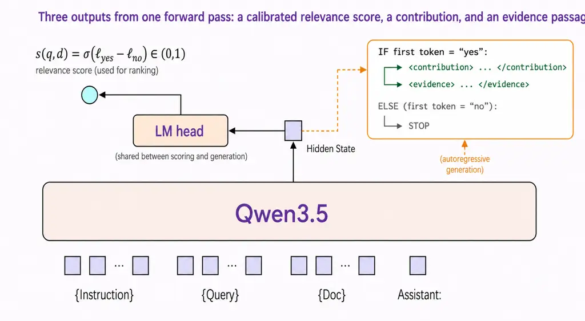
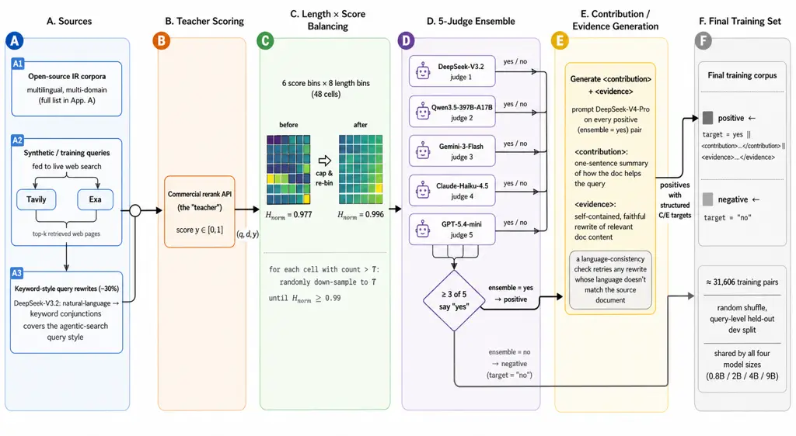
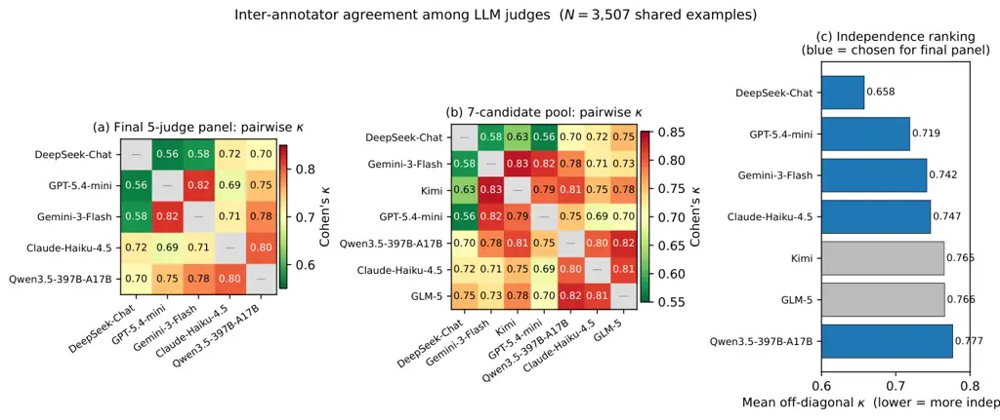
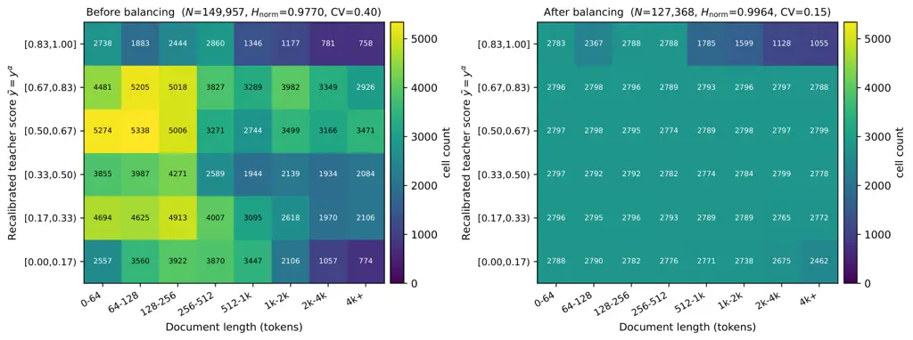

\setCJKmainfont

\[BoldFont=FandolSong-Bold.otf\]FandolSong-Regular.otf

# Prism-Reranker: Beyond Relevance Scoring — Jointly Producing Contributions and Evidence for Agentic Retrieval

DunZhang ^(†)^(†)thanks: Independent researcher. Correspondence:
[dunnzhang0@gmail.com](mailto:dunnzhang0@gmail.com).

April 26, 2026

###### Abstract

Modern retrieval pipelines increasingly serve downstream
consumers—retrieval-augmented generation (RAG) \[14\] and autonomous
agents \[38\]—that need more than a scalar relevance score. A reranker
that only tells the caller “how relevant” forces the agent to dump
entire documents into the language-model context, wasting tokens on
tangential passages, boilerplate from web crawls, and redundant
background, while providing no actionable signal to drive the next
planning step. We introduce Prism-Reranker, a family of reranker models
built on the Qwen3.5 \[24\] backbone at four sizes (0.8B, 2B, 4B, 9B)
that goes beyond scalar scoring. In addition to the standard yes/no
relevance judgement, whenever the verdict is yes the model emits (i) a
_contribution_ statement that summarizes how the document helps the
query, and (ii) an _evidence_ passage—a self-contained rewrite that
preserves every query-relevant signal from the original document while
discarding redundancy and noise. Prism-Reranker is trained with a hybrid
objective combining point-wise distillation from a strong commercial
reranker API with supervised fine-tuning on contribution and evidence
targets. We curate training data by drawing on the open-source
retrieval-data aggregation released by KaLM-Embedding \[7, 42\],
augmenting it with real web documents retrieved via commercial search
APIs for open-domain queries and their LLM-synthesized variants, and
rewriting a portion of queries into keyword-style reformulations so the
model adapts to traffic issued by agents. To reconcile inconsistent
labeling conventions across open corpora and to obtain crisp binary
labels for the contribution-and-evidence supervision branch, we relabel
data with an LLM-as-Judge ensemble that aggregates votes from five
diverse frontier LLMs. On a QA subset of BEIR and on an LLM-judged
evaluation of contribution and evidence quality, Prism-Reranker attains
solid results across all four model sizes. We further show that the same
recipe can extend existing LLM-based rerankers—augmenting
Qwen3-Reranker-4B with contribution and evidence capabilities while
improving its average BEIR-QA NDCG@10 by $`+1.54`$ over the base model.
Model weights, the full training recipe, and the evaluation suite are
released to the community.

## 1 Introduction

Neural retrieval pipelines have long followed a two-stage recipe: a fast
first-stage retriever \[13, 33, 2\] fetches a candidate pool, after
which a cross-encoder reranker \[19, 36\] reorders it. In the last two
years the downstream consumer of that pipeline has changed
qualitatively. Retrieval-augmented generation \[14\] and, more recently,
tool-using agents \[38, 26\] now stand between retrieval and the end
user: instead of a human eyeballing the top-10 snippets, a large
language model reads the ranked list and either generates an answer,
plans another action, or issues a follow-up query. This shift reshapes
what a reranker should output.

Contemporary open-source and commercial rerankers \[36, 2, 41, 32\]
return a single scalar per (query, document) pair. That output is
sufficient for pure ranking, but it leaves three pain points for RAG and
agent workloads. (1) Long documents waste context. Once a document is
deemed relevant, current practice is to feed its full text into the
downstream LLM, even though most passages inside a long document are
tangential to the specific query. (2) Web-crawled documents are noisy.
When agents search the open web via services such as Tavily or Exa \[29,
4\], returned pages mix the answer with navigation menus, advertising
copy, repeated disclaimers, and unrelated context; a scalar score cannot
separate signal from noise. (3) A scalar offers no planning signal. An
agent deciding whether to stop retrieving, to refine the query, or to
pivot to a different tool benefits from knowing _what_ each candidate
contributes, not merely _whether_ it is relevant.

We address these pain points with Prism-Reranker, a reranker family that
jointly emits three outputs in a single forward pass. Built on the
Qwen3.5 \[24\] backbone and released at 0.8B, 2B, 4B, and 9B sizes, the
model (a) produces a yes/no token from which a calibrated relevance
score is recovered as
$`\sigma(\ell_{\texttt{yes}}-\ell_{\texttt{no}})`$, (b) when the verdict
is yes, generates a short _contribution_ sentence describing what the
document adds to the query, and (c) generates a self-contained
_evidence_ passage that is a faithful, redundancy-stripped rewrite of
the query-relevant portion of the source. The evidence field is designed
to completely replace the original document when the downstream LLM
consumes it, cutting context length while preserving answerable content;
the contribution field is designed to be read at the agent-planning
layer.

Realizing this interface requires rethinking both training and data. On
the training side, Prism-Reranker is supervised by two complementary
signals combined through a single loss: a point-wise distillation term
that aligns $`\sigma(\ell_{\texttt{yes}}-\ell_{\texttt{no}})`$ with the
teacher score from a strong, widely used commercial rerank API, and a
supervised fine-tuning term on the concatenated yes/no, contribution,
and evidence targets. A small ablation confirms that the simplest
point-wise distillation suffices for the ranking head—listwise or
pairwise objectives did not help, which we attribute to the inherent
fitting capacity of a cross-encoder scorer.

On the data side, we observe that training-time query distribution is
the single largest factor affecting how Prism-Reranker behaves in
production. We therefore: (i) build on the open-source retrieval-data
aggregation released by KaLM-Embedding \[7, 42\], which itself unifies a
large pool of English, Chinese, and multilingual retrieval corpora, and
uniformly sample across its constituent datasets; (ii) take open-source
queries together with LLM-synthesized queries and feed them into
commercial web search APIs (Tavily and Exa) to collect real web
documents, producing a data slice whose surface statistics match what an
agent actually sees at inference; (iii) rewrite roughly 30% of queries
into short keyword-style strings through a dedicated DeepSeek-V3.2
rewriting pass, because agent-issued queries are often keyword bags
rather than well-formed questions; (iv) balance the final dataset along
both document length and teacher score so that no
length $`\times`$ score cell dominates.

The commercial teacher provides only a continuous score, not a binary
verdict that contribution/evidence generation can be gated on. Open
corpora carry their own pathology: different datasets use inconsistent
criteria for what counts as “relevant.” We therefore deploy an
LLM-as-Judge ensemble for binary labeling. We surveyed a large panel of
frontier LLMs, measured their pairwise agreement, and deliberately
selected five models whose verdicts are individually strong yet, _within
the candidate pool_, mutually as decorrelated as possible—DeepSeek-V3.2,
Qwen3.5-397B-A17B, Gemini-3-Flash, Claude-Haiku-4.5, and
GPT-5.4-mini—and declare a pair relevant when at least three of the five
agree. We are explicit that the resulting pairwise agreements remain
high in absolute terms (section 4.3); they represent the maximum
diversity attainable from a pool of frontier judges that already largely
concur on relevance, not low correlation in the Landis–Koch sense. This
procedure reconciles heterogeneous dataset conventions behind a single
crisp definition and supplies the binary positive/negative tag that
determines whether a sample carries a full \<contribution\>/\<evidence\>
target text or only the single token no during supervised fine-tuning.

Evaluation is reported on two axes. For ranking, we adapt the
BEIR \[30\] evaluation protocol used by Wang et al. \[32\] and report
NDCG@10 on the QA-style subset of BEIR (dropping tasks whose semantics
are not question answering). For contribution and evidence quality—a
capability for which no standard benchmark exists—we design a
multi-dimensional, DeepSeek-V4-Pro-judged evaluation that scores
faithfulness, completeness, redundancy, and contribution specificity.
Prism-Reranker achieves solid results on both axes at every released
size.

#### Contributions.

In summary:

- •
  We introduce Prism-Reranker, the first open reranker family, to the
  best of our knowledge, that jointly outputs a calibrated relevance
  score, a contribution statement, and a self-contained evidence passage
  in a single forward pass—an interface targeted at RAG and agent
  workloads rather than human-facing search.
- •
  We present a hybrid distillation-plus-SFT training recipe in which a
  single combined loss applies point-wise teacher-score regression and
  structured-text supervised fine-tuning to every training sample; the
  only difference between positive and negative samples is the SFT
  target text (full \<contribution\>/\<evidence\> target vs. a single no
  token).
- •
  We release a data pipeline that combines uniform sampling from
  KaLM-Embedding’s open-source aggregation of retrieval corpora,
  agent-realistic web documents retrieved through commercial search
  APIs, keyword-style query reformulation, and length $`\times`$ score
  balanced curation.
- •
  We show that a 5-judge LLM-as-Judge ensemble, drawn by
  maximum-disagreement selection from a pool of frontier judges that
  already largely concur on relevance (so the resulting panel is more
  diverse than an ad-hoc choice but still highly correlated in absolute
  terms; section 4.3), reconciles heterogeneous labeling conventions
  across open corpora into a single crisp positive/negative tag that
  determines which samples carry contribution-and-evidence supervision.
- •
  We demonstrate a flexible extension variant that augments an existing
  LLM-based reranker (Qwen3-Reranker-4B) with contribution and evidence
  capabilities via self-distillation, lifting its average BEIR-QA
  NDCG@10 by $`+1.54`$ over the base model without invoking a commercial
  teacher.
- •
  We release five models—four sizes (0.8B, 2B, 4B, 9B) on the Qwen3.5
  backbone plus Prism-Reranker-4B-exp, an experimental extension of
  Qwen3-Reranker-4B—along with the full training code, the balanced
  training corpus, and the evaluation harness for both ranking and
  contribution/evidence quality.

## 2 Related Work

#### Cross-encoder and generative rerankers.

Cross-encoder rerankers were established by Nogueira and Cho \[19\] and
Nogueira et al. \[20\], and remain the workhorse of modern retrieval
pipelines through families such as BGE \[36, 2\], Jina \[32\], and
Qwen3-Reranker \[41\]. A second line of work prompts or fine-tunes large
language models to rank candidates _listwise_: RankGPT \[28\]
establishes the prompting recipe, while RankVicuna \[22\],
RankZephyr \[23\], and RankLLaMA \[17\] train open models for the same
task; FIRST \[25\] accelerates listwise inference by reading only the
first decoded token, and setwise/pairwise prompting variants \[46\]
explore the design space further. All of these systems—whether
cross-encoders or LLM rankers—return only a relevance score (or,
equivalently, a permutation), which is precisely the interface our work
argues is insufficient for downstream RAG and agent consumers.

#### Distillation for ranking.

Knowledge distillation from a strong cross-encoder teacher into a
lightweight student is a standard recipe both for compressing rerankers
and for bootstrapping bi-encoders, with margin-MSE \[6\] and KL
divergence over teacher scores both widely used; RankT5 \[45\]
specifically distills listwise teacher signals into a
sequence-to-sequence reranker. Our distillation term is deliberately the
simplest possible point-wise MSE between
$`\sigma(\ell_{\texttt{yes}}-\ell_{\texttt{no}})`$ and the commercial
teacher’s score. An ablation in section 5 shows that listwise or
pairwise distillation does not help our cross-encoder student,
consistent with the observation that a high-capacity cross-encoder
absorbs the teacher’s preferences from point-wise targets alone.

#### Context compression and evidence selection for RAG.

The need to shorten retrieved context before it reaches the generator
has produced an active line of work that is the closest neighbor to our
_evidence_ output. Token-level pruning approaches such as
LLMLingua \[10\] and LongLLMLingua \[11\] drop low-information tokens
with a small auxiliary model, and LLMLingua-2 \[21\] learns the pruner
from data; RECOMP \[37\] trains both extractive and abstractive
compressors specifically for RAG, FILCO \[35\] learns to filter
sentences before generation, and EXIT \[8\] performs context-aware
extractive compression at retrieval time. CompAct \[39\] compresses
iteratively, while xRAG \[3\] pushes compression all the way to a single
soft token. Self-RAG \[1\] interleaves retrieval with self-emitted
critique tokens that judge support and utility. Two structural
differences separate Prism-Reranker from this body of work. First, every
method above is a _post-retrieval_ module that runs after a separate
reranker, adding another inference call to the pipeline; we fold
compression into the reranker so a single forward pass yields both the
relevance verdict and the compressed evidence. Second, those methods
emit compressed text unconditionally on every candidate; we generate
evidence only when the yes/no head fires, so tail-of-list and irrelevant
documents incur no generation cost at all. The _contribution_ field is,
to the best of our knowledge, without direct precedent in the reranker
literature: it is an explicit planning signal targeted at the agent
layer rather than at the answer-generation layer.

#### LLM-as-Judge for relevance labeling.

Using strong LLMs as cheap stand-ins for human judges has become
standard practice since Zheng et al. \[43\], Zhu et al. \[44\], Wang et
al. \[34\], and the practice has been imported into IR for relevance
assessment by Faggioli et al. \[5\]. Verga et al. \[31\] (“Replacing
Judges with Juries”) further argue that an ensemble of smaller, diverse
judges can match or beat a single frontier judge while being cheaper and
less biased. Our LLM-as-Judge setup sits in this lineage but pushes the
diversity argument operationally: rather than picking judges by
capability alone, we measure pairwise agreement across a large panel of
frontier models and deliberately select the five whose verdicts are
individually strong yet, _relative to the rest of the pool_, the most
mutually decorrelated, then take a 3-of-5 majority. We do not claim the
resulting panel is decorrelated in an absolute Landis–Koch sense
(section 4.3)—it is not; we claim only that we have removed the most
redundant judges from a pool that would otherwise cluster more tightly.
This produces a single binary label that is consistent across
heterogeneous source corpora and supplies the positive/negative tag that
gates which samples carry full \<contribution\>/\<evidence\> SFT
supervision (section 3.2).

## 3 Method

This section defines the model interface (section 3.1) and the training
objective (section 3.2). Implementation details—LoRA configuration,
optimizer, and loss weights—are deferred to section 5.

### 3.1 Model

#### Backbone.

Prism-Reranker uses the Qwen3.5 \[24\] causal LM as its backbone, at
four sizes (0.8B, 2B, 4B, 9B), with no architectural modification. All
four sizes share a single training recipe.

#### Input format.

Each forward pass takes one $`(\text{query},\text{document})`$ pair,
formatted with a fixed raw prompt template that ends in an empty
\<think\>\</think\> block placed inside the assistant turn (full
template in appendix A). We deliberately use the raw template rather
than apply_chat_template() because both the position of the first
decoded token and the prompt boundary used for relevance scoring (below)
must be deterministic across samples.

#### Output and relevance score.

The model is trained so that the very first decoded token is either yes
or no, followed—when the verdict is yes—by an XML-tagged
\<contribution\> … \</contribution\> sentence and an
\<evidence\> … \</evidence\> passage. When the verdict is no, the model
is trained to stop after the label, so irrelevant documents incur no
generation cost beyond a single token.

The relevance score is read directly from the logits at the prompt
boundary. Let $`\ell_{\texttt{yes}}`$ and $`\ell_{\texttt{no}}`$ denote
the logits at the position whose next-token prediction is the label
token. We define

```math
s(q,d)\;=\;\sigma\!\left(\ell_{\texttt{yes}}-\ell_{\texttt{no}}\right), \tag{1}
```

which is a calibrated probability in $`(0,1)`$ used for ranking. fig. 1
summarizes the resulting interface: the score is read from the LM head
at the prompt boundary, and the same head autoregressively continues to
emit the contribution and evidence fields whenever the verdict is yes.



Figure 1: Three outputs from one forward pass. The same LM head is
reused for (i) reading the calibrated relevance score
$`s(q,d)=\sigma(\ell_{\texttt{yes}}-\ell_{\texttt{no}})`$ at the prompt
boundary, and (ii) autoregressively generating the \<contribution\> and
\<evidence\> fields when the first decoded token is yes. Irrelevant
pairs stop after the single no token, so generation cost is paid only on
positives.

### 3.2 Training Objective

We combine point-wise distillation against a commercial teacher reranker
with supervised fine-tuning on structured text targets. Both losses are
applied to every training sample and share one forward pass.

#### Two sample types, one objective.

Training data has just two types of pairs, distinguished by the binary
verdict produced by the LLM-as-Judge ensemble of section 4.3: _positive_
pairs (ensemble = yes) and _negative_ pairs (ensemble = no). Both types
are supervised by the same total loss

```math
\mathcal{L}\;=\;\gamma_{\text{point}}\,\mathcal{L}_{\text{point}}\;+\;\gamma_{\text{sft}}\,\mathcal{L}_{\text{sft}}, \tag{2}
```

where $`\mathcal{L}_{\text{point}}`$ regresses the student score
$`s(q,d)`$ against the commercial teacher score and
$`\mathcal{L}_{\text{sft}}`$ supervises the structured text output. The
only difference between the two sample types is the SFT target text:
positives carry a full target
yes $`\|`$ \<contribution\>…\</contribution\> $`\|`$ \<evidence\>…\</evidence\>,
while negatives carry the single token no.

#### Point-wise distillation.

For a pair $`(q,d)`$ with teacher score $`y(q,d)\in[0,1]`$,

```math
\mathcal{L}_{\text{point}}\;=\;\bigl(s(q,d)-y(q,d)\bigr)^{2}. \tag{3}
```

We use the teacher’s score directly as the regression target.

#### Supervised fine-tuning.

With target text $`T`$ as defined above (full yes-target for positives;
the single token no for negatives),

```math
\mathcal{L}_{\text{sft}}\;=\;-\sum_{t\in T}\log p_{\theta}\bigl(t\mid q,d,t_{<}\bigr), \tag{4}
```

where prompt tokens are masked out (label $`=-100`$). Because the first
target token is always the verdict, this loss directly supervises the
binary classification head; $`\mathcal{L}_{\text{point}}`$ adds a
continuous, score-aligned signal on top.

#### Extension to existing rerankers.

The training framework above assumes a general-purpose LLM backbone that
must learn relevance scoring from scratch. However, several recent
rerankers—notably Qwen3-Reranker \[41\]—are architecturally standard
causal LMs that have already been fine-tuned for ranking but lack the
ability to generate structured text beyond a relevance score. For such
models the contribution and evidence capabilities can be added _without_
a commercial teacher. We replace the external teacher target $`y(q,d)`$
in eq. 3 with the model’s own pre-training score:
$`y(q,d)=s_{\text{orig}}(q,d)`$, where $`s_{\text{orig}}`$ is obtained
by running the _frozen_ original checkpoint on each training pair before
fine-tuning begins.

It is worth being precise about what each term in this extension does.
The point-wise term $`\mathcal{L}_{\text{point}}`$ regresses the
student’s score against $`s_{\text{orig}}`$, so the loss-minimizing
solution under this term alone is to reproduce the original checkpoint’s
score; it acts primarily as an _anchor_ that prevents catastrophic
ranking degradation during fine-tuning. We do not claim that
self-distillation can never exceed its anchor—it sometimes does in other
regimes—only that, with $`s_{\text{orig}}`$ as the regression target,
this term provides no _new_ information about ranking beyond what the
base model already encodes. The improvement we observe over the base
model is therefore most naturally attributed to the SFT branch, whose
first target token is the 5-judge ensemble verdict (section 4.3). The
ensemble label is constructed independently of $`s_{\text{orig}}`$ and
supplies a fresh binary supervision signal that the gate can be pulled
toward when the original ranker disagrees with the ensemble. We
additionally hypothesise that joint training on the structured
\<contribution\>/\<evidence\> targets acts as a soft regulariser on the
same hidden states that drive the relevance gate, but we have not
isolated this effect with an ablation. The empirical result on
Qwen3-Reranker-4B (section 5.2) is consistent with this picture: ranking
quality improves, and the improvement is most plausibly driven by the
ensemble-label SFT signal rather than by self-distillation alone.

The rest of the training recipe—loss form, LoRA configuration, optimizer
schedule—remains unchanged. We demonstrate this variant with
Qwen3-Reranker-4B in section 5.

## 4 Data

Training data is assembled through a multi-stage pipeline that combines
broad coverage (diverse corpora and live web documents) with
high-quality binary labels and structured text supervision. fig. 2 gives
a high-level overview; the remainder of this section walks through each
stage.



Figure 2: Data construction pipeline. Open-source IR corpora and live
web pages retrieved through Tavily and Exa—for both natural-language and
keyword-style queries—are scored by a commercial rerank API (the
teacher) and balanced across a $`6\times 8`$ length-by-score grid. A
5-judge LLM ensemble then issues a binary positive/negative tag by
3-of-5 majority vote; positives receive structured
\<contribution\>/\<evidence\> targets generated by DeepSeek-V4-Pro,
while negatives carry the single token no as the SFT target. The teacher
score serves as the point-wise regression target on every pair; the
binary tag determines only which SFT target text is used.

### 4.1 Data Sources

#### Open-source corpora.

Rather than reassembling a heterogeneous collection of public retrieval
datasets ourselves, we build on the open-source retrieval-data
aggregation released by KaLM-Embedding \[7, 42, 12\]. Their release
consolidates a large pool of English, Chinese, and multilingual
retrieval corpora—spanning open-domain QA (MS MARCO, NQ, HotpotQA,
TriviaQA), domain-specific QA (PubMedQA, FiQA, LegalQA), e-commerce
(ESCI), web search (DuReader, mMARCO, T2Ranking), and multilingual
benchmarks (MIRACL, Mr. TyDi)—into a single uniform format. We uniformly
sample across its constituent datasets so that no single domain or
language dominates the training distribution.

#### Web-sourced documents.

Curated benchmarks tend to be cleaner than documents encountered in
production. To close this gap, we issue training queries against two
live web-search APIs—Tavily \[29\] and Exa \[4\]—and retain the
top-retrieved pages as additional training documents. Web-sourced data
better reflects the heterogeneous, often noisy content that real-world
agentic retrieval systems must handle.

#### Keyword query conversion.

Agentic search pipelines frequently emit keyword conjunctions rather
than full natural-language questions. To improve robustness to this
query style, approximately 30% of training queries are rewritten into
keyword form using DeepSeek-V3.2¹¹ 1 All DeepSeek models used throughout
this work (V3.2, V4-Flash, and V4-Pro) are invoked without
reasoning/thinking mode. before retrieval and scoring, producing
additional training pairs from the same document pool.

### 4.2 Teacher Scoring

Each query–document pair is scored by a strong commercial rerank API
(the _teacher_). The score $`y\in[0,1]`$ returned by the API is used
directly as the point-wise regression target for
$`\mathcal{L}_{\text{point}}`$ (section 3.2).

We deliberately do not name the teacher API in this paper. As a
reproducibility mitigation, we release the cached teacher scores for
every training pair together with the model weights, so that downstream
users can recover the same training targets without invoking the teacher
API themselves.

### 4.3 LLM-as-Judge Annotation

Teacher scores are continuous and carry no natural decision threshold;
furthermore, relevance criteria differ across open-source datasets,
making their binary labels inconsistent with each other. We therefore
augment the teacher signal with ensemble-voted binary labels from a
panel of frontier LLMs \[43, 31\].

After surveying a wide range of models and computing pairwise
inter-annotator agreement, we select five judges whose verdicts are,
_within the surveyed pool_, mutually as decorrelated as we could make
them while keeping individual judge quality high: DeepSeek-V3.2,
Qwen3.5-397B-A17B, Gemini-3-Flash, Claude-Haiku-4.5, and GPT-5.4-mini.
The largest pairwise Cohen’s $`\kappa`$ among the panel is $`0.82`$, and
the smallest is also high—we acknowledge that on the Landis–Koch scale
these values still indicate substantial-to-almost-perfect agreement. The
point of the selection is therefore not that the panel is decorrelated
in absolute terms (it is not; frontier LLMs largely concur on
relevance), but that we have removed the most redundant judges from a
pool that would otherwise cluster even more tightly, so that the 3-of-5
majority vote draws on the maximum diversity actually available. fig. 3
reports the full pairwise agreement matrix over both the final 5-judge
panel and the broader candidate pool from which it was selected. Each
judge receives a unified, unambiguous relevance rubric and returns a
binary yes/no verdict; the ensemble label is decided by a 3-of-5
majority vote.



Figure 3: Inter-annotator agreement among LLM judges, measured as
Cohen’s $`\kappa`$ on $`N{=}3{,}507`$ shared examples. (a) Pairwise
$`\kappa`$ over the final 5-judge panel; the largest pairwise $`\kappa`$
is $`0.82`$. By Landis–Koch this is still “almost perfect” agreement in
absolute terms—the panel is the _relatively_ most decorrelated 5-subset
of the candidate pool, not a decorrelated panel in any absolute sense.
(b) Pairwise $`\kappa`$ over the 7-model candidate pool. (c)
Independence ranking by mean off-diagonal $`\kappa`$ (lower is more
relatively independent within this pool); blue bars mark the five judges
retained for the ensemble, gray bars mark the two candidates dropped
because they cluster too tightly with judges already selected.

The ensemble verdict and the teacher score are used independently: the
verdict assigns each pair to the positive or negative bucket and thereby
chooses which SFT target text is emitted, while the teacher score is
regressed on every pair (section 3.2).

### 4.4 Contribution and Evidence Generation

For every pair that the ensemble votes yes (positives), we prompt
DeepSeek-V4-Pro to generate the structured \<contribution\> and
\<evidence\> targets consumed by $`\mathcal{L}_{\text{sft}}`$. For pairs
voted no (negatives), the SFT target is simply the single token no, with
no continuation.

### 4.5 Length–Score Balancing

Raw web-search data is heavily skewed: short, high-relevance documents
are overrepresented relative to long or marginally-relevant ones. We
measure distributional uniformity by placing each training example in
one of $`6\times 8=48`$ cells defined by six equal-width bins over the
teacher score $`y`$ and eight log-spaced bins over document token count
($`[0,64)`$, $`[64,128)`$, $`\ldots`$, $`[4096,+\infty)`$). Uniformity
is quantified by the normalized cell entropy

```math
H_{\text{norm}}=-\frac{1}{\ln 48}\sum_{i=1}^{48}p_{i}\ln p_{i}, \tag{5}
```

where $`p_{i}`$ is the fraction of samples in cell $`i`$. We cap
over-populated cells via random under-sampling until
$`H_{\text{norm}}\geq 0.99`$, retaining the majority of data while
achieving a near-uniform joint distribution across score and length.
fig. 4 contrasts the cell counts before and after balancing on the
web-search slice of our corpus: $`H_{\text{norm}}`$ rises from $`0.977`$
to $`0.996`$ while $`85\%`$ of the original samples are kept.



Figure 4: Joint distribution of training pairs over teacher score $`y`$
(rows, six equal-width bins) and document token length (columns, eight
log-spaced bins). Before balancing, short and high-scoring documents
dominate ($`H_{\text{norm}}=0.977`$, CV $`=0.40`$). After balancing,
every cell is capped, raising entropy to $`H_{\text{norm}}=0.996`$ (CV
$`=0.15`$) while retaining $`\sim 85\%`$ of the original pairs.

The final corpus supports sequences up to 10,240 tokens and covers
multiple languages, with English and Chinese as the primary languages
and smaller proportions of other languages.

## 5 Experiments

### 5.1 Training Setup

All four Qwen3.5-based model sizes (0.8B, 2B, 4B, 9B) share a single
training recipe. We apply LoRA to all attention projections—including
the linear-attention modules in*proj\_{qkv,a,b,z}—and all MLP layers.
The rank is $`r{=}64`$, $`\alpha{=}128`$ for the three smaller sizes and
$`r{=}32`$, $`\alpha{=}64`$ for 9B, with no dropout. Optimization uses
AdamW with learning rate $`10^{-5}`$, weight decay 0.01, 100-step linear
warm-up, and cosine decay. Sequences are truncated to 10,240 tokens.
Per-device batch size is 1 with gradient accumulation over 8 steps;
training runs for 2 epochs (3 epochs for 0.8B). Loss weights are
$`\gamma*{\text{point}}=20`$ and $`\gamma\_{\text{sft}}=1.0`$. Training
was carried out on a single NVIDIA RTX 4090 (24 GB) for the 0.8B, 2B,
and 4B sizes, and on a single NVIDIA A800 (80 GB) for the 9B size. All
released checkpoints are distributed as fully merged weights, not LoRA
adapters.

#### Released artifacts.

All five checkpoints—the four Qwen3.5-based sizes and the
Qwen3-Reranker-4B-based extension variant—are publicly released on the
Hugging Face Hub:

- •
  Prism-Qwen3.5-Reranker-0.8B:
  [https://huggingface.co/infgrad/Prism-Qwen3.5-Reranker-0.8B](https://huggingface.co/infgrad/Prism-Qwen3.5-Reranker-0.8B)
- •
  Prism-Qwen3.5-Reranker-2B:
  [https://huggingface.co/infgrad/Prism-Qwen3.5-Reranker-2B](https://huggingface.co/infgrad/Prism-Qwen3.5-Reranker-2B)
- •
  Prism-Qwen3.5-Reranker-4B:
  [https://huggingface.co/infgrad/Prism-Qwen3.5-Reranker-4B](https://huggingface.co/infgrad/Prism-Qwen3.5-Reranker-4B)
- •
  Prism-Qwen3.5-Reranker-9B:
  [https://huggingface.co/infgrad/Prism-Qwen3.5-Reranker-9B](https://huggingface.co/infgrad/Prism-Qwen3.5-Reranker-9B)
- •
  Prism-Qwen3-Reranker-4B-exp:
  [https://huggingface.co/infgrad/Prism-Qwen3-Reranker-4B-exp](https://huggingface.co/infgrad/Prism-Qwen3-Reranker-4B-exp)

#### Extension experiment.

We additionally train Prism-Reranker-4B-exp, which applies the extension
variant described in section 3.2 to Qwen3-Reranker-4B \[41\]—an existing
reranker whose architecture is a standard causal LM. Because this model
already possesses strong ranking ability, the point-wise distillation
target is its own pre-training score rather than a commercial teacher’s.
All other hyperparameters (LoRA rank, learning rate, loss weights, etc.)
match the 4B Qwen3.5 configuration above.

#### Checkpoint selection.

For each trained model, we evaluate all saved checkpoints on a held-out
dev set using four metrics: Pearson correlation with the teacher score,
Pearson correlation with the ensemble binary labels from section 4.3,
AUC, and accuracy at threshold $`0.5`$. We select the checkpoint that
achieves the best trade-off across the label-driven metrics
(label-Pearson, AUC, accuracy) rather than relying on training loss
alone: we observed that eval_loss can continue to decrease after
downstream metrics have plateaued or begun to degrade—a common signature
of the model over-fitting to the teacher’s distribution rather than
improving on the true label distribution. Under this protocol, the
released checkpoints correspond to 48,000 training samples for the 0.8B
model, one full pass over the 31,606-sample training set for the 2B and
4B models, and only 22,000 samples for the 9B model, which converges
visibly faster than the smaller variants and starts to over-fit before a
full epoch is completed.

#### Note on size scaling.

Because checkpoint selection optimizes dev-set quality rather than equal
sample budget, the released sizes have seen different numbers of
training samples (smallest seeing the most, largest the fewest). We
report these counts for transparency. Cross-size NDCG@10 numbers in
section 5.2 should therefore be read as the released-checkpoint Pareto
frontier, not as a controlled scaling study at fixed compute or data
budget; we have not run an iso-sample sweep across the four sizes and do
not claim a scaling law from this table.

### 5.2 Relevance Ranking on BEIR

We evaluate ranking quality on a 9-dataset subset of BEIR \[30\]. We
adopt the same first-stage retrieval pipeline as
Jina-Reranker-v3 \[32\]: jina-embeddings-v3 retrieves the top-100
candidates, which every reranker then re-scores. Sharing this identical
candidate set ensures that scores are directly comparable across models.
We exclude four BEIR datasets that lack a clear question–answer
structure (ArguAna, FEVER, ClimateFEVER, Quora) and report NDCG@10 on
the remaining nine.

|                                                                                                                                                                              |      |       |       |       |       |       |       |       |       |       |       |
| ---------------------------------------------------------------------------------------------------------------------------------------------------------------------------- | ---- | ----- | ----- | ----- | ----- | ----- | ----- | ----- | ----- | ----- | ----- |
| Model                                                                                                                                                                        | Size | Avg.  | NFC   | SF    | SD    | FQA   | TC    | TCH   | DBP   | NQ    | HQA   |
| First-stage retriever                                                                                                                                                        |      |       |       |       |       |       |       |       |       |       |       |
| jina-embeddings-v3                                                                                                                                                           | 0.5B | 50.09 | 36.65 | 72.40 | 19.91 | 47.47 | 77.81 | 26.55 | 41.07 | 64.31 | 64.63 |
| Existing rerankers                                                                                                                                                           |      |       |       |       |       |       |       |       |       |       |       |
| jina-reranker-v2                                                                                                                                                             | 0.3B | 53.83 | 37.17 | 76.50 | 20.03 | 46.48 | 80.53 | 32.35 | 47.81 | 67.39 | 76.17 |
| mxbai-rerank-base-v2                                                                                                                                                         | 0.5B | 54.14 | 37.57 | 77.76 | 18.09 | 47.33 | 82.75 | 30.71 | 48.00 | 67.74 | 77.35 |
| jina-colbert-v2                                                                                                                                                              | 0.6B | 51.95 | 35.88 | 70.13 | 19.40 | 43.62 | 81.94 | 29.11 | 47.14 | 66.01 | 74.36 |
| bge-reranker-v2-m3                                                                                                                                                           | 0.6B | 53.29 | 34.33 | 72.64 | 17.79 | 45.45 | 82.19 | 33.12 | 46.72 | 69.52 | 77.89 |
| Qwen3-Reranker-0.6B                                                                                                                                                          | 0.6B | 51.84 | 38.37 | 74.89 | 20.98 | 43.45 | 87.08 | 27.26 | 43.54 | 56.54 | 74.41 |
| jina-reranker-v3 (R)                                                                                                                                                         | 0.6B | 56.43 | 38.92 | 76.84 | 24.26 | 51.81 | 86.59 | 30.12 | 48.37 | 72.90 | 78.03 |
| mxbai-rerank-large-v2                                                                                                                                                        | 1.5B | 55.43 | 37.76 | 78.86 | 18.58 | 52.75 | 81.51 | 29.81 | 49.07 | 72.46 | 78.10 |
| jina-reranker-m0                                                                                                                                                             | 2.4B | 56.67 | 41.03 | 79.94 | 22.91 | 51.62 | 84.17 | 31.79 | 49.34 | 72.25 | 76.99 |
| Qwen3-Reranker-4B                                                                                                                                                            | 4.0B | 57.33 | 41.56 | 78.41 | 26.01 | 52.29 | 87.08 | 33.73 | 50.81 | 69.06 | 77.03 |
| Commercial teacher (anonymized)                                                                                                                                              |      |       |       |       |       |       |       |       |       |       |       |
| Teacher API^(‡)                                                                                                                                                              | —    | —     | 41.95 | 79.91 | 23.53 | 60.42 | 87.23 | 30.82 | 50.74 | —     | —     |
| Prism-Reranker (ours)                                                                                                                                                        |      |       |       |       |       |       |       |       |       |       |       |
| Prism-Reranker-0.8B                                                                                                                                                          | 0.8B | 51.92 | 39.64 | 75.52 | 19.26 | 43.23 | 82.38 | 32.79 | 44.86 | 60.52 | 69.05 |
| Prism-Reranker-2B                                                                                                                                                            | 2B   | 53.32 | 40.53 | 76.56 | 19.85 | 45.89 | 84.35 | 32.34 | 46.14 | 63.67 | 70.56 |
| Prism-Reranker-4B                                                                                                                                                            | 4B   | 54.18 | 41.49 | 77.03 | 20.85 | 48.91 | 83.61 | 30.33 | 47.16 | 68.64 | 69.62 |
| Prism-Reranker-9B                                                                                                                                                            | 9B   | 55.02 | 41.43 | 79.90 | 21.74 | 50.28 | 83.39 | 30.57 | 47.75 | 69.16 | 70.97 |
| Extension experiment (ours)                                                                                                                                                  |      |       |       |       |       |       |       |       |       |       |       |
| Prism-Reranker-4B-exp²² 2 Based on Qwen3-Reranker-4B rather than Qwen3.5; trained with self-distillation to preserve the original model’s ranking quality (see section 3.2). | 4B   | 58.87 | 42.33 | 78.39 | 26.13 | 55.05 | 89.05 | 38.55 | 51.21 | 72.67 | 76.42 |

Table 1: NDCG@10 (%) on 9 BEIR datasets. All rerankers operate on the
same top-100 candidates from jina-embeddings-v3. Baseline numbers are
taken from \[32\]; Avg. is computed over the 9 datasets listed here. For
jina-reranker-v3, we report the random-ordering variant (R), which is
its best configuration. ^(‡)The commercial teacher API was evaluated on
7 of the 9 datasets only; NQ and HotpotQA were skipped due to
query-volume cost. We compare the teacher to our students on the shared
7-dataset subset in the text below; the 9-dataset Avg. column is left
blank for this row to avoid a misleading comparison. NFC = NFCorpus,
SF = SciFact, SD = SCIDOCS, FQA = FiQA, TC = TREC-COVID, TCH = Touché,
DBP = DBPedia, NQ = Natural Questions, HQA = HotpotQA.

Table 1 reports the results. Among the four Qwen3.5-based models,
average NDCG@10 on the released checkpoints rises monotonically from
51.92 (0.8B) to 55.02 (9B). We caution against reading this as a clean
size-scaling result: as noted in section 5.1, checkpoint selection
optimizes dev-set quality rather than equal sample budget, and the
larger models in fact see fewer training samples than the smaller ones.
The trend reflects the released-checkpoint Pareto frontier under our
recipe, not a controlled scaling law. These models are trained from a
general-purpose LLM backbone and must learn relevance scoring from
scratch via distillation; unlike the baselines, they simultaneously
acquire the ability to produce contribution and evidence outputs.

#### Comparison with the commercial teacher.

On the 7-dataset subset that the teacher API could be evaluated on, the
teacher achieves an average NDCG@10 of $`53.51`$, while
Prism-Reranker-9B / 4B / 2B / 0.8B reach $`50.72`$ / $`49.91`$ /
$`49.38`$ / $`48.24`$ on the _same_ 7 datasets. All four Qwen3.5-based
students therefore land below the teacher by roughly $`2.8`$ to $`5.3`$
points. We attribute this gap to the multi-task burden carried by the
students: in addition to fitting the teacher’s relevance score, each
student must simultaneously learn to generate the \<contribution\> and
\<evidence\> fields from scratch on the same forward pass, and a
non-trivial share of the model’s capacity is necessarily redirected away
from pure score-fitting. A student trained primarily by point-wise score
regression typically tracks rather than surpasses its teacher on the
teacher’s own scoring distribution—improvements over the teacher are
possible but not the norm; on top of this practical ceiling, the joint
contribution-and-evidence objective costs measurable ranking quality on
this benchmark. The relevant question for these sizes is therefore
whether the structured-output capability is worth a few NDCG@10 points
of ranking, not whether the students can outrank a teacher they were
directly distilled from.

#### The 4B-exp result.

A complementary picture comes from Prism-Reranker-4B-exp, which
exercises the extension variant (section 3.2) by replacing the
commercial teacher with Qwen3-Reranker-4B’s own scores as a
self-distillation anchor. Qwen3-Reranker-4B is itself a BEIR-strong
reranker (57.33 avg over 9 datasets in table 1), and applying the same
Prism recipe on top lifts ranking quality to 58.87—a $`+`$1.54 gain over
its own anchor; seven of the nine datasets improve and the remaining two
change by less than one point. On the 7-dataset subset that includes the
teacher, 4B-exp reaches $`54.39`$, marginally above the commercial
teacher’s $`53.51`$ on the same 7 datasets. We do not read this as
evidence that the Prism recipe _outperforms_ commercial rerankers in
general—4B-exp is anchored to a different, BEIR-strong open-source
reranker rather than to the commercial API—only that, when paired with a
sufficiently strong anchor, the recipe absorbs the joint
contribution-and-evidence objective without surrendering ranking
quality.

It is worth being precise about where the $`+`$1.54 over
Qwen3-Reranker-4B itself comes from. The point-wise self-distillation
term $`\mathcal{L}_{\text{point}}`$ regresses against
Qwen3-Reranker-4B’s own pre-training score, and its loss-minimizing
solution is to reproduce that score; in expectation this term anchors
ranking near the base model rather than driving it higher, and on its
own it carries no information about ranking beyond what the base model
already encodes. The observed improvement is therefore most plausibly
driven by the SFT branch: the first SFT target token is the 5-judge
ensemble verdict, which was constructed independently of
Qwen3-Reranker-4B and supplies a fresh binary label whenever the
original ranker disagrees with the ensemble. Joint training on the
structured contribution and evidence targets plausibly contributes
additional regularisation on the shared hidden states that drive the
gate; we report this as a hypothesis rather than an ablated fact.

### 5.3 Contribution and Evidence Quality

No existing benchmark targets the quality of jointly produced
contribution and evidence fields. We therefore construct a dedicated
evaluation set and assess the model’s structured outputs along nine
complementary dimensions—three rule-based and six LLM-judged.

#### Evaluation set.

The evaluation set is drawn from the same pipeline described in
section 4 and split at the _query level_: no query appears in both the
training and evaluation partitions. This strict partitioning prevents
information leakage through queries that share different documents
across splits—a weaker split that only separates query–document pairs
could still expose the model to the same query at training time.

#### Rule-based metrics.

label_match measures binary classification accuracy: whether the first
decoded token (yes/no) agrees with the ensemble ground-truth label.
format_score $`\in\{0,0.4,0.7,1.0\}`$ evaluates structural compliance
under three cases. (no) If the first decoded token is no and the model
emits no further text, the sample scores $`1.0`$; a no first token
followed by any continuation scores $`0`$, since the protocol requires
irrelevant pairs to terminate immediately. (yes) If the first token is
yes, the sample receives $`+0.4`$ for the parseable verdict, plus
$`+0.3`$ for a well-formed \<contribution\> field ($`>`$10 characters)
and $`+0.3`$ for a well-formed \<evidence\> field ($`>`$10 characters),
capped at $`1.0`$. (other) Any first token that is neither yes nor no
scores $`0`$. The three cases are symmetric in the sense that a
fully-compliant output—whether positive or negative—can attain the full
$`1.0`$.

#### Entity fidelity.

For samples where both the ground-truth label and the model prediction
are yes, we extract key entities from the generated evidence via a
two-pass approach: (1) an LLM (DeepSeek-V4-Flash) extracts proper nouns,
technical terms, model codes, and URLs; (2) regex patterns capture
numbers, percentages, and dates. Each extracted entity is validated by
checking for a verbatim substring match in the source document. The
fidelity score is the fraction of entities present in the document,
directly quantifying factual hallucination.

#### LLM-as-Judge protocol.

For the same yes/yes subset, we employ DeepSeek-V4-Pro as a single-call
judge that scores six quality dimensions on an integer 1–5 scale. The
judge is calibrated with a _start-from-3_ anchor: the default score for
an acceptable sample is 3; a score of 4 requires demonstrable merit with
no shortcoming, while 5 (expert-level) is reserved for outputs that
surpass the source document in clarity—most samples are expected to fall
in the 2–4 range. Hard disqualification rules further constrain scores
when critical failures are detected; for example, hallucinated numbers
force evidence_faithfulness $`=`$ 1 regardless of other qualities. The
six dimensions are:

- •
  contribution_accuracy — Does the contribution faithfully describe what
  the document actually contributes to the query? Fabrication or empty
  boilerplate (e.g. “this article discusses…”) caps the score at 2.
- •
  contribution_coverage — Does a single sentence capture all key
  contribution points without omission or redundancy?
- •
  evidence_faithfulness — The most critical dimension. Are numbers,
  named entities, and hedging language (“approximately,” “reportedly”)
  preserved verbatim from the source? Any altered number or fabricated
  causal claim forces a score of 1.
- •
  evidence_self_contained — Can the evidence alone answer the query
  without referring back to the original document? Unresolved pronouns
  (“this method,” “they”) or missing qualifiers (sample size, time
  scope) lower the score.
- •
  evidence_concision — Has irrelevant background been removed? Verbatim
  copying of the source without condensation is capped at 3.
- •
  language_consistency — Binary (5 or 1): the output language must match
  the document language; for multilingual documents, it must match the
  query language or default to English. Proper nouns and technical terms
  are excluded from this check.

#### Reading the LLM-judged columns.

Two structural facts about table 2 should be flagged before the table is
read. Our SFT contribution and evidence targets are themselves
DeepSeek-V4-Pro generations (section 4.4) and the judge in this section
is also DeepSeek-V4-Pro: the six 1–5 LLM-judged columns therefore
measure how closely a model reproduces the V4-Pro output style on
quality dimensions that V4-Pro itself defines. Absolute LLM-judge scores
should be read as fidelity-to-teacher rather than absolute quality, and
cross-model comparisons within these columns are robust only when the
candidates are not themselves V4-Pro family members. The metric that
bypasses this loop is label_match (which compares against the 5-judge
ensemble verdict, constructed independently of V4-Pro). entity_fidelity,
although a deterministic substring check, is upper-bounded by the
fidelity of the V4-Pro-generated SFT targets themselves; absolute
numbers reflect how often the student copies entities verbatim, but
should not be over-interpreted as “hallucination measurement at
frontier-LLM scale,” since the teacher V4-Pro—which the student
imitates—may itself paraphrase entities at some non-zero rate.

| Model                 | lbl  | fmt  | fid  | c-acc | c-cov | e-fth | e-sc | e-con | lang |
| --------------------- | ---- | ---- | ---- | ----- | ----- | ----- | ---- | ----- | ---- |
| Prism-Reranker-0.8B   | .814 | .995 | .977 | 3.60  | 3.50  | 3.44  | 3.31 | 3.11  | 4.98 |
| Prism-Reranker-2B     | .828 | .996 | .968 | 3.75  | 3.65  | 3.63  | 3.43 | 3.17  | 4.93 |
| Prism-Reranker-4B     | .834 | .997 | .975 | 3.85  | 3.80  | 3.71  | 3.56 | 3.31  | 4.99 |
| Prism-Reranker-9B     | .845 | .999 | .972 | 3.88  | 3.82  | 3.70  | 3.57 | 3.33  | 4.95 |
| Prism-Reranker-4B-exp | .851 | .996 | .975 | 3.75  | 3.66  | 3.55  | 3.35 | 3.29  | 4.94 |
| DeepSeek-V4-Flash^(†) | n/a  | n/a  | .914 | 3.93  | 3.90  | 3.76  | 3.72 | 3.57  | 4.92 |

Table 2: Contribution and evidence quality. LLM scores are 1–5; fidelity
is $`[0,1]`$; label and format are accuracy / score in $`[0,1]`$.
lbl = label_match, fmt = format_score, fid = entity_fidelity,
c-acc = contribution_accuracy, c-cov = contribution_coverage,
e-fth = evidence_faithfulness, e-sc = evidence_self_contained,
e-con = evidence_concision, lang = language_consistency.
^(†)DeepSeek-V4-Flash was prompted in this run to emit only contribution
and evidence (no relevance gate), so the lbl/fmt columns are not
measured here.

Table 2 summarizes the results across all nine dimensions. Format
compliance is near-perfect ($`\geq 0.995`$) and language consistency
exceeds 4.93 for every model, indicating that the structured output
protocol is reliably followed regardless of model size. Label accuracy
scales steadily from .814 (0.8B) to .845 (9B), and all six LLM-judged
quality dimensions follow the same trend, with the largest gains in
contribution coverage ($`+`$0.32 from 0.8B to 9B) and evidence
self-containedness ($`+`$0.26). Entity fidelity remains above .968
across the board, suggesting that hallucinated content is rare even for
the smallest model.

Prism-Reranker-4B-exp achieves the highest label accuracy (.851) among
all five models, which is expected given that its base model
Qwen3-Reranker-4B was already fine-tuned for relevance classification.
Its LLM-judged quality scores are slightly below those of
Prism-Reranker-4B (which shares the same parameter count but was trained
from scratch on the full distillation pipeline), most likely because the
extension variant’s SFT data uses self-generated teacher labels rather
than the commercial teacher’s scores. Nevertheless, all dimensions
remain comfortably above the “acceptable” anchor of 3, confirming that
the extension recipe produces usable contribution and evidence outputs.

#### Compression ratio.

Beyond per-dimension quality, the practical value of the evidence field
depends on how much it shortens the source document. fig. 5 reports the
per-pair compression ratio $`r=|\mathrm{evidence}|/|\mathrm{document}|`$
measured in cl100k tokens over all dev-set pairs the model labels yes.
The median ratio is approximately $`0.5`$ across all five released
models—0.55 (0.8B), 0.53 (2B), 0.56 (4B), 0.54 (9B), 0.50
(4B-exp)—meaning the evidence field is on average half the length of the
source document. The 10th-percentile ratio falls to $`\sim 0.07`$, which
corresponds to long noisy web pages condensed to a single relevant span;
the 90th percentile saturates near $`1.0`$, where short, already-concise
documents are preserved nearly verbatim. The scatter in panel (b)
confirms that evidence length grows sub-linearly in document length, so
the largest absolute token savings accrue precisely on the longest
inputs—the regime where context-length pressure on downstream LLMs is
greatest.

Figure 5: Compression statistics of the evidence field on the held-out
dev set ($`\sim`$470 yes-labeled pairs per model, cl100k tokens).
(a) Per-pair compression-ratio distribution
$`|\mathrm{evidence}|/|\mathrm{document}|`$, clipped at 2.0 for display;
the dashed line marks $`r=1`$ (no compression). (b) Per-pair scatter of
evidence length against document length; the dashed diagonal marks the
$`1{:}1`$ no-compression line.

#### Strong-LLM baseline.

As an external reference point, we additionally evaluate
DeepSeek-V4-Flash—a 284B-total / 13B-active-parameter mixture-of-experts
model, roughly $`32\times`$ the total parameters of
Prism-Reranker-9B—prompted with the same input and asked to emit
contribution and evidence in the same structured format. We deliberately
do _not_ use the larger sibling V4-Pro ($`\sim`$1.6T parameters) for
this comparison: V4-Pro is itself the generator of our SFT
contribution/evidence targets (section 4.4), and benchmarking the
student directly against its own training teacher would not be
informative. V4-Flash, while sharing a model family, is a substantially
smaller and weaker model than V4-Pro and serves as a deployable proxy
ceiling rather than as the true upper bound; the true upper bound is
V4-Pro itself, and any number a student reports on the deterministic
entity-fidelity metric should be read against _V4-Pro’s_ quality, not
V4-Flash’s.

On entity fidelity, computed by deterministic substring matching against
the source document, Prism-Reranker-9B reports $`.972`$ versus
V4-Flash’s $`.914`$. We do not interpret this as the student
outperforming its teacher: it merely reflects that V4-Flash—a much
smaller model than V4-Pro—paraphrases the source more aggressively, and
the gap to V4-Pro itself, which we have not measured directly, is
plausibly far smaller or in the other direction. On five of the six
LLM-judged dimensions Flash leads Prism-Reranker-9B by $`0.05`$–$`0.24`$
points on the 1–5 scale; on the sixth—language
consistency—Prism-Reranker-9B holds a marginal lead ($`4.95`$ vs
$`4.92`$). We openly acknowledge that on the subjective dimensions our
compact models still trail a frontier-scale LLM. We position
Prism-Reranker accordingly: not as a quality-at-any-cost competitor to
frontier LLMs, but as a deployable family of dense $`\leq 9`$B models
that runs the full gate$`\,+\,`$contribution$`\,+\,`$evidence pipeline
in a single forward pass on commodity GPUs, which is the regime that
matters for low-budget and on-premise deployments where invoking a
284B-class (let alone 1.6T-class) API per query is impractical. Closing
the remaining quality gap by further scaling both the backbone and the
training corpus is left to future work. As flagged at the top of this
section, the LLM-judged columns measure fidelity to the V4-Pro output
style; V4-Flash shares a model family with the V4-Pro judge and may
benefit from stylistic affinity, so its lead on those dimensions should
not be over-interpreted.

### 5.4 Distillation Loss Choice

Our method uses point-wise MSE as the sole distillation component
(section 3.2). We justify this choice with a controlled ablation on a
shared Qwen3-Reranker-0.6B \[41\] backbone, varying only the
distillation loss across $`\mathcal{L}_{\text{point}}`$,
$`\mathcal{L}_{\text{list}}`$, their combination, and a three-way
combination with a weighted InfoNCE rank loss
$`\mathcal{L}_{\text{rank}}`$ \[6, 45\]. Evaluated on 80 retrieval
datasets from MTEB \[18\] and PosIR \[40\], all four recipes improve
over the non-distilled backbone by at least $`+2.26`$ NDCG@10, but
adding $`\mathcal{L}_{\text{list}}`$ or $`\mathcal{L}_{\text{rank}}`$ on
top of $`\mathcal{L}_{\text{point}}`$ yields no further gain and
slightly dilutes the signal; point-wise alone attains the best overall
mean. We attribute this to the cross-encoder’s full query–document
interaction at inference: the continuous teacher score already supplies
a dense per-pair signal that dual-encoder-style contrastive objectives
were designed to substitute for. We caveat that this ablation runs on
Qwen3-Reranker-0.6B rather than the Qwen3.5 backbone of our main models;
we adopt point-wise distillation for Prism-Reranker on the basis of this
signal but leave a Qwen3.5-backbone replication to future work. Full
setup, grouped results, and per-MTEB-dataset numbers are in appendix B.

## 6 Discussion

### 6.1 Is Reasoning Necessary for Reranking?

Recent work on reasoning-augmented language models has prompted the
question of whether explicit chain-of-thought (CoT) reasoning can
improve passage reranking. Prism-Reranker deliberately adopts a
_non-reasoning_ architecture: the relevance decision is made via a
single-token yes/no prediction followed by direct generation of
contribution and evidence, with no intermediate reasoning trace. We now
situate this choice within the emerging empirical evidence.

Jedidi et al. \[9\] conduct a controlled comparison between a
reasoning-based pointwise reranker (ReasonRR) and a standard
non-reasoning counterpart (StandardRR) trained under identical
conditions. StandardRR consistently outperforms ReasonRR; more
strikingly, disabling the reasoning trace at inference time
(ReasonRR-NoReason) yields better scores than the full reasoning
variant. The authors attribute this to a _polarization effect_: the
reasoning process pushes relevance scores toward the extremes,
undermining the model’s ability to capture partial relevance—precisely
the fine-grained signal that pointwise rerankers rely on.

Lu et al. \[16\] present the first systematic study covering both
pointwise and listwise rerankers, direct-output and reasoning-augmented
variants, and both SFT and RL training paradigms. Across the BEIR
benchmark and the reasoning-intensive BRIGHT benchmark,
reasoning-augmented rerankers _consistently underperform_ their
direct-prediction counterparts, with NDCG@10 gaps of up to 9.0 points on
BRIGHT—despite the substantially higher inference cost of generating a
full reasoning chain.

These findings align with a broader cognitive-science perspective. Liu
et al. \[15\] demonstrate that, analogous to tasks where deliberate
reasoning harms human performance, CoT can degrade state-of-the-art
models on certain task families, with accuracy drops of up to 36.3% for
o1-preview relative to GPT-4o. Relevance assessment appears to be one
such task: it depends heavily on soft, holistic matching rather than
multi-step logical deduction, and injecting an explicit reasoning trace
can override the model’s implicit pattern-matching strengths.

For Prism-Reranker, the implication is two-fold. First, the direct
yes/no scoring mechanism preserves the continuous relevance signal that
is critical for accurate ranking, avoiding the polarization artifact
observed with CoT. Second, by not generating a reasoning chain, the
model reserves its generation budget entirely for the \<contribution\>
and \<evidence\> fields—outputs that provide concrete downstream value
for agentic pipelines—rather than spending tokens on an intermediate
rationale that, as shown above, would likely _hurt_ rather than help.

### 6.2 The Case for Reinforcement Learning

Prism-Reranker is trained entirely with supervised objectives
(distillation loss plus SFT). While our evaluation of contribution and
evidence quality (section 5.3) shows satisfactory results under the
current recipe, we believe reinforcement learning (RL) represents a
promising direction for further improvement.

#### Task-level reward signals are naturally available.

Several quality dimensions of the structured output lend themselves to
well-defined, automatable reward functions: (i) *conciseness*—whether
the generated text avoids redundant phrasing and stays within a target
length; (ii) *language consistency*—whether the output language matches
the document or query language; (iii) *entity fidelity*—whether named
entities, numbers, and dates in the evidence are verbatim copies from
the source document rather than paraphrased or fabricated. These
criteria can be evaluated with lightweight rule-based checkers, making
them well-suited as reward signals for RL without requiring an expensive
LLM judge in the training loop.

#### Hallucination suppression.

The most compelling motivation for RL is the elimination of hallucinated
content in the evidence field. Under SFT alone, the model learns to
_imitate_ teacher outputs and may generalize by producing
plausible-sounding but unfaithful details—particularly when the source
document is long and the relevant span is small. An RL objective that
directly penalizes entity-level hallucination could teach the model a
stronger invariant: _never fabricate content that is absent from the
source_. This is especially important in agentic settings where the
downstream model trusts the evidence as a faithful proxy for the
original document and has no opportunity to verify against the source.

#### Why we did not pursue RL in this work.

The entire Prism-Reranker project—data curation, training, evaluation,
and paper writing—was carried out by a single independent researcher
with limited computational resources. Implementing a stable RL pipeline
(reward model design, PPO or GRPO infrastructure, hyperparameter search)
constitutes a substantial engineering effort that was beyond the scope
of this release. We leave RL-based refinement of the structured outputs
as future work, and we expect it to yield measurable gains in evidence
faithfulness and conciseness.

### 6.3 Flexible Training Methodology

The default Prism-Reranker recipe distills a commercial teacher while
simultaneously training structured outputs. This section discusses two
alternative scenarios that broaden the applicability of the framework.

#### Scenario 1: Augmenting an existing LLM-based reranker.

When a reranker is architecturally a causal LM—as is the case for
Qwen3-Reranker \[41\]—contribution and evidence generation can be
grafted on through the extension variant described in section 3.2, with
no external teacher required. The self-distillation objective anchors
the model’s ranking behaviour to its own pre-training checkpoint, while
SFT teaches the new structured outputs.

Prism-Reranker-4B-exp provides concrete evidence for this scenario.
Starting from Qwen3-Reranker-4B, the extension training improves average
BEIR-QA NDCG@10 by $`+`$1.54 (Table 1) while equipping the model with
contribution and evidence capabilities whose quality scores sit
comfortably above the acceptable threshold (Table 2). As discussed in
sections 3.2 and 5.2, the self-distillation term carries no ranking
information beyond what the base model already encodes—its
loss-minimizing solution is simply to reproduce the frozen anchor—so the
ranking gain in this variant is most plausibly driven by the SFT
branch’s ensemble-label supervision, possibly with additional
regularisation from the joint contribution/evidence targets. The key
prerequisite is that the base reranker must be a generative
LM—encoder-only cross-encoders such as bge-reranker-v2-m3 \[2\] cannot
produce free-form text and are therefore not amenable to this approach.

#### Scenario 2: Training from scratch without a commercial teacher.

When no commercial reranker API is available for distillation, a
two-stage curriculum offers a plausible path. In the first stage, the
model is trained on ranking data using standard point-wise or list-wise
objectives, with a small fraction of SFT examples mixed in to prevent
the model from losing its text-generation capability. Zhang et al.
\[41\] report that their reranker required large-scale data to achieve
competitive ranking quality, suggesting that ranking is a data-intensive
skill that benefits from being learned first. In the second stage, once
ranking ability has converged, the model undergoes the same
self-distillation-plus-SFT extension as Scenario 1 to acquire
contribution and evidence outputs.

We have not validated this two-stage recipe experimentally; the
description above is a methodological extrapolation from our
observations on Scenario 1 and from the data requirements documented by
Zhang et al. \[41\]. We present it here as a discussion point rather
than a verified result, and leave empirical validation to future work.

### 6.4 Other Limitations and Future Work

Beyond the RL direction discussed in section 6.2, two further
limitations of this release deserve explicit mention.

#### Ablation coverage.

The only methodological ablation we report is the choice of distillation
loss (section 5.4). Several other design decisions—the 5-judge ensemble
(compared against a single judge or against the teacher alone), the
length–score balancing of the training corpus, the $`\sim`$30% rate of
keyword-style query rewrites, and the relatively aggressive choice of
$`\gamma_{\text{point}}=20`$—are presented without controlled
comparisons. We leave systematic ablations of these factors to future
work.

#### End-to-end agentic evaluation.

The paper is framed around agentic retrieval, but all reported
experiments are intrinsic: BEIR NDCG@10 measures ranking quality, and
the contribution-and-evidence evaluation measures output quality through
an LLM judge. We do not yet measure downstream task success when a
language-model agent consumes Prism-Reranker’s evidence field in place
of full retrieved documents (e.g. open-domain QA exact-match, or
prompt-token reduction at fixed downstream accuracy). Such an end-to-end
study is the most direct test of the value proposition advertised in
this paper and is the highest-priority item we leave for future work.

#### Faithfulness via SFT alone.

Evidence faithfulness, our most safety-critical output dimension, is
enforced solely by the supervised fine-tuning loss. We do not employ
constrained decoding, copy-bias mechanisms, or post-hoc entity
verification at inference time. Our entity-fidelity numbers (table 2)
and the LLM judge’s evidence_faithfulness scores indicate that
hallucinated tokens are rare in practice, but autoregressive generation
provides no architectural guarantee against them. Reinforcement-learning
rewards on entity-level fidelity, discussed in section 6.2, are the most
promising mitigation we are aware of and are explicitly left for future
work.

#### Language coverage and data licensing.

The training corpus is dominated by English and Chinese, with smaller
proportions of other languages inherited from the KaLM-Embedding
aggregation \[12\]. We have not measured ranking or
contribution/evidence quality on truly low-resource languages, and the
released models should be assumed strongest in the two majority
languages. Separately, the web-sourced documents collected via Tavily
and Exa carry per-page licensing terms that we cannot enumerate
exhaustively; consumers of the released training corpus should treat the
web slice as research-only and consult the original source URLs before
redistributing any individual document.

## 7 Conclusion

We introduced Prism-Reranker, a family of open cross-encoder rerankers
that extend the standard relevance-scoring interface with two additional
outputs: a \<contribution\> sentence summarizing how a document helps
the query, and an \<evidence\> passage that is a self-contained,
query-focused distillation of the document’s relevant content. Both
outputs are produced in a single forward pass at negligible cost beyond
the relevance score itself.

The training methodology combines point-wise distillation from a strong
commercial reranker with supervised fine-tuning on LLM-generated
structured targets, applied jointly to every training sample under a
single combined loss. The role of an independently-constructed
five-model LLM-as-Judge ensemble is to convert the teacher’s continuous
score into a clean binary tag that is consistent across heterogeneous
open corpora; positives receive a full \<contribution\>/\<evidence\> SFT
target, negatives receive a single no token. This binary signal,
together with length–score balancing of the training corpus, yields a
recipe under which the model produces high-quality contribution and
evidence outputs at the cost of a few NDCG@10 points relative to the
commercial teacher on BEIR-QA. The same recipe applied to an existing
strong open-source reranker (Prism-Reranker-4B-exp) instead lifts
ranking quality while adding the structured-output capability,
suggesting that the ranking gap on the four Qwen3.5-based sizes is a
multi-task tradeoff against a single-task teacher rather than a
methodological ceiling.

Beyond the four Qwen3.5-based models, we show that the same training
recipe readily extends to existing LLM-based rerankers:
Prism-Reranker-4B-exp augments Qwen3-Reranker-4B with contribution and
evidence outputs while improving its average BEIR-QA NDCG@10 by
$`+1.54`$ over the base model, demonstrating that the approach is not
tied to a single backbone or training-from-scratch workflow.

We hope that pairing a relevance signal with a faithful, compact
evidence passage lowers the barrier between retrieval and reasoning in
agentic pipelines: downstream language models receive precisely the
information that is relevant to the query, reducing both prompt length
and the risk of hallucination from noisy retrieved content.

## References

- \[1\] A. Asai, Z. Wu, Y. Wang, A. Sil, and H. Hajishirzi (2024)
  Self-RAG: learning to retrieve, generate, and critique through
  self-reflection. In International Conference on Learning
  Representations (ICLR), Cited by: §2.
- \[2\] J. Chen, S. Xiao, P. Zhang, K. Luo, D. Lian, and Z. Liu (2024)
  M3-Embedding: multi-linguality, multi-functionality, multi-granularity
  text embeddings through self-knowledge distillation. arXiv preprint
  arXiv:2402.03216. Cited by: §1, §1, §2, §6.3.
- \[3\] X. Cheng, X. Wang, X. Zhang, T. Ge, S. Chen, F. Wei, H. Zhang,
  and D. Zhao (2024) xRAG: extreme context compression for
  retrieval-augmented generation with one token. arXiv preprint
  arXiv:2405.13792. Cited by: §2.
- \[4\] Exa (2024) Exa: neural search API. Note:
  [https://exa.ai/](https://exa.ai/) Cited by: §1, §4.1.
- \[5\] G. Faggioli, L. Dietz, C. L.A. Clarke, G. Demartini, M.
  Hagen, C. Hauff, N. Kando, E. Kanoulas, M. Potthast, B. Stein, and H.
  Wachsmuth (2023) Perspectives on large language models for relevance
  judgment. In Proceedings of the 2023 ACM SIGIR International
  Conference on the Theory of Information Retrieval (ICTIR), Cited by:
  §2.
- \[6\] S. Hofstätter, S. Althammer, M. Schröder, M. Sertkan, and A.
  Hanbury (2020) Improving efficient neural ranking models with
  cross-architecture knowledge distillation. arXiv preprint
  arXiv:2010.02666. Cited by: Appendix B, §2, §5.4.
- \[7\] X. Hu, Z. Shan, X. Zhao, Z. Sun, Z. Liu, D. Li, S. Ye, X.
  Wei, Q. Chen, B. Hu, H. Wang, J. Yu, and M. Zhang (2025)
  KaLM-Embedding: superior training data brings a stronger embedding
  model. External Links: 2501.01028,
  [Link](https://arxiv.org/abs/2501.01028) Cited by: §1, §4.1, Abstract.
- \[8\] T. Hwang, S. Cho, S. Jeong, H. Song, S. Han, and J. C.
  Park (2024) EXIT: context-aware extractive compression for enhancing
  retrieval-augmented generation. arXiv preprint arXiv:2412.12559. Cited
  by: §2.
- \[9\] N. Jedidi, Y. Chuang, J. Glass, and J. Lin (2025) Don’t
  “overthink” passage reranking: is reasoning truly necessary?. arXiv
  preprint arXiv:2505.16886. Cited by: §6.1.
- \[10\] H. Jiang, Q. Wu, C. Lin, Y. Yang, and L. Qiu (2023) LLMLingua:
  compressing prompts for accelerated inference of large language
  models. In Proceedings of the 2023 Conference on Empirical Methods in
  Natural Language Processing (EMNLP), Cited by: §2.
- \[11\] H. Jiang, Q. Wu, X. Luo, D. Li, C. Lin, Y. Yang, and L.
  Qiu (2024) LongLLMLingua: accelerating and enhancing LLMs in long
  context scenarios via prompt compression. In Proceedings of the 62nd
  Annual Meeting of the Association for Computational Linguistics (ACL),
  Cited by: §2.
- \[12\] KaLM-Embedding Team (2025) KaLM-embedding-finetuning-data.
  Note:
  [https://huggingface.co/datasets/KaLM-Embedding/KaLM-embedding-finetuning-data](https://huggingface.co/datasets/KaLM-Embedding/KaLM-embedding-finetuning-data)HuggingFace
  dataset card Cited by: §4.1, §6.4.
- \[13\] V. Karpukhin, B. Oğuz, S. Min, P. Lewis, L. Wu, S. Edunov, D.
  Chen, and W. Yih (2020) Dense passage retrieval for open-domain
  question answering. In Proceedings of the 2020 Conference on Empirical
  Methods in Natural Language Processing (EMNLP), Cited by: §1.
- \[14\] P. Lewis, E. Perez, A. Piktus, F. Petroni, V. Karpukhin, N.
  Goyal, H. Küttler, M. Lewis, W. Yih, T. Rocktäschel, S. Riedel, and D.
  Kiela (2020) Retrieval-augmented generation for knowledge-intensive
  NLP tasks. In Advances in Neural Information Processing Systems
  (NeurIPS), Cited by: §1, Abstract.
- \[15\] R. Liu, J. Geng, A. J. Wu, I. Sucholutsky, T. Lombrozo,
  and T. L. Griffiths (2024) Mind your step (by step): chain-of-thought
  can reduce performance on tasks where thinking makes humans worse.
  arXiv preprint arXiv:2410.21333. Cited by: §6.1.
- \[16\] X. Lu, H. Huang, R. Meng, Y. Jin, W. Zeng, and X. Shen (2025)
  Rethinking reasoning in document ranking: why chain-of-thought falls
  short. arXiv preprint arXiv:2510.08985. Cited by: §6.1.
- \[17\] X. Ma, L. Wang, N. Yang, F. Wei, and J. Lin (2024) Fine-tuning
  LLaMA for multi-stage text retrieval. In Proceedings of the 47th
  International ACM SIGIR Conference on Research and Development in
  Information Retrieval (SIGIR), Cited by: §2.
- \[18\] N. Muennighoff, N. Tazi, L. Magne, and N. Reimers (2022) MTEB:
  massive text embedding benchmark. arXiv preprint arXiv:2210.07316.
  External Links:
  [Document](https://dx.doi.org/10.48550/ARXIV.2210.07316),
  [Link](https://arxiv.org/abs/2210.07316) Cited by: Appendix B, §5.4.
- \[19\] R. Nogueira and K. Cho (2019) Passage re-ranking with BERT.
  arXiv preprint arXiv:1901.04085. Cited by: §1, §2.
- \[20\] R. Nogueira, Z. Jiang, and J. Lin (2020) Document ranking with
  a pretrained sequence-to-sequence model. In Findings of the
  Association for Computational Linguistics: EMNLP 2020, Cited by: §2.
- \[21\] Z. Pan, Q. Wu, H. Jiang, M. Xia, X. Luo, J. Zhang, Q. Lin, V.
  Rühle, Y. Yang, C. Lin, H. V. Zhao, L. Qiu, and D. Zhang (2024)
  LLMLingua-2: data distillation for efficient and faithful
  task-agnostic prompt compression. In Findings of the Association for
  Computational Linguistics: ACL 2024, Cited by: §2.
- \[22\] R. Pradeep, S. Sharifymoghaddam, and J. Lin (2023) RankVicuna:
  zero-shot listwise document reranking with open-source large language
  models. arXiv preprint arXiv:2309.15088. Cited by: §2.
- \[23\] R. Pradeep, S. Sharifymoghaddam, and J. Lin (2023) RankZephyr:
  effective and robust zero-shot listwise reranking is a breeze!. arXiv
  preprint arXiv:2312.02724. Cited by: §2.
- \[24\] Qwen Team (2026) Qwen3.5: foundation models for the open
  community. Note:
  [https://qwen.ai/blog?id=qwen3.5](https://qwen.ai/blog?id=qwen3.5)Qwen
  Team blog post Cited by: §1, §3.1, Abstract.
- \[25\] R. G. Reddy, J. Doo, Y. Xu, M. A. Sultan, D. Swain, A. Sil,
  and H. Ji (2024) FIRST: faster improved listwise reranking with single
  token decoding. arXiv preprint arXiv:2406.15657. Cited by: §2.
- \[26\] T. Schick, J. Dwivedi-Yu, R. Dessì, R. Raileanu, M. Lomeli, L.
  Zettlemoyer, N. Cancedda, and T. Scialom (2023) Toolformer: language
  models can teach themselves to use tools. In Advances in Neural
  Information Processing Systems (NeurIPS), Cited by: §1.
- \[27\] Sentence Transformers (2024)
  static-similarity-mrl-multilingual-v1. Note:
  [https://huggingface.co/sentence-transformers/static-similarity-mrl-multilingual-v1](https://huggingface.co/sentence-transformers/static-similarity-mrl-multilingual-v1)HuggingFace
  model card Cited by: Appendix B.
- \[28\] W. Sun, L. Yan, X. Ma, S. Wang, P. Ren, Z. Chen, D. Yin, and Z.
  Ren (2023) Is ChatGPT good at search? Investigating large language
  models as re-ranking agents. In Proceedings of the 2023 Conference on
  Empirical Methods in Natural Language Processing (EMNLP), Cited by:
  §2.
- \[29\] Tavily (2024) Tavily: search API for AI agents. Note:
  [https://tavily.com/](https://tavily.com/) Cited by: §1, §4.1.
- \[30\] N. Thakur, N. Reimers, A. Rücklé, A. Srivastava, and I.
  Gurevych (2021) BEIR: a heterogeneous benchmark for zero-shot
  evaluation of information retrieval models. In NeurIPS Datasets and
  Benchmarks Track, Cited by: §1, §5.2.
- \[31\] P. Verga, S. Hofstatter, S. Althammer, Y. Su, A. Piktus, A.
  Arkhangorodsky, M. Xu, N. White, and P. Lewis (2024) Replacing judges
  with juries: evaluating LLM generations with a panel of diverse
  models. arXiv preprint arXiv:2404.18796. Cited by: §2, §4.3.
- \[32\] F. Wang, Y. Li, and H. Xiao (2025) Jina-Reranker-v3: last but
  not late interaction for listwise document reranking. arXiv preprint.
  Cited by: §1, §1, §2, §5.2, Table 1, Table 1.
- \[33\] L. Wang, N. Yang, X. Huang, B. Jiao, L. Yang, D. Jiang, R.
  Majumder, and F. Wei (2022) Text embeddings by weakly-supervised
  contrastive pre-training. arXiv preprint arXiv:2212.03533. Cited by:
  §1.
- \[34\] Y. Wang, Z. Yu, W. Yao, Z. Zeng, L. Yang, C. Wang, H. Chen, C.
  Jiang, R. Xie, J. Wang, X. Xie, W. Ye, S. Zhang, and Y. Zhang (2024)
  PandaLM: an automatic evaluation benchmark for LLM instruction tuning
  optimization. In International Conference on Learning Representations
  (ICLR), Cited by: §2.
- \[35\] Z. Wang, J. Araki, Z. Jiang, M. R. Parvez, and G. Neubig (2023)
  Learning to filter context for retrieval-augmented generation. arXiv
  preprint arXiv:2311.08377. Cited by: §2.
- \[36\] S. Xiao, Z. Liu, P. Zhang, N. Muennighoff, D. Lian, and J.
  Nie (2023) C-Pack: packed resources for general Chinese embeddings.
  arXiv preprint arXiv:2309.07597. Cited by: §1, §1, §2.
- \[37\] F. Xu, W. Shi, and E. Choi (2024) RECOMP: improving
  retrieval-augmented LMs with compression and selective augmentation.
  In International Conference on Learning Representations (ICLR), Cited
  by: §2.
- \[38\] S. Yao, J. Zhao, D. Yu, N. Du, I. Shafran, K. Narasimhan,
  and Y. Cao (2023) ReAct: synergizing reasoning and acting in language
  models. In International Conference on Learning Representations
  (ICLR), Cited by: §1, Abstract.
- \[39\] C. Yoon, T. Lee, H. Hwang, M. Jeong, and J. Kang (2024)
  CompAct: compressing retrieved documents actively for question
  answering. arXiv preprint arXiv:2407.09014. Cited by: §2.
- \[40\] Z. Zeng, D. Zhang, Y. Yan, X. Sun, C. Pan, Y. Zhou, and Y.
  Yang (2026) PosIR: position-aware heterogeneous information retrieval
  benchmark. External Links: 2601.08363,
  [Link](https://arxiv.org/abs/2601.08363) Cited by: Appendix B,
  Appendix B, §5.4.
- \[41\] Y. Zhang, M. Li, D. Long, X. Zhang, H. Lin, B. Yang, P. Xie, A.
  Yang, D. Liu, J. Lin, F. Huang, and J. Zhou (2025) Qwen3 embedding:
  advancing text embedding and reranking through foundation models.
  arXiv preprint. Cited by: Appendix B, §1, §2, §3.2, §5.1, §5.4, §6.3,
  §6.3, §6.3.
- \[42\] X. Zhao, X. Hu, Z. Shan, S. Huang, Y. Zhou, X. Zhang, Z.
  Sun, Z. Liu, D. Li, X. Wei, Y. Pan, Y. Xiang, M. Zhang, H. Wang, J.
  Yu, B. Hu, and M. Zhang (2025) KaLM-Embedding-V2: superior training
  techniques and data inspire a versatile embedding model. External
  Links: 2506.20923, [Link](https://arxiv.org/abs/2506.20923) Cited by:
  §1, §4.1, Abstract.
- \[43\] L. Zheng, W. Chiang, Y. Sheng, S. Zhuang, Z. Wu, Y. Zhuang, Z.
  Lin, Z. Li, D. Li, E. P. Xing, H. Zhang, J. E. Gonzalez, and I.
  Stoica (2023) Judging LLM-as-a-judge with MT-Bench and Chatbot Arena.
  In Advances in Neural Information Processing Systems (NeurIPS),
  Datasets and Benchmarks Track, Cited by: §2, §4.3.
- \[44\] L. Zhu, X. Wang, and X. Wang (2023) JudgeLM: fine-tuned large
  language models are scalable judges. arXiv preprint arXiv:2310.17631.
  Cited by: §2.
- \[45\] H. Zhuang, Z. Qin, R. Jagerman, K. Hui, J. Ma, J. Lu, J. Ni, X.
  Wang, and M. Bendersky (2023) RankT5: fine-tuning T5 for text ranking
  with ranking losses. In Proceedings of the 46th International ACM
  SIGIR Conference on Research and Development in Information Retrieval
  (SIGIR), Cited by: Appendix B, §2, §5.4.
- \[46\] S. Zhuang, H. Zhuang, B. Koopman, and G. Zuccon (2024) A
  setwise approach for effective and highly efficient zero-shot ranking
  with large language models. In Proceedings of the 47th International
  ACM SIGIR Conference on Research and Development in Information
  Retrieval (SIGIR), Cited by: §2.

## Appendix A Prompt Template and Output Format

This appendix gives the exact training-time prompt and a worked
input/output example. Inference uses the same template.

### A.1 Raw Template

We feed the backbone with a raw string template rather than calling
apply_chat_template(), so that the prompt boundary used for relevance
scoring (eq. 1) is byte-identical across samples. The template is:

> \<\|im_start\|\>system  
> {system_prompt}\<\|im_end\|\>  
> \<\|im_start\|\>user  
> \<Instruct\>: {instruction}  
> \<Query\>: {query}  
> \<Document\>: {doc}\<\|im_end\|\>  
> \<\|im_start\|\>assistant  
> \<think\>
>
> \</think\>  
>

The system_prompt is the single sentence “Judge whether the Document
meets the requirements based on the Query and the Instruct provided.”
The instruction field is the same for every sample:

> Given a query and a document, judge whether the document is relevant
> to the query. Answer “yes” or “no”, then provide in XML:
>
> 1.  1.  \<contribution\>: what the document contributes to the query.
> 2.  2.  \<evidence\>: a self-contained rewrite of relevant content.

The empty \<think\>\</think\> block is intentional: it disables the
backbone’s chain-of-thought channel at training time, so the very next
decoded token is the verdict. This makes the position of
$`\ell_{\texttt{yes}}`$ and $`\ell_{\texttt{no}}`$ in eq. 1
deterministic.

### A.2 Worked Examples

We give two positive examples in different languages, then describe the
negative case. Training data is multilingual, with Chinese and English
as the dominant languages.

#### English example — input.

> Query: How can I lose weight quickly?  
> Document: A 12-week randomized controlled trial ($`n{=}200`$) found
> that the intermittent fasting group lost on average $`6.8`$ kg,
> significantly more than the $`4.1`$ kg lost by the traditional caloric
> restriction group ($`p<0.01`$). The authors attribute the gap to a
> longer fat-oxidation window during the fasting periods.

#### English example — target output.

> yes  
> \<contribution\>Provides controlled-trial evidence that intermittent
> fasting outperforms traditional caloric restriction for short-term
> weight loss.\</contribution\>  
> \<evidence\>A 12-week randomized controlled trial with 200
> participants found the intermittent fasting group lost 6.8 kg on
> average versus 4.1 kg for traditional caloric restriction (p\<0.01);
> the authors attribute the gap to a longer fat-oxidation
> window.\</evidence\>

#### Chinese example — input.

> Query: Transformer 模型中的位置编码是干什么用的  
> Document: Transformer 是 Google 在 2017
> 年提出的神经网络架构，已被广泛应用于各类自然语言处理任务。由于自注意力机制本身不区分输入序列中元素的顺序，模型无法感知
> “我吃苹果” 和 “苹果吃我” 的差异，因此需要引入位置编码（positional
> encoding）将位置信息注入输入向量。原始论文采用正弦余弦函数生成固定的位置编码，后续工作如
> RoPE、ALiBi 等则提出了可学习或相对位置的方案。

#### Chinese example — target output.

> yes  
> \<contribution\>说明了位置编码的作用是为自注意力机制注入序列顺序信息，并列举了几种主流实现方式。\</contribution\>  
> \<evidence\>Transformer
> 的自注意力机制不区分输入元素顺序，需要位置编码将位置信息注入输入向量。原始论文使用正弦余弦函数生成固定位置编码；后续工作如
> RoPE、ALiBi 提出了可学习或相对位置的方案。\</evidence\>

In both cases the \<evidence\> field drops opening boilerplate (the
trial’s design framing in English, the historical attribution to Google
in Chinese) while preserving every fact that bears on the query.

#### Negative example.

When the document is irrelevant to the query, the target is the single
token no with no contribution or evidence emitted.

## Appendix B Distillation Loss Ablation

This appendix expands section 5.4: a controlled study of which
distillation loss—or which combination of losses—best suits a generative
cross-encoder student. Prior work has used list-wise KL against the
teacher’s rank distribution \[45\], pair-wise or InfoNCE-style rank
losses \[6\], and point-wise score regression; it is not a priori clear
which is best suited here.

#### Setup.

To separate the loss question from backbone choice, this ablation uses
Qwen3-Reranker-0.6B \[41\] as _both_ the student and the no-distillation
reference. All four distilled variants share the same backbone, the same
commercial teacher (section 3.2), the same training data, and the same
optimizer schedule; only the distillation loss changes. We compare four
recipes:

- •
  $`\mathcal{L}_{\text{point}}`$: the point-wise MSE objective of eq. 3.
- •
  $`\mathcal{L}_{\text{list}}`$: Hinton-style KL divergence between the
  student and teacher score distributions over the 8-document training
  group (one positive, seven negatives). Teacher scores are mapped back
  to logits via inverse sigmoid, both sides are softened with
  temperature $`T{=}2`$, and the loss is multiplied by $`T^{2}`$ to
  restore gradient scale.
- •
  $`\mathcal{L}_{\text{point}}+\mathcal{L}_{\text{list}}`$: the two
  combined with equal weight.
- •
  $`\mathcal{L}_{\text{point}}+\mathcal{L}_{\text{list}}+\mathcal{L}_{\text{rank}}`$:
  additionally adds a weighted InfoNCE rank loss. Each negative is
  reweighted by its teacher-margin gap to the positive, so hard
  negatives (small margin) receive more gradient than trivial ones.

No SFT branch is used in any configuration, so this ablation speaks only
to the choice of distillation loss and is orthogonal to the point+SFT
recipe of our main model.

#### Evaluation.

We evaluate on three heterogeneous benchmark groups: (i) 18 retrieval
datasets from MTEB \[18\] covering English and Chinese; (ii) the Chinese
subset of PosIR \[40\] (31 domain-stratified datasets spanning
aerospace, biomedicine, finance, law, and 27 other domains); and
(iii) the English subset of PosIR (31 domains in parallel to the Chinese
subset). For every (query, corpus) pair we take the top-100 candidates
returned by the lightweight multilingual retriever
static-similarity-mrl-multilingual-v1 \[27\]; if the annotated positive
is not among them we force-insert it, so that the metric reflects
reranking quality alone and is not upper-bounded by first-stage recall.
We report NDCG@10.

| Configuration                                                                         | MTEB  | PosIR-zh | PosIR-en | Overall |
| ------------------------------------------------------------------------------------- | ----- | -------- | -------- | ------- |
| Qwen3-Reranker-0.6B (no distillation)                                                 | 82.11 | 94.73    | 95.23    | 92.08   |
| $`+\ \mathcal{L}_{\text{list}}`$                                                      | 84.98 | 97.24    | 96.88    | 94.34   |
| $`+\ \mathcal{L}_{\text{point}}`$                                                     | 85.08 | 97.58    | 97.04    | 94.56   |
| $`+\ \mathcal{L}_{\text{point}}+\mathcal{L}_{\text{list}}`$                           | 85.08 | 97.44    | 96.97    | 94.48   |
| $`+\ \mathcal{L}_{\text{point}}+\mathcal{L}_{\text{list}}+\mathcal{L}_{\text{rank}}`$ | 85.02 | 97.42    | 97.07    | 94.49   |

Table 3: NDCG@10 (%) averaged within each benchmark group. All four
distilled variants share the same Qwen3-Reranker-0.6B backbone, teacher,
and training data; only the distillation loss differs. Best per column
in bold. MTEB: 18 datasets; PosIR-zh / PosIR-en: 31 Chinese / English
domain-stratified datasets each; Overall: unweighted mean over all 80
datasets.

| Dataset            | Qwen3-RR-0.6B | $`+\,`$L | $`+\,`$P | $`+\,`$P$`+`$L | $`+\,`$P$`+`$L$`+`$R |
| ------------------ | ------------- | -------- | -------- | -------------- | -------------------- |
| ClimateFEVER       | 63.15         | 68.87    | 69.43    | 69.93          | 69.46                |
| CmedqaRetrieval    | 68.38         | 74.48    | 76.31    | 75.61          | 75.21                |
| CovidRetrieval     | 95.54         | 98.02    | 98.02    | 98.32          | 98.39                |
| DuRetrieval        | 96.17         | 96.47    | 95.91    | 96.49          | 96.01                |
| EcomRetrieval      | 82.39         | 84.74    | 85.28    | 84.85          | 85.78                |
| FEVER              | 95.01         | 96.36    | 96.81    | 96.67          | 96.63                |
| HotpotQA           | 90.15         | 92.01    | 92.49    | 91.91          | 92.27                |
| MMarcoRetrieval    | 89.86         | 89.09    | 89.61    | 89.34          | 88.81                |
| MedicalRetrieval   | 80.00         | 89.18    | 87.91    | 89.67          | 87.82                |
| T2Retrieval        | 94.66         | 97.80    | 97.87    | 97.77          | 97.89                |
| VideoRetrieval     | 85.49         | 89.07    | 89.10    | 87.78          | 89.14                |
| ArguAna            | 77.82         | 81.31    | 81.70    | 82.10          | 82.27                |
| CQADupStack Gaming | 82.02         | 82.34    | 81.98    | 81.91          | 82.09                |
| CQADupStack Unix   | 74.07         | 77.03    | 77.34    | 77.48          | 77.32                |
| FiQA               | 69.96         | 69.26    | 68.97    | 67.99          | 67.79                |
| SCIDOCS            | 44.62         | 51.80    | 52.15    | 51.83          | 51.85                |
| TREC-COVID         | 99.73         | 99.86    | 99.81    | 99.85          | 99.81                |
| Touché 2020 v3     | 88.96         | 91.93    | 90.82    | 91.99          | 91.80                |
| Average            | 82.11         | 84.98    | 85.08    | 85.08          | 85.02                |

Table 4: Per-dataset NDCG@10 (%) on the 18 MTEB retrieval datasets. Same
settings as table 3. L, P, R denote $`\mathcal{L}_{\text{list}}`$,
$`\mathcal{L}_{\text{point}}`$, $`\mathcal{L}_{\text{rank}}`$; the first
column is the non-distilled backbone.

#### Findings.

table 3 shows that all four distillation recipes lift the backbone by a
large and consistent margin—between $`+2.26`$ and $`+2.48`$ NDCG@10
overall—so distillation from the commercial teacher is useful regardless
of loss shape. Among the four recipes the gaps are small (within
$`0.22`$ point overall), but the simplest objective wins:
$`\mathcal{L}_{\text{point}}`$ alone attains the highest overall mean
and is best or tied on MTEB and PosIR-zh. Adding
$`\mathcal{L}_{\text{list}}`$, or further adding
$`\mathcal{L}_{\text{rank}}`$, does not help and slightly dilutes the
signal. The per-dataset view in table 4 is consistent: on 16 of 18 MTEB
datasets point-wise distillation lands within $`0.4`$ NDCG@10 of the
best recipe, and the only two datasets where the non-distilled backbone
remains competitive (FiQA, MMarcoRetrieval) penalize all four recipes
roughly equally—implicating a teacher–domain mismatch rather than a loss
choice.

We attribute the sufficiency of point-wise distillation to the
cross-encoder’s full query–document interaction at inference time.
Contrastive and list-wise losses were originally motivated by
dual-encoder students whose bottleneck is representation capacity; for a
cross-encoder, the continuous teacher score already supplies a dense
per-pair supervision signal rich enough to recover the teacher’s ranking
without an auxiliary contrastive objective.

Per-dataset NDCG@10 figures for the 31 PosIR-zh and 31 PosIR-en domains
underlying table 3 are not reproduced here for space; readers interested
in the domain composition and per-domain protocol of the benchmark are
referred to the original PosIR paper \[40\].

## Appendix C Qualitative Examples: Strengths and Failure Modes

This appendix presents four qualitative examples drawn from the held-out
dev set, all generated by Prism-Reranker-9B and scored under the
LLM-as-Judge pipeline of section 5.3. The first two illustrate strengths
of the structured output; the last two illustrate failure modes that
future iterations should target.

Each example reports the query, the source document (truncated where
necessary), the model’s contribution and evidence outputs, and a short
commentary.

### C.1 Strength: Extracting a Clean Answer from a Noisy Source (Chinese)

Query.  
燕子乌鸦老鹰小鸟麻雀哪个是不同类的词语

Document ($`\sim`$914 cl100k tokens, abbreviated).  
来源:学生作业帮助网 … 燕子乌鸦老鹰小鸟麻雀那个不是同一类 …
小鸟，因为小鸟是人对小型鸟类或鸟类幼畜的泛称，而剩下的都是不同鸟类的名字
… \[followed by $`\sim`$750 characters of unrelated forum questions
copied from the same page: 黑熊松鼠老鹰小鹿紫貂哪个不同类,
信鸽老鹰松鼠喜鹊海鸥, 蝈蝈蜥蜴蚂蚁甲虫瓢虫, etc.\]

Contribution.  
指出“小鸟”是泛称而非具体鸟类名称，其余均为具体鸟种，因此“小鸟”是不同类的词语。

Evidence.  
小鸟是人对小型鸟类或鸟类幼畜的泛称，而燕子、乌鸦、老鹰、麻雀都是不同鸟类的名字，所以小鸟是不同类的词语。

The source is a forum scrape dominated by repeated copies of the
question stem and unrelated similar questions; the model isolates the
single answer-bearing span and rewrites it concisely. Judge scores:
contribution_accuracy 5, contribution_coverage 5,
evidence_faithfulness 4.

### C.2 Strength: Concise Fact Extraction (English)

Query.  
in what year was new york city divided into its boroughs?

Document.  
title: 125 years ago, the five boroughs are joined to create today’s New
York City \| Welcome2TheBronx  
content: January 2, 2023 - On January 1st, 1898, after years of planning
and razor-thin election results, the five boroughs we know today as The
Bronx, Brooklyn, Manhattan, Queens, and Staten Island, were consolidated
into one city to create the New York City we know

Contribution.  
Provides the exact year when the five boroughs of New York City were
consolidated into a single city.

Evidence.  
On January 1st, 1898, the five boroughs—The Bronx, Brooklyn, Manhattan,
Queens, and Staten Island—were consolidated into one city to create the
New York City we know today.

The evidence drops the page-publication date “January 2, 2023”
(irrelevant to the historical year the query asks about) while
preserving the load-bearing fact “January 1st, 1898”. All judge
dimensions score $`\geq 4`$.

### C.3 Failure Mode: Evidence Hallucination from a Short Source (Chinese)

Query.  
牡丹和芍药花的区别在哪里

Document ($`\sim`$125 cl100k tokens; truncated by the source webpage at “多”).  
title: 牡丹、芍药傻傻分不清楚？药师教您轻松辨别（内附食疗养生方 …  
content:
第一，来源相同。二者同为毛茛科植物，所以在外观上长得很相似，让人分不清楚。第二，牡丹花的层数多而厚，看起来雍容华贵的感觉，而芍药的花的层数比较少，多

Contribution.  
从植物来源、花朵层数与外观形态、花期时间、药用部位四个方面对比了牡丹和芍药的区别，并提供了食疗养生方。

Evidence.  
牡丹和芍药同为毛茛科植物，来源相同，外观相似。牡丹花的层数多而厚，看起来雍容华贵；芍药的花层数比较少。牡丹花期在春季，芍药花期在夏季。牡丹药用部位是根皮，芍药药用部位是根。食疗养生方包括：牡丹花泡茶、芍药花泡茶、牡丹花煮粥、芍药花煮粥。

The bolded portions of the evidence are not in the source. The document
only mentions “食疗养生方” (dietary recipes) and “花期” (flowering
period) inside its truncated title; it never specifies a season, a
medicinal part, or any recipe. The model fills these gaps with
plausible-sounding but unsupported content—a textbook case of the
SFT-level hallucination discussed in section 6.4, which an
entity-fidelity reward in an RL stage (section 6.2) would directly
penalize. Judge scores: evidence_faithfulness 1,
contribution_accuracy 2.

### C.4 Failure Mode: Contribution Overreach (English)

Query.  
Which element is added to iron to make steel?

Document.  
It mostly contains iron, but chromium, carbon, nickel, and other
elements are added to make it aesthetic, strong, durable, and corrosion
resistant. We can

Contribution.  
Identifies that chromium, carbon, nickel, and other elements are added
to iron to make _steel_ with specific properties.

Evidence.  
It mostly contains iron, but chromium, carbon, nickel, and other
elements are added to make it aesthetic, strong, durable, and corrosion
resistant.

The evidence is verbatim faithful to the document (entity-fidelity score
$`1.0`$, evidence_faithfulness 4). The contribution, however, asserts
that the document is about _steel_—a word that never appears in the
snippet, which only describes an iron-based alloy by its properties. The
model has implicitly answered the user’s query rather than describing
what the source contributes, conflating the two roles of the
contribution field. Judge: contribution_accuracy 2.
