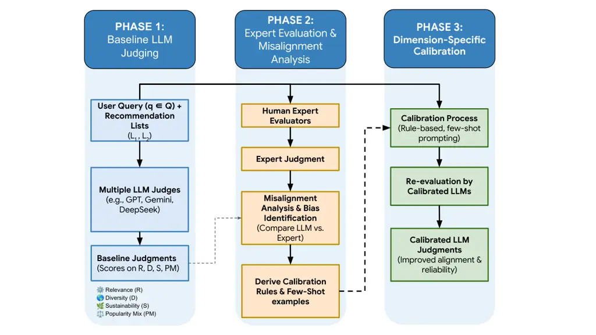
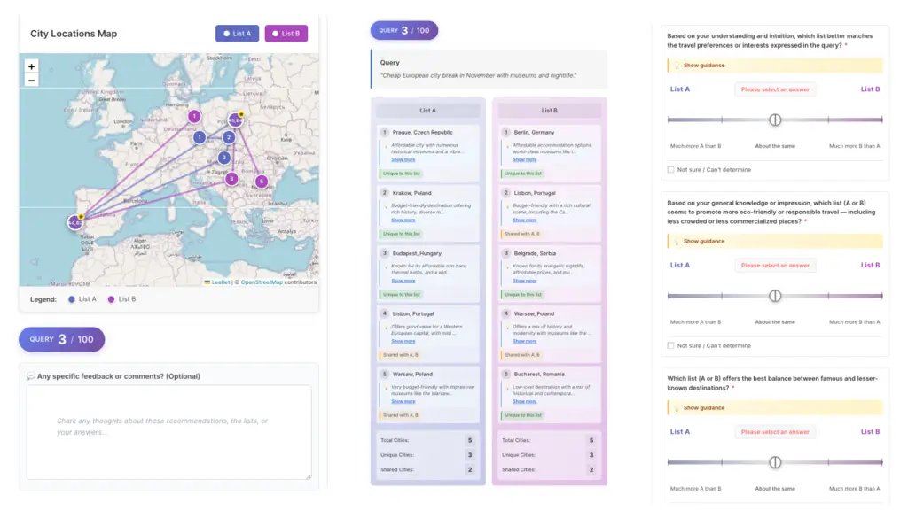

# Multi-Dimensional Evaluation of Sustainable City Trips with LLM-as-a-Judge and Human-in-the-Loop

Conference: 34th ACM Conference on User Modeling, Adaptation and
Personalization; June 08–11, 2026; Gothenburg, Sweden34th ACM Conference
on User Modeling, Adaptation and Personalization (UMAP ’26), June 08–11,
2026, Gothenburg, SwedenDOI:
[10.1145/3774935.3812717](https://doi.org/10.1145/3774935.3812717)ISBN:
979-8-4007-2311-7/2026/06

Ashmi Banerjee email: <ashmi.banerjee@tum.de> Affiliation: Technical
University of Munich, Munich, Germany , Adithi Satish email:
<adithi.satish@tum.de> Affiliation: Technical University of Munich,
Munich, Germany , Wolfgang Wörndl email: <woerndl@in.tum.de>
Affiliation: Technical University of Munich, Munich, Germany and Yashar
Deldjoo email: <yashar.deldjoo@poliba.it> Affiliation: Polytechnic
University of Bari, Bari, Italy

© cc

###### Abstract.

Evaluating nuanced conversational travel recommendations is challenging
when human annotations are costly and standard metrics ignore
stakeholder-centric goals. We study LLMs-as-Judges for sustainable
city-trip lists across four dimensions --- relevance, diversity,
sustainability, and popularity balance, and propose a three-phase
calibration framework: (1) baseline judging with multiple LLMs, (2)
expert evaluation to identify systematic misalignment, and (3)
dimension-specific calibration via rules and few-shot examples. Across
two recommendation settings, we observe model-specific biases and high
dimension-level variance, even when judges agree on overall rankings.
Calibration clarifies reasoning per dimension but exposes divergent
interpretations of sustainability, highlighting the need for
transparent, bias-aware LLM evaluation. Prompts and code are released
for reproducibility ¹¹ 1
[https://github.com/ashmibanerjee/trs-llm-calibration](https://github.com/ashmibanerjee/trs-llm-calibration).

###### Keywords:

LLMs, LLM-as-a-Judge, Calibration, Tourism Recommender Systems,
Sustainability

^(†)^(†)cc-license: by-nc-nd

## 1. Introduction and Context

Tourism recommender systems operate in a multi-stakeholder setting,
where personalization must balance sustainability, destination capacity,
and community impact. Standard accuracy metrics capture relevance but
overlook sustainability, overtourism risk, and the balance between
popular and lesser-known destinations \[3\]. Evaluation is further
complicated by the tourism data gap: official statistics are often too
aggregated for operational recommender systems and differ across
countries, limiting cross-country comparability \[7\]. No canonical
benchmark exists for conversational itinerary recommendation that
supports multidimensional evaluation. Expert evaluation is costly and
unscalable, while automated metrics often miss contextual and societal
factors. LLMs-as-Judges provide scalable approximations of human
reasoning but exhibit model-specific biases, especially on subjective
criteria \[6\].



Figure 1. Three-phase LLM calibration framework: baseline judgments,
comparison with human evaluations to identify systematic errors, and
dimension-specific calibration to improve alignment and reliability.

In tourism, this subjectivity is amplified: sustainability varies by
seasonality, diversity requires balancing geographic spread with
coherence, and popularity must reconcile authenticity with mainstream
appeal. Even human evaluators disagree on these dimensions, making
perfect consensus neither achievable nor desirable. Moreover, evaluation
must consider non-participating stakeholders, such as residents affected
by overtourism, aligning with emerging notions of societal fairness \[2,
3\].

To capture these considerations, we evaluate recommendations across four
dimensions: Relevance, Diversity, Sustainability, and Popularity Mix.
Relevance and diversity reflect established yet inherently subjective
criteria, shaped by user perceptions and multi-stakeholder trade-offs
\[2, 5\]. Sustainability and popularity mix address the need to balance
personalization with destination capacity and community well-being,
thereby mitigating overtourism risks \[3\]. In our framework,
sustainability is treated as a normative rubric dimension, assessed by
expert judgment rather than strict factual verification, with indicators
including seasonality, crowding risk, and the encouragement of less
commercialized destinations. While recent work, such as SynthTRIPs
\[4\], generates diverse, knowledge-grounded travel queries, it does not
address how recommendations should be evaluated across these dimensions.
This motivates our central question: _How can LLM-based evaluators be
calibrated to assess multi-dimensional tourism recommendations in the
absence of objective ground truth?_

Contributions. We present a methodological study of LLM-based evaluation
for sustainable city-trip recommendations:

- •
  Three-phase calibration framework aligning LLM judges with human
  experts across relevance, diversity, sustainability, and popularity
  balance.
- •
  Empirical analysis of model biases, showing calibration improves
  inter-judge consistency while preserving legitimate disagreement.
- •
  Lightweight calibration checklist from human–LLM misalignment to
  reduce bias without fine-tuning.
- •
  Reproducible evaluation pipeline generalizable to other
  multi-dimensional, domain-specific tasks.

We retain dimension-level evaluation as our primary focus to keep the
trade-offs explicit, even though we also compute confidence-weighted
aggregated scores. In multi-stakeholder settings, aggregation can
obscure trade-offs and mask specific failure modes; analyzing dimensions
separately keeps disagreements explicit and actionable.

## 2. Evaluation Framework and Experimental Methodology

We propose a three-phase calibration framework to systematically
evaluate multi-dimensional European city-trip recommendations using both
human experts and LLM judges (Figure 1). In this work, we use the
general term _Evaluators_ to refer to both LLMs and human experts. When
specifying a particular group, we append either _LLM_ or _human_
explicitly. The term _Judges_ is reserved exclusively for LLM
evaluators, while _Experts_ always refers to human evaluators.



Figure 2. Web-based survey interface used by human experts for pairwise
evaluation of city-trip recommendation lists, including
dimension-specific scoring and optional justifications.

Each query $`q\in\mathcal{Q}`$ represents a traveler request with
explicit constraints. For each query, two LLMs generate ranked lists
$`L_{1}`$ and $`L_{2}`$ of $`k=5`$ cities, each with justifications.
Evaluators compare these lists using a structured pairwise protocol
\[8\], assigning dimension-specific judgments over the four predefined
dimensions (subsection 2.1).

Phase 1: Baseline Judging. Paired recommendation lists are independently
evaluated by multiple LLM judges, producing baseline judgments across
all dimensions.

Phase 2: Expert Evaluation and Misalignment Analysis. Baseline judgments
are compared with evaluations from five domain experts with at least 5
years of experience in tourism recommendations. Systematic disagreements
reveal recurring error patterns and inform calibration rules \[10\].

Phase 3: Dimension-Specific Calibration. The derived calibration rules
after _Phase 2_ and a few-shot examples are integrated into refined
judge prompts, and the same queries are re-evaluated to analyze the
updated inter-judge variance and alignment with experts.

### 2.1. Evaluation Dimensions

Our study evaluates city-trip recommendation lists generated by LLMs for
a natural language query with explicit constraints. We evaluate across
four dimensions grounded in multi-stakeholder fairness literature \[2,
5\] and tourism-specific concerns \[3\]:

- •
  Relevance ($`\mathcal{R}`$) measures how well the recommended cities
  align with the query’s explicit constraints (e.g., budget, season,
  interests) and implicit preferences inferred from the traveler \[4,
  2\].
- •
  Diversity ($`\mathcal{D}`$) captures geographic and thematic variety
  within a list, reflecting the presence of distinct regions and
  experience types \[2, 5\].
- •
  Sustainability ($`\mathcal{S}`$) evaluates responsible travel
  characteristics such as seasonality, walkability, public transit
  access, air quality, and destination capacity. Assessments rely on
  observable, context-dependent indicators rather than generic or
  unsubstantiated sustainability claims \[3\].
- •
  Popularity Mix ($`\mathcal{P}_{\mathrm{M}}`$) examines the balance
  between widely known destinations and lesser-known alternatives \[3\].
  In this paper, _popularity_, _popularity mix_, and _popularity
  balance_ are used interchangeably.

### 2.2. Experimental Setup

#### Query Selection and Data Generation

Our query set is derived from SynthTRIPS \[4\], which generates
realistic travel requests by combining user preferences with structured
constraints (e.g., season, budget, interests, sustainability) and a pool
of European cities. We use only the natural-language queries—excluding
city lists and constraints—to prompt LLMs (e.g., “European city break in
July, walkable, less touristy”). From 2,302 generated queries, we retain
123 via deduplication and diversity filtering. Paired recommendations
are generated using gpt-4o-mini and gemini-2.5-flash; pairs with more
than three overlapping cities are discarded, resulting in 100 evaluation
queries and one practice query.

Experimental Conditions. We compare gemini-2.5-flash ($`L_{1}`$) and
gpt-4o-mini ($`L_{2}`$), and they are evaluated by both Experts and
Judges. The LLM judges (gpt-5, gemini-2.5-pro, deepseek-v3) are
configured with $`\tau=0.0`$, top-$`p=0.95`$, and an 8192-token context
window. Five human experts with at least 5 years of experience in the
tourism domain evaluate the recommendations through a web-based
interface that displays side-by-side lists with dimension-specific
scoring (Figure 2). Each query receives responses from at least three
experts, resulting in approximately 15 hours of total annotation time.
Three LLM judges evaluate the same 100 queries to enable
cross-architecture comparison.

Pairwise Comparison Protocol. We use pairwise comparisons to improve
judgment stability and reduce scale-related biases \[5\]. For each
query, evaluators assign dimension-specific scores
$`s_{d}(L_{1},L_{2}\mid q)\in\{-2,-1,0,+1,+2\}`$, with positive values
favoring $`L_{1}`$; responses marked as _unsure_ are excluded from the
analysis. This allows us to assess inter-judge reliability and alignment
with human evaluation \[10\], capturing the inherent subjectivity of
dimensions such as Sustainability and Diversity.

In addition to dimension-level judgments, LLM judges report a confidence
score $`c_{d}\in[0,1]`$ for each dimension and select a _best list_ per
query to indicate their overall preference. To quantify confidence-aware
overall preference, we compute a confidence-weighted aggregated score
$`S_{\text{agg}}`$ for each query:

```math
S_{\text{agg}}=\sum_{d\in\{\mathcal{R},\mathcal{D},\mathcal{S},\mathcal{P}_{M}\}}s_{d}\cdot c_{d}, \tag{1}
```

where $`s_{d}`$ denotes the signed pairwise score for dimension $`d`$
and $`c_{d}`$ the corresponding confidence. Positive values of $`s_{d}`$
favor $`L_{1}`$, while negatives favor $`L_{2}`$.

At the dataset level, we summarize directional preference using two
complementary ratios. The _Aggregated Score Ratio (ASR)_ quantifies the
total strength of evidence by dividing the sum of all
confidence-weighted scores favoring $`L_{1}`$ by the sum of those
favoring $`L_{2}`$. In contrast, the _Best List Ratio (BLR)_ measures
the frequency of preference, calculated as the total number of times
$`L_{1}`$ was explicitly selected as the ‘best’ list divided by the
total selections for $`L_{2}`$. For both ratios, values $`>1`$ indicate
a net preference for $`L_{1}`$, while values $`<1`$ indicate a net
preference for $`L_{2}`$. Together, these metrics allow us to examine
whether holistic _best list_ choices align with the direction implied by
confidence-weighted, dimension-level evidence, and to assess consistency
between decomposed judgments and overall preference signals.

| Rule                  | Guideline                                                                                                      |
| --------------------- | -------------------------------------------------------------------------------------------------------------- |
| Relevance             | Match explicit constraints using city-level evidence; avoid keyword-only matches.                              |
| Sustainability        | Reward verifiable indicators; penalize vague claims; account for seasonality and off-peak travel.              |
| Popularity            | Favor a balanced mix of mainstream destinations and hidden gems; down-weight crowded options unless justified. |
| Diversity             | Ensure geographic and thematic variety unless restricted by the query.                                         |
| Tie-breaking          | Resolve close cases using constraint coverage, specificity, factual accuracy, and context.                     |
| Validation            | Verify entity type (city, landmark, country) and factual correctness.                                          |
| Context & Seasonality | Penalize unsafe, closed, or seasonally unsuitable recommendations.                                             |
| Confidence            | Credit evidence-backed claims; mark uncertainty only when ambiguity is unavoidable.                            |

Table 1. Calibration rules used to guide LLM judge behavior. The exact
prompt formulations are available in the repository³³ 3
[https://github.com/ashmibanerjee/trs-llm-calibration](https://github.com/ashmibanerjee/trs-llm-calibration).

Calibration Procedure. Calibration is performed through iterative
re-prompting \[9\], informed by recurring patterns of disagreement
between LLM judges and human experts. It focuses on _systematic_ rather
than marginal disagreement by analyzing only cases with
$`|s_{d}^{\text{llm}}-s_{d}^{\text{human}}|\geq 2`$, which indicate
clear directional conflicts with the human majority. Since single-point
differences are common across both human-human and judge-judge
comparisons and generally reflect acceptable subjective variation rather
than errors worth correcting, we only include the two-point
disagreements in our misalignment analysis.

We derive eight calibration rules (Table 1) that capture operational
criteria, common failure modes, and corrective examples which can be
generalized across queries and models. These rules are incorporated into
refined judge prompts, along with targeted few-shot demonstrations.
While the two-point threshold is empirically justified, future work
should examine whether stacking multiple calibration rules introduces
noise. Overall, our study shows that calibration improves alignment on
subjective dimensions and stabilizes inter-judge behavior.

## 3. Results and Discussions

We analyze LLM judge behavior before and after calibration, focusing on
alignment with human experts and inter-judge consistency.

### RQ1. How well do judges align with human experts, and why do they disagree?

Note on inter-rater reliability. We do not report traditional
inter-rater agreement because the number of raters varies across queries
and the task involves inherently subjective, multidimensional judgments;
instead, we focus on model-specific patterns and calibration effects to
analyze consistency and directional preferences.

Results. Alignment is measured against the majority vote of humans for
each response. Against the human majority (Table 2, “Before”), GPT
aligns best on Relevance ($`0.53`$) and achieves moderate alignment on
other dimensions ($`0.36`$–$`0.42`$). Gemini shows a comparable
macro-average alignment (approximately $`0.42`$), while DeepSeek
performs lower overall (approximately $`0.34`$), with particularly weak
agreement on Relevance (approximately $`0.17`$). Subjective dimensions,
especially Diversity and Sustainability, remain the most challenging for
judges (mid-$`0.30`$s to $`0.40`$s). Human annotators also disagree
among themselves, so perfect alignment is neither expected nor always
desirable; the objective is to reduce _systematic_ LLM errors that
humans rarely make.

|                              | DeepSeek |                    | GPT    |       | Gemini |                    |
| ---------------------------- | -------- | ------------------ | ------ | ----- | ------ | ------------------ |
| Metric                       | Before   | After              | Before | After | Before | After              |
| $`\mathcal{R}`$              | 0.17     | 0.18$`\uparrow`$   | 0.53   | 0.53  | 0.48   | 0.54$`\uparrow`$   |
| $`\mathcal{D}`$              | 0.35     | 0.29$`\downarrow`$ | 0.36   | 0.36  | 0.37   | 0.39$`\uparrow`$   |
| $`\mathcal{S}`$              | 0.36     | 0.36               | 0.40   | 0.40  | 0.37   | 0.35$`\downarrow`$ |
| $`\mathcal{P}_{\mathrm{M}}`$ | 0.47     | 0.43$`\downarrow`$ | 0.42   | 0.42  | 0.45   | 0.39$`\downarrow`$ |

Table 2. LLM judge agreement with the human majority vote before and
after calibration (values denote the proportion of queries where the
judge matches the human majority decision). Arrows indicate the
direction of change after calibration.

Why disagreements occur (evidence and examples). Manual analysis reveals
four recurring causes: (i) _Type and factual errors_ go unpenalized by
judges but are reliably caught by experts: Malta, Santorini, and
Plitvice Lakes are treated as cities in some lists. (ii) _Context and
seasonality_: judges do not flag Lviv during conflict or Keukenhof in
October (closed), nor do they penalize Tallinn’s deep winter conditions
that diminish trip quality; experts do. (iii) _Unsure aversion_: Gemini
never chooses “Unsure,” GPT almost never (one case on Sustainability),
while DeepSeek does so more often. Forcing a side when the evidence is
insufficient reduces alignment on edge cases. (iv) _Attention to
explicit constraints vs. surface cues_: experts reward concrete coverage
of budget, time, and persona, while judges sometimes reward keyword
echoes or generic sustainability claims.

### RQ2. What changes after dimension-specific calibration?

Results. Calibration primarily stabilizes inter-judge consistency. Gains
are largest for Popularity Balance and Sustainability, where concrete
rules (e.g., verifying "green" claims) reduce idiosyncratic
interpretations. Subjective dimensions like Relevance show mixed
results, indicating that rules cannot fully replace world knowledge.
Alignment with human experts improves qualitatively (better reasoning)
but quantitative gains are modest (Table 2). Gemini improves on
Relevance (+0.06), while GPT and DeepSeek remain static or dip slightly.
This indicates calibration enforces strict, evidence-based
assessment—often penalizing vague claims that human experts might
forgive—rather than simply mimicking human intuition. We performed
statistical tests ($`p<0.05`$) on pre–post calibration deltas, showing
significant improvements primarily in Sustainability for all three
judges, with selective gains for DeepSeek on Relevance and Diversity,
while Popularity Balance remained stable, indicating that calibration
enhances alignment and inter-judge consistency without introducing
unintended variance.

Examples. Explicit constraints successfully help judges penalize false
entities (e.g., Malta as a city) and unsubstantiated sustainability
claims. However, trade-offs in Diversity (geographic spread vs. thematic
coherence) remain inherently subjective, causing valid disagreements to
persist.

Effects on Directional preferences. We analyze whether calibration
reduces systematic bias toward specific lists ($`L_{1}`$ vs. $`L_{2}`$)
using confidence-weighted scores (ASR) and best-list selections (BLR)
(Table 3). The results clarify that calibration reduces uncertainty
(noise) but has divergent effects on directionality:

- •
  Correction toward Parity (Gemini) Pre-calibration, Gemini skewed
  slightly against $`L_{1}`$. Calibration shifts its ASR significantly
  toward equilibrium ($`0.71\rightarrow 0.98`$), aligning with the
  evidence that the lists are of comparable quality.
- •
  Preference Sharpening (DeepSeek) Conversely, DeepSeek amplifies its
  initial preference for $`L_{1}`$ ($`1.30\rightarrow 2.88`$). By
  removing ambiguity, calibration makes the model more decisive in its
  specific interpretation of the rules (e.g., strictly rewarding
  specific keywords), leading to polarization ("sharpening") rather than
  consensus.
- •
  Entrenchment (GPT) GPT shows minimal movement
  ($`0.58\rightarrow 0.64`$), suggesting its evaluation heuristics are
  deeply entrenched and less sensitive to few-shot prompts.

| Judge    | ASR    |                   | BLR    |                   |
| -------- | ------ | ----------------- | ------ | ----------------- |
|          | Before | After             | Before | After             |
| Gemini   | 0.71   | 0.98 $`\uparrow`$ | 0.91   | 1.46 $`\uparrow`$ |
| GPT-5    | 0.58   | 0.64 $`\uparrow`$ | 0.74   | 0.89 $`\uparrow`$ |
| DeepSeek | 1.30   | 2.88 $`\uparrow`$ | 1.40   | 2.81 $`\uparrow`$ |

Table 3. Directional preference ratios ($`>1`$ favors $`L_{1}`$, $`<1`$
favors $`L_{2}`$) before and after calibration. Arrows indicate the
direction of change following calibration, computed using
confidence-weighted aggregated scores (ASR) and explicit best-list
selections (BLR).

## 4. Conclusion and Limitations

Tourism recommendation requires metrics that prioritize sustainability
and diversity over simple accuracy. While LLMs enable scalable
multi-dimensional assessment, they exhibit model-specific biases.
Calibration stabilizes reasoning and harmonizes heuristics, acting as a
“clarifier” rather than a universal corrector: it reduces noise while
revealing how models interpret rules—moving some toward parity (Gemini)
and others toward sharpened preferences (DeepSeek). This transparency
shows that one-size-fits-all consensus between judges is unrealistic.
Future improvements should refine “Unsure” thresholds and incorporate
richer, evidence-linked contextual reasoning. Despite limitations
regarding human oversight and normative assumptions, domain-specific
calibration provides a scalable, transferable framework, making
assumptions explicit and comparable. Our open-source pipeline offers a
reusable foundation for transparent, stakeholder-aware evaluation across
domains such as health, education, and policy.

## References

- \[2\] Himan Abdollahpouri, Gediminas Adomavicius, Robin Burke, Ido
  Guy, Dietmar Jannach, Toshihiro Kamishima, Jan Krasnodebski, and Luiz
  Pizzato. 2019. Beyond personalization: Research directions in
  multistakeholder recommendation. _arXiv preprint arXiv:1905.01986_
  (2019).
- \[3\] Ashmi Banerjee, Paromita Banik, and Wolfgang Wörndl. 2023. A
  review on individual and multistakeholder fairness in tourism
  recommender systems. _Frontiers in big Data_ 6 (2023), 1168692.
- \[4\] Ashmi Banerjee, Adithi Satish, Fitri Nur Aisyah, Wolfgang
  Wörndl, and Yashar Deldjoo. 2025. SynthTRIPs: A Knowledge-Grounded
  Framework for Benchmark Data Generation for Personalized Tourism
  Recommenders. In _Proceedings of the 48th International ACM SIGIR
  Conference on Research and Development in Information Retrieval_.
  3743–3752.
- \[5\] Michael D Ekstrand, F Maxwell Harper, Martijn C Willemsen, and
  Joseph A Konstan. 2014. User perception of differences in recommender
  algorithms. In _Proceedings of the 8th ACM Conference on Recommender
  systems_. 161–168.
- \[6\] Jiawei Gu, Xuhui Jiang, Zhichao Shi, Hexiang Tan, Xuehao Zhai,
  Chengjin Xu, Wei Li, Yinghan Shen, Shengjie Ma, Honghao Liu, et
  al. 2024. A survey on llm-as-a-judge. _arXiv preprint
  arXiv:2411.15594_ (2024).
- \[7\] Carmen Lam and Bob McKercher. 2013. The tourism data gap: The
  utility of official tourism information for the hospitality and
  tourism industry. _Tourism Management Perspectives_ 6 (2013), 82–94.
- \[8\] ChaeHun Park, Minseok Choi, Dohyun Lee, and Jaegul Choo. 2024.
  Paireval: Open-domain dialogue evaluation metric with pairwise
  comparisons. In _First Conference on Language Modeling_.
- \[9\] Shreyas Sundara Raman, Vanya Cohen, Eric Rosen, Ifrah Idrees,
  David Paulius, and Stefanie Tellex. 2022. Planning with large language
  models via corrective re-prompting. In _NeurIPS 2022 Foundation Models
  for Decision Making Workshop_.
- \[10\] Aman Singh Thakur, Kartik Choudhary, Venkat Srinik Ramayapally,
  Sankaran Vaidyanathan, and Dieuwke Hupkes. 2024. Judging the judges:
  Evaluating alignment and vulnerabilities in llms-as-judges. _arXiv
  preprint arXiv:2406.12624_ (2024).
