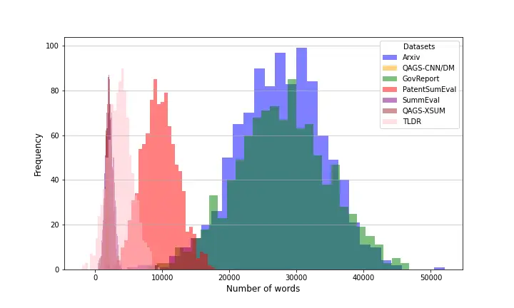
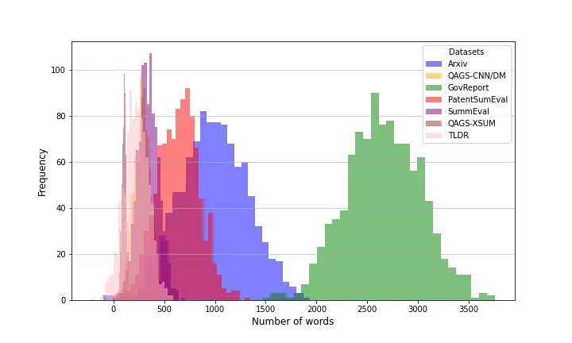

# LLM-ReSum: A Framework for LLM Reflective Summarization through Self-Evaluation Invited Paper

1^(st) Huyen Nguyen Affiliation: Cigna Group  
Evernorth Health Services  
Austin, Texas, USA  
HuyenNguyen5@my.unt.edu Affiliation:     2^(nd) Haoxuan Zhang
Affiliation: dept. of Information Science  
University of North Texas  
Denton, Texas, USA  
haoxuanzhang@my.unt.edu Affiliation:     3^(rd) Yang Zhang
Affiliation: dept. of Data Science  
University of North Texas  
Denton, Texas, USA  
yang.zhang@unt.edu Affiliation:     4^(th) Haihua Chen
Affiliation: dept. of Data Science  
University of North Texas  
Denton, Texas, USA  
haihua.chen@unt.edu Affiliation:     5^(th) Junhua Ding¹ ^(†)^(†)thanks:
This work was supported in part by the NSF under Grants \#2225229,
\#2601493, and \#2231519. Corresponding author: Junhua Ding (Email:
junhua.ding@unt.edu) Affiliation: dept. of Data Science  
University of North Texas  
Denton, Texas, USA  
junhua.ding@unt.edu

###### Abstract

Reliable evaluation of large language model (LLM)–generated summaries
remains an open challenge, particularly across heterogeneous domains and
document lengths. We conduct a comprehensive meta-evaluation of 14
automatic summarization metrics and LLM-based evaluators across seven
datasets spanning five domains, covering documents from short news
articles to long scientific, governmental, and legal texts (2K–27K
words) with over 1,500 human-annotated summaries. Our results show that
traditional lexical overlap metrics (e.g., ROUGE, BLEU) exhibit weak or
negative correlation with human judgments, while task-specific neural
metrics and LLM-based evaluators achieve substantially higher alignment,
especially for linguistic quality assessment. Leveraging these findings,
we propose LLM-ReSum, a self-reflective summarization framework that
integrates LLM-based evaluation and generation in a closed feedback loop
without model finetuning. Across three domains, LLM-ReSum improves
low-quality summaries by up to 33% in factual accuracy and 39% in
coverage, with human evaluators preferring refined summaries in 89% of
cases. We additionally introduce PatentSumEval, a new human-annotated
benchmark for legal document summarization comprising 180
expert-evaluated summaries. All code and datasets will be released in
GitHub.

###### Index Terms: 

Text Summarization, Meta-evaluation, Evaluation metrics, Large Language
Model, Agentic AI

## I Introduction

Text summarization has emerged as an indispensable technology for
enabling efficient information consumption across diverse domains,
including news media, governmental documentation, scientific literature,
social platforms, and legal corpora \[1, 2\]. Modern summarization
systems, increasingly powered by large language models (LLMs), are now
deployed at scale in search engines, recommendation systems, and
knowledge extraction pipelines \[1, 3, 2\]. The proliferation of these
systems has intensified the demand for robust evaluation methodologies
that align with human quality judgments \[4, 5, 6\].

Conventional automatic evaluation metrics, such as n-gram overlap
measures (ROUGE, BLEU), embedding-based similarity scores (BERTScore),
and task-specific NLP models, have dominated summarization assessment
for decades. Traditional approaches have employed topic-based vector
space models and semantic measures for evaluation \[7\], while
extractive methods have focused on candidate sentence selection
strategies \[8\]. Nevertheless, accumulating evidence reveals systematic
failures of these metrics to capture dimensions of quality prioritized
by human evaluators, particularly factual consistency, semantic
coverage, and linguistic fluency \[5, 9\]. Lexical overlap metrics such
as ROUGE and BLEU exhibit fundamental limitations in semantic
understanding, penalizing paraphrases and rewarding superficial word
matches \[10\]. These shortcomings are especially pronounced for
abstractive summarization, where neural models generate novel phrasings
rather than extractive fragments \[7\]. Notably, while human evaluators
substantially prefer summaries from prompt-based LLMs such as GPT-3,
these outputs receive significantly lower ROUGE scores than earlier
fine-tuned models, exposing a critical misalignment between automatic
metrics and human preferences \[11, 12, 13\]. This discrepancy raises
fundamental questions about metric validity across heterogeneous
domains, document lengths, and summarization paradigms.

Concurrently, recent advancements in LLMs have enabled a paradigm shift:
leveraging LLMs as evaluation agents. Given their capacity to process
nuanced natural language instructions and assess multiple quality
dimensions simultaneously, LLMs present a compelling alternative to
handcrafted metrics. Empirical investigations have demonstrated that
ChatGPT and similar models, when employed for Likert-scale rating or
pairwise comparison, can exceed conventional metrics in correlation with
human judgments \[4, 14, 15\]. Recent work has also explored LLM
feedback mechanisms for improving text generation quality \[16\].
However, LLM-based evaluation exhibits significant sensitivity to prompt
engineering and domain shift \[4\], with existing research predominantly
concentrated on news corpora. Critical gaps persist regarding
cross-domain robustness, quantitative benchmarking against traditional
metrics, and reliability across diverse document types including
domain-specific applications such as biomedical literature, patent
documents, and legal cases \[2, 6, 17\].

Beyond their role as evaluators, LLMs offer an opportunity to establish
a closed-loop framework integrating evaluation and generation. Iterative
refinement driven by evaluation feedback could enable LLMs to
self-correct outputs toward greater human alignment without
resource-intensive finetuning \[16\]. While reinforcement learning from
human feedback has proven effective \[18\], such approaches demand
substantial computational infrastructure and curated preference data.
Prompt-based self-improvement presents a more scalable alternative, yet
poses unresolved challenges in prompt design, feedback representation,
convergence criteria, and error amplification mitigation.

The primary objective of this study is to systematically examine the
reliability of existing summarization evaluation methods in the context
of large language model (LLM)–generated summaries and to investigate
whether evaluation signals can be effectively leveraged to improve
summarization quality. Specifically, this research aims (1) to assess
the extent to which widely used automatic evaluation metrics align with
human judgments across diverse domains and document lengths; (2) to
evaluate the effectiveness and robustness of LLM-based evaluation
approaches, including single-agent and multi-agent configurations, as
alternatives to conventional metrics; and (3) to develop and empirically
validate a self-reflective summarization framework that integrates
evaluation and generation to enable iterative quality improvement
without model finetuning. To address these objectives, we formulate
three research questions (RQs):

- •
  RQ1: To what extent do traditional automatic evaluation metrics
  correlate with human judgments across diverse domains and document
  lengths?
- •
  RQ2: How reliably can LLMs function as evaluation metrics for
  summarization quality assessment compared to conventional approaches?
- •
  RQ3: Can a human-aligned LLM evaluation framework enable iterative
  self-refinement to improve summarization quality?

To answer RQ1, we conduct a systematic meta-evaluation of 14 widely
adopted automatic metrics across seven datasets spanning five domains
with varying input lengths, quantifying their alignment with human
judgments on multiple quality dimensions. For RQ2, we investigate
single-agent and multi-agent LLM evaluation architectures, benchmarking
their performance against conventional metrics and analyzing
domain-specific strengths and limitations. Addressing RQ3, we introduce
LLM-ReSum, a novel reflective summarization framework wherein LLMs
iteratively refine outputs based on self-generated evaluation feedback
aligned with human quality criteria. Validation through both automatic
metrics and human evaluation demonstrates substantial quality
improvements, particularly in factual accuracy and semantic coverage.

Our contributions are fourfold:

- •
  We conduct a comprehensive meta-evaluation of widely-used automatic
  metrics and LLM-based evaluation across seven datasets spanning five
  domains, revealing systematic failures of traditional lexical overlap
  metrics for evaluating LLM-generated summaries and establishing
  empirical reliability benchmarks across diverse contexts.
- •
  We systematically compare single-agent and multi-agent LLM evaluation
  architectures, demonstrating that multi-agent frameworks significantly
  outperform conventional metrics on linguistic quality dimensions,
  providing clear guidance for selecting appropriate evaluation
  strategies in practical deployment.
- •
  We propose LLM-ReSum, a novel self-reflective summarization framework
  integrating LLM evaluation and generation in a closed feedback loop,
  achieving substantial gains of up to 33% in accuracy and 39% in
  coverage with 89% human preference rate, without requiring model
  finetuning or reinforcement learning.
- •
  We introduce PatentSumEval, a human-annotated benchmark for legal
  patent document summarization evaluation, and release reproducible
  meta-evaluation code to facilitate future research.

## II Related Work

### II-A Evaluation Methods for Summarization

Summarization evaluation approaches are broadly categorized as
reference-based or reference-free \[5\]. Reference-based methods measure
similarity against human-authored summaries, while reference-free
approaches assess quality directly from source documents. Given the
prohibitive cost of reference creation, particularly in specialized
domains \[2\], we focus on reference-free evaluation.

Automatic evaluation metrics dominate current practice. N-gram overlap
metrics (ROUGE \[19\], BLEU \[20\]) quantify lexical similarity through
surface-form matching. Embedding-based metrics (BERTScore \[9\],
MoverScore \[21\]) leverage contextualized representations to capture
semantic correspondence. Task-specific metrics operationalize quality
through auxiliary NLP tasks: SummaC \[22\] employs natural language
inference for consistency verification, while QuestEval \[23\] utilizes
question-answering frameworks. These metrics exhibit systematic
deficiencies. Empirical studies reveal weak correlations between
automated scores and human quality judgments \[5, 24\], particularly for
lexical metrics that penalize semantically valid paraphrases \[10\].

Given these limitations, researchers have conducted meta-evaluations to
assess which metrics most reliably correlate with human judgments.
However, existing reliability assessments suffer from a narrow scope.
Prior meta-evaluations typically examine one or two datasets within
homogeneous domains \[25, 5, 26\], constraining generalizability of
their findings. Consequently, cross-domain robustness and performance
across varying document characteristics remain uncharacterized.

### II-B LLMs in Summarization: Evaluation and Improvement

The emergence of instruction-tuned LLMs has introduced new paradigms for
both evaluation and quality improvement in summarization.
Instruction-following capabilities enable direct quality assessment
through natural language specifications of evaluation criteria. ChatGPT
demonstrates human-comparable performance on Likert scoring and pairwise
ranking tasks, surpassing conventional metrics \[4\]. Zero-shot
consistency detection \[14\] and chain-of-thought evaluation frameworks
\[15\] achieve superior human alignment on established benchmarks.
Domain-specific applications, including biomedical summarization \[2\],
further validate LLM evaluator capabilities. Despite these advances,
critical limitations persist: evaluation quality exhibits high prompt
sensitivity \[27\] and domain dependence \[4\], research concentrates
predominantly on news corpora while specialized domains remain
underexplored, and single-agent versus multi-agent architectures lack
systematic comparison across diverse contexts.

Beyond evaluation, parallel research investigates LLM-driven quality
improvement through two paradigms. Reinforcement learning methods
optimize generation through feedback signals: early approaches
incorporated ROUGE rewards \[28, 29\], while recent work employs human
preference models \[30\] or LLM-synthesized feedback \[31\]. Despite
effectiveness, these methods demand substantial computational resources
and curated training data. Alternatively, prompt-based adaptation
enables task-specific behavior through structured instructions without
parameter modification \[32\]. Recent investigations of feedback-driven
text refinement \[16\] demonstrate viability for iterative improvement,
though applications to summarization remain limited.

Existing work treats evaluation and improvement as independent
processes. While reinforcement learning approaches integrate feedback
during training \[30, 31\], and prompt-based methods enable iterative
refinement \[16\], no prior framework integrates LLM evaluation and
generation in a closed feedback loop for iterative summarization quality
enhancement. Specifically, existing evaluation studies focus on metric
reliability \[4, 14, 15\] without exploring how evaluation outcomes can
guide revision, and improvement methods rely on external feedback
sources \[30\] or general-purpose refinement strategies \[16\] rather
than summary-specific evaluation criteria. Key questions remain
unaddressed: whether evaluation feedback can be translated into
actionable revision guidance, which quality dimensions respond to
iterative refinement, and whether self-correction converges toward
improved quality. We address these gaps by proposing LLM-ReSum, a
self-reflective architecture wherein LLMs evaluate outputs against
human-aligned criteria and leverage generated feedback for iterative
refinement, achieving quality improvements without model finetuning.

## III Methodology

### III-A Framework Overview

Fig. 1: Overview of our three-stage research framework: meta-evaluation
of automatic metrics (RQ1), multi-agent LLM evaluation (RQ2), and
iterative self-reflective summarization (RQ3).

This study adopts a three-stage methodological framework to
systematically address the research questions posed in Section I. To
answer RQ1, we employ meta-evaluation methodology to assess the
reliability of automatic evaluation metrics by measuring their
correlation with human judgments across diverse contexts. For RQ2, we
design single-agent and multi-agent LLM evaluation frameworks that
leverage instruction-following capabilities and chain-of-thought
reasoning to simulate human evaluation behavior. To address RQ3, we
propose LLM-ReSum, a self-reflective summarization framework that
integrates evaluation and generation in a closed feedback loop to enable
iterative quality improvement without model finetuning. Figure 1
illustrates the complete research workflow.

### III-B Task Formulation

We formalize the reference-free summarization evaluation and iterative
refinement tasks as follows. Let $`D`$ denote a source document and
$`S`$ denote a candidate summary. The evaluation task computes quality
scores across $`K`$ dimensions
$`\mathcal{Q}=\{q_{1},q_{2},\ldots,q_{K}\}`$:

```math
\centering\mathbf{q}(S,D)=[q_{1}(S,D),q_{2}(S,D),\ldots,q_{K}(S,D)]\@add@centering \tag{1}
```

where each $`q_{i}(S,D)\in[1,L]`$ represents a score on a Likert scale
with $`L`$ levels.

For iterative refinement, starting with an initial summary
$`S^{(0)}=f_{\text{sum}}(D)`$, we iteratively improve quality through
evaluation-guided feedback:

```math
\centering S^{(t+1)}=f_{\text{refine}}(S^{(t)},D,F^{(t)})\@add@centering \tag{2}
```

where $`F^{(t)}=g_{\text{feedback}}(\mathbf{q}^{(t)},\mathbf{r}^{(t)})`$
represents structured feedback constructed from evaluation scores
$`\mathbf{q}^{(t)}`$ and rationales $`\mathbf{r}^{(t)}`$ at iteration
$`t`$. The process terminates when $`\min_{i}q_{i}^{(t)}\geq\tau`$
(quality threshold satisfied) or $`t=T_{\text{max}}`$ (maximum
iterations reached).

### III-C LLM-Based Evaluation Framework

#### III-C1 Direct Evaluation Paradigm

We adopt the direct evaluation paradigm wherein evaluators assess
generated summaries according to predefined quality criteria without
relying on reference summaries. This approach offers several advantages:
it avoids assuming reference summaries represent perfect quality,
enables evaluation along dimensions not captured by reference
similarity, and provides flexibility to customize evaluation criteria
for domain-specific applications \[4\].

Given that LLMs demonstrate exceptional instruction-following
capabilities and can process complex natural language specifications of
evaluation criteria \[33\], we hypothesize they can emulate human
evaluation behavior when provided with appropriately structured prompts
\[15, 34\]. We formalize LLM-based evaluation as
$`\mathbf{q}_{\text{LLM}}(S,D)=f_{\text{LLM}}(P_{\text{eval}},S,D)`$,
where $`P_{\text{eval}}`$ encodes evaluation instructions and quality
dimension definitions.

#### III-C2 Multi-Agent Evaluation Framework

Inspired by human evaluation practices that aggregate judgments from
multiple annotators to mitigate individual bias \[35\], we propose a
multi-agent evaluation framework employing heterogeneous LLMs as
independent evaluation agents. Each agent independently evaluates
summaries using the Reasoning Reinforced prompt strategy, producing
dimension-specific scores and rationales.

When agents produce divergent assessments, we explore three aggregation
mechanisms:

Averaging computes the arithmetic mean of scores across agents for each
dimension, treating all agents equally and producing continuous scores.

Majority Voting identifies the most frequent score among agents for each
dimension. In cases of three-way disagreement, the median score is
selected. This method enforces discrete scoring and emphasizes consensus
\[36\].

Leader-Based Aggregation introduces an additional LLM serving as a
meta-evaluator that receives independent evaluations and rationales,
analyzes points of agreement and disagreement, weighs the strength of
different rationales, and produces a final assessment \[37\]. This
approach leverages meta-reasoning capabilities to resolve conflicts
intelligently.

### III-D LLM-ReSum: Self-Reflective Summarization Framework

Building upon the LLM evaluation framework, we propose LLM-ReSum—a novel
architecture that integrates evaluation and generation in a closed
feedback loop for iterative quality improvement. The framework addresses
a fundamental limitation of conventional summarization: the disconnect
between training objectives and evaluation criteria \[31\]. By
incorporating evaluation directly into the generation process through
prompt-based feedback, LLM-ReSum enables zero-shot quality improvement
without requiring supervised finetuning or reinforcement learning \[32,
38\]. The framework operationalizes two key hypotheses. First, explicit
evaluation feedback aligned with human quality criteria can guide LLMs
toward self-correction \[39, 40\]. Second, iterative refinement through
evaluation-generation cycles can progressively improve output quality
when properly constrained to prevent degradation \[38\].

#### III-D1 Iterative Refinement Process

LLM-ReSum executes a four-stage iterative cycle (Algorithm 1): (1)
generate initial summary using standard summarization instructions
(Prompt 1), (2) evaluate the summary across multiple quality dimensions
producing scores and rationales using our reasoning-reinforced
evaluation prompt ( Prompt 2) \[15\], (3) construct actionable feedback
for dimensions scoring below threshold $`\tau`$, and (4) generate
refined summary conditioned on the source document and evaluation
feedback using the refinement prompt (Prompt 3) \[40\]. The cycle
continues until convergence criteria are satisfied or maximum iterations
$`T_{\text{max}}`$ are exhausted.

0:  Source document $`D`$, Summarization function $`f_{\text{sum}}`$,
Evaluation function $`f_{\text{eval}}`$, Refinement function
$`f_{\text{refine}}`$, Quality threshold $`\tau`$, Maximum iterations
$`T_{\text{max}}`$

0:  Enhanced summary $`S^{*}`$

1:  $`S^{(0)}\leftarrow f_{\text{sum}}(D)`$ {Generate initial summary}

2:  $`t\leftarrow 0`$

3:  while $`t<T_{\text{max}}`$ do

4:
  $`\mathbf{q}^{(t)},\mathbf{r}^{(t)}\leftarrow f_{\text{eval}}(D,S^{(t)})`$
{Evaluate current summary}

5:   if $`\min_{i}q_{i}^{(t)}\geq\tau`$ then

6:    return $`S^{(t)}`$ {Quality threshold satisfied}

7:   end if

8:   $`\mathcal{I}\leftarrow\{i\mid q_{i}^{(t)}<\tau\}`$ {Identify
deficient dimensions}

9:
  $`F^{(t)}\leftarrow g_{\text{feedback}}(\{q_{i}^{(t)},r_{i}^{(t)}\}_{i\in\mathcal{I}})`$
{Construct feedback}

10:   $`S^{(t+1)}\leftarrow f_{\text{refine}}(D,F^{(t)})`$ {Generate
refined summary}

11:   $`t\leftarrow t+1`$

12:  end while

13:  return $`\arg\max_{t^{\prime}}\min_{i}q_{i}^{(t^{\prime})}`$
{Return best summary}

Algorithm 1 LLM-ReSum: Self-Reflective Summarization


#### III-D2 Feedback Construction and Convergence

A critical innovation is the transformation of evaluation scores into
actionable improvement guidance. For each dimension scoring below
threshold $`\tau`$, we extract the evaluation rationale and format it as
structured natural language feedback. This approach serves dual
purposes: it explicitly identifies deficient quality aspects and
provides concrete error examples for correction. Unlike generic
instructions, dimension-specific feedback with detailed rationales
enables targeted revisions aligned with human quality expectations
\[33\].

The refinement prompt (Prompt 3) comprises three components: (1) base
instruction directing quality improvement with explicit dimension
definitions, (2) evaluation feedback presenting dimension-specific
scores and explanatory rationales from the evaluation phase, and (3) the
source document for fact verification.

We establish convergence criteria to balance quality improvement against
iterative degradation risk \[38\]. The quality threshold is set to
$`\tau=4`$ on a 5-point Likert scale, where scores of 4 (“Good”) and 5
(“Excellent”) indicate acceptable quality. Refinement is triggered when
any dimension scores below $`\tau`$, ensuring comprehensive quality
assurance across all evaluated aspects. We impose maximum iterations
$`T_{\text{max}}=3`$ to prevent excessive refinement that may introduce
semantic drift, over-compression, or hallucinations \[41\]. If
convergence is not achieved within the iteration limit, the system
returns the summary with the highest minimum quality score across all
dimensions, ensuring the best available output is selected.

## IV Datasets

We conduct our meta-evaluation across seven datasets spanning five
diverse domains to comprehensively assess metric reliability across
different text types and lengths. Table I presents an overview of these
datasets. Six datasets are drawn from existing literature, while we
introduce PatentSumEval as a novel benchmark for legal domain
summarization evaluation. The datasets exhibit substantial variation in
input document length, ranging from short news articles (average 2,084
words in QAGS-XSUM) to lengthy research papers and government reports
(average 27,631 words in GovReport), as illustrated in Figure 2 and
Figure 3, enabling robust assessment of metric performance across
diverse summarization contexts.

|                    |           |         |              |              |                |             |                       |            |           |         |
| ------------------ | --------- | ------- | ------------ | ------------ | -------------- | ----------- | --------------------- | ---------- | --------- | ------- |
| Dataset            | \# Models | \# Docs | Domain       | Human Eval.  | Length (words) |             | Evaluation Dimensions |            |           |         |
|                    |           |         |              |              | Source         | Summary     | Ling.                 | Acc./Cons. | Cov./Rel. | Overall |
| SummEval \[5\]     | 23        | 100     | News         | Likert (1-5) | 2,160 (601)    | 343 (105)   | ✓                     | ✓          | ✓         | ✗       |
| Arxiv \[26\]       | 12        | 17      | Scientific   | Binary^(†)   | 27,193 (6,558) | 972 (342)   | ✗                     | ✓          | ✓         | ✗       |
| GovReport \[26\]   | 12        | 17      | Government   | Binary^(†)   | 27,631 (6,943) | 2,658 (363) | ✗                     | ✓          | ✓         | ✗       |
| TLDR \[42\]        | 8         | 788     | Social media | Likert (1-7) | 3,756 (1,866)  | 227 (123)   | ✓                     | ✓          | ✓         | ✓       |
| QAGS-XSUM \[43\]   | 1         | 239     | News         | Binary^(‡)   | 2,084 (514)    | 105 (22)    | ✗                     | ✓          | ✗         | ✗       |
| QAGS-CNN/DM \[43\] | 1         | 235     | News         | Binary^(‡)   | 1,791 (192)    | 284 (83)    | ✗                     | ✓          | ✗         | ✗       |
| PatentSumEval^(∗)  | 6         | 30      | Legal        | Likert (1-5) | 9,754 (2,727)  | 647 (209)   | ✓                     | ✓          | ✓         | ✓       |

Note: ^(∗)Our proposed dataset. ^(†)Sentence-level binary evaluations
averaged to summary-level scores. ^(‡)Sentence-level binary consistency
judgments aggregated via averaging. Ling. = Linguistic quality
(coherence, fluency, clarity); Acc./Cons. = Accuracy/Consistency;
Cov./Rel. = Coverage/Relevance. Length values represent the mean
(standard deviation) in word count. ✓indicates dimension evaluated;
✗indicates not evaluated.

TABLE I: Overview of meta-evaluation datasets with human annotations.
The datasets span five domains with varying document lengths and
evaluation protocols.



Fig. 2: Source document length distributions



Fig. 3: Model-generated summary length distributions

### IV-A Existing Datasets

SummEval: Contains 100 CNN/DailyMail news articles with summaries from
23 models (16 extractive, 7 abstractive). Five Amazon Mechanical Turk
workers and three experts rated summaries on a 5-point Likert scale
across coherence, consistency, fluency, and relevance \[5\].

Arxiv: Comprises scientific paper summaries from 12 long-document models
including TDT \[44\] and DYLE \[45\], applied to documents sampled from
the arXivPubMed corpus. Three experts provided sentence-level binary
judgments for factual consistency and relevance, aggregated to
summary-level scores \[26\].

GovReport: Contains government report summaries from the same 12 models
as Arxiv, applied to documents from the GovReport dataset. Three experts
evaluated summaries using sentence-level binary judgments for factual
consistency and relevance, averaged to produce summary-level
evaluations \[26\].

TLDR: Consists of 788 Reddit posts with summaries from 8 reinforcement
learning model variants. Each summary received ten evaluations on a
7-point Likert scale across coherence, accuracy, coverage, and overall
quality \[42\].

QAGS-XSUM: Contains 239 news article summaries from the XSUM dataset
generated by the BART model. Three Amazon Mechanical Turk workers
evaluated factual consistency through sentence-level binary judgments,
aggregated via averaging \[43\].

QAGS-CNN/DM: Comprises 235 news article summaries from the CNN/DailyMail
dataset generated by the Bottom-Up model. Three Amazon Mechanical Turk
workers assessed factual consistency using sentence-level binary
judgments, averaged to summary-level scores \[43\].

### IV-B PatentSumEval Benchmark (Ours)

#### IV-B1 Dataset Construction

Since no publicly available datasets exist for evaluating legal document
summarization with human annotations, we constructed PatentSumEval to
assess metric performance on domain-specific technical documents. The
benchmark comprises 180 summaries generated by six models across 30
patent documents related to communication and streaming technologies,
collected from Google Patents¹¹ 1
[https://patents.google.com](https://patents.google.com).

Input Selection. Patent documents contain extensive technical
descriptions, but the most critical content includes the abstract and
claims. The abstract provides an invention overview, while claims detail
specific novel aspects. Unlike existing datasets such as
BIGPATENT \[46\] that use only the abstract as reference, we concatenate
both abstract and claims as model input to enable generation of
summaries that comprehensively cover both the invention’s scope and
novelty.

Model Selection. We generated summaries using six diverse models
representing different architectural paradigms: HUPD-T5-base
(domain-specific patent model), XLNet, BART, and Pegasus
(general-purpose pretrained models), LongT5 (long-context specialist),
and GPT-3.5-turbo (instruction-tuned LLM). Each model generated one
summary per document, yielding 180 summaries total.

#### IV-B2 Human Evaluation Protocol

Annotator Recruitment. Given the technical complexity of communication
and engineering patents, we recruited three Master’s students in
computer science and engineering fields with sufficient domain expertise
to assess summary quality. Each annotator independently evaluated all
180 summaries. To ensure annotation reliability, we embedded quality
control questions throughout the evaluation to identify and filter
inconsistent responses.

Evaluation Platform. We conducted evaluations using the APPEN platform²²
2 [https://client.appen.com](https://client.appen.com), which provides
structured interfaces for Likert-scale assessments and facilitates
quality control. The complete evaluation form is publicly available³³ 3
[APPEN evaluation
form](https://account.appen.com/channels/cf_internal/jobs/2377354/work?secret=2g7C%2FLK%2BeVn%2FDg%2FdFFjyjXnTJLz2LC7c8vBLPNOhG6zo).

Quality Dimensions. Annotators rated each summary on a 5-point Likert
scale (1=Poor, 2=Fair, 3=Adequate, 4=Good, 5=Excellent) across four
dimensions:

- •
  Clarity: Whether the summary expresses ideas clearly without ambiguity
  or readability issues.
- •
  Accuracy: Whether all information in the summary is entailed by the
  source document without fabrications.
- •
  Coverage: How comprehensively the summary captures the important
  information from the source.
- •
  Overall Quality: Holistic assessment of how effectively the summary
  represents the source, balancing conciseness with information
  preservation.

#### IV-B3 Error Analysis

To understand model failure modes, we conducted a qualitative analysis
examining summaries that received low human ratings (scores $`\leq 2`$
on any dimension). We identified three recurring error patterns:

Low Abstractiveness. HUPD-T5-base, XLNet, and BART predominantly
employed extractive strategies, copying lengthy phrases or entire
sentences verbatim rather than paraphrasing. This extractive behavior
explains their high ROUGE scores (which reward n-gram overlap) despite
receiving low clarity ratings from human evaluators who expect
synthesized, readable text. HUPD-T5-base exhibited particularly severe
issues, concatenating copied fragments without ensuring semantic
coherence.

Incompleteness. Several models, particularly shorter-output models like
BART and Pegasus, omitted critical technical details or key claims from
their summaries. These summaries achieved high accuracy scores
(containing no fabricated information) but low coverage scores (missing
essential content), demonstrating a precision-recall trade-off in
summary generation.

Hallucinations. LongT5 exhibited the most severe factual errors,
including term substitution and concept conflation. A representative
example: the source document defined “RIBS” as “Radio Interface Based
Synchronization”, but LongT5 generated “bribs coordination” in its
summary—a nonsensical substitution that fundamentally corrupts the
technical meaning. Such hallucinations are particularly problematic in
legal documents where terminology precision is critical.

These error patterns reveal fundamental trade-offs in patent
summarization: extractive methods achieve factual accuracy but sacrifice
readability and abstractiveness, while abstractive approaches risk
introducing hallucinations when paraphrasing technical terminology. The
findings motivate the need for evaluation metrics that can reliably
detect these diverse error types across different model architectures.

## V Experiments and Results

### V-A Baseline Metrics

Different datasets employ subsets of these dimensions according to their
evaluation protocols, as detailed in Table I. SummEval assesses
coherence, consistency, fluency, and relevance; Arxiv and GovReport
focus on factual consistency and relevance; TLDR evaluates coherence,
accuracy, coverage, and overall quality; QAGS datasets exclusively
measure factual consistency; and PatentSumEval examines clarity,
accuracy, coverage, and overall quality.

We evaluate a comprehensive set of automatic metrics spanning four
categories: (1) readability metrics assess linguistic complexity and
accessibility (FRE, DCR); (2) n-gram overlap metrics quantify
surface-level lexical matching (ROUGE, BLEU, METEOR, CHRF); (3)
embedding-based metrics leverage contextualized representations for
semantic similarity (BERTScore, BARTScore); and (4) task-specific neural
metrics employ auxiliary NLP tasks to evaluate factual consistency and
informativeness (SummaC, SummaQA, QAEval, QuestEval, BLANC). Table II
details each metric.

|                 |                        |                                                                                                   |
| --------------- | ---------------------- | ------------------------------------------------------------------------------------------------- |
| Category        | Metric                 | Description                                                                                       |
| Readability     | Flesch Reading Ease    | Scores (0–100) based on sentence and word length; higher scores indicate greater readability.     |
|                 | Dale-Chall Readability | Difficulty assessment based on sentence length and unfamiliar word frequency.                     |
| N-gram Overlap  | ROUGE \[19\]           | Recall-oriented overlap for unigrams (R-1), bigrams (R-2), and longest common subsequences (R-L). |
|                 | BLEU \[20\]            | Geometric mean of n-gram precision with brevity penalty.                                          |
|                 | METEOR \[47\]          | Semantic overlap incorporating exact matches, stemming, synonyms, and word alignment.             |
|                 | CHRF \[48\]            | Character-level n-gram F-scores for fine-grained similarity.                                      |
| Embedding-Based | BERTScore \[9\]        | Token-level similarity using contextualized BERT embeddings.                                      |
|                 | BARTScore \[49\]       | Generation likelihood scoring via BART language model.                                            |
| Task-Specific   | SummaC \[22\]          | Factual consistency detection via natural language inference (NLI).                               |
|                 | SummaQA \[50\]         | QA-based coverage assessment using answer F1 and confidence scores.                               |
|                 | QAEval \[51\]          | Factual verification via question answering on generated summaries.                               |
|                 | QuestEval \[23\]       | Reference-free bidirectional question generation and answering.                                   |
|                 | BLANC \[52\]           | Informativeness via cloze task performance improvement.                                           |

TABLE II: Baseline automatic evaluation metrics categorized by
evaluation approach.

### V-B Implementation Detail

We investigate both single-agent and multi-agent LLM evaluation
architectures using state-of-the-art open-source instruction-tuned
models. This configuration enables systematic comparison of evaluation
strategies while maintaining reproducibility.

For single-agent evaluation, we employ three independently operating
models: Meta-Llama-3.1-8B-Instruct (Llama-3.1-8B \[53\]), an 8-billion
parameter instruction-tuned model from Meta’s Llama 3.1 series;
Linkbricks-Horizon-AI-Avengers-V6-32B⁴⁴ 4
[https://huggingface.co/Saxo/Linkbricks-Horizon-AI-Avengers-V6-32B](https://huggingface.co/Saxo/Linkbricks-Horizon-AI-Avengers-V6-32B)
(Linkbricks-V6-32B), a 32-billion parameter specialized model; and
Qwen2-7B-Instruct (Qwen2-7B \[54\]), a 7-billion parameter
instruction-tuned model from Alibaba’s Qwen2 family.

For multi-agent evaluation, we implement a collaborative architecture
wherein the three single-agent models independently assess summaries and
their outputs are aggregated through one of three strategies. The
_averaging_ strategy computes the arithmetic mean of scores across
agents for each quality dimension, treating all agents equally. The
_majority voting_ strategy selects the most frequent score per
dimension, with median selection applied in cases of three-way
disagreements to ensure deterministic outputs. The _leader-based
aggregation_ strategy employs an additional meta-evaluator agent
(Microsoft-Phi-4 \[55\]) that receives independent evaluations and their
accompanying rationales, analyzes points of agreement and disagreement,
and produces final assessments by weighing the strength of different
arguments \[37\].

To ensure evaluation stability and reproducibility, we configure all
models with a temperature set to $`10^{-10}`$, effectively implementing
deterministic sampling. This hyperparameter setting eliminates
stochastic variation in model outputs while maintaining the pretrained
models’ capabilities.

### V-C Human Evaluation Protocol for LLM-ReSum Validation

#### V-C1 Evaluation Strategy

We employ a controlled pairwise comparison design where evaluators
compare initial summaries (IS) generated without feedback against
enhanced summaries (ES) produced through complete LLM-ReSum refinement
cycles.

#### V-C2 Evaluation Dimensions

Human evaluations across our datasets focus on six quality dimensions
encompassing both linguistic and content aspects of summarization. The
linguistic quality dimensions assess surface-level properties, while
content quality dimensions evaluate semantic fidelity and
informativeness.

For linguistic quality, we consider three dimensions. _Coherence_
measures whether the summary is structured and organized effectively,
progressing logically from one sentence to the next to form a cohesive
body of information rather than presenting disjointed fragments \[56\].
_Fluency_ assesses whether the summary is free from formatting issues,
capitalization errors, or grammatical mistakes that impede
readability \[56\]. _Clarity_ evaluates whether the summary is
reader-friendly and expresses ideas clearly without ambiguity \[13\].

For content quality, we evaluate three critical dimensions. _Accuracy_
(also referred to as factual consistency) determines whether the summary
contains only information present in the source document; a factually
consistent summary includes exclusively statements that are entailed by
the source \[5, 13\]. _Coverage_ (or relevance) measures how
comprehensively the summary captures the important information from the
source document \[13\]. _Overall quality_ provides a holistic assessment
of how effectively the summary represents the source document as a
whole, balancing conciseness with preservation of essential
information \[13, 18\].

#### V-C3 Data Sampling and Summary Generation

We randomly sampled 30 source documents from each of three datasets
(CNNDailyMail, ArxivPubMed, and PatentSumEval), yielding 90 instances.
For each document, we generated initial summaries (IS) via single-pass
generation and enhanced summaries (ES) through complete LLM-ReSum
refinement. Three graduate students in computer science with strong
English proficiency served as evaluators. Following comprehensive
training on quality dimensions (Clarity, Accuracy, Coverage, Overall
Quality), task procedures, and calibration exercises, evaluators
received document-summary pairs with anonymized, randomized presentation
order. For each pair, they selected the superior summary across four
dimensions and provided justifications.

#### V-C4 Evaluator Recruitment and Training

Three graduate students in computer science with strong English
proficiency and prior annotation experience served as evaluators. We
conducted a comprehensive training session covering: (1) quality
dimension definitions with concrete examples, (2) APPEN platform
interface navigation, (3) calibration exercises on 10 sample
document-summary pairs with subsequent discussion, and (4) resolution of
edge cases and ambiguous scenarios. All evaluators demonstrated
satisfactory inter-rater agreement ($`\kappa>0.70`$) on calibration
tasks before proceeding to the main evaluation.

#### V-C5 Evaluation Task Design

Pairwise Comparison Protocol. For each of 90 document instances,
evaluators received the source document and two anonymized summaries
(labeled “Summary A” and “Summary B”) through the APPEN platform
interface. Summary presentation order was randomized to prevent position
bias, and evaluators remained blind to generation method throughout the
study.

Quality Assessment. For each quality dimension, evaluators selected
which summary was superior or indicated equal quality, accompanied by
written justifications for their decisions. The four evaluation
dimensions are:

- •
  Clarity: Reader-friendliness and expression of ideas without ambiguity
  or readability issues.
- •
  Accuracy: Factual consistency with source; absence of hallucinations
  or unsupported statements.
- •
  Coverage: Comprehensiveness in capturing important source information
  while avoiding trivial details.
- •
  Overall Quality: Holistic assessment balancing conciseness, accuracy,
  and informativeness.

#### V-C6 Quality Control Mechanisms

We implemented three quality assurance procedures. First,
attention-check items with obvious quality differences (e.g., summaries
containing clear hallucinations versus accurate summaries) were randomly
embedded at a rate of 10% without evaluator awareness. Second, the APPEN
interface enforced minimum justification lengths (50 characters) to
prevent superficial engagement and encourage thoughtful assessment.
Third, pre-task training assessments ensured evaluators comprehended
evaluation criteria before main task completion. All three evaluators
passed all embedded attention checks. One submission with incomplete
justifications was flagged and removed during quality review, yielding
89 valid evaluations per evaluator (267 total judgments across 89
documents).

#### V-C7 Inter-Annotator Agreement

We computed Krippendorff’s alpha across all evaluators, documents, and
dimensions to quantify inter-rater reliability. The overall agreement
coefficient was $`\alpha=0.784`$ (95% CI: \[0.731, 0.829\]), indicating
substantial agreement according to standard interpretation guidelines
($`\alpha>0.667`$ = substantial agreement; $`\alpha>0.800`$ = strong
agreement). This demonstrates that evaluation criteria were well-defined
and consistently interpreted across evaluators, validating the
reliability of preference judgments for LLM-ReSum performance
assessment.

### V-D Results

#### V-D1 RQ1: Reliability of Automatic Evaluation Metrics

|                          |           |           |           |           |           |         |        |         |            |            |            |           |           |               |       |      |
| ------------------------ | --------- | --------- | --------- | --------- | --------- | ------- | ------ | ------- | ---------- | ---------- | ---------- | --------- | --------- | ------------- | ----- | ---- |
| Metric                   | SummEval  |           |           |           | Arxiv     |         | GovRpt |         | TLDR       |            |            | QAGS-X    | QAGS-C    | PatentSumEval |       |      |
|                          | A         | C         | Coh       | Flu       | A         | C       | A      | C       | A          | C          | Coh        | A         | A         | A             | C     | Clar |
| Readability              |           |           |           |           |           |         |        |         |            |            |            |           |           |               |       |      |
| FRE                      | -.47\*    | -.30      | -.30      | -.33      | .30       | .12     | .09    | .21     | -.06\*\*\* | -.05\*\*\* | -.04\*\*\* | -.06      | -.11\*    | -.80          | -.74  | -.60 |
| DCR                      | .17       | .60\*\*\* | .53\*\*   | .44\*     | -.18      | -.06    | .27    | -.39    | .08\*\*\*  | .05\*\*\*  | .05\*\*\*  | 0         | -.01      | -.40          | -.32  | -.20 |
| N-gram Overlap           |           |           |           |           |           |         |        |         |            |            |            |           |           |               |       |      |
| BLEU                     | -.21      | -.21      | .03       | -.27      | -.61\*\*  | -.06    | .33    | .03     | -.02\*     | -.12\*\*\* | 0          | -.11\*    | .07       | -.80          | -.74  | -.60 |
| ROUGE-1                  | .47\*     | .20       | 0         | .23       | .18       | .49\*   | .15    | .39     | .19\*\*\*  | .29\*\*\*  | .08\*\*\*  | -.08      | .23\*\*\* | .80           | .74   | .60  |
| ROUGE-2                  | .50\*\*   | .27       | .07       | .29       | .30       | .36     | -.06   | .55\*   | .29\*\*\*  | .29\*\*\*  | .11\*\*\*  | .05       | .32\*\*\* | .60           | .53   | .40  |
| ROUGE-L                  | .55\*\*   | .32       | .12       | .31       | .39       | .33     | -.06   | .55\*   | .24\*\*\*  | .28\*\*\*  | .09\*\*\*  | -.02      | .30\*\*\* | .60           | .53   | .40  |
| METEOR                   | .48\*\*   | .18       | -.02      | .21       | .15       | .52\*   | .18    | .36     | .19\*\*\*  | .27\*\*\*  | .08\*\*\*  | -.05      | .23\*\*\* | .60           | .53   | .40  |
| CHRF                     | .45\*     | .22       | -.02      | .24       | .27       | .39     | .15    | .46\*   | .22\*\*\*  | .30\*\*\*  | .09\*\*\*  | -.06      | .26\*\*\* | .60           | .53   | .40  |
| Embedding-Based          |           |           |           |           |           |         |        |         |            |            |            |           |           |               |       |      |
| BERTScore                | .53\*\*   | .27       | .07       | .29       | .52\*     | .15     | -.46\* | -.46\*  | .29\*\*\*  | .35\*\*\*  | .12\*\*\*  | .02       | .31\*\*\* | .40           | .32   | .20  |
| BARTScore                | .42\*     | .15       | -.08      | .21       | .55\*     | .30     | .15    | .03     | .16\*\*\*  | .32\*\*\*  | .05\*\*\*  | -.07      | .25\*\*\* | .80           | .74   | .60  |
| Task-Specific            |           |           |           |           |           |         |        |         |            |            |            |           |           |               |       |      |
| SummaC-ZS                | .62\*\*\* | .42\*     | .18       | .41\*     | .61\*\*   | -.12    | .52\*  | .52\*   | .28\*\*\*  | .16\*\*\*  | .11\*\*\*  | .33\*\*\* | .39\*\*\* | .40           | .53   | .60  |
| SummaC-CV                | .65\*\*\* | .32       | .08       | .34       | .70\*\*\* | .09     | .21    | .58\*\* | .31\*\*\*  | .15\*\*\*  | .10\*\*\*  | .37\*\*\* | .48\*\*\* | 0             | .11   | .20  |
| SummaQA-Prob             | .50\*\*   | .50\*\*   | .27       | .53\*\*   | .33       | .27     | -.09   | -.03    | .14\*\*\*  | .22\*\*\*  | .08\*\*\*  | .09       | .16\*\*\* | .60           | .53   | .40  |
| SummaQA-F1               | .58\*\*\* | .28       | .12       | .34       | .06       | -.18    | -.18   | .12     | .15\*\*\*  | .18\*\*\*  | .09\*\*\*  | -.05      | .24\*\*\* | -.20          | -.32  | -.40 |
| BLANC                    | .62\*\*\* | .35       | .15       | .38\*     | .21       | .58\*\* | .27    | .39     | .22\*\*\*  | .25\*\*\*  | .08\*\*\*  | .08       | .21\*\*\* | .60           | .53   | .40  |
| QAEval-EM                | 0         | 0         | 0         | 0         | 0         | 0       | 0      | 0       | -.02       | .05\*\*\*  | .06\*\*\*  | 0         | 0         | 0             | 0     | 0    |
| QAEval-F1                | 0         | 0         | 0         | 0         | 0         | 0       | 0      | 0       | 0          | -.01       | .01        | 0         | 0         | 0             | 0     | 0    |
| QAEval-Ans               | .42\*     | .25       | .18       | .34       | .03       | -.09    | .30    | .24     | .05\*\*\*  | .06\*\*\*  | .05\*\*\*  | -.13\*    | -.03      | -.20          | -.11  | 0    |
| QuestEval                | .57\*\*   | .20       | .03       | .29       | .27       | -.27    | -.18   | -.36    | .25\*\*\*  | .16\*\*\*  | .10\*\*\*  | .18\*\*\* | .17\*\*\* | 0             | .11   | .20  |
| BARTScore-Gen            | .63\*\*\* | .33       | .13       | .43\*     | .39       | -.27    | -.09   | -.33    | .38\*\*\*  | .22\*\*\*  | .15\*\*\*  | .15\*\*   | .57\*\*\* | 0             | .11   | .20  |
| LLM-Based (Llama-3.1-8B) |           |           |           |           |           |         |        |         |            |            |            |           |           |               |       |      |
| LLM-Acc (macro)          | .57\*\*   | .81\*\*\* | –         | –         | -.35      | .21     | .22    | -.08    | .24\*\*\*  | .24\*\*\*  | –          | .47\*\*\* | .53\*\*\* | .60           | .74   | –    |
| LLM-Acc (micro)          | –         | –         | –         | –         | 0         | 0       | .55\*  | .30     | –          | –          | –          | .47\*\*\* | .58\*\*\* | –             | –     | –    |
| LLM-Cov (macro)          | .56\*\*   | .68\*\*\* | –         | –         | .05       | .38     | .28    | -.11    | .15\*\*\*  | .32\*\*\*  | –          | –         | –         | .95\*         | 1.0\* | –    |
| LLM-Cov (micro)          | –         | –         | –         | –         | 0         | 0       | .42    | .36     | –          | –          | –          | –         | –         | –             | –     | –    |
| LLM-Coherence            | –         | –         | .46\*     | –         | –         | –       | –      | –       | –          | –          | .13\*\*\*  | –         | –         | –             | –     | –    |
| LLM-Fluency              | –         | –         | .67\*\*\* | .76\*\*\* | –         | –       | –      | –       | –          | –          | –          | –         | –         | –             | –     | –    |
| LLM-Clarity              | –         | –         | –         | –         | –         | –       | –      | –       | –          | –          | –          | –         | –         | –             | –     | .60  |

TABLE III: Meta-evaluation of automatic metrics across quality
dimensions. Abbreviations: A=Accuracy, C=Coverage, Coh=Coherence,
Flu=Fluency, Clar=Clarity. Significance levels: \*\*\*$`p<0.001`$,
\*\*$`p<0.01`$, \*$`p<0.05`$. Colors indicate correlation strength for
statistically significant results ($`p<0.05`$): Strong
($`\tau\geq 0.60`$), Moderate ($`0.40\leq\tau<0.60`$), and Negative.
LLM-based evaluators significantly outperform conventional metrics in
linguistic dimensions (Fluency/Coherence) and specialized tasks (Patent
Coverage), while conventional metrics (e.g., SummaC) remain robust for
standard accuracy assessment.

Table III presents a comprehensive meta-evaluation of 14 automatic
metrics across seven datasets spanning five domains, revealing
substantial variability in metric reliability . Task-specific neural
metrics demonstrate the strongest alignment with human judgments on
factual consistency, with SummaC-CV achieving the highest correlations
on SummEval ($`\tau=0.65`$) and Arxiv ($`\tau=0.70`$). However, this
performance does not generalize consistently: SummaC-CV exhibits only
moderate correlation on GovReport coverage ($`\tau=0.58`$) and
negligible correlation on PatentSumEval.

Systematic Failures of Lexical Metrics. N-gram overlap metrics show
moderate effectiveness in news domains (ROUGE-L achieving $`\tau=0.55`$
on SummEval) yet fail catastrophically on long-document datasets . BLEU
produces significant negative correlations on Arxiv accuracy
($`\tau=-0.61`$) and consistently underperforms across TLDR and QAGS
benchmarks. These failures underscore fundamental limitations of lexical
matching for abstractive summarization, where semantic equivalence
rarely corresponds to surface-form overlap. Readability metrics exhibit
similar inconsistency: DCR achieves moderate correlation on SummEval
coverage ($`\tau=0.60`$), while FRE demonstrates significant negative
correlations across multiple dimensions.

Domain-Dependent Behavior of Embedding Approaches. BERTScore achieves
moderate correlations on SummEval ($`\tau=0.53`$) and Arxiv
($`\tau=0.52`$) accuracy, but exhibits significant negative correlation
on GovReport for both accuracy and coverage ($`\tau=-0.46`$) . This
suggests contextual embeddings struggle with lengthy governmental
documents (average 27,631 words) where local semantic similarity may
misalign with document-level consistency.

Emergence of LLM-Based Evaluation Advantages. LLM-based evaluators
significantly outperform conventional metrics on linguistic quality
dimensions . LLM-Fluency achieves exceptional correlation on SummEval
($`\tau=0.67`$ for coherence, $`\tau=0.76`$ for fluency), surpassing the
best conventional metric (DCR, $`\tau=0.53`$) by 24%. For specialized
domains, LLM-Coverage demonstrates near-perfect correlation on
PatentSumEval ($`\tau=1.0`$), whereas conventional metrics achieve at
most $`\tau=0.74`$. However, LLM evaluators exhibit inconsistent
performance on long documents, with LLM-Accuracy producing negligible
correlations on Arxiv ($`\tau=-0.35`$) and GovReport ($`\tau=0.22`$).

These findings reveal that no single conventional metric reliably
captures human judgments across diverse domains and document lengths.
Task-specific metrics excel at factual consistency detection in news
summarization but fail to generalize to specialized domains or
linguistic quality assessment.

#### V-D2 RQ2: LLM-Based Evaluation Performance

|                                    |           |           |           |           |           |           |           |           |         |           |         |               |       |       |           |           |
| ---------------------------------- | --------- | --------- | --------- | --------- | --------- | --------- | --------- | --------- | ------- | --------- | ------- | ------------- | ----- | ----- | --------- | --------- |
| Evaluation Method                  | SummEval  |           |           |           | TLDR      |           |           | Arxiv     |         | GovReport |         | PatentSumEval |       |       | Q-XS      | Q-CN      |
|                                    | Acc       | Cov       | Coh       | Flu       | Acc       | Cov       | Coh       | Acc       | Cov     | Acc       | Cov     | Acc           | Cov   | Clr   | Acc       | Acc       |
| Single-Agent LLM                   |           |           |           |           |           |           |           |           |         |           |         |               |       |       |           |           |
| Llama-3.1-8B                       | .53\*\*\* | .64\*\*\* | .47\*     | .69\*\*\* | .25\*\*\* | .34\*\*\* | .14\*\*\* | -.12      | .48\*   | .52\*     | -.06    | .60           | .95\* | .60   | .46\*\*\* | .51\*\*\* |
| Linkbricks-V6-32B                  | .68\*\*\* | .85\*\*\* | .76\*\*\* | .72\*\*\* | .35\*\*\* | .36\*\*\* | .20\*\*\* | .34       | .15     | .66\*\*   | -.14    | .60           | .95\* | .60   | .61\*\*\* | .63\*\*\* |
| Qwen2-7B                           | .78\*\*\* | .65\*\*\* | .37\*     | .76\*\*\* | .20\*\*\* | .22\*\*\* | .05\*\*\* | .04       | .26     | 0         | -.31    | .80           | .74   | .80   | .58\*\*\* | .55\*\*\* |
| Multi-Agent Aggregation            |           |           |           |           |           |           |           |           |         |           |         |               |       |       |           |           |
| Averaging                          | .68\*\*\* | .70\*\*\* | .54\*\*   | .77\*\*\* | .30\*\*\* | .36\*\*\* | .17\*\*\* | .17       | .42     | .56\*     | .02     | 1.00\*        | .95\* | .80   | .57\*\*\* | .62\*\*\* |
| Majority Voting                    | .84\*\*\* | .76\*\*\* | .57\*\*   | .76\*\*\* | .29\*\*\* | .33\*\*\* | .16\*\*\* | .40       | .53\*   | .34       | 0       | .60           | .95\* | .95\* | .62\*\*\* | .65\*\*\* |
| Leader-Based (Phi-4)               | .82\*\*\* | .70\*\*\* | .55\*\*   | .76\*\*\* | .32\*\*\* | .34\*\*\* | .18\*\*\* | .23       | .29     | .57\*     | -.03    | 1.00\*        | .95\* | .60   | .58\*\*\* | .59\*\*\* |
| Best Conventional (from Table III) |           |           |           |           |           |           |           |           |         |           |         |               |       |       |           |           |
| Best Conv. Metric                  | .65\*\*\* | .60\*\*\* | .53\*\*   | .53\*\*   | .38\*\*\* | .35\*\*\* | .15\*\*\* | .70\*\*\* | .58\*\* | .52\*     | .58\*\* | –             | –     | –     | .37\*\*\* | .48\*\*\* |
| Improvement ($`\Delta`$)           | +.19      | +.16      | +.04      | +.24      | -.06      | -.01      | +.03      | -.30      | -.05    | +.05      | -.58    | +1.00         | +.95  | +.95  | +.25      | +.17      |

TABLE IV: LLM-based evaluation performance across seven datasets.
Abbreviations: Acc=Accuracy, Cov=Coverage, Coh=Coherence, Flu=Fluency,
Clr=Clarity. Q-XS/Q-CN=QAGS-XSUM/CNN. Significance levels:
\*\*\*$`p<0.001`$, \*\*$`p<0.01`$, \*$`p<0.05`$. Colors indicate
significant correlations ($`p<0.05`$): Strong, Moderate, and Negative.
Multi-agent aggregation (especially Majority Voting) consistently yields
the highest agreement with human judgments, providing significant gains
over conventional metrics on SummEval and PatentSumEval, though
challenges remain in long-document coverage (GovReport).

Table IV demonstrates that multi-agent LLM evaluation frameworks
consistently outperform both single-agent approaches and conventional
metrics. Majority voting achieves the highest human alignment on
SummEval, with correlations of $`\tau=0.84`$ for accuracy, $`\tau=0.76`$
for coverage, and $`\tau=0.57`$ for coherence, representing improvements
of $`\Delta=+0.19`$, $`+0.16`$, and $`+0.04`$ respectively over the best
conventional metrics. On PatentSumEval, leader-based aggregation
achieves near-perfect alignment ($`\tau=1.00`$) for accuracy,
substantially exceeding all conventional approaches.

Single-Agent Performance Variability. Among single-agent configurations,
performance varies significantly by model architecture and dataset
characteristics. Qwen2-7B demonstrates exceptional performance on
SummEval accuracy ($`\tau=0.78`$) and fluency ($`\tau=0.76`$), while
Linkbricks-V6-32B excels across multiple dimensions simultaneously,
achieving strong correlations for coverage ($`\tau=0.85`$), coherence
($`\tau=0.76`$), and fluency ($`\tau=0.72`$). However, all single-agent
approaches exhibit substantially degraded performance on long documents,
with Llama-3.1-8B producing negative correlation on Arxiv accuracy
($`\tau=-0.12`$) and near-zero performance on GovReport coverage
($`\tau=-0.06`$).

Dimension-Specific Advantages. Multi-agent aggregation strategies yield
differential benefits across contexts. Averaging produces the most
consistent improvements on PatentSumEval ($`\tau=1.0`$ for accuracy),
while leader-based aggregation using Phi-4 achieves the highest
correlation on TLDR accuracy ($`\tau=0.32`$). For linguistic quality,
LLM evaluators demonstrate substantial advantages, with coherence and
fluency correlations reaching $`\tau\approx 0.76`$, representing
improvements of $`\Delta=+0.24`$ over conventional metrics.

Critical Long-Context Limitations. Despite these successes, critical
performance degradation emerges on Arxiv and GovReport datasets . The
best multi-agent configuration achieves only $`\tau=0.40`$ on Arxiv
accuracy versus $`\tau=0.70`$ for SummaC-CV ($`\Delta=-0.30`$). This
pattern intensifies for GovReport coverage, where LLM approaches produce
at most $`\tau=0.02`$ compared to $`\tau=0.58`$ for BLANC. These
failures indicate fundamental limitations in processing documents
averaging 27,000 words.

The results suggest that LLM evaluators excel when document length
remains within context window constraints and evaluation criteria
emphasize nuanced linguistic properties rather than exhaustive content
verification.

#### V-D3 RQ3: Effectiveness of LLM-ReSum Framework

|                                                                                   |         |                   |          |                   |          |                   |                 |                   |                        |
| --------------------------------------------------------------------------------- | ------- | ----------------- | -------- | ----------------- | -------- | ----------------- | --------------- | ----------------- | ---------------------- |
| Dataset                                                                           | Clarity |                   | Accuracy |                   | Coverage |                   | Overall Quality |                   | Human Pref. (ES vs IS) |
|                                                                                   | IS      | ES (% $`\Delta`$) | IS       | ES (% $`\Delta`$) | IS       | ES (% $`\Delta`$) | IS              | ES (% $`\Delta`$) |                        |
| All Summaries                                                                     |         |                   |          |                   |          |                   |                 |                   |                        |
| CNN                                                                               | 4.32    | 4.32 (+0.1%)      | 4.49     | 4.51 (+0.5%)      | 4.14     | 4.16 (+0.4%)      | 4.30            | 4.31 (+0.2%)      | –                      |
| Daily Mail                                                                        | 4.41    | 4.41 (+0.1%)      | 4.52     | 4.52 (±0.0%)      | 4.22     | 4.23 (+0.2%)      | 4.38            | 4.39 (+0.1%)      | –                      |
| Arxiv                                                                             | 4.37    | 4.37 (+0.1%)      | 4.72     | 4.72 (±0.0%)      | 4.41     | 4.41 (±0.0%)      | 4.42            | 4.42 (±0.0%)      | –                      |
| PubMed                                                                            | 4.39    | 4.39 (±0.0%)      | 4.59     | 4.59 (+0.1%)      | 4.22     | 4.22 (+0.1%)      | 4.39            | 4.39 (+0.1%)      | –                      |
| PatentSumEval                                                                     | 4.12    | 4.12 (±0.0%)      | 4.09     | 4.10 (+0.1%)      | 4.07     | 4.07 (±0.0%)      | 4.10            | 4.10 (±0.0%)      | –                      |
| Low-Quality Summaries (IS $`<4.0`$)                                               |         |                   |          |                   |          |                   |                 |                   |                        |
| CNN                                                                               | 4.05    | 4.25 (+4.9%)      | 3.20     | 4.25 (+32.8%)     | 3.30     | 4.20 (+27.3%)     | 3.75            | 4.25 (+13.3%)     | –                      |
| Daily Mail                                                                        | 4.00    | 4.50 (+12.5%)     | 3.83     | 4.17 (+8.7%)      | 3.00     | 4.17 (+38.9%)     | 4.00            | 4.50 (+12.5%)     | –                      |
| Arxiv                                                                             | 3.00    | 4.50 (+50.0%)     | 4.00     | 4.50 (+12.5%)     | 4.00     | 4.50 (+12.5%)     | 4.00            | 4.50 (+12.5%)     | –                      |
| PubMed                                                                            | 4.00    | 4.33 (+8.3%)      | 3.00     | 4.00 (+33.3%)     | 3.33     | 4.00 (+20.0%)     | 3.67            | 4.33 (+18.2%)     | –                      |
| PatentSumEval                                                                     | 4.00    | 4.33 (+8.3%)      | 3.00     | 4.00 (+33.3%)     | 3.67     | 4.00 (+9.1%)      | 4.00            | 4.00 (±0.0%)      | –                      |
| Human Evaluation (n=90 documents, 29 evaluators, Krippendorff’s $`\alpha`$=0.784) |         |                   |          |                   |          |                   |                 |                   |                        |
| Prefers ES                                                                        | 46%     |                   | 62%      |                   | 97%      |                   | 89%             |                   | 89% (Avg)              |

TABLE V: LLM-ReSum framework quality improvement. Likert scale scores
(1=Poor, 5=Excellent) for initial (IS) and enhanced (ES) summaries.
Color coding: Substantial ($`\geq`$20%), Exceptional ($`\geq`$50%)
improvement. IS=Initial Summary, ES=Enhanced Summary.
$`\Delta`$=percentage improvement. Human Pref.=Percentage of evaluators
preferring the Enhanced Summary (ES) over the Initial Summary (IS).
Low-quality summaries show statistically significant gains, particularly
in Accuracy (+33% for Patent/PubMed) and Coverage (+39% for Daily Mail).
Human evaluators strongly prefer enhanced summaries (89% Overall).

Table V reveals that LLM-ReSum functions as a targeted quality assurance
mechanism whose effectiveness depends critically on initial summary
quality. Across all summaries, initial scores average 4.3-4.7 across
dimensions, with enhanced summaries showing minimal gains
($`\leq 0.5\%`$). This ceiling effect validates the framework’s design
to trigger refinement selectively based on dimension-specific scores.

Substantial Recovery for Deficient Outputs. Filtering for low-quality
summaries (initial scores $`<4.0`$) exposes the framework’s
effectiveness . Accuracy improvements reach $`+32.8\%`$ for CNN,
$`+33.3\%`$ for PubMed, and $`+33.3\%`$ for PatentSumEval, elevating
summaries from marginal quality (3.0-3.2) to acceptable standards
(4.0-4.25). Coverage demonstrates similarly substantial gains, with
Daily Mail achieving $`+38.9\%`$ and CNN reaching $`+27.3\%`$. These
metrics confirm that the framework successfully addresses information
omission by explicitly identifying missing content through coverage
evaluation.

Domain-Specific Enhancement Patterns. Clarity improvements exhibit
pronounced domain-specific patterns . Arxiv summaries show exceptional
gains of $`+50.0\%`$, suggesting that scientific abstracts benefit
substantially from refinement of technical terminology and structural
coherence. In contrast, news summaries (CNN, Daily Mail) demonstrate
moderate clarity improvements ($`+4.9\%`$ to $`+12.5\%`$), indicating
that journalistic templates produce initially readable outputs requiring
primarily content correction.

Strong Human Validation. Human evaluation provides robust validation of
framework effectiveness . Among 90 documents evaluated by 29 annotators
(Krippendorff’s $`\alpha=0.784`$), enhanced summaries achieve 89%
overall preference. Coverage demonstrates the most pronounced preference
(97%), confirming that iterative refinement successfully addresses
information omission. Accuracy preference reaches 62%, validating
effective factual error correction. Notably, clarity shows only 46%
preference for enhanced summaries, suggesting that initial generation
already produces readable text and that excessive refinement may
occasionally introduce unnecessary complexity.

These findings establish that LLM-ReSum operates as an effective quality
assurance mechanism rather than a universal enhancement tool. The
selective activation (triggering refinement only when scores fall below
$`\tau=4`$) enables targeted improvement while avoiding degradation of
already-acceptable summaries.

## VI Discussion

### VI-A Revisiting Traditional Automatic Metrics in the GenAI Era

Our findings from RQ1 reveal a fundamental incongruity: traditional
lexical metrics demonstrate severely diminished validity for evaluating
LLM-generated summaries across most contexts, yet exhibit
domain-specific effectiveness under particular conditions. ROUGE and
BLEU produce weak or negative correlations with human judgments across
the majority of evaluated datasets, with BLEU yielding negative
correlation on Arxiv. This systematic inadequacy originates from a
representational mismatch: lexical overlap metrics presuppose that
surface-form similarity indicates semantic quality, whereas contemporary
LLM-generated summaries predominantly employ abstractive strategies that
express equivalent semantic content through lexically divergent
formulations \[57, 26\]. This paraphrastic variation, which constitutes
a hallmark of human-like summarization, systematically causes lexical
metrics to underestimate the quality of abstractive outputs.

PatentSumEval presents a theoretically instructive exception to this
pattern. ROUGE-1 achieves substantial correlation with human quality
judgments on patent documents, reflecting domain-specific constraints
rather than rehabilitating the metric’s general applicability. Legal and
patent domains impose stringent terminological precision requirements
where lexical substitution may alter legal interpretation or claim
scope \[58\]. Under these specialized conditions, lexical matching
constitutes a valid quality indicator because precise terminology
retention represents a substantive quality criterion. The methodological
implication is consequential: evaluation frameworks must adopt
context-adaptive strategies rather than universal approaches \[5\].
While general-purpose summarization warrants abandoning lexical metrics
in favor of semantic assessment methods, high-stakes
terminology-sensitive domains encompassing legal, medical, and
regulatory applications require lexical precision verification as a
necessary safety mechanism.

### VI-B The Paradigm Shift: LLMs as Evaluators

RQ2 establishes that LLM-based evaluation constitutes a paradigmatic
advancement in automated quality assessment, while simultaneously
identifying critical operational constraints. Multi-agent architectures
demonstrate systematic performance advantages over single-agent
configurations, with Majority Voting and Leader-Based aggregation
achieving superior alignment with human judgments. This performance
differential mirrors established human evaluation methodologies where
inter-annotator agreement protocols mitigate individual cognitive
biases. Analogous to employing multiple human annotators to attenuate
idiosyncratic preferences, multi-agent LLM evaluation leverages ensemble
mechanisms to reduce model-specific variance and systematic biases,
yielding more robust and generalizable assessments \[59\].

Our empirical results expose a critical operational boundary: severe
performance degradation on extended documents. On GovReport datasets
averaging 27,000 words, LLM evaluators produce near-zero or negative
correlations with human coverage assessments, substantially
underperforming conventional metrics. While LLMs demonstrate superior
semantic reasoning capabilities within tractable context windows, their
sequential processing architecture cannot replicate the global semantic
aggregation capabilities of embedding-based approaches for comprehensive
content verification \[60\]. The practical implication necessitates
architectural adaptation: practitioners deploying LLM evaluators for
lengthy documents should implement hierarchical evaluation frameworks,
document segmentation strategies, or hybrid architectures that allocate
LLM assessment to linguistic quality dimensions while employing
conventional metrics for exhaustive coverage verification.

### VI-C From Generation to Reflection: The Effectiveness of LLM-ReSum

RQ3 demonstrates that advancing summarization quality increasingly
depends on integrating evaluation-driven self-correction mechanisms
rather than solely pursuing more sophisticated generation
architectures \[40\]. The most theoretically significant finding
manifests as a targeted enhancement effect: LLM-ReSum produces
negligible improvements for initially high-quality summaries exhibiting
ceiling performance, yet achieves substantial quality recovery for
deficient outputs, with accuracy improvements reaching 33% and coverage
enhancements achieving 39%. This asymmetric improvement pattern
illuminates the framework’s functional role as a quality assurance
mechanism. Summaries approaching optimal quality offer limited
refinement potential, whereas outputs exhibiting factual hallucinations
or critical information omissions benefit substantially from the
self-evaluation feedback loop, which functions as an error detection and
correction gatekeeper \[61\].

The 89% human preference rate for enhanced summaries provides robust
empirical validation that evaluation-derived feedback encodes actionable
revision guidance rather than constituting superficial textual
reformulation. This demonstrates that LLM-generated evaluation
rationales successfully identify specific quality deficiencies and
operationalize concrete improvement strategies. The framework
establishes a computationally efficient pathway for domain-specific
quality enhancement through test-time inference optimization alone,
obviating resource-intensive fine-tuning procedures or reinforcement
learning from human feedback. For deployment contexts requiring quality
assurance capabilities without model retraining infrastructure,
LLM-ReSum offers a practical and scalable solution.

### VI-D Implications

#### VI-D1 Theoretical Implications

Context-Adaptive Evaluation Frameworks. Our meta-evaluation across seven
datasets demonstrates that metric reliability varies systematically with
domain, document length, and generation paradigm, establishing an
empirical foundation for context-sensitive evaluation design. Rather
than pursuing universally optimal metrics, future research should
develop systematic protocols for characterizing the operational contexts
in which specific evaluation approaches align with human judgment \[5\].
This represents a methodological shift from benchmark-driven metric
development toward evidence-based evaluation engineering. Under this
paradigm, practitioners empirically validate metric reliability within
their target application domain before production deployment \[11\].

Compositional Evaluation Architectures. The differential performance of
evaluation methods across quality dimensions reveals that optimal
evaluation requires compositional architectures allocating specialized
assessment mechanisms to appropriate dimensions. Specifically, LLM-based
evaluators demonstrate superior performance on linguistic quality
assessment (coherence, fluency, clarity), while embedding-based metrics
excel at coverage verification, and lexical matching remains effective
for terminology-sensitive domains. Future frameworks should exploit
these complementary strengths through hybrid designs by deploying
semantic reasoning capabilities of LLMs for linguistic coherence \[15\],
leveraging distributional properties of embeddings for comprehensive
coverage assessment \[9\], and applying lexical precision checks where
terminological accuracy is critical \[2\].

Evaluation as Generative Feedback. The LLM-ReSum framework demonstrates
that evaluation signals can function as actionable feedback for
iterative quality improvement at inference time without model
retraining. This establishes a research direction beyond
correlation-based metric validation by designing evaluation mechanisms
that generate interpretable, dimension-specific improvement directives
rather than scalar quality scores \[38\]. Such feedback-oriented
architectures transform evaluation from passive quality measurement into
active generation guidance, integrating assessment as a functional
component within generation systems rather than external post-hoc
verification \[40\].

#### VI-D2 Practical Implications

Evaluation Infrastructure as Development Priority. Our findings indicate
that practitioners should establish domain-specific evaluation
infrastructure before production deployment rather than adopting
evaluation strategies validated on standard benchmarks. Organizations
should construct validation datasets within their target domain and
empirically assess which metrics correlate with domain-specific human
quality judgments, treating evaluation reliability as a deployment
prerequisite \[62\]. Prioritizing evaluation infrastructure in this
manner enables early identification of failure modes specific to the
target domain and supports principled system iteration based on reliable
quality signals.

Reusable Evaluation Methodologies. The meta-evaluation framework and
PatentSumEval construction protocol we introduce provide concrete
methodological templates applicable to new domains. Practitioners
deploying summarization in specialized areas, such as medical \[2\],
financial \[63\], or academic domains \[64\], can replicate our
validation procedures by sampling domain-representative documents,
recruiting expert annotators with domain knowledge, collecting
multi-dimensional quality judgments \[5\], and computing metric-human
correlations to identify reliable evaluation approaches. This
methodological reusability reduces barriers to establishing rigorous
evaluation in previously underexplored application domains.

Iterative Quality Assurance Architecture. For quality-critical
applications where errors carry significant consequences, such as legal
document processing, medical report generation, or regulatory compliance
summaries, the iterative refinement paradigm offers a deployable quality
assurance mechanism. Rather than assuming single-pass generation
achieves acceptable quality, systems can implement evaluation-guided
revision cycles that detect and correct deficiencies before output
delivery \[65\]. This architecture provides two operational advantages:
systematic error detection through automated evaluation, and
interpretable diagnostic rationales that facilitate human oversight and
continuous system improvement.

### VI-E Limitations

Our investigation identifies salient boundary conditions that constrain
generalizability. For documents exceeding approximately 27,000 words,
the evaluation component itself may yield unreliable quality
assessments, producing a cascading error scenario where erroneous
evaluation feedback propagates to misguided refinement operations. This
length constraint reflects current architectural limitations in
attention mechanisms and necessitates alternative methodological
approaches such as hierarchical evaluation frameworks or document
segmentation strategies for reliable extended-length application.
Furthermore, employing LLMs to evaluate LLM-generated content introduces
potential systematic bias through self-preference effects, wherein
models may disproportionately favor outputs exhibiting stylistic
conventions or structural patterns characteristic of their training
distributions. While our human validation study provides independent
empirical verification of framework effectiveness, future research
should systematically investigate bias mitigation strategies including
evaluator architectural diversification and calibration protocols
employing conventional metrics as reference anchors to ensure robust
evaluation reliability across heterogeneous content types and generation
paradigms.

## VII Conclusion

This study reveals that traditional lexical overlap metrics
systematically fail to align with human judgments for LLM-generated
summaries, while multi-agent LLM evaluators demonstrate substantially
stronger correlation. We introduced LLM-ReSum, a self-reflective
framework achieving significant quality improvements through
evaluation-driven iterative refinement without model finetuning,
validated by strong human preference. Additionally, we contributed
PatentSumEval for legal domain evaluation. Future work should explore
hierarchical evaluation frameworks for extended documents, hybrid
architectures combining LLM and conventional metrics, and bias
mitigation strategies to address self-preference effects in LLM-based
evaluation.

## References

- \[1\] H. Zhang, P. S. Yu, and J. Zhang (2025) A systematic survey of
  text summarization: from statistical methods to large language models.
  ACM Computing Surveys 57 (11), pp. 1–41. Cited by: §I.
- \[2\] Z. Huang, X. Chen, Y. Wang, J. Huang, and X. Zhao (2025) A
  survey on biomedical automatic text summarization with large language
  models. Information Processing & Management 62 (5), pp. 104216. Cited
  by: §I, §I, §II-A, §II-B, §VI-D1, §VI-D2.
- \[3\] M. Zhang, G. Zhou, W. Yu, N. Huang, and W. Liu (2022) A
  comprehensive survey of abstractive text summarization based on deep
  learning. Computational intelligence and neuroscience 2022 (1),
  pp. 7132226. Cited by: §I.
- \[4\] M. Gao, J. Ruan, R. Sun, X. Yin, S. Yang, and X. Wan (2023)
  Human-like summarization evaluation with chatgpt. arXiv preprint
  arXiv:2304.02554. Cited by: §I, §I, §II-B, §II-B, §III-C1.
- \[5\] A. R. Fabbri, W. Kryściński, B. McCann, C. Xiong, R. Socher,
  and D. Radev (2021) Summeval: re-evaluating summarization evaluation.
  Transactions of the Association for Computational Linguistics 9,
  pp. 391–409. Cited by: §I, §I, §II-A, §II-A, §II-A, §IV-A, TABLE I,
  §V-C2, §VI-A, §VI-D1, §VI-D2.
- \[6\] J. Ding, H. Chen, S. Kolapudi, L. Pobbathi, and H. Nguyen (2023)
  Quality evaluation of summarization models for patent documents. In
  2023 IEEE 23rd International Conference on Software Quality,
  Reliability, and Security (QRS), pp. 250–259. Cited by: §I, §I.
- \[7\] R. C. Belwal, S. Rai, and A. Gupta (2021) Text summarization
  using topic-based vector space model and semantic measure. Information
  Processing & Management 58 (3), pp. 102536. Cited by: §I.
- \[8\] B. Mutlu, E. A. Sezer, and M. A. Akcayol (2020) Candidate
  sentence selection for extractive text summarization. Information
  Processing & Management 57 (6), pp. 102359. Cited by: §I.
- \[9\] T. Zhang\*, V. Kishore\*, F. Wu\*, K. Q. Weinberger, and Y.
  Artzi (2020) BERTScore: evaluating text generation with bert. In
  International Conference on Learning Representations, Cited by: §I,
  §II-A, TABLE II, §VI-D1.
- \[10\] E. Reiter (2018) A structured review of the validity of bleu.
  Computational Linguistics 44 (3), pp. 393–401. Cited by: §I, §II-A.
- \[11\] T. Goyal, J. J. Li, and G. Durrett (2022) News summarization
  and evaluation in the era of gpt-3. arXiv preprint arXiv:2209.12356.
  Cited by: §I, §VI-D1.
- \[12\] J. Ding, H. Nguyen, and H. Chen (2024) Evaluation of
  question-answering based text summarization using llm invited paper.
  In 2024 IEEE International Conference on Artificial Intelligence
  Testing (AITest), pp. 142–149. Cited by: §I.
- \[13\] H. Nguyen, H. Chen, L. Pobbathi, and J. Ding (2024) A
  comparative study of quality evaluation methods for text
  summarization. arXiv preprint arXiv:2407.00747. Cited by: §I, §V-C2,
  §V-C2.
- \[14\] Z. Luo, Q. Xie, and S. Ananiadou (2023) Chatgpt as a factual
  inconsistency evaluator for text summarization. arXiv preprint
  arXiv:2303.15621. Cited by: §I, §II-B, §II-B.
- \[15\] Y. Liu, D. Iter, Y. Xu, S. Wang, R. Xu, and C. Zhu (2023)
  G-eval: nlg evaluation using gpt-4 with better human alignment. In
  Proceedings of the 2023 conference on empirical methods in natural
  language processing, pp. 2511–2522. Cited by: §I, §II-B, §II-B,
  §III-C1, §III-D1, §VI-D1.
- \[16\] R. Song, Y. Li, M. Tian, H. Wang, F. Giunchiglia, and H.
  Xu (2025) Causal keyword driven reliable text classification with
  large language model feedback. Information Processing & Management 62
  (2), pp. 103964. Cited by: §I, §I, §II-B, §II-B.
- \[17\] M. Akter, E. Çano, E. Weber, D. Dobler, and I. Habernal (2025)
  A comprehensive survey on legal summarization: challenges and future
  directions. ACM Computing Surveys 58 (7), pp. 1–32. Cited by: §I.
- \[18\] N. Stiennon, L. Ouyang, J. Wu, D. Ziegler, R. Lowe, C. Voss, A.
  Radford, D. Amodei, and P. F. Christiano (2020) Learning to summarize
  with human feedback. Advances in neural information processing systems
  33, pp. 3008–3021. Cited by: §I, §V-C2.
- \[19\] C. Lin (2004) Rouge: a package for automatic evaluation of
  summaries. In Text summarization branches out, pp. 74–81. Cited by:
  §II-A, TABLE II.
- \[20\] K. Papineni, S. Roukos, T. Ward, and W. Zhu (2002) Bleu: a
  method for automatic evaluation of machine translation. In Proceedings
  of the 40th annual meeting of the Association for Computational
  Linguistics, pp. 311–318. Cited by: §II-A, TABLE II.
- \[21\] W. Zhao, M. Peyrard, F. Liu, Y. Gao, C. M. Meyer, and S.
  Eger (2019) MoverScore: text generation evaluating with contextualized
  embeddings and earth mover distance. In Proceedings of the 2019
  conference on empirical methods in natural language processing and the
  9th international joint conference on natural language processing
  (EMNLP-IJCNLP), pp. 563–578. Cited by: §II-A.
- \[22\] P. Laban, T. Schnabel, P. N. Bennett, and M. A. Hearst (2022)
  SummaC: re-visiting nli-based models for inconsistency detection in
  summarization. Transactions of the Association for Computational
  Linguistics 10, pp. 163–177. Cited by: §II-A, TABLE II.
- \[23\] T. Scialom, P. Dray, S. Lamprier, B. Piwowarski, J. Staiano, A.
  Wang, and P. Gallinari (2021) QuestEval: summarization asks for
  fact-based evaluation. In Proceedings of the 2021 conference on
  empirical methods in natural language processing, pp. 6594–6604. Cited
  by: §II-A, TABLE II.
- \[24\] T. Sun, J. He, X. Qiu, and X. Huang (2022) BERTScore is unfair:
  on social bias in language model-based metrics for text generation. In
  Proceedings of the 2022 conference on empirical methods in natural
  language processing, pp. 3726–3739. Cited by: §II-A.
- \[25\] M. Bhandari, P. N. Gour, A. Ashfaq, P. Liu, and G.
  Neubig (2020) Re-evaluating evaluation in text summarization. In
  Proceedings of the 2020 Conference on Empirical Methods in Natural
  Language Processing (EMNLP), pp. 9347–9359. Cited by: §II-A.
- \[26\] H. Y. Koh, J. Ju, H. Zhang, M. Liu, and S. Pan (2022) How far
  are we from robust long abstractive summarization?. In Proceedings of
  the 2022 Conference on Empirical Methods in Natural Language
  Processing, pp. 2682–2698. Cited by: §II-A, §IV-A, §IV-A, TABLE I,
  TABLE I, §VI-A.
- \[27\] G. Mahmoudi (2023) Exploring prompting large language models as
  explainable metrics. In Proceedings of the 4th Workshop on Evaluation
  and Comparison of NLP Systems, pp. 219–227. Cited by: §II-B.
- \[28\] R. Paulus, C. Xiong, and R. Socher (2018) A deep reinforced
  model for abstractive summarization. In International Conference on
  Learning Representations, Cited by: §II-B.
- \[29\] L. Wang, J. Yao, Y. Tao, L. Zhong, W. Liu, and Q. Du (2018) A
  reinforced topic-aware convolutional sequence-to-sequence model for
  abstractive text summarization. In Proceedings of the 27th
  International Joint Conference on Artificial Intelligence,
  pp. 4453–4460. Cited by: §II-B.
- \[30\] K. Stańczak, N. Meade, M. Bhatia, H. Zhou, K. Böttinger, J.
  Barnes, J. Stanley, J. Montgomery, R. Zemel, N. Papernot, et
  al. (2025) Societal alignment frameworks can improve llm alignment.
  arXiv preprint arXiv:2503.00069. Cited by: §II-B, §II-B.
- \[31\] H. Song, T. Yun, Y. Lee, J. Oh, G. Lee, J. Cai, and H.
  Su (2025) Learning to summarize from llm-generated feedback. In
  Proceedings of the 2025 Conference of the Nations of the Americas
  Chapter of the Association for Computational Linguistics: Human
  Language Technologies (Volume 1: Long Papers), pp. 835–857. Cited by:
  §II-B, §II-B, §III-D.
- \[32\] T. Brown, B. Mann, N. Ryder, M. Subbiah, J. D. Kaplan, P.
  Dhariwal, A. Neelakantan, P. Shyam, G. Sastry, A. Askell, et
  al. (2020) Language models are few-shot learners. Advances in neural
  information processing systems 33, pp. 1877–1901. Cited by: §II-B,
  §III-D.
- \[33\] L. Ouyang, J. Wu, X. Jiang, D. Almeida, C. Wainwright, P.
  Mishkin, C. Zhang, S. Agarwal, K. Slama, A. Ray, et al. (2022)
  Training language models to follow instructions with human feedback.
  Advances in neural information processing systems 35, pp. 27730–27744.
  Cited by: §III-C1, §III-D2.
- \[34\] T. Kocmi and C. Federmann (2023) Large language models are
  state-of-the-art evaluators of translation quality. In Proceedings of
  the 24th Annual Conference of the European Association for Machine
  Translation, pp. 193–203. Cited by: §III-C1.
- \[35\] A. Nenkova, R. Passonneau, and K. McKeown (2007) The pyramid
  method: incorporating human content selection variation in
  summarization evaluation. ACM Transactions on Speech and Language
  Processing (TSLP) 4 (2), pp. 4–es. Cited by: §III-C2.
- \[36\] P. Wang, L. Li, L. Chen, Z. Cai, D. Zhu, B. Lin, Y. Cao, L.
  Kong, Q. Liu, T. Liu, et al. (2024) Large language models are not fair
  evaluators. In Proceedings of the 62nd Annual Meeting of the
  Association for Computational Linguistics (Volume 1: Long Papers),
  pp. 9440–9450. Cited by: §III-C2.
- \[37\] Y. Du, S. Li, A. Torralba, J. B. Tenenbaum, and I.
  Mordatch (2023) Improving factuality and reasoning in language models
  through multiagent debate. In Forty-first International Conference on
  Machine Learning, Cited by: §III-C2, §V-B.
- \[38\] S. Welleck, X. Lu, P. West, F. Brahman, T. Shen, D. Khashabi,
  and Y. Choi (2023) Generating sequences by learning to self-correct.
  In The Eleventh International Conference on Learning Representations,
  Cited by: §III-D2, §III-D, §VI-D1.
- \[39\] Y. Bai, S. Kadavath, S. Kundu, A. Askell, J. Kernion, A.
  Jones, A. Chen, A. Goldie, A. Mirhoseini, C. McKinnon, et al. (2022)
  Constitutional ai: harmlessness from ai feedback. arXiv preprint
  arXiv:2212.08073. Cited by: §III-D.
- \[40\] A. Madaan, N. Tandon, P. Gupta, S. Hallinan, L. Gao, S.
  Wiegreffe, U. Alon, N. Dziri, S. Prabhumoye, Y. Yang, et al. (2023)
  Self-refine: iterative refinement with self-feedback. Advances in
  neural information processing systems 36, pp. 46534–46594. Cited by:
  §III-D1, §III-D, §VI-C, §VI-D1.
- \[41\] J. Maynez, S. Narayan, B. Bohnet, and R. McDonald (2020) On
  faithfulness and factuality in abstractive summarization. In
  Proceedings of the 58th annual meeting of the association for
  computational linguistics, pp. 1906–1919. Cited by: §III-D2.
- \[42\] N. Stiennon, L. Ouyang, J. Wu, D. Ziegler, R. Lowe, C. Voss, A.
  Radford, D. Amodei, and P. F. Christiano (2020) Learning to summarize
  with human feedback. Advances in neural information processing systems
  33, pp. 3008–3021. Cited by: §IV-A, TABLE I.
- \[43\] A. Wang, K. Cho, and M. Lewis (2020) Asking and answering
  questions to evaluate the factual consistency of summaries. In
  Proceedings of the 58th annual meeting of the association for
  computational linguistics, pp. 5008–5020. Cited by: §IV-A, §IV-A,
  TABLE I, TABLE I.
- \[44\] B. Pang, E. Nijkamp, W. Kryściński, S. Savarese, Y. Zhou,
  and C. Xiong (2023) Long document summarization with top-down and
  bottom-up inference. In Findings of the Association for Computational
  Linguistics: EACL 2023, pp. 1267–1284. Cited by: §IV-A.
- \[45\] Z. Mao, C. H. Wu, A. Ni, Y. Zhang, R. Zhang, T. Yu, B. Deb, C.
  Zhu, A. Awadallah, and D. Radev (2022) DYLE: dynamic latent extraction
  for abstractive long-input summarization. In Proceedings of the 60th
  Annual Meeting of the Association for Computational Linguistics
  (Volume 1: Long Papers), pp. 1687–1698. Cited by: §IV-A.
- \[46\] E. Sharma, C. Li, and L. Wang (2019) BIGPATENT: a large-scale
  dataset for abstractive and coherent summarization. In Proceedings of
  the 57th annual meeting of the association for computational
  linguistics, pp. 2204–2213. Cited by: §IV-B1.
- \[47\] S. Banerjee and A. Lavie (2005) METEOR: an automatic metric for
  mt evaluation with improved correlation with human judgments. In
  Proceedings of the acl workshop on intrinsic and extrinsic evaluation
  measures for machine translation and/or summarization, pp. 65–72.
  Cited by: TABLE II.
- \[48\] M. Popović (2015) ChrF: character n-gram f-score for automatic
  mt evaluation. In Proceedings of the tenth workshop on statistical
  machine translation, pp. 392–395. Cited by: TABLE II.
- \[49\] W. Yuan, G. Neubig, and P. Liu (2021) Bartscore: evaluating
  generated text as text generation. Advances in neural information
  processing systems 34, pp. 27263–27277. Cited by: TABLE II.
- \[50\] T. Scialom, S. Lamprier, B. Piwowarski, and J. Staiano (2019)
  Answers unite! unsupervised metrics for reinforced summarization
  models. In Proceedings of the 2019 Conference on Empirical Methods in
  Natural Language Processing and the 9th International Joint Conference
  on Natural Language Processing (EMNLP-IJCNLP), pp. 3246–3256. Cited
  by: TABLE II.
- \[51\] D. Deutsch, T. Bedrax-Weiss, and D. Roth (2021) Towards
  question-answering as an automatic metric for evaluating the content
  quality of a summary. Transactions of the Association for
  Computational Linguistics 9, pp. 774–789. Cited by: TABLE II.
- \[52\] O. Vasilyev, V. Dharnidharka, and J. Bohannon (2020) Fill in
  the blanc: human-free quality estimation of document summaries. In
  Proceedings of the First Workshop on Evaluation and Comparison of NLP
  Systems, pp. 11–20. Cited by: TABLE II.
- \[53\] A. Grattafiori, A. Dubey, A. Jauhri, A. Pandey, A. Kadian, A.
  Al-Dahle, A. Letman, A. Mathur, A. Schelten, A. Vaughan, et al. (2024)
  The llama 3 herd of models. In Neural Information Processing Systems,
  Cited by: §V-B.
- \[54\] A. Yang, B. Yang, B. Hui, B. Zheng, B. Yu, C. Zhou, C. Li, C.
  Li, D. Liu, F. Huang, et al. (2024) Qwen2 technical report. eprint
  arXiv: 2407.10671. Cited by: §V-B.
- \[55\] M. Abdin, J. Aneja, H. Behl, S. Bubeck, R. Eldan, S.
  Gunasekar, M. Harrison, R. J. Hewett, M. Javaheripi, P. Kauffmann, et
  al. (2024) Phi-4 technical report. arXiv preprint arXiv:2412.08905.
  Cited by: §V-B.
- \[56\] H. T. Dang (2005) Overview of duc 2005. In Proceedings of the
  document understanding conference, Vol. 2005, pp. 1–12. Cited by:
  §V-C2.
- \[57\] M. Wilber, W. Timkey, and M. Van Schijndel (2021) To point or
  not to point: understanding how abstractive summarizers paraphrase
  text. In Findings of the Association for Computational Linguistics:
  ACL-IJCNLP 2021, pp. 3362–3376. Cited by: §VI-A.
- \[58\] A. Kornilova and V. Eidelman (2019) BillSum: a corpus for
  automatic summarization of us legislation. In Proceedings of the 2nd
  Workshop on New Frontiers in Summarization, pp. 48–56. Cited by:
  §VI-A.
- \[59\] C. Chan, W. Chen, Y. Su, J. Yu, W. Xue, S. Zhang, J. Fu, and Z.
  Liu (2024) ChatEval: towards better LLM-based evaluators through
  multi-agent debate. In The Twelfth International Conference on
  Learning Representations, Cited by: §VI-B.
- \[60\] X. Wu, Y. Wang, S. Jegelka, and A. Jadbabaie (2025) On the
  emergence of position bias in transformers. In Forty-second
  International Conference on Machine Learning, Cited by: §VI-B.
- \[61\] Z. Ji, T. Yu, Y. Xu, N. Lee, E. Ishii, and P. Fung (2023)
  Towards mitigating llm hallucination via self reflection. In Findings
  of the Association for Computational Linguistics: EMNLP 2023,
  pp. 1827–1843. Cited by: §VI-C.
- \[62\] P. Liang, R. Bommasani, T. Lee, D. Tsipras, D. Soylu, M.
  Yasunaga, Y. Zhang, D. Narayanan, Y. Wu, A. Kumar, et al. (2023)
  Holistic evaluation of language models. Transactions on Machine
  Learning Research. External Links: ISSN 2835-8856 Cited by: §VI-D2.
- \[63\] M. El-Haj, M. Litvak, N. Pittaras, G. Giannakopoulos, et
  al. (2020) The financial narrative summarisation shared task (fns
  2020). In Proceedings of the 1st Joint Workshop on Financial Narrative
  Processing and MultiLing Financial Summarisation, pp. 1–12. Cited by:
  §VI-D2.
- \[64\] N. I. Altmami and M. E. B. Menai (2022) Automatic summarization
  of scientific articles: a survey. Journal of King Saud
  University-Computer and Information Sciences 34 (4), pp. 1011–1028.
  Cited by: §VI-D2.
- \[65\] S. Kim, J. Shin, Y. Cho, J. Jang, S. Longpre, H. Lee, S.
  Yun, S. Shin, S. Kim, J. Thorne, and M. Seo (2024) Prometheus:
  inducing fine-grained evaluation capability in language models. In The
  Twelfth International Conference on Learning Representations, Cited
  by: §VI-D2.
