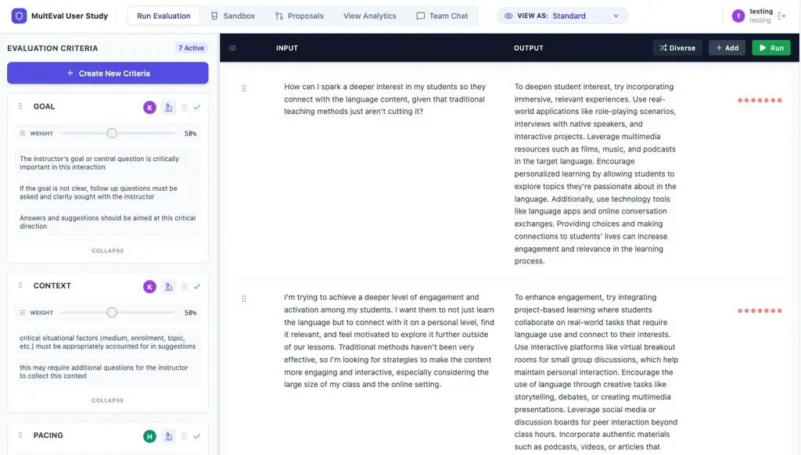
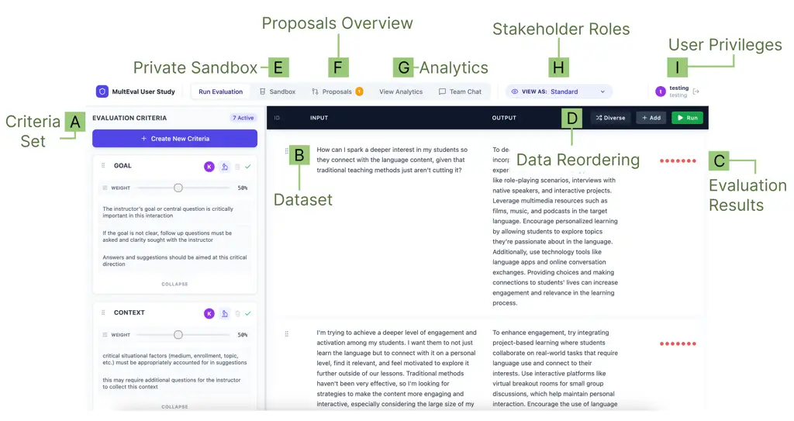
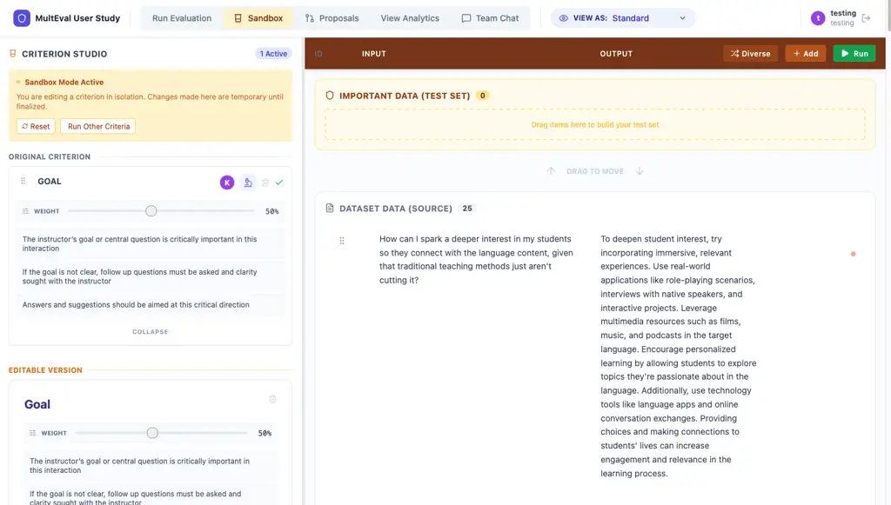
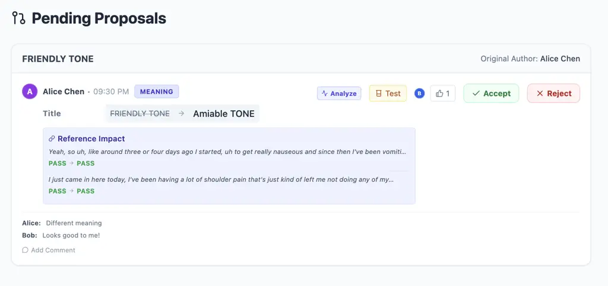
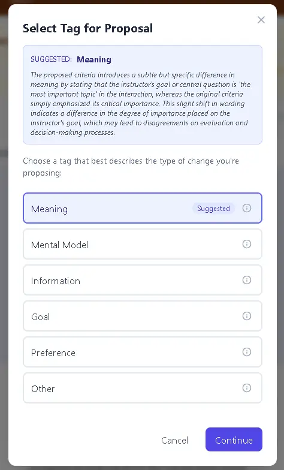
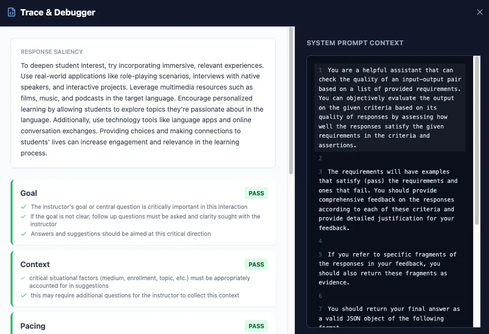
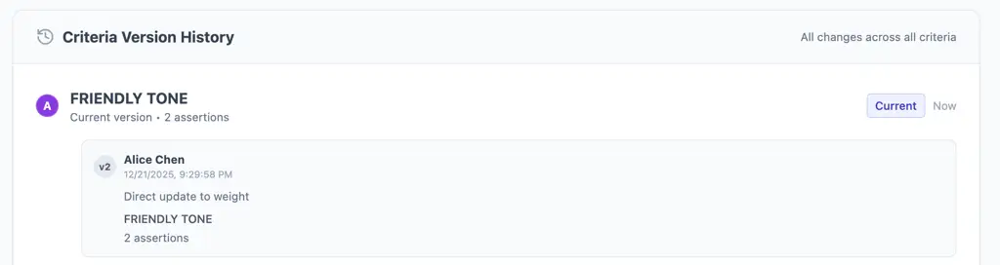

# MultEval: Supporting Collaborative Alignment for LLM-as-a-Judge Evaluation Criteria

Conference: Proceedings of the 5th Annual Symposium on Human-Computer
Interaction for Work; June 22–25, 2026; Linz, AustriaProceedings of the
5th Annual Symposium on Human-Computer Interaction for Work (CHIWORK
’26), June 22–25, 2026, Linz,
AustriaDOI: [10.1145/3808045.3808093](https://doi.org/10.1145/3808045.3808093)ISBN: 979-8-4007-2429-9/2026/06CCS: Human-centered
computing Interactive systems and toolsCCS: Human-centered
computing Interaction paradigmsCCS: Human-centered
computing Collaborative and social computing

Charles Chiang

email: <cchiang3@nd.edu> Affiliation: University of Notre Dame, Notre
Dame, IN, USA , Simret Gebreegziabher

email: <sgebreeg@nd.edu> Affiliation: University of Notre Dame, Notre
Dame, IN, USA , Annalisa Szymanski

email: <aszyman2@nd.edu> Affiliation: University of Notre Dame, Notre
Dame, IN, USA , Yukun Yang

email: <yyang35@nd.edu> Affiliation: University of Notre Dame, Notre
Dame, IN, USA , Hyo Jin Do

email: <dohyojin90@gmail.com> Affiliation: IBM Research, Yorktown
Heights, NY, USA , Zahra Ashktorab

email: <zashktorab@gmail.com> Affiliation: IBM Research, Yorktown
Heights, NY, USA , Werner Geyer

Note: This work was done in connection with IBM Research. Author is now
at Oracle. email: <werner.geyer@gmail.com> Affiliation: IBM Research,
Yorktown Heights, NY, USA , Toby Li

email: <toby.j.li@nd.edu> Affiliation: University of Notre Dame, Notre
Dame, IN, USA and Diego Gomez-Zara

email: <dgomezara@nd.edu> Affiliation: University of Notre Dame, Notre
Dame, IN, USA

© cc

###### Abstract.

LLM-as-a-judge approaches have emerged as a scalable solution for
evaluating model behaviors, yet they rely on evaluation criteria often
created by a single individual, embedding that person’s assumptions,
priorities, and interpretive lens. In practice, defining such criteria
is a collaborative and contested process involving multiple stakeholders
with different values, interpretations, and priorities—an aspect largely
unsupported by existing tools. To examine this problem in depth, we
present a formative study examining how stakeholders collaboratively
create, negotiate, and refine evaluation criteria for LLM-as-a-judge
systems. Our findings reveal challenges in human oversight, including
difficulties in establishing shared understanding, aligning values
across stakeholders with different expertise and priorities, and
translating nuanced human judgments into criteria that are interpretable
and actionable for LLM judges. Based on these insights, we developed
MultEval, a system that supports collaborative criteria by enabling
multiple evaluators to surface and diagnose disagreements using
consensus-building theory, iteratively revise criteria with attached
examples and proposal history, and maintain transparency over how
judgments are encoded into an automated evaluator. We further report a
case study in which a team of domain experts used MultEval to
collaboratively author criteria, illustrating how coordination and
collaborative consensus-making shape criteria evolution.

###### Keywords: 

LLM-as-a-Judge, Consensus-Building Theory, Human-AI Alignment

^(†)^(†)cc-license: by-nc-nd

## 1. Introduction

As Large Language Models (LLMs) are increasingly deployed across
different domains, developing robust mechanisms for oversight and
evaluation has become a central concern. LLM-as-a-judge has emerged as a
scalable alternative to human evaluation, in which LLMs themselves
evaluate model outputs according to explicitly defined criteria (Gu et
al., 2025; Zheng et al., 2023). Prior work has shown that strong
LLM-judges can achieve moderate to high agreement with human judgments
across tasks such as ranking responses and summarization scoring (Dubois
et al., 2024). However, most existing systems assume that a single
evaluator defines and refines evaluation criteria (Gebreegziabher et
al., 2025; Kim et al., 2024; Ashktorab et al., 2025; Kim et al., 2025).

Figure 1. The initial evaluation screen. Criteria and assertions are
shown on the left, while the dataset is shown on the right. At the top,
users can switch between the different tabs. When the evaluation runs,
the dots on the right-hand side turn green or red, depending on whether
the criteria pass or fail.

In practice, defining evaluation criteria is not a neutral or individual
task. Rather, it is a collaborative and socially negotiated process
involving multiple stakeholders with diverse expertise, values, and
interpretations (Parmar et al., 2010; Soltani et al., 2015). Teams must
establish shared understanding, reconcile competing interpretations, and
translate nuanced human judgments into criteria that are both
interpretable and actionable for LLM judges. Despite this, current tools
for LLM-as-a-judge workflows offer limited support for making such
disagreements visible, negotiating competing perspectives, or
coordinating consensus around evaluation criteria. This creates a
bottleneck in which perspectives remain implicit or unconsidered, and
where relevant domain expertise or stakeholder viewpoints are excluded
(Passi and Barocas, 2019; Friedman et al., 2013).

To address this gap, we first conducted a formative study to
characterize how stakeholders collaboratively create and negotiate
evaluation criteria for LLM-as-a-judge systems, identifying key
challenges in coordination, alignment, and criteria specification
practices. Based on these insights, we introduce MultEval, a system
designed to support collaborative criteria creation for such systems.
Grounded in consensus-building theory (Briggs et al., 2005), MultEval
enables multiple evaluators to propose, test, and revise evaluation
criteria while surfacing disagreements, diagnosing sources of conflict,
and preserving rationale over time.

We evaluate MultEval through a case study in which a real-world team of
domain experts collaboratively authored evaluation criteria for a
pedagogical LLM, allowing us to examine how teams coordinate, negotiate
specificity, and manage roles and authority during criteria creation.
Our findings show that collaborative criteria development involves
substantial sense-making and coordination work - such as establishing
shared vocabulary, translating nuanced judgments into executable
criteria, and negotiating decision rights - and that MultEval’s
proposal-based workflow and transparency features help make these
processes more visible and manageable.

This paper makes three contributions. First, we present a formative
qualitative study characterizing how multiple stakeholders
collaboratively create and negotiate evaluation criteria for
LLM-as-a-judge systems, revealing coordination challenges related to
value alignment, role asymmetries, and translating human judgment into
executable criteria. Second, we derive design goals for supporting
multi-stakeholder criteria creation grounded in consensus-building
theory. Third, we introduce MultEval, a multi-user web system that
operationalizes these goals by enabling evaluators to surface
disagreement, preserve rationale, and iteratively refine shared
criteria. We further report a case study illustrating how these
mechanisms shape collaborative criteria development in practice. In sum,
this paper provides a new perspective on LLM-as-a-judge workflows by
showing that evaluation criteria are not merely technical specifications
but socially negotiated artifacts shaped by multiple stakeholders. The
system and materials are available at
[https://github.com/RINGZ-Lab/MultEval](https://github.com/RINGZ-Lab/MultEval).

## 2. Related Work

### 2.1. Interactive Systems for LLM-as-a-judge

LLM-as-a-judge refers to the use of LLMs as automated evaluators that
assess other model outputs according to explicitly defined criteria or
prompts (Zheng et al., 2023; Dubois et al., 2024). This approach offers
a scalable alternative to human evaluation, with prior work showing
moderate to high agreement with human judgments. In this paradigm,
evaluation is often framed as aligning model judgments with human
preferences, where users iteratively refine criteria and prompts to
better approximate human evaluation (Shankar et al., 2024).

A growing ecosystem of computational applications has emerged to support
LLM-as-a-judge workflows. Systems such as EvalLM (Kim et al., 2024) or
Chainforge (Arawjo et al., 2024) allow users to iterate and optimize
prompts for an LLM-judge by comparing outputs. ChatEval takes a
multi-agent approach to iterating LLM judges (Chan et al., 2023). Other
systems focus more explicitly on criteria creation and refinement. For
example, Promptfoo (31), Stax (Stax, ), and Chainforge (Arawjo et al., 2024) support users in defining and testing evaluation criteria across
different models. EvaluLLM takes this a step further, allowing users to
run evaluations with different prompts and criteria metrics (Desmond et
al., 2024). Systems such as EvalGen generate criteria automatically from
a history of criterion generation (Shankar et al., 2024), while
MetricMate (Gebreegziabher et al., 2025) and EvalAssist (Ashktorab et
al., 2025) support users in the whole process of criteria generation,
iteration, and testing. Lastly, Evalet breaks the criteria down into
fragments that highlight different aspects of an output depending on its
relevance to each criterion (Kim et al., 2025). This diversity of
systems reflects the growing need to support the iterative development
of evaluation criteria (Gu et al., 2025).

However, all these systems are designed for a single evaluator. In
real-world scenarios, these criteria are often created through a
collaborative process involving multiple stakeholders with different
perspectives and expertise. As a result, different evaluators may
interpret the criteria differently and bring different perspectives and
requirements to the criteria definition, given their role. Current tools
provide limited support for making such disagreements visible or
coordinating alignment across evaluators. To address this gap, MultEval
draws on consensus-building theory (Briggs et al., 2005) to support
collaborative alignment by surfacing disagreements and enabling
structured negotiation of evaluation criteria among stakeholders.

### 2.2. Designing Systems for User Agreement

While working in a diverse team can increase creativity and performance,
it can also introduce disagreements over priorities and interpretations
(Gómez-Zará et al., 2020; Jehn et al., 1999). Prior work has examined
how interfaces can surface disagreement and support convergence,
particularly in civic and political contexts. For example, systems that
present news to politically diverse audiences study how to expose users
to differing viewpoints without immediately triggering disengagement
(Graells-Garrido et al., 2016; Munson and Resnick, 2010). Related work
also considers large-scale deliberation platforms that let participants
collectively propose and vote on policy ideas (e.g., pol.is and vTaiwan)
(Hsiao et al., 2018). One effective mechanism shown is introducing
“intermediary” topics that can connect polarized groups (Graells-Garrido
et al., 2016). Beyond content, collaborative sequencing highlights how
the ordering of contributions can shape group convergence over time (Kim
et al., 2021).

Process-oriented perspectives on consensus building further emphasize
that agreement is often achieved through structured cycles of proposal,
critique, and refinement. For instance, Briggs et al. (2005) describes a
process model of consensus building that characterizes the activities
groups undertake when moving from divergent to convergent positions. The
Delphi method similarly structures convergence through repeated rounds
of elicitation and feedback. Participants answer the same question,
review aggregated responses, and revise their answers across rounds
until responses stabilize (Wilson et al., 2024). While effective in
expert settings, Delphi-style workflows can be costly due to repeated,
coordinated rounds of participation (Wilson et al., 2024).

Similar approaches appear in collaborative analytics work. For example,
CollabCoder supports qualitative coding, in which multiple analysts
independently label data and then discuss discrepancies to reach a
codebook (Gao et al., 2024). Similar to criteria iteration for LLM
evaluation, qualitative codes evolve through discussion and negotiation,
and tools can support convergence by making differences visible and
helping teams reconcile diverse interpretations (Gao et al., 2024).

These studies show that agreement is not simply about aggregating votes,
but about supporting cycles of independent reflection, disagreements,
and convergence on shared artifacts. However, prior deliberation and
consensus systems are not tailored to LLM evaluation, where teams must
translate discussion into executable, testable criteria. To address this
gap, MultEval scaffolds a structured proposal-and-review loop around
criteria edits, pairs deliberation with concrete evidence (e.g.,
representative data points and changed evaluation outcomes), and helps
teams diagnose disagreement to support more efficient convergence.

### 2.3. Multi-stakeholder Human-AI Alignment

A central challenge in human-AI alignment is deciding whose preferences
and values should be reflected in the aligned system (Gabriel, 2020;
Zhi-Xuan et al., 2025). While many alignment workflows assume a
one-to-one relationship between a user and an AI system, emerging work
emphasizes settings in which alignment must account for interactions
among multiple humans and AI agents. For example, jury learning explores
how to learn from panels of annotators and how to surface and manage
disagreement (Gordon et al., 2022). Similarly, collective approaches
explore how groups can author and iteratively refine shared principles
that guide model behavior (Huang et al., 2024).

This shift toward multi-stakeholder alignment also motivates the design
of interactive systems that support the articulation, inspection, and
negotiation of alignment targets. Work on interactive AI alignment
characterizes this paradigm and highlights key challenges, including
making trade-offs legible, supporting iteration, and handling
conflicting preferences (Terry et al., 2024). In the context of
LLM-as-a-judge, incorporating domain experts is critical for producing
criteria that reflect real task requirements, as experts and lay users
may propose meaningfully different criteria (Szymanski et al., 2024).

More broadly, alignment has also been conceptualized as the calibration
of model behavior to shared values and normative principles.
Constitutional AI operationalizes this idea by training models to follow
an explicit set of normative rules (Bai et al., 2022), and subsequent
work has explored broadening these principles through collective input
(Huang et al., 2024). These approaches highlight a growing interest in
multi-stakeholder alignment, where model behavior is shaped by inputs
from multiple collaborators (Lam et al., 2025; Feng et al., 2026).

However, much of this work focuses on aggregating or encoding
preferences, with less emphasis on how stakeholders collaboratively
articulate, negotiate, and refine alignment targets in practice. Tools
that support interaction, interpretation, and coordination play a key
role in enabling collaborative alignment by helping stakeholders make
sense of model outputs and reconcile differing interpretations (Gero et
al., 2024). MultEval addresses this gap by supporting both human–human
alignment and human–AI alignment within a shared workflow for
collaborative criteria creation.

## 3. Formative Study

Grounded in our literature review, we conducted a formative qualitative
study using semi-structured interviews with 10 participants who had
experience working on LLM-based systems and participating in LLM
evaluation efforts. The goal of this study was to understand how
different teams create evaluation criteria, with particular attention to
how individuals in different roles contribute to, coordinate around, and
make decisions during the evaluation process. These insights inform the
design of tools and workflows to better support LLM evaluation across
stakeholders.

Interviews lasted approximately one hour and followed a semi-structured
protocol. Prior to the interview, participants completed a short
pre-study survey collecting demographic information and background
experience. During the interviews, participants were asked to describe
their role in LLM evaluation, how they interacted with other
stakeholders (e.g., developers, domain experts, end users), and how
evaluation activities were conducted over time. Interview questions
probed topics such as coordination across roles, iteration practices,
communication strategies, conflicts or breakdowns in the evaluation
process, and how requirements from different stakeholders were managed.
This study protocol was approved by the University of Notre Dame’s
Institutional Review Board (IRB).

### 3.1. Participants

Participants were recruited through a combination of social media and
professional networks (i.e., LinkedIn, Slack), word of mouth, and the
authors’ institution newsletters. Recruitment material asked for
participants with experience working on a team to evaluate LLM outputs,
and we pre-screened participants to ensure they had sufficient
experience collaborating with others in evaluation contexts and to
capture a diverse set of participant roles and perspectives.

The final sample included 10 participants, with four from industry and
six from academia. Participants occupied a range of roles spanning both
technical and knowledge-based responsibilities in LLM evaluation,
including frontend and backend developers, pedagogy domain experts, and
hybrid roles combining development and domain expertise. Technical
participants were primarily involved in modeling and training LLMs,
testing and quality assurance, and end-user testing. Domain experts
contributed through evaluation criteria development, design feedback,
testing, and data provisioning. Several participants held multiple roles
within their teams, reflecting the interdisciplinary and collaborative
nature of LLM evaluation work. Five participants were recruited from the
same project, where they worked as domain-knowledge evaluators for a
pedagogical chatbot. Additional details are provided in Table 1.

In describing participant roles, we distinguish between developers and
domain experts. Developers are primarily responsible for building and
modifying the underlying LLM system, including model development,
prompting, and evaluation infrastructure. Domain experts contribute
task-specific knowledge and are typically responsible for defining,
interpreting, and assessing evaluation criteria. During interviews,
participants often referred to these roles when describing
collaboration, including their interactions with counterparts across
technical and domain boundaries. While some participants occupied hybrid
roles, this distinction helps characterize recurring patterns in how
responsibilities and decision-making were distributed across teams.

### 3.2. Qualitative Analysis

All interviews were conducted and recorded via Zoom and transcribed
using online transcription tools. We analyzed the interview transcripts
using thematic analysis (Braun and Clarke, 2006). Three researchers
independently reviewed the transcripts, first engaging in close reading
to familiarize themselves with the data and recording notes. Each
researcher then generated initial codes to capture recurring patterns
and ideas across the dataset. The research team met to discuss and
reconcile these codes, after which the codes were iteratively grouped
into candidate themes. These themes were reviewed, refined, and
synthesized into higher-level key insights.

### 3.3. Key Insights

#### 3.3.1. KI1: Collaborative criteria generation highlights divisions

We found that developers and domain experts often work closely together
in interdisciplinary teams. While developers drive system development,
domain experts are called upon to evaluate the system’s outputs and
progress. Even though evaluation is a critical and time-consuming
iterative process, domain expert participation is often limited (Shankar
et al., 2024). Domain experts were not always involved in day-to-day
progress, as many developers stated they needed time to develop the
system to a satisfactory state before calling on the domain experts for
evaluation. Additionally, domain experts may need technical guidance to
understand how to contribute meaningfully. P4 stated, “Because most of
it, when it’s technical, it’s, like, over my head … not always extremely
interesting in those meetings.” However, developers can be reluctant to
take time to do this: “…they just don’t really like the process” (P1).
This gap in technical expertise can lead to suboptimal evaluations,
placing an additional burden on developers. P2 described their work as
“converting \[domain knowledge\] to technical expertise” - since
“business people always are proposing different solutions as well, but
technically, those weren’t feasible or effective.”

#### 3.3.2. KI2: Criteria inclusion depends on a hierarchical decision making process.

Across industry and academia, teams had well-defined hierarchies that
dictated who was responsible for final decisions. While no single
stakeholder was consistently dominant, a dominant stakeholder typically
held the final say over the implementation of the criteria. For example,
P1 described a scenario in which given requirements were not
implemented, saying “they just picked some that they think the LLM could
correctly do, and then they used it, and then definitely that’s not
capturing all the experience.” This structure reflects a division of
roles in which domain experts contribute requirements, but developers or
project leads ultimately determine which criteria are implemented. While
such hierarchies can streamline decision-making, they may also limit the
integration of diverse perspectives, leading to criteria that do not
fully capture stakeholders’ expertise or account for uncertainties in AI
outputs (Subramonyam et al., 2022). To produce more robust and
representative criteria, domain experts need to be meaningfully
integrated into the decision-making process rather than consulted only
at specific stages. In this sense, an explicitly defined decision-making
structure can still support co-creation while allowing teams to converge
on final criteria.

#### 3.3.3. KI3: Current workflows insufficiently support meaningful collaboration among domain experts

In our interviews, domain experts expressed a desire to consult with
others to discuss the best way to handle specific topics or niche
situations, something that was not always supported in existing
workflows. For example, P10 stated “I think that I would want to do it
(evaluation) with a group”, while P6 emphasized the importance of their
ability to say, “Let me go ask my colleagues.”

Though our participants emphasized the collaborative nature of knowledge
work, they also identified some challenges in existing workflows. For
example, though P10 wanted to work in a group, they also mentioned
wanting “a little bit more time for like self-reflection first”, similar
to P9’s request for “more time to process” before talking to the group.
Due to potential unfamiliarity with LLM-as-a-judge systems or criteria
creation, domain experts may not be immediately ready to jump into a
collaborative discussion, and conversations that occur too early in the
familiarization process may lead to bias formation.

Therefore, criteria-creation workflows should account for collaboration
among domain experts. This can ensure that criteria are more rigorous
and reduce the burden of criteria drift. In addition, encouraging
collaboration can also mitigate the effect of personal differences in
criteria, as personal background and experience influence how criteria
are expressed (Gebreegziabher et al., 2025). Ensuring that human
oversight comes from diverse sources is crucial to creating an equitable
LLM judge.

#### 3.3.4. KI4: Human-AI alignment is constrained by development experts

While recent studies in LLM-as-a-judge assume a single user interacting
with an AI system, our findings show that criteria creation in practice
involves interdependent roles across multiple stakeholders (Terry et
al., 2024; Gu et al., 2025). This process splits goal articulation and
output assessment across different roles. On one hand, domain experts
evaluate responses from an LLM judge but may lack the technical
expertise to directly steer or manipulate the system’s LLM. On the other
hand, developers can interact with the LLM but require requirements
derived from domain experts.

As a result, alignment is not solely a human-AI problem, but a
human-human-AI alignment problem, in which stakeholders must first align
with each other before effectively aligning the system. Misalignment
between stakeholders can lead to incomplete or distorted criteria, even
when each individual perspective is valid.

One team we interviewed used the “show-and-tell” method, in which domain
experts demonstrated the appropriate behavior, often paired with an
incorrect judgment or response in the evaluation data. For example, in
evaluating a chatbot, a domain expert may review an incorrect response
and correct it, producing a correct response for the same input data.
This information is then given to developers as a pair of positive and
negative examples, which the LLM-judge should be trained to distinguish
between. However, this process places the burden on developers to
interpret implicit requirements and translate them into executable
criteria, often without direct access to the underlying rationale.

### 3.4. Design Goals

Based on the insights from the formative study, we derive the following
design goals:

1.  (1)
    DG1: Support multiple stakeholders’ alignment of criteria to more
    holistically facilitate the domain human-human-AI alignment process
    (Sections 3.3.1, 3.3.4)
2.  (2)
    DG2: Support an asynchronous co-creation workflow that enables broad
    participation in criteria development, while still accommodating
    hierarchical decision making for final decisions (Section 3.3.2)
3.  (3)
    DG3: Highlight and help users understand nuanced criteria and
    confidence levels, to avoid oversimplification of criteria
    requirements (Section 3.3.3)

## 4. The MultEval System

We implemented MultEval, a multi-user web-based system that enables
different stakeholders to define, iterate on, and build collective LLM
evaluation criteria for the LLM-as-a-judge framework (Gu et al., 2025).
We draw upon Briggs’ Consensus Building Theory (CBT) (Briggs et al.,
2005), which frames consensus building as a cyclical process:
articulating a proposal, evaluating commitment, discovering and
diagnosing conflicts, and resolving disagreements through discussion,
potentially leading to revised proposals. CBT allows us to directly
address DG1 in supporting the consensus creation process, and provides
the theoretical framework around which we build our system in order to
support DG2 and DG3. In our context, proposals correspond to criteria or
criterion revisions, and disagreements may arise during their
evaluation. CBT identifies several types of disagreement, which we adapt
to the criteria-iteration process:

- •
  Differences of Meaning: ambiguity in the wording of criteria,
- •
  Differences of Mental Model: differing expectations of how criteria
  operate,
- •
  Differences of Information: an imbalance of information or knowledge,
  such as data and expertise, between evaluators,
- •
  Differences of Goals: disagreement over desired outcomes, and
- •
  Differences of Taste: differing value priorities.

Figure 2. Overview of the MultEval System: A) The global criteria set,
showing assertions, authorship, and criteria weight. B) The project’s
dataset, with input and output pairs. C) The results of the evaluation -
red circles mean a failed criterion, while green means a pass. D) The
option to reorder the dataset to show a diverse subset of data first.
This feature helps surface disagreements faster. E) The private sandbox,
where evaluators can test and author new criteria or propose changes to
criteria. F) The proposal tab, showing active proposals as well as
support from other evaluators and context to inform the changes. G) The
analytics tab, where evaluators can see how criteria have changed
throughout the process, as well as an overview of the contribution. H) A
lightweight stakeholder-role swap, allowing users to quickly sample
evaluation through a different lens. I) The user within the project has
specific roles according to their background and expertise
contribution - this gives additional context to authorship. Privileged
‘admin’ users have final say on criteria inclusion.Overview of the
\toolname{} System

A key step in consensus building is proposal evaluation. Here, MultEval
applies criteria to data, producing outputs that serve as a shared
evaluation artifact. When criteria are easily operationalized,
disagreements about how they should be applied are resolved through
execution; remaining conflicts instead reflect differing expectations
for how the LLM-judge should interpret the criteria.

### 4.1. Example Scenario

Alice, Bob, and Charlie are the developer, domain expert, and project
manager, respectively, of a new LLM-as-a-judge system. They decide to
use MultEval to help them create the system’s criteria. Charlie creates
a project, naming it and uploading their dataset. Charlie adds Alice and
Bob as evaluators, keeping admin privilege for themselves. In their
initial meeting, the team has developed a basic set of criteria, which
Charlie inputs into MultEval. Now, on their own time, Alice and Bob can
explore the criteria set.

Alice sees criteria alongside the dataset and evaluation results (Figs.
2, 6). Scrolling through, Alice sees a criterion that has interesting
wording. She selects it, taking her to her private testing sandbox (Fig.
3). Here, Alice further tests the criterion, noticing some data points
that exhibit unintended behavior. She changes some words in the criteria
and retests. Satisfied, Alice attaches the data point to the proposed
change and submits the proposal for review.

Bob sees Alice’s proposal and takes it to the sandbox dashboard for
testing. He is not entirely confident about the specific wording that
Alice uses, so Bob highlights a section of the proposed criteria.
MultEval suggests a couple of different variations. Bob selects one of
the variations and, testing the changes, he creates a new data point to
highlight the difference. After some tweaking, Bob is satisfied with the
changes and submits the proposal. Continuing to review other proposals,
he shows support for some proposals by adding his vote. Later, Charlie
reviews the proposals, starting with the ones that were voted on, and
accepts or rejects them as he sees fit (Fig. 4). Over time, the criteria
evolve as the team creates, reviews, and accepts proposals until they
eventually converge.

### 4.2. Key Features

Figure 3. Private Sandbox. Users see the original criteria alongside an
editable version on the left side panel. Users can additionally add data
to a ’test set’ or attach it to the criteria as context.

#### 4.2.1. Criteria Proposal Loop

The application of CBT requires that MultEval makes disagreements
explicit and actionable within the criteria development process. In
MultEval, this involves surfacing differences not only between
evaluators and the LLM judge, but also among evaluators themselves,
while providing a private space for exploring and refining criteria. We
implemented this as a private sandbox for individual evaluators to
iterate on criteria, as seen in Fig. 3. Especially for evaluators
without a technical background, creating a private space for exploration
may help them become more familiar with the evaluation process. The
sandbox also features a toggle that enables the remaining criteria,
allowing users to check for any potential conflicts. Similarly, users
must be able to propose modifications to criteria, along with some
context for the change, as in Git or other version control systems (Fig.
4). However, this context goes beyond a simple description of the change
and its rationale. Since criteria are meant to dictate the LLM-judge’s
behavior, the context should include some measure of how the LLM judge’s
behavior has changed. For example, some data on which the change to the
criteria has altered the result of the judgment. This feature supports
DG2 and DG3, allowing evaluators to understand the nuances within the
evaluation of criteria at their own pace.

#### 4.2.2. Supporting Disagreement Diagnosis

When it comes to disagreements about criteria, surfacing which type of
disagreement is the first step towards resolving the conflict. MultEval
employs strategies to help users identify and classify disagreements. By
determining which type of feature the user explored in their criteria
iteration, MultEval can implicitly infer what the type of disagreement
is. One such feature is the support for exploring different versions of
highlighted sections of criteria. This allows users to iterate more
quickly and suggests that the disagreement with the original criteria
was related to meaning or goal. Similarly, by allowing users to attach
data and author data, the system infers that the user may disagree with
the information or have a mental model, respectively (Fig. 5). When
users view proposals, they can ‘like’ or ‘dislike’ them to show their
support.

Figure 4. A proposal as seen by a user with administrative privileges.
Admin users can accept or reject proposals. Non-admin users can only
vote and comment on proposals.

#### 4.2.3. Surfacing Disagreement Through Data Curation

Criteria iteration is a time-consuming process, partly because
evaluators must review a large amount of data to ensure the quality of
their judgments. Many data points in a dataset may be similar, forcing
evaluators to filter through large quantities of data to find
interesting results. To address this, MultEval implements an algorithm
that identifies the most critical data that may result in disagreements.
We first compute a fixed-length embedding using OpenAI’s
text-embedding-3-small model, then sorting using a greedy
farthest-neighbors algorithm with cosine similarity. This ensures
evaluators see structurally or semantically different examples rather
than near-duplicate data, increasing the likelihood that differing
interpretations of data appear earlier. In addition, once interesting
data have been identified, MultEval allows users to select relevant data
points and designate them as representative data. These data points are
grouped and always tested, allowing users to see how their changes to
the criteria affect specific, important data.

#### 4.2.4. Role-Cognizant Analysis

To support transparency and reflection in the development of
multi-stakeholder criteria, we implemented a version-control feature for
evaluation criteria that explicitly surfaces contributors’ roles and
expertise over time (Fig. 7). The system visualizes each criterion as a
chronological timeline, beginning from its initial creation and
progressing through successive versions to its current or finalized
form. Each revision is annotated with metadata indicating the author’s
role, enabling users to contextualize changes through a lens of
expertise and responsibility. By visualizing role-aware iterations, the
timeline allows teams to identify where and how evaluators with
different roles diverge in their judgments, priorities, or
interpretations of quality. In addition, to encourage collaboration in
criteria evaluation, MultEval offers lightweight stakeholder personas,
based on the evaluator roles defined in the project. These personas take
on different evaluator roles and background information, prompting the
LLM-judge to adopt a similar persona in their evaluation. This feature
aims to enable stakeholders to incorporate other perspectives at a low
cost and with minimal time commitment. This feature was designed not as
a replacement for real evaluators, but as a reminder for users to
consult real evaluators.

Figure 5. The system diagnoses the type of disagreement between the
initial version of the criteria and the proposal. If the user disagrees
with the rationale, they can select a different tag. Each tag shows a
definition of its type of disagreement when the information icon is
hovered over.

### 4.3. Implementation Details

MultEval was created using a Node.js¹¹ 1
[https://nodejs.org/en](https://nodejs.org/en) backend and React²² 2
[http://react.dev/](http://react.dev/) frontend. For the case study, the
system was deployed online, using Firebase³³ 3
[https://firebase.google.com/](https://firebase.google.com/).
Specifically, the database and hosting were done using Firebase
Firestore and Firebase Cloud Functions. For the LLM functions, we used
OpenAI’s GPT-5⁴⁴ 4 [https://openai.com/](https://openai.com/). Prompts
can be found in the Appendix A.

## 5. Case Study

To evaluate our system, we recruited a real-world team of four pedagogy
experts who had prior experience collaboratively evaluating a teaching
assistant chatbot, and observed their interactions with MultEval. The
study lasted 1.5 hours and was conducted online. During the study, the
team of experts was introduced to the MultEval system and asked to
complete a criteria creation task in the pedagogy domain. The study
concluded with a semi-structured focus group-style interview.

### 5.1. Participants

We recruited a team of four pedagogical experts affiliated with the
University of Notre Dame, a U.S. higher education institution. This team
was identified due to their previous work, and invited via targeted
email outreach based on its members’ expertise in pedagogy,
instructional design, and educational evaluation. All team members
provided informed consent prior to participation and were compensated
\$80. The study was approved by the University of Notre Dame’s IRB.

The team had prior experience evaluating pedagogical chatbots in
research settings. In that context, its team members collaboratively
developed evaluation criteria and applied them to assess model outputs,
gaining hands-on experience articulating quality dimensions for
educational dialogue systems. We intentionally recruited this team to
ensure they were comfortable both setting evaluation criteria and
critiquing LLM-generated responses. All the team members held doctoral
degrees and reported substantial professional experience (7–14+ years).
The team had complementary perspectives spanning faculty development and
instructional consulting, academic standards and assessment, writing
pedagogy and the use of generative AI in instruction, alternative
assessment methodologies, and equity-minded pedagogy. All reported prior
use of LLMs in their professional workflows (e.g., teaching, research,
instructional planning, and analytical reasoning).

### 5.2. Procedure

The team joined a Zoom meeting where they were introduced to the
researchers and the study. All team members were asked to give brief
introductions to one another. Participants were then introduced to the
task and the dataset and given 10 minutes to individually create an
initial set of criteria in a text editor. They were given a dataset of
input/output pairs of instructor-related questions and responses to
familiarize themselves with the data. Afterwards, the team was given a
brief walkthrough of the MultEval system, and then had 30 minutes to use
MultEval and collaboratively create criteria. During this time, team
members were free to discuss during the Zoom call and had access to
their initial criteria document. After the time elapsed, the researchers
asked team members a series of questions in a semi-structured focus
group interview format for 30 minutes.

### 5.3. Dataset

Because the studied team had pedagogical experts in academia, we asked
them to review model outputs responding to instructor-authored
pedagogical questions. The scenarios consisted of questions an
instructor might pose to a pedagogy expert when reflecting on their
teaching practice, such as how to approach instructional decisions,
interpret student understanding, or respond to classroom challenges.

We used a set of previously developed pedagogical conversation questions
and generated a new dataset of 26 single-turn model responses using
OpenAI’s GPT-4o model. Each response was generated using a
teaching-assistant prompt that framed the model as a pedagogy-focused
advisor, tasked with providing concise, expert-oriented guidance to
instructors, as shown in Appendix A.3. These outputs were intended to
approximate a baseline pedagogical consultation LLM chatbot.

### 5.4. Qualitative Analysis

We analyzed the focus group data using a collaborative thematic analysis
approach (Braun and Clarke, 2006). First, the focus group session was
transcribed to capture both the discussion during use of the tool and
the interview questions. Three of the authors then collectively reviewed
the transcripts and imported relevant excerpts into a shared Miro ⁵⁵ 5
[https://miro.com/](https://miro.com/) board. Using standard open coding
procedures (Williams and Moser, 2019), the authors read the excerpts and
grouped segments that reflected similar ideas, experiences, or concerns.
Through a series of iterative discussions, these groupings were refined,
merged, or split as needed, resulting in higher-level themes. This
process occurred over multiple rounds, with themes and labels evolving
as the team revisited the data and negotiated shared interpretations.
Any disagreements between coders were resolved through discussion until
a unanimous agreement was reached. The final set of themes reflects
consensus across the research team and captures recurring patterns
observed across focus groups. We identified five themes, which we
discuss in the next section.

## 6. Evaluation of Automated Coding

To assess whether MultEval’s LLM annotator pipeline could reliably apply
the proposed taxonomy of expert disagreement, we conducted a validation
study on a corpus of criterion-change proposals.

##### Reference Dataset.

We constructed a corpus of 40 criterion-change proposals drawn from a
patient-intake chatbot domain. These proposals were generated using
OpenAI’s gpt-5 in a four-stage process. We began by defining the task as
creating criteria for a baseline mental health consultation LLM chatbot.
For each criterion, we generated a proposed alternative. Then, we
randomly selected 10 criterion-change proposals and generated the
reasoning behind the proposal. We repeated this step to generate the
illustrative examples as well. In total, each proposal comprised an
original criterion and a proposed alternative, with optional fields for
the proposer’s reasoning and an illustrative example.

Two members of the research team independently coded each proposal
across the five dimensions of the taxonomy. Initial inter-coder
agreement, measured with Krippendorff’s $`\alpha`$ at the nominal level,
varied substantially across categories: Meaning ($`\alpha=0.48`$), Goals
($`\alpha=0.41`$), Mental Models ($`\alpha=0.07`$), Information
($`\alpha=0.05`$), and Taste ($`\alpha=-0.09`$). The coders then
convened to adjudicate disagreements, discussing each divergent case
until reaching consensus. This process yielded the consensus labels used
as ground truth and informed iterative refinements to the codebook,
including clarifications to category definitions and the addition of
worked examples illustrating boundary cases.

##### Automated Annotation.

Automated annotation was performed with OpenAI’s gpt-5.4-mini. To
isolate the contribution of different prompt components, we conducted an
ablation study with three conditions. The baseline condition presented
the LLM with only the category names and the observation. The
definitions-only condition added the full codebook definitions for each
category. Lastly, the full-prompt condition further added worked
examples illustrating positive, boundary, and cross-category cases. In
all conditions, the LLM produced binary classifications and short
justifications for each of the five categories.

##### Reliability Analysis.

Agreement between the automated annotations and the consensus ground
truth was assessed using Krippendorff’s $`\alpha`$ at the nominal level,
computed independently for each category and each ablation condition.
The full-prompt condition yielded the highest agreement on four of the
five categories, indicating that worked examples contributed
meaningfully to the LLM’s calibration beyond what definitions alone
provided, even though the Differences of Meaning category decreased.
Agreement varied substantially across categories, ranging from
$`\alpha=0.605`$ for Differences of Information to $`\alpha=0.225`$ for
Differences of Meaning. More details are reported in Appendix C.

We interpret these results as a positive validation of MultEval’s
annotation pipeline. The improvement from baseline to the
definitions-only condition, and the further gains from adding worked
examples, indicate that the codebook’s structure and worked examples
function as intended in guiding the model toward category-aligned
classifications. The pattern across categories was consistent between
the LLM annotator and human coders. The categories requiring more
interpretive judgment showed lower agreement across both rater types.
This consistency suggests that the pipeline tracks the analytical
structure of the taxonomy rather than introducing model-specific
artifacts, providing users with a concrete starting point for
deliberation.

## 7. Results

### 7.1. Starting with Common Ground and Organization

Before using MultEval, the team established shared ground by pooling
initial criteria and aligning on vocabulary. This early alignment
appeared to reduce later friction during criteria authoring. This
behavior aligns with the notion of establishing common ground within the
team (Clark and Brennan, 1991). After participants spent a few minutes
creating their own initial set of criteria, they were tasked with
consolidating them into a unified set. When the group-criteria session
began, participants immediately suggested consolidating their criteria
sets, expecting to find overlap. P3 stated, “I do wonder if a starting
place…to actually go back to each of our individual criteria, just sort
of read through as a group what each of us put down, to get a sense of
how we’re all thinking about these criteria…?”. This interaction was
enabled by the session’s synchronous nature, which allowed participants
to talk to each other and coordinate. For instance, P3 mentioned that it
was “hugely important just for grounding and understanding and thinking
about next steps.”.

Although the team had access to MultEval from the beginning, they
decided to first discuss their initial criteria for 10 minutes. During
this time, participants also agreed on establishing a shared vocabulary
to guide their discussion: “I just think it would be really helpful for
us to have a common vocabulary as we discuss.” (P3). Despite these
conversations outside of the system, this initial organization enabled
the team to use MultEval more efficiently. P4 reported, “…because of the
way that we initially set up our work … we had a plan, we were
organized… I think that organization really, really made our work more
efficient in the tool” (P4). This also saved the administrator (P4) time
on reviewing initial criteria since duplicates were removed: “…once
somebody submitted a proposal, I just accepted it. There was no review
that was necessary at that point” (P4).

### 7.2. Struggle with Specificity

Participants struggled to determine the appropriate level of detail and
specificity when formulating criteria, often treating specificity as a
primary lever for improving the judge’s behavior. Beyond establishing a
shared vocabulary, word choice remained a recurring challenge, as
participants attempted to translate a high-level intent—what they wanted
the judge to reward or penalize—into text they expected MultEval to
apply consistently. For example, P3 noted uncertainty about phrasing: “I
don’t know if that is the word that is capturing what I’m trying to
suggest there”. Similarly, P2 emphasized a desire for criteria that
provided stronger guidance by spelling out expectations more concretely,
including through examples: “Yeah, I think we all liked the idea of
specific or concrete examples… but I wanted more… I wanted to kind of
spell it out for me even more.”

This struggle reflects a broader sense-making problem in criteria
authoring, wherein teams must determine whether evaluation failures are
attributable to ambiguous language, missing constraints, or genuine
differences in interpretation. In practice, this often meant negotiating
what level of detail would be “specific enough” without becoming overly
narrow. While participants did not escalate this into overt disagreement
during the session, their comments suggest a latent trade-off between
flexible writing criteria that span contexts and precise criteria that
reduce divergent interpretations.

Participants also reflected on how the formatting of the criteria shaped
their interpretation of the overall criteria set. For instance, P3
asked, “Do I need to be phrasing this in a certain way?” This question
highlights that, beyond the content of the criteria, participants were
uncertain about the conventions for encoding them for an LLM judge. For
example, they questioned how strongly to phrase requirements, whether to
include examples, and how to structure the text. Because the study was
time-limited, the team did not systematically test how such formatting
choices affected MultEval’s evaluations. Nevertheless, some team members
expressed skepticism that minor wording changes would meaningfully
affect the tool’s behavior. As P4 declared: “I suspect that it doesn’t
even make a difference for the actual application of the tool.”,
pointing to a need for tool support that makes the relationship between
the criteria formulation and evaluation outcomes more transparent.

### 7.3. Multiple Perspectives and Group Work

Participants emphasized that criteria creation benefits from
incorporating multiple perspectives, particularly different forms of
expertise. For example, P1 argued for grounding criteria in shared
evidence rather than individual judgment: “I’d appeal to the literature
and the evidence, and so it’s not just grounded in, you know, someone’s
personal experience”  (P1).

Although all participants were experts in the task domain, they still
recognized limitations in relying on a single perspective, suggesting
that additional viewpoints could help capture nuances even within the
same domain. P3 suggested support for “different personas… \[to\]
capture maybe some of those discipline-specific contexts… and filter the
results.”. This highlights a perceived need to extend beyond a single
expert perspective, even within a domain-aligned group.

Participants also described collaboration as beneficial for both
efficiency and ideation. They noted that working together was
substantially faster than if they had been working individually (“…it
just would have taken much, much longer \[individually\]” (P3)) and
enabled a broader set of criteria (“…instead of 7 criteria that we all
came up with together, you’d have probably had two or three…” (P1)). An
additional benefit was the ability to specialize. As P1 noted, “in a
group … we’re all contributing from our different areas of expertise and
playing to our different strengths and capacities”, which supported both
faster progress and more in-depth analysis.

There were a few disagreements in the group. Some participants raised
minor concerns about the formatting of particular criteria. However,
participants generally reached agreement quickly during the session. For
example, one small disagreement centered on naming conventions: “What is
the goal of what the naming of the criteria should do? Is it supposed to
be descriptive and be able to communicate to the system, or is it
necessarily about uniformity, and how do we balance those?” (P1). This
was largely resolved through discussion, and the group ultimately
decided not to pursue it further because they believed it would have
little impact on the final output of the criteria set.

Participants noted that they would have been more likely to disagree if
the criteria produced unintended behavior or conflicted with their
personal experience. For example, P2 remarked that they would have
argued more strongly for a criterion tied to their own experience (“the
suggestion I made about making sure it’s answering the right question …
I feel like I would have been more confident in arguing for it… because
it was something that I had personal experience with” (P2)). Similarly,
P3 suggested they would object if a proposed criterion was “deeply
against my own pedagogical philosophy” (P3). In these cases,
participants emphasized that resolving disagreements may require
surfacing the rationale behind strongly held beliefs rather than
appealing to authority; as P4 reflected, “…it may just come down to…
damn it, just trust me on this, which is not a good argument… kind of
the why am I believing this and believing it so strongly?”

### 7.4. Negotiating Roles and Hierarchy

The team members initially resisted hierarchy. At the beginning of the
study, participants were asked, as a group, whether they would designate
a single teammate as an administrator. As coordination costs became more
salient, they converged on an admin role. However, the role’s authority
remained contested. The admin had the privilege to accept and reject
proposals and delete criteria. The group was initially hesitant to
designate an administrator: “we’re all equal” (P4). However, some
participants wished to designate P4 “I was going to nominate you,
\[P4\].” (P3).

Later, shortly after the criteria creation session began, a few
participants nominated P4 again: “I feel like I like the administrator
idea more than I thought I did 10 minutes ago” (P2). The participants
eventually agreed that P4 would take on the administrator role. The
reason P4 was chosen was partially due to some participants having
worked with them prior (“I’ve worked with \[P4\] a lot, so I know his
strengths in note-taking and organization” (P1)), but also for P4’s
apparent familiarity with the task domain: “it seemed like P4 had a
clear direction.” (P2).

After the session, participants reflected further on why they did not
want to take the admin role, attributing it to uncertainty about the
task and the pressure of the role. For example, P2 said “I think mine
stemmed from uncertainty…I did not want to be the administrator because
I was nervous about not fully grasping what we were doing, and so I was
like, let’s just all throw our hats in the ring and see what emerges.”
Overall, participants’ reluctance to take on the role suggests that
administrative authority can feel high-stakes when the task and decision
boundaries are not yet well defined.

In this case study, assigning an administrator did not fully resolve
questions of authority. Instead, it revealed a mismatch in expectations
about the role. Some participants framed the administrator as a
decision-maker who would determine which criteria were included in the
final set, which aligns with MultEval’s permission model. In contrast,
P4 described the role as primarily (“just a logistical administrative
role, not … the final arbiter of decisions.”) This suggests that
adopting lightweight hierarchies may help reduce coordination overhead,
but teams may still benefit from mechanisms that make accountability
explicit (e.g., who can accept changes, who can veto, and how
disagreements are resolved).

### 7.5. Making Sense of the Interface

Overall, participants described MultEval as easy to learn and navigate,
noting that the workflow felt intuitive once they understood the basic
proposal loop (e.g., testing in the sandbox, submitting proposals, and
reviewing changes). For instance, P3 declared that “I think the
interface was pretty clear… I like the way it sort of helped you work
through the workflow.”. While we did not administer a standardized
usability instrument, participants raised minor usability concerns in
the post-task discussion, such as inconsistent behavior of text input
fields (e.g., when edits were saved or reflected across views). As P4
noted, “Once I figured it out, it’s not a big deal.”

Additionally, P1 reported some difficulty understanding how certain
features worked, particularly leaving comments on proposals: “I just
wasn’t sure if those comments would be… how would those comments work?
Are they connected to the system and the information that we’re giving
it, or is it just for, like, people on the team to see, oh here’s how
\[P1\] was thinking” (P1). Beyond confusion about how features
interfaced with the system, the feature set and terminology could be
cognitively demanding: “that was a little bit confusing, and just the
language, from new requirements to assertion to comments, how do those
things interface” (P1). Overall, despite these issues, participants
still considered the system generally usable with a clear workflow and
interface.

## 8. Discussion

Our findings show that authoring criteria collaboratively is
fundamentally a process of coordination and sense-making. In our case
study, the team established common ground, negotiated shared vocabulary,
and iterated on wording to manage ambiguity and specificity. We also
found that MultEval’s collaboration features are most valuable when they
preserve rationale and coordination context over time, enabling teams to
revisit decisions and understand how the criteria evolve. In the
following subsections, we discuss the key implications of these findings
for the design of systems that support multi-stakeholder criteria
creation.

### 8.1. Supporting Continuity across Asynchronous and Synchronous Work

Our findings suggest that the value of MultEval becomes most visible in
settings where coordination cannot rely on real-time communication. In
our study, participants used Zoom to externalize reasoning, negotiate
wording, and resolve minor disagreements in real time. This synchronous
channel reduced the need for in-system mechanisms to surface and
negotiate conflicts.

However, in many real-world settings, teams cannot rely on continuous
synchronous interaction due to limited overlap in availability or the
need for individual reflection. In such cases, the work of establishing
shared vocabulary and negotiating criterion specificity—both central to
our findings—must be carried through the system itself. Without support,
these decisions are easily lost, fragmented, or repeatedly renegotiated.

Features such as comments on proposals, attached examples, and version
history can support asynchronous grounding by preserving both decisions
and their justifications. These features allow team members who were not
present at earlier stages to understand why the criteria evolved.
Participants explicitly pointed to this potential, as P3 noted, “I
didn’t quite understand the comment section either, but once you
explained it, I was like, oh, right, if we were doing this
asynchronously, that would be a really useful feature there.”

In practice, our findings suggest that collaborative criteria authoring
often alternates between periods of real-time coordination and more
distributed, time-shifted work. Rather than prescribing a specific
workflow, this highlights the need for systems like MultEval to support
continuity across these models. In particular, features such as
proposals, comments, and revision history can help surface disagreements
as they emerge and prevent them from being lost across fragmented
communication. These mechanisms also enable contributors to quickly
recover context after periods of absence, supporting smoother
transitions between synchronous and asynchronous collaboration.

### 8.2. Making Coordination Visible Through System Translucency

Across the session, participants frequently relied on the external
initial criteria document to coordinate work alongside MultEval,
particularly to track task assignments (e.g., which criterion they were
responsible for) and avoid redundant effort. This suggests that
visibility into who is working on what—and how work is evolving—is a
central need for discussing and negotiating criteria.

We frame this need through the lens of social translucence, where
systems support collaboration by making activity, intentions, and
contributions visible to others (Erickson and Kellogg, 2000). In this
context, translucency enables coordination without requiring constant
real-time communication. Features such as authorship, version history,
proposals, and comments can serve as a coordination infrastructure,
making ongoing work and decision-making processes legible over time.

Participants implicitly enacted this workflow when dividing labor and
reviewing each other’s contributions. As P3 described, “should we all
assign ourselves one of these, begin trying to articulate and capture
what \[Team-Member\] is, you know, helpfully putting down here, and then
we can sign off on one another’s, or make amendments as needed”.
However, the current version of MultEval provides limited support for
making these collaboration signals explicit. For example, lightweight
voting mechanisms (likes and dislikes) are underspecified: a “like”
could indicate agreement or acknowledgment, while a “dislike” could
indicate disagreement, uncertainty, or an alternative.

These findings suggest a need to make social signals more interpretable
and actionable. One direction is to clarify their semantics (e.g.,
separate buttons for reviewed, support, and block) and pair them with a
brief, structured rationale. More broadly, translucency could be
strengthened with at-a-glance indicators that support both parallel and
sequential workflows (e.g., per-criterion badges for current editor,
last updated time, pending proposals, and unresolved comments). Such
features would reduce coordination overhead by making responsibilities,
progress, and outstanding decisions visible without requiring
synchronous interaction (Erickson and Kellogg, 2000).

### 8.3. Evolving Authority Human-Human-AI Alignment

The tension surrounding the administrator role reflects a broader
human–human–AI alignment challenge. As discussed in the formative study,
stakeholders must first align with each other before they can
effectively align the system. In our study, this dependency became
visible through participants’ hesitation to assign epistemic authority
early in the process. While participants were willing to delegate
procedural authority—such as managing proposals or merging changes—they
resisted granting any individual the power to define criteria on behalf
of the group while their shared understanding remained unstable.

The hesitation stems from the dual role of criteria as both a
coordinator artifact and the mechanism through which the AI is aligned.
Assigning authority over criteria is therefore not just a matter of
organizing teamwork, but of determining how the system will enact and
evaluate outputs. As a result, disagreements were not only
interpersonal, but also tied to uncertainty about downstream AI
behavior.

As participants converged on shared interpretations, they became more
willing to consolidate authority in an administrator role. However, this
authority emerged gradually and remained negotiated. This pattern
suggests that systems supporting collaborative LLM evaluation should not
require fixed roles upfront, but instead enable graduated authority that
evolves alongside shared understanding and trust in the system. More
broadly, the study highlights that human–human–AI alignment unfolds
progressively, requiring systems to support not only shared
understanding, but also the gradual consolidation of authority as teams
become confident in how their criteria shape system behavior.

### 8.4. Understanding How Criteria Shape LLM Behavior

A recurring challenge in the case study was participants’ limited
ability to anticipate how changes to criteria wording would affect the
LLM judge’s behavior. Although MultEval made criteria revisions and
their outcomes visible, participants often questioned whether specific
edits—such as changes in phrasing, structure, or examples—had any
meaningful impact. This uncertainty made it difficult for the team to
assess progress or determine whether refinements were actually improving
alignment.

We interpret this as a lack of behavioral legibility: the team did not
have a clear mental model of how symbolic changes to criteria translate
into the behavior of an opaque, probabilistic LLM evaluation process. As
a result, even when participants identified issues in the criteria, they
were hesitant to assert strong positions or exercise epistemic authority
without confidence in downstream effects. In this way, limited
behavioral legibility not only constrained human-AI alignment, but also
slowed human-human coordination.

Our findings suggest that supporting collaborative criteria authoring
requires more than tools for negotiation and versioning. Teams also need
mechanisms to reason about the sensitivity of criteria—understanding
which changes matter, under what conditions, and why—so they can more
confidently align their judgments with LLM behavior.

### 8.5. Feature Usage

Not all features were used during the session, and this non-use was
informative rather than incidental. In many cases, it reflected a
mismatch between the system’s capabilities and participants’ workflow,
attention, and mental models.

First, several features were not easily discoverable within the flow of
criteria authoring. When participants were focused on drafting and
revising wording, they rarely explored other actions, suggesting that
feature visibility alone is insufficient when attention is tightly
coupled to the task at hand.

Second, participants’ uncertainty about how MultEval interprets criteria
shaped how they engaged with the system. In particular, doubts whether
formatting and minor wording changes would meaningfully affect
evaluation outcomes made it difficult to judge when to use features
designed to support iteration and diagnosis. As a result, participants
were less likely to engage in systematic exploration of the tool’s
capabilities.

Third, some features were implicitly designed for use across time,
rather than within a single, time-bounded synchronous session. Artifacts
such as comments, attached examples, and proposal history are most
valuable when teams need to preserve rationale across contributors or
revisit decisions later, which limited their perceived relevance during
synchronous collaboration.

Taken together, these findings suggest that supporting collaborative
criteria development is not only about providing functionality, but also
about aligning features with moments of need. One design implication is
to more tightly couple advanced features to breakdowns and decision
points—for example, when a proposal is contested, when an evaluation
appears surprising, or when a criterion is repeatedly revised. More
broadly, improving the legibility of how criteria shape system behavior
may help participants better anticipate when and how to engage with
these features.

### 8.6. Limitations and Future Work

We acknowledge the main limitations of this study. First, our case study
involved only one team of pedagogical experts with shared institutional
and professional backgrounds, thereby limiting the generalizability of
our findings. Rather than treating this as representative of all
multi-stakeholder settings, we view this case as a best-case scenario
for collaborative criteria creation: participants shared domain
expertise, professional norms, and a common evaluative ethos, reducing
the likelihood of overt value conflict. Notably, even under these
relatively aligned conditions, participants encountered substantial
coordination and sense-making challenges, including negotiating
specificity, interpreting system affordances, and clarifying decision
authority. We therefore interpret these challenges as conservative
indicators of the work required to collaboratively author evaluation
criteria.

Second, the team composition is also not necessarily reflective of the
diversity seen in real-world teams. While workplace teams may have more
members and a wider range of roles, the team in our study was relatively
small and uniform, with all four members sharing the same domain
expertise and professional context. As P4 noted, “we’ve got a shared
ethos… we belong to some of the same professional organizations… There’s
a lot of shared concerns, practices, there’s a shared intellectual
heritage that many of us have” (P4). More teams across different domains
are needed to increase the study’s sample size and to generalize its
results and conclusions. In more heterogeneous teams—spanning domains,
organizational roles, or value systems—we expect such tensions to be
more pronounced, further motivating the need for tools that make
disagreement, rationale, and coordination processes explicit. While
MultEval was built to support diverse teams, the types of disagreements
and the ability to resolve conflicts may vary across environments.

Third, the study’s time limit was a drawback, as participants were
unable to fully explore relevant system features in the allotted time.
In the post-task interview, participants described challenges that may
have been addressed or mitigated by features they did not use.
Additionally, participants completed only a few criterion-iteration
rounds due to limited time to evaluate the criteria they created. We
anticipate that, with larger teams over a longer time period, MultEval
may encounter scalability issues due to the number of proposals and
criteria being created. Especially in high-conflict environments,
additional work may be needed to reconcile individual differences.

Another limitation deals with the technical evaluation of our
disagreement diagnosis feature. The automated annotator is not proposed
as a substitute for human coding. Instead, it functions as an initial
scaffold to support proposal authors and evaluators in initiating
discussion and working toward consensus. Although the annotator may not
produce perfectly accurate initial labels, it still surfaces potential
disagreements that warrant further examination. Moreover, because the
process of reaching consensus is often time-consuming and cognitively
demanding, this feature is designed to reduce that burden by structuring
and prompting more efficient deliberation. The role of human judgment
remains a vital part of consensus behavior, and this feature exists to
initiate and support those conversations.

Finally, the study setup could be enhanced to determine the specific
benefits provided by MultEval. Rather than a case study where team
members interact synchronously over Zoom, future work could use a
deployment study in which teams collaborate both synchronously and
asynchronously over a longer period.

## 9. Conclusion

We present MultEval, a multi-user, web-based system for collaboratively
authoring and iteratively refining evaluation criteria for
LLM-as-a-judge workflows. Grounded in consensus-building theory,
MultEval supports teams in surfacing and diagnosing disagreement,
preserving rationale through proposals and examples, and coordinating
criteria evolution through role-aware history and review. Our case study
suggests that collaborative criteria creation involves substantial
coordination and sense-making work—from establishing shared vocabulary
to negotiating decision rights—and that tools can reduce friction by
making these processes visible and persistent, particularly in
asynchronous settings.

More broadly, this work reframes evaluation in LLM-as-a-judge systems as
a fundamentally social process. Rather than treating criteria as fixed
technical specifications, we show that they are negotiated artifacts
that emerge through interaction, uncertainty, and alignment among
stakeholders. In this sense, evaluation is not solely a human–AI
alignment problem, but a human–human–AI alignment challenge: teams must
first converge on shared interpretations before those interpretations
can be reliably encoded into system behavior. Designing for this reality
requires moving beyond static evaluation pipelines toward systems that
support evolving understanding, distributed expertise, and ongoing
alignment across people and systems. We see this as a critical direction
for building more transparent, accountable, and trustworthy AI
evaluation practices.

###### Acknowledgements.

This work was partially supported in part by the Notre Dame-IBM
Technology Ethics Lab, an IBM Ph.D. Fellowship, Alfred P. Sloan
Foundation G-2024-22427, the U.S. National Science Foundation under
grant CNS-2426395, a Google Research Scholar Award, an NVIDIA Academic
Hardware Grant, an Amazon Science Award, and a gift from Adobe Inc.

## Generative AI Usage Disclosure

The authors used ChatGPT and Gemini to assist in writing and
proofreading the paper. The usage of generative AI in writing did not
affect the intent or original meaning of the text. All words written
were read and checked by a human author before submission. The authors
also used Gemini and Cursor to assist in coding. The placement and
inclusion of features were done solely by the authors. All decisions
regarding code were made by the authors.

## References

- Arawjo et al. (2024) I. Arawjo, C. Swoopes, P. Vaithilingam, M.
  Wattenberg, and E. L. Glassman Chainforge: a visual toolkit for prompt
  engineering and llm hypothesis testing. In Proceedings of the 2024 CHI
  Conference on Human Factors in Computing Systems, pp. 1–18. Cited by:
  §2.1.
- Ashktorab et al. (2025) Z. Ashktorab, M. Desmond, Q. Pan, J. M.
  Johnson, M. S. Cooper, E. M. Daly, R. Nair, T. Pedapati, H. J. Do,
  and W. Geyer Aligning human and llm judgments: insights from
  evalassist on task-specific evaluations and ai-assisted assessment
  strategy preferences. (arXiv:2410.00873) (en). External Links:
  [Link](http://arxiv.org/abs/2410.00873),
  [Document](https://dx.doi.org/10.48550/arXiv.2410.00873) Cited by: §1,
  §2.1.
- Bai et al. (2022) Y. Bai, S. Kadavath, S. Kundu, A. Askell, J.
  Kernion, A. Jones, A. Chen, A. Goldie, A. Mirhoseini, C. McKinnon, et
  al. Constitutional ai: harmlessness from ai feedback. arXiv preprint
  arXiv:2212.08073. Cited by: §2.3.
- Braun and Clarke (2006) V. Braun and V. Clarke Using thematic analysis
  in psychology. Qualitative research in psychology 3 (2), pp. 77–101.
  Cited by: §3.2, §5.4.
- Briggs et al. (2005) R. O. Briggs, G. L. Kolfschoten, and G. d. Vreede
  Toward a theoretical model of consensus building. AMCIS 2005
  Proceedings, pp. 12. Cited by: §1, §2.1, §2.2, §4.
- Chan et al. (2023) C. Chan, W. Chen, Y. Su, J. Yu, W. Xue, S.
  Zhang, J. Fu, and Z. Liu ChatEval: towards better llm-based evaluators
  through multi-agent debate. (arXiv:2308.07201) (en). External Links:
  [Link](http://arxiv.org/abs/2308.07201),
  [Document](https://dx.doi.org/10.48550/arXiv.2308.07201) Cited by:
  §2.1.
- Clark and Brennan (1991) H. H. Clark and S. E. Brennan Grounding in
  communication.. Cited by: §7.1.
- Desmond et al. (2024) M. Desmond, Z. Ashktorab, Q. Pan, C. Dugan,
  and J. M. Johnson EvaluLLM: llm assisted evaluation of generative
  outputs. In Companion Proceedings of the 29th International Conference
  on Intelligent User Interfaces, Greenville SC USA, pp. 30–32 (en).
  External Links: ISBN 979-8-4007-0509-0,
  [Link](https://dl.acm.org/doi/10.1145/3640544.3645216),
  [Document](https://dx.doi.org/10.1145/3640544.3645216) Cited by: §2.1.
- Dubois et al. (2024) Y. Dubois, B. Galambosi, P. Liang, and T. B.
  Hashimoto Length-controlled alpacaeval: a simple way to debias
  automatic evaluators. arXiv preprint arXiv:2404.04475. Cited by: §1,
  §2.1.
- Erickson and Kellogg (2000) T. Erickson and W. A. Kellogg Social
  translucence: an approach to designing systems that support social
  processes. ACM transactions on computer-human interaction (TOCHI) 7
  (1), pp. 59–83. Cited by: §8.2, §8.2.
- Feng et al. (2026) K. J. K. Feng, T. Kuo, Q. Z. (. Chen, I. Cheong, K.
  Holstein, and A. X. Zhang PolicyPad: collaborative prototyping of llm
  policies. In Proceedings of the 2026 CHI Conference on Human Factors
  in Computing Systems, CHI ’26, New York, NY, USA. External Links: ISBN
  9798400722783, [Link](https://doi.org/10.1145/3772318.3791689),
  [Document](https://dx.doi.org/10.1145/3772318.3791689) Cited by: §2.3.
- Friedman et al. (2013) B. Friedman, P. H. Kahn Jr, A. Borning, and A.
  Huldtgren Value sensitive design and information systems. In Early
  engagement and new technologies: Opening up the laboratory, pp. 55–95.
  Cited by: §1.
- Gabriel (2020) I. Gabriel Artificial intelligence, values, and
  alignment. Minds and machines 30 (3), pp. 411–437. Cited by: §2.3.
- Gao et al. (2024) J. Gao, Y. Guo, G. Lim, T. Zhang, Z. Zhang, T. J.
  Li, and S. T. Perrault CollabCoder: a lower-barrier, rigorous workflow
  for inductive collaborative qualitative analysis with large language
  models. In Proceedings of the 2024 CHI Conference on Human Factors in
  Computing Systems, CHI ’24, New York, NY, USA, pp. 1–29. External
  Links: ISBN 979-8-4007-0330-0,
  [Link](https://dl.acm.org/doi/10.1145/3613904.3642002),
  [Document](https://dx.doi.org/10.1145/3613904.3642002) Cited by: §2.2.
- Gebreegziabher et al. (2025) S. A. Gebreegziabher, C. Chiang, Z.
  Wang, Z. Ashktorab, M. Brachman, W. Geyer, T. J. Li, and D. Gómez-Zará
  MetricMate: an interactive tool for generating evaluation criteria for
  llm-as-a-judge workflow. In Proceedings of the 4th Annual Symposium on
  Human-Computer Interaction for Work, pp. 1–18. Cited by: §1, §2.1,
  §3.3.3.
- Gero et al. (2024) K. I. Gero, C. Swoopes, Z. Gu, J. K. Kummerfeld,
  and E. L. Glassman Supporting sensemaking of large language model
  outputs at scale. (arXiv:2401.13726) (en). External Links:
  [Link](http://arxiv.org/abs/2401.13726),
  [Document](https://dx.doi.org/10.48550/arXiv.2401.13726) Cited by:
  §2.3.
- Gómez-Zará et al. (2020) D. Gómez-Zará, M. Guo, L. A. DeChurch, and N.
  Contractor The impact of displaying diversity information on the
  formation of self-assembling teams. In Proceedings of the 2020 CHI
  Conference on Human Factors in Computing Systems, CHI ’20, New York,
  NY, USA, pp. 1–15. External Links: ISBN 9781450367080,
  [Document](https://dx.doi.org/10.1145/3313831.3376654) Cited by: §2.2.
- Gordon et al. (2022) M. L. Gordon, M. S. Lam, J. S. Park, K. Patel, J.
  Hancock, T. Hashimoto, and M. S. Bernstein Jury learning: integrating
  dissenting voices into machine learning models. In Proceedings of the
  2022 CHI Conference on Human Factors in Computing Systems, pp. 1–19.
  Cited by: §2.3.
- Graells-Garrido et al. (2016) E. Graells-Garrido, M. Lalmas, and R.
  Baeza-Yates Data portraits and intermediary topics: encouraging
  exploration of politically diverse profiles. In Proceedings of the
  21st International Conference on Intelligent User Interfaces, Sonoma
  California USA, pp. 228–240 (en). External Links: ISBN
  978-1-4503-4137-0,
  [Link](https://dl.acm.org/doi/10.1145/2856767.2856776),
  [Document](https://dx.doi.org/10.1145/2856767.2856776) Cited by: §2.2.
- Gu et al. (2025) J. Gu, X. Jiang, Z. Shi, H. Tan, X. Zhai, C. Xu, W.
  Li, Y. Shen, S. Ma, H. Liu, S. Wang, K. Zhang, Y. Wang, W. Gao, L. Ni,
  and J. Guo A survey on llm-as-a-judge. (arXiv:2411.15594) (en).
  External Links: [Link](http://arxiv.org/abs/2411.15594),
  [Document](https://dx.doi.org/10.48550/arXiv.2411.15594) Cited by: §1,
  §2.1, §3.3.4, §4.
- Hsiao et al. (2018) Y. Hsiao, S. Lin, A. Tang, D. Narayanan, and C.
  Sarahe VTaiwan: an empirical study of open consultation process in
  taiwan. Taiwan: Center for Open Science. Cited by: §2.2.
- Huang et al. (2024) S. Huang, D. Siddarth, L. Lovitt, T. I. Liao, E.
  Durmus, A. Tamkin, and D. Ganguli Collective constitutional ai:
  aligning a language model with public input. In Proceedings of the
  2024 ACM Conference on Fairness, Accountability, and Transparency,
  pp. 1395–1417. Cited by: §2.3, §2.3.
- Jehn et al. (1999) K. A. Jehn, G. B. Northcraft, and M. A. Neale Why
  differences make a difference: a field study of diversity, conflict
  and performance in workgroups. Administrative science quarterly 44
  (4), pp. 741–763. Cited by: §2.2.
- Kim et al. (2021) T. S. Kim, N. Goyal, J. Kim, J. Kim, and S. R. Hong
  Supporting collaborative sequencing of small groups through visual
  awareness. Proceedings of the ACM on Human-Computer Interaction 5
  (CSCW1), pp. 1–29. Cited by: §2.2.
- Kim et al. (2025) T. S. Kim, H. Lee, Y. Lee, J. Seering, and J. Kim
  Evalet: evaluating large language models by fragmenting outputs into
  functions. (arXiv:2509.11206) (en). External Links:
  [Link](http://arxiv.org/abs/2509.11206),
  [Document](https://dx.doi.org/10.48550/arXiv.2509.11206) Cited by: §1,
  §2.1.
- Kim et al. (2024) T. S. Kim, Y. Lee, J. Shin, Y. Kim, and J. Kim
  Evallm: interactive evaluation of large language model prompts on
  user-defined criteria. In Proceedings of the 2024 CHI Conference on
  Human Factors in Computing Systems, pp. 1–21. Cited by: §1, §2.1.
- Lam et al. (2025) M. S. Lam, F. Hohman, D. Moritz, J. P. Bigham, K.
  Holstein, and M. B. Kery Policy maps: tools for guiding the unbounded
  space of llm behaviors. In Proceedings of the 38th Annual ACM
  Symposium on User Interface Software and Technology, pp. 1–24. Cited
  by: §2.3.
- Munson and Resnick (2010) S. A. Munson and P. Resnick Presenting
  diverse political opinions: how and how much. In Proceedings of the
  SIGCHI conference on human factors in computing systems,
  pp. 1457–1466. Cited by: §2.2.
- Parmar et al. (2010) B. L. Parmar, R. E. Freeman, J. S.
  Harrison, A. C. Wicks, L. Purnell, and S. De Colle Stakeholder theory:
  the state of the art. Academy of Management Annals 4 (1), pp. 403–445.
  Cited by: §1.
- Passi and Barocas (2019) S. Passi and S. Barocas Problem formulation
  and fairness. In Proceedings of the conference on fairness,
  accountability, and transparency, pp. 39–48. Cited by: §1.
- \[31\] Secure & reliable llms \| promptfoo. (en). External Links:
  [Link](https://www.promptfoo.dev/) Cited by: §2.1.
- Shankar et al. (2024) S. Shankar, J. Zamfirescu-Pereira, B.
  Hartmann, A. Parameswaran, and I. Arawjo Who validates the validators?
  aligning llm-assisted evaluation of llm outputs with human
  preferences. In Proceedings of the 37th Annual ACM Symposium on User
  Interface Software and Technology, pp. 1–14. Cited by: §2.1, §2.1,
  §3.3.1.
- Soltani et al. (2015) A. Soltani, K. Hewage, B. Reza, and R. Sadiq
  Multiple stakeholders in multi-criteria decision-making in the context
  of municipal solid waste management: a review. Waste Management 35,
  pp. 318–328. Cited by: §1.
- \[34\] Stax Stax - the complete toolkit for ai evaluation. (en).
  External Links: [Link](https://stax.withgoogle.com/landing) Cited by:
  §2.1.
- Subramonyam et al. (2022) H. Subramonyam, J. Im, C. Seifert, and E.
  Adar Solving separation-of-concerns problems in collaborative design
  of human-ai systems through leaky abstractions. In Proceedings of the
  2022 CHI Conference on Human Factors in Computing Systems, pp. 1–21.
  Cited by: §3.3.2.
- Szymanski et al. (2024) A. Szymanski, S. A. Gebreegziabher, O.
  Anuyah, R. A. Metoyer, and T. J. Li Comparing criteria development
  across domain experts, lay users, and models in large language model
  evaluation. (arXiv:2410.02054) (en). External Links:
  [Link](http://arxiv.org/abs/2410.02054),
  [Document](https://dx.doi.org/10.48550/arXiv.2410.02054) Cited by:
  §2.3.
- Terry et al. (2024) M. Terry, C. Kulkarni, M. Wattenberg, L. Dixon,
  and M. R. Morris Interactive ai alignment: specification, process, and
  evaluation alignment. (arXiv:2311.00710) (en). External Links:
  [Link](http://arxiv.org/abs/2311.00710),
  [Document](https://dx.doi.org/10.48550/arXiv.2311.00710) Cited by:
  §2.3, §3.3.4.
- Williams and Moser (2019) M. Williams and T. Moser The art of coding
  and thematic exploration in qualitative research. International
  management review 15 (1), pp. 45–55. Cited by: §5.4.
- Wilson et al. (2024) M. Wilson, D. Brazier, D. Gkatzia, and P.
  Robertson Participatory design with domain experts: a delphi study for
  a career support chatbot. In ACM Conversational User Interfaces 2024,
  Luxembourg Luxembourg, pp. 1–12 (en). External Links: ISBN
  979-8-4007-0511-3,
  [Link](https://dl.acm.org/doi/10.1145/3640794.3665534),
  [Document](https://dx.doi.org/10.1145/3640794.3665534) Cited by: §2.2.
- Zheng et al. (2023) L. Zheng, W. Chiang, Y. Sheng, S. Zhuang, Z.
  Wu, Y. Zhuang, Z. Lin, Z. Li, D. Li, E. Xing, et al. Judging
  llm-as-a-judge with mt-bench and chatbot arena. Advances in neural
  information processing systems 36, pp. 46595–46623. Cited by: §1,
  §2.1.
- Zhi-Xuan et al. (2025) T. Zhi-Xuan, M. Carroll, M. Franklin, and H.
  Ashton Beyond preferences in ai alignment: t. zhi-xuan et al..
  Philosophical Studies 182 (7), pp. 1813–1863. Cited by: §2.3.

## Appendix A System Prompts

### A.1. LLM-Judge System

Judge Prompt: "You are a helpful assistant that can check the quality of
an input-output pair based on a list of provided requirements. You can
objectively evaluate the output on the given criteria based on its
quality of responses by assessing how well the responses satisfy the
given requirements in the criteria and assertions. The requirements will
have examples that satisfy (pass) the requirements and ones that fail.
You should provide comprehensive feedback on the responses according to
each of these criteria and provide detailed justification for your
feedback. If you refer to specific fragments of the responses in your
feedback, you should also return these fragments as evidence. You should
return your final answer as a valid JSON object of the following format.
"results": \["assertion_id": "\<ID\>","result": "\<pass or fail\>",
"reason": "\<comprehensive and detailed explanation of why the output
does or does not satisfy the criterion\>", "evidence": \["\<maximum of 5
words or short phrases from the output that serve as evidence for your
feedback\>"\]\]"

### A.2. Rephrasing

Rephrasing prompt: "You are a helpful assistant that can paraphrase a
short piece of text. Your response should be of similar length to the
input text, within one or two words. You should not simply use synonyms,
but rephrase the text in a way that keeps the same meaning. Your
response should ONLY be the paraphrased text, nothing else."

### A.3. Synthetic Data Generation Prompts

You are a pedagogy expert bot. You will introduce yourself as a teaching
assistant bot whose role is to help the teacher with some questions
about their teaching work. Your role is to provide specific advice and
support to the teacher, one question at a time. Only ask follow up
questions if your answer depends on necessary information that was not
provided. Your response should be concise, within 100 words, addressing
the specific question.

### A.4. Tag Suggestion

Tag suggestion prompt: You are an expert analyst of stakeholder
disagreement and deliberation frameworks. Your task is to diagnose the
\*primary underlying source of disagreement\* between two criteria
statements. You must classify the disagreement using \*\*exactly one\*\*
of the following tags, selected according to the \*earliest applicable
level\* in the hierarchy below (i.e., start at 1 and only move to the
next level if the previous one does not apply):1. \*\*Difference of
Meaning\*\* The same words, phrases, or symbols are interpreted as
referring to different concepts or definitions.2. \*\*Difference of
Mental Model\*\* The meaning is shared, but there is a difference in
beliefs about how the proposal functions, what mechanisms are involved,
or what outcomes will result.3. \*\*Difference of Information\*\* The
disagreement arises from asymmetric, missing, or conflicting factual
information, evidence, or assumptions about the world.4. \*\*Difference
of Goals\*\* The criteria reflect incompatible or competing objectives,
even when meaning, mental model, and information are aligned. 5.
\*\*Difference of Taste\*\* The disagreement is rooted in normative
preferences or value judgments about what \*ought\* to be prioritized,
even when goals are shared. Instructions - Compare the \*\*Original
Criteria\*\* and \*\*Proposed Criteria\*\*. - Consider the
\*\*Proposer’s Comment\*\* (if provided) to understand the proposer’s
intent and reasoning. - Consider the \*\*Reference Examples\*\* (if
provided) to understand what specific data or scenarios motivated the
change. - Determine the category that best explains the disagreement. -
Do \*\*not\*\* select multiple categories. - Justify your decision by
explicitly referencing how the two criteria differ, and incorporate
insights from the comment and reference examples if they provide
relevant context. - If multiple categories seem plausible, explain why
the selected category is the most fundamental. Proposals with few word
changes may be more likely to be differences of meaning, proposals with
additional data attached may be more likely to be differences of mental
model or information, and proposals with large changes may be
differences of goals or values. {Output Requirements}

### A.5. Basic Tag Suggestion

Classify this proposed change to the original criteria as either a
difference of Meaning, Mental Model, Information, Goals, or Taste.
{Output Requirements}

### A.6. Output Requirements

This prompt was appended to the tag suggestion prompts in order to
generate the output in the correct format.

Output Requirements - Respond \*\*only\*\* in valid JSON. - Follow this
exact schema: "tag": "\<one of the five tag names\>", "rationale":
"\<detailed explanation of why this tag was selected, referencing
specific differences between the criteria\>" - Do not include additional
commentary outside the JSON. Valid tag values are exactly: "Difference
of Meaning", "Difference of Mental Model", "Difference of Information",
"Difference of Goals", "Difference of Taste".

## Appendix B Formative Study Participants

| ID  | Gender | Education | Primary Industry                                    | Stakeholder Type                  | Evaluation Roles                                      |
| --- | ------ | --------- | --------------------------------------------------- | --------------------------------- | ----------------------------------------------------- |
| P1  | F      | Doctorate | Education                                           | Frontend Developer; Domain Expert | Modeling/Training; End-user Testing                   |
| P2  | F      | Doctorate | Software, Information Services, and Data Processing | Backend Developer; Domain Expert  | Modeling/Training                                     |
| P3  | M      | Bachelors | Telecommunications                                  | Backend Developer                 | Modeling/Training; End-user Testing                   |
| P4  | M      | Doctorate | Education                                           | Domain Expert                     | Domain Expert                                         |
| P5  | M      | Bachelors | Software, Information Services, and Data Processing | Backend Developer                 | Testing/QA; Modeling/Training; End-user Testing       |
| P6  | M      | Doctorate | Pedagogy Support                                    | Domain Expert                     | Testing; Data Provision; Criteria Development         |
| P7  | F      | Doctorate | Education Administration                            | Domain Expert                     | Design; Criteria Development                          |
| P8  | M      | Doctorate | Pedagogy Support                                    | Domain Expert                     | Testing; Design; Data Provision; Criteria Development |
| P9  | F      | Doctorate | Pedagogy                                            | Domain Expert                     | Testing; Criteria Development                         |
| P10 | M      | Doctorate | Education                                           | Domain Expert                     | Testing; Criteria Development                         |

Table 1. Participant Attributes

## Appendix C Technical Evaluation

| Differences of…         | Meaning | Mental Model | Information | Goal   | Taste |
| ----------------------- | ------- | ------------ | ----------- | ------ | ----- |
| Baseline                | -0.580  | -0.049       | 0.428       | -0.159 | 0.134 |
| +Definitions            | 0.433   | 0.393        | 0.604       | -0.053 | 0.172 |
| +Definitions & Examples | 0.225   | 0.540        | 0.605       | 0.263  | 0.280 |

Table 2. Krippendorff’s Alpha scores. Greatest scores are bolded.

## Appendix D Additional System Images

Figure 6. Example output of a data point trace and prompt.

Figure 7. Timeline showing different versions of a criterion, including
proposals.
