# LLM-as-a-Judge for Contest-Style Human-AI Co-Creation: A Reliability-Aware Evaluation Framework for Coding

Md Faizul Ibne Amin    Yutaka Watanobe    Daniel M. Muepu    Haruto
Suzuki    Kenta Nanaumi    Md Mostafizer Rahman ^(†)^(†)thanks: Md
Faizul Ibne Amin, Yutaka Watanobe, Daniel M. Muepu, Haruto Suzuki, and
Kenta Nanaumi are with the Department of Computer and Information
Systems, The University of Aizu, Aizu-Wakamatsu, Fukushima 965-8580,
Japan (e-mail: aminfaizul007@gmail.com, yutaka@u-aizu.ac.jp,
mdaniel108@gmail.com, lingmuwenda93@gmail.com, and
m5291053@u-aizu.ac.jp).^(†)^(†)thanks: Md Mostafizer Rahman is with the
Lucy Family Institute for Data & Society, University of Notre Dame, IN
46556, USA (e-mail: mostafiz26@gmail.com, mrahman3@nd.edu).

###### Abstract

Large language models now judge open-ended outputs and co-create code
with programmers, yet judgments of _human-AI co-creation_ must be
reliable, comparable across models, and interpretable over multi-turn
interaction. This work presents a rubric-driven _LLM-as-a-Judge_
framework for contest-style _human-AI co-creation_ in coding, evaluated
on 15 participants, 13 problems, 184 trajectories, and 517 attempts from
an AI-permitted track run in parallel with a programming contest. Four
judges are evaluated under grouped cross-validation with
cluster-bootstrap 95% intervals and probed by injecting single defects
into accepted programs against behavior-preserving controls. Three
findings concern the judges as instruments and likely extend beyond this
setting. First, the judge input is a first-order design variable:
supplying the problem statement in place of an identifier rebuilds the
judges’ ranking (rank correlation 0.2617 \[0.123, 0.391\] for the three
judges whose model was unchanged) and raises their ROC-AUC by 0.130
\[0.061, 0.202\] to 0.295 \[0.214, 0.381\]. Second, schema compliance
does not imply scale validity: the judges emit as few as 8 distinct
probability values, leaving as few as 6 of 99 thresholds effective.
Third, accuracy and defect sensitivity are separable: Claude and Gemini
are indistinguishable on accuracy (ROC-AUC 0.6985 \[0.633, 0.763\]
against 0.7691 \[0.719, 0.817\]) yet separate on defect detection
(0.8380 \[0.806, 0.871\] against 0.7512 \[0.719, 0.783\]). For
co-creation, Success@Turn rises from 0.6033 \[0.533, 0.674\] at the
first attempt to 0.8370 \[0.783, 0.886\] by the tenth, 44 of the 73
trajectories unsolved at first (60.3%) succeed later, and revision size
is unrelated to judged improvement (Spearman 0.0007 \[$`-`$0.085,
+0.090\]).

###### Index Terms: 

LLM as a Judge, Human-AI co-creation, Large Language Models, AI for
code, Software Engineering.

## I Introduction

Recent Transformer-based large language models (LLMs) \[1, 2\],
pretrained at scale and instruction-tuned, follow natural-language (NL)
specifications and produce controllable outputs \[3, 4\]. In software
engineering (SE) and programming, code-capable LLMs generate, summarize,
explain, and refine solutions and support iterative debugging from NL
prompts \[5, 6\], increasingly as partners in _human-AI co-creation_,
where artifacts are built jointly through multi-turn interaction,
explicit constraints, and mixed initiative \[7, 8, 9, 10\]. Evaluation
then becomes harder: co-creative traces contain partial attempts,
revisions, and explanations, and the target extends beyond final
correctness to constraint satisfaction, clarity, and usefulness \[11,
12, 13\]. These challenges motivate scalable evaluation protocols such
as _LLM-as-a-Judge_, in which an LLM assesses open-ended artifacts under
explicit criteria, reducing reliance on slow and inconsistent human
grading \[14, 15\].

In coding and SE, evaluation has traditionally relied on outcome-only
signals such as compile success and pass/fail tests, which miss the
value of intermediate artifacts such as partially correct patches,
debugging hypotheses, and explanations \[16, 17\]. Co-creation therefore
needs reasoning-aware evaluation that captures product and process
quality consistently and auditably \[18, 19, 20\]. This study examines
the problem in an AI-permitted co-creation track run in parallel with
the official PC Koshien (PCK) Finals, where participants attempt the
same released problems under the same time constraints while allowed to
use AI tools \[21\]. Co-creative traces are operationalized as
attempt-level instances grouped by
$`(\text{participant},\text{problem})`$ to avoid trajectory leakage, and
judges receive the problem statement and the submitted code under three
input conditions that vary only in the participant context supplied,
returning schema-constrained rubric outputs.

LLM judging is commonly implemented as pairwise preference for ranking
systems or as direct assessment under task-specific rubrics \[22, 12,
23, 11\], and specialized open judge models target reproducibility \[24,
25\]. Judge outputs can vary with prompt wording, formatting, and
presentation order, and can favor longer responses, particular
positions, or outputs close to the judge’s own distribution \[26, 27,
28, 29, 30, 31, 32\]; judging also can be manipulated, and bias profiles
differ between human and LLM evaluators \[33\]. These concerns weigh
more in coding and SE, where tasks involve long contexts, complex code
changes, and realistic benchmarks such as SWE-bench \[34, 35, 36\].
Judging co-creative programming artifacts therefore requires protocols
that are auditable and reliability-aware, meaning consistent under
repeated use and demonstrably valid for what they measure \[13, 17\].

Although _LLM-as-a-Judge_ has become a practical solution for scalable
evaluation, existing research has largely emphasized judge bias,
benchmark alignment, or general judge design rather than standardizing
the end-to-end measurement pipeline needed for _human-AI co-creation_
artifacts in coding and SE specifically \[29, 31, 33, 30, 36, 35\].
Co-creative artifacts are heterogeneous and iterative, interleaving NL
with code, partial revisions, and evolving constraints, so conclusions
depend on judge reliability and on execution-level failures such as
malformed outputs \[26, 27\]. A practical gap therefore remains, not for
another pipeline but for evidence that one’s judgments are valid
measurements: a framework that yields auditable decisions instead of
free-form critiques, is robust to invalid outputs, and supports
reliability-aware reporting for trajectory-level co-creation analysis.

To fill this gap, we propose a unified rubric-driven _LLM-as-a-Judge_
framework for contest-style _human-AI co-creation_ in coding and SE, in
which multiple judges (OpenAI, DeepSeek, Gemini, and Claude) return
schema-constrained criterion-level outputs that are validated and
repaired when necessary, and are analyzed through complementary metrics
for discrimination, thresholded decision quality, probabilistic
reliability, and inter-judge agreement. While existing pipelines produce
judgments, this study also measures whether those judgments function as
valid measurements, in a setting where an objective external verdict and
the full interaction process are both available, and reports where they
hold and where they fall short. A controlled perturbation study, which
injects single defects into contest-accepted programs, supplies ground
truth we control. In parallel, the same framework supports
trajectory-based analysis of _human-AI co-creation_ through turn-wise
rank consensus of the judges, Success@Turn, time-to-success, revision
churn, and code-aware similarity. The empirical part is a first
demonstration in this contest-style setting: claims about participants
rest on that setting, whereas findings about the judges as instruments
(the effect of input specification, the gap between schema compliance
and scale validity, and the separation of accuracy from defect
sensitivity) concern LLM judging more generally.

Key points of this research.

- •
  Framework: We introduce a rubric-driven _LLM-as-a-Judge_ measurement
  pipeline for contest-style _human-AI co-creation_ in coding and SE,
  emphasizing auditable outputs, schema validation and repair, and
  reliability-aware evaluation across multiple judge models.
- •
  Co-creation Dynamics: We model human-AI interaction through
  trajectory-level signals including turn-wise progress, Success@Turn,
  and time-to-success, together with revision churn and code-aware
  similarity.
- •
  Evaluation: A multi-metric evaluation suite is provided to
  quantify (i) discrimination (ROC-AUC and PR-AUC), (ii) thresholded
  decision quality (MCC), (iii) probabilistic reliability (LogLoss,
  Brier score, and ECE), (iv) inter-judge agreement (Cohen’s $`\kappa`$
  and Fleiss’ $`\kappa`$), (v) revision behavior (NED and CodeBLEU),
  and (vi) perturbation-based validity (arm discrimination, detection
  specificity, and severity gradient).
- •
  Impact: The resulting methodology provides a reproducible evaluation
  template that links process-aware co-creation analysis with
  reliability-aware judge evaluation for future AI-assisted coding and
  SE studies.

## II Related Work

##### LLMs, AI-Assisted Programming, and Human-AI Co-Creation

LLMs are studied as programming assistants in education and SE, for code
generation, explanation, classification, refinement, and debugging under
NL interaction \[17, 37, 38, 6, 5, 39, 40, 41\]. Attention has moved
from final outputs toward workflows in which users iteratively inspect,
revise, and build on model-produced artifacts \[12, 11, 42\], and
studies of _human-AI co-creation_ describe these workflows as
collaborative processes shaped by mixed initiative, iterative feedback,
and human oversight, not one-shot automation \[7, 8, 9\].

##### LLM-as-a-Judge for Evaluation

Recent surveys \[14, 15\] describe how LLM judges are designed and
evaluated across tasks, within the broader landscape of LLM
evaluation \[13\]. Within this view, Croxford et al. \[43\] benchmarked
a medical _LLM-as-a-Judge_ framework against the validated PDSQI-9
instrument for clinical summarization, with GPT-o3-mini reaching an ICC
of 0.818 at 22 seconds per evaluation on average. Kim et al. \[44\]
introduced an open evaluator supporting direct scoring and pairwise
ranking under user-defined criteria. Wang et al. \[18\] compared
_LLM-as-a-Judge_ methods with human scores on SE tasks and found
output-based large LLM judges best aligned for code translation and
generation. Crupi et al. \[5\] found GPT-4-turbo the strongest of
several judges for code generation and summarization, though it still
made non-trivial misjudgments. SE-Jury \[45\] treats five evaluation
strategies as independent judges and dynamically selects a team among
them to score the correctness of generated software artifacts across
code generation, program repair, and code summarization.
Code-DiTing \[46\] distills the reasoning of a large model into compact
evaluators (1.5B and 7B parameters) that judge whether generated code is
functionally consistent with its problem description, without references
or test cases. Another line of work has focused on judge bias and
reliability. Wataoka et al. \[31\] showed that LLM judges can favor
their own or more familiar outputs, while Zhou et al. \[47\] highlighted
sensitivity to preference biases such as position and verbosity.

##### Human-AI Co-Creation in Coding and SE

Hassany et al. \[9\] proposed an authoring system in which an LLM
generates line-by-line explanations of instructor-provided problems and
code for humans to review and edit. In a controlled experiment with 109
participants, Wang et al. \[48\] found that ChatGPT sped up coding
puzzles but helped less on broader development tasks. Ma et al. \[49\]
introduced HYPOCOMPASS, a tutoring system in which novice students guide
an LLM-simulated learner through debugging. Daryanto et al. \[50\]
showed in a within-subjects study that shared and personal AI support in
triadic programming improves collaborative learning and social presence
over human-AI baselines, and Basque et al. \[51\] found human-LLM
teaming in software reverse engineering helpful in some respects and
harmful in others, through a practitioner survey and a controlled study.

##### Evaluation of Programming Performance, Reliability, and Multi-Rater Measurement

A review of 121 studies on automated grading and feedback tools \[52\]
finds most systems oriented toward functional correctness and unit
tests, with little attention to maintainability, readability, or
documentation. Inter-coder agreement coefficients, particularly
Krippendorff’s $`\alpha`$, have been formalized to strengthen
transparency in collaborative SE analysis \[53\]. Wang et al. \[54\]
introduced a multilingual benchmark for meta-evaluating code-focused LLM
judges and reported strong ranking performance together with weaknesses
in consistency and refinement-effort judgment. Student programs have
been modeled as progression trajectories over intermediate code states,
whose classes predict future behavior better than simpler
baselines \[55\], and Babe et al. \[56\] built a benchmark of 1,749
student-written prompts to examine how code LLMs handle non-expert
NL-to-code descriptions, including prompt ambiguity and inter-rater
reliability.

##### Research Gap and Positioning of This Study

These lines of work have advanced largely in parallel: co-creation
studies foreground interaction behavior or task effectiveness, while
judge-oriented work focuses on artifact-level evaluation, benchmark
alignment, or general judge design, so the intersection of
trajectory-level co-creation and reliability-aware _LLM-as-a-Judge_
evaluation in coding and SE has received little integrated treatment.
This study addresses that intersection, examining process-aware
co-creation behavior and multi-metric judge reliability and validity in
a single contest-style setting, as an empirical bridge between the two
lines. Relative to recent surveys \[14, 15\] and to work on judge bias,
benchmark alignment, and general judge design \[29, 31, 33, 30, 36,
35\], it adds a measurement view: existing pipelines produce judgments,
whereas here the judgments of four judges are checked as measurements,
scored against objective contest verdicts, probed with controlled defect
injection, and reported for where they hold and where they do not.
Perturbation-based benchmarks of code judges \[54\] likewise report
weaknesses in consistency and refinement-effort judgment. The panel
examined here combines the four judges by unweighted percentile rank; it
gains about 0.07 ROC-AUC over the mean member while remaining below its
strongest member (interval excluding zero; Section VI-A10), a baseline
for dynamically selected teams such as SE-Jury \[45\]. Like
Code-DiTing \[46\], the judges here assess code against the problem
statement without reference solutions or test cases, and their outputs
are scored against objective execution verdicts, which links
reference-free judging to test-based ground truth.

## III Motivation and Task Design

### III-A Motivation

Programming education is caught between two realities: AI systems now
generate code and explanations at scale, yet it remains unclear which
competencies learners must still internalize to remain reliable,
independent problem solvers. Competitive programming is a stringent test
bed: success requires (i) core competencies (algorithms, data
structures, control flow) and (ii) higher-order skills (critical
evaluation, problem formulation, ethical judgment, domain intuition) to
verify, correct, and extend AI suggestions under time pressure. Its
co-creative traces contain partial attempts, revisions, and intermediate
reasoning, and a pass/fail signal does not show how a solution is
reached. This motivates a task setting and measurement perspective for
reproducible analysis of co-creation behavior and the limits of AI
assistance, anchored to objective execution outcomes, which also serve
as the ground truth against which the judges are measured
(Section III-A2).

#### III-A1 Study Setting: Parallel Contest vs. AI-Permitted Co-Creation Track

The study uses the programming division of the PCK Finals at the
University of Aizu \[21\]. AI/LLM use is forbidden in the official
track; in a parallel AI-permitted co-creation track, a different group
of participants attempts the same final-round problems, released live,
with any AI tools, in the same four-hour window and under the same rules
apart from AI permission. Prompting, verification, and revision are
therefore observed under genuine contest time pressure. The contest
committee authors the problems without AI assistance, and they appear in
the contest judge system only when the contest begins, so neither the
participants’ tools nor the judges used here had access to them
beforehand. The submitted programs and verdicts remain in that system
and are not public, so the labeled pairs against which the judges are
scored have no public counterpart. The setting supplies an objective
verdict for every attempt and the participants’ interaction logs
alongside the submissions; it does not supply the breadth of everyday
development, since the participants, problems, and time limit are those
of a single contest.

#### III-A2 Why an LLM Judge Alongside an Execution Verdict

The contest verdict is objective but coarse: it records whether an
attempt was accepted and, if not, only a broad failure category (wrong
answer, time limit, or compile error), not how close the attempt was, so
a near-correct attempt and a fundamentally flawed one can receive the
same verdict. A graded, criterion-level assessment makes intermediate
progress measurable, which trajectory-level analysis requires. The judge
does not replace the verdict; the verdict makes the judge measurable:
every attempt carries an objective label, so judge quality is scored
against ground truth, not agreement with annotators, and, given the
provenance above (Section III-A1), without entanglement with benchmark
memorization. A judge can also be probed where a verdict cannot: a
defect can be injected into a program and the response of the score
observed, as the perturbation study does (Section V-D), which makes an
LLM judge auditable in a way a pass or fail signal is not.

#### III-A3 Reliability and Validity

Following standard measurement usage, _reliability_ refers to
consistency: the same instrument produces the same measurement across
repeated application, and different instruments applied to the same
object agree. _Validity_ refers to whether a measurement tracks the
property it is meant to capture. A pipeline is _reliability-aware_ when
it reports both, together with the conditions under which each degrades,
and not a score alone. Here, reliability is examined through inter-judge
agreement and through repeated judgments of identical code; validity
through discrimination against the contest verdict and through the
perturbation study (Section VI-B); and the conditions of degradation
through the effect of input specification, the resolution of each
judge’s output scale, and calibration error (Section VI-A).

### III-B Task Design and Data Representation

During the AI-permitted co-creation track, participant activity is
captured through submission logs and interaction traces, yielding
chronological records for each participant-problem pair. Each submission
attempt records a participant $`u`$, a problem $`p`$, its index within
that pair, the submitted code, the prompt-side interaction text
associated with it, a timestamp, and the external execution verdict
returned by the contest judge system. Every judge request carries the
problem statement and the submitted code; three input conditions, blind,
prefix12k and nonblind, differ only in the participant context added,
from none to a problem-specific context cut where the submitted code
first appears in the logs (Section IV-A). A binary success label is
derived from the verdict, which anchors the study to an objective
outcome while still permitting analysis of intermediate progress.
Attempts are grouped into trajectories by $`(u,p)`$, with temporal order
preserved to support turn-level characterization of revision behavior
and time-to-success.

#### III-B1 Measurement Targets

The task needs measurements beyond final correctness that stay
compatible with contest outcomes. Two targets are used: the predicted
acceptance probability of an attempt, given the problem statement, its
code and, under prefix12k and nonblind, participant context; and
criterion-level assessments of algorithmic adequacy and
robustness/constraint satisfaction, which separate a near-correct
attempt from a fundamentally flawed one with the same verdict. Metrics
are defined in Section V-B.

#### III-B2 Research Questions and Evaluation Questions

The study is organized around three pairs of questions. Each evaluation
question (EQ) specifies what a valid measurement pipeline must
demonstrate, and the research question (RQ) that follows it is answered
only through measurements that the EQ shows to be valid.

EQ1 (Trajectory validity): Do attempt-level signals support coherent
trajectory analyses, including Success@Turn (success by turn index
$`k`$) and time-to-success under right-censoring, without relying solely
on the final attempt?

RQ1 (Co-creation dynamics): How do participants progress across
successive attempts when co-creating with AI under competitive
constraints, and what turn-level patterns characterize both struggle and
eventual success?

EQ2 (Churn & similarity validity): Can revision magnitude be quantified
robustly and comparably across participants/problems using turn-to-turn
churn and code-aware similarity measures (e.g., NED and CodeBLEU), and
do these measures relate meaningfully to progress signals such as
changes in the judges’ rank consensus?

RQ2 (Revision behavior): How are revision behaviors related to progress
across successive attempts, and can code-side changes distinguish
incremental fixing from larger rewrites with limited gains?

EQ3 (Measurement quality): Under grouped cross-validation (CV) over all
attempts, do judge-produced outputs exhibit (i) discrimination against
the contest verdict (ROC-AUC/PR-AUC), (ii) output scales that support
stable thresholded decisions, with thresholds selected out of fold
(MCC), (iii) probabilistic calibration (LogLoss/Brier/ECE), (iv)
inter-judge agreement (Cohen’s/Fleiss’ $`\kappa`$), and (v) a response
to injected defects that exceeds the response to behavior-preserving
edits?

RQ3 (Judges as measurement instruments): Can multiple LLM judges provide
auditable and comparable assessments of co-creative attempts, and how
stable are these measurements across judges?

The judge-dependent measurements in RQ1 and RQ2 (the turn-wise rank
consensus of the judges and judged improvement) also rest on EQ3,
whereas Success@Turn, time-to-success, revision churn, and code-aware
similarity are computed from submissions and verdicts alone and do not
depend on any judge output. The results therefore present the evaluation
questions first, and each research-question answer names the evaluation
result it depends on.

## IV Methodology

The pipeline (

Figure 1,

Algorithm 1) has three stages: (i) data processing and attempt-level
dataset construction from submission artifacts and prompt logs, (ii)
API-based judge inference under a unified schema with verification and
bounded repair, and (iii) consolidation, judge evaluation, and
trajectory-level co-creation analysis.

Table Icollects the notation used in Sections III to VII.

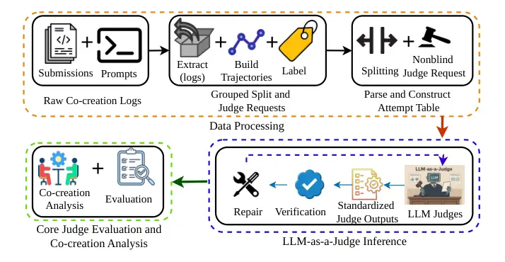

Fig. 1: Overview of the _LLM-as-a-Judge_ and _human-AI co-creation_
workflow

1: Raw submissions $`\mathcal{S}`$, prompt logs $`\mathcal{P}`$, judges
$`\mathcal{J}`$, input conditions
$`\{\textsc{blind},\textsc{prefix12k},\textsc{nonblind}\}`$, fold count
$`K`$

2: Verified judge outputs $`\{O_{j}\}_{j\in\mathcal{J}}`$, merged
prediction table $`\mathcal{T}`$, and evaluation artifacts

3: Parse $`\mathcal{S}`$ and $`\mathcal{P}`$; construct attempt table
$`\mathcal{A}=\{(a,u,p,k,c,h,\tau,v,y)\}`$ sorted by $`(u,p,\tau)`$

4: For each $`a\in\mathcal{A}`$, locate $`\mathrm{anchor}(a)`$, the
first occurrence of $`c_{a}`$ in $`u`$’s logs when present, and
construct $`x_{a}^{(\mathrm{cond})}`$ for $`\mathrm{cond}\in\{`$ blind,
prefix12k, nonblind$`\}`$

5: Split trajectories by group key $`(u,p)`$ into $`K`$ folds; serialize
canonical judge requests
$`\mathcal{R}=\{(a,\mathrm{cond},x_{a}^{(\mathrm{cond})})\}`$ for every
attempt and condition

6: for each judge $`j\in\mathcal{J}`$ in parallel do

7:    infer outputs under a strict JSON schema with checkpointing

8:    verify every field; while an attempt_id fails validation and its
retry budget remains do reissue the identical request under bounded
retry with backoff

9:    record any attempt_id that exhausts its retry budget as a failure,
without reducing its input

10: end for

11: Merge all verified outputs with $`\mathcal{A}`$ by attempt_id to
obtain $`\mathcal{T}`$

12: for each fold $`k\in\{1,\dots,K\}`$ do select threshold
$`t_{j}^{\star}`$ on the other $`K-1`$ folds and apply it to fold $`k`$,
for every judge $`j`$

13: Compute cross-judge agreement and trajectory-level dynamics; produce
final evaluation artifacts

Algorithm 1 _LLM-as-a-Judge Workflow_ for _AI Co-Creation_

|                                                           |                                                                                                           |
| --------------------------------------------------------- | --------------------------------------------------------------------------------------------------------- |
| Symbol                                                    | Meaning                                                                                                   |
| $`u`$, $`p`$                                              | participant identifier, problem identifier                                                                |
| $`a`$                                                     | attempt identifier (attempt_id); primary key for every judge and analysis table                           |
| $`(u,p,k)`$                                               | trajectory and turn index of attempt $`a`$: the $`k`$-th attempt by $`u`$ on $`p`$                        |
| $`c_{a},h_{a},\tau_{a},v_{a}`$                            | submitted code, prompt-side text, timestamp, and verdict of attempt $`a`$                                 |
| $`y_{a}`$                                                 | ground-truth acceptance label, $`y_{a}=\mathbb{I}[v_{a}=\mathrm{AC}]`$                                    |
| $`\mathrm{cond}`$                                         | input condition, $`\mathrm{cond}\in\{\textsc{blind},\textsc{prefix12k},\textsc{nonblind}\}`$              |
| $`x_{a}^{(\mathrm{cond})}`$                               | judge request for attempt $`a`$ under condition $`\mathrm{cond}`$                                         |
| $`\mathcal{J}`$                                           | set of judges (OpenAI, DeepSeek, Gemini, Claude)                                                          |
| $`p_{a}^{(j)}`$                                           | judge $`j`$’s predicted acceptance probability for attempt $`a`$                                          |
| $`s_{\mathrm{algo},a}^{(j)},s_{\mathrm{robust},a}^{(j)}`$ | judge $`j`$’s ordinal scores for algorithmic adequacy, robustness                                         |
| $`t_{j}^{\star}`$                                         | judge $`j`$’s accept/reject threshold, selected out of fold                                               |
| $`\hat{y}_{a}^{(j)}`$                                     | judge $`j`$’s predicted acceptance label, $`\hat{y}_{a}^{(j)}=\mathbb{I}[p_{a}^{(j)}\geq t_{j}^{\star}]`$ |
| $`\bar{q}_{u,p,k}`$                                       | rank consensus of $`\mathcal{J}`$ at turn $`k`$ of $`(u,p)`$ (mean percentile rank of $`p`$)              |
| $`\Delta\bar{q}_{u,p,k}`$                                 | turn-wise change in $`\bar{q}_{u,p,k}`$ (judged improvement)                                              |
| $`\mathcal{G}`$                                           | set of participant-problem trajectories                                                                   |
| $`K_{u,p}`$, $`T^{\star}_{u,p}`$                          | last observed turn, and latent first-success turn, of $`(u,p)`$                                           |

TABLE I: Notation used in Sections III–VII

### IV-A Data Processing and Request Construction

#### IV-A1 Raw artifacts and canonical parsing

Each participant record consists of (i) submission artifacts from the
competition judge system, containing the submitted code and verdict, and
(ii) prompt logs of the participant’s interaction with AI tools.
Submission artifacts are parsed from text-like formats (.html, .htm,
.md, .txt) to avoid optical character recognition (OCR) noise. For each
submission, the participant $`u`$, problem $`p`$, timestamp $`\tau`$,
source code $`c`$, verdict $`v`$, and language $`\ell`$ are extracted,
the verdict and the timestamp each from its own named field, not from
the visible page text (Section IV-D, V1 and V3). For HTML pages, scripts
and styles are removed first, and the submitted code is taken from the
longest \<pre\> block, with \<code\> as a fallback.

#### IV-A2 Attempt-level dataset construction

Parsed submissions are sorted by $`(u,p,\tau)`$. Within each
participant-problem group, a trajectory turn index $`k\in\{1,2,\dots\}`$
and a stable global identifier $`a`$ (attempt_id) are assigned: for
instance, the third submission by participant $`u`$ on problem $`p`$ is
turn $`k=3`$ of trajectory $`(u,p)`$ and receives its own $`a`$, which
is used as the primary key for all downstream joins. Each attempt is
represented as

```math
a=\left(u,p,k,c_{a},h_{a},\tau_{a},v_{a}\right), \tag{1}
```

and the ground-truth acceptance label is

```math
y_{a}=\mathbb{I}\!\left[v_{a}=\mathrm{AC}\right], \tag{2}
```

where $`\mathbb{I}[\cdot]`$ denotes the indicator function and $`h_{a}`$
is the prompt-side interaction text associated with attempt $`a`$. The
participant context actually sent to a judge is constructed separately,
as described next.

#### IV-A3 Anchor-Based Context and Input Conditions

Prompt logs are parsed into textual records and ordered
deterministically (e.g., by filename and/or stable file metadata).
Because prompt timestamps are not uniformly reliable across all
participants and formats, temporal truncation cannot be implemented from
timestamps alone. Instead, for each attempt $`a`$ whose code $`c_{a}`$
can be located verbatim in participant $`u`$’s logs, an anchor point is
defined at its first appearance, and the context supplied to a judge is
drawn only from log content strictly preceding that point, restricted to
turns that concern problem $`p`$. Every judge request carries the
problem statement and the submitted code; the three input conditions
differ only in what participant context, if any, is added: $`(i)`$
blind: no participant context. $`(ii)`$ prefix12k: the first 12,000
characters of the participant’s logs, aggregated across all of $`u`$’s
problems in a fixed deterministic order, independent of $`p`$ and of any
anchor. $`(iii)`$ nonblind: the anchored context defined above, capped
at 12,000 characters, restricted to problem $`p`$.

Context provenance for the nonblind condition is reported in three
tiers. For 369 of the 517 attempts (71.4%), the code can be located in
the logs, and the context is _anchored_, meaning it is proven to precede
the submission it accompanies. For 102 (19.7%), the correct problem’s
log content can be identified without locating the code itself, and the
context is _segmented_ to that problem without an anchor. For the
remaining 46 (8.9%), neither is possible, and no context is sent, since
context about the wrong problem would be worse than none. Anchored and
segmented attempts together, 471 (91.1%), are termed evidence-backed.
Participant identity is not disclosed to a judge under any condition:
all context is scrubbed of personal information before a request is
issued.

#### IV-A4 Grouped splitting and request serialization

To prevent leakage across repeated attempts of the same participant on
the same problem, grouped CV folds attempts by trajectory key
$`g=(u,p)`$, so that no trajectory’s threshold is selected on its own
attempts (Section IV-C). For each attempt $`a`$ and input condition
$`\mathrm{cond}`$, a canonical request is serialized as

```math
x_{a}^{(\mathrm{cond})}=\left\{\begin{aligned} &\texttt{problem\_id},\\
&\texttt{problem\_statement},\\
&\texttt{language},\ \texttt{source\_code},\\
&\texttt{prompt\_text}^{(\mathrm{cond})}\end{aligned}\right\}, \tag{3}
```

where problem_statement is the full statement, including input
constraints, expected behavior, and examples, and prompt_text^((cond))
is the participant context defined above for condition $`\mathrm{cond}`$
(empty under blind). All requests are stored in a model-agnostic JSONL
file shared by all judges. Ground-truth labels are excluded from these
requests to avoid label leakage.

### IV-B LLM-as-a-Judge Inference and Verification

#### IV-B1 Unified judge schema

Multiple judges $`j\in\mathcal{J}`$ (e.g., OpenAI, DeepSeek, Gemini, and
Claude) are evaluated through API-based inference. The same input
$`x_{a}^{(\mathrm{cond})}`$ is provided to each judge, for each
condition in turn, and a strict JSON object of the following form is
required:

```math
\hat{z}^{(j)}_{a}=\left(p^{(j)}_{a},\;s^{(j)}_{\mathrm{algo},a},\;s^{(j)}_{\mathrm{robust},a},\;r^{(j)}_{a}\right), \tag{4}
```

where $`p^{(j)}_{a}\in[0,1]`$ denotes the predicted acceptance
probability, $`s^{(j)}_{\mathrm{algo},a}\in\{1,\dots,5\}`$ denotes an
ordinal score for algorithmic adequacy,
$`s^{(j)}_{\mathrm{robust},a}\in\{1,\dots,5\}`$ denotes an ordinal score
for robustness and constraint handling, and $`r^{(j)}_{a}`$ denotes a
short rationale. The discrete ranges $`\{1,\dots,5\}`$ represent bounded
rubric levels, where lower values indicate poorer performance and higher
values indicate stronger satisfaction of the corresponding criterion.
All judges are executed under the same schema, on a single shared
request-and-validation path rather than a runner written per judge, so
that the resulting outputs are directly comparable across models.

#### IV-B2 Verification and bounded repair

Inference is executed with checkpointing so that successful attempts are
not recomputed on reruns. Because large-scale API calls can produce
transient failures (e.g., rate limits, timeouts, quota limits, or
truncated responses), bounded retries with backoff are applied to failed
attempt_ids at the transport level, independently of the validation
check below. A response is accepted only if all of the following hold:

```math
\displaystyle\text{(a) the response parses as the schema of Eq.~\eqref{eq:judge_output};} \tag{5}
```

```math
\displaystyle\text{(b) every field of $\hat{z}^{(j)}_{a}$ is present;}
```

```math
\displaystyle\text{(c) }p^{(j)}_{a}\in[0,1];
```

```math
\displaystyle\text{(d) }s^{(j)}_{\mathrm{algo},a}\in\{1,\dots,5\}\text{ and }s^{(j)}_{\mathrm{robust},a}\in\{1,\dots,5\}.
```

A judge output table $`O_{j}`$ is accepted only once it contains exactly
one row satisfying (a)-(d) for every $`a\in\mathcal{A}`$, with no
attempt missing and none duplicated. When a response fails any condition
in Eq. (5), repair applies: the identical request is reissued,
unchanged, under bounded retry with backoff, for that attempt_id alone.
The input is not reduced on repair, since a row judged on a shorter
input than every other row would no longer be comparable to them; an
attempt_id that exhausts its retry budget is recorded as a failure
instead. A repaired response overwrites the earlier failure state,
preserving a one-to-one mapping between attempt_id and the final judge
output. Only verified outputs are passed to downstream evaluation. In
the evaluation run, 11 of the 6,204 responses failed validation on first
receipt, all through truncated or empty output, and each returned a
valid response on reissue.

### IV-C Consolidation and Analysis Protocol

#### IV-C1 Unified prediction tables

All verified judge outputs are merged with the attempt table by
attempt_id. Long-format and wide-format prediction tables are then
retained for grouped analyses, plotting, and cross-judge comparisons.

#### IV-C2 Judge evaluation protocol

For each judge and input condition, probabilistic predictions are
evaluated by grouped $`K`$-fold CV over all 517 attempts, with folds
formed on the trajectory key $`(u,p)`$ so that no trajectory is split
across folds and every attempt is scored out of fold exactly once.
Within each fold, the accept/reject threshold $`t_{j}^{\star}`$ is
selected on the other $`K-1`$ folds by maximizing the Matthews
Correlation Coefficient (MCC) and applied, unchanged, to the held-out
fold, giving the predicted acceptance label
$`\hat{y}_{a}^{(j)}=\mathbb{I}[p_{a}^{(j)}\geq t_{j}^{\star}]`$.
Discrimination, calibration, and thresholded decision metrics are then
computed by pooling the out-of-fold $`p_{a}^{(j)}`$ and
$`\hat{y}_{a}^{(j)}`$ across folds. Cross-judge agreement instead uses
each judge’s continuous output cut at its own median, with rank
agreement (Spearman’s $`\rho`$) reported alongside it. Confidence
intervals are obtained by bootstrap resampling the trajectories
$`(u,p)`$, which are the unit of dependence in this corpus; a
problem-clustered re-estimation, resampling the 13 problems instead, is
reported alongside it as a robustness check.

#### IV-C3 Trajectory construction and co-creation dynamics

For each trajectory $`(u,p)`$, the judges’ rank consensus at turn $`k`$
is computed as

```math
\bar{q}_{u,p,k}=\frac{1}{|\mathcal{J}|}\sum_{j\in\mathcal{J}}F_{j}\!\left(p^{(j)}_{u,p,k}\right), \tag{6}
```

where $`F_{j}`$ gives the percentile rank of a value among the outputs
of judge $`j`$ on all 517 attempts under nonblind, ties sharing their
average rank. Ranking each judge first lets judges of very different
output resolution (Section VI-A7) count equally. The result is the score
of the unweighted percentile-rank panel evaluated in Section VI-A, and
it orders the attempts almost exactly as a plain mean of the
probabilities would (Spearman 0.974 across the 517 attempts). The
corresponding turn-wise progress, the judged improvement, is defined as

```math
\Delta\bar{q}_{u,p,k}=\bar{q}_{u,p,k}-\bar{q}_{u,p,k-1},\qquad k\geq 2. \tag{7}
```

These quantities are used to characterize struggle curves, recovery
patterns, and stagnation over iterative attempts.

#### IV-C4 Time-to-success and similarity analyses

Let $`K_{u,p}`$ denote the last observed turn index for trajectory
$`(u,p)`$. The latent first-success turn is

```math
T^{\star}_{u,p}=\min\{k:\ y_{u,p,k}=1\}, \tag{8}
```

with $`T^{\star}_{u,p}=+\infty`$ if the trajectory is never solved. For
survival analysis \[57\], the observed time and censoring indicator are

```math
T_{u,p}=\min(T^{\star}_{u,p},K_{u,p}),\qquad\delta_{u,p}=\mathbb{I}[T^{\star}_{u,p}\leq K_{u,p}], \tag{9}
```

thus treating unsolved trajectories as right-censored. Success by turn
index $`k`$ is reported as

```math
S(k)=\frac{1}{|\mathcal{G}|}\sum_{(u,p)\in\mathcal{G}}\mathbb{I}[T^{\star}_{u,p}\leq k], \tag{10}
```

where $`\mathcal{G}`$ is the set of all participant-problem
trajectories. Prompt churn, code churn, and code-aware similarity
between consecutive turns quantify revision behavior; the analysis uses
code churn and CodeBLEU similarity (Section V-B).

### IV-D Data Verification

Because this revision re-estimates every reported value, the data
pipeline was verified end to end before any analysis was rebuilt. The
analysis code (metric definitions, MCC protocol, calibration, agreement
statistics, and survival analysis) behaved as specified; the
verification found three issues in its input, V1, V3, and V4, with V2 a
consequence of V1 and V5 a reproducibility check on the parsing layer.

V1. Submission timestamps. Each saved submission page carries two
clocks: a header clock recording when the page was rendered, and a named
Submit field recording when the code was submitted. Timestamps are read
from the Submit field, with the header clock retained separately as
page_saved_ts so the two are not conflated. The corrected timestamps
span 13:49:28 to 17:44:50 on the contest date, inside the contest’s
official 13:45-17:45 window, and order 72 of 73 multi-attempt
trajectories identically to the independent filename submission order.

V2. Trajectory ordering. This follows from V1: pages had been saved
newest-first from a submissions list, so the corrected clock reverses
the order within each multi-attempt trajectory, which is why
Success@Turn now rises across turns rather than beginning near its
asymptote.

V3. Verdict extraction. Verdicts are read from the named Result field,
no longer by scanning the visible page text, since submitted source code
is part of that text and, for one of the thirteen problems, solutions
commonly declare a variable named accepted, which a whole-page scan can
match in place of the verdict itself. All 517 pages were audited and
contain exactly four distinct Result strings, all mapped; every
disagreement between the two extraction methods falls on that single
problem and no other.

V4. Join key. The attempt_id used to associate judge outputs with
attempts had been assigned by position after sorting; since V1 changes
the sort order, the correspondence was rebuilt through the source file
path, adding a stable natural key, attempt_uid. The submitted code each
judge was sent was compared against the code of the attempt its
prediction is now attached to, and matches on 517 of 517 rows.

V5. Pipeline reproducibility. The parsing layer was rebuilt
independently and its output compared against the frozen archive of the
earlier analysis: timestamps, problem identifiers, submission
identifiers, language, and code length match on every row, and the full
pipeline runs end to end from a clean environment.

Effect on the reported corpus. Reading verdicts from the named field
(V3) changes the label on 35 attempts recorded as accepted in the data
as originally analyzed, all on that single problem: accepted attempts
fall from 193 to 158 (with 192 wrong-answer, 147 time-limit-exceeded,
and 20 compile-error;

Table II), and prevalence from 0.3733 to 0.3056. The same labels move
the convergence observations from 329 to 280 and the design-phase
partition, stratified on whether a trajectory is ever accepted, from
148/18/18 trajectories and 373/108/36 attempts to 146/19/19 and
401/66/50; V2 moves Success@Turn at turn 1 from 0.8533 to 0.6033. This
revision reports nothing from either partition, since every judge figure
comes from CV over all 517 attempts (Section IV-C).

## V Experiments

### V-A Dataset Overview

Table IIsummarizes the dataset. Each trajectory $`(u,p)`$ is a
chronological sequence of attempts, and each attempt holds the submitted
code, prompt-side context, timestamp, verdict, and acceptance label. The
interaction logs range from conversational use of chat assistants to
full delegation, in which one participant configured autonomous coding
agents to read the problems, write the solutions, and submit them.
Reading a specification, writing code, submitting it, receiving an
objective pass or fail from execution, diagnosing the failure, and
revising is the inner loop of software development that continuous
integration automates; this setting differs from everyday practice in
scale and duration, not in the kind of work. A grouped
train/validation/test split decided, before any judge prompt was
written, which trajectories could be inspected during prompt and schema
design (Section IV-D); judge evaluation uses grouped CV over all
attempts (Section IV-C).

|                                                |               |
| ---------------------------------------------- | ------------- |
| Statistic                                      | Value         |
| Participants ; Problems                        | 15 ; 13       |
| Participant-problem trajectories $`(u,p)`$     | 184           |
| Submission attempts (rows) ; Prompt logs       | 517 ; 83      |
| Accepted (AC) ; Wrong answer (WA)              | 158 ; 192     |
| Time limit exceeded (TLE) ; Compile error (CE) | 147 ; 20      |
| Design-phase train / val / test trajectories   | 146 / 19 / 19 |
| Average attempts per trajectory                | 2.81          |
| Median attempts per trajectory                 | 1             |
| Maximum attempts in a trajectory               | 30            |

TABLE II: Overview of the co-creation dataset

### V-B Evaluation Metrics

The pipeline is evaluated as a measurement instrument and through
co-creation dynamics. Each metric is reported with the decision it
serves: discrimination when a judge ranks or triages attempts,
calibration when a threshold is applied to its output, and defect
sensitivity when a judge assesses quality instead of predicting an
outcome;

Table IIIlists each metric, its intended use, and its role.

|                       |                         |                                                                                     |
| --------------------- | ----------------------- | ----------------------------------------------------------------------------------- |
| Metric                | Decisive for            | Role in the study                                                                   |
| ROC-AUC               | Ranking, triage         | Ranking ability for accepted vs. non-accepted attempts                              |
| PR-AUC                | Ranking, triage         | Precision-recall behavior under class imbalance                                     |
| LogLoss               | Threshold transfer      | Penalization of inaccurate and overconfident probability predictions                |
| Brier score           | Threshold transfer      | Mean squared error of probabilistic predictions                                     |
| ECE                   | Threshold transfer      | Agreement between predicted probability and observed acceptance rate                |
| MCC                   | Decision quality        | Balanced decision quality by out-of-fold-selected threshold                         |
| Cohen’s $`\kappa`$    | Cross-judge reliability | Pairwise agreement between judges                                                   |
| Fleiss’ $`\kappa`$    | Cross-judge reliability | Multi-rater agreement across all judges                                             |
| Spearman’s $`\rho`$   | Cross-judge reliability | Rank agreement between judge pairs                                                  |
| Struggle curves       | –                       | Turn-wise rank consensus of the judges dynamics over trajectories                   |
| Success@Turn          | –                       | Fraction of trajectories solved by or before turn index $`k`$                       |
| Kaplan-Meier survival | –                       | Time-to-success with right-censoring at the last observed turn                      |
| Prompt/code NED churn | –                       | Surface-form revision magnitude between consecutive turns                           |
| CodeBLEU churn        | –                       | Code-aware change between consecutive turns                                         |
| CodeBLEU convergence  | –                       | Similarity to the first accepted solution within a solved trajectory                |
| Arm discrimination    | Defect sensitivity      | Separation between injected-defect and matched control edits                        |
| Detection specificity | Defect sensitivity      | Genuine detections against false alarms on behavior-preserving edits                |
| Severity gradient     | Defect sensitivity      | Whether the score tracks how visible a defect is, not merely that something changed |

TABLE III: Summary of evaluation metrics, their intended use, and their
roles

#### V-B1 Judge quality metrics

##### ROC-AUC and PR-AUC (discrimination metrics; decisive for ranking and triage)

Discrimination metrics quantify how well accepted attempts are ranked
above non-accepted attempts using predicted probabilities $`p_{a}`$
without fixing a decision threshold \[58\]. ROC-AUC measures the
probability that a randomly chosen accepted attempt receives a higher
score than a randomly chosen non-accepted attempt. PR-AUC (reported as
Average Precision) summarizes the precision-recall trade-off and is
especially informative under class imbalance. Higher values indicate
better discrimination.

##### LogLoss ($`\mathcal{L}`$) (probabilistic scoring; decisive when a threshold is applied downstream)

LogLoss evaluates the quality of probabilistic predictions on a set of
$`N`$ attempts and penalizes overconfident errors strongly \[59\]:

```math
\mathcal{L}=-\frac{1}{N}\sum_{a=1}^{N}\left[y_{a}\log p_{a}+(1-y_{a})\log(1-p_{a})\right]. \tag{11}
```

Lower values indicate better probabilistic accuracy.

##### Brier score ($`B`$) (probabilistic scoring; decisive when a threshold is applied downstream)

The Brier score measures mean squared error of probabilistic
predictions \[60\]:

```math
\mathrm{B}=\frac{1}{N}\sum_{a=1}^{N}(p_{a}-y_{a})^{2}. \tag{12}
```

where lower values indicate better probabilistic accuracy.

##### Expected Calibration Error (ECE) (calibration metric; decisive when a threshold is applied downstream)

Calibration metrics quantify how well predicted probabilities match
empirical frequencies. ECE is computed by partitioning the predicted
acceptance probabilities into $`B`$ equal-width bins and comparing, in
each bin, the observed acceptance rate with the mean predicted
probability \[61\]:

```math
\mathrm{ECE}=\sum_{b=1}^{B}\frac{n_{b}}{N}\left|\mathrm{obs}(b)-\mathrm{pred}(b)\right|,\qquad B=15, \tag{13}
```

where $`n_{b}`$ is the number of predictions in bin $`b`$.

##### Matthews Correlation Coefficient (MCC) (thresholded decision quality)

Thresholded decision metrics evaluate binary accept/reject decisions
after converting probabilities to labels. Decisions are obtained as

```math
\hat{y}_{a}(t)=\mathbb{I}[p_{a}\geq t]. \tag{14}
```

The threshold is selected, for each CV fold, on the other folds by
maximizing MCC and applied, unchanged, to the held-out fold:

```math
t^{\star}=\arg\max_{t\in[0,1]}\mathrm{MCC}_{\mathrm{other\ folds}}(t). \tag{15}
```

MCC is defined as \[62\]

```math
\mathrm{MCC}=\frac{TP\cdot TN-FP\cdot FN}{\sqrt{(TP+FP)(TP+FN)(TN+FP)(TN+FN)}}, \tag{16}
```

where $`TP`$, $`TN`$, $`FP`$, and $`FN`$ denote true positives, true
negatives, false positives, and false negatives, respectively.

##### Cohen’s $`\kappa`$ and Fleiss’ $`\kappa`$ (agreement / reliability metrics)

Agreement metrics treat LLM judges as raters and quantify reliability
beyond chance agreement. Cohen’s $`\kappa`$ is used for pairwise
agreement \[63\]:

```math
\kappa=\frac{p_{o}-p_{e}}{1-p_{e}}, \tag{17}
```

where $`p_{o}`$ is observed agreement and $`p_{e}`$ is agreement
expected by chance. Fleiss’ $`\kappa`$ extends this notion to the
multi-rater setting \[64\]. Higher $`\kappa`$ indicates stronger
agreement. Rank agreement between two judges is measured with Spearman’s
$`\rho`$ on their continuous outputs, reported alongside $`\kappa`$ so
that agreement on ordering can be told apart from agreement on a cut.

#### V-B2 Trajectory and co-creation metrics

##### Struggle curves, Success@Turn, and time-to-success (trajectory dynamics)

These signals, the judges’ rank consensus at a turn, its turn-wise
change, success by turn index, and Kaplan-Meier survival, are defined
once, in Section IV-C; success by turn index and survival need only the
verdicts, while the other two rest on the judges’ nonblind outputs.

##### Normalized Edit Distance (NED) (string-based churn)

String-based churn is quantified using NED based on Levenshtein
distance \[65\]:

```math
\mathrm{NED}(s,t)=\frac{\mathrm{LD}(s,t)}{\max(1,|s|,|t|)}, \tag{18}
```

where $`\mathrm{LD}(\cdot,\cdot)`$ is Levenshtein distance. For
prompt-side text $`h_{u,p,k}`$ and code $`c_{u,p,k}`$, churn between
consecutive observed turns is defined as

```math
\displaystyle\mathrm{Churn}^{\mathrm{prompt}}_{u,p,k} \displaystyle=\mathrm{NED}(h_{u,p,k-1},h_{u,p,k}), \tag{19}
```

```math
\displaystyle\mathrm{Churn}^{\mathrm{code}}_{u,p,k} \displaystyle=\mathrm{NED}(c_{u,p,k-1},c_{u,p,k}),\qquad k\geq 2.
```

##### CodeBLEU-based churn and convergence (code-aware similarity)

To reduce over-penalization of logic-preserving edits, code-aware
similarity is measured using CodeBLEU \[66\]. In the finalized
implementation, the data-flow component is excluded for stability, and
CodeBLEU is computed using the n-gram, weighted n-gram, and syntax
components only. The three are weighted equally, $`(1/3,1/3,1/3,0)`$,
and C submissions are evaluated under the C++ CodeBLEU configuration for
toolchain stability. Consecutive-turn churn is

```math
\mathrm{Churn}^{\mathrm{CB}}_{u,p,k}=1-\mathrm{CodeBLEU}(c_{u,p,k-1},c_{u,p,k}),\qquad k\geq 2, \tag{20}
```

and, for solved trajectories, convergence toward the first accepted
solution $`c^{\mathrm{AC}}_{u,p}`$ is measured for every attempt other
than that submission itself as

```math
\mathrm{Conv}^{\mathrm{CB}}_{u,p,k}=\mathrm{CodeBLEU}(c^{\mathrm{AC}}_{u,p},c_{u,p,k}). \tag{21}
```

### V-C Inference Configuration

Table IVsummarizes the inference configuration. Gemini 2.5 Pro cannot be
invoked without internal reasoning, and an unbounded reasoning allowance
causes it to exhaust its output budget before emitting a response on a
substantial share of prompts. An explicit reasoning budget is therefore
set for every Gemini request; a paired check on ten attempts (nine
comparable pairs), scored with and without that budget, confirmed it
does not alter the judgement. All other judges use their provider
defaults. Before the evaluation run, each provider was asked which model
it actually serves under the requested identifier. Three identifiers
were version-pinned or resolved unchanged; the DeepSeek identifier
deepseek-reasoner resolved to deepseek-v4-flash, so the run pins that
explicit identifier, and the identifier each provider reports is
recorded with every response.

|                                 |                                                                                                                                                                                          |
| ------------------------------- | ---------------------------------------------------------------------------------------------------------------------------------------------------------------------------------------- |
| Settings                        | Value/Description                                                                                                                                                                        |
| Judge models                    | gpt-5.2-2025-12-11, gemini-2.5-pro, claude-sonnet-4-5-20250929, deepseek-v4-flash                                                                                                        |
| Input conditions                | blind, prefix12k, nonblind (Section IV-A)                                                                                                                                                |
| Context type                    | Per condition: none, the first 12,000 characters of the aggregated logs, or the anchored context (Section IV-A)                                                                          |
| Output format                   | Strict JSON schema                                                                                                                                                                       |
| Output fields                   | $`p_{\mathrm{ac}},s_{\mathrm{algo}},s_{\mathrm{robust}},r`$                                                                                                                              |
| Score scale                     | $`s_{\mathrm{algo}},s_{\mathrm{robust}}\in\{1,\dots,5\}`$                                                                                                                                |
| Temperature                     | 0 (all judges)                                                                                                                                                                           |
| Max output tokens               | OpenAI/DeepSeek: provider default;  Gemini: 2048 (main), 4096 (repair);  Claude: 1024                                                                                                    |
| Gemini reasoning budget         | 1,024 thinking tokens (a soft target, not a hard cap; observed up to 1,395 in practice); confirmed not to alter the judgement (mean absolute difference 0.036, 8 of 9 pairs within 0.10) |
| Code input budget               | MAX_CODE_CHARS=12000                                                                                                                                                                     |
| Prompt/context budget           | MAX_PROMPT_CHARS=12000                                                                                                                                                                   |
| Request pacing / checkpointing  | SLEEP_SECONDS=0.2, SAVE_EVERY=10; resume-safe checkpointing enabled                                                                                                                      |
| Retry policy                    | Bounded retry with backoff; retry-only-failed with UPSERT by attempt_id                                                                                                                  |
| Evaluation folds                | Grouped 10-fold CV by $`(u,p)`$ (Section IV-C)                                                                                                                                           |
| Threshold criterion             | MCC selected on the other 9 folds, applied unchanged to the held-out fold                                                                                                                |
| Per-request latency (aggregate) | About 1.5s (fastest judge) to about 90s (slowest), one to two orders of magnitude, over the same 517 attempts                                                                            |
| OpenAI latency (s/request)      | blind 1.5, prefix12k 1.8, nonblind 1.8                                                                                                                                                   |
| Claude latency (s/request)      | blind 2.7, nonblind 2.9; prefix12k not cleanly measurable (pass split by provider credit exhaustion)                                                                                     |
| Gemini latency (s/request)      | blind 10.3, prefix12k 10.7; nonblind not cleanly measurable (pass interrupted by provider quota)                                                                                         |
| DeepSeek latency (s/request)    | blind 77.6, nonblind 83.5, prefix12k 92.2                                                                                                                                                |
| ECE bins                        | 15                                                                                                                                                                                       |

TABLE IV: Inference configuration for the API-based _LLM-as-a-Judge_
pipeline

### V-D Perturbation Study Design

The evaluation above scores judges against the contest verdict on
unmodified attempts. This section adds a second, independent check:
whether a judge’s score responds to a defect that the corpus does not
already contain, against a matched edit that provably changes nothing.

Seeds. The 134 accepted programs written in C++, C, or Java (57, 39, and 38) serve as mutation seeds, since all four operators below apply in
these languages. The 24 accepted Python and Go programs are not used; in
Python, the narrowed-type defect cannot occur.

Semantic operators. Four operators each introduce a single defect of a
kind the contest judge system is already known to reject, ordered here
by how difficult the defect is to notice, subtlest first:

- •
  TYPE_NARROW (severity 1): a long long declaration is narrowed to int.
  The program still compiles and remains correct below 32 bits, failing
  only once a value exceeds that range, which is exactly what contest
  input bounds are designed to reach.
- •
  ROR_BOUNDARY (severity 2): a relational operator at a boundary check
  is tightened or loosened, \<= to \< or the reverse, an off-by-one at
  that boundary.
- •
  LOOP_SHORTEN (severity 3): a loop bound i \< n becomes i \< n - 1,
  dropping the last iteration.
- •
  ARITH_FLIP (severity 4): an addition becomes a subtraction, a + b to
  a - b, a change wrong on essentially every input.

Each operator changes exactly one occurrence, the first one it finds
outside comments, preprocessor directives, and string or character
literals, so every mutation is auditable by eye against the line it
replaces.

Matched control arm. Two operators edit the same kind of construct
without changing what the program computes, so that a judge’s response
to a real defect can be told apart from a response to the fact that code
changed at all: a post-increment is rewritten to a pre-increment inside
a for-loop header (i++ to ++i, behavior-identical in C, C++, and Java,
since the result of that expression is discarded there), and a comment
line is inserted at a fixed point.

Yield. The operators reach different shares of the 134 seeds, giving 97
TYPE_NARROW, 91 ROR_BOUNDARY, 71 LOOP_SHORTEN, and 89 ARITH_FLIP mutants
(348 semantic) and 73 post-increment and 134 comment controls (207); all
555 passed verification. Guard-context exposure is measured: 35 of the
348 semantic mutants sit in a guard condition where the edit may not
change behavior, for instance a tightened boundary check that excludes a
value the problem’s constraints already rule out.

Judge requests and the primary subset. All 555 mutants are scored by all
four judges under the blind condition, since a mutant is a synthetic
program with no participant history of its own to attach; 2,220 requests
in all. The primary analysis is restricted to the subset in which the
same judge scored the unmutated seed at or above 0.5 under the same
condition, since a judge that misjudged the original program can be
neither credited nor blamed for what it does to the mutant; that subset
holds 1,507 of the 2,220 judge-mutant pairs.

## VI Experimental Results

Judges are named by provider;

Table IVgives the model identifiers. Results are reported over all 517
attempts under grouped 10-fold CV (Section IV-C), for each of the three
input conditions defined in Section IV-A. All intervals are 95%
trajectory-clustered bootstrap intervals from 2,000 resamples; the
tables give one for every value, and the text gives one wherever a
comparison rests on it. Two judges are described as different only where
their intervals do not overlap, and two conditions only where the
interval on their paired difference excludes zero.

### VI-A LLM-as-a-Judge Evaluation Results

#### VI-A1 Effect of Input Specification

The earlier canonical request carried a problem identifier in place of
the problem statement, so a judge assessing algorithmic adequacy had not
seen the specification it was judging against. Supplying the full
statement rebuilds the ranking: over the same 517 attempts at the same
temperature, the rank correlation between the two orderings is 0.3021
\[0.168, 0.424\], and the mean judged probability moves from 0.1840
\[0.158, 0.214\], well below the base rate of 0.3056, to 0.3561 \[0.311,
0.409\], slightly above it. Under nonblind, out-of-fold ROC-AUC rises
for every judge, from 0.130 \[0.061, 0.202\] for Gemini to 0.295
\[0.214, 0.381\] for OpenAI, every gain’s interval excluding zero (

Table V). The blind condition removes participant context entirely, so a
gain there cannot come from better context: three judges gain under it
as well, from 0.095 \[0.022, 0.172\] for Gemini to 0.249 \[0.177,
0.319\] for DeepSeek, while Claude’s gain, 0.065 \[$`-0.023`$, 0.158\],
separates from zero only once participant context is added (0.141
\[0.058, 0.227\] under nonblind). For OpenAI, Claude, and Gemini, model,
corpus, labels, and temperature are identical across the two runs.
DeepSeek’s earlier run requested an alias whose served model cannot be
recovered (Section V-C), so its gain may include a change of model; the
gains of the other three judges carry the comparison on their own, and
without DeepSeek the ordering is rebuilt at least as fully, with a rank
correlation of 0.2617 \[0.123, 0.391\] across those three judges.

With the problem statement held fixed, adding participant context
improves discrimination for two of the four judges. Moving from blind to
nonblind raises out-of-fold ROC-AUC for Claude by 0.0762 \[0.034,
0.120\] and for OpenAI by 0.0672 \[0.030, 0.106\], and by 0.0903
\[0.039, 0.143\] and 0.0805 \[0.040, 0.128\] on the 471 attempts whose
context is anchored or segmented (Section IV-A); for DeepSeek and Gemini
the change is not detectable either way, its interval including zero.
The benefit of context is therefore judge-specific and is reported per
judge, with nonblind as the main reporting condition because it gives
every judge the most relevant evidence.

|                    |                                   |                                   |                              |
| ------------------ | --------------------------------- | --------------------------------- | ---------------------------- |
|      Judge         |      blind                        |      prefix12k                    |      nonblind                |
|      Claude        |      0.6224 \[0.557, 0.689\]      |      0.6815 \[0.612, 0.752\]      |      0.6985 \[0.633, 0.763\] |
|      DeepSeek      |      0.9020 \[0.863, 0.936\]      |      0.9357 \[0.904, 0.961\]      |      0.9236 \[0.890, 0.954\] |
|      Gemini        |      0.7345 \[0.675, 0.791\]      |      0.7574 \[0.704, 0.811\]      |      0.7691 \[0.719, 0.817\] |
|      OpenAI        |      0.7535 \[0.693, 0.815\]      |      0.7975 \[0.739, 0.853\]      |      0.8208 \[0.767, 0.874\] |

TABLE V: ROC-AUC by input condition, out-of-fold, all 517 attempts, with
95% intervals

Against prefix12k, which reproduces the context rule of the earlier run
and fills its 12,000-character cap on every attempt, nonblind sends
6,821 characters on average, about 43% less, and no judge separates the
two on all 517 attempts; on the 471 evidence-backed attempts, only
OpenAI gains, by 0.0516 \[0.018, 0.088\]. Judge performance is reported
conditionally on the input specification throughout this section, since
the specification determines what a score measures.

#### VI-A2 Discrimination (ROC-AUC, PR-AUC)

DeepSeek ranks best (

Table VI), with the highest ROC-AUC (0.9236) and PR-AUC (0.8844), its
intervals clear of the other three judges on both. OpenAI (ROC-AUC
0.8208; PR-AUC 0.6969), Gemini (0.7691; 0.5480) and Claude (0.6985;
0.5060) follow in that order on both measures, but adjacent intervals
overlap, so among them only OpenAI’s lead over Claude on ROC-AUC
separates. All four ROC-AUC intervals exclude chance. The curves in

Figure 2show where these differences arise. DeepSeek’s ROC curve

Figure 2areaches a TP rate near 0.8 at a FP rate below 0.05, and its PR
curve

Figure 2bholds precision above 0.9 up to a recall near 0.8. The OpenAI
and Gemini curves cross more than once in both panels, so which of the
two is better depends on the operating point, in line with their
overlapping intervals. Gemini’s ROC curve opens with a single straight
segment to about (0.2, 0.7), its 181 predictions tied at exactly 1.00,
which no threshold can split: the scale-validity effect of
Section VI-A7, seen directly. Every curve stays above chance, and every
PR curve above the prevalence of 0.306 until full recall. Averaged, the
two rubric scores rank attempts better than the probability for DeepSeek
(ROC-AUC difference 0.0424 \[0.016, 0.071\]) and worse for OpenAI
($`-0.0295`$ \[$`-0.057`$, $`-0.002`$\]), with no detectable difference
for Claude and Gemini.

|          |                         |                         |                                |                         |                         |                         |                         |
| -------- | ----------------------- | ----------------------- | ------------------------------ | ----------------------- | ----------------------- | ----------------------- | ----------------------- |
| Judge    | ROC-AUC $`\uparrow`$    | PR-AUC $`\uparrow`$     | $`\mathcal{L}`$ $`\downarrow`$ | $`B`$ $`\downarrow`$    | ECE₁₅ $`\downarrow`$    | MCC $`\uparrow`$        | MCC\_(oof) $`\uparrow`$ |
| OpenAI   | 0.8208 \[0.767, 0.874\] | 0.6969 \[0.600, 0.798\] | 0.5477 \[0.438, 0.667\]        | 0.1672 \[0.134, 0.205\] | 0.1261 \[0.089, 0.175\] | 0.4810 \[0.414, 0.595\] | 0.4396 \[0.338, 0.543\] |
| DeepSeek | 0.9236 \[0.890, 0.954\] | 0.8844 \[0.828, 0.933\] | 0.5236 \[0.323, 0.762\]        | 0.0717 \[0.049, 0.101\] | 0.0627 \[0.043, 0.097\] | 0.8147 \[0.761, 0.874\] | 0.7822 \[0.701, 0.850\] |
| Gemini   | 0.7691 \[0.719, 0.817\] | 0.5480 \[0.448, 0.665\] | 2.7769 \[2.216, 3.340\]        | 0.3045 \[0.251, 0.355\] | 0.3036 \[0.250, 0.358\] | 0.4978 \[0.404, 0.592\] | 0.4978 \[0.404, 0.592\] |
| Claude   | 0.6985 \[0.633, 0.763\] | 0.5060 \[0.395, 0.641\] | 1.6549 \[1.229, 2.128\]        | 0.2807 \[0.219, 0.342\] | 0.2647 \[0.198, 0.332\] | 0.3233 \[0.244, 0.453\] | 0.2120 \[0.087, 0.356\] |

TABLE VI: _LLM-as-a-Judge_ performance, nonblind condition, out-of-fold
over all 517 attempts, with 95% trajectory-clustered bootstrap intervals

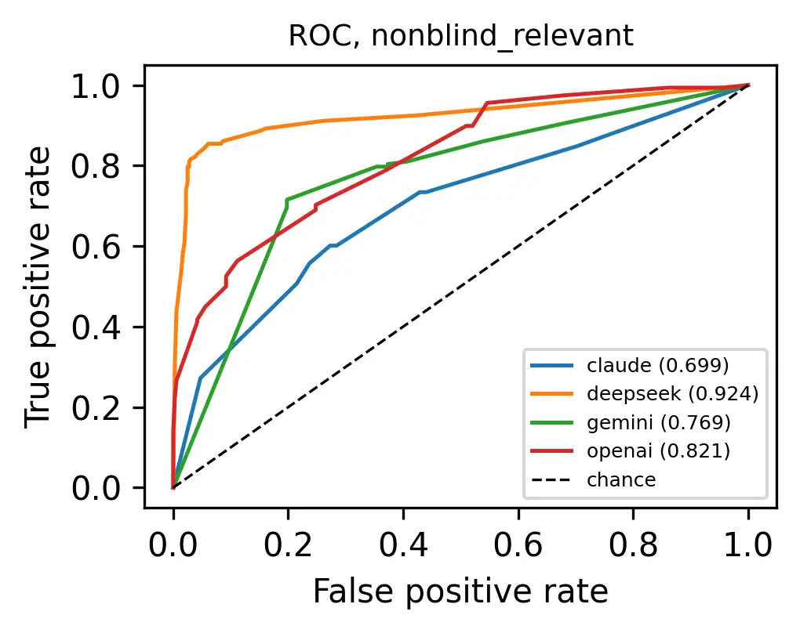

(a) ROC-AUC

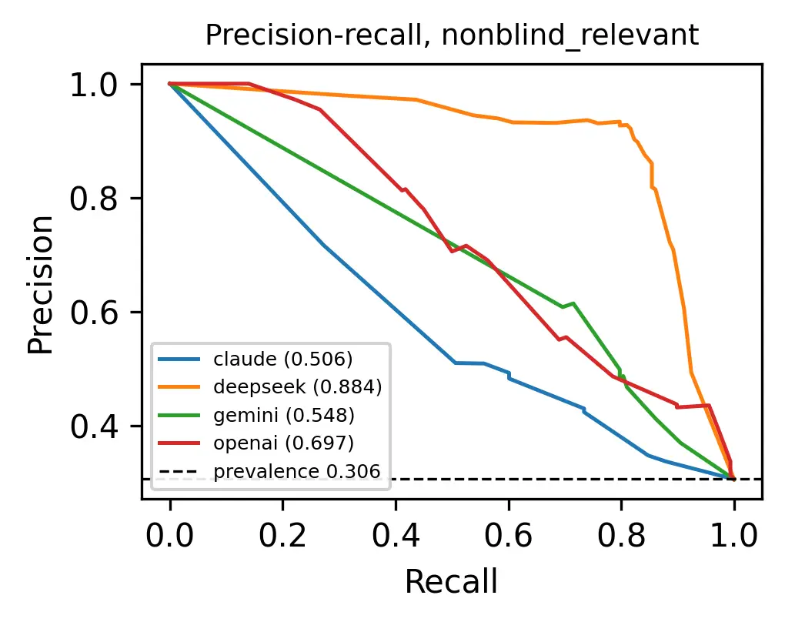

(b) PR-AUC

Fig. 2: (a) ROC and (b) PR curves per judge, out-of-fold, nonblind, 517
attempts

#### VI-A3 Probabilistic scoring ($`\mathcal{L}`$, $`B`$)

On Brier, DeepSeek is lowest ($`B=0.0717`$, against 0.1672 for OpenAI,
intervals separating); on $`\mathcal{L}`$, DeepSeek and OpenAI are not
distinguishable (0.5236 and 0.5477). Gemini and Claude have much larger
$`\mathcal{L}`$ (2.7769 and 1.6549), consistent with poorly calibrated
or overconfident wrong predictions. Calibration error across judges and
conditions ranges from 0.052 to 0.374, so this is not confined to one
judge or setting.

#### VI-A4 Calibration (ECE)

ECE₁₅ separates the judges into two tiers: DeepSeek (0.0627) and OpenAI
(0.1261), whose intervals overlap, are better calibrated than Claude
(0.2647) and Gemini (0.3036), whose intervals overlap with each other
but with neither of the first two. Calibration matters wherever a
judge’s probability is read at face value, for instance when a threshold
set on one sample is applied to another: lower ECE indicates that
predicted probabilities align more closely with empirical acceptance
frequencies on held-out attempts. The co-creation signal of Section VI-C
uses each judge’s ranks only, so no order-preserving recalibration
changes it. The reliability diagram in

Figure 3shows the same split: DeepSeek’s curve tracks the diagonal
closely throughout, while Claude and Gemini both compress toward the
middle at the high end, so a stated probability above 0.85 yields an
observed acceptance rate of only 0.4 to 0.5 for either judge.

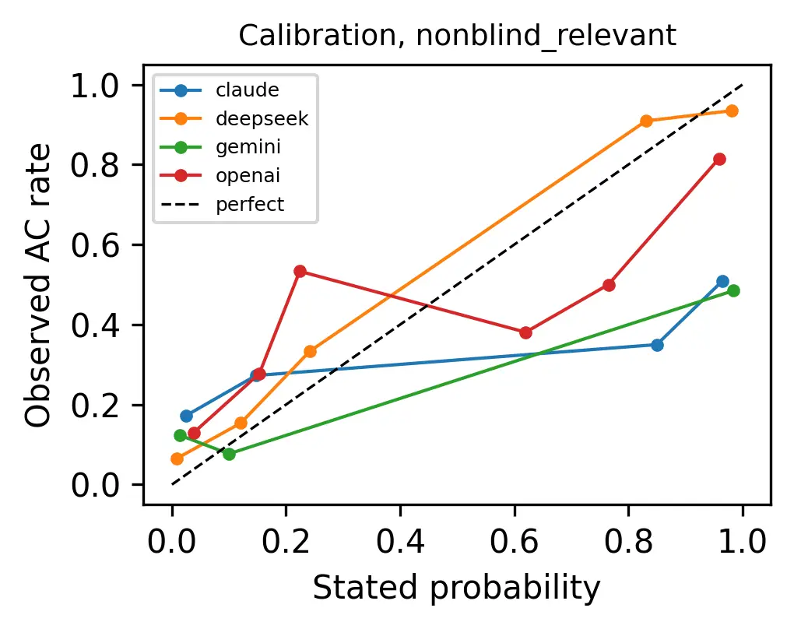

Fig. 3: Judge-level reliability: observed acceptance rate against mean
predicted probability per bin, out-of-fold, nonblind condition

#### VI-A5 Thresholded decision quality (MCC, out-of-fold)

MCC*(oof) pools the out-of-fold decisions of all ten folds
(Section IV-C). DeepSeek achieves the highest MCC*(oof) (0.7822), with
an interval clear of the other three; Gemini (0.4978, identical to its
in-fold value) and OpenAI (0.4396) overlap, and Claude (0.2120)
separates from Gemini but not from OpenAI. The gap between MCC and
MCC\_(oof) in

Table VIshows how much of a judge’s apparent decision quality depended
on the fold it was measured on; that gap is examined directly in
Section VI-A7.

#### VI-A6 Cross-metric comparison

Two cross-metric comparisons, illustrated in

Figure 4, test whether one favorable measurement transfers to another.
Panel (a) compares discrimination (ROC-AUC/PR-AUC) against out-of-fold
decision quality (MCC\_(oof)): favorable discrimination transfers to
decision quality, with DeepSeek leading on both and its intervals clear
of the others, while OpenAI and Gemini change places between the two
measures only within overlapping intervals. Panel (b) compares
calibration (ECE₁₅) against probabilistic scoring
($`\mathcal{L}`$/$`B`$). Here the point-estimate order is the same on
all three measures, DeepSeek, OpenAI, Claude, Gemini, and on each the
intervals separate DeepSeek and OpenAI from Claude and Gemini, so
probability quality transfers across measures at the level the intervals
support.

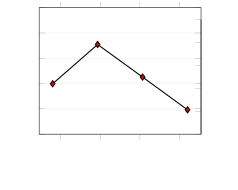

(a) Ranking vs. decision

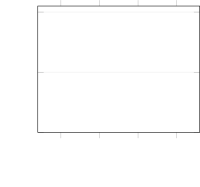

(b) Calibration vs. scoring

Fig. 4: Cross-metric comparison, nonblind: (a) ROC-AUC and PR-AUC
against MCC\_(oof); (b) ECE₁₅, $`\mathcal{L}`$, and $`B`$, min-max
normalized so higher is better (text uses raw values)

#### VI-A7 Scale Validity

A number in \[0,1\] can satisfy the schema without saying much. Across
the three input conditions, the four judges emit as few as 8 and as many
as 31 distinct probability values, collapsing a grid of 99 candidate
decision thresholds to as few as 6 effective rules. Under nonblind,
Claude, DeepSeek, Gemini, and OpenAI emit 11, 31, 10, and 22 distinct
values, leaving 10, 28, 8, and 20 effective rules of 99. Concentration
compounds the effect: Gemini places 181 of its 517 predictions (35.0%)
at exactly 1.00 and DeepSeek 221 (42.7%) at exactly 0.00, in a corpus
where 69.4% of attempts are not accepted. Coarse scales also make
decision quality depend on where the threshold is selected: under blind,
moving from in-fold to out-of-fold thresholds lowers MCC by 0% for
Gemini (0.4061 both), 1.1% for DeepSeek, 45.7% for Claude, and 62.5% for
OpenAI, the one judge whose two intervals do not overlap. Schema
compliance and scale validity are therefore separate properties: every
judge returns a well-formed probability, but not an equally informative
one.

#### VI-A8 Metric-Ranking Invariance

Which judge ranks best depends on which metric and which
threshold-selection method is used, a practical consequence of scale
validity, not a separate finding. Under the in-fold threshold, OpenAI’s
point estimate sits above Claude’s in the blind condition (MCC 0.3741
\[0.335, 0.486\] against 0.2184 \[0.134, 0.357\]); under out-of-fold
selection on the 369 anchored attempts, in the same condition, it falls
below (MCC\_(oof) 0.0729 \[$`-0.091`$, 0.245\] against 0.1463 \[0.007,
0.283\]). Neither difference separates, which is the point: a single
ranking would present an unstable order as a fixed one. The perturbation
study, reported in Section VI-B, separates the judges more clearly:
counting a score drop of more than 0.05 as a reaction, DeepSeek, the
most accurate judge on discrimination, reacted to 27 of 180
behavior-preserving edits, and Claude, the least accurate, to 1 of 129.
No judge is strongest on every measure, so two criteria are used
together, not one: a discrimination interval that excludes chance, and
an arm-discrimination interval that excludes chance on the perturbation
check. Calibration follows the same principle: with no established
cut-off for this setting, its value and consequence for threshold
transfer are reported directly.

#### VI-A9 Pairwise and multi-rater agreement (Cohen’s $`\kappa`$, Fleiss’ $`\kappa`$)

Inter-judge reliability is evaluated over all 517 attempts under each of
the three input conditions, with each judge’s continuous output cut at
its own median, a rank-based cut that places judges of different output
resolution on equal terms; since the conditions differ only in the
participant context supplied, any resulting difference is attributable
to that context alone (

Table VII).

|                                  |                         |                         |                         |                         |                       |                       |                                                   |                         |                         |                         |
| -------------------------------- | ----------------------- | ----------------------- | ----------------------- | ----------------------- | --------------------- | --------------------- | ------------------------------------------------- | ----------------------- | ----------------------- | ----------------------- |
| Panel A: condition-level summary |                         |                         |                         |                         |                       |                       | Panel B: pairwise Cohen’s $`\kappa`$ by condition |                         |                         |                         |
| Condition                        | Fleiss’ $`\kappa`$      | Mean $`\kappa`$         | Mean $`\rho`$           | $`\rho-\kappa`$         | Max $`\kappa`$ (pair) | Min $`\kappa`$ (pair) | Pair                                              | blind                   | prefix12k               | nonblind                |
| blind                            | 0.3714 \[0.299, 0.441\] | 0.3718 \[0.300, 0.441\] | 0.4863 \[0.410, 0.553\] | 0.1145 \[0.078, 0.151\] | 0.4844 (G-O)          | 0.2590 (C-D)          | C-D                                               | 0.2590 \[0.164, 0.354\] | 0.2497 \[0.148, 0.368\] | 0.3494 \[0.246, 0.461\] |
| prefix12k                        | 0.4178 \[0.343, 0.493\] | 0.4199 \[0.347, 0.495\] | 0.5414 \[0.474, 0.606\] | 0.1216 \[0.082, 0.156\] | 0.5021 (C-O)          | 0.2497 (C-D)          | C-G                                               | 0.4250 \[0.312, 0.526\] | 0.4224 \[0.327, 0.526\] | 0.4246 \[0.319, 0.534\] |
| nonblind                         | 0.4353 \[0.366, 0.510\] | 0.4366 \[0.368, 0.512\] | 0.5533 \[0.488, 0.614\] | 0.1167 \[0.075, 0.155\] | 0.5589 (G-O)          | 0.3494 (C-D)          | C-O                                               | 0.3232 \[0.221, 0.414\] | 0.5021 \[0.407, 0.588\] | 0.4567 \[0.354, 0.544\] |
|                                  |                         |                         |                         |                         |                       |                       | D-G                                               | 0.3771 \[0.270, 0.477\] | 0.4269 \[0.331, 0.526\] | 0.4149 \[0.321, 0.510\] |
|                                  |                         |                         |                         |                         |                       |                       | D-O                                               | 0.3621 \[0.260, 0.459\] | 0.4255 \[0.309, 0.542\] | 0.4152 \[0.306, 0.532\] |
|                                  |                         |                         |                         |                         |                       |                       | G-O                                               | 0.4844 \[0.378, 0.579\] | 0.4927 \[0.392, 0.594\] | 0.5589 \[0.468, 0.643\] |

TABLE VII: Inter-judge agreement across input conditions, each judge cut
at its own median, with 95% trajectory-clustered bootstrap intervals.
Max and Min repeat Panel B values, whose intervals are given there.
Judge codes: C=Claude, D=DeepSeek, G=Gemini, O=OpenAI

Agreement is higher with relevance-selected context than with none: on
the same resampled attempts, Fleiss’ $`\kappa`$ rises by 0.0639
\[0.0005, 0.1336\] from blind to nonblind, and mean rank agreement by
0.0670 \[0.0158, 0.1233\], while prefix12k lies between the two without
separating from either on $`\kappa`$. No pairwise agreement is negative,
and no pair’s interval reaches zero, under any condition (Panel B).
Claude-DeepSeek is the lowest pair under every condition, and the
leading pairs’ intervals overlap in every condition. Mean $`\rho`$
exceeds mean $`\kappa`$ by 0.11 to 0.12 in every condition, no more than
reducing each ranking to two halves produces on its own, so the residual
disagreement concerns which attempts are better, not merely where each
judge cuts.

Figure 5shows the nonblind pairs; Panel B gives all three conditions.

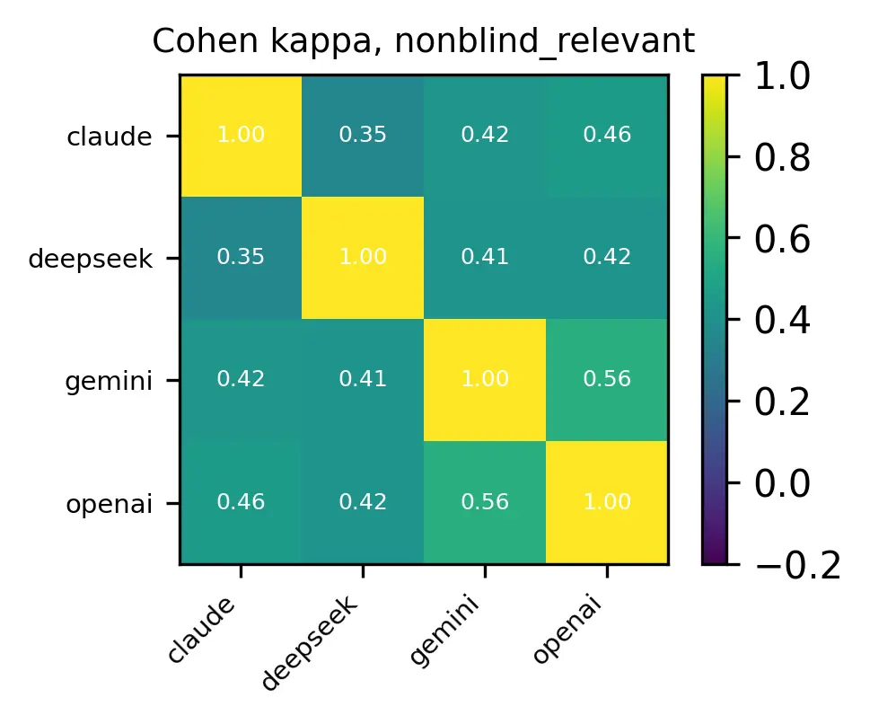

Fig. 5: Pairwise Cohen’s $`\kappa`$, nonblind condition, all 517
attempts, each judge cut at its own median

One further result bears on how much this residual disagreement should
be trusted: agreement across instruments is only half of consistency.
Under repeated application, 17 consecutive-attempt pairs in the corpus
consist of character-identical resubmissions, and the judged probability
moved between them at temperature zero, evidence that some of it
reflects the judges themselves and not only the input they are given.
The four judges are therefore not interchangeable, and their divergence
is reported as a limit with guidance attached: DeepSeek suits ranking
and triage, and Claude suits uses where the score must not move on edits
that leave behavior unchanged, on the evidence given in Section VI-A8.

#### VI-A10 Integrated performance perspective

Pooled metrics can also hide how a judge fails. DeepSeek’s own errors,
examined by type, are mostly confident FN: of its 47 out-of-fold errors
under nonblind, 30 reject attempts the contest accepted, 27 of them at
an acceptance probability of 0.2 or below, a different risk from a judge
that is merely uncertain. The per-problem breakdown makes such risks
visible where pooled figures hide them: on one problem, Gemini’s ROC-AUC
falls to 0.0614 under nonblind, an ordering inverted within that problem
although its pooled discrimination holds. Combining the four judges
tests this directly: an unweighted percentile-rank panel scores 0.8734
\[0.831, 0.913\] ROC-AUC under nonblind, 0.070 \[0.059, 0.082\] above
the mean member (0.8030 \[0.767, 0.841\]) but below the single strongest
member, DeepSeek (0.9236; difference $`-0.0502`$ \[$`-0.0883`$,
$`-0.0123`$\], excluding zero). The panel offers a safe default when the
best judge for a task is not yet known; knowing that judge offers more
still. Overall, no single judge leads on every measure, so a
multi-criteria view is what matches each judge to the use it has been
validated for.

#### VI-A11 Decision performance vs. agreement-based reliability

Figure 6relates each judge’s MCC\_(oof) to its mean pairwise Cohen’s
$`\kappa`$ to check whether stronger decisions come with broader
agreement. They do not: DeepSeek pairs the strongest decision quality
with the lowest mean pairwise $`\kappa`$ (0.3932 \[0.303, 0.487\],
against 0.4102 to 0.4769 for the others), with all four intervals
overlapping.

 

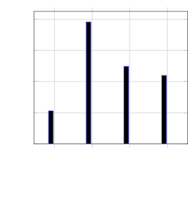

(a) Raw decision and agreement

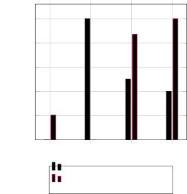

(b) Relative judge profiles

Fig. 6: Decision quality and agreement per judge, nonblind: (a)
MCC\_(oof) and mean pairwise $`\kappa`$; (b) the same, min-max normalized
(text uses raw values)

#### VI-A12 Robustness Checks

The main findings hold under three independent checks. First,
clustering: resampling the 13 problems in place of the trajectories, a
stricter assumption that treats all attempts on a problem as dependent,
widens the intervals by 1.76$`\times`$ on average, yet every judge still
exceeds chance, Claude most narrowly at $`[0.5887,0.8126]`$; all eight
condition-level findings keep their status; and DeepSeek’s lead over
Gemini and Claude still separates (DeepSeek \[0.8687, 0.9683\], Gemini
\[0.6811, 0.8507\]). Only the two closest comparisons, DeepSeek over
OpenAI (\[0.7205, 0.9147\]) and OpenAI over Claude, become ties. Second,
problem weighting: giving every problem equal weight under nonblind
changes each judge’s ROC-AUC by less than 0.05 (macro-averaged 0.9161
against 0.9236 for DeepSeek), so the pooled figures are not driven by
the largest problems. Third, prompt-design contamination: under the same
condition, the 38 trajectories (116 attempts) never inspected while the
judge prompt was designed score at least as high as the full corpus for
every judge, by 0.0005 to 0.0556, with every interval excluding 0.5 and
a similar prevalence (0.2931 against 0.3056).

### VI-B Perturbation Study Results

Results are reported on the primary subset defined in Section V-D, with
95% intervals from 2,000 bootstrap resamples of seeds, since the mutants
of one program are not independent observations. For each mutant, the
shift $`\Delta`$ is its judged probability minus that of its seed, both
under blind. Three properties of the score are measured: arm
discrimination $`A_{j}`$, the probability that a control mutant’s shift
exceeds a semantic mutant’s, which is the ROC-AUC of the shift as a
separator of the two arms; detection specificity, how often each arm
reacts, counting a drop of more than 0.05 as a reaction; and the
severity gradient $`\rho_{j}`$, the Spearman correlation between
operator severity and the size of the drop. Every shift is measured from
a seed the judge itself scored as acceptable: the primary subset keeps
84 to 118 seeds for DeepSeek, Gemini and Claude, and 59 for OpenAI,
which scored 75 of the 134 accepted seeds below 0.5.

|          |                         |                                  |                        |                         |
| -------- | ----------------------- | -------------------------------- | ---------------------- | ----------------------- |
| Judge    | $`A_{j}`$               | $`A_{j}`$, semantic arm in loops | Reactions, sem. / ctl. | $`\rho_{j}`$            |
| OpenAI   | 0.8655 \[0.824, 0.905\] | 0.9465 \[0.905, 0.980\]          | 113/144 11/92          | 0.2717 \[0.124, 0.405\] |
| DeepSeek | 0.8478 \[0.814, 0.881\] | 0.9041 \[0.867, 0.941\]          | 225/296 27/180         | 0.3159 \[0.216, 0.412\] |
| Gemini   | 0.7512 \[0.719, 0.783\] | 0.8438 \[0.796, 0.891\]          | 161/287 14/179         | 0.3681 \[0.271, 0.452\] |
| Claude   | 0.8380 \[0.806, 0.871\] | 0.8982 \[0.853, 0.939\]          | 137/200 1/129          | 0.2464 \[0.132, 0.359\] |

TABLE VIII: Perturbation results, primary subset, blind, 95%
seed-clustered intervals. Reactions: mutants whose judged probability
drops by more than 0.05, of those scored; semantic arm (sem.) above
control arm (ctl.)

#### VI-B1 Arm Discrimination and Specificity

All four judges reliably separate a broken program from an edited one
that behaves the same, every interval lying above 0.5 (

Table VIII). OpenAI, DeepSeek and Claude form one tier, between 0.8380
and 0.8655 with overlapping intervals, and Gemini sits below them, its
interval clear of all three, at 0.7512 \[0.719, 0.783\]. The arms differ
in size as well as in rank: semantic mutants lower the judged
probability by 0.49 to 0.69 on average, control mutants by 0.004 to
0.092. Specificity distinguishes the judges more sharply still. Claude
is the most specific, reacting to 1 of its 129 control mutants against
27 of 180 for DeepSeek, and on the post-increment rewrite, which
provably changes nothing, DeepSeek’s score falls by 0.124 on average
where Claude’s rises by 0.001.

#### VI-B2 Grading by Severity

Every judge’s drop grows with the severity of the defect, with
$`\rho_{j}`$ from 0.2464 \[0.132, 0.359\] for Claude to 0.3681 \[0.271,
0.452\] for Gemini, every interval excluding zero (

Figure 7). The subtlest defect separates the judges most: on a narrowed
integer type, which still compiles and stays correct below 32 bits,
Gemini’s score falls by 0.22 on average against 0.40 to 0.45 for the
others. The gradient is steepest across the subtler defects and levels
off at the top, where the most visible defect, the arithmetic flip,
already draws drops of 0.67 to 0.87.

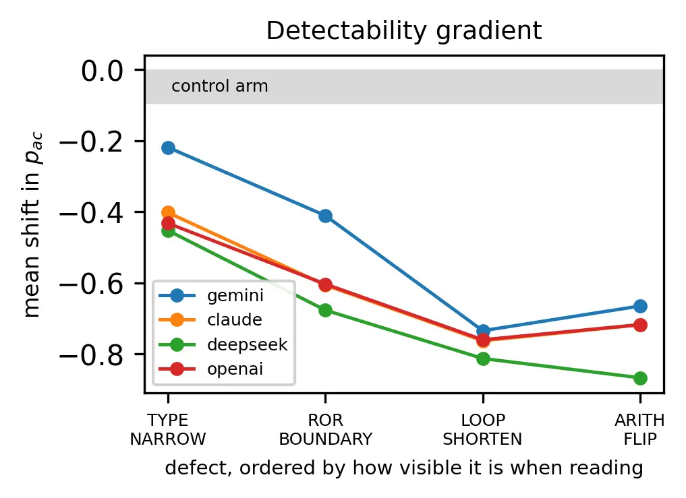

Fig. 7: Mean shift in the judged probability per semantic operator,
ordered by severity, primary subset, blind condition. The grey band
spans the control arm’s mean shifts

#### VI-B3 Two Abilities, Not One

Ranking real submissions and reacting to a broken one are separate
abilities (

Figure 8). Claude and Gemini cannot be told apart on accuracy, 0.6985
\[0.633, 0.763\] against 0.7691 \[0.719, 0.817\], yet separate on
detection, 0.8380 \[0.806, 0.871\] against 0.7512 \[0.719, 0.783\].
DeepSeek, first on accuracy (0.9236 \[0.890, 0.954\]), is not first on
detection, where it overlaps OpenAI and Claude. With four judges, no
correlation between the two abilities is computed; the separation rests
on the intervals alone.

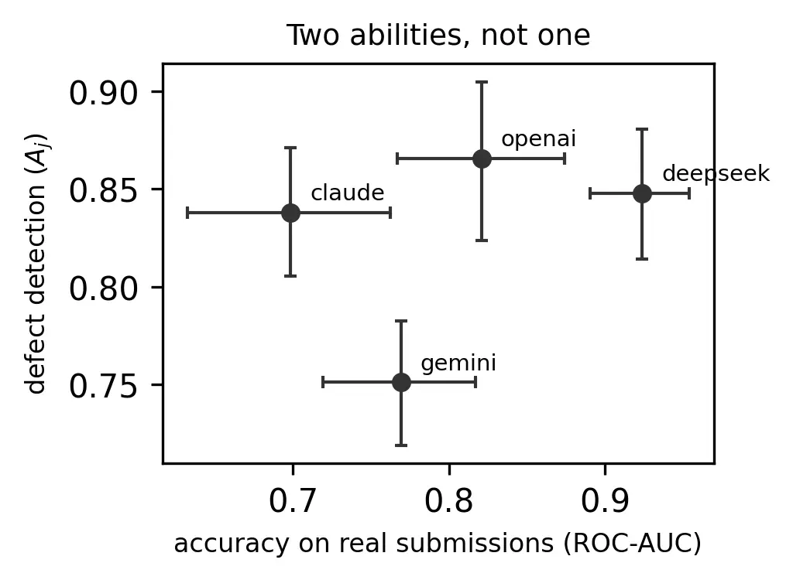

Fig. 8: Accuracy (ROC-AUC, nonblind, 517 attempts) against defect
detection ($`A_{j}`$, blind, primary subset), with 95% intervals

#### VI-B4 Conservative Estimates

A mutant’s defect is fixed by construction, since the contest’s hidden
tests run only inside its official judge system, so any intended defect
that happens not to change behavior counts against a judge as a missed
detection; and 35 of the 348 semantic mutants sit in a guard context,
where the edit may be unreachable under the problem’s own constraints.
Both can only lower $`A_{j}`$, never raise it. Setting the guard mutants
aside, by restricting the semantic arm to loop contexts, raises every
judge’s $`A_{j}`$ to between 0.8438 for Gemini and 0.9465 for OpenAI (

Table VIII), in line with some guard mutants being behaviorally
equivalent; since the restriction also sets aside the subtlest operator,
which never occurs in a loop, the two effects are not separated here.
The result also holds on the full set: on every scored mutant, including
seeds a judge misjudged, every interval excludes 0.5, from 0.7359
\[0.706, 0.768\] for Gemini to 0.8246 \[0.792, 0.857\] for DeepSeek.

### VI-C Human-AI Co-Creation Dynamics Results

The co-creation analyses fall into two groups, reported in that order.
Success@Turn, time-to-success, revision churn, and code-aware similarity
are computed from submissions and verdicts alone and do not depend on
any judge. The turn-wise rank consensus $`\bar{q}_{u,p,k}`$ and the
judged improvement $`\Delta\bar{q}_{u,p,k}`$ (Section IV-C) do depend on
the judges; they are computed under nonblind and rest on the validated
discrimination of the four-judge panel whose score they use, ROC-AUC
0.8734 \[0.831, 0.913\] (Section VI-A), so that no co-creation finding
rests on one model.

#### VI-C1 Success by Turn and Time-to-Success

Success accumulates across turns (

Figure 9): Success@Turn rises from 0.6033 \[0.533, 0.674\] at the first
attempt to 0.7065 \[0.636, 0.772\] by the second and 0.8370 \[0.783,
0.886\] by the tenth, toward the 0.8424 of trajectories ever solved (155
of 184). The first-turn value carries a selection effect that has to be
read with it: a trajectory is single-attempt largely because its first
attempt succeeded, so 108 of the 111 single-attempt trajectories are
solved against 47 of the 73 multi-attempt ones. The conditional quantity
is the informative one. Of the 73 trajectories not solved at their first
attempt, 44 (60.3%) succeed later, 44 of the 70 that continued (62.9%),
with the first success at a median of turn 3 and as late as turn 14. For
the multi-attempt trajectories alone, Success@Turn climbs from 0.041 to
0.644, so most of their success comes after the first turn. The
Kaplan-Meier curve, which right-censors the 29 never-solved trajectories
at their last attempt, gives the same picture from the other side:
survival stands at 0.397 after the first turn, declines through the
early turns, and is flat after turn 14.

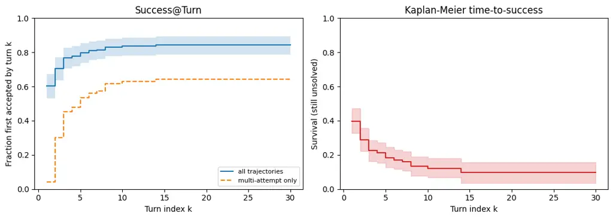

Fig. 9: (a) Success@Turn, the share of trajectories first accepted by
turn $`k`$: all 184 (solid, 95% interval) and the 73 multi-attempt ones
(dashed). (b) Kaplan-Meier share still unsolved, never-solved
trajectories censored at their last attempt

#### VI-C2 Revision Magnitude and Similarity to the Accepted Solution

Revisions between consecutive attempts are substantial: across the 333
transitions of the 73 multi-attempt trajectories, the NED churn has a
median of 0.5138. Revision size does not distinguish the transitions
that reached acceptance from those that did not, their mean churn
differing by +0.0406 \[$`-0.032`$, +0.111\]. Among solved trajectories,
the CodeBLEU similarity of each attempt to the first accepted
submission, with that submission excluded from its own comparison, has a
median of 0.3103 and a first quartile of 0.2109 over 125 observations,
with 6.4% above 0.8 (

Figure 10); the one value at 1.0 is an attempt that resubmitted the
accepted code unchanged. The distribution stands as a descriptive
reference: comparing it with the similarity of independent solutions to
the same problems is the step that would turn it into a test of
convergence.

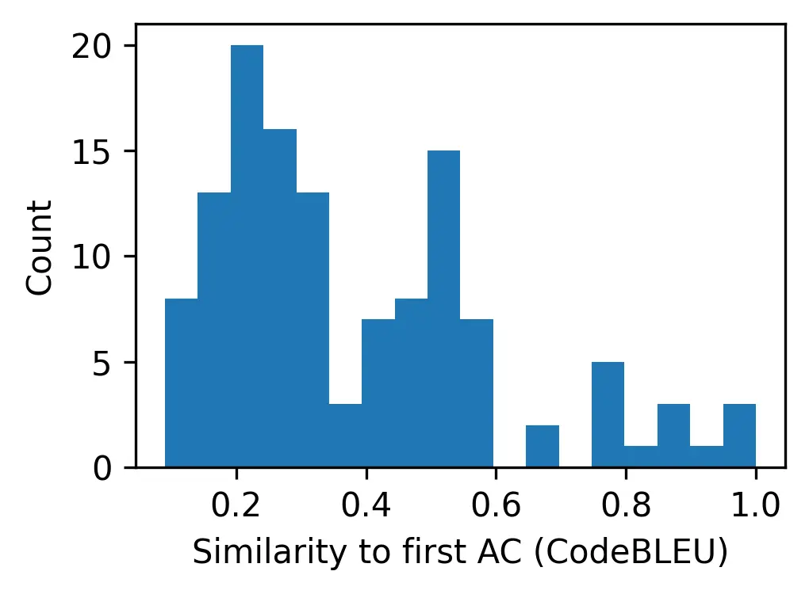

Fig. 10: CodeBLEU similarity to the first accepted submission in solved
trajectories: 125 of 280 observations, after excluding the 155 that
score that submission against itself

#### VI-C3 Turn-Wise Rank Consensus

The six trajectories in

Figure 11follow the fixed selection rule in its caption. The solved ones
reach acceptance after uneven paths of 8 to 14 attempts. The unsolved
ones fall on problems 781 and 782, and problem 781 drew a single
acceptance in 115 attempts across all participants, the one in the top
row; one of them rises past a rank consensus of 0.7 without ever being
accepted, so a rising curve does not by itself imply acceptance. Across
all 517 attempts, the rank consensus separates the verdicts clearly (

Figure 12): its median is 0.40 for the 359 non-accepted attempts and
0.75 for the 158 accepted, with interquartile ranges of \[0.25, 0.54\]
and \[0.59, 0.84\] that do not overlap, while the whiskers do.

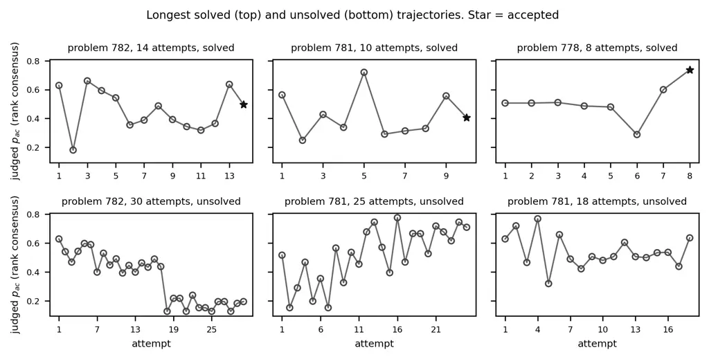

Fig. 11: Rank consensus $`\bar{q}`$ per attempt, nonblind, for the three
longest solved (top) and three longest unsolved (bottom) trajectories; a
star marks acceptance. Long trajectories cluster on the hardest
problems, so the panel is not a random sample

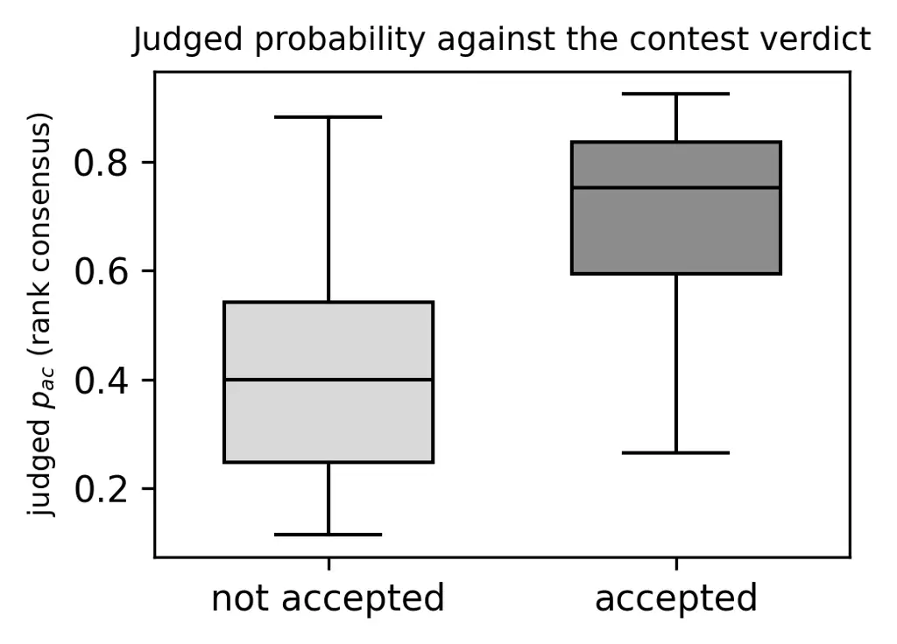

Fig. 12: Rank consensus $`\bar{q}`$ by verdict, nonblind: 359
non-accepted and 158 accepted attempts

#### VI-C4 Revision Magnitude Against Judged Improvement

Larger revisions do not bring larger judged gains (

Figure 13). Over the same 333 transitions, NED churn and the judged
improvement $`\Delta\bar{q}`$ are uncorrelated, Spearman 0.0007
\[$`-0.085`$, +0.090\], with the interval clustered on the 73
trajectories, and the code-aware CodeBLEU distance agrees at 0.033, for
which no clustered interval was computed. With the judge-independent
result above, the finding holds on both sides of the measurement:
revision size predicts neither the judged improvement nor the verdict.
Accepted transitions appear across the whole range, from small targeted
edits to near rewrites, so productive revision in this setting takes
more than one form.

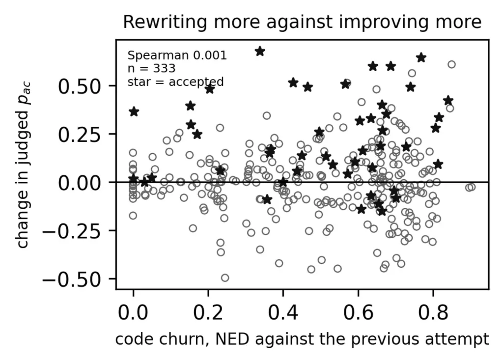

(a) NED churn

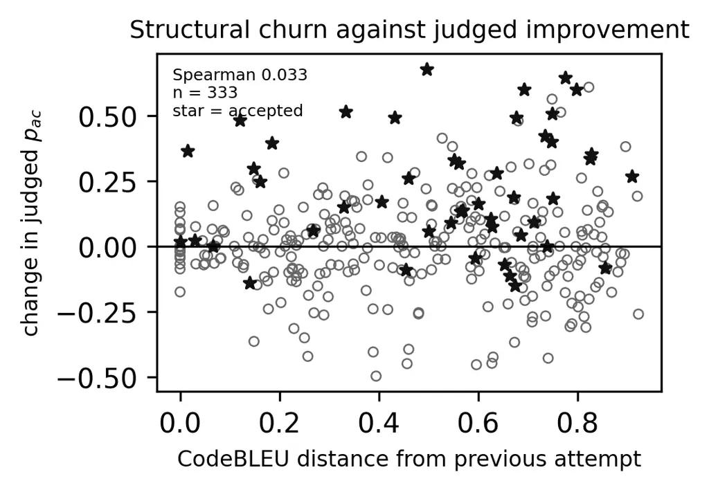

(b) CodeBLEU distance

Fig. 13: Revision size between consecutive attempts against judged
improvement $`\Delta\bar{q}`$, 333 transitions, nonblind; stars mark
transitions reaching acceptance

### VI-D Synthesis with respect to RQs and EQs

Each pair is answered evaluation question first, since a research
question’s answer is admissible only where its evaluation question
holds; EQ3 comes first because the judge-dependent parts of RQ1 and RQ2
rest on it.

#### VI-D1 EQ3/RQ3: Measurement quality and judges as measurement instruments

EQ3 is met on all five criteria, with limits stated per judge. Every
judge discriminates against the contest verdict, every interval
excluding chance, also under problem clustering (

Table VI). Out-of-fold thresholds transfer intact for Gemini and nearly
so for DeepSeek, while OpenAI and Claude lose 62.5% and 45.7% of their
in-fold MCC under blind, on scales with as few as 8 distinct values
(Section VI-A7). Calibration separates DeepSeek and OpenAI from Claude
and Gemini; agreement is beyond chance for every pair and higher with
relevance-selected context than with none (

Table VII); and every judge’s score falls further on a broken program
than on a behavior-preserving edit, every severity gradient excluding
zero (

Table VIII). RQ3 is answered on that basis. Multiple LLM judges provide
auditable assessments whose stability is measured: agreement is
moderate, Fleiss’ $`\kappa`$ 0.4353 \[0.366, 0.510\] under nonblind, and
depends on the request, since supplying the problem statement rebuilt
the judges’ ordering (rank correlation 0.3021 \[0.168, 0.424\]). The
judges are therefore not interchangeable. DeepSeek ranks attempts best,
Claude reacts least to edits that change nothing, and Claude and Gemini,
indistinguishable on accuracy, separate on defect detection, so the
choice of judge follows its intended use.

#### VI-D2 EQ1/RQ1: Trajectory validity and co-creation dynamics

EQ1 is met: Success@Turn, with intervals, and time-to-success under
right-censoring characterize trajectories beyond their final attempt
from verdicts alone (

Figure 9). RQ1’s answer is that success accumulates across turns: 44 of
the 73 trajectories unsolved at the first attempt (60.3%) succeed later,
at a median of turn 3, a result an outcome-only evaluation cannot reach.
The judges’ rank consensus, which rests on EQ3 through the panel’s
ROC-AUC of 0.8734 \[0.831, 0.913\], separates accepted from non-accepted
attempts (medians 0.75 and 0.40,

Figure 12) and traces uneven paths in which a rise does not by itself
imply acceptance.

#### VI-D3 EQ2/RQ2: Churn and similarity validity, and revision behavior

EQ2 is met: NED churn and CodeBLEU distance are computed for all 333
transitions, and the relation of NED churn to progress carries an
interval. The earlier convergence reading is withdrawn: similarity to
the first accepted solution, median 0.3103 over 125 observations (

Figure 10), stays a description until a baseline of independent
solutions turns it into a test. RQ2’s answer rests on one finding:
revision size does not predict progress. It is unrelated to judged
improvement, Spearman 0.0007 \[$`-0.085`$, +0.090\], and does not
separate the transitions that reached acceptance, +0.0406 \[$`-0.032`$,
+0.111\] (

Figure 13), so incremental refinement and broader restructuring both
lead to acceptance. The verdict side involves no judge and reaches the
same null, so the finding does not rest on the judges alone; on the
judged side, which rests on EQ3, the null is also compatible with
reports that LLM judges are insensitive to refinement effort \[54\].

## VII Discussion

### VII-A Overall interpretation of the findings

Co-creation progress continues well beyond the first attempt: success
keeps accumulating across turns, and most trajectories that miss at
first go on to succeed. Early success rates also carry a selection
effect, since a trajectory is short largely because its first attempt
succeeded; the conditional view, success after an initial failure,
removes that confound and shows persistence paying off. Revision size
predicts neither judged improvement nor the verdict, so progress shows
in what a revision achieves, not in how much it changes. On the
measurement side, ranking quality, calibration, decision stability, and
defect sensitivity order the judges differently, so each criterion
guides a different choice of judge. Execution outcomes remain the
anchor; attempt-level tracking with a validated instrument extends what
they reveal about co-creation.

### VII-B LLM-as-a-Judge as an evaluation framework

Rubric-driven LLM judges serve as measurement instruments for
co-creative coding when their outputs are treated as structured,
auditable signals, and turning the pipeline on its own outputs yields
three findings that make this practical. First, the specification of the
judge input is a first-order design variable: supplying the problem
statement rebuilt the judges’ ordering, so judge performance is reported
together with the request that produced it, given here for each
condition with its coverage evidence. Second, scale validity is measured
alongside schema compliance: it shows how many distinct decisions each
judge’s probabilities support, and range-bounded output checks now catch
out-of-range rubric scores of the kind an unbounded schema check let
through on 39 rows of an earlier run. Third, accuracy and defect
sensitivity are measured as distinct properties, so each judge is
matched to the use it has been validated for. Because the judges are not
interchangeable, the framework states which judge suits which use, on
the evidence of Sections VI-A and VI-B. The pipeline is auditable end to
end. Context provenance is stated per request; every row is judged on
the full input, and any row that cannot be is recorded as a failure,
never shortened to fit; and model identity is recorded as the provider
reports it, which matters because one requested identifier resolved to a
different served model.

### VII-C Human-AI co-creation in coding and software engineering

The findings divide into those that transfer and those specific to the
contest, and both are useful. The three judge-side findings are likely
to transfer to other uses of an LLM as a judge, since they concern how a
judge’s output relates to its input, its scale and its sensitivity. The
apparatus transfers as well: attempt-level trajectories, conditional
success, revision-magnitude measures and the perturbation check apply
wherever attempts are logged against some ground truth. The co-creation
outcomes transfer as patterns, not as numbers, since they reflect
competitive programming under time pressure. One pattern agrees with
practice: progress follows no single revision style, so effective
co-creation rests on the participant’s capacity to evaluate intermediate
outputs and steer the next revision, a capacity that grows more valuable
as AI assistance improves.

### VII-D Practical implications for future co-creation studies

Several practices follow. Log every attempt, since conditional success
and time-to-success depend on it; report the judge request, including
what the judge sees and where its context is cut; check a judge’s output
scale before relying on its threshold, and record the served model
identity with every response; choose each judge for its intended use,
with a panel ranked on a common scale as a safe default when no single
judge is validated for that use; and measure defect sensitivity
directly, with a perturbation check against matched controls.

### VII-E Limitations

The findings hold within six boundaries, each opening a natural
extension. (i) Scope: one contest, with 15 participants, 13 problems and
517 attempts; the judge-side findings are likely to transfer, as they
concern how a judge’s output relates to its input, scale and
sensitivity, while the co-creation patterns invite replication in
open-ended development. (ii) Context: participant context is
reconstructed from logs, so context-dependent results are also reported
on the evidence-backed subset. (iii) Hosted judges: identifiers can be
aliases and outputs can vary at temperature zero, so the served identity
is recorded with every response. (iv) Perturbation: defects are
intended, not executed, and some guard-context edits may be unreachable,
so the reported sensitivity is a conservative estimate. (v) Revision and
similarity: a baseline of independent solutions would turn the
similarity distribution into a convergence test, and the judged-side
null may partly reflect judge insensitivity, although the verdict side
shows the same null. (vi) CodeBLEU: the data-flow component is excluded
and C is scored under the C++ configuration, which affects only the
post-hoc similarity analysis.

## VIII Conclusion

This study presented a reliability-aware _LLM-as-a-Judge_ framework for
evaluating _human-AI co-creation_ in contest-style coding, in which four
judges score every attempt through a verified, schema-constrained
pipeline under three input conditions, and their measurement quality is
tested alongside the co-creation analysis.

Four findings stand out. First, the judge input is a first-order design
variable: supplying the problem statement rebuilt the judges’ ordering
of the same attempts (rank correlation 0.3021 \[0.168, 0.424\]) and
raised out-of-fold ROC-AUC by 0.130 \[0.061, 0.202\] to 0.295 \[0.214,
0.381\] for the three judges whose model was unchanged. Second, schema
compliance does not guarantee a usable scale: the judges emit as few as
8 distinct probability values, leaving as few as 6 effective decision
rules on a 99-point threshold grid. Third, accuracy and defect
sensitivity are separable: every judge detects injected defects, yet
Claude and Gemini, indistinguishable on accuracy (0.6985 \[0.633,
0.763\] and 0.7691 \[0.719, 0.817\]), separate on detection (0.8380
\[0.806, 0.871\] and 0.7512 \[0.719, 0.783\]), so each judge is chosen
for its use. Fourth, success accumulates across turns, from 0.6033
\[0.533, 0.674\] at the first attempt to 0.8370 \[0.783, 0.886\] by the
tenth; 44 of the 73 trajectories unsolved at first (60.3%) succeed
later, and revision size predicts neither judged improvement (Spearman
0.0007 \[$`-0.085`$, +0.090\]) nor the verdict.

Future work follows directly: weighted or selected judge panels, set
against the unweighted panel examined here; a baseline of independent
solutions, which would turn the similarity analysis into a test of
convergence; perturbation checks with participant context and
execution-confirmed defects; and replication beyond contest-style
programming. Together, the results show that execution outcomes, tracked
across attempts and read through validated judges, reveal both how
co-creative solutions form and how far a judge’s assessment can be
trusted.

## References

- \[1\] A. Vaswani, N. Shazeer, N. Parmar, J. Uszkoreit, L. Jones, A. N.
  Gomez, Ł. Kaiser, and I. Polosukhin (2017) Attention is all you need.
  Advances in neural information processing systems 30. Cited by: §I.
- \[2\] M. M. Rahman, A. I. Shiplu, M. F. I. Amin, Y. Watanobe, and L.
  Peng (2025) Large language models for education and research: an
  empirical and user survey-based analysis. arXiv preprint
  arXiv:2512.08057. Cited by: §I.
- \[3\] L. Ouyang, J. Wu, X. Jiang, D. Almeida, C. Wainwright, P.
  Mishkin, C. Zhang, S. Agarwal, K. Slama, A. Ray, et al. (2022)
  Training language models to follow instructions with human feedback.
  Advances in neural information processing systems 35, pp. 27730–27744.
  Cited by: §I.
- \[4\] T. Brown, B. Mann, N. Ryder, M. Subbiah, J. D. Kaplan, P.
  Dhariwal, A. Neelakantan, P. Shyam, G. Sastry, A. Askell, et
  al. (2020) Language models are few-shot learners. Advances in neural
  information processing systems 33, pp. 1877–1901. Cited by: §I.
- \[5\] G. Crupi, R. Tufano, A. Velasco, A. Mastropaolo, D. Poshyvanyk,
  and G. Bavota (2025) On the effectiveness of llm-as-a-judge for code
  generation and summarization. IEEE Transactions on Software
  Engineering. Cited by: §I, §II, §II.
- \[6\] M. Chen, J. Tworek, H. Jun, Q. Yuan, H. P. D. O. Pinto, J.
  Kaplan, H. Edwards, Y. Burda, N. Joseph, G. Brockman, et al. (2021)
  Evaluating large language models trained on code. arXiv preprint
  arXiv:2107.03374. Cited by: §I, §II.
- \[7\] J. Rezwana and M. L. Maher (2023) Designing creative ai partners
  with cofi: a framework for modeling interaction in human-ai
  co-creative systems. ACM Transactions on Computer-Human Interaction 30
  (5), pp. 1–28. Cited by: §I, §II.
- \[8\] A. Nguyen, Y. Hong, B. Dang, and X. Huang (2024) Human-ai
  collaboration patterns in ai-assisted academic writing. Studies in
  Higher Education 49 (5), pp. 847–864. Cited by: §I, §II.
- \[9\] M. Hassany, P. Brusilovsky, J. Ke, K. Akhuseyinoglu,
  and A. B. L. Narayanan (2024) Human-ai co-creation of worked examples
  for programming classes. arXiv preprint arXiv:2402.16235. Cited by:
  §I, §II, §II.
- \[10\] N. Kadenhe, M. Al Musleh, and A. Lompot (2025) Human-ai
  co-design and co-creation: a review of emerging approaches,
  challenges, and future directions. In Proceedings of the AAAI
  Symposium Series, Vol. 6, pp. 265–270. Cited by: §I.
- \[11\] S. Honarvar, M. Rei, and A. Donaldson (2025) The “question
  neighbourhood” approach for systematic evaluation of code-generating
  llms. IEEE Transactions on Software Engineering. Cited by: §I, §I,
  §II.
- \[12\] Y. Liu, D. Iter, Y. Xu, S. Wang, R. Xu, and C. Zhu (2023)
  G-eval: nlg evaluation using gpt-4 with better human alignment. In
  Proceedings of the 2023 conference on empirical methods in natural
  language processing, pp. 2511–2522. Cited by: §I, §I, §II.
- \[13\] Y. Chang, X. Wang, J. Wang, Y. Wu, L. Yang, K. Zhu, H. Chen, X.
  Yi, C. Wang, Y. Wang, et al. (2024) A survey on evaluation of large
  language models. ACM transactions on intelligent systems and
  technology 15 (3), pp. 1–45. Cited by: §I, §I, §II.
- \[14\] J. Gu, X. Jiang, Z. Shi, H. Tan, X. Zhai, C. Xu, W. Li, Y.
  Shen, S. Ma, H. Liu, et al. (2024) A survey on llm-as-a-judge. The
  Innovation. Cited by: §I, §II, §II.
- \[15\] H. Li, Q. Dong, J. Chen, H. Su, Y. Zhou, Q. Ai, Z. Ye, and Y.
  Liu (2024) Llms-as-judges: a comprehensive survey on llm-based
  evaluation methods. arXiv preprint arXiv:2412.05579. Cited by: §I,
  §II, §II.
- \[16\] J. Liu, C. S. Xia, Y. Wang, and L. Zhang (2023) Is your code
  generated by chatgpt really correct? rigorous evaluation of large
  language models for code generation. Advances in neural information
  processing systems 36, pp. 21558–21572. Cited by: §I.
- \[17\] J. Li, S. Sun, W. Yuan, R. Fan, H. Zhao, and P. Liu (2023)
  Generative judge for evaluating alignment. arXiv preprint
  arXiv:2310.05470. Cited by: §I, §I, §II.
- \[18\] R. Wang, J. Guo, C. Gao, G. Fan, C. Y. Chong, and X. Xia (2025)
  Can llms replace human evaluators? an empirical study of
  llm-as-a-judge in software engineering. Proceedings of the ACM on
  Software Engineering 2 (ISSTA), pp. 1955–1977. Cited by: §I, §II.
- \[19\] Z. Ji, P. Ma, Z. Li, Z. Wang, and S. Wang (2025)
  Causality-aided evaluation and explanation of large language
  model-based code generation. Proceedings of the ACM on Software
  Engineering 2 (ISSTA), pp. 1374–1397. Cited by: §I.
- \[20\] C. Koutcheme, N. Dainese, S. Sarsa, A. Hellas, J. Leinonen, S.
  Ashraf, and P. Denny (2025) Evaluating language models for generating
  and judging programming feedback. In Proceedings of the 56th ACM
  Technical Symposium on Computer Science Education V. 1, pp. 624–630.
  Cited by: §I.
- \[21\] The University of Aizu (2025) PC koshien 2025. Note: Online.
  [https://pckoshien.u-aizu.ac.jp/](https://pckoshien.u-aizu.ac.jp/)Accessed:
  February, 2026 Cited by: §I, §III-A1.
- \[22\] L. Zheng, W. Chiang, Y. Sheng, S. Zhuang, Z. Wu, Y. Zhuang, Z.
  Lin, Z. Li, D. Li, E. Xing, et al. (2023) Judging llm-as-a-judge with
  mt-bench and chatbot arena. Advances in neural information processing
  systems 36, pp. 46595–46623. Cited by: §I.
- \[23\] A. Pathak, R. Gandhi, V. Uttam, A. Ramamoorthy, P. Ghosh, A. R.
  Jindal, S. Verma, A. Mittal, A. Ased, C. Khatri, et al. (2025) Rubric
  is all you need: improving llm-based code evaluation with
  question-specific rubrics. In Proceedings of the 2025 ACM Conference
  on International Computing Education Research V. 1, pp. 181–195. Cited
  by: §I.
- \[24\] Y. Wang, Z. Yu, W. Yao, Z. Zeng, L. Yang, C. Wang, H. Chen, C.
  Jiang, R. Xie, J. Wang, X. Xie, W. Ye, S. Zhang, and Y. Zhang (2024)
  PandaLM: an automatic evaluation benchmark for LLM instruction tuning
  optimization. In The Twelfth International Conference on Learning
  Representations, External Links:
  [Link](https://openreview.net/forum?id=5Nn2BLV7SB) Cited by: §I.
- \[25\] L. Zhu, X. Wang, and X. Wang (2023) Judgelm: fine-tuned large
  language models are scalable judges. arXiv preprint arXiv:2310.17631.
  Cited by: §I.
- \[26\] C. Chiang and H. Lee (2023) A closer look into using large
  language models for automatic evaluation. In Findings of the
  association for computational linguistics: EMNLP 2023, pp. 8928–8942.
  Cited by: §I, §I.
- \[27\] Y. Dubois, B. Galambosi, P. Liang, and T. B. Hashimoto (2024)
  Length-controlled alpacaeval: a simple way to debias automatic
  evaluators. arXiv preprint arXiv:2404.04475. Cited by: §I, §I.
- \[28\] Y. Wang, P. Ji, C. Yang, K. Li, M. Hu, J. Li, and G.
  Sartoretti (2025) Mcts-judge: test-time scaling in llm-as-a-judge for
  code correctness evaluation. arXiv preprint arXiv:2502.12468. Cited
  by: §I.
- \[29\] L. Shi, C. Ma, W. Liang, X. Diao, W. Ma, and S. Vosoughi (2025)
  Judging the judges: a systematic study of position bias in
  llm-as-a-judge. In Proceedings of the 14th International Joint
  Conference on Natural Language Processing and the 4th Conference of
  the Asia-Pacific Chapter of the Association for Computational
  Linguistics, pp. 292–314. Cited by: §I, §I, §II.
- \[30\] Q. Wang, Z. Lou, Z. Tang, N. Chen, X. Zhao, W. Zhang, D. Song,
  and B. He (2025) Assessing judging bias in large reasoning models: an
  empirical study. arXiv preprint arXiv:2504.09946. Cited by: §I, §I,
  §II.
- \[31\] K. Wataoka, T. Takahashi, and R. Ri (2024) Self-preference bias
  in llm-as-a-judge. arXiv preprint arXiv:2410.21819. Cited by: §I, §I,
  §II, §II.
- \[32\] Z. Ye, X. Li, Q. Li, Q. Ai, Y. Zhou, W. Shen, D. Yan, and Y.
  Liu (2025) Learning llm-as-a-judge for preference alignment. In The
  Thirteenth International Conference on Learning Representations, Cited
  by: §I.
- \[33\] G. H. Chen, S. Chen, Z. Liu, F. Jiang, and B. Wang (2024)
  Humans or llms as the judge? a study on judgement bias. In Proceedings
  of the 2024 Conference on Empirical Methods in Natural Language
  Processing, pp. 8301–8327. Cited by: §I, §I, §II.
- \[34\] C. E. Jimenez, J. Yang, A. Wettig, S. Yao, K. Pei, O. Press,
  and K. Narasimhan (2023) Swe-bench: can language models resolve
  real-world github issues?. arXiv preprint arXiv:2310.06770. Cited by:
  §I.
- \[35\] H. Jiang, Y. Chen, Y. Cao, H. Lee, and R. T. Tan (2025)
  Codejudgebench: benchmarking llm-as-a-judge for coding tasks. arXiv
  preprint arXiv:2507.10535. Cited by: §I, §I, §II.
- \[36\] S. Tan, S. Zhuang, K. Montgomery, W. Y. Tang, A. Cuadron, C.
  Wang, R. A. Popa, and I. Stoica (2024) Judgebench: a benchmark for
  evaluating llm-based judges. arXiv preprint arXiv:2410.12784. Cited
  by: §I, §I, §II.
- \[37\] M. F. I. Amin, A. Shirafuji, M. M. Rahman, and Y.
  Watanobe (2024) Multi-label code error classification using codet5 and
  ml-knn. IEEE Access 12, pp. 100805–100820. Cited by: §II.
- \[38\] M. F. I. Amin, Y. Watanobe, M. M. Rahman, and A.
  Shirafuji (2025) Source code error understanding using bert for
  multi-label classification. IEEE Access 13, pp. 3802–3822. Cited by:
  §II.
- \[39\] M. M. Rahman, A. I. Shiplu, Y. Watanobe, M. F. I. Amin, S. R.
  Naqvi, and F. Liu (2026) CodeT5-rnn: reinforcing contextual embeddings
  for enhanced code comprehension. arXiv preprint arXiv:2603.17821.
  Cited by: §II.
- \[40\] J. J. Wu and F. H. Fard (2025) Humanevalcomm: benchmarking the
  communication competence of code generation for llms and llm agents.
  ACM Transactions on Software Engineering and Methodology 34 (7),
  pp. 1–42. Cited by: §II.
- \[41\] M. F. I. Amin, Y. Watanobe, M. M. Rahman, D. M. Muepu,
  and M. S. Mia (2026) Error understanding in program code with llm-dl
  for multi-label classification. arXiv preprint arXiv:2603.25005. Cited
  by: §II.
- \[42\] A. H. Hwang, Q. V. Liao, S. L. Blodgett, A. Olteanu, and A.
  Trischler (2025) ’It was 80% me, 20% ai’: seeking authenticity in
  co-writing with large language models. Proceedings of the ACM on
  Human-Computer Interaction 9 (2), pp. 1–41. Cited by: §II.
- \[43\] E. Croxford, Y. Gao, E. First, N. Pellegrino, M. Schnier, J.
  Caskey, M. Oguss, G. Wills, G. Chen, D. Dligach, et al. (2025)
  Automating evaluation of ai text generation in healthcare with a large
  language model (llm)-as-a-judge. medRxiv. Cited by: §II.
- \[44\] S. Kim, J. Suk, S. Longpre, B. Y. Lin, J. Shin, S. Welleck, G.
  Neubig, M. Lee, K. Lee, and M. Seo (2024) Prometheus 2: an open source
  language model specialized in evaluating other language models. In
  Proceedings of the 2024 Conference on Empirical Methods in Natural
  Language Processing, pp. 4334–4353. Cited by: §II.
- \[45\] X. Zhou, K. Kim, T. Zhang, M. Weyssow, L. F. Gomes, G. Yang, K.
  Liu, X. Xia, and D. Lo (2025) SE-jury: an llm-as-ensemble-judge metric
  for narrowing the gap with human evaluation in se. In 2025 40th
  IEEE/ACM International Conference on Automated Software Engineering
  (ASE), pp. 2606–2618. Cited by: §II, §II.
- \[46\] G. Yang, Y. Zhou, X. Chen, W. Zheng, X. Hu, X. Zhou, D. Lo,
  and T. Chen (2025) Code-diting: automatic evaluation of code
  generation without references or test cases. In 2025 40th IEEE/ACM
  International Conference on Automated Software Engineering (ASE),
  pp. 154–165. Cited by: §II, §II.
- \[47\] H. Zhou, X. Wan, Y. Liu, N. Collier, I. Vulić, and A.
  Korhonen (2024) Fairer preferences elicit improved human-aligned large
  language model judgments. In Proceedings of the 2024 Conference on
  Empirical Methods in Natural Language Processing, pp. 1241–1252. Cited
  by: §II.
- \[48\] W. Wang, H. Ning, G. Zhang, L. Liu, and Y. Wang (2024) Rocks
  coding, not development: a human-centric, experimental evaluation of
  llm-supported se tasks. Proceedings of the ACM on Software Engineering
  1 (FSE), pp. 699–721. Cited by: §II.
- \[49\] Q. Ma, H. Shen, K. Koedinger, and S. T. Wu (2024) How to teach
  programming in the ai era? using llms as a teachable agent for
  debugging. In International Conference on Artificial Intelligence in
  Education, pp. 265–279. Cited by: §II.
- \[50\] T. Daryanto, X. Ding, K. Ping, L. T. Wilhelm, Y. Chen, C.
  Brown, and E. H. Rho (2026) Human-human-ai triadic programming:
  uncovering the role of ai agent and the value of human partner in
  collaborative learning. arXiv preprint arXiv:2601.12134. Cited by:
  §II.
- \[51\] Z. L. Basque, S. Doria, A. Soneji, W. Gibbs, A. Doupé, Y.
  Shoshitaishvili, E. Losiouk, R. Wang, and S. Aonzo (2026) Decompiling
  the synergy: an empirical study of human-llm teaming in software
  reverse engineering. In 33rd Network and Distributed System Security
  Symposium, 23-27 February 2026, San Diego, USA, Usenix (Ed.), Cited
  by: §II.
- \[52\] M. Messer, N. C. Brown, M. Kölling, and M. Shi (2024) Automated
  grading and feedback tools for programming education: a systematic
  review. ACM Transactions on Computing Education 24 (1), pp. 1–43.
  Cited by: §II.
- \[53\] Á. González-Prieto, J. Perez, J. Diaz, and D.
  López-Fernández (2023) Reliability in software engineering qualitative
  research through inter-coder agreement. Journal of Systems and
  Software 202, pp. 111707. Cited by: §II.
- \[54\] R. Wang, X. Wang, C. Gao, C. Y. Chong, X. Xia, and Q.
  Liao (2025) AXIOM: benchmarking llm-as-a-judge for code via rule-based
  perturbation and multisource quality calibration. arXiv preprint
  arXiv:2512.20159. Cited by: §II, §II, §VI-D3.
- \[55\] F. Morshed Fahid, X. Tian, A. Emerson, J. B. Wiggins, D.
  Bounajim, A. Smith, E. Wiebe, B. Mott, K. Elizabeth Boyer, and J.
  Lester (2021) Progression trajectory-based student modeling for novice
  block-based programming. In Proceedings of the 29th ACM Conference on
  User Modeling, Adaptation and Personalization, pp. 189–200. Cited by:
  §II.
- \[56\] H. M. Babe, S. Nguyen, Y. Zi, A. Guha, M. Q. Feldman, and C. J.
  Anderson (2024) Studenteval: a benchmark of student-written prompts
  for large language models of code. In Findings of the Association for
  Computational Linguistics: ACL 2024, pp. 8452–8474. Cited by: §II.
- \[57\] E. L. Kaplan and P. Meier (1958) Nonparametric estimation from
  incomplete observations. Journal of the American statistical
  association 53 (282), pp. 457–481. Cited by: §IV-C4.
- \[58\] T. Fawcett (2006) An introduction to roc analysis. Pattern
  recognition letters 27 (8), pp. 861–874. Cited by: §V-B1.
- \[59\] T. Gneiting and A. E. Raftery (2007) Strictly proper scoring
  rules, prediction, and estimation. Journal of the American statistical
  Association 102 (477), pp. 359–378. Cited by: §V-B1.
- \[60\] W. B. Glenn et al. (1950) Verification of forecasts expressed
  in terms of probability. Monthly weather review 78 (1), pp. 1–3. Cited
  by: §V-B1.
- \[61\] C. Guo, G. Pleiss, Y. Sun, and K. Q. Weinberger (2017) On
  calibration of modern neural networks. In International conference on
  machine learning, pp. 1321–1330. Cited by: §V-B1.
- \[62\] B. W. Matthews (1975) Comparison of the predicted and observed
  secondary structure of t4 phage lysozyme. Biochimica et Biophysica
  Acta (BBA)-Protein Structure 405 (2), pp. 442–451. Cited by: §V-B1.
- \[63\] J. Cohen (1960) A coefficient of agreement for nominal scales.
  Educational and psychological measurement 20 (1), pp. 37–46. Cited by:
  §V-B1.
- \[64\] J. L. Fleiss (1971) Measuring nominal scale agreement among
  many raters.. Psychological bulletin 76 (5), pp. 378. Cited by: §V-B1.
- \[65\] V. I. Levenshtein et al. (1966) Binary codes capable of
  correcting deletions, insertions, and reversals. In Soviet physics
  doklady, Vol. 10, pp. 707–710. Cited by: §V-B2.
- \[66\] S. Ren, D. Guo, S. Lu, L. Zhou, S. Liu, D. Tang, N.
  Sundaresan, M. Zhou, A. Blanco, and S. Ma (2020) Codebleu: a method
  for automatic evaluation of code synthesis. arXiv preprint
  arXiv:2009.10297. Cited by: §V-B2.
