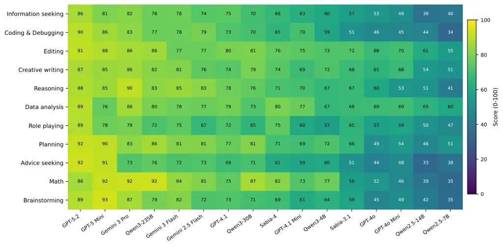

# Prosa: Rubric-Based Evaluation of LLMs on Real User Chats in Brazilian Portuguese

Roseval Malaquias Junior Affiliation: Maritaca AI    Giovana Kerche
Bonás Affiliation: Maritaca AI    Thales Sales Almeida
Affiliation: Maritaca AI    Hugo Abonizio Affiliation: Maritaca AI   
Thiago Laitz Affiliation: Maritaca AI    Ramon Pires
Affiliation: Maritaca AI    Marcos Piau Affiliation: Jusbrasil    Celio
Larcher Affiliation: Jusbrasil    Rodrigo Nogueira Affiliation: Maritaca
AI

###### Abstract

Rankings produced by holistic LLM-as-a-judge scoring are sensitive to
the bias of the chosen judge model. We show that switching to binary
rubric scoring with multi-judge filtering removes this sensitivity:
decomposing the judgement matters more than the judge model itself. To
support this claim, we introduce Prosa¹¹ 1 All code, benchmark, and
rubrics:
[https://github.com/maritaca-ai/Prosa](https://github.com/maritaca-ai/Prosa).,
the first real user multi-turn Brazilian Portuguese chat benchmark:
1,000 WildChat conversations scored by three judges from three model
families on 16 models. Under filtered rubric scoring the three judges
agree on every one of the 16 ranks, whereas under holistic scoring they
agree on only 7 of 16. Additionally, the rubric filtering pipeline
increases the average score gap between neighbouring models by 47%,
thereby improving Prosa’s discriminative power. Evaluating a new model
on Prosa costs approximately \$2.1 when using Gemini 3 Flash as the
judge. We release the benchmark and the filtering code to ensure that
future models can be assessed under identical conditions. These
artifacts also make our rubric-based scoring method reusable beyond
Prosa, supporting other open-ended evaluation settings.

###### Keywords: 

LLM-as-a-judge Benchmark Rubric-based evaluation Real user chat
Brazilian Portuguese

## 1 Introduction

Automatic evaluation of open-ended language generation has long relied
on n-gram overlap metrics such as BLEU and ROUGE. Because they reward
only lexical overlap with a reference, these metrics correlate weakly
with human judgement on open-ended tasks \[10, 11, 15\]. The failure is
sharpest near the top of the quality range: they separate bad from good
systems but fail to rank good systems among themselves \[16\].
LLM-as-a-judge evaluation addresses this limitation, reaching
inter-annotator agreement on par with expert humans \[23\]. Modern
benchmarks such as MT-Bench \[23\], AlpacaEval 2 LC \[6\],
Arena-Hard-Auto \[8\], and WildBench \[9\] converged on this paradigm,
scoring responses holistically as a single $`[1,10]`$ score or a
pairwise preference. In both cases, the judge must collapse multiple
dimensions of quality into a single decision, leaving the score
dependent on the judge’s bias. Holistic scoring is convenient but opaque
at the criterion level, and we show that this dependence makes the
resulting ranking sensitive to the choice of judge.

This progress has been heavily centred on English. Existing Brazilian
Portuguese benchmarks are dominated by academic multiple-choice
exams \[4, 12, 2\] and translated variants of English tasks \[5, 3\];
none of them observe how Brazilian users actually interact with LLMs for
their own purposes. A benchmark derived from naturally occurring
interactions surfaces the topics, registers, and patterns of use that
matter in Brazil, and evaluates model behaviour under conditions closer
to deployment than exam-based or translated benchmarks can offer.

We introduce Prosa²² 2 Prosa is the Brazilian Portuguese word for
informal conversation., the first real user multi-turn Brazilian
Portuguese chat benchmark with rubric-based LLM-as-judge evaluation. It
rests on three design choices. First, it derives its 1,000 conversations
from WildChat \[22\] with the original multi-turn context preserved.
Second, each response is scored against a set of binary pass/fail
rubrics adapted from RRD \[17\] and aligned with the
decomposed-requirement protocol of InfoBench \[14\]. Third, a
multi-judge post-hoc filtering pipeline removes low-quality rubrics
before scoring.

The central empirical finding is that decomposing the judgement (into
atomic binary verdicts rather than a single score) matters more than the
judge model itself: three judges from three model families agree on
every one of the 16 ranks under filtered rubric scoring, while the same
judges disagree on multiple rank positions under holistic scoring. The
filtering pipeline alone raises the average gap between neighbouring
models by 47%, sharpening Prosa’s discriminative power.

Two practical implications follow. First, because each rubric reduces
the judge’s task to a single binary verdict, the methodology does not
demand a frontier judge: Gemini 3 Flash at \$2.1 per candidate
reproduces the ranking obtained with the most expensive judge in our
suite, lowering the cost barrier for large-scale evaluation. Second, the
per-rubric verdicts provide a more discriminative, fine-grained quality
signal than a single holistic score, which may make the same rubric set
usable for reward modelling in addition to evaluation.

Section 2 positions Prosa in the three lines of literature that motivate
its design. Sections 3 and 4 describe the benchmark construction and the
evaluation protocol. Section 5 reports the empirical validation and the
final model ranking. Section 6 concludes.

## 2 Related Work

### 2.1 Real user open-ended benchmarks

Open-ended LLM evaluation with LLM-as-judge scoring was largely
established by MT-Bench \[23\] (80 expert-written multi-turn prompts
scored on $`[1,10]`$) and AlpacaEval 2 LC \[6\] (pairwise single-turn
evaluation over the AlpacaFarm aggregation, with regression-based
length-bias control).

A second line builds benchmarks directly from user interactions.
Arena-Hard-Auto \[8\] curates 500 challenging single-turn prompts from
Chatbot Arena logs and scores responses pairwise against a strong
baseline. WildBench \[9\] samples multi-turn tasks from WildChat and
scores responses either pairwise (WB-Reward) or as a single $`[1,10]`$
score in which a task-specific checklist is provided to the judge as
contextual guidance (WB-Score). MultiChallenge \[18\] targets realistic
multi-turn conversations but synthesises them with persona seeds and
human edits rather than drawing them from real user logs, scoring
responses against instance-level binary rubrics.

Prosa adapts this real user line to Brazilian Portuguese with three
scoring-side differentials. First, it scores responses with binary
pass/fail rubrics rather than holistic scoring (motivated in
Section 2.2). Second, it introduces an automatic multi-judge post-hoc
filtering pipeline (Section 4.3) that removes low-quality rubrics before
scoring. Third, because each rubric reduces the judge’s task to a single
binary decision, weaker and cheaper judges suffice: evaluating a
candidate with Gemini 3 Flash costs approximately \$2.1, an order of
magnitude below the \$20 per candidate that Arena-Hard-Auto \[8\]
reports. Table 1 summarises how Prosa relates to existing benchmarks.

|                 |                          |           |            |                  |                |                            |
| --------------- | ------------------------ | --------- | ---------- | ---------------- | -------------- | -------------------------- |
| Benchmark       | Prompt data              |           |            | Scoring protocol |                |                            |
|                 | Source of prompts        | Real user | Multi-turn | Holistic scoring | Binary rubrics | Automatic rubric filtering |
| MT-Bench        | Expert-written           |           |            |                  |                |                            |
| AlpacaEval 2 LC | AlpacaFarm eval set      |           |            |                  |                |                            |
| Arena-Hard-Auto | Chatbot Arena, WildChat  |           |            |                  |                |                            |
| WildBench       | WildChat                 |           |            |                  |                |                            |
| MultiChallenge  | Synthetic + human-edited |           |            |                  |                |                            |
| Prosa (ours)    | WildChat                 |           |            |                  |                |                            |

Table 1: Open-ended LLM-as-judge evaluation benchmarks. Prosa is the
only one combining real user data, binary rubrics, and automatic rubric
filtering.

### 2.2 Decomposed rubric-based evaluation

Holistic LLM-as-judge scoring forces the judge to integrate many
evaluation dimensions into a single number, which limits
reproducibility, obscures the reasoning behind the final score, and
demands a strong judge to perform the integration reliably. A parallel
literature addresses this by decomposing the judgement into
finer-grained criteria, where each verdict is local to one criterion and
therefore simpler to elicit. InfoBench \[14\] introduces the Decomposed
Requirements Following Ratio, breaking each instruction into binary
pass/fail requirements and computing the score as the compliance rate.
FLASK \[20\] and BiGGen Bench \[7\] extend this idea with
skill-set-based and instance-specific rubrics on graded scales.

RRD (Recursive Rubric Decomposition) \[17\] is the framework our scoring
protocol most directly builds on. It formalises binary rubrics as
functions $`g_{k}:P\times R\to\{0,1\}`$ that map a prompt–response pair
to a pass/fail verdict, and proposes a decompose-filter loop that
refines an initial rubric set by splitting coarse criteria into finer
ones, removing overlapping or conflicting rubrics, and flagging rubrics
whose verdicts are inverted with respect to a weak reference model. The
authors show that rubrics refined by this pipeline improve both judge
accuracy and reward-modelling stability across several open-ended tasks,
evidence that decomposed binary verdicts can serve both evaluation and
reward-signal roles.

Prosa inherits two components from this literature and adds one. From
InfoBench: our scoring formula (Section 4.2) is DRFR scaled to a 0–100
range. From RRD: the F.1 rubric-generation and F.3 binary-judging
prompts, adapted to Brazilian Portuguese; we do not run RRD’s
decompose-filter loop or weight-assignment stage. Our addition is the
multi-judge post-hoc filtering pipeline (Section 4.3), which operates on
the empirical ranking of 16 candidate models rather than on a weak
reference model and, together with the real user Brazilian Portuguese
application, defines what is original about Prosa.

### 2.3 Brazilian Portuguese LLM evaluation

Most Brazilian Portuguese LLM benchmarks focus on academic
multiple-choice exams such as ENEM \[4, 12\] and BLUEX \[2\]. Open-ended
LLM-as-judge evaluation in Brazilian Portuguese has emerged more
recently. Sabiá-2 \[1\] introduces BRACEval, an in-house multi-turn
benchmark of 150 questions inspired by MT-Bench. OAB-Bench \[13\]
evaluates legal-essay writing on questions from the Brazilian Bar Exam,
graded by an o1 judge against official reference materials.

To the best of our knowledge, no prior Brazilian Portuguese benchmark
combines real user conversations, multi-turn context, and binary
rubric-based LLM-as-judge evaluation. Prosa occupies this intersection
by deriving its 1,000 conversations from WildChat, preserving their
natural multi-turn structure, and scoring responses with the
rubric-based protocol introduced in Section 2.2.

## 3 Prosa Construction

Prosa is constructed from the WildChat dataset \[22\], which contains
3.2 million conversation logs and includes only non-toxic user
interactions, as released by the authors³³ 3
[https://huggingface.co/datasets/allenai/WildChat-4.8M](https://huggingface.co/datasets/allenai/WildChat-4.8M).
Real user logs frequently contain tasks whose outcomes cannot be
reliably verified, or that are too simple or repetitive to discriminate
between models \[8\]; our conversation filtering pipeline (Figure 1)
therefore retains only verifiable, non-redundant tasks written in
Portuguese and originating from Brazil, reducing the corpus to 1,000
conversations through six successive filters and a final random sample.
The topic and difficulty labels assigned during filtering also serve as
metadata for the analyses in Section 5.2. We release the full pipeline
so that the same procedure can be applied to other real user
conversation logs.

Figure 1: Conversation filtering pipeline reducing 3.2M WildChat
conversations to the final 1,000 of Prosa. Solid borders mark rule-based
filters (metadata, token length, and embedding similarity); dashed
borders mark LLM-based filters (difficulty, topic, and intent clarity).
A random sample finalises the benchmark.

### 3.1 Rule-based filtering

Three rule-based stages on metadata, length, and embedding similarity
precede any LLM judgement. The _Base Filter_ keeps only conversations in
Portuguese originating from Brazil with non-empty user messages, retains
at most one per unique IP address, limits length to five user–model
turns, and removes any conversation containing the REDACTED marker (3.2M
$`\rightarrow`$ 3,889). The _Token Filter_ discards conversations whose
total length, measured with the Qwen3-Embedding-8B tokenizer \[21\],
falls outside $`[50,8192]`$ tokens (3,889 $`\rightarrow`$ 2,537).
_Semantic Deduplication_ encodes each remaining conversation with the
same model and removes pairs with cosine similarity $`\geq 0.90`$ (2,537
$`\rightarrow`$ 2,097).

### 3.2 LLM-based filtering

Three LLM-driven stages refine the surviving conversations, supported by
prior work on LLM-based automatic annotation \[23, 19\]. The _Difficulty
Filter_ prompts gpt-4.1-2025-04-14 and Qwen3-235B-A22B-Instruct-2507 to
classify each task on a five-level scale (_very easy_ to _very hard_);
we retain examples where at least one judge labels the task at _medium_
or above (2,097 $`\rightarrow`$ 1,420). The _Topic Filter_ uses
gpt-4.1-2025-04-14 to assign each example to one of 12 categories
inspired by the Magpie taxonomy \[19\]; examples that cannot be
confidently assigned (labelled _Others_) are removed (1,420
$`\rightarrow`$ 1,399). The _Nonsensical Filter_ uses the same judge to
remove examples that lack a clear, evaluable user request (1,399
$`\rightarrow`$ 1,355). A final random sample of 1,000 examples
preserves the natural distribution of topics, token lengths, and turns.

### 3.3 Benchmark statistics

The final 1,000 conversations are 51% multi-turn (mean 1.99 user turns),
with token counts ranging widely (median $`530`$, mean $`990`$); this
distinguishes Prosa from single-turn benchmarks such as AlpacaEval 2
LC \[6\] and Arena-Hard-Auto \[8\] (Figure 2). Topics span 11 categories
with Information seeking the largest at $`23.4\%`$ and the remaining ten
between $`3\%`$ and $`17\%`$; geographically, $`95.7\%`$ of
conversations carry a state annotation covering all five Brazilian
regions, with the Southeast accounting for $`52.0\%`$ (Figure 3).

Figure 2: Conversational composition of Prosa ($`n{=}1{,}000`$): (a)
turn count distribution ($`51\%`$ multi-turn, mean $`1.99`$ turns); (b)
token counts (median $`530`$, mean $`990`$, long-tailed).

Figure 3: Topical and geographic coverage of Prosa ($`n{=}1{,}000`$):
(a) 11 topical categories from the Magpie taxonomy \[19\]; (b) all five
Brazilian regions, with a Southeast majority.

## 4 Evaluation Protocol

### 4.1 Rubric generation

We adopt the F.1 rubric-generation prompt from RRD \[17\], applied
directly to our 1,000 filtered conversations through a Brazilian
Portuguese translation of the template. We do not run RRD’s
decompose-filter loop or its weight-assignment stage; our multi-judge
filtering pipeline (Section 4.3) plays that role.

For each conversation, the generator (GPT-5.2) is conditioned on the
conversation history, the user query, and three reference responses from
strong models spanning distinct families (GPT-5.2, Qwen3.5-397B-A17B,
Gemini 3 Pro), and produces a set of binary pass/fail criteria covering
the dimensions needed to judge a response. The resulting set comprises
12,920 atomic binary criteria ($`g_{k}:P\times R\to\{0,1\}`$), with a
mean of 12.9 rubrics per conversation.

### 4.2 Rubric-level binary scoring

The judge emits an independent YES/NO verdict for every rubric of
Section 4.1, and the response score is computed from these verdicts. We
refer to this protocol as _rubric scoring_, in contrast to the _holistic
scoring_ used by WildBench’s WB-Score \[9\], in which the judge reads
the checklist as contextual guidance but returns a single $`[1,10]`$
score.

Our judge prompt is a Brazilian Portuguese adaptation of the F.3
template from RRD \[17\]. In a single judgement, the judge receives the
conversation history (when present), the current user query, the
response under evaluation, and the full rubric list, and emits one
YES/NO verdict per rubric. Batching all rubrics of a question into a
single judgement amortises the conversation context across rubrics,
reducing inference cost.

Let $`g_{k}(m,q)\in\{0,1\}`$ be the verdict on rubric $`k`$ of question
$`q`$ for model $`m`$, and let $`K_{q}`$ be the number of rubrics for
question $`q`$. The score for model $`m`$ pools rubric verdicts across
the benchmark,

```math
s(m)=100\cdot\frac{\sum_{q,k}g_{k}(m,q)}{\sum_{q}K_{q}}.
```

This is InfoBench’s Decomposed Requirements Following Ratio
(DRFR) \[14\] scaled to a 0–100 range.

### 4.3 Multi-judge rubric filtering

Not every rubric carries discriminative value: some are trivially
satisfied or universally failed, some correlate negatively with response
quality, and some flip their verdict across repeated runs at temperature
$`0`$. We apply five post-hoc filters to remove rubrics exhibiting these
pathologies, operating on the $`16\times 1{,}000`$ evaluation matrix
produced by the three judges of Section 4.4.

Three filters use majority voting across the three judges ($`\geq 2/3`$
agreement) on the candidate verdicts. _Trivial_ marks a rubric that
every one of the 16 candidates passes; _impossible_ marks a rubric that
every candidate fails; _misaligned_ marks a rubric on which the two
top-scoring candidates fail while the bottom-scoring candidate passes,
indicating the verdict is inverted with respect to overall response
quality. The misaligned filter is related to RRD’s misalignment
detection \[17\], but operates on the empirical ranking of the
candidates rather than on a weak reference model.

The fourth filter, _unstable_, targets non-reproducible rubrics: with
Qwen3-30B as candidate and GPT-4.1 as judge, we run three independent
evaluations at temperature $`0`$ and remove any rubric whose verdict
changes across the three runs. The fifth filter operates at the question
level: a question with no surviving rubrics is dropped from scoring.

Applied to Prosa, the five filters remove 4,512 rubrics ($`34.9\%`$ of
the 12,920 originally generated) and drop 19 questions; the effective
benchmark comprises 981 questions and 8,408 rubrics (mean 8.6 per
question). Section 5.1 reports their empirical impact on inter-judge
agreement, ranking stability, and discriminative power.

### 4.4 Experimental setup

We evaluate 16 candidates from four model families (Table 2).
Proprietary models are served through their providers’ native APIs;
open-weights Qwen models are served via OpenRouter when available, with
local inference as fallback.

We use three judges spanning three model families: GPT-4.1, Gemini 3
Flash, and Sabiá-4 (Table 2). All candidate responses and judge verdicts
are decoded at temperature $`0`$. We report three families of validation
metrics in Section 5.1. _Rank stability_ measures whether the three
judges produce the same leaderboard: we report the Spearman correlation
between each pair of judges, averaged over the three pairs, and the
number of models that occupy the same rank under both judges in a pair,
taking the minimum over pairs to surface the most divergent pair.
_Inter-judge agreement_ measures how often the judges return the same
YES/NO verdict for a given (model, rubric) pair: we report the fraction
of such pairs on which all three judges agree. _Discriminative power_
measures how cleanly the protocol separates adjacent models on the
leaderboard: we report the average gap between consecutive ranks and the
top-to-bottom spread (rank 1 minus rank 16), each averaged over the
three judges on a 0–100 scale.

|             |                  |                 |
| ----------- | ---------------- | --------------- |
| Family      | Model            | Inference route |
| OpenAI      | GPT-5.2          | OpenAI API      |
|             | GPT-5 Mini       | OpenAI API      |
|             | GPT-4.1          | OpenAI API      |
|             | GPT-4.1 Mini     | OpenAI API      |
|             | GPT-4o           | OpenAI API      |
|             | GPT-4o Mini      | OpenAI API      |
| Google      | Gemini 3 Pro     | Google AI API   |
|             | Gemini 3 Flash   | Google AI API   |
|             | Gemini 2.5 Flash | Google AI API   |
| Alibaba     | Qwen3-235B       | OpenRouter      |
|             | Qwen3-30B        | OpenRouter      |
|             | Qwen2.5-7B       | OpenRouter      |
|             | Qwen3-4B         | local (A100)    |
|             | Qwen2.5-14B      | local (A100)    |
| Maritaca AI | Sabiá-4          | Maritaca AI API |
|             | Sabiá-3.1        | Maritaca AI API |

Table 2: Candidate models evaluated in Prosa, grouped by family.
Responses come from the provider’s native API for proprietary models,
OpenRouter when available for open-weights Qwen models, and local
inference otherwise.

Validating the benchmark with all three judges over the 16 candidates
and 981 questions costs approximately \$113 (GPT-4.1), \$34 (Gemini 3
Flash), and \$66 (Sabiá-4). Evaluating a new candidate requires only one
judge; the cheapest is Gemini 3 Flash at $`\sim`$\$2.1 per candidate.
For reference, Arena-Hard-Auto \[8\] reports \$20 per candidate over 500
prompts. We release the rubric-generation, scoring, and filtering code,
with the rubrics and filter outcomes frozen, so that any new candidate
can be evaluated with a single judge of choice without re-running the
filtering stage.

## 5 Results

### 5.1 Benchmark validation

We compare three protocols on the same 1,000 conversations and three
judges: _holistic scoring_, which reproduces WildBench’s WB-Score \[9\];
_rubric scoring_ without filtering; and _rubric scoring_ with the
pipeline of Section 4.3 applied. Table 3 reports rank stability,
inter-judge agreement, and discriminative power across the three
protocols, using the metrics defined in Section 4.4. Figure 4 visualises
how the rank of each candidate shifts across judges under the first and
last protocols.

Figure 4: Candidate rank across the three judges under (a) holistic
scoring and (b) filtered rubric scoring. Holistic disagreement is
sharpest at the top (Gemini 3 Flash places Gemini 3 Pro first, others
place GPT-5.2 first); under rubric scoring, all three judges agree on
every rank.

Under holistic scoring the three judges do not agree on the ranking:
Spearman averages 0.986 but only 7 of 16 candidates occupy the same rank
in the most divergent judge pair. Figure 4(a) makes the mechanism
explicit: the Gemini 3 Flash judge places Gemini 3 Pro at rank 1, while
GPT-4.1 and Sabiá-4 place GPT-5.2 at rank 1, with several adjacent
positions also shuffled. Switching to rubric scoring largely eliminates
this divergence: even without filtering, Spearman is 0.998 and 14 of 16
candidates occupy identical ranks across judge pairs; with filtering,
Spearman reaches exactly 1.000 and every candidate occupies the same
rank (Figure 4(b)). The contrast is already largely present without
filtering, indicating that atomic binary verdicts carry most of the
mechanism, while the filtering pipeline closes the remaining
disagreement on two of the sixteen ranks.

The pipeline also sharpens the separation between adjacent ranks.
Without filtering, the average gap between neighbouring candidates is
2.22 points and the top-to-bottom spread is 33.3 points, close to what
holistic scoring achieves (2.24 and 33.5). Applying the pipeline raises
the average gap to 3.26 (a 47% increase) and expands the spread to 48.9
points. This gain in separability comes at the cost of a small drop in
inter-judge agreement: unanimous YES/NO verdicts fall from 87.6% to
83.8% of the (model, rubric) pairs (over 12,920 and 8,408 rubrics,
respectively), which is expected since the trivial filter removes
precisely the rubrics on which agreement is easiest.

|                             |                |                 |                       |                      |        |
| --------------------------- | -------------- | --------------- | --------------------- | -------------------- | ------ |
| Protocol                    | Rank stability |                 | Inter-judge agreement | Discriminative power |        |
|                             | Spearman       | Identical ranks | Unanimity (%)         | Avg gap              | Spread |
| Holistic scoring (WB-Score) | 0.986          | 07/16           | –                     | 2.24                 | 33.5   |
| Rubric scoring, unfiltered  | 0.998          | 14/16           | 87.6                  | 2.22                 | 33.3   |
| Rubric scoring, filtered    | 1.000          | 16/16           | 83.8                  | 3.26                 | 48.9   |

Table 3: Validation metrics across the three protocols, grouped by the
families introduced in Section 4.4. Filtered rubric scoring achieves
perfect rank agreement and the largest gap and spread, at a small drop
in rubric-level unanimity.

This rank invariance across judges has a direct practical consequence: a
new candidate can be evaluated with any single judge. The cheapest in
our suite, Gemini 3 Flash at approximately \$2.1 per candidate
(Section 4.4), reproduces the leaderboard obtained with the most
expensive judge.

### 5.2 Model ranking and analysis

Table 4 presents the final ranking on the effective benchmark using
Sabiá-4 as judge; since the rank ordering is identical across the three
judges (Section 5.1), the substance of the leaderboard does not depend
on this choice. Scores span from 88.6 (GPT-5.2) to 43.3 (Qwen2.5-7B), a
45.3-point spread.

|      |                  |             |       |
| ---- | ---------------- | ----------- | ----- |
| Rank | Model            | Family      | Score |
| 1    | GPT-5.2          | OpenAI      | 88.6  |
| 2    | GPT-5 Mini       | OpenAI      | 84.8  |
| 3    | Gemini 3 Pro     | Google      | 83.8  |
| 4    | Qwen3-235B       | Alibaba     | 80.1  |
| 5    | Gemini 3 Flash   | Google      | 78.8  |
| 6    | Gemini 2.5 Flash | Google      | 76.3  |
| 7    | GPT-4.1          | OpenAI      | 74.8  |
| 8    | Qwen3-30B        | Alibaba     | 73.9  |
| 9    | Sabiá-4          | Maritaca AI | 70.2  |
| 10   | GPT-4.1 Mini     | OpenAI      | 67.7  |
| 11   | Qwen3-4B         | Alibaba     | 64.6  |
| 12   | Sabiá-3.1        | Maritaca AI | 60.5  |
| 13   | GPT-4o           | OpenAI      | 55.0  |
| 14   | GPT-4o Mini      | OpenAI      | 54.5  |
| 15   | Qwen2.5-14B      | Alibaba     | 46.4  |
| 16   | Qwen2.5-7B       | Alibaba     | 43.3  |

Table 4: Prosa leaderboard, Sabiá-4 as judge, filtered rubric scoring
(0–100 scale).

Four observations stand out in Table 4. First, Qwen3-235B reaches rank 4
with a score of $`80.1`$, placing it above GPT-4.1 ($`74.8`$) and Gemini
3 Flash ($`78.8`$) and only $`3.7`$ points below Gemini 3 Pro, showing
that an open-weights model is competitive with the proprietary frontier
on natural Brazilian Portuguese chat. Second, the generational gap
within the Qwen family is pronounced: the 2025-generation Qwen3 variants
occupy ranks 4, 8, and 11, while the 2024-generation Qwen2.5 variants
sit at ranks 15 and 16, with Qwen2.5-14B finishing below the
4B-parameter Qwen3-4B. Third, the GPT-4o generation is noticeably behind
the GPT-4.1 and GPT-5 lines: GPT-4o ($`55.0`$) and GPT-4o Mini
($`54.5`$) land roughly $`13`$ points below GPT-4.1 Mini ($`67.7`$) and
more than $`33`$ points below GPT-5.2. Finally, the Maritaca AI family
shows a clear generational improvement on Brazilian Portuguese chat:
Sabiá-4 reaches rank 9 with $`70.2`$, $`9.6`$ points above Sabiá-3.1
($`60.5`$, rank 12).

Figure 5 breaks the ranking down by topical category. The benchmark
discriminates most sharply on _Advice seeking_, _Brainstorming_, _Math_,
and _Coding & Debugging_ (spreads of 55–60 points), and also on
_Reasoning_ and _Information seeking_ (around 49 points). It
discriminates least on _Data analysis_ (spread 29), where most current
models produce similarly structured answers, and moderately on _Editing_
and _Creative writing_ (around 36 points each). The top candidates
dominate every category, while the Qwen2.5 row shows a clear floor
across the 11 topical categories.



Figure 5: Per-category scores across the 11 topical categories of Prosa,
with Sabiá-4 as judge under filtered rubric scoring (0–100 scale).

## 6 Conclusion

Prosa is the first real user multi-turn Brazilian Portuguese chat
benchmark with rubric-based LLM-as-judge evaluation. Its central
methodological lesson is that decomposing the judgement into atomic
binary verdicts matters more than the choice of judge model: three
judges from three model families agree on every one of the 16 candidate
ranks under filtered binary rubric scoring, while the same judges
disagree under holistic scoring. The multi-judge post-hoc filtering
pipeline raises the average gap between neighbouring models by 47%,
sharpening Prosa’s discriminative power.

Two consequences follow. First, rubric scoring lowers the cost barrier
for benchmark evaluation: any reasonable judge produces the same
ranking, the cheapest in our suite (Gemini 3 Flash at \$2.1 per
candidate) reproduces the leaderboard of the most expensive, and
benchmark designers can therefore swap in cheaper or future judges
without re-baselining. Second, the per-rubric verdicts that yield
judge-invariant rankings provide a more discriminative quality signal
than a holistic score, which may make the same rubric set usable as a
reward signal for reward modelling in addition to evaluation.

We release Prosa, the conversation filtering pipeline, the rubric-based
scoring code, and the multi-judge rubric filtering pipeline. Because the
judge’s task of integrating multiple dimensions into a single scalar
does not inherently depend on the prompt language, we conjecture that
the central effect transfers beyond Brazilian Portuguese; validating
this conjecture, running a human-alignment study, and applying the
protocol to reward modelling are natural extensions.

#### Ethics statement.

Prosa is derived from the non-toxic release of WildChat \[22\]
(WildChat-4.8M), distributed under the AI2 ImpACT Licenses. WildChat’s
authors removed personally identifiable information and hashed all IP
addresses (mapped only to country and state) prior to release; we apply
no further toxicity filter and inherit these protections. The
conversations reflect real user interactions and may contain language
that some readers find sensitive. Downstream use is subject to the AI2
ImpACT Licenses that govern WildChat.

#### LLM usage disclosure.

Language-model tools were used as writing aids for grammatical revision,
clarity, and occasional style adjustments, and as coding aids throughout
the codebase. They were not used for the formulation of research ideas,
the literature review, the methodological choices, the analysis of
empirical results, or the framing of the conclusions. All technical and
scientific content was produced, reviewed, and validated by the authors,
who assume full responsibility for the final text.

#### Disclosure of Interests.

The authors declare no conflicts of interest related to the content of
this article.

## References

- \[1\] T. S. Almeida, H. Abonizio, R. Nogueira, and R. Pires (2024)
  Sabiá-2: a new generation of Portuguese large language models. arXiv
  preprint arXiv:2403.09887. External Links:
  [Link](https://arxiv.org/abs/2403.09887) Cited by: §2.3.
- \[2\] T. S. Almeida, T. Laitz, G. K. Bonás, and R. Nogueira (2023)
  BLUEX: a benchmark based on Brazilian leading universities entrance
  exams. In Intelligent Systems, M. C. Naldi and R. A. C. Bianchi
  (Eds.), pp. 337–347. External Links:
  [Document](https://dx.doi.org/10.1007/978-3-031-45368-7%5F22) Cited
  by: §1, §2.3.
- \[3\] T. S. Almeida, R. Pires, H. Abonizio, R. Nogueira, and H.
  Pedrini (2025) PoETa v2: toward more robust evaluation of large
  language models in Portuguese. arXiv preprint arXiv:2511.17808.
  External Links: [Link](https://arxiv.org/abs/2511.17808) Cited by: §1.
- \[4\] I. Cataneo Silveira and D. Deratani Mauá (2018) Advances in
  automatically solving the ENEM. In 2018 7th Brazilian Conference on
  Intelligent Systems (BRACIS), pp. 43–48. External Links:
  [Document](https://dx.doi.org/10.1109/BRACIS.2018.00016) Cited by: §1,
  §2.3.
- \[5\] N. K. Corrêa et al. (2026) Tucano 2 Cool: better open source
  LLMs for Portuguese. arXiv preprint arXiv:2603.03543. External Links:
  [Link](https://arxiv.org/abs/2603.03543) Cited by: §1.
- \[6\] Y. Dubois et al. (2024) Length-controlled AlpacaEval: a simple
  way to debias automatic evaluators. In First Conference on Language
  Modeling (COLM), External Links:
  [Link](https://openreview.net/forum?id=CybBmzWBX0) Cited by: §1, §2.1,
  §3.3.
- \[7\] S. Kim et al. (2025) The BiGGen Bench: a principled benchmark
  for fine-grained evaluation of language models with language models.
  In Proceedings of the 2025 Conference of the Nations of the Americas
  Chapter of the Association for Computational Linguistics: Human
  Language Technologies (Long Papers), pp. 5877–5919. External Links:
  [Document](https://dx.doi.org/10.18653/v1/2025.naacl-long.303) Cited
  by: §2.2.
- \[8\] T. Li et al. (2025) From crowdsourced data to high-quality
  benchmarks: Arena-Hard and BenchBuilder pipeline. In Proceedings of
  the 42nd International Conference on Machine Learning (ICML),
  Proceedings of Machine Learning Research, Vol. 267, pp. 34209–34231.
  External Links: [Link](https://proceedings.mlr.press/v267/li25h.html)
  Cited by: §1, §2.1, §2.1, §3.3, §3, §4.4.
- \[9\] B. Y. Lin et al. (2025) WildBench: benchmarking LLMs with
  challenging tasks from real users in the wild. In The Thirteenth
  International Conference on Learning Representations, External Links:
  [Link](https://openreview.net/forum?id=MKEHCx25xp) Cited by: §1, §2.1,
  §4.2, §5.1.
- \[10\] C. Liu, R. Lowe, I. V. Serban, M. Noseworthy, L. Charlin,
  and J. Pineau (2016) How NOT To evaluate your dialogue system: an
  empirical study of unsupervised evaluation metrics for dialogue
  response generation. In Proceedings of the 2016 Conference on
  Empirical Methods in Natural Language Processing (EMNLP),
  pp. 2122–2132. External Links:
  [Document](https://dx.doi.org/10.18653/v1/D16-1230) Cited by: §1.
- \[11\] Q. Ma, J. T. Wei, O. Bojar, and Y. Graham (2019) Results of the
  WMT19 metrics shared task: segment-level and strong MT systems pose
  big challenges. In Proceedings of the Fourth Conference on Machine
  Translation (WMT), Volume 2: Shared Task Papers, Day 1, pp. 62–90.
  External Links: [Document](https://dx.doi.org/10.18653/v1/W19-5302)
  Cited by: §1.
- \[12\] D. Nunes, R. Primi, R. Pires, R. Lotufo, and R. Nogueira (2023)
  Evaluating GPT-3.5 and GPT-4 models on Brazilian university admission
  exams. arXiv preprint arXiv:2303.17003. External Links:
  [Link](https://arxiv.org/abs/2303.17003) Cited by: §1, §2.3.
- \[13\] R. Pires, R. Malaquias Junior, and R. Nogueira (2025) Automatic
  legal writing evaluation of LLMs. arXiv preprint arXiv:2504.21202.
  External Links: [Link](https://arxiv.org/abs/2504.21202) Cited by:
  §2.3.
- \[14\] Y. Qin et al. (2024) InFoBench: evaluating instruction
  following ability in large language models. In Findings of the
  Association for Computational Linguistics: ACL 2024, pp. 13025–13048.
  External Links:
  [Document](https://dx.doi.org/10.18653/v1/2024.findings-acl.772) Cited
  by: §1, §2.2, §4.2.
- \[15\] E. Reiter (2018) A structured review of the validity of BLEU.
  Computational Linguistics 44 (3), pp. 393–401. External Links:
  [Document](https://dx.doi.org/10.1162/COLI%5Fa%5F00322) Cited by: §1.
- \[16\] T. Sellam, D. Das, and A. P. Parikh (2020) BLEURT: learning
  robust metrics for text generation. In Proceedings of the 58th Annual
  Meeting of the Association for Computational Linguistics (ACL),
  pp. 7881–7892. External Links:
  [Document](https://dx.doi.org/10.18653/v1/2020.acl-main.704) Cited by:
  §1.
- \[17\] W. F. Shen et al. (2026) Rethinking rubric generation for
  improving LLM judge and reward modeling for open-ended tasks. arXiv
  preprint arXiv:2602.05125. External Links:
  [Link](https://arxiv.org/abs/2602.05125) Cited by: §1, §2.2, §4.1,
  §4.2, §4.3.
- \[18\] V. Sirdeshmukh et al. (2025) MultiChallenge: a realistic
  multi-turn conversation evaluation benchmark challenging to frontier
  LLMs. In Findings of the Association for Computational Linguistics:
  ACL 2025, pp. 18632–18702. External Links:
  [Document](https://dx.doi.org/10.18653/v1/2025.findings-acl.958) Cited
  by: §2.1.
- \[19\] Z. Xu et al. (2025) Magpie: alignment data synthesis from
  scratch by prompting aligned LLMs with nothing. In The Thirteenth
  International Conference on Learning Representations, External Links:
  [Link](https://openreview.net/forum?id=Pnk7vMbznK) Cited by: Figure 3,
  §3.2.
- \[20\] S. Ye et al. (2024) FLASK: fine-grained language model
  evaluation based on alignment skill sets. In The Twelfth International
  Conference on Learning Representations (ICLR), External Links:
  [Link](https://openreview.net/forum?id=CYmF38ysDa) Cited by: §2.2.
- \[21\] Y. Zhang et al. (2025) Qwen3 embedding: advancing text
  embedding and reranking through foundation models. arXiv preprint
  arXiv:2506.05176. External Links:
  [Link](https://arxiv.org/abs/2506.05176) Cited by: §3.1.
- \[22\] W. Zhao, X. Ren, J. Hessel, C. Cardie, Y. Choi, and Y.
  Deng (2024) WildChat: 1m chatGPT interaction logs in the wild. In The
  Twelfth International Conference on Learning Representations, External
  Links: [Link](https://openreview.net/forum?id=Bl8u7ZRlbM) Cited by:
  §1, §3, §6.
- \[23\] L. Zheng et al. (2023) Judging llm-as-a-judge with mt-bench and
  chatbot arena. In Advances in Neural Information Processing
  Systems, A. Oh, T. Naumann, A. Globerson, K. Saenko, M. Hardt, and S.
  Levine (Eds.), Vol. 36, pp. 46595 – 46623. External Links:
  [Link](https://proceedings.neurips.cc/paper_files/paper/2023/file/91f18a1287b398d378ef22505bf41832-Paper-Datasets_and_Benchmarks.pdf)
  Cited by: §1, §2.1, §3.2.
