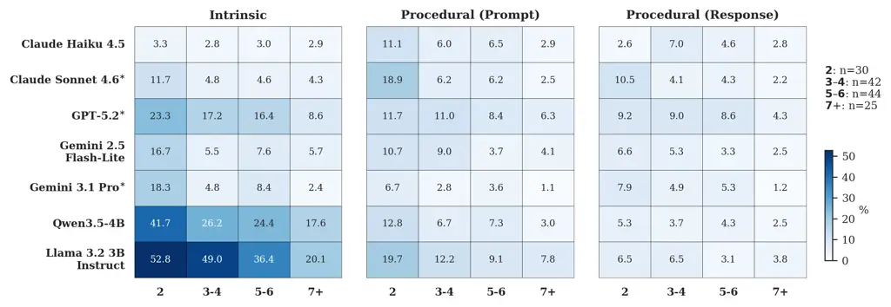
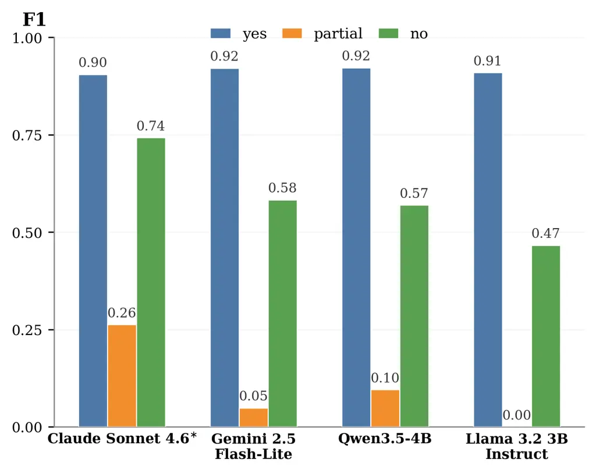
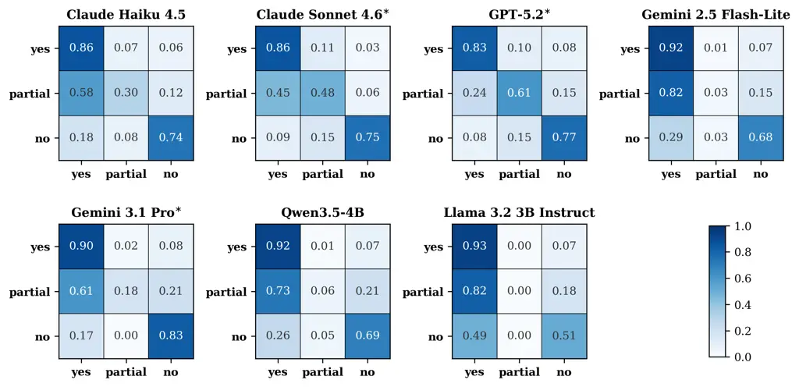
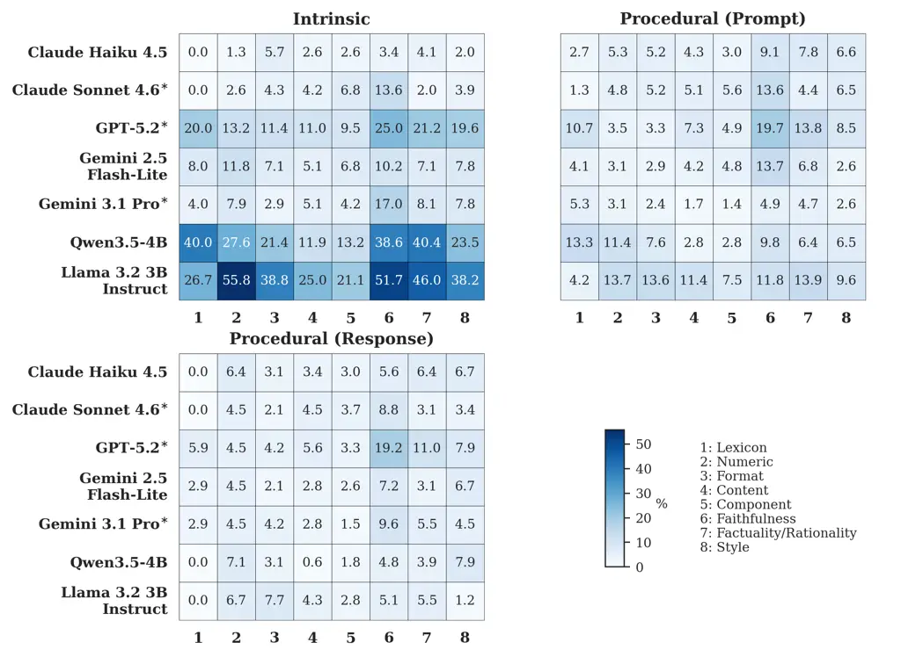

# MCJudgeBench: A Benchmark for Constraint-Level Judge Evaluation in Multi-Constraint Instruction Following

Jaeyun Lee ^(†)^(†)thanks: Corresponding author: jaeyun.lee@cs.ox.ac.uk
Affiliation: University of Oxford    Junyoung Koh Affiliation: Yonsei
University    Zeynel Tok Affiliation: University of Oxford    Hunar
Batra Affiliation: University of Oxford    Ronald Clark
Affiliation: University of Oxford

###### Abstract

Multi-constraint instruction following requires verifying whether a
response satisfies multiple individual requirements, yet LLM judges are
often assessed only through overall-response judgments. We introduce
MCJudgeBench, a benchmark for constraint-level judge evaluation in
multi-constraint instruction following. Each instance includes an
instruction, a candidate response, an explicit constraint list,
per-constraint gold labels in {yes, partial, no}, and controlled
response-side perturbations. The evaluation protocol further includes
evaluation prompt variants to test judge stability. We evaluate
proprietary and open-source LLM judges using both correctness and
inconsistency metrics, distinguishing intrinsic inconsistency under
stochastic decoding from procedural inconsistency under prompt and
response perturbations. Our results show that judge reliability has
multiple dimensions: strong overall performance does not guarantee
equally reliable detection across label categories, especially for rarer
partial and no cases. Judges with higher correctness do not always have
lower inconsistency. Evaluation with reasoning improves correctness but
does not uniformly improve stability. These findings motivate evaluating
LLM judges at the constraint level to study these failure modes.

## 1 Introduction

Instruction following often involves satisfying several constraints at
once, such as requirements on content, format, style, or length. Recent
benchmarks show that performance declines as the number of constraints
increases and they become harder to satisfy jointly, making prompt-level
evaluation insufficient for understanding which requirements a model
actually satisfies (Jiang et al., 2024; Wen et al., 2024). In practice,
however, assessing multi-constraint adherence at scale is expensive,
which has encouraged the use of _LLM-as-a-judge_ for open-ended
responses.

In parallel, there is increasing evidence that LLM judges are not always
reliable. Their judgments can vary with prompt formulation and
evaluation protocol, they may favor outputs that appear stylistically
stronger despite weaker instruction adherence, and they can exhibit
systematic biases under controlled changes (Zeng et al., 2024; Liu et
al., 2025b; Ye et al., 2024; Li et al., 2025; Yang et al., 2026).
Existing judge benchmarks have made progress on pairwise preferences,
scalar judgments, and rubric-based evaluation (Tan et al., 2025; Muller
et al., 2025), but they do not directly address whether a judge can
verify individual constraints in multi-constraint instruction following
tasks.

This is particularly important in multi-constraint settings, where a
response may satisfy some requirements while failing others. In such
settings, evaluation must identify which constraints are satisfied or
violated, rather than relying only on an overall score. A reliable
evaluator must also remain stable under invariance perturbations to
prompts and candidate response form. However, constraint-level judge
stability in multi-constraint instruction following remains
underexplored.

In this work, we introduce MCJudgeBench, a meta-evaluation benchmark for
LLM-as-a-judge on multi-constraint instruction following. Building on
ComplexBench and InFoBench (Wen et al., 2024; Qin et al., 2024), the
benchmark represents each instance as an instruction, a candidate
response, and an explicit list of constraints, together with
per-constraint adherence labels drawn from three classes: yes, partial,
or no. We further construct controlled invariance sets through candidate
response variants that preserve the underlying adherence labels. In the
evaluation protocol, we additionally introduce evaluation prompt
variants to test judge stability under alternative formulations of the
same verification task.

Beyond benchmark construction, we use this setting to study how current
LLM judges behave on multi-constraint adherence verification. We
evaluate judge correctness on the original instances and decompose judge
instability into two sources: intrinsic inconsistency under stochastic
decoding and procedural inconsistency under two invariance perturbation
axes. Our results show that aggregate evaluation can hide substantial
variation in constraint-level behavior, motivating systematic evaluation
of judge reliability in this setting. Our contributions are as follows:

- •
  MCJudgeBench, a new meta-evaluation benchmark for LLM-as-a-judge on
  multi-constraint instruction following, with per-constraint labels and
  controlled invariance sets.
- •
  An evaluation framework for judge reliability, covering correctness on
  original instances and two sources of judge instability: intrinsic
  inconsistency under stochastic decoding and procedural inconsistency
  under invariance perturbations.
- •
  A baseline evaluation on the benchmark across proprietary and
  open-source LLM judges, showing how reliability varies across
  constraint types, constraint count, and perturbation conditions.

## 2 Related Work

|                                  |            |     |               |                  |                |                              |
| -------------------------------- | ---------- | --- | ------------- | ---------------- | -------------- | ---------------------------- |
| Benchmark                        | Target     | IF  | Multi- const. | Decomposed eval. | Perturb. tests | Constraint-level judge eval. |
| IFEval (Zhou et al., 2023)       | Models     | ✓   | ✓             | ✓                | –              | –                            |
| FollowBench (Jiang et al., 2024) | Models     | ✓   | ✓             | ✓                | –              | –                            |
| ComplexBench (Wen et al., 2024)  | Models     | ✓   | ✓             | ✓                | –              | –                            |
| InFoBench (Qin et al., 2024)     | Models     | ✓   | ✓             | ✓                | –              | –                            |
| WildIFEval (Lior et al., 2025)   | Models     | ✓   | ✓             | ✓                | –              | –                            |
| CFBench (Zhang et al., 2025)     | Models     | ✓   | ✓             | ✓                | –              | –                            |
| LLMBar (Zeng et al., 2024)       | Evaluators | ✓   | –             | –                | ✓              | –                            |
| ReIFE (Liu et al., 2025b)        | Evaluators | ✓   | –             | –                | –              | –                            |
| GroUSE (Muller et al., 2025)     | Evaluators | –   | –             | ✓                | ✓              | –                            |
| MCJudgeBench                     | Evaluators | ✓   | ✓             | ✓                | ✓              | ✓                            |

Table 1: Comparison of MCJudgeBench with prior multi-constraint
instruction following benchmarks and meta-evaluation benchmarks for
automated evaluators and LLM judges. “Decomposed eval.” indicates
evaluation beyond a single overall judgment, such as checking individual
constraints, decomposed criteria, or rubric dimensions.
“Constraint-level judge eval.” indicates meta-evaluation of whether a
judge can verify individual constraints in multi-constraint instruction
following.

#### Instruction following and multi-constraint evaluation.

Recent work has moved instruction following evaluation beyond coarse
prompt-level judgments toward a more fine-grained assessment of whether
individual requirements are satisfied. IFEval (Zhou et al., 2023)
focuses on objectively verifiable constraints, with each instruction
containing one or more such constraints. FollowBench (Jiang et al., 2024) extends this direction by constructing a controlled progression in
difficulty over the same base instruction, incrementally adding
constraints so that higher levels require satisfying a larger and more
diverse set of requirements. Subsequent benchmarks broaden this line in
different ways. ComplexBench (Wen et al., 2024) emphasizes the
composition of multiple constraints and introduces a hierarchical
taxonomy over constraint and composition types. InFoBench (Qin et al., 2024) decomposes complex instructions into simpler criteria for more
interpretable requirement-level evaluation. CFBench (Zhang et al., 2025)
and WildIFEval (Lior et al., 2025) extend evaluation to broader and more
realistic constraint settings through systematic taxonomies, real-world
scenarios, and real user instructions.

#### LLM-as-a-judge and meta-evaluation of evaluators.

LLM-as-a-judge has become a common approach for scalable evaluation, but
recent work shows that judge behavior is often sensitive to factors
beyond the underlying quality of the response. LLMBar (Zeng et al., 2024) shows that judges can be misled by stylistic differences even when
instruction adherence is weaker, while ReIFE (Liu et al., 2025b)
demonstrates that evaluation accuracy depends strongly on both the base
LLM and the evaluation protocol. JudgeBench (Tan et al., 2025) and
GroUSE (Muller et al., 2025) further argue that judge quality cannot be
assessed only through aggregate agreement or correlation, since
evaluators may still fail on difficult objective comparisons or specific
failure modes. Related work on bias analysis also finds persistent
systematic preferences under controlled modifications (Ye et al., 2024).
Recent work further shows that LLM evaluators can be inconsistent and
sensitive to prompt differences that are not meaningful to human
evaluators (Stureborg et al., 2024). Evaluator consistency has also been
studied through self-consistency and inter-scale consistency, showing
that strong evaluator models are not necessarily consistent and that
consistency should be considered when assessing LLM evaluators (Lee et
al., 2025).

#### Constraint-level judge evaluation.

These two lines of work address complementary parts of the problem.
Multi-constraint instruction following benchmarks study whether models
satisfy complex sets of requirements, while meta-evaluation studies
examine the reliability of evaluators through pairwise preferences,
scalar judgments, or rubric-based scoring (Zheng et al., 2023; Kim et
al., 2024). Prior work also shows the value of controlled perturbations
for diagnosing evaluator behavior (Sai et al., 2021; Ribeiro et al.,
2020; Hua et al., 2025), but this perspective has not been developed for
constraint-level verification in multi-constraint instruction following.
What remains underexplored is whether LLM judges can accurately and
stably verify individual constraints, especially under invariance
perturbations to the evaluation prompt or response form. Our work
addresses this gap through MCJudgeBench, a benchmark for per-constraint
judge evaluation under controlled invariance perturbations. Table 1
summarizes the position of our benchmark relative to prior model-side
and evaluator-side benchmarks.

## 3 MCJudgeBench

### 3.1 Overview

MCJudgeBench is a meta-evaluation benchmark for constraint-level judge
evaluation in multi-constraint instruction following. Each instance is
represented as

```math
x=(I,y,C,L,\mathcal{P}_{y}),
```

where $`I`$ denotes the instruction, $`y`$ the natural candidate
response, $`C=\{c_{1},\dots,c_{m}\}`$ the explicit constraint list,
$`L=\{\ell_{1},\dots,\ell_{m}\}`$ the corresponding per-constraint gold
labels with
$`\ell_{j}\in\{\textit{yes},\textit{partial},\textit{no}\}`$, and
$`\mathcal{P}_{y}`$ denotes an invariance perturbation set of candidate
response variants. A label of yes indicates that a constraint is clearly
satisfied, no indicates that it is clearly violated or missing, and
partial indicates partial but incomplete satisfaction. Figure 1 shows a
representative instance of MCJudgeBench.


Figure 1: An example MCJudgeBench instance from the easy split,
illustrating the instruction, candidate response, constraints, labels,
and perturbation set of candidate response variants.

### 3.2 Benchmark Construction

MCJudgeBench is built from two source benchmarks: ComplexBench (Wen et
al., 2024) and InFoBench (Qin et al., 2024). We select these sources
because they provide a progression in instruction length and constraint
complexity. InFoBench contributes the easy and hard instances. The hard
instances contain longer instructions and more decomposed requirements
than the easy instances. ComplexBench contributes the complex instances,
which have substantially longer instructions than those in InFoBench and
involve more complex multi-constraint structures. Together, these
sources broaden the difficulty range covered by the benchmark, which
consists of easy, hard, and complex splits. We construct MCJudgeBench in
three steps: source instance filtering, candidate construction, and
human validation.

Step 1: Source instance filtering. We first preprocess source instances
from ComplexBench and InFoBench using rule-based filtering to obtain a
pool suitable for English-language constraint-level judge evaluation. To
align the source data with our English-language evaluation setting, we
apply text-level filters to the relevant instance fields, excluding
cases with missing content or Chinese-language material. We additionally
use metadata provided by the source benchmarks to exclude task types
that tend to rely on culturally specific personas or background
knowledge not contained in the prompt.

Step 2: Candidate construction. For each retained instance, we first
generate a natural candidate response with Qwen3-4B-Instruct (Yang et
al., 2025). We use a relatively small open model because it produces
responses with a more natural mix of satisfied, partially satisfied, and
violated constraints than stronger frontier models, which are more
likely to produce uniformly strong responses and therefore less
informative benchmark instances. Human annotators then assign gold
per-constraint adherence labels to the generated candidate response
using the classes yes, partial, and no. We also use GPT-5 mini to
propose an initial single constraint-type label from the constraint text
and to generate candidate response invariance perturbations. Prompt
templates used in this pipeline are provided in Appendix B.

Step 3: Human validation. Human annotators perform a final validation
stage over the constructed instances. They review and correct the
proposed constraint-type labels where needed, and may assign multiple
final type labels when a constraint requires more than one form of
verification. They also verify whether the generated perturbations
preserve the annotated adherence label vector of the natural candidate
response. We retain only perturbations that satisfy this criterion.

#### Constraint types.

We group constraints in MCJudgeBench into eight types based on the
verification challenge each constraint poses to an evaluator: Lexicon,
Numeric, Format, Content, Component, Faithfulness,
Factuality/Rationality, and Style. Our taxonomy is organized by the kind
of judgment required to verify whether a constraint is satisfied. Full
category definitions are provided in Appendix A.

#### Invariance perturbation sets.

We use response-side perturbations as invariance tests: the response
form changes, but the per-constraint labels should remain unchanged
(Ribeiro et al., 2020). We generate candidate response variants from the
natural responses using an LLM. Since many MCJudgeBench constraints
directly depend on length, format, style, required keywords, required
components, or factual content, broader transformations such as adding
or removing text or changing style can alter whether a constraint is
satisfied. We therefore restrict response-side perturbations to local
changes in wording or structural organization.

- •
  Local paraphrase: rewrites the response at the sentence or phrase
  level while preserving the same underlying content and adherence
  labels. It does not change required keywords, required structure,
  required components, or factual content relevant to the constraint
  labels.
- •
  Structural reorganization: changes how the same content is arranged,
  for example by reordering independent sentences or regrouping content
  into different paragraphs. It does not change the required order,
  format, keywords, components, or any factual claim or judgment.

#### Inter-annotator agreement.

Human validation is necessary because a meta-evaluation benchmark
depends on reliable gold labels and validated invariance sets for
assessing evaluator behavior. In our construction pipeline, annotators
provide per-constraint adherence labels for the natural candidate
responses and review subsequent artifacts, including proposed constraint
types and candidate response perturbations.

To assess annotation consistency, three annotators independently label a
shared subset comprising 10% of instances from each split (easy, hard,
and complex). Table 2 reports inter-annotator agreement on the adherence
labels, using Fleiss’ $`\kappa`$ for multi-rater agreement and Cohen’s
$`\kappa`$ for pairwise agreement. The agreement scores are consistently
high across both measures, indicating strong annotation consistency.

|                            |        |
| -------------------------- | ------ |
| Statistic                  | Value  |
| Fleiss’ $`\kappa`$         | 0.8768 |
| Cohen’s $`\kappa`$ (A1–A2) | 0.8121 |
| Cohen’s $`\kappa`$ (A1–A3) | 0.9286 |
| Cohen’s $`\kappa`$ (A2–A3) | 0.8873 |

Table 2: Inter-annotator agreement on the shared annotation subset. A1,
A2, and A3 denote the three annotators.

### 3.3 Benchmark Statistics

|         |         |        |              |        |      |      |         |               |       |      |           |
| ------- | ------- | ------ | ------------ | ------ | ---- | ---- | ------- | ------------- | ----- | ---- | --------- |
| Split   | \#Inst. | \#Con. | \#Con./Inst. | Len.   | \#LP | \#SR | \#Pert. | \#Pert./Inst. | \#Yes | \#No | \#Partial |
| Easy    | 48      | 131    | 2.73         | 39.06  | 33   | 35   | 68      | 1.42          | 120   | 6    | 5         |
| Hard    | 52      | 336    | 6.46         | 60.06  | 42   | 32   | 74      | 1.42          | 293   | 31   | 12        |
| Complex | 41      | 186    | 4.54         | 228.46 | 32   | 27   | 59      | 1.44          | 142   | 28   | 16        |
| Overall | 141     | 653    | 4.63         | 101.88 | 107  | 94   | 201     | 1.43          | 555   | 65   | 33        |

Table 3: Summary statistics of MCJudgeBench, including the number of
instructions (#Inst.), total constraints (#Con.), average constraints
per instruction (#Con./Inst.), average instruction length in words
(Len.), response-side perturbations by type (local paraphrase: \#LP;
structural reorganization: \#SR), total response-side perturbations
(#Pert.), average perturbations per instruction (#Pert./Inst.), and the
distribution of per-constraint gold labels.

|                        |       |      |
| ---------------------- | ----- | ---- |
| Constraint type        | Count | %    |
| Component              | 190   | 26.5 |
| Content                | 118   | 16.5 |
| Factuality/Rationality | 99    | 13.8 |
| Faithfulness           | 88    | 12.3 |
| Numeric                | 76    | 10.6 |
| Format                 | 70    | 9.8  |
| Style                  | 51    | 7.1  |
| Lexicon                | 25    | 3.5  |

Table 4: Distribution of constraint types in MCJudgeBench. Of 653
constraints, 64 (9.8%) have more than one type label. As a result, the
type counts sum to more than the number of unique constraints.

MCJudgeBench contains 141 instructions and 653 constraints. As shown in
Table 3, the benchmark spans three splits with substantial differences
in instruction length and constraint density. The distribution of gold
labels also varies across splits, with complex instances containing a
noticeably larger share of no and partial labels than easy and hard
instances.

We generate two perturbation candidates per instance, for a total of 282
candidates. After human validation, 201 (71.3%) are retained in the
final benchmark. Most excluded candidates are due to infeasible
perturbations for highly constrained outputs, where achieving a
meaningful perturbation is difficult. Representative examples of
excluded perturbation candidates are provided in Appendix D.

Table 4 summarizes the distribution of constraint types. Component and
Content constraints are the most common, while Lexicon constraints are
relatively rare. Some constraints receive more than one type label when
they require multiple forms of verification, such as checking both
required content and structured format.

## 4 Baseline Evaluation

### 4.1 Baselines

We evaluate a mix of proprietary and open-source LLM judges to provide
representative baselines for judge performance on MCJudgeBench. Our
proprietary judges are GPT-5.2 (OpenAI, ), Claude Sonnet 4.6 and Claude
Haiku 4.5 (Anthropic, ), and Gemini 3.1 Pro and Gemini 2.5 Flash-Lite
(Google, ). We also include two open-source judges, Qwen3.5-4B (Qwen
Team, 2026) and Llama 3.2 3B Instruct (Llama Team, 2024), to complement
the proprietary models with lightweight baselines under limited GPU
resources. This selection provides a mix of stronger commercial judges,
smaller cost-efficient variants, and lightweight open models that can be
run under modest hardware constraints.

### 4.2 Evaluation Protocol

For each benchmark instance $`i`$, a judge is given the instruction
$`I_{i}`$, a candidate response $`y_{i}`$, and the explicit constraint
list $`C_{i}=\{c_{i,1},\dots,c_{i,m_{i}}\}`$. The judge predicts one
label for each constraint from the set
$`\{\textit{yes},\textit{partial},\textit{no}\}`$, producing a label
vector $`\hat{L}_{i}=\{\hat{\ell}_{i,1},\dots,\hat{\ell}_{i,m_{i}}\}`$.
These predictions are compared against the human-validated gold label
vector $`L_{i}=\{\ell_{i,1},\dots,\ell_{i,m_{i}}\}`$. We standardize the
decoding temperature across models for each evaluation setting. For
proprietary models, we evaluate both with and without reasoning when
this setting is configurable. Open-source models are evaluated without
reasoning as lightweight local baselines under limited GPU resources.

#### Measuring correctness.

We first evaluate judge correctness on the original benchmark instances,
using the natural candidate responses and a default evaluation prompt.
To avoid introducing decoding randomness in this setting, we use
deterministic decoding with temperature=0.0. Inspired by the Decomposed
Requirements Following Ratio (DRFR) proposed in InFoBench (Qin et al.,
2024), we aggregate correctness over individual constraints rather than
relying only on instruction-level judgments. For instance $`i`$, let

```math
a_{i,j}=\mathbf{1}\!\left[\hat{\ell}_{i,j}=\ell_{i,j}\right]
```

denote whether the judge correctly predicts the gold label for
constraint $`c_{i,j}`$, where $`\ell_{i,j}`$ is the human-validated gold
label and $`\hat{\ell}_{i,j}`$ is the corresponding judge prediction. We
define the Constraint-level Judge Accuracy Ratio (CJAR) as

```math
\mathrm{CJAR}=\frac{\sum_{i=1}^{N}\sum_{j=1}^{m_{i}}a_{i,j}}{\sum_{i=1}^{N}m_{i}},
```

where $`N`$ is the number of benchmark instances and $`m_{i}`$ is the
number of constraints in instance $`i`$. Because the gold labels are
imbalanced across yes, partial, and no, we also report macro-F1 over the
three label classes as a complementary measure.

#### Measuring intrinsic inconsistency.

To measure intrinsic inconsistency, we repeatedly query the same judge
on the same instance under stochastic decoding while keeping the
instruction, candidate response, constraint list, and evaluation prompt
fixed. Let $`\hat{\ell}_{i,j}^{(1)},\dots,\hat{\ell}_{i,j}^{(K)}`$
denote the predicted labels for constraint $`c_{i,j}`$ across $`K`$
repeated runs. In experiments, we set $`K=5`$ and use stochastic
decoding with temperature=1.0. We define the inconsistency indicator

```math
u_{i,j}=\mathbf{1}\!\left[\exists\,k\neq k^{\prime}\text{ such that }\hat{\ell}_{i,j}^{(k)}\neq\hat{\ell}_{i,j}^{(k^{\prime})}\right].
```

The corresponding intrinsic constraint-level inconsistency rate is

```math
\mathrm{CIR}_{\text{intr}}=\frac{\sum_{i=1}^{N}\sum_{j=1}^{m_{i}}u_{i,j}}{\sum_{i=1}^{N}m_{i}}.
```

This score measures the proportion of constraints whose predicted labels
are not fully stable across repeated evaluations of the same underlying
instance. As a more fine-grained companion measure, we also compute a
pairwise disagreement version of intrinsic inconsistency, denoted
$`\mathrm{CIR}_{\text{intr-pair}}`$, whose full definition is provided
in Appendix E.1.

#### Measuring procedural inconsistency.

We evaluate judge stability under two invariance perturbation axes:
evaluation prompt variants and candidate response variants. In both
cases, the underlying gold label vector remains unchanged, so a stable
judge should return the same constraint-level predictions across these
alternative forms.

For evaluation prompt variants, we restate the same judging task while
preserving the constraint content and required output schema. We
consider three prompt variants: reordering the constraint list, changing
the formatting of the constraints, and reordering the sections of the
evaluation prompt template. Examples of the prompt variants are provided
in Appendix B.4. For candidate response variants, we use the
human-validated response perturbation sets described in Section 3.

To isolate procedural effects from decoding randomness, we use
deterministic decoding with temperature=0.0. For each instance $`i`$,
let $`V_{i}`$ denote the set of valid prompt or response variants
compared against the reference prediction. Let
$`\hat{\ell}_{i,j}^{(0)}`$ denote the reference prediction for
constraint $`c_{i,j}`$, and let $`\hat{\ell}_{i,j}^{(v)}`$ denote the
prediction under a prompt or response variant $`v\in V_{i}`$. We define
the pairwise inconsistency indicator

```math
u_{i,j}^{(v)}=\mathbf{1}\!\left[\hat{\ell}_{i,j}^{(v)}\neq\hat{\ell}_{i,j}^{(0)}\right].
```

We then define

```math
\mathrm{CIR}_{\mathrm{proc}}=\frac{\sum_{i=1}^{N}\sum_{v\in V_{i}}\sum_{j=1}^{m_{i}}u_{i,j}^{(v)}}{\sum_{i=1}^{N}\sum_{v\in V_{i}}m_{i}}.
```

We report this quantity separately for prompt variants and response
variants, yielding $`\mathrm{CIR}_{\text{prompt}}`$ and
$`\mathrm{CIR}_{\text{resp}}`$, respectively. This metric is
reference-relative: it counts any change from the reference prediction
as inconsistency, regardless of whether the variant prediction is more
or less correct with respect to the gold label. We therefore also
include a gold-relative companion analysis of how often procedural
perturbations change correctness with respect to the gold label. Full
definitions are provided in Appendix E.2.

### 4.3 Main Results

We evaluate baseline judges on MCJudgeBench under three settings:
correctness on the original benchmark instances, intrinsic inconsistency
under repeated stochastic decoding, and procedural inconsistency under
label-preserving invariance perturbations. The results are summarized in
Table 5.

|                       |           |                          |          |                                  |                              |                           |                                     |                         |                                   |
| --------------------- | --------- | ------------------------ | -------- | -------------------------------- | ---------------------------- | ------------------------- | ----------------------------------- | ----------------------- | --------------------------------- |
| Model                 | Reasoning | Correctness $`\uparrow`$ |          | Inconsistency (%) $`\downarrow`$ |                              |                           |                                     |                         |                                   |
|                       |           | CJAR                     | Macro-F1 | CIR$`{}_{\text{intr}}`$          | CIR$`{}_{\text{intr-pair}}`$ | CIR$`{}_{\text{prompt}}`$ | CIR$`{}_{\text{prompt}}^{\dagger}`$ | CIR$`{}_{\text{resp}}`$ | CIR$`{}_{\text{resp}}^{\dagger}`$ |
| Proprietary models    |           |                          |          |                                  |                              |                           |                                     |                         |                                   |
| GPT-5.2               | Off       | 0.775                    | 0.592    | 9.49                             | 4.49                         | 9.04                      | 9.04                                | 7.51                    | 7.51                              |
|                       | On        | 0.809                    | 0.616    | 14.70                            | 7.41                         | 8.63                      | 8.63                                | 7.29                    | 7.29                              |
| Claude Sonnet 4.6     | Off       | 0.821                    | 0.607    | 5.72                             | 2.61                         | 6.36                      | 6.74                                | 4.97                    | 4.97                              |
|                       | On        | 0.828                    | 0.637    | 5.21                             | 2.51                         | 6.18                      | 6.18                                | 4.02                    | 4.02                              |
| Claude Haiku 4.5      | Off       | 0.822                    | 0.585    | 2.94                             | 1.55                         | 5.66                      | 6.33                                | 4.48                    | 5.29                              |
|                       | On        | 0.848                    | 0.603    | 14.09                            | 7.35                         | 7.15                      | 7.15                                | 7.19                    | 7.19                              |
| Gemini 2.5 Flash-Lite | Off       | 0.855                    | 0.518    | 7.35                             | 3.61                         | 5.64                      | 6.13                                | 3.81                    | 3.81                              |
|                       | On        | 0.836                    | 0.569    | 14.77                            | 7.65                         | 6.71                      | 7.43                                | 7.41                    | 8.20                              |
| Gemini 3.1 Pro        | On        | 0.858                    | 0.598    | 6.58                             | 3.32                         | 2.91                      | 2.91                                | 4.02                    | 4.02                              |
| Open-source models    |           |                          |          |                                  |                              |                           |                                     |                         |                                   |
| Qwen3.5-4B            | Off       | 0.853                    | 0.529    | 24.20                            | 12.79                        | 6.28                      | 6.28                                | 3.59                    | 3.59                              |
| Llama 3.2 3B Instruct | N/A       | 0.770                    | 0.441    | 35.38                            | 18.07                        | 10.52                     | 27.58                               | 4.45                    | 6.17                              |

Table 5: Main baseline results on MCJudgeBench. The Reasoning column
indicates whether reasoning is enabled, with shaded cells denoting
reasoning-enabled runs. N/A indicates that no reasoning mode is
available. Correctness is measured by Constraint-level Judge Accuracy
Ratio (CJAR) and macro-F1. Inconsistency is measured by constraint-level
inconsistency rate (CIR). We report intrinsic inconsistency under
repeated stochastic decoding (CIR$`{}_{\text{intr}}`$), its pairwise
disagreement variant (CIR$`{}_{\text{intr-pair}}`$), procedural
inconsistency under evaluation prompt variants
(CIR$`{}_{\text{prompt}}`$), and procedural inconsistency under
candidate response variants (CIR$`{}_{\text{resp}}`$). Columns marked
with $`\dagger`$ apply parse-penalty scoring, where unparsable outputs
are counted as inconsistent.

#### Correctness.

Claude Sonnet 4.6 with reasoning attains the highest macro-F1, while
Gemini 3.1 Pro with reasoning achieves the highest CJAR. This contrast
is meaningful because, in multi-constraint responses, most requirements
are typically satisfied and only a smaller number are violated or
partially satisfied. A judge can therefore obtain high CJAR by
recognizing the majority of satisfied constraints while still missing
rarer minority-label cases, especially no and partial, which are often
more informative for reliability analysis. Qwen3.5-4B shows a similar
pattern, remaining competitive on CJAR but achieving a lower macro-F1
than the stronger proprietary models. Its high CJAR should therefore not
be interpreted as evidence of consistently strong performance across
labels. The Qwen3.5-4B result may also be partly affected by the fact
that Qwen3.5-4B is part of the same model family as the
Qwen3-4B-Instruct model used for candidate response generation. Prior
work on self-preference bias suggests that LLM judges can assign higher
scores to outputs that are more likely under the judge model’s own
distribution, as reflected by lower perplexity (Wataoka et al., 2024).
Across models evaluated with both reasoning settings, reasoning improves
macro-F1, suggesting more balanced performance across label classes. By
contrast, Llama 3.2 3B Instruct is noticeably weaker on both measures.
Overall, these results reinforce the need to read CJAR together with
macro-F1 and per-label behavior rather than treating CJAR rank alone as
evidence of stronger judge quality.

#### Inconsistency.

The clearest difference between proprietary and open-source models
appears in intrinsic inconsistency, where the open-source baselines are
much less stable under repeated stochastic decoding. This pattern is
consistent under both the intrinsic metric and its pairwise variant. The
effect of reasoning on inconsistency varies across inconsistency types
and models. It reduces all inconsistency metrics for Claude Sonnet 4.6,
increases them for Claude Haiku 4.5 and Gemini 2.5 Flash-Lite, and
produces a mixed pattern for GPT-5.2, where intrinsic inconsistency
increases but procedural inconsistency slightly decreases. Response-side
procedural inconsistency is generally lower than intrinsic
inconsistency, while prompt-side procedural inconsistency is more
variable and is typically higher than response-side inconsistency. This
suggests that judges’ decisions are often more sensitive to changes in
evaluation prompt form than to changes in candidate response form.



Figure 2: Constraint-level inconsistency rates by number of constraints.
Models marked with ^(∗) are evaluated with reasoning enabled. The
intrinsic panel uses the primary intrinsic inconsistency metric,
$`\mathrm{CIR}_{\text{intr}}`$, while the other panels show procedural
inconsistency under prompt-side and response-side perturbations.



Figure 3: Per-label F1 for representative judges. Models marked with
^(∗) are evaluated with reasoning enabled.

#### Interpretation.

Taken together, these results suggest that judge reliability is not
one-dimensional. Because multi-constraint responses usually satisfy most
requirements and fail only a smaller number, high overall correctness
can hide weaker detection of the minority but more informative no and
partial cases. Reasoning also changes the reliability profile rather
than uniformly improving it, since the gains in correctness do not
always translate into lower inconsistency. This suggests that reasoning
may change how judges resolve borderline constraints, improving some
per-constraint predictions while also introducing additional variability
across repeated or perturbed evaluations. This is broadly consistent
with prior work showing that inference-time reasoning can be
task-dependent rather than uniformly beneficial (Liu et al., 2025a). The
large differences in intrinsic inconsistency, which remain visible under
both the intrinsic metric and its pairwise variant, further suggest that
some judges have less stable separation among yes/partial/no verdicts,
making small stochastic variation more likely to flip the predicted
label. The gap between the standard and $`\dagger`$ procedural metrics
also shows that, for some models, perturbations introduce another source
of inconsistency beyond changed verdicts: the model may preserve the
same underlying judgment but fail to return it in the required
structured format. This makes format reliability, alongside verdict
quality and verdict stability, an important part of judge reliability.

### 4.4 Analysis

We next examine where judge performance differs systematically across
label categories, benchmark characteristics, and perturbation settings.
These analyses help explain patterns that are not visible from aggregate
correctness and inconsistency scores alone.

#### Performance by label.

As shown in Figure 3, the gap between CJAR and macro-F1 is driven mainly
by uneven performance across labels. Across representative judges, F1 is
consistently high on yes, lower on no, and weakest by far on partial.
Thus, strong overall constraint-level accuracy does not imply equally
strong detection of minority-label failures. Claude Sonnet 4.6 with
reasoning is the most balanced of the representative judges, whereas
Gemini 2.5 Flash-Lite, Qwen3.5-4B, and Llama 3.2 3B Instruct remain
strongest on yes and substantially weaker on partial. This explains why
some models remain competitive on CJAR while underperforming on
macro-F1. The confusion matrices in Appendix E.3 show that these errors
are often asymmetric: gold partial cases are more often mapped to yes
than to partial, indicating a tendency to over-credit partially
satisfied constraints rather than distinguish them reliably as a
separate adherence state.

#### Patterns of inconsistency.

Figure 2 shows that inconsistency does not increase monotonically with
constraint count. For most models, intrinsic inconsistency is highest on
2-constraint instructions and declines as more constraints are added,
although Claude Haiku 4.5 is a notable exception with uniformly low
intrinsic inconsistency across all constraint counts. Prompt-side
procedural inconsistency shows a similar tendency, while response-side
procedural inconsistency is lower overall and varies less with
constraint count. This is counter-intuitive because instructions with
more constraints would naturally seem harder to judge. One possible
explanation is that constraint count does not directly measure judgment
ambiguity. Longer constraint lists may make the verification task more
explicitly decomposed, whereas 2-constraint instructions may leave the
boundary between yes, partial, and no less distinct, making predictions
more sensitive to stochastic variation and procedural reformulation.
This suggests that judge instability is not determined by constraint
count alone. Additional analyses by constraint type are provided in
Appendix E.4.

#### Implications for judge reliability.

Correctness and inconsistency capture related but distinct aspects of
judge reliability. The model rankings in Table 5 do not reduce to a
single ordering: Claude Sonnet 4.6 with reasoning achieves the strongest
macro-F1, but not the lowest inconsistency on every axis, while Claude
Haiku 4.5 without reasoning shows particularly low intrinsic
inconsistency without corresponding gains in macro-F1. Appendix E.2
further shows that reference-relative procedural inconsistency should
not be interpreted as a direct proxy for correctness degradation: when
procedural perturbations change correctness, the distribution of
transitions is often fairly balanced between correct-to-incorrect and
incorrect-to-correct cases. Together, these findings reinforce the need
to evaluate both correctness and stability rather than treating either
as a sufficient proxy for overall judge reliability.

## 5 Conclusion

We introduced MCJudgeBench, a benchmark for constraint-level judge
evaluation in multi-constraint instruction following. MCJudgeBench
combines explicit constraint lists, per-constraint gold labels, and
controlled response-side invariance sets, together with an evaluation
protocol that includes prompt variants, enabling direct study of whether
an evaluator can correctly and stably verify individual requirements.

Our results show that judge reliability is not captured by a single
score. High overall correctness can hide weak detection of partial and
no cases, and higher correctness does not necessarily imply stronger
stability under repeated or perturbed evaluation. The effect of
reasoning varies across models and evaluation metrics, rather than
uniformly improving judge reliability. In particular, intrinsic
inconsistency under stochastic decoding emerges as an important source
of unreliability, while procedural inconsistency reveals additional
sensitivity to prompt and response reformulation, with perturbations
sometimes degrading judgments and sometimes correcting them.

These findings suggest that evaluating LLM judges for multi-constraint
instruction following requires joint consideration of correctness and
stability at the constraint level. We hope MCJudgeBench provides a
useful benchmark for future work on more reliable and robust automated
evaluators.

## Limitations

MCJudgeBench focuses on English-language multi-constraint instruction
following and is constructed from two source benchmarks, ComplexBench
and InFoBench. Its coverage therefore does not extend to all instruction
following task distributions or languages. Although we include
controlled perturbations over the candidate response and evaluation
prompt forms, these do not exhaust all possible sources of judge
instability. In addition, although human validation improves label
quality, distinguishing partial from yes or no can still be difficult in
borderline cases. Some constraints may also admit multiple reasonable
interpretations, leaving residual annotation subjectivity despite strong
inter-annotator agreement.

## Ethics

#### Data sources and licensing.

MCJudgeBench is constructed from two publicly released benchmark
sources, ComplexBench and InFoBench, which are available under
permissive licenses for research use, and is further extended through
additional human validation.

#### Human subjects.

The human annotation stage was conducted for research benchmark
construction and quality control. The annotation task involved judging
constraint adherence and validating label-preserving perturbations, and
did not require the collection of personal or sensitive information from
annotators or from the benchmark content.

## References

- \[1\] Anthropic Models overview. Note:
  [https://platform.claude.com/docs/en/about-claude/models/overview](https://platform.claude.com/docs/en/about-claude/models/overview)Accessed:
  2026-03-12 Cited by: §4.1.
- \[2\] Google Gemini models. Note:
  [https://ai.google.dev/gemini-api/docs/models](https://ai.google.dev/gemini-api/docs/models)Accessed:
  2026-03-12 Cited by: §4.1.
- Hua et al. (2025) A. Hua, K. Tang, C. Gu, J. Gu, E. Wong, and Y. Qin
  Flaw or artifact? rethinking prompt sensitivity in evaluating LLMs.
  External Links: 2509.01790, [Link](https://arxiv.org/abs/2509.01790)
  Cited by: §2.
- Jiang et al. (2024) Y. Jiang, S. Wang, M. Zhu, Z. Zhao, W. Yuan, G.
  Wang, R. Yuan, J. Xu, J. Liang, Y. Xiao, and D. Yang FollowBench: a
  multi-level fine-grained constraints following benchmark for large
  language models. In Proceedings of the 62nd Annual Meeting of the
  Association for Computational Linguistics (Volume 1: Long Papers),
  pp. 4747–4768. External Links:
  [Link](https://aclanthology.org/2024.acl-long.257/) Cited by: §1, §2,
  Table 1.
- Kim et al. (2024) S. Kim, J. Shin, Y. Cho, J. Jang, S. Longpre, H.
  Lee, S. Yun, S. Shin, S. Kim, J. Thorne, and M. Seo Prometheus:
  inducing fine-grained evaluation capability in language models. In The
  Twelfth International Conference on Learning Representations, External
  Links: [Link](https://openreview.net/forum?id=8euJaTveKw) Cited by:
  §2.
- Lee et al. (2025) N. Lee, J. Hong, and J. Thorne Evaluating the
  consistency of LLM evaluators. In Proceedings of the 31st
  International Conference on Computational Linguistics, Abu Dhabi, UAE,
  pp. 10650–10659. External Links:
  [Link](https://aclanthology.org/2025.coling-main.710/) Cited by: §2.
- Li et al. (2025) S. Li, C. Xu, J. Wang, X. Gong, C. Chen, J. Zhang, J.
  Wang, K. Lam, and S. Ji LLMs cannot reliably judge (yet?): a
  comprehensive assessment on the robustness of LLM-as-a-judge. External
  Links: 2506.09443, [Link](https://arxiv.org/abs/2506.09443) Cited by:
  §1.
- Lior et al. (2025) G. Lior, A. Yehudai, A. Gera, and L. Ein-Dor
  WildIFEval: instruction following in the wild. arXiv preprint
  arXiv:2503.06573. External Links:
  [Link](https://arxiv.org/abs/2503.06573),
  [Document](https://dx.doi.org/10.48550/arXiv.2503.06573) Cited by: §2,
  Table 1.
- Liu et al. (2025a) R. Liu, J. Geng, A. J. Wu, I. Sucholutsky, T.
  Lombrozo, and T. L. Griffiths Mind your step (by step):
  chain-of-thought can reduce performance on tasks where thinking makes
  humans worse. In Proceedings of the 42nd International Conference on
  Machine Learning, External Links:
  [Link](https://arxiv.org/abs/2410.21333) Cited by: §4.3.
- Liu et al. (2025b) Y. Liu, K. Shi, A. R. Fabbri, Y. Zhao, P. Wang, C.
  Wu, S. Joty, and A. Cohan ReIFE: re-evaluating instruction-following
  evaluation. In Proceedings of the 2025 Annual Conference of the
  Nations of the Americas Chapter of the Association for Computational
  Linguistics, External Links:
  [Link](https://aclanthology.org/2025.naacl-long.610/) Cited by: §1,
  §2, Table 1.
- Llama Team (2024) Llama Team The Llama 3 herd of models. arXiv
  preprint arXiv:2407.21783. External Links:
  [Link](https://arxiv.org/abs/2407.21783) Cited by: §4.1.
- Muller et al. (2025) S. Muller, A. Loison, B. Omrani, and G. Viaud
  GroUSE: a benchmark to evaluate evaluators in grounded question
  answering. In Proceedings of the 31st International Conference on
  Computational Linguistics, Abu Dhabi, UAE, pp. 4510–4534. External
  Links: [Link](https://aclanthology.org/2025.coling-main.304/) Cited
  by: §1, §2, Table 1.
- \[13\] OpenAI OpenAI API models. Note:
  [https://developers.openai.com/api/docs/models](https://developers.openai.com/api/docs/models)Accessed:
  2026-03-12 Cited by: §4.1.
- Qin et al. (2024) Y. Qin, K. Song, Y. Hu, W. Yao, S. Cho, X. Wang, X.
  Wu, F. Liu, P. Liu, and D. Yu InFoBench: evaluating instruction
  following ability in large language models. In Findings of the
  Association for Computational Linguistics: ACL 2024, Bangkok,
  Thailand, pp. 13025–13048. External Links:
  [Document](https://dx.doi.org/10.18653/v1/2024.findings-acl.772),
  [Link](https://aclanthology.org/2024.findings-acl.772/) Cited by: §1,
  §2, Table 1, §3.2, §4.2.
- Qwen Team (2026) Qwen Team Qwen3.5: towards native multimodal agents.
  External Links: [Link](https://qwen.ai/blog?id=qwen3.5) Cited by:
  §4.1.
- Ribeiro et al. (2020) M. T. Ribeiro, T. Wu, C. Guestrin, and S. Singh
  Beyond accuracy: behavioral testing of NLP models with CheckList. In
  Proceedings of the 58th Annual Meeting of the Association for
  Computational Linguistics, Online, pp. 4902–4912. External Links:
  [Document](https://dx.doi.org/10.18653/v1/2020.acl-main.442),
  [Link](https://aclanthology.org/2020.acl-main.442/) Cited by: §2,
  §3.2.
- Sai et al. (2021) A. B. Sai, T. Dixit, D. Y. Sheth, S. Mohan,
  and M. M. Khapra Perturbation CheckLists for evaluating NLG evaluation
  metrics. In Proceedings of the 2021 Conference on Empirical Methods in
  Natural Language Processing, pp. 7219–7234. External Links:
  [Link](https://aclanthology.org/2021.emnlp-main.575/) Cited by: §2.
- Stureborg et al. (2024) R. Stureborg, D. Alikaniotis, and Y. Suhara
  Large language models are inconsistent and biased evaluators. arXiv
  preprint arXiv:2405.01724. External Links:
  [Link](https://arxiv.org/abs/2405.01724) Cited by: §2.
- Tan et al. (2025) S. Tan, S. Zhuang, K. Montgomery, W. Y. Tang, A.
  Cuadron, C. Wang, R. A. Popa, and I. Stoica JudgeBench: a benchmark
  for evaluating LLM-based judges. In The Thirteenth International
  Conference on Learning Representations (ICLR 2025), External Links:
  [Link](https://openreview.net/forum?id=G0dksFayVq) Cited by: §1, §2.
- Wataoka et al. (2024) K. Wataoka, T. Takahashi, and R. Ri
  Self-preference bias in LLM-as-a-judge. arXiv preprint
  arXiv:2410.21819. External Links:
  [Link](https://arxiv.org/abs/2410.21819) Cited by: §4.3.
- Wen et al. (2024) B. Wen, P. Ke, X. Gu, L. Wu, H. Huang, J. Zhou, W.
  Li, B. Hu, W. Gao, J. Xu, Y. Liu, J. Tang, H. Wang, and M. Huang
  Benchmarking complex instruction-following with multiple constraints
  composition. In Advances in Neural Information Processing Systems 38
  (NeurIPS 2024), Datasets and Benchmarks Track, External Links:
  [Link](https://proceedings.neurips.cc/paper_files/paper/2024/file/f8c24b08b96a08ec7a7a975feea7777e-Paper-Datasets_and_Benchmarks_Track.pdf)
  Cited by: §1, §1, §2, Table 1, §3.2.
- Yang et al. (2025) A. Yang, A. Li, B. Yang, B. Zhang, B. Hui, B.
  Zheng, B. Yu, C. Gao, C. Huang, C. Lv, C. Zheng, D. Liu, F. Zhou, F.
  Huang, F. Hu, H. Ge, H. Wei, H. Lin, J. Tang, J. Yang, J. Tu, J.
  Zhang, J. Yang, J. Yang, J. Zhou, J. Zhou, J. Lin, K. Dang, K. Bao, K.
  Yang, L. Yu, L. Deng, M. Li, M. Xue, M. Li, P. Zhang, P. Wang, Q.
  Zhu, R. Men, R. Gao, S. Liu, S. Luo, T. Li, T. Tang, W. Yin, X.
  Ren, X. Wang, X. Zhang, X. Ren, Y. Fan, Y. Su, Y. Zhang, Y. Zhang, Y.
  Wan, Y. Liu, Z. Wang, Z. Cui, Z. Zhang, Z. Zhou, and Z. Qiu Qwen3
  technical report. arXiv preprint arXiv:2505.09388. External Links:
  [Link](https://arxiv.org/abs/2505.09388) Cited by: §3.2.
- Yang et al. (2026) B. Yang, L. Feng, Y. Chen, Y. Zhang, X. Xu, and S.
  Li FairJudge: an adaptive, debiased, and consistent LLM-as-a-judge.
  External Links: 2602.06625, [Link](https://arxiv.org/abs/2602.06625)
  Cited by: §1.
- Ye et al. (2024) J. Ye, Y. Wang, Y. Huang, D. Chen, Q. Zhang, N.
  Moniz, T. Gao, W. Geyer, C. Huang, P. Chen, N. V. Chawla, and X. Zhang
  Justice or prejudice? quantifying biases in LLM-as-a-judge. arXiv
  preprint arXiv:2410.02736. External Links:
  [Link](https://arxiv.org/abs/2410.02736) Cited by: §1, §2.
- Zeng et al. (2024) Z. Zeng, J. Yu, T. Gao, Y. Meng, T. Goyal, and D.
  Chen Evaluating large language models at evaluating instruction
  following. In The Twelfth International Conference on Learning
  Representations (ICLR 2024), External Links:
  [Link](https://openreview.net/forum?id=tr0KidwPLc) Cited by: §1, §2,
  Table 1.
- Zhang et al. (2025) T. Zhang, C. Zhu, Y. Shen, W. Luo, Y. Zhang, H.
  Liang, T. Zhang, F. Yang, M. Lin, Y. Qiao, W. Chen, B. Cui, W. Zhang,
  and Z. Zhou CFBench: a comprehensive constraints-following benchmark
  for LLMs. In Proceedings of the 63rd Annual Meeting of the Association
  for Computational Linguistics (Volume 1: Long Papers), Vienna,
  Austria, pp. 32926–32944. External Links:
  [Document](https://dx.doi.org/10.18653/v1/2025.acl-long.1581),
  [Link](https://aclanthology.org/2025.acl-long.1581/) Cited by: §2,
  Table 1.
- Zheng et al. (2023) L. Zheng, W. Chiang, Y. Sheng, S. Zhuang, Z.
  Wu, Y. Zhuang, Z. Lin, Z. Li, D. Li, E. P. Xing, H. Zhang, J. E.
  Gonzalez, and I. Stoica Judging LLM-as-a-judge with MT-Bench and
  chatbot arena. External Links: 2306.05685,
  [Link](https://arxiv.org/abs/2306.05685) Cited by: §2.
- Zhou et al. (2023) J. Zhou, T. Lu, S. Mishra, S. Brahma, S. Basu, Y.
  Luan, D. Zhou, and L. Hou Instruction-following evaluation for large
  language models. arXiv preprint arXiv:2311.07911. External Links:
  [Link](https://arxiv.org/abs/2311.07911) Cited by: §2, Table 1.

## Appendix A Constraint Type Definitions

Below, we give the full definitions of the eight constraint types used
in MCJudgeBench.

- •
  Lexicon: checks whether specific words, phrases, or symbols appear in
  the output.
- •
  Numeric: checks explicit counts or bounds, such as the number of
  words, characters, sentences, or items.
- •
  Format: checks whether the output follows a required structure or
  layout, such as JSON, Markdown, tables, headings, bullet lists, or
  fixed templates.
- •
  Content: checks whether the response is of the required high-level
  kind, such as a summary, report, itinerary, or tutorial.
- •
  Component: checks whether specific information elements or sections
  are included in the response.
- •
  Faithfulness: checks whether the response is grounded in the provided
  input or reference, including cases where correctness is fully
  determined by the given context.
- •
  Factuality/Rationality: checks correctness or plausibility beyond the
  provided input, including logical or plausibility judgments based on
  internal knowledge.
- •
  Style: checks whether the response matches a required tone, voice,
  register, or persona, such as being formal, polite, concise, or
  beginner-friendly.

## Appendix B Prompt Templates for Benchmark Construction and Evaluation

### B.1 Natural Candidate Response Generation

To construct natural candidate responses, we use a simple instruction
following prompt that asks the model to answer the source instruction
directly and return only the response itself.

Your task is to produce a response to the instruction below.

Output ONLY the final response content.

Instruction:

{instruction}

Input:

{input}

Response:

When no additional input field is available, the {input} field is
omitted.

### B.2 Constraint Type Proposal

We use an LLM to propose an initial single constraint type for each
constraint based on the taxonomy described in Section 3. This step only
assists benchmark construction. During human validation, annotators
review and revise the proposals, and may assign multiple final type
labels if a constraint spans more than one verification category.

Assign the input constraint text to ONE category from the taxonomy
below.

TASK

Given a single constraint sentence, return the most appropriate category
label.

- Output format MUST be valid JSON:

{"const_type": \["Category"\]}

ALLOWED CATEGORY LABELS

- "Lexicon"

- "Numeric"

- "Format"

- "Content"

- "Component"

- "Faithfulness"

- "Factuality/Rationality"

- "Style"

TAXONOMY

Lexicon

Checks whether specific words, phrases, or symbols appear in the output.

Numeric

Checks explicit counts or bounds, such as the number of words,
characters, sentences, or items.

Format

Checks whether the output follows a required structure or layout, such
as JSON, Markdown, tables, headings, bullet lists, or fixed templates.

Content

Checks whether the response is of the required high-level kind, such as
a summary, report, itinerary, or tutorial.

Component

Checks whether specific information elements or sections are included in
the response.

Faithfulness

Checks whether the response is grounded in the provided input or
reference, including cases where correctness is fully determined by the
given context.

Factuality/Rationality

Checks correctness or plausibility beyond the provided input, including
logical or plausibility judgments based on internal knowledge.

Style

Checks whether the response matches a required tone, voice, register, or
persona, such as being formal, polite, concise, or beginner-friendly.

INPUT

Constraint: {constraint}

OUTPUT

Return ONLY the JSON object.

### B.3 Candidate Response Perturbation Generation

We use an LLM to generate candidate response perturbations that preserve
the original constraint adherence labels. The perturbation prompt
conditions on the instruction, the response, and the partition of
constraints into yes, partial, and no. The model is instructed to
rewrite the response while preserving the same label for each
constraint. We use the following template for two perturbation types.

You are generating a candidate response invariance perturbation for a
benchmark instance.

Your goal is to rewrite the original response while preserving the exact
same constraint adherence labels.

TASK TYPE:

{perturbation_type}

INSTANCE

Instruction:

{instruction}

Original response:

{output}

CONSTRAINTS THAT ARE SATISFIED (label = yes)

These constraints are satisfied in the original response and must remain
satisfied after rewriting.

{yes_constraints}

CONSTRAINTS THAT ARE PARTIALLY SATISFIED (label = partial)

These constraints are only partially satisfied in the original response
and must remain partially satisfied after rewriting.

{partial_constraints}

CONSTRAINTS THAT ARE VIOLATED (label = no)

These constraints are violated in the original response and must remain
violated after rewriting.

{no_constraints}

REQUIREMENTS

1. Preserve the exact same adherence label for every constraint.

2. Do not add, remove, or change anything that would alter a constraint
   label.

3. If no safe rewrite is possible, output NO_SAFE_PERTURBATION.

Return only the rewritten response, or NO_SAFE_PERTURBATION.

#### Local paraphrase.

This variant allows only local wording changes, such as minor
rephrasing, sentence-level paraphrases, discourse marker changes, or
local simplification and compression. It must not change the required
keywords or phrases, required format or section structure, the presence
or absence of required components, factual claims, or any wording whose
change would alter a constraint label. It also must not repair violated
constraints or complete partially satisfied ones.

#### Structural reorganization.

This variant allows only organizational changes, such as reordering
independent sentences or sections, regrouping content into different
paragraphs, or reordering independent bullet items when order is not
required. It must not change required order or sequencing, required
prefix or suffix position, required format type, required keywords, the
presence or absence of required components, or any factual claim,
verdict, or reasoning content. It also must not make the response more
complete or less complete in a way that would alter any constraint
label.

### B.4 Evaluation Prompt Templates and Variants

All baseline judges are evaluated with a base prompt that asks the model
to verify each constraint independently and assign one label from yes,
partial, and no.

You are a strict evaluator of instruction following constraints.

You will be given:

- an instruction

- a model output

- a list of constraints

For each constraint, assign exactly one label:

- yes: clearly satisfied

- no: clearly violated or missing

- partial: partially satisfied but not fully satisfied

Rules:

- Judge each constraint independently.

- Use only the provided instruction, model output, and constraint text.

- Do not assume missing information.

- Do not reward fluency, style, or overall quality if a constraint is
  violated.

- Use partial only when there is clear evidence that the constraint is
  satisfied in part but not in full.

INSTRUCTION:

{instruction}

MODEL OUTPUT:

{output}

CONSTRAINTS:

{constraints}

Return ONLY valid JSON with EXACTLY this schema:

{output_format}

#### Prompt variants.

To measure prompt-side procedural inconsistency, we construct
semantically equivalent variants of the base evaluation prompt. These
variants preserve the instruction, candidate response, constraint
content, and required output schema, while changing only the
presentation of the evaluation task. Below, we illustrate the three
prompt perturbation types used in our experiments.

#### Constraint reordering.

The constraint list is permuted, while the instruction, model output,
constraint text, and output schema remain unchanged. A default
constraint order

CONSTRAINTS:

1. {constraint_1}

2. {constraint_2}

3. {constraint_3}

is changed to

CONSTRAINTS:

3. {constraint_3}

4. {constraint_2}

5. {constraint_1}

#### Constraint formatting.

The constraint content is unchanged, but the presentation format of the
constraint list is altered. A numbered list

CONSTRAINTS:

1. {constraint_1}

2. {constraint_2}

3. {constraint_3}

is rewritten as a structured field format:

CONSTRAINTS:

- constraint_id: "1"

text: "{constraint_1}"

- constraint_id: "2"

text: "{constraint_2}"

- constraint_id: "3"

text: "{constraint_3}"

#### Template reordering.

The same prompt sections are preserved, but their order is changed. The
default section order

INSTRUCTION:

{instruction}

MODEL OUTPUT:

{output}

CONSTRAINTS:

{constraints}

is changed to

CONSTRAINTS:

{constraints}

INSTRUCTION:

{instruction}

MODEL OUTPUT:

{output}

## Appendix C Human Annotation and Validation

### C.1 Annotation Criteria

For each explicit constraint, annotators assign one label from yes,
partial, and no. Here, yes denotes clear satisfaction, no denotes clear
violation or omission, and partial is used only when the constraint is
met in part with clear evidence. Annotations are made independently for
each constraint using only the instruction, candidate response, and
constraint text. Annotators do not assume missing information or reward
overall fluency or response quality when a specific constraint is not
met.

For candidate response perturbations, annotators verify that the
rewritten response preserves the per-constraint label vector.
Perturbations are retained only when all constraint labels remain
unchanged.

## Appendix D Excluded Perturbation Examples

### D.1 Infeasible Perturbations

Figure 4 illustrates this failure mode for a highly constrained
structured output, while Figure 5 shows the same issue for a minimal
output.


Figure 4: Infeasible perturbation for a structured output.


Figure 5: Infeasible perturbation for a minimal output.

## Appendix E Detailed Quantitative Analysis

### E.1 Pairwise Intrinsic Inconsistency

In addition to the intrinsic inconsistency rate, we compute a more
fine-grained pairwise disagreement version that measures the extent of
disagreement across repeated stochastic evaluations. For each constraint
$`c_{i,j}`$, let $`\hat{\ell}_{i,j}^{(1)},\dots,\hat{\ell}_{i,j}^{(K)}`$
denote the predicted labels across $`K`$ repeated runs. We define the
per-constraint pairwise disagreement score as

```math
d_{i,j}=\frac{1}{\binom{K}{2}}\sum_{1\leq k<k^{\prime}\leq K}\mathbf{1}\!\left[\hat{\ell}_{i,j}^{(k)}\neq\hat{\ell}_{i,j}^{(k^{\prime})}\right],
```

which is the fraction of run pairs that disagree for that constraint. We
then define the benchmark-level pairwise intrinsic inconsistency as

```math
\mathrm{CIR}_{\text{intr-pair}}=\frac{\sum_{i=1}^{N}\sum_{j=1}^{m_{i}}d_{i,j}}{\sum_{i=1}^{N}m_{i}}.
```

Unlike the standard metric, which records only whether any disagreement
occurs, this companion metric captures the degree of disagreement across
repeated runs.

### E.2 Gold-Relative Procedural Analysis

To complement the reference-relative procedural inconsistency metric, we
additionally analyze procedural perturbations with respect to the gold
label. This companion analysis measures how often a procedural
perturbation changes correctness relative to the gold label, and then
decomposes those cases into transitions from correct to incorrect and
from incorrect to correct.

For each constraint $`c_{i,j}`$, where $`m_{i}`$ is the number of
constraints in instance $`i`$, let $`\hat{\ell}_{i,j}^{(0)}`$ denote the
reference prediction on the original instance, let
$`\hat{\ell}_{i,j}^{(v)}`$ denote the prediction under a prompt or
response variant $`v\in V_{i}`$, and let $`\ell_{i,j}`$ denote the gold
label. We define the correctness indicators

```math
r_{i,j}^{(0)}=\mathbf{1}\!\left[\hat{\ell}_{i,j}^{(0)}=\ell_{i,j}\right]\quad\text{and}\quad r_{i,j}^{(v)}=\mathbf{1}\!\left[\hat{\ell}_{i,j}^{(v)}=\ell_{i,j}\right].
```

We define the correctness-change rate as

```math
R_{\Delta\mathrm{corr}}=\frac{\sum_{i=1}^{N}\sum_{v\in V_{i}}\sum_{j=1}^{m_{i}}\mathbf{1}\!\left[r_{i,j}^{(0)}\neq r_{i,j}^{(v)}\right]}{\sum_{i=1}^{N}\sum_{v\in V_{i}}m_{i}}.
```

Among the cases where correctness changes, we define the
correct-to-incorrect proportion as

```math
P_{\text{c}\to\text{i}}=\frac{\sum\limits_{i=1}^{N}\sum\limits_{v\in V_{i}}\sum\limits_{j=1}^{m_{i}}\mathbf{1}\!\left[r_{i,j}^{(0)}=1\land r_{i,j}^{(v)}=0\right]}{\sum\limits_{i=1}^{N}\sum\limits_{v\in V_{i}}\sum\limits_{j=1}^{m_{i}}\mathbf{1}\!\left[r_{i,j}^{(0)}\neq r_{i,j}^{(v)}\right]},
```

and the incorrect-to-correct proportion as

```math
P_{\text{i}\to\text{c}}=\frac{\sum\limits_{i=1}^{N}\sum\limits_{v\in V_{i}}\sum\limits_{j=1}^{m_{i}}\mathbf{1}\!\left[r_{i,j}^{(0)}=0\land r_{i,j}^{(v)}=1\right]}{\sum\limits_{i=1}^{N}\sum\limits_{v\in V_{i}}\sum\limits_{j=1}^{m_{i}}\mathbf{1}\!\left[r_{i,j}^{(0)}\neq r_{i,j}^{(v)}\right]}.
```

By construction, $`P_{\text{c}\to\text{i}}+P_{\text{i}\to\text{c}}=1`$
whenever $`R_{\Delta\mathrm{corr}}>0`$.

|                       |           |                                      |                                      |                                      |                                      |                                      |                                      |
| --------------------- | --------- | ------------------------------------ | ------------------------------------ | ------------------------------------ | ------------------------------------ | ------------------------------------ | ------------------------------------ |
| Model                 | Reasoning | Prompt-side (%)                      |                                      |                                      | Response-side (%)                    |                                      |                                      |
|                       |           | $`\mathbf{R_{\Delta\mathrm{corr}}}`$ | $`\mathbf{P_{\text{c}\to\text{i}}}`$ | $`\mathbf{P_{\text{i}\to\text{c}}}`$ | $`\mathbf{R_{\Delta\mathrm{corr}}}`$ | $`\mathbf{P_{\text{c}\to\text{i}}}`$ | $`\mathbf{P_{\text{i}\to\text{c}}}`$ |
| Proprietary models    |           |                                      |                                      |                                      |                                      |                                      |                                      |
| GPT-5.2               | Off       | 7.10                                 | 64.03                                | 35.97                                | 6.24                                 | 49.15                                | 50.85                                |
|                       | On        | 6.02                                 | 58.47                                | 41.53                                | 4.86                                 | 41.30                                | 58.70                                |
| Claude Sonnet 4.6     | Off       | 4.61                                 | 50.00                                | 50.00                                | 3.59                                 | 50.00                                | 50.00                                |
|                       | On        | 4.70                                 | 47.83                                | 52.17                                | 3.49                                 | 51.52                                | 48.48                                |
| Claude Haiku 4.5      | Off       | 3.91                                 | 53.95                                | 46.05                                | 3.30                                 | 58.06                                | 41.94                                |
|                       | On        | 5.16                                 | 56.44                                | 43.56                                | 5.07                                 | 56.25                                | 43.75                                |
| Gemini 2.5 Flash-Lite | Off       | 4.72                                 | 47.83                                | 52.17                                | 3.38                                 | 37.50                                | 62.50                                |
|                       | On        | 5.56                                 | 57.01                                | 42.99                                | 6.02                                 | 53.57                                | 46.43                                |
| Gemini 3.1 Pro        | On        | 2.65                                 | 46.15                                | 53.85                                | 3.70                                 | 31.43                                | 68.57                                |
| Open-source models    |           |                                      |                                      |                                      |                                      |                                      |                                      |
| Qwen3.5-4B            | Off       | 5.56                                 | 42.20                                | 57.80                                | 2.96                                 | 53.57                                | 46.43                                |
| Llama 3.2 3B Instruct | N/A       | 9.56                                 | 51.43                                | 48.57                                | 4.00                                 | 60.00                                | 40.00                                |

Table 6: Gold-relative procedural analysis by model.
$`R_{\Delta\mathrm{corr}}`$ measures how often procedural perturbations
change correctness relative to the gold label, while
$`P_{\text{c}\to\text{i}}`$ and $`P_{\text{i}\to\text{c}}`$ decompose
those correctness-changing cases by direction. Shaded cells denote
reasoning-enabled runs.

Table 6 shows that prompt-side perturbations generally change
correctness more often than response-side perturbations. This is
consistent with the earlier pattern that
$`\mathrm{CIR}_{\text{prompt}}`$ is typically higher than
$`\mathrm{CIR}_{\text{resp}}`$. Reasoning-enabled runs support the same
qualitative point, since reasoning can change the rate and direction of
correctness changes, but procedural perturbations are not uniformly
harmful or uniformly beneficial. When correctness changes, the direction
of change is often relatively balanced across models, with
correct-to-incorrect and incorrect-to-correct transitions mostly falling
within a roughly 40–60% range, although some settings are more skewed.
This indicates that reference-relative procedural inconsistency should
not be interpreted as a direct proxy for correctness degradation. Some
perturbation-induced changes make the prediction less correct, while
others make it more correct.

### E.3 Confusion Patterns Across Models

Figure 6 shows confusion matrices for all baseline judges, with each
gold-label row normalized to sum to one. These matrices complement the
per-label F1 plot for representative judges in the main text by showing
how each gold label is distributed across predicted labels. Across
models, the weakest label is typically partial. For most judges, gold
partial cases are more often mapped to yes than to partial, indicating a
tendency to over-credit partially satisfied constraints rather than
distinguish them reliably as a separate adherence state. By contrast,
gold yes cases are identified much more reliably, while performance on
gold no is generally intermediate between these two extremes.



Figure 6: Confusion matrices for all baseline judges, with each
gold-label row normalized to sum to one. Rows correspond to gold labels
and columns to predicted labels. Models marked with ^(∗) are evaluated
with reasoning enabled.

### E.4 Inconsistency Across Constraint Types



Figure 7: Constraint-level inconsistency rates by constraint type.
Models marked with ^(∗) are evaluated with reasoning enabled. Panels
correspond to intrinsic inconsistency and procedural inconsistency under
prompt-side and response-side perturbations.

Figure 7 shows that inconsistency varies across constraint categories
and does not reduce to a single dominant failure mode. The clearest
regularity appears in procedural inconsistency, where Faithfulness is
repeatedly among the most inconsistent categories for several
proprietary judges, with Factuality/Rationality elevated for some
models. Intrinsic inconsistency is more model-dependent, with some
models showing localized instability on particular categories, such as
GPT-5.2 on Faithfulness and Factuality/Rationality, while the two
open-source baselines show high inconsistency across a wider range of
categories. Overall, the figure suggests that procedural inconsistency
is more likely to arise on categories that require grounding or
plausibility judgments, meaning that these more interpretive
verification tasks appear less stable under prompt or response
reformulation than surface-oriented checks.
