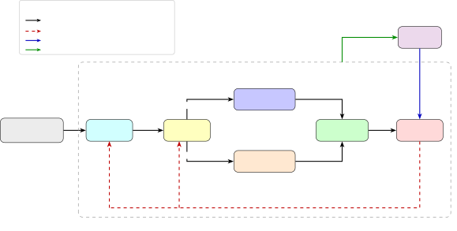
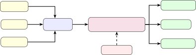
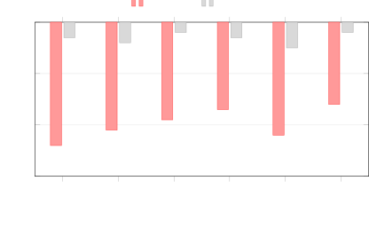
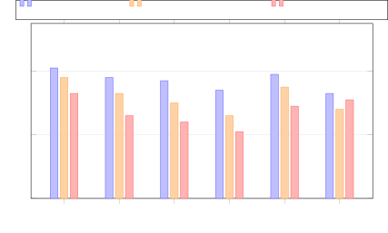
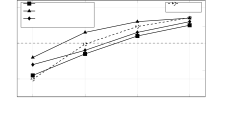

# This work has been submitted to Taylor and Francis’ Applied Artificial Intelligence for possible publication. Multi-Dimensional Behavioral Evaluation of Agentic Stock Prediction Systems Using Large Language Model Judges with Closed-Loop Reinforcement Learning Feedback

Mohammad Al Ridhawi, Mahtab Haj Ali, and Hussein Al Osman Affiliation: 
Affiliation: School of Electrical Engineering and Computer Science,  
University of Ottawa, Ottawa, Canada  
e-mail: malri039@uottawa.ca

###### Abstract

Agentic artificial intelligence systems produce outputs through
sequences of interdependent autonomous decisions, yet standard
evaluation assesses outputs alone and cannot diagnose the underlying
process. We develop a behavioral evaluation methodology that complements
output-level testing by scoring the intermediate decision process
itself. Behavioral traces logged at each autonomous decision point are
grouped into five-day episodes and scored along six domain-specific
dimensions (regime detection, routing, adaptation, risk calibration,
strategy coherence, error recovery) by an ensemble of three large
language model (LLM) judges. A perturbation procedure that corrupts one
dimension while leaving the other five intact confirms dimension
specificity; cross-model agreement reaches Krippendorff’s
$`\alpha=0.85`$. The composite behavioral score correlates at Spearman
$`\rho=0.72`$ with realized 20-day Sharpe ratio. Closing the loop, the
framework converts deficient per-dimension scores into a credit-assigned
penalty added to the Soft Actor-Critic reward. Three fine-tuning cycles,
confined to validation data, reduce one-day MAPE from 0.61% to 0.54%
(11.5% relative; $`p<0.001`$, $`d=0.31`$) on the held-out 2017 to 2025
test period, significant under Diebold-Mariano and localized by
Giacomini-White to the high-volatility regime. The methodology is
application-agnostic and applies to any agentic system whose
intermediate decisions can be logged.

###### Index Terms: 

Agentic AI; LLM-as-a-Judge; behavioral evaluation; reinforcement
learning; closed-loop learning; financial forecasting

## I Introduction

Modern artificial intelligence systems are increasingly agentic in the
operational sense that each output is produced through a sequence of
interdependent autonomous decisions rather than through a single forward
pass over a static model. A regime detector classifies the current state
of the world, a routing layer selects between specialized predictive
pathways, a controller adjusts hyperparameters in response to recent
performance, and the final output emerges only after several such
decisions have been chained \[1, 2\]. The autonomy and modularity that
make these systems effective also make them difficult to evaluate.
Standard evaluation practice scores the final output against a
ground-truth label or a benchmark, but cannot localize which
intermediate decision was responsible when the output is wrong, nor
confirm that a correct output was produced through sound intermediate
decisions rather than fortunate coincidence.

The distinction between output quality and process quality matters
because the two can diverge. An agent may complete a task through a
sequence of lucky coincidences in which several poor decisions cancel
each other out, or fail a task despite making well-justified decisions
that are then undermined by environmental stochasticity. As agentic
systems are deployed in safety-relevant and high-cost domains
(autonomous driving, medical decision support, financial forecasting,
industrial control), the cost of treating output success as a proxy for
decision quality grows. \[1\] survey the autonomous-agent literature and
identify process-quality evaluation as one of the open problems for the
field, noting that existing benchmarks measure whether agents achieve
their goals but not whether their reasoning was sound. \[2\] similarly
survey large-language-model based agents and observe that behavioral
evaluation, in domains where the link between immediate outcome and
decision quality is noisy, remains underdeveloped relative to
output-level assessment.

The LLM-as-a-Judge paradigm offers a natural entry point for closing the
gap. Large language models produce evaluations that align closely with
human raters on natural-language tasks \[3, 4\] and are reliable enough
to drive downstream optimization in language-model alignment \[5, 6\].
Existing applications, however, evaluate static outputs such as single
responses, summaries, and dialogue turns. Adapting the paradigm to
agentic systems requires assessing temporal sequences of interdependent
decisions made under stochastic conditions, where the same decision may
be appropriate under one set of conditions and inappropriate under
another, and where decision quality cannot always be inferred from the
immediate outcome because of data-generating-process noise. To our
knowledge, no prior work formalizes LLM-based behavioral evaluation as a
methodology in which the dimensions, the validation procedure, and the
integration with downstream learning are designed jointly against the
requirements of a specific applied-AI task rather than borrowed
wholesale from natural-language evaluation.

This paper develops such a methodology and demonstrates it as a case
study on a representative agentic forecasting system: an adaptive
regime-aware stock prediction system that combines an autoencoder regime
detector, dual node-transformer pathways specialized for stable and
volatile market conditions, and a Soft Actor-Critic (SAC) controller
that tunes the regime threshold and the pathway blending weight at each
trading day \[7, 8\]. The system is a representative instance of the
agentic class because each daily forecast is produced through a
four-stage decision chain (detect, route, predict, adjust), each stage
is autonomous, and the quality of the forecast depends on the
appropriateness of every stage’s decision in context. The forecasting
application is the demonstration domain rather than the contribution:
the architecture is taken from prior work \[9, 7\] and is treated here
as the agentic system being evaluated.

The methodology rests on four components: a behavioral-trace
formalization that records the inputs, outputs, and adjustments at every
autonomous decision point and segments them into fixed-length episodes
(Equation 1); six domain-specific evaluation dimensions covering three
architectural decision points (regime detection, routing, adaptation)
and three emergent behavioral properties (risk calibration, strategy
coherence, error recovery) scored under an anchored Likert rubric; a
perturbation procedure that corrupts exactly one dimension while leaving
the other five mechanically intact, supplying direct validation of
dimension specificity rather than indirect inference; and a
credit-assignment mechanism that translates per-dimension diagnostics
into targeted modifications of the reinforcement-learning reward, so
that the existing controller corrects identified weaknesses without
architectural changes. Empirical validation comprises perturbation-based
dimension specificity, predictive-validity correlation against realized
20-day Sharpe ratio, and a closed-loop campaign whose effect on the
underlying forecasts is checked against the baseline through paired
tests, Diebold-Mariano \[10, 11\], Giacomini-White \[12\], and Hansen
model confidence set \[13\] procedures, plus canonical-benchmark
comparisons.

The case study uses daily forecasts on 20 S&P 500 equities over 1982 to
2025, with the closed-loop intervention evaluated on the held-out 2017
to 2025 test period (2,267 trading days). The dataset, feature
engineering pipeline, and core evaluation metrics follow the protocol
established in our prior work \[7\].

## II Materials and Methods

The methodology developed here complements, rather than replaces,
classical output-level evaluation. Procedures such as Diebold-Mariano
\[10, 11\], Giacomini-White conditional predictive ability testing
\[12\], model confidence sets \[13\], and forecast combination \[14\]
continue to supply the output-level evidence that the present framework
supplements with process-level evidence. The principle that LLM
judgments can serve as training signals for downstream learning is taken
from reinforcement learning from human feedback \[6, 5\]; what is novel
here is the adaptation of that principle to temporal sequences of
interdependent decisions under stochastic conditions, the perturbation
engineering that mechanically isolates each evaluation dimension, and
the credit-assignment mechanism that routes per-dimension diagnostics to
specific components of the controller’s action space. The
agent-evaluation literature has identified process quality as an open
challenge \[15, 16, 1, 2\], but a dedicated framework combining
mechanical dimension-specificity validation, predictive-validity
calibration, and a closed-loop bridge to a reinforcement-learning
controller has not, to our knowledge, been established for any
applied-AI domain. In financial forecasting specifically, evaluation has
remained at the level of aggregate accuracy metrics and statistical
predictive-accuracy tests \[17, 18, 19\], leaving the quality of
intermediate decisions unexamined.

### II-A Case-Study System and Behavioral Context

The framework is demonstrated on the adaptive regime-aware prediction
system introduced in \[7\], which processes daily data for 20 S&P 500
equities from January 1982 to March 2025. The complete architectural
description and baseline evaluation are given in \[7\]; only the
elements the behavioral evaluation reads off are summarized here. At
each trading day $`t`$, the autoencoder computes reconstruction error
$`e_{t}=\|x_{t}-\hat{x}_{t}\|_{2}`$ and classifies the market state by
comparing $`e_{t}`$ to a learned threshold $`\tau`$; the router directs
data to a normal- or event-conditioned pathway accordingly; the system
emits a blended forecast
$`\hat{y}_{t}=\alpha_{t}\,y_{\text{normal}}+(1-\alpha_{t})\,y_{\text{event}}`$;
and the Soft Actor-Critic (SAC) controller emits adjustments
$`(\Delta\tau_{t},\Delta\alpha_{t})`$ in response to recent prediction
performance. The forecast is therefore the output of a four-stage
decision chain. Figure 1 shows the complete pipeline; dashed red arrows
mark the SAC reinforcement feedback loop from \[7\], and the blue arrow
marks the new LLM diagnostic reward signal introduced here.



Fig. 1: Architecture of the agentic prediction system with the LLM judge
feedback loop. Behavioral traces logged at each decision point (dashed
gray box) feed the LLM judge, which produces diagnostic reward signals
for the SAC engine; the SAC engine also receives reinforcement feedback
from realized prediction outcomes.

### II-B Behavioral Trace Formalization

At each trading day $`t`$, the system records a behavioral trace
$`\mathcal{B}_{t}`$ that captures the complete decision context and
outcomes of every autonomous action. The trace is defined as a
structured tuple:

```math
\mathcal{B}_{t}=\langle\,\mathbf{m}_{t},\;\mathbf{a}_{t},\;\mathbf{r}_{t},\;\mathbf{u}_{t},\;\hat{y}_{t},\;\mathbf{p}_{t}\,\rangle \tag{1}
```

where the market context vector
$`\mathbf{m}_{t}=(p_{t},v_{t},\text{VIX}_{t},\bar{S}_{t})`$ records the
closing price, trading volume, CBOE Volatility Index value, and
aggregated BERT sentiment score (an exponentially weighted average of
BERT sentiment signals derived from financial news headlines, as in our
prior work \[9\]); the autoencoder decision vector
$`\mathbf{a}_{t}=(e_{t},\tau_{t},\ell_{t})`$ records the reconstruction
error, the current threshold, and the binary regime label
($`\ell_{t}\in\{0,1\}`$, where 1 indicates anomalous); the routing
vector $`\mathbf{r}_{t}=(\alpha_{t},k_{t})`$ records the blending weight
and the dominant-pathway index ($`k_{t}=0`$ normal, $`k_{t}=1`$ event);
the SAC action vector
$`\mathbf{u}_{t}=(\Delta\tau_{t},\Delta\alpha_{t})\in[-0.1,0.1]^{2}`$
records the threshold and blending-weight adjustments; $`\hat{y}_{t}`$
is the one-day-ahead forecast; and the rolling performance vector
$`\mathbf{p}_{t}=(\text{MAPE}_{t,w},\text{DA}_{t,w})`$ records MAPE and
directional accuracy over a trailing window of $`w=20`$ trading days.
Including both $`e_{t}`$ and $`\tau_{t}`$ alongside $`\ell_{t}`$ allows
the judge to assess the margin of the classification decision rather
than only its label; consistency between $`\ell_{t}`$ and
$`(k_{t},\alpha_{t})`$ is a key indicator of strategy coherence, since
classifying the market as anomalous while setting $`\alpha_{t}`$ to
heavily favor the normal pathway constitutes a logical contradiction.
Adjustments are assessed for timeliness (applied soon after a detectable
condition change), proportionality (scaled to the magnitude of the
change), and stability (no day-to-day reversals).

The trace is serialized as a structured JSON record for inclusion in the
LLM prompt, with labeled fields, units, and value ranges; reconstruction
errors appear alongside the threshold, blending weights alongside the
regime label, and SAC adjustments alongside the resulting post-update
parameters. A representative serialized trace is reproduced in
Appendix A. Single-day traces are insufficient for several evaluation
dimensions, motivating the episodic grouping described next.

### II-C Evaluation Episodes

Several evaluation dimensions require temporal context that extends
beyond a single day: adaptation responsiveness depends on whether the
system adjusts parameters promptly after a condition change, error
recovery on the system’s behavior over multiple days following a
prediction error, and strategy coherence on whether sequential decisions
are logically consistent. The framework therefore groups consecutive
traces into evaluation episodes:

```math
\mathcal{E}_{t}=\{\mathcal{B}_{t},\mathcal{B}_{t+1},\mathcal{B}_{t+2},\mathcal{B}_{t+3},\mathcal{B}_{t+4}\} \tag{2}
```

The five-day window matches the recent-error history length $`k=5`$ used
in the SAC state representation of \[7\]. Validation-period pilots over
three, five, seven, and ten-day windows favored five days on both
inter-episode score variance ($`\sigma=0.71`$ against $`0.94`$ at three
days) and cross-model agreement (Krippendorff’s $`\alpha=0.81`$ against
$`0.74`$ at three days and $`0.78`$ at ten days), with longer windows
degrading agreement because justifications increasingly averaged over
heterogeneous regimes within the episode. Episodes are sampled without
overlap to reduce statistical dependence between evaluated units (see
Section II-H).

### II-D Evaluation Dimensions

The framework defines six evaluation dimensions in two categories. The
first three correspond to specific architectural decision points and
assess whether individual components performed their designated
function. The remaining three capture emergent behavioral properties
that arise from the interaction of multiple components and cannot be
attributed to any single subsystem.

#### II-D1 Architectural decision dimensions

_Regime Detection (RD)_ assesses the accuracy of the autoencoder’s
market-state classification and the sensitivity of the threshold
$`\tau`$. The judge examines the relationship between $`e_{t}`$,
$`\tau_{t}`$, $`\ell_{t}`$, and concurrent market context: a sharp VIX
rise with elevated $`e_{t}`$ but a “normal” label receives a low RD
score. Because regime detection is the first decision in the chain,
errors here propagate downstream through routing and prediction.

_Routing Appropriateness (RT)_ evaluates whether data was directed to
the correct pathway given the detected regime, with particular attention
to decisions near the threshold boundary where $`e_{t}\approx\tau_{t}`$.
A high RT score requires the blending weight $`\alpha_{t}`$ to reflect
the system’s confidence: smooth intermediate weights
($`\alpha_{t}\approx 0.5`$) when the classification is uncertain, and
stable weights across consecutive days absent a corresponding change in
conditions.

_Adaptation Responsiveness (AD)_ measures the timeliness and
proportionality of SAC parameter adjustments. A high AD score requires
that $`\tau`$ and $`\alpha`$ move within one to two trading days of a
detectable shift, with magnitudes proportional to the severity of the
change; persistent stale parameters or aggressive overshoot both lower
the score. A day on which the VIX doubles while
$`\Delta\tau=\Delta\alpha=0`$ indicates poor adaptation.

#### II-D2 Emergent behavioral dimensions

_Risk Calibration (RC)_ assesses the appropriateness of the system’s
overall risk posture given the prevailing volatility environment. A
well-calibrated system becomes more conservative during high-volatility
periods (lower $`\alpha_{t}`$, more cautious parameter adjustments) and
more confident during low-volatility periods, rather than running a
static configuration that ignores volatility.

_Strategy Coherence (SC)_ evaluates the absence of contradictory actions
across the decision chain. Classifying the market as anomalous while
setting $`\alpha_{t}`$ to favor the normal pathway, detecting a regime
transition while freezing SAC parameters, or increasing $`\tau`$ (making
detection less sensitive) while simultaneously shifting $`\alpha`$
toward the event pathway are all coherence violations the judge is asked
to flag.

_Error Recovery (ER)_ measures the speed and effectiveness of adaptation
following prediction errors. A substantial error at time $`t`$ is
detected when the daily MAPE exceeds the trailing 20-day average by more
than one standard deviation:

```math
\xi_{t}=\mathbb{1}\!\left[\,\text{MAPE}_{t}>\overline{\text{MAPE}}_{t,20}+\sigma_{\text{MAPE},t,20}\,\right] \tag{3}
```

where $`\overline{\text{MAPE}}_{t,20}`$ and
$`\sigma_{\text{MAPE},t,20}`$ are the mean and standard deviation of
daily MAPE over the preceding 20 trading days. When $`\xi_{t}=1`$, a
high ER score requires SAC adjustments within two trading days and
measurable subsequent improvement; persistent errors and overcorrections
both lower the score. Table I summarizes the six dimensions.

| Category               | Dimension               | Assessment Criteria                                                                                    |
| ---------------------- | ----------------------- | ------------------------------------------------------------------------------------------------------ |
| Architectural Decision | Regime Detection (RD)   | Accuracy of autoencoder classification; threshold sensitivity; false positive and false negative rates |
|                        | Routing (RT)            | Consistency with detected regime; blending weight appropriateness; stability near threshold boundary   |
|                        | Adaptation (AD)         | Timeliness of SAC adjustments; proportionality to condition changes; absence of overshooting           |
| Emergent Behavioral    | Risk Calibration (RC)   | Appropriateness of risk posture given volatility; conservative behavior in high-VIX periods            |
|                        | Strategy Coherence (SC) | Logical consistency across decision chain; absence of contradictory actions                            |
|                        | Error Recovery (ER)     | Speed of adaptation after errors; effectiveness of corrective actions; absence of overcorrection       |

TABLE I: Six evaluation dimensions for the LLM-as-a-Judge assessment,
organized by category.

Coarser four-dimension and finer eight-dimension variants were piloted
on the validation set: the four-dimension variant conflated distinct
failure modes that require different corrective actions, and the
eight-dimension variant produced lower inter-judge agreement (mean
$`\alpha_{K}=0.62`$) without improving predictive validity. Across the
200 unperturbed evaluation episodes, the mean pairwise Spearman
correlation among the six dimensions is $`\bar{\rho}=0.26`$ and no
pairwise correlation exceeds 0.45 (the highest, $`\rho=0.41`$, between
regime detection and routing, reflects the architectural dependence of
routing on regime classification), indicating substantially independent
behavioral variation.

### II-E Scoring Rubric

Each dimension is scored on a 1 to 5 Likert scale anchored by observable
behavioral criteria. An integer scale was preferred over a finer 1 to 10
scale, which produced lower inter-judge agreement in preliminary
experiments without adding diagnostic information. Table II reports the
anchor descriptions for scores 1 and 5; scores 2 through 4 interpolate
(2 indicates predominantly flawed performance with occasional acceptable
behavior, 3 acceptable performance with identifiable but
non-disqualifying weaknesses, and 4 strong performance with only minor
imperfections). The full five-level rubric for all six dimensions is
reproduced verbatim in the LLM prompt and in Appendix A.

| Dim. | Score 1 (Fundamentally Flawed)                                                           | Score 5 (Exemplary)                                                                                        |
| ---- | ---------------------------------------------------------------------------------------- | ---------------------------------------------------------------------------------------------------------- |
| RD   | Systematic misclassification of regime; threshold unresponsive to volatility changes     | All regime transitions identified within one trading day; threshold adjustments proportional to volatility |
| RT   | Data routed to wrong pathway; blending weight contradicts regime classification          | Routing consistently matches market state; smooth blending transitions near threshold                      |
| AD   | Parameters frozen or wildly oscillating; no response to condition changes within episode | Prompt, proportional adjustments within one to two days; no overshooting or oscillation                    |
| RC   | Risk posture inappropriate for volatility (e.g., aggressive in high-VIX period)          | Conservative during high volatility, confident during low volatility; smooth transitions                   |
| SC   | Multiple contradictory actions across decision chain within episode                      | All decisions form logically consistent sequence; no contradictions                                        |
| ER   | No corrective action within 2 days of error; errors persist or worsen                    | Corrective adjustments within 1 to 2 days; subsequent predictions show measurable improvement              |

TABLE II: Rubric anchor descriptions for each evaluation dimension.
Scores 2 through 4 interpolate between the anchors.

The anchors reference concrete behavioral indicators the judge can read
off the trace rather than abstract quality descriptors, following the
principle from \[4\] that structured criteria yield more reliable
assessments than open-ended scoring instructions. Inter-judge agreement
on dimension scores is quantified using Krippendorff’s alpha,
appropriate for ordinal data with more than two raters and corrected for
chance agreement.

### II-F LLM Judge Ensemble and Evaluation Pipeline

The LLM judge receives a structured prompt with four components: a fixed
system description of the prediction architecture and trace-field
semantics; the five-trace episode
$`\{\mathcal{B}_{t},\ldots,\mathcal{B}_{t+4}\}`$ serialized as JSON with
units, ranges, and derived quantities such as $`e_{t}/\tau_{t}`$; the
full evaluation rubric for each of the six dimensions; and an output
schema requiring an integer score per dimension, a natural-language
justification grounded in specific trace fields, and an optional failure
label drawn from a 12-label vocabulary that maps each below-threshold
score onto a specific SAC action subspace. The full prompt text and the
failure-label vocabulary are reproduced verbatim in Appendix A.
Following \[4\], the prompt instructs the judge to summarize
episode-level market conditions, examine each decision point against the
information available when it was made, identify inconsistencies or
failures with references to specific trace fields, and only then assign
scores; the structured chain of thought, shown by \[4\] to improve
evaluation fidelity on NLP tasks, extends to multi-step behavioral
assessment where the judge must track causal chains across decision
points and days.

Three judges from different model families evaluate every episode
independently: GPT 5.4, Claude 4.6 Opus, and Gemini 3.1 Pro. Aggregating
across families reduces the influence of any single model’s
idiosyncrasies and exposes inter-judge agreement as a per-dimension
quality signal: higher agreement indicates the dimension is
well-defined, while disagreement flags rubric ambiguity or genuine edge
cases (Section III-C reports the full agreement statistics and
divergence examples). All judges operate at temperature zero, with no
access to other judges’ scores, and a maximum output of 2,000 tokens.
Figure 2 illustrates the complete pipeline from trace collection to
reward-signal generation.



Fig. 2: LLM-as-a-Judge evaluation pipeline. Behavioral traces, system
description, and evaluation rubric are combined into a structured
prompt. Outputs include per-dimension scores, natural-language
justifications, and reward signals fed back into the SAC engine.
Perturbation benchmarks validate the framework.

The per-dimension consensus score
$`\bar{s}_{d}=\tfrac{1}{J}\sum_{j=1}^{J}s_{d,j}`$ ($`J=3`$) is the
primary unit of evaluation. The closed-loop reward modification in
Section II-G operates on $`\bar{s}_{d}`$ directly with empirically
calibrated weights $`w_{d}`$, preserving the diagnostic granularity that
allows the SAC controller to localize which dimension requires
correction. An unweighted composite
$`S_{\text{composite}}=\tfrac{1}{6}\sum_{d}\bar{s}_{d}`$ is reported for
cross-episode comparison but not used as a training signal, since
collapsing the six dimensions into a scalar would discard targeted
feedback.

### II-G Closed-Loop Reward Integration

#### II-G1 Reward modification

The closed-loop mechanism augments the original SAC reward from \[7\]
(which combines prediction accuracy, directional correctness, and
threshold stability) with a penalty derived from the LLM evaluation:

```math
R^{\prime}_{t}=R_{t}-\lambda\sum_{d=1}^{6}\max(0,\;\theta-s_{d})\cdot w_{d} \tag{4}
```

where $`\lambda=0.15`$ scales LLM feedback against the primary reward,
$`\theta=3`$ is the minimum acceptable score (the midpoint of the 1 to 5
scale), and $`w_{d}`$ is the weight assigned to dimension $`d`$.
Dimensions scoring at or above $`\theta`$ receive no penalty; the linear
hinge ensures that severity scales proportionally with deficiency
without the destabilizing magnitudes a quadratic or exponential penalty
would produce. The feedback strength $`\lambda`$ was selected through a
sweep on the validation set (2011 to 2016) over six values spanning an
order of magnitude. For each candidate value, three full evaluation
cycles were executed and the resulting metrics were recorded after the
third cycle (Table III).

| $`\lambda`$ | MAPE (%) | DA (%) | $`\bar{s}_{\text{def}}`$ | Stability |
| ----------- | -------- | ------ | ------------------------ | --------- |
| 0.05        | 0.60     | 72     | 2.8                      | Stable    |
| 0.10        | 0.57     | 73     | 3.1                      | Stable    |
| 0.15        | 0.54     | 74     | 3.6                      | Stable    |
| 0.20        | 0.55     | 74     | 3.4                      | Stable    |
| 0.25        | 0.58     | 72     | 3.0                      | Marginal  |
| 0.30        | 0.63     | 71     | 2.5                      | Unstable  |

TABLE III: Sensitivity of closed-loop outcomes to the feedback strength
$`\lambda`$, measured after three evaluation cycles on the validation
set. $`\bar{s}_{\text{def}}`$ is the mean score across originally
deficient dimensions.

The sweep traces a three-regime pattern: under-correction at
$`\lambda\leq 0.05`$ where the LLM penalty is dominated by the primary
reward; an effective operating range at $`\lambda\in[0.10,0.20]`$ where
prediction and behavioral metrics improve jointly; and destabilization
at $`\lambda\geq 0.25`$ where the reward signal causes oscillatory SAC
behavior, with $`\lambda=0.30`$ producing final metrics worse than the
pre-intervention baseline. The selected $`\lambda=0.15`$ is the point at
which LLM feedback is strong enough to induce measurable behavioral
change while remaining subordinate to the primary objective.

The dimension weights $`w_{d}`$ are set equal to the Spearman
correlation between each dimension’s score and the realized Sharpe ratio
over the subsequent 20 trading days (Table IX), so the reward penalty
emphasizes dimensions with the greatest demonstrated impact on
risk-adjusted returns. The weights are computed once from the validation
episodes and held fixed during the closed-loop cycles to prevent
circular optimization in which the system simultaneously changes the
behavior being evaluated and the weights used to evaluate it.

#### II-G2 Credit assignment

The SAC controller outputs a two-dimensional action
$`a_{t}=[\Delta\tau,\Delta\alpha]`$, and different evaluation dimensions
correspond to different action components. Routing the penalty
incorrectly (for example, charging a routing deficiency to
$`\Delta\tau`$ rather than $`\Delta\alpha`$) would create conflicting
gradients and risk degrading non-targeted behaviors. The framework
decomposes the penalty through a credit assignment vector
$`\mathbf{c}_{d}=[c_{d,\tau},c_{d,\alpha}]`$:

```math
\Delta R_{d}=\max(0,\;\theta-\bar{s}_{d})\cdot w_{d}\cdot\mathbf{c}_{d} \tag{5}
```

with $`\mathbf{c}_{d}=[1,0]`$ for dimensions targeting $`\Delta\tau`$
only (RD, RC), $`[0,1]`$ for $`\Delta\alpha`$ only (RT), and
$`[0.5,0.5]`$ for both subspaces (AD, SC, ER); Table IV gives the
complete mapping.

| Dimension          | Target Subspace                            | Rationale                                                          |
| ------------------ | ------------------------------------------ | ------------------------------------------------------------------ |
| Regime Detection   | $`\Delta\tau`$                             | Threshold directly controls regime classification boundary         |
| Routing            | $`\Delta\alpha`$                           | Blending weight determines pathway contribution                    |
| Adaptation         | $`\Delta\tau`$, $`\Delta\alpha`$           | Adaptation quality reflects both threshold and blending tuning     |
| Risk Calibration   | $`\Delta\tau`$                             | Risk posture primarily determined by regime sensitivity            |
| Strategy Coherence | $`\Delta\tau`$, $`\Delta\alpha`$ (uniform) | Coherence is a system-level property not localizable to one action |
| Error Recovery     | $`\Delta\tau`$, $`\Delta\alpha`$           | Recovery requires coordinated adjustment of both parameters        |

TABLE IV: Credit assignment mapping from evaluation dimensions to SAC
action subspaces.

The total penalty from Equation 4 is thus applied selectively: each SAC
action component receives penalty contributions only from dimensions
with a non-zero element in its credit-assignment column. The ablation
study in Section III-I confirms that this targeted routing preserves the
quality of non-deficient dimensions throughout the improvement cycles.
The judge’s structured JSON output also supplies, for each
below-$`\theta`$ dimension, a categorical failure label (for example
delayed_threshold, wrong_routing, frozen_parameters,
inconsistent_blend); the label-to-subspace lookup in Appendix A provides
a finer-grained routing signal that overrides the default dimensional
mapping in atypical failure modes where, for instance, a routing
deficiency originates from an incorrect threshold rather than the
blending weight.

#### II-G3 Periodic evaluation protocol

LLM evaluation operates in cycles rather than continuously, so the
feedback acts as a corrective intervention rather than a competing
reward stream. Each cycle begins with 40 trading days of normal
operation (approximately two calendar months), generating traces without
reward modification; the traces are grouped into eight non-overlapping
five-day episodes, evaluated by all three judges, and per-dimension
scores averaged across judges and episodes. If any mean dimension score
falls below $`\theta=3`$, the reward modification from Equation 4 is
activated and the SAC controller is fine-tuned for 10 epochs on the
cycle’s replay buffer (Adam, learning rate $`3\times 10^{-4}`$, soft
target updates $`\tau_{\text{soft}}=0.005`$, matching the original SAC
training). The modified reward is deactivated after fine-tuning, and the
system resumes normal operation. This periodic structure prevents the
LLM feedback from dominating the reward signal during normal operation.
Three cycles were conducted in the experiments of Section III-G, at
which point dimension scores converged above $`\theta`$ for all
dimensions.

### II-H Experimental Setup

The experiments use the same 20 S&P 500 equities and temporal
partitioning as our prior work \[9, 7\]: training over 1982 to 2010,
validation over 2011 to 2016, and test over 2017 to 2025. The data
discipline of \[7\] is preserved: the test period is reserved for final
reporting only and is never used for adaptation, hyperparameter tuning,
or prompt selection. The closed-loop adaptation pipeline introduced
here, including all SAC fine-tuning cycles, LLM-judge evaluation
episodes, hyperparameter selection ($`\lambda`$ and $`\theta`$),
prompt-sensitivity analyses, and ablations, is therefore confined
entirely to the validation window. After the closed-loop process
concludes, the SAC weights are frozen and the system is applied without
further updates to the held-out test set for the final
prediction-performance reporting in Section III-H.

For the LLM-judge analyses, 200 unperturbed evaluation episodes were
sampled from the validation period, stratified by VIX-based regime: 70
episodes from low volatility (VIX $`<`$ 15), 90 from medium volatility
(VIX 15 to 25), and 40 from high volatility (VIX $`\geq`$ 25). The
distribution reflects the empirical frequency of each regime while
over-sampling high volatility for statistical power, and episode
boundaries were constrained to lie within a single regime
classification. The validation window encompasses the European sovereign
debt crisis (2011 to 2012), the 2014 to 2015 oil price crash, the 2015
Chinese market turbulence, and the 2016 Brexit period. All three judges
evaluated the 200 episodes at temperature zero, independently. Total
evaluation cost was approximately \$180; individual episode evaluations
completed in 8 to 15 seconds per judge through provider batch endpoints.
Table V summarizes the configuration.

| Parameter                       | Value                          | Rationale                            |
| ------------------------------- | ------------------------------ | ------------------------------------ |
| Episode length                  | 5 trading days                 | Matches SAC history window ($`k=5`$) |
| Episode overlap                 | None                           | Statistical independence             |
| Total episodes                  | 200                            | Sufficient for regime stratification |
| Low-vol. episodes               | 70 (VIX $`<`$ 15)              | Proportional to regime frequency     |
| Medium-vol. episodes            | 90 (VIX 15 to 25)              | Proportional to regime frequency     |
| High-vol. episodes              | 40 (VIX $`\geq`$ 25)           | Over-sampled for statistical power   |
| Evaluation period               | 2011 to 2016                   | Validation window (test held out)    |
| LLM temperature                 | 0                              | Deterministic, reproducible scores   |
| Max output tokens               | 2,000                          | Accommodates CoT + 6 justifications  |
| Score scale                     | 1 to 5 (integer)               | Optimal LLM discrimination           |
| Score threshold ($`\theta`$)    | 3                              | Midpoint of Likert scale             |
| Feedback strength ($`\lambda`$) | 0.15                           | Validated on 2011 to 2016 period     |
| Cycle length                    | 40 trading days                | Balance frequency / stability        |
| SAC fine-tuning epochs          | 10 per cycle                   | Sufficient for penalty integration   |
| Perturbation episodes           | 60 baseline $`\times`$ 6 types | 420 total perturbed + baseline       |

TABLE V: Evaluation framework configuration parameters.

### II-I Perturbation Design

To validate that the LLM judges can reliably detect specific behavioral
deficiencies, the framework uses perturbation-based benchmarking. The
validation set consists of 60 unperturbed baseline episodes (20 from
each regime stratum) drawn from the 200 evaluation episodes. Six
perturbations were designed, each engineered to corrupt exactly one
dimension while leaving the other five mechanically unaffected. Letting
$`\mathcal{B}_{t}`$ denote the original trace and
$`\mathcal{B}^{\prime}_{t}`$ the perturbed trace, the transformations
are:

```math
\displaystyle\ell^{\prime}_{t}=1-\ell_{t},\quad e_{t},\tau_{t}\text{ unchanged} \tag{6}
```

```math
\displaystyle\alpha^{\prime}_{t}=0.9\cdot\ell_{t}+0.1\cdot(1-\ell_{t}) \tag{7}
```

```math
\displaystyle\mathbf{u}^{\prime}_{t}=\mathbf{0}\;\;\forall\,t\in\mathcal{E} \tag{8}
```

```math
\displaystyle f_{\text{VIX}}(\cdot)\to 1 \tag{9}
```

```math
\displaystyle\exists\,i\neq j:\;a_{i}\perp a_{j}\text{ per day} \tag{10}
```

```math
\displaystyle\mathbf{u}^{\prime}_{t+1}=\mathbf{u}^{\prime}_{t+2}=\mathbf{0}\;\;\text{if }\xi_{t}=1 \tag{11}
```

Regime inversion (Eq. 6) flips the classification while leaving
$`e_{t}`$ and $`\tau_{t}`$ untouched, creating a label that contradicts
the underlying evidence. Forced wrong-pathway routing (Eq. 7) overrides
the routing decision against the regime label with $`\alpha=0.1`$ when
normal and $`\alpha=0.9`$ when anomalous, isolating RT from RD. Frozen
SAC (Eq. 8) zeros all adjustments for the episode, isolating AD. Removed
VIX scaling (Eq. 9) disables the volatility scaling in the
risk-management code path, making the risk posture independent of
current volatility. Randomized contradictory actions (Eq. 10) replace
one component per day with a value contradicting the others (anomalous
label with $`\alpha=0.9`$; or $`\Delta\tau>0`$ paired with
$`\Delta\alpha`$ shifted toward the event pathway), targeting coherence
while preserving individual component outputs. Disabled recovery
(Eq. 11) zeros SAC actions for two days after any $`\xi_{t}=1`$ event,
leaving non-error days untouched. Each perturbation was applied
independently to the 60 baselines, yielding $`6\times 60=360`$ perturbed
episodes. Combined with the 60 originals, the validation set comprises
420 episodes; all three judges evaluated the complete set, producing
$`1{,}260`$ individual results.

### II-J Statistical Validation Procedures

To assess whether closed-loop improvements transfer from validation to
test data, the empirical analysis applies six complementary procedures
on the held-out 2017 to 2025 test period: paired tests with Cohen’s
$`d`$ effect sizes \[20\]; bootstrap confidence intervals on the
Sharpe-ratio improvement \[21\]; the Diebold-Mariano test of equal
predictive accuracy \[10\] with the \[11\] small-sample correction and
Newey-West HAC variance, replicated under squared-error, absolute-error,
MAPE, and QLIKE losses to control the choice-of-loss confound;
comparison against random-walk, AR(1), and ARMA(1,1)-GARCH(1,1)
benchmarks; the Giacomini-White test of conditional predictive ability
\[12\] with the autoencoder regime label as conditioning variable; and
the Hansen model confidence set \[13\] across the closed-loop cycles and
against a non-corrective SAC-only ablation. No weight updates, reward
modifications, or hyperparameter adjustments occur on the test set under
either configuration; Section III-H reports the single final comparison
between pre- and post-intervention with SAC weights frozen after the
third validation-period cycle.

## III Results

### III-A Baseline System Performance

Table VI reports one-day-ahead prediction performance for the agentic
system and selected baselines prior to the LLM feedback loop,
establishing the starting point from which the closed-loop improvement
is measured. The full set of baseline comparisons, per-stock analyses,
and multi-horizon results are reported in \[7\].

| Model                  | MAPE  | RMSE | DA  | Theil’s U | CTR |
| ---------------------- | ----- | ---- | --- | --------- | --- |
| ARIMA                  | 1.20% | 1.35 | 55% | 0.98      | 51% |
| LSTM                   | 1.00% | 1.20 | 58% | 0.88      | 54% |
| NodeFormer-BERT \[9\]  | 0.80% | 0.95 | 65% | 0.72      | 62% |
| AE-NodeFormer (no SAC) | 0.68% | 0.88 | 69% | 0.68      | 64% |
| AE-NodeFormer + SAC    | 0.61% | 0.82 | 71% | 0.63      | 67% |

TABLE VI: One-day-ahead prediction performance before LLM feedback loop.
DA: Directional Accuracy. CTR: Confidence Tracking Rate.

The AE-NodeFormer + SAC system from \[7\], applied without any
closed-loop fine-tuning, achieves 0.61% MAPE and 71% directional
accuracy on the validation-period episodes used here, a 24% MAPE
reduction over the single-pathway NodeFormer-BERT baseline from \[9\].
These figures are within sampling noise of the test-period results in
\[7\] (0.59% MAPE, 72% DA across 2017 to 2025), confirming the
validation window provides a representative operating regime. The
remainder of this section compares the validation-period baseline
against the closed-loop fine-tuned variant; held-out test-set prediction
performance is reported separately in Section III-H. Five-day and 20-day
MAPE follow the same pattern (1.02% and 1.52% respectively).

### III-B Perturbation-Based Validation

Table VII reports the perturbation validation results. For each
perturbation type, the table shows the targeted dimension, the mean
score drop on that dimension (relative to the unperturbed baseline), the
average score change on the remaining five dimensions (off-target
shift), Krippendorff’s alpha measuring cross-model agreement, and the
statistical significance of the targeted drop.

| Perturbation         | Target | $`\Delta s`$ | Off-tgt. $`\Delta`$ | $`\alpha`$ | $`p`$-value |
| -------------------- | ------ | ------------ | ------------------- | ---------- | ----------- |
| Regime inversion     | RD     | $`-`$2.4     | $`-`$0.3            | 0.85       | $`<`$0.001  |
| Wrong routing        | RT     | $`-`$2.1     | $`-`$0.4            | 0.81       | $`<`$0.001  |
| Frozen SAC           | AD     | $`-`$1.9     | $`-`$0.2            | 0.79       | $`<`$0.001  |
| No vol. scaling      | RC     | $`-`$1.7     | $`-`$0.3            | 0.74       | $`<`$0.001  |
| Contradictory action | SC     | $`-`$2.2     | $`-`$0.5            | 0.82       | $`<`$0.001  |
| Disabled recovery    | ER     | $`-`$1.6     | $`-`$0.2            | 0.76       | $`<`$0.001  |

TABLE VII: Perturbation validation results. $`\Delta s`$: mean targeted
score drop (GPT 5.4). Off-target $`\Delta`$: average change on remaining
five dimensions. $`\alpha`$: Krippendorff’s cross-model agreement.

Every perturbation produces a statistically significant targeted score
drop ($`p<0.001`$, paired $`t`$-test). The mean drops range from
$`-1.6`$ (disabled recovery) to $`-2.4`$ (regime inversion). Regime
inversion produces the largest drop because the contradiction between
the inverted label and the unchanged $`(e_{t},\tau_{t},\text{VIX}_{t})`$
context is unambiguous across all three judges. Disabled recovery
produces the smallest drop because in episodes where no significant
errors occur within the five-day window the recovery behavior cannot be
assessed in either direction, attenuating the mean effect.

The mean off-target shift across all perturbations and dimensions is
$`0.32`$, substantially smaller than the targeted drops. The largest
off-target shift ($`-0.5`$) is for contradictory actions, since
logically inconsistent decisions impair downstream quality on dimensions
beyond coherence; the smallest ($`-0.2`$) are for frozen SAC and
disabled recovery, indicating these perturbations are well-isolated.
Figure 3 visualizes the contrast.



Fig. 3: Targeted score drops (red) versus mean off-target shifts (gray)
for each perturbation type. The large gap between targeted and
off-target effects confirms dimension specificity: each perturbation
degrades its intended dimension far more than other dimensions.

Non-zero off-target shifts are expected: a perturbation that degrades
regime detection will have downstream effects on routing and adaptation,
because subsequent decisions operate on incorrect regime information.
Zero off-target sensitivity would in fact be suspect, implying that the
judges assess each dimension in isolation rather than in the integrated
manner behavioral evaluation requires. The observed pattern indicates
that the judges recognize downstream effects while maintaining primary
sensitivity to the targeted dimension.

### III-C Cross-Model Agreement

Cross-model agreement is quantified using Krippendorff’s alpha, a
reliability measure that generalizes across different numbers of raters
and rating scales while correcting for chance agreement:

```math
\alpha_{K}=1-\frac{D_{o}}{D_{e}}=1-\frac{(N-1)\sum_{c,k}o_{ck}\,\delta^{2}_{ck}}{\sum_{c,k}n_{c}\,n_{k}\,\delta^{2}_{ck}} \tag{12}
```

where $`D_{o}`$ and $`D_{e}`$ are observed and chance disagreement,
$`o_{ck}`$ counts coincidences between categories $`c`$ and $`k`$,
$`n_{c}`$ is the marginal frequency of category $`c`$, and
$`\delta^{2}_{ck}`$ is the squared difference function appropriate for
ordinal data. Thresholds of 0.667 and 0.800 are commonly accepted for
tentative and reliable conclusions \[22\].

Across the six dimensions, $`\alpha_{K}`$ ranges from 0.74 (risk
calibration) to 0.85 (regime detection). Regime detection, routing, and
strategy coherence exceed 0.800. Regime detection achieves the highest
agreement because the judges can directly compare $`e_{t}`$ against
$`\tau_{t}`$ and verify the regime label against the market context; an
obviously stable regime (low VIX, low volatility, no sentiment spikes)
classified as anomalous is a clear error the three models identify
consistently. Risk calibration achieves the lowest agreement because
what constitutes an appropriate risk posture depends on implicit
assumptions about risk tolerance, leading different LLM families to
apply slightly different standards for conservative versus aggressive
behavior. Even the lowest agreement (0.74) exceeds the threshold for
meaningful inter-rater reliability, supporting use of all six dimensions
in downstream reward modification.

Pairwise agreement shows GPT 5.4 and Claude 4.6 closest (Cohen’s kappa
\[23\] 0.71 to 0.83 across dimensions); both show slightly lower
agreement with Gemini 3.1 Pro (kappa 0.65 to 0.79). The divergence is
not a uniform leniency or strictness bias: on identical episodes Gemini
sometimes scored higher by treating borderline parameter lags as within
acceptable response time, and sometimes lower by penalizing minor
recovery overshoots the others treated as proportional (concrete
examples in Section III-F). Averaging across the three judges yields
more stable composite scores than any single judge.

### III-D Per-Regime Score Analysis

To understand how behavioral quality varies across market conditions,
Table VIII reports the mean dimension scores from GPT 5.4 across the
three regime strata on the 200 unperturbed evaluation episodes. GPT 5.4
is shown as a presentation choice (it has the highest pairwise agreement
with the other two judges); all training and downstream analysis operate
on the consensus score $`\bar{s}_{d}`$ averaged over the three judges,
and the regime-dependent patterns produced by Claude 4.6 and Gemini 3.1
Pro are qualitatively similar. Figure 4 visualizes the patterns.

| Regime                      | RD             | RT             | AD             | RC             | SC             | ER             |
| --------------------------- | -------------- | -------------- | -------------- | -------------- | -------------- | -------------- |
| Low vol. (VIX $`<`$ 15)     | 4.1$`\pm`$0.07 | 3.8$`\pm`$0.09 | 3.7$`\pm`$0.11 | 3.4$`\pm`$0.12 | 3.9$`\pm`$0.08 | 3.3$`\pm`$0.14 |
| Medium vol. (VIX 15 to 25)  | 3.8$`\pm`$0.09 | 3.3$`\pm`$0.12 | 3.0$`\pm`$0.14 | 2.6$`\pm`$0.17 | 3.5$`\pm`$0.11 | 2.8$`\pm`$0.15 |
| High vol. (VIX $`\geq`$ 25) | 3.3$`\pm`$0.12 | 2.6$`\pm`$0.16 | 2.4$`\pm`$0.18 | 2.1$`\pm`$0.19 | 2.9$`\pm`$0.14 | 3.1$`\pm`$0.17 |

TABLE VIII: Mean dimension scores ($`\pm`$ standard error) by volatility
regime on a 1 to 5 scale (GPT 5.4, unperturbed episodes;
$`n_{\text{low}}=82`$, $`n_{\text{med}}=74`$, $`n_{\text{high}}=44`$).



Fig. 4: Mean evaluation scores by volatility regime across the six
dimensions (GPT 5.4, 200 unperturbed episodes). Risk calibration (RC)
and adaptation responsiveness (AD) show the steepest declines from low
to high volatility, while error recovery (ER) is non-monotonic.

Behavioral quality generally degrades from low to high volatility,
though not uniformly. Risk calibration and adaptation responsiveness
decline most steeply (both by 1.3 points). Risk calibration drops from
3.4 (low) to 2.1 (high), so risk management is least adequate precisely
when it matters most. Routing declines by 1.2 points, reflecting the
difficulty of stable routing when $`e_{t}`$ fluctuates near $`\tau`$.

Error recovery is a notable exception: it scores higher in
high-volatility episodes (3.1) than in medium-volatility episodes (2.8).
The reversal occurs because high-volatility periods produce more
frequent and pronounced prediction errors, giving the system clearer
signals for corrective action and more opportunities to demonstrate
recovery; during medium volatility, errors are less severe and the
appropriate response is more ambiguous. Regime detection stays
relatively high even in high volatility (3.3), indicating the
autoencoder reliably identifies volatile conditions; the bottleneck
under stress is the system’s response to anomalous conditions, not their
detection.

This pattern motivates the closed-loop mechanism: behavioral weaknesses
are concentrated in specific dimensions under specific conditions, and a
targeted intervention should produce disproportionate gains in those
conditions. The prediction is confirmed in Section III-G, where the
largest improvements occur during high-volatility episodes.

### III-E Predictive Validity

A behavioral evaluation framework is useful only if its scores predict
future system performance. To assess predictive validity, Spearman rank
correlations were computed between GPT 5.4’s dimension scores on each
unperturbed episode and realized trading metrics over the subsequent 20
trading days. The 20-day window captures medium-term consequences of
behavioral quality without extending so far that the link to evaluated
behavior is diluted by intervening events. Table IX reports the
correlations.

| Dimension          | Sharpe | MAPE⁻¹ | MDD⁻¹ | Return |
| ------------------ | ------ | ------ | ----- | ------ |
| Regime Detection   | 0.64   | 0.69   | 0.51  | 0.54   |
| Routing            | 0.59   | 0.61   | 0.47  | 0.51   |
| Adaptation         | 0.58   | 0.53   | 0.56  | 0.52   |
| Risk Calibration   | 0.55   | 0.44   | 0.64  | 0.43   |
| Strategy Coherence | 0.62   | 0.59   | 0.49  | 0.57   |
| Error Recovery     | 0.51   | 0.48   | 0.54  | 0.46   |
| Composite          | 0.72   | 0.68   | 0.61  | 0.59   |

TABLE IX: Spearman $`\rho`$ between GPT 5.4 dimension scores and
realized 20-day trading metrics. MAPE⁻¹ and MDD⁻¹ are inverted so that
higher values indicate better performance (all correlations significant
at $`p<0.01`$).

The composite score correlates most strongly with the Sharpe ratio
($`\rho=0.72`$), so overall behavioral quality predicts risk-adjusted
returns over the subsequent month. Because the Sharpe ratio integrates
both the magnitude and the consistency of returns, behavioral quality
predicts not just average performance but performance stability.

Individual dimensions exhibit predictive profiles that align with their
conceptual definitions. Regime detection is the strongest predictor of
inverse MAPE ($`\rho=0.69`$), consistent with accurate classification
enabling appropriate model selection. Risk calibration is the strongest
predictor of inverse maximum drawdown ($`\rho=0.64`$), reflecting that
appropriate risk posture during volatile periods limits downside
exposure; that it predicts drawdown best despite showing the lowest
inter-judge agreement suggests imperfect calibration assessments still
capture genuine variation in tail-risk behavior. Strategy coherence
shows the strongest individual correlation with returns ($`\rho=0.57`$),
so logical consistency across the decision chain translates into more
reliable exploitation of predictive signals. Risk calibration’s weak
link to MAPE⁻¹ ($`\rho=0.44`$) but strong link to drawdown indicates its
contribution operates through risk management rather than forecasting.
Error recovery’s moderate correlations ($`\rho`$ from 0.46 to 0.54)
reflect that recovery only manifests when errors occur, limiting its
predictive content in error-free episodes. Even the weakest correlation
is significant ($`p<0.01`$).

These correlations serve a dual purpose: they validate that LLM scores
reflect genuine behavioral properties influencing realized outcomes, and
they supply the empirical basis for the dimension weights $`w_{d}`$ in
Equation 4, ensuring the closed-loop penalty emphasizes the dimensions
with the greatest demonstrated impact on risk-adjusted performance.

### III-F Qualitative Analysis of LLM Judgments

Four representative judgment patterns illustrate how the judges produce
evidence-grounded assessments rather than generic quality ratings; the
four span a stable episode, a transition episode, a perturbed episode,
and an error-recovery episode, covering the high-, mid-, and
low-agreement dimensions of Section III-C. On a high-quality episode in
stable conditions (VIX averaging 13.2), all three judges assigned 4 or 5
across all dimensions. GPT 5.4 noted that “$`e_{t}/\tau_{t}`$ stays
between 0.45 and 0.62, and $`\alpha=0.82`$ to $`0.88`$ reflects high
confidence in the normal-regime classification.” Claude 4.6 highlighted
that “SAC adjustments are minimal ($`|\Delta\tau|<0.005`$,
$`|\Delta\alpha|<0.02`$), appropriate given the absence of condition
changes.”

On a challenging episode spanning a volatility spike (VIX 18 to 29 over
five days), the judges assigned lower scores on risk calibration and
adaptation. GPT 5.4 gave RC = 2, noting that “the system maintains
$`\alpha=0.75`$ on day 3 despite VIX exceeding 25, and the day-4 drop to
$`\alpha=0.42`$ lags the spike by a full trading day.” Gemini 3.1 Pro
gave RC = 3 on the same episode, identifying the same lag but
interpreting it as “within acceptable response time given the noise in
daily VIX.” The divergence illustrates the subjective component of
risk-calibration assessment that contributes to its lower Krippendorff’s
alpha.

On a perturbed episode with regime-label inversion, all three judges
identified the perturbation with high confidence. Claude 4.6 gave
RD = 1: “the regime label indicates ‘normal’ on all five days despite
$`e\in[0.041,0.053]`$ exceeding $`\tau=0.031`$, and VIX 27 to 32 that is
inconsistent with normal conditions.” The failure label
systematic_misclassification routes to $`\Delta\tau`$. Routing was only
moderately affected (RT = 3) because $`\alpha=0.55`$ remained a
reasonable intermediate value despite the inverted label, illustrating
the off-target specificity pattern from the quantitative analysis.

A fourth example illustrates error recovery. During an episode in which
$`\xi_{t}=1`$ on days 1 and 2 (Eq. 3), GPT 5.4 gave ER = 4: “the SAC
controller reduces $`\tau`$ by 0.08 on day 3, $`\alpha`$ moves from 0.71
to 0.54 by day 4, and day-5 MAPE returns to within one standard
deviation of the rolling mean. The corrective sequence is prompt and
proportional.” Claude 4.6 also gave ER = 4; Gemini 3.1 Pro gave ER = 3,
noting “the day-3 correction overshoots slightly, as $`\tau`$ drops 0.03
below its pre-error level.” The disagreement reflects an interpretive
difference about where proportional ends and overshoot begins when the
overshoot is small. The episode also shows how recovery scores depend on
errors being present: in the 82 low-volatility episodes with no
significant errors, all three judges defaulted to ER = 3, noting
insufficient evidence.

These examples demonstrate that the judges ground their assessments in
specific numerical values, articulate causal chains between upstream
decisions and downstream consequences, agree on objective dimensions
(RD, RT) where rubric criteria are unambiguous, and disagree on
subjective dimensions (RC, ER) where multiple valid interpretations
exist. The lower Krippendorff’s alpha for ER thus reflects genuine
interpretive ambiguity about proportionality rather than poor instrument
design.

### III-G Closed-Loop Improvement

Three cycles of LLM evaluation and SAC reward modification were
conducted with $`\lambda=0.15`$. The data partitioning mirrors the
discipline of \[7\]: every adaptation step, hyperparameter choice, and
fine-tuning update operates on validation-period data, and the test
period is reserved for final reporting. The three cycles ran on a
contiguous 120-day window in the latter portion of the validation set
(three consecutive 40-day cycles ending in late 2016), with each cycle’s
SAC fine-tuning drawing only on its own replay buffer. After the third
cycle, all SAC weights are frozen and the controller is applied without
further updates to the held-out 2017 to 2025 test period in
Section III-H; the SAC weights have therefore never been updated using
transitions from the test set.

The initial evaluation identified three dimensions below $`\theta=3`$:
risk calibration during regime transitions (mean 2.1), routing near the
threshold boundary (mean 2.6), and adaptation following consecutive
errors (mean 2.4), with deficiencies most pronounced in high-volatility
episodes. Table X summarizes the per-cycle validation-period progression
and Figure 5 plots the trajectories.

|                             |                 |                 |                 |                 |
| --------------------------- | --------------- | --------------- | --------------- | --------------- |
| Metric                      | Baseline        | Cycle 1         | Cycle 2         | Cycle 3         |
| Risk Calibration (RC)       | 2.1$`\pm`$0.18  | 2.7$`\pm`$0.16  | 3.2$`\pm`$0.14  | 3.5$`\pm`$0.11  |
| Routing (RT, near $`\tau`$) | 2.6$`\pm`$0.15  | 3.3$`\pm`$0.12  | 3.6$`\pm`$0.10  | 3.7$`\pm`$0.09  |
| Adaptation (AD, post-error) | 2.4$`\pm`$0.17  | 2.8$`\pm`$0.15  | 3.3$`\pm`$0.12  | 3.6$`\pm`$0.10  |
| Val. MAPE (%)               | 0.61$`\pm`$0.03 | 0.57$`\pm`$0.03 | 0.55$`\pm`$0.02 | 0.54$`\pm`$0.02 |
| Val. DA (%)                 | 71$`\pm`$2      | 73$`\pm`$2      | 74$`\pm`$2      | 74$`\pm`$2      |

TABLE X: Per-cycle progression of deficient dimension scores ($`\pm`$
standard error) and prediction metrics during the closed-loop process.
All entries are measured on validation-period episodes; the held-out
test results are reported in Section III-H.



Fig. 5: Progression of deficient dimension scores (left axis, solid
lines) and MAPE (right axis, dashed line, inverted) across three
closed-loop cycles, measured on the validation-period episodes within
each cycle. The horizontal dashed gray line marks the intervention
threshold ($`\theta=3`$).

After three cycles, all three deficient dimensions exceed $`\theta`$.
Risk calibration rose from 2.1 to 3.5: the SAC controller produces
larger $`\Delta\alpha`$ adjustments toward the event pathway when
$`e_{t}`$ rises, even before crossing $`\tau`$, reflecting a proactive
rather than reactive response to emerging volatility. Routing rose from
2.6 to 3.7, the gain concentrated in the first cycle as the
$`\Delta\alpha`$-targeted penalty took immediate effect; the system now
sets intermediate weights ($`\alpha\approx 0.4`$ to $`0.6`$) when
$`e_{t}`$ is within 15% of $`\tau`$ rather than committing fully to one
pathway. Adaptation rose from 2.4 to 3.6, with corrective adjustments
applied earlier in error sequences rather than after error magnitudes
accumulate.

These validation-period behavioral gains were tested on unseen data by
applying the frozen post-cycle-3 SAC controller to the held-out 2017 to
2025 test period and comparing against the pre-intervention
configuration on identical test inputs. Test-period one-day MAPE fell
from 0.61% to 0.54% (11.5% relative reduction), directional accuracy
rose from 71% to 74% (3 percentage points), and the Sharpe ratio
increased by 18%. The gains are concentrated where the pre-intervention
deficiencies were greatest: test-set MAPE in high-volatility episodes
decreased by 17.3% versus 7.8% in low-volatility episodes. Longer
horizons attenuate but remain significant: five-day MAPE decreased 10.8%
(1.02% to 0.91%) and twenty-day MAPE 8.6% (1.52% to 1.39%), with
directional accuracy gains of 2 and 1 points respectively.

The per-cycle progression in Table X shows diminishing returns
consistent with convergence, with the rate varying by dimension. Routing
improved most rapidly (2.6 to 3.3 in cycle 1), risk calibration more
gradually (requiring all three cycles to exceed $`\theta`$), and
adaptation produced its largest gain in cycle 2 (2.8 to 3.3), likely
because the cycle-1 routing improvements supplied a more useful state
representation. By cycle 3 the magnitude of reward modifications had
decreased substantially, indicating the controller had internalized the
corrections. Dimensions already above $`\theta`$ at the start (RD 3.8,
SC 3.4, ER 3.2) remained stable throughout (mean changes $`<`$ 0.2),
confirming that the credit-assignment mechanism (Table IV) routes the
targeted penalty without degrading already-adequate behaviors.

### III-H Statistical Validation

This subsection situates the closed-loop intervention within the
standard predictive-accuracy testing framework, applying the six
complementary procedures introduced in Section II-J to the held-out 2017
to 2025 test period. Each procedure probes a different alternative
explanation for the observed gain: paired tests and bootstrap intervals
establish significance, Diebold-Mariano and benchmark comparisons rule
out artefacts, conditional predictive ability and the Hansen confidence
set probe regime and cycle robustness, and the four-loss sweep verifies
the result is not specific to squared-error loss.

##### Paired significance and Sharpe bootstrap.

On the held-out 2017 to 2025 test period, paired $`t`$-tests compare
daily prediction errors between the pre-intervention configuration
(AE-NodeFormer + SAC from \[7\], no closed-loop fine-tuning) and the
post-intervention configuration (same system after the three closed-loop
cycles). Both run with all weights frozen on identical inputs, isolating
the contribution of the closed-loop fine-tuning. The MAPE reduction
(0.61% $`\to`$ 0.54%) is significant ($`t=4.82`$, $`p<0.001`$, Cohen’s
$`d=0.31`$; \[20\]), as is the directional-accuracy gain (71% $`\to`$
74%; $`t=3.15`$, $`p=0.002`$, $`d=0.20`$). Effect sizes are moderate
relative to the architectural innovations in \[7\] ($`d`$ of 0.27 to
0.57), consistent with the closed-loop refining an already strong
system. Five-day MAPE is significant ($`t=3.41`$, $`p<0.001`$,
$`d=0.22`$); twenty-day MAPE is significant at a lower confidence
($`t=2.28`$, $`p=0.024`$, $`d=0.15`$), the declining effect plausibly
due to compounding variance over multi-day windows. A bootstrap \[21\]
with 10,000 resamples yields a 95% CI for the Sharpe-ratio improvement
of \[8.2%, 27.4%\] around the 18% point estimate, excluding zero.

##### Diebold-Mariano test of equal predictive accuracy.

The Diebold-Mariano (DM) test \[10\] with the \[11\] small-sample
correction is applied to per-day squared-error loss differentials
$`d_{i,t}=(e^{(\mathrm{pre})}_{i,t})^{2}-(e^{(\mathrm{post})}_{i,t})^{2}`$.
The per-stock statistic is
$`\mathrm{DM}_{i}=\bar{d}_{i}/\sqrt{\hat{V}(\bar{d}_{i})}`$ with
$`\hat{V}`$ a Newey-West HAC estimator (bandwidth
$`\lfloor 4(T/100)^{2/9}\rfloor=5`$). The fixed-effects panel pool over
20 stocks and 2,267 trading days yields $`\mathrm{DM}=-7.83`$
($`p<0.001`$), with the negative sign indicating strictly lower
squared-error loss post-intervention. Per-stock statistics range from
$`-1.74`$ (low-volatility consumer staples, smallest pre-intervention
errors) to $`-6.49`$ (high-beta technology, largest pre-intervention
errors). Eighteen of twenty per-stock tests remain significant after
Bonferroni correction ($`|z|=2.81`$); all twenty are significant at the
uncorrected 5% level. The improvement is therefore not driven by a small
number of tickers.

##### Comparison against statistical benchmarks.

The agentic system is situated against three canonical univariate
forecasters on the same test inputs: a no-change random walk; an AR(1)
on log-returns with parameters re-estimated on a 1,000-day rolling
window; and an ARMA(1,1)-GARCH(1,1) on the same window with the
conditional mean used as the point forecast. The third rules out the
alternative that agentic gains depend on conditional-variance modeling.
Table XI summarizes the comparison.

| Forecaster               | MAPE  | RMSE | DA  | DM vs. post |
| ------------------------ | ----- | ---- | --- | ----------- |
| Random Walk              | 1.34% | 1.51 | 50% | $`-23.74`$  |
| AR(1) on log-returns     | 1.31% | 1.48 | 51% | $`-22.41`$  |
| ARMA(1,1)-GARCH(1,1)     | 1.29% | 1.46 | 52% | $`-21.86`$  |
| Pre-intervention agentic | 0.61% | 0.82 | 71% | $`-7.83`$   |
| Post-intervention        | 0.54% | 0.74 | 74% | (reference) |

TABLE XI: One-day-ahead test-period predictive accuracy against
statistical benchmarks. Pooled Diebold-Mariano statistics compare each
row to the post-intervention agentic system (final column) under
squared-error loss; negative values indicate the agentic system has
lower loss.

The post-intervention agentic system achieves a one-day MAPE roughly 60%
lower than each statistical benchmark. DM statistics against the
post-intervention configuration are uniformly large and negative
($`-23.74`$ random walk, $`-22.41`$ AR(1), $`-21.86`$ ARMA-GARCH; all
$`p<10^{-6}`$). ARMA-GARCH is only marginally more accurate than AR(1)
on the mean forecast, since conditional-variance machinery does not
change the mean equation. The pre-intervention agentic system already
outperforms each benchmark by a wide margin (consistent with \[7\]); the
closed-loop yields a further, statistically significant improvement on
top of an already-strong baseline.

##### Conditional predictive ability.

The pooled DM test evaluates unconditional equal predictive accuracy and
can mask asymmetric performance. We therefore apply the conditional
predictive ability test of \[12\] with the autoencoder regime label
$`\ell_{t}`$ as conditioning variable. Regressing
$`d_{i,t}=\beta_{0}+\beta_{1}\ell_{t}+\varepsilon_{i,t}`$ and testing
$`\beta_{0}=\beta_{1}=0`$ via a Wald statistic with HAC-corrected
standard errors, two-way fixed-effects pooling yields Wald $`=86.41`$
($`p<10^{-9}`$), with $`\hat{\beta}_{0}=0.014`$ ($`t=4.27`$) and
$`\hat{\beta}_{1}=0.029`$ ($`t=5.93`$). Post-intervention loss is lower
in both regimes (differential 0.014 low-vol., 0.043 high-vol.); the
advantage is roughly three times larger in high volatility, matching the
behavioral analysis: gains are largest where pre-intervention
deficiencies in risk calibration and adaptation were most severe.

##### Model confidence set across closed-loop cycles.

The Hansen Model Confidence Set \[13\] is computed on test-period
squared-error losses for five candidates: pre-intervention, cycle 1,
cycle 2, cycle 3, and a non-corrective ablation matching cycle 3 in
additional SAC training steps but with $`\lambda=0`$ (no LLM penalty).
The $`T_{\max}`$ statistic with 5,000 stationary block-bootstrap
resamples (block length 10 days) gives: 90% MCS contains $`\{`$cycle 3,
cycle 2$`\}`$; 75% MCS shrinks to $`\{`$cycle 3$`\}`$. The $`\lambda=0`$
ablation is rejected at 99% with $`T_{\max}=11.62`$ ($`p<0.001`$)
against cycle 3, confirming that the predictive-accuracy gains require
the LLM penalty rather than generic additional training.
Pre-intervention and cycle 1 are rejected from the 90% MCS with
$`T_{\max}`$ of $`9.07`$ and $`3.62`$, tracking the per-cycle behavioral
progression.

##### Robustness across loss functions.

Forecast rankings can reverse under different losses, so the DM test is
repeated under absolute-error loss $`|e_{i,t}|`$, MAPE loss
$`|e_{i,t}|/|y_{i,t}|`$, and the QLIKE loss
$`\log(\sigma^{2}_{i,t})+e^{2}_{i,t}/\sigma^{2}_{i,t}`$ with
$`\sigma^{2}_{i,t}`$ a 22-day realized-variance proxy. Pooled DM
statistics are $`-7.83`$ (squared-error), $`-7.21`$ (MAE), $`-7.58`$
(MAPE), $`-7.04`$ (QLIKE), all $`p<0.001`$. The narrow spread indicates
the improvement is not an artifact of the squared-error metric.

### III-I Framework Ablations

Three ablations isolate the contribution of individual design choices:
the number of LLM judges, the credit assignment strategy, and the
sensitivity of scores to prompt phrasing. Each modifies a single
framework component while keeping the others fixed, and the closed-loop
cycle is re-run from the same pre-intervention checkpoint.

#### III-I1 Number of judges

To assess whether the three-judge ensemble is necessary, the closed-loop
process was repeated with each judge in isolation, holding all other
components fixed. Per-episode composite-score variance is the diagnostic
of interest because a noisier consensus mean produces noisier SAC
updates. Table XII reports the resulting prediction quality and
score-variance figures.

| Judge Configuration  | MAPE (%) | DA (%) | Sharpe | Score Variance |
| -------------------- | -------- | ------ | ------ | -------------- |
| GPT 5.4 only         | 0.55     | 74     | 1.57   | 0.41           |
| Claude 4.6 Opus only | 0.56     | 74     | 1.53   | 0.43           |
| Gemini 3.1 Pro only  | 0.58     | 73     | 1.46   | 0.46           |
| 3-judge ensemble     | 0.54     | 74     | 1.61   | 0.29           |

TABLE XII: Closed-loop outcomes after three evaluation cycles for
single-judge variants versus the three-judge ensemble. Score variance is
the mean per-episode composite-score standard deviation across the 200
evaluation episodes.

All single-judge variants improve over the pre-intervention baseline, so
the closed-loop mechanism is not dependent on any single LLM family. The
three-judge ensemble nevertheless achieves consistently better outcomes;
its primary advantage is variance reduction (per-episode variance 0.29
is 29 to 37% lower than any single judge), which translates into a more
stable reward signal for SAC training. GPT 5.4 comes closest as a single
judge but its higher score variance produces noisier updates and a lower
final Sharpe. The single-judge MAPE gap to the ensemble is 0.01 to 0.04,
indicating robustness to the choice of judge with a measurable ensemble
benefit through variance reduction.

#### III-I2 Credit assignment strategy

An alternative uniform strategy was tested in which all dimension
penalties are applied equally to both action components, removing the
dimension-to-action mapping in Table IV. Table XIII compares the two
strategies.

| Credit Strategy     | MAPE (%) | DA (%) | $`\Delta\bar{s}_{\text{def}}`$ | $`\Delta\bar{s}_{\text{non}}`$ |
| ------------------- | -------- | ------ | ------------------------------ | ------------------------------ |
| Targeted (proposed) | 0.54     | 74     | +1.3                           | +0.1                           |
| Uniform             | 0.56     | 73     | +0.9                           | $`-`$0.4                       |

TABLE XIII: Comparison of targeted versus uniform credit assignment
after three evaluation cycles. $`\Delta\bar{s}_{\text{def}}`$ and
$`\Delta\bar{s}_{\text{non}}`$ denote mean score changes for initially
deficient and non-deficient dimensions, respectively.

The targeted strategy produces larger improvements on deficient
dimensions ($`+`$1.3 versus $`+`$0.9 points) while preserving
non-deficient ones (mean change $`+`$0.1). The uniform strategy degrades
non-deficient dimensions by 0.4 points on average because uniform
penalties create conflicting gradients: a penalty intended to improve
routing inappropriately adjusts the anomaly threshold, degrading
previously adequate regime detection. In this setting, targeted credit
assignment is therefore necessary for translating LLM behavioral
assessments into non-destructive learning signals.

#### III-I3 Prompt sensitivity

To probe sensitivity of scores to prompt phrasing, three prompt variants
were constructed: the original prompt (A), a version with reordered
dimension descriptions (B), and a version with simplified language
preserving the rubric criteria (C). Each was used with GPT 5.4 to
evaluate the same 60 unperturbed validation-period episodes, with
per-dimension scores compared across variants. The assessment is
confined to the validation period because any sensitivity finding that
informed a prompt revision would otherwise constitute indirect selection
on the test data.

This is a bounded robustness check rather than a settled claim of prompt
invariance: it covers 60 episodes, a single judge (GPT 5.4), and only
two surface-level variant axes (ordering and lexical simplification). A
definitive claim would require a larger pool, the full ensemble, and
more variant types (paraphrased rubrics, alternative chain-of-thought
scaffolds, adversarial phrasings).

Within these limits, the mean absolute score difference between any two
variants is 0.14 per dimension on the 1 to 5 scale, with an intra-class
correlation coefficient (ICC) of 0.91. No dimension shows systematic
bias; the largest per-dimension shift is 0.11 (strategy coherence,
Variant C), within the standard error of 0.09. The ICC exceeds the 0.75
threshold conventionally considered “excellent” \[24\], indicating
scores are driven primarily by trace properties rather than phrasing
differences. The reordering test (Variant B) specifically probes
position bias; the absence of an effect ($`p=0.34`$, paired $`t`$-test
on composite scores) is consistent with robustness to this class of
artifact within the tested range.

## IV Discussion

### IV-A Interpretation of Findings

The empirical results support a three-part claim about LLM-based
behavioral evaluation of agentic AI systems. The dimensions can be
assessed with selective sensitivity rather than as a diffuse quality
signal: each of the six perturbations produced a targeted score drop of
at least 1.6 points while shifting the remaining dimensions by an
average of only 0.32 points. This asymmetry requires that the judges
correctly identify which trace component is responsible for the
degradation and distinguish a targeted deficiency from its downstream
consequences. The cross-model agreement (Krippendorff’s $`\alpha`$ 0.74
to 0.85) indicates the selective sensitivity is not an artifact of any
single model.

The scores also carry information beyond what is visible at the trace
level: the composite correlates at $`\rho=0.72`$ with realized 20-day
Sharpe ratio, exceeding any individual dimension’s correlation. The
distinct predictive profiles (regime detection predicting MAPE, risk
calibration predicting drawdown, strategy coherence predicting returns)
align with how each behavioral property should affect outcomes,
supplying convergent validity. The qualitative analysis (Section III-F)
shows the mechanism: the judges ground scores in specific numerical
trace values and articulate causal chains between upstream decisions and
downstream consequences.

The assessments are not merely diagnostic but actionable. The 11.5%
one-day MAPE reduction (significant under paired $`t`$-test,
Diebold-Mariano, and across four loss specifications) and the 3-point
directional-accuracy gain are meaningful improvements over an
already-strong baseline. Several observations support a causal
interpretation: the gains concentrate in the dimensions identified as
initially deficient; they are largest in high-volatility episodes where
deficiencies were most severe, consistent with targeted correction
rather than uniform improvement; non-targeted dimensions remained
stable, ruling out generic SAC re-training as the source of the gains;
and the Hansen MCS rejects a non-corrective $`\lambda=0`$ ablation (same
SAC training steps without LLM penalty) at the 99% level against the
closed-loop configuration.

The ablations sharpen these conclusions. The multi-judge ensemble
reduces per-episode score variance by 29 to 37%, producing a more stable
reward signal, though the modest single-judge gap (0.01 to 0.04 MAPE)
indicates the framework is robust to the choice of judge. The
credit-assignment ablation is more consequential: uniform penalty
distribution degrades non-targeted dimensions by 0.4 points on average,
so targeted credit assignment is necessary for translating behavioral
diagnostics into non-destructive learning signals. The $`\lambda`$ sweep
(Table III) maps a clean transition from under-correction
($`\lambda<0.10`$) through an effective range
($`\lambda\in[0.10,0.20]`$) to destabilization ($`\lambda>0.25`$),
supplying concrete tuning guidance.

### IV-B Implications for Applied AI and Agentic-System Evaluation

The findings carry three implications that extend beyond the
financial-forecasting demonstration, each addressing a different layer
of the methodology stack: how agentic process quality is measured, how
the LLM-as-a-Judge paradigm extends to temporal decision sequences, and
how qualitative diagnostics translate into a quantitative
reinforcement-learning signal. All three transfer to any application
that records intermediate decisions in a structured form.

For agentic-system evaluation generally, the results show that process
quality can be assessed directly (rather than inferred indirectly from
output success) with sufficient reliability to support both diagnostic
reporting and downstream optimization, provided three design conditions
are met: intermediate decisions must be loggable in a structured format;
evaluation dimensions must be domain-specific rather than borrowed
wholesale from natural-language evaluation; and dimension specificity
must be validated through engineered perturbations rather than assumed.
The methodology developed here satisfies all three and produces a
quantitative answer to a question aggregate metrics cannot address:
which intermediate decision was unsound when the system failed.

For the LLM-as-a-Judge paradigm, the framework extends scoring from
static outputs \[3, 4, 5\] to temporal sequences of interdependent
decisions under stochastic conditions, where decision quality cannot
always be inferred from immediate outcomes. The structured prompt and
chain-of-thought scaffold from \[4\] transfer without loss of judge
agreement; what is added is the episode formalization, the trace
serialization, and the credit-assignment routing. The extension is not
specific to finance: autonomous driving (with intermediate perception
and planning decisions), medical decision support (with intermediate
diagnostic and treatment-selection decisions), and robotic control (with
intermediate state estimation and action selection) are all candidate
domains.

For the bridge from qualitative LLM evaluation to quantitative
reinforcement learning, the closed-loop mechanism extends the RLHF
principle \[6, 5\] (originally developed for language-model alignment)
to a setting in which the learning signal must be routed to specific
components of a controller’s action space. The credit-assignment
mechanism is the technical contribution that makes this routing
possible. The targeted-versus-uniform ablation quantifies the value:
uniform penalties degrade non-targeted behaviors by 0.4 points; targeted
penalties improve targeted behaviors by 1.3 points while keeping
non-targeted ones stable. Practitioners implementing analogous
closed-loop systems will likely face the same routing problem.

### IV-C Generalizability beyond the Demonstration Domain

The methodology, considered separately from the empirical case study, is
application-agnostic. The four core components transfer without
modification: the behavioral-trace formalization (Equation 1), the
episodic grouping (Equation 2), the perturbation-based validation
(Section II-I), and the credit-assignment mechanism (Section II-G2).
What requires redesign for a new domain is the specific list of
dimensions, their rubric anchors, and the action-subspace mapping, all
of which depend on the architecture of the system being evaluated.

The empirical findings are quantitative artefacts of the specific case
study and should be re-estimated elsewhere. The 11.5% MAPE reduction,
the $`\rho=0.72`$ predictive-validity correlation, the regime
localization, and the specific Krippendorff’s $`\alpha`$ values reflect
properties of the AE-NodeFormer + SAC architecture, the 20 S&P 500
equities, and the 2017 to 2025 test window. The directionality
(perturbations produce targeted drops, scores correlate with realized
performance, closed-loop intervention improves prediction quality)
should transfer to analogous agentic systems, but the magnitudes should
not be assumed without re-evaluation. Priority extensions include
macroeconomic nowcasting, energy demand forecasting under regime shifts,
supply-chain forecasting under demand-disruption events, autonomous
decision systems in industrial control, and medical decision-support
pipelines.

### IV-D Limitations

LLM judges are generalist models whose domain knowledge derives from
pre-training rather than domain-specific training. The structured prompt
and rubric mitigate this by defining criteria explicitly, but the judges
may miss subtle signals a human expert would catch (options-implied
volatility surfaces, cross-asset contagion patterns) that are not
represented in the trace fields. The predictive-validity correlations
suggest assessments are meaningful but possibly incomplete relative to
expert human evaluators; a direct LLM-vs-human comparison would
strengthen the validation and is beyond the present scope.

The closed-loop mechanism introduces a Goodhart-type
objective-misspecification risk: the system could optimize for LLM
approval rather than genuine task performance. No such effect was
observed (all dimension improvements translated into prediction gains,
non-targeted dimensions remained stable), and the $`\lambda`$
sensitivity analysis (Table III) bounds the operating range within which
LLM feedback improves performance. The periodic evaluation protocol,
which restricts feedback to corrective interventions rather than
continuous reward modification, supplies a structural safeguard. The
risk nevertheless remains a theoretical concern under many more cycles
or on systems whose behavioral patterns diverge substantially from
pre-training.

The framework has been validated on a single architecture (the
AE-NodeFormer + SAC system from \[7\]) and a single case study (20
S&P 500 equities, 2,267 trading days from 2017 to 2025). The 20-equity
sample and 8-year horizon were chosen to keep LLM evaluation cost
tractable. The test window contains the 2018 volatility shock, the 2020
COVID-19 dislocation, and the 2022 to 2023 inflation regime, providing
exposure to structural breaks, but the empirical magnitudes should still
be re-estimated on architecturally distinct systems and broader samples.
The LLM evaluation cost (approximately \$180) is modest in absolute
terms but scales linearly with episodes and judges; real-time deployment
or higher-frequency cycles may require distillation of the judges into a
smaller, faster surrogate, subject to validation that distillation
preserves dimension specificity and predictive validity.

The three judges are commercial systems whose weights are subject to
provider-side updates the authors cannot version-pin from outside the
API. Mitigations include temperature-zero querying, the verbatim frozen
prompt in Appendix A, the three-family ensemble (reducing any single
provider’s update influence), and an archive of per-episode dimension
scores and rationales for the entire 2017 to 2025 test window. A
contemporaneous replay against the archive is therefore reproducible; a
future re-query against the live APIs may diverge if any provider has
updated its model. The inter-judge agreement (Krippendorff’s $`\alpha`$
0.74 to 0.85) suggests the framework is not critically dependent on any
single provider, so partial drift would be partially absorbed; complete
drift across all three would require re-validation.

Finally, temperature-zero operation produces deterministic evaluations
but eliminates the stochastic variation that could reveal model
uncertainty on borderline cases. Extending the framework to incorporate
evaluation uncertainty (for example via multi-temperature sampling and
per-episode score variance) could soften credit-assignment penalties on
borderline episodes and is left to future work.

### IV-E Future Work

Three directions extend the present study. Validation on architecturally
distinct agentic systems in non-financial domains (industrial control,
medical decision support, energy demand forecasting under regime shifts)
would test the application-agnostic claim directly; the trace
formalization, perturbation procedure, predictive-validity check, and
credit-assignment routing all transfer in principle, but specific
dimensions and rubric anchors will differ.

Distillation of the multi-judge ensemble into a faster surrogate is the
second direction. A distilled model that preserves dimension specificity
and predictive validity would reduce evaluation latency and cost,
opening the framework to real-time deployment. A multi-headed
distillation, in which the student outputs one score per dimension
trained against all three judges’ scores jointly, is a natural starting
point.

Incorporation of evaluation uncertainty through temperature sampling is
the third direction. Per-episode uncertainty estimates could soften
credit-assignment penalties on borderline episodes (mitigating the
Goodhart-type risk when the LLM is treated as a deterministic oracle)
and flag episodes for human review when the judges agree on a low score
but disagree on the failure label, precisely the case where intervention
is most consequential.

## Disclosure of interest

The authors report there are no competing interests to declare. No
financial or personal relationships with the providers of the language
models used as evaluators, or with any other party that could be
perceived to have an interest in the empirical findings, exist for any
of the authors.

## Funding

The authors received no financial support for the research, authorship,
or publication of this article.

## Data availability statement

Daily price and volume data for the twenty S&P 500 equities analyzed in
this study, together with the CBOE Volatility Index (VIX) used as a
market-volatility proxy, were retrieved from Yahoo Finance through the
yfinance Python library. The retrieved snapshot has been deposited at
Zenodo under DOI 10.5281/zenodo.20192822
(https://doi.org/10.5281/zenodo.20192822, Creative Commons Attribution
4.0 International License) and includes the per-ticker daily OHLCV
records together with the script used to generate them. The sentiment
series was constructed from public posts on X (formerly Twitter)
collected through cashtag-based queries against the X application
programming interface. The X developer agreement restricts
redistribution of platform content and of content derived from it; the
raw posts and the aggregated daily sentiment series are therefore not
redistributable, and reproduction requires independent collection under
the platform terms in force at the time of access. The code implementing
the behavioral evaluation framework, the perturbation harness, and the
closed-loop reward integration is available from the corresponding
author on reasonable academic request.

## References

- \[1\] L. Wang, C. Ma, X. Feng, Z. Zhang, H. Yang, J. Zhang, Z.
  Chen, J. Tang, X. Chen, Y. Lin, et al. (2024) A survey on large
  language model based autonomous agents. Frontiers of Computer Science
  18 (6), pp. 186345. Cited by: §I, §I, §II.
- \[2\] Z. Xi, W. Chen, X. Guo, W. He, Y. Ding, B. Hong, M. Zhang, J.
  Wang, S. Jin, E. Zhou, et al. (2023) The rise and potential of large
  language model based agents: a survey. arXiv preprint
  arXiv:2309.07864. Cited by: §I, §I, §II.
- \[3\] L. Zheng, W. Chiang, Y. Sheng, S. Zhuang, Z. Wu, Y. Zhuang, Z.
  Lin, Z. Li, D. Li, E. P. Xing, et al. (2023) Judging LLM-as-a-Judge
  with MT-Bench and Chatbot Arena. Advances in Neural Information
  Processing Systems 36. Cited by: §I, §IV-B.
- \[4\] Y. Liu, D. Iter, Y. Xu, S. Wang, R. Xu, and C. Zhu (2023)
  G-Eval: NLG evaluation using GPT-4 with better human alignment. In
  Proceedings of the 2023 Conference on Empirical Methods in Natural
  Language Processing, pp. 2511–2522. Cited by: §I, §II-E, §II-F, §IV-B.
- \[5\] Y. Dubois, X. Li, R. Taori, T. Zhang, I. Gulrajani, J. Ba, C.
  Guestrin, P. Liang, and T. B. Hashimoto (2024) AlpacaFarm: a
  simulation framework for methods that learn from human feedback.
  Advances in Neural Information Processing Systems 36. Cited by: §I,
  §II, §IV-B, §IV-B.
- \[6\] L. Ouyang, J. Wu, X. Jiang, D. Almeida, C. Wainwright, P.
  Mishkin, C. Zhang, S. Agarwal, K. Slama, A. Ray, et al. (2022)
  Training language models to follow instructions with human feedback.
  Advances in Neural Information Processing Systems 35, pp. 27730–27744.
  Cited by: §I, §II, §IV-B.
- \[7\] M. Al Ridhawi, M. Haj Ali, and H. Al Osman (2026) Adaptive
  regime-aware stock price prediction using autoencoder-gated dual node
  transformers with reinforcement learning control. Submitted to Applied
  Intelligence. Note: Under review. Preprint: arXiv:2603.19136 External
  Links: 2603.19136 Cited by: §I, §I, §II-A, §II-C, §II-G1, §II-H,
  §III-A, §III-A, §III-G, §III-H, §III-H, §IV-D.
- \[8\] T. Haarnoja, A. Zhou, P. Abbeel, and S. Levine (2018) Soft
  actor-critic: off-policy maximum entropy deep reinforcement learning
  with a stochastic actor. In International Conference on Machine
  Learning, pp. 1861–1870. Cited by: §I.
- \[9\] M. Al Ridhawi, M. Haj Ali, and H. Al Osman (2026) Stock market
  prediction using node transformer architecture integrated with BERT
  sentiment analysis. IEEE Access. External Links:
  [Document](https://dx.doi.org/10.1109/ACCESS.2026.3691980) Cited by:
  §I, §II-B, §II-H, §III-A, TABLE VI.
- \[10\] F. X. Diebold and R. S. Mariano (1995) Comparing predictive
  accuracy. Journal of Business & Economic Statistics 13 (3),
  pp. 253–263. External Links:
  [Document](https://dx.doi.org/10.1080/07350015.1995.10524599) Cited
  by: §I, §II-J, §II, §III-H.
- \[11\] D. Harvey, S. Leybourne, and P. Newbold (1997) Testing the
  equality of prediction mean squared errors. International Journal of
  Forecasting 13 (2), pp. 281–291. External Links:
  [Document](https://dx.doi.org/10.1016/S0169-2070%2896%2900719-4) Cited
  by: §I, §II-J, §II, §III-H.
- \[12\] R. Giacomini and H. White (2006) Tests of conditional
  predictive ability. Econometrica 74 (6), pp. 1545–1578. External
  Links: [Document](https://dx.doi.org/10.1111/j.1468-0262.2006.00718.x)
  Cited by: §I, §II-J, §II, §III-H.
- \[13\] P. R. Hansen, A. Lunde, and J. M. Nason (2011) The model
  confidence set. Econometrica 79 (2), pp. 453–497. External Links:
  [Document](https://dx.doi.org/10.3982/ECTA5771) Cited by: §I, §II-J,
  §II, §III-H.
- \[14\] A. Timmermann (2006) Forecast combinations. In Handbook of
  Economic Forecasting, G. Elliott, C. W. J. Granger, and A. Timmermann
  (Eds.), Vol. 1, pp. 135–196. External Links:
  [Document](https://dx.doi.org/10.1016/S1574-0706%2805%2901004-9) Cited
  by: §II.
- \[15\] S. Yao, J. Zhao, D. Yu, N. Du, I. Shafran, K. Narasimhan,
  and Y. Cao (2023) ReAct: synergizing reasoning and acting in language
  models. In Proceedings of the Eleventh International Conference on
  Learning Representations (ICLR), Note: OpenReview: tvI4u1ylcqs Cited
  by: §II.
- \[16\] N. Shinn, F. Cassano, A. Gopinath, K. Narasimhan, and S.
  Yao (2023) Reflexion: language agents with verbal reinforcement
  learning. In Advances in Neural Information Processing Systems, Vol.
  36, pp. 8634–8652. Cited by: §II.
- \[17\] M. Lopez de Prado (2018) Advances in financial machine
  learning. John Wiley & Sons. Cited by: §II.
- \[18\] Z. D. Akşehir and E. Kılıç (2024) Analyzing the critical steps
  in deep learning-based stock forecasting: a literature review. PeerJ
  Computer Science 10, pp. e2312. External Links:
  [Document](https://dx.doi.org/10.7717/peerj-cs.2312) Cited by: §II.
- \[19\] W. Bao, Y. Cao, Y. Yang, H. Che, J. Huang, and S. Wen (2025)
  Data-driven stock forecasting models based on neural networks: a
  review. Information Fusion 113, pp. 102616. External Links:
  [Document](https://dx.doi.org/10.1016/j.inffus.2024.102616) Cited by:
  §II.
- \[20\] J. Cohen (1988) Statistical power analysis for the behavioral
  sciences. 2nd edition, Lawrence Erlbaum Associates, Hillsdale, NJ,
  USA. Cited by: §II-J, §III-H.
- \[21\] B. Efron and R. J. Tibshirani (1993) An introduction to the
  bootstrap. Chapman and Hall/CRC, New York, NY, USA. Cited by: §II-J,
  §III-H.
- \[22\] K. Krippendorff (2011) Computing Krippendorff’s
  alpha-reliability. Annenberg School for Communication Departmental
  Papers. Note: Available at https://repository.upenn.edu/asc_papers/43/
  Cited by: §III-C.
- \[23\] J. Cohen (1960) A coefficient of agreement for nominal scales.
  Educational and Psychological Measurement 20 (1), pp. 37–46. Cited by:
  §III-C.
- \[24\] D. V. Cicchetti (1994) Guidelines, criteria, and rules of thumb
  for evaluating normed and standardized assessment instruments in
  psychology. Psychological Assessment 6 (4), pp. 284–290. Cited by:
  §III-I3.

## Appendix A LLM Judge Prompt Template

This appendix records the prompt template applied uniformly to all three
judges (GPT 5.4, Claude 4.6 Opus, and Gemini 3.1 Pro) at temperature
zero with a $`2{,}000`$-token output budget. A fixed system message
establishes the evaluator role, trace semantics, and rubric; an
episode-specific behavioral-trace serialization is appended; the model
is constrained by an output schema together with the failure-label
vocabulary in Table A1. Only the trace serialization varies across
episodes.

### A.1 System message

The text below is delivered as the system role (or its provider-specific
equivalent) on every episode evaluation.

```ltx_verbatim
You are an expert evaluator of an agentic stock prediction system that combines an
autoencoder regime detector, a routing layer that selects between a normal pathway
and an event pathway, dual node-transformer prediction pathways, and a Soft Actor-
Critic (SAC) controller that adjusts the regime threshold tau and the blending
weight alpha at each trading day.

For each episode you receive five consecutive daily behavioral traces. Each trace
contains: (i) market context (closing price, volume, VIX, aggregated BERT
sentiment); (ii) autoencoder reconstruction error e, current threshold tau, and
regime label (0 = normal, 1 = anomalous); (iii) routing blending weight alpha and
dominant pathway index; (iv) SAC adjustments delta_tau and delta_alpha, each in
[-0.1, 0.1]; (v) the one-day-ahead prediction; (vi) trailing 20-day MAPE and
directional accuracy.

Interpretation rules. A regime label of 1 is appropriate when the reconstruction
error exceeds the threshold by a non-trivial margin and the surrounding market
context (VIX above 25, sharply negative sentiment, abrupt price moves) supports
the anomaly classification. A blending weight alpha closer to 1 directs prediction
weight to the normal pathway; alpha closer to 0 directs it to the event pathway.
SAC adjustments are applied additively at the next time step. Adaptive behavior
should be timely (within one to two days of a detectable change), proportional to
the magnitude of that change, and stable (no day-to-day reversals).

Score each episode along the six dimensions (RD, RT, AD, RC, SC, ER) on an integer
1-5 scale: 1 = fundamentally flawed; 2 = predominantly flawed with occasional
acceptable behavior; 3 = acceptable with identifiable weaknesses; 4 = strong with
minor imperfections; 5 = exemplary.

The score-1 and score-5 anchors for each dimension are:
  RD  1: systematic misclassification of regime; threshold unresponsive to
         volatility.
      5: all regime transitions identified within one trading day; threshold
         adjustments proportional to volatility.
  RT  1: data routed to wrong pathway; blending weight contradicts regime
         classification.
      5: routing consistently matches market state; smooth blending transitions
         near threshold.
  AD  1: parameters frozen or wildly oscillating; no response to condition
         changes within episode.
      5: prompt, proportional adjustments within one to two days; no overshoot
         or oscillation.
  RC  1: risk posture inappropriate for volatility (e.g., aggressive in high-VIX
         period).
      5: conservative during high volatility, confident during low volatility;
         smooth transitions.
  SC  1: multiple contradictory actions across the decision chain within episode.
      5: all decisions form a logically consistent sequence; no contradictions.
  ER  1: no corrective action within two days of an error; errors persist or
         worsen.
      5: corrective adjustments within one to two days; subsequent predictions
         show measurable improvement.
Intermediate levels interpolate between the anchors using the per-dimension rubric
descriptions provided to the judge.

Reason in four steps before scoring: (1) summarize market conditions across the
five-day window, noting any volatility, sentiment, or price transitions; (2)
examine each decision point and assess whether the decision was appropriate given
the information available at that time; (3) identify any inconsistencies,
failures, or suboptimal behaviors, citing the specific trace fields that support
each observation; (4) assign each of the six scores, grounded in specific
observations from Steps 2 and 3, not an overall impression.

Return a single JSON object in the format specified in the output schema. Do not
include the chain-of-thought reasoning inside the JSON.
```

### A.2 Behavioral-trace serialization

Each daily trace $`\mathcal{B}_{t}`$ defined in Equation 1 is serialized
as a JSON record and the five traces of an episode are presented in
chronological order; a representative high-volatility record is shown
below.

```ltx_verbatim
{
  "day_index": 3,
  "market_context": {"price": 142.31, "volume": 38421500, "VIX": 22.4,
                     "sentiment_bar": -0.18},
  "autoencoder": {"reconstruction_error_e": 0.034, "threshold_tau": 0.031,
                  "ratio_e_over_tau": 1.10, "regime_label": 1},
  "routing": {"alpha": 0.35, "normal_pathway_pct": 35,
              "event_pathway_pct": 65, "dominant_pathway": "event"},
  "sac_action": {"delta_tau": -0.002, "delta_alpha": -0.05,
                 "tau_after_update": 0.029, "alpha_after_update": 0.30},
  "prediction": {"y_hat_next_day": 142.05},
  "rolling_performance": {"MAPE_20d_pct": 0.58, "DA_20d_pct": 73,
                          "trend": "stable"}
}
```

### A.3 Output schema and failure-label vocabulary

The judge returns a single JSON object with one integer score per
dimension (1 to 5), one justification per dimension referencing specific
trace fields, and an optional failure label for each dimension scoring
strictly below $`\theta=3`$.

```ltx_verbatim
{
  "scores": {"RD": <int>, "RT": <int>, "AD": <int>,
             "RC": <int>, "SC": <int>, "ER": <int>},
  "justifications": {"RD": "<text referencing trace fields>",
                     "RT": "<text>", "AD": "<text>",
                     "RC": "<text>", "SC": "<text>", "ER": "<text>"},
  "failures": [{"dimension": "<RD|RT|AD|RC|SC|ER>",
                "label": "<label-from-vocabulary>"}]
}
```

The 12 failure labels and their default SAC action subspaces are listed
in Table A1; a label is recorded only when the corresponding score is
strictly below $`\theta=3`$, and determines which action component
receives the penalty under the credit-assignment routing of Table IV.

| Label                        | Dimension | Subspace                      |
| ---------------------------- | --------- | ----------------------------- |
| delayed_threshold            | RD        | $`\Delta\tau`$                |
| systematic_misclassification | RD        | $`\Delta\tau`$                |
| oversensitive_threshold      | RD        | $`\Delta\tau`$                |
| wrong_routing                | RT        | $`\Delta\alpha`$              |
| inconsistent_blend           | RT        | $`\Delta\alpha`$              |
| abrupt_blending              | RT        | $`\Delta\alpha`$              |
| frozen_parameters            | AD        | $`\Delta\tau,\,\Delta\alpha`$ |
| oscillating_actions          | AD        | $`\Delta\tau,\,\Delta\alpha`$ |
| uncalibrated_risk            | RC        | $`\Delta\tau`$                |
| contradictory_decisions      | SC        | $`\Delta\tau,\,\Delta\alpha`$ |
| delayed_recovery             | ER        | $`\Delta\tau,\,\Delta\alpha`$ |
| error_amplification          | ER        | $`\Delta\tau,\,\Delta\alpha`$ |

TABLE A1: Failure-label vocabulary and default SAC action-subspace
mapping. The default mapping follows Table IV; a label may override it
in atypical failure modes (Section II-G2).

|                                                                                |                                                                                                                                                                                                                                                                                                                                                                                                                                                                                                                                                                                                                                                                                                                                                   |
| ------------------------------------------------------------------------------ | ------------------------------------------------------------------------------------------------------------------------------------------------------------------------------------------------------------------------------------------------------------------------------------------------------------------------------------------------------------------------------------------------------------------------------------------------------------------------------------------------------------------------------------------------------------------------------------------------------------------------------------------------------------------------------------------------------------------------------------------------- |
| ![[Uncaptioned image]](arxiv-2605-05739v3--fb601886000b.figures/figure-1.webp) | Mohammad Al Ridhawi received the B.A.Sc. degree in computer engineering and the M.Sc. degree in digital transformation and innovation (machine learning) from the University of Ottawa, Ottawa, Canada, in 2019 and 2021, respectively. He is currently pursuing the Ph.D. degree in electrical and computer engineering at the University of Ottawa, where he also serves as a Part-Time Engineering Professor. He has industry experience as a Senior Data Scientist and Senior Machine Learning Engineer, building production ML systems in financial and environmental domains. His research interests include deep learning, graph neural networks, natural language processing, financial time series analysis, and reinforcement learning. |

|                                                                                |                                                                                                                                                                                                                                                                                                                                                                                                                                                                                                                                                                                                                                                                                                                                                                                                                                       |
| ------------------------------------------------------------------------------ | ------------------------------------------------------------------------------------------------------------------------------------------------------------------------------------------------------------------------------------------------------------------------------------------------------------------------------------------------------------------------------------------------------------------------------------------------------------------------------------------------------------------------------------------------------------------------------------------------------------------------------------------------------------------------------------------------------------------------------------------------------------------------------------------------------------------------------------- |
| ![[Uncaptioned image]](arxiv-2605-05739v3--fb601886000b.figures/figure-2.webp) | Mahtab Haj Ali received the M.Sc. degree in digital transformation and innovation from the University of Ottawa, Ottawa, Canada, in 2021. She is currently pursuing the Ph.D. degree in electrical and computer engineering at the University of Ottawa, with a research focus on time series forecasting and deep learning models. She works as an AI Research Engineer at the National Research Council of Canada, where she builds and evaluates large language models (LLMs) and develops AI-driven solutions for real-world industrial applications. Her work includes large-scale time series analysis, advanced feature engineering, and the application of LLMs in production environments. Her research interests include deep learning for time series analysis, deep neural networks, and applied artificial intelligence. |

|                                                                                |                                                                                                                                                                                                                                                                                                                                                                                                                                                                                                                                                                                                   |
| ------------------------------------------------------------------------------ | ------------------------------------------------------------------------------------------------------------------------------------------------------------------------------------------------------------------------------------------------------------------------------------------------------------------------------------------------------------------------------------------------------------------------------------------------------------------------------------------------------------------------------------------------------------------------------------------------- |
| ![[Uncaptioned image]](arxiv-2605-05739v3--fb601886000b.figures/figure-3.webp) | Hussein Al Osman received the B.A.Sc., M.A.Sc., and Ph.D. degrees from the University of Ottawa, Ottawa, Canada. He is an Associate Professor and Associate Director in the School of Electrical Engineering and Computer Science at the University of Ottawa, where he leads the Multimedia Processing and Interaction Group. His research focuses on affective computing, multimodal affect estimation, human–computer interaction, serious gaming, and multimedia systems. He has produced over 50 peer-reviewed research articles, two patents, and several technology transfers to industry. |
